# Clock catalog

1552 clock types (204 periods, 152 families) pictured in the real game at the most active moment of their period, plus 806 variants (a clock of the same period with fewer blocks uses a subset of their block kinds: listed under it); **orange glass = where the output signal is** (placed only for the picture); click a picture for its design. Generated by `mctas clock catalog` ([docs/clocks.md](../../docs/clocks.md); the period x family matrix: [coverage.md](coverage.md)).

## Extendable clocks

A family grows by a repeated step. Each card shows its two smallest members in the real game, its period for any n, its size, how to extend it and the n range judged in the game (`mctas clock extend-check`); the members are not repeated in the period galleries.

### P = 8 + 4n gt

**clk-obs-obs-ring** ([base design](archive/clk-obs-obs-ring.txt)) · P = 0.4 s + 0.2 s·n · 4 + 2n blocks · observer

<table><tr><td align="center" valign="top"> <b>n = 0</b>: 8 gt (0.4 s) · 4 blocks</td><td align="center" valign="top"> <b>n = 1</b>: 12 gt (0.6 s) · 6 blocks</td></tr></table>

Extend: insert 2 observers: one more column in the 2-wide ring (each observer watches the previous one). 
n = 0..48: P = 8 gt (0.4 s) .. 200 gt (10 s); judged in the game: n = 0, 1, 2, 24, 48.

### P = 10 + 4n gt

**clk-misc-activator_rail-ring** ([base design](archive/clk-misc-activator_rail-ring-n0.txt)) · P = 0.5 s + 0.2 s·n · 6 + 2n blocks · activator_rail+observer

<table><tr><td align="center" valign="top"> <b>n = 0</b>: 10 gt (0.5 s) · 6 blocks</td><td align="center" valign="top">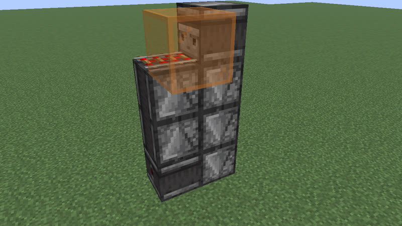 <b>n = 1</b>: 14 gt (0.7 s) · 8 blocks</td></tr></table>

Extend: insert 2 observers: the 2-wide ring one row higher. 
n = 0..47: P = 10 gt (0.5 s) .. 198 gt (9.9 s); judged in the game: n = 0, 1, 2, 23, 47.

### P = 10 + 4n gt

**clk-misc-crafter-ring** ([base design](archive/clk-misc-crafter-ring-n0.txt)) · P = 0.5 s + 0.2 s·n · 6 + 2n blocks · crafter+observer

<table><tr><td align="center" valign="top"> <b>n = 0</b>: 10 gt (0.5 s) · 6 blocks</td><td align="center" valign="top">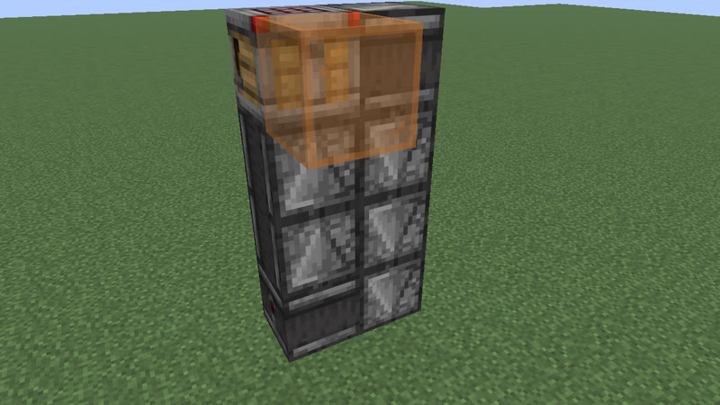 <b>n = 1</b>: 14 gt (0.7 s) · 8 blocks</td></tr></table>

Extend: insert 2 observers: the 2-wide ring one row higher. 
n = 0..47: P = 10 gt (0.5 s) .. 198 gt (9.9 s); judged in the game: n = 0, 1, 2, 23, 47.

### P = 10 + 4n gt

**clk-misc-iron_door-ring** ([base design](archive/clk-misc-iron_door-ring-n0.txt)) · P = 0.5 s + 0.2 s·n · 7 + 2n blocks · iron_door+observer

<table><tr><td align="center" valign="top"> <b>n = 0</b>: 10 gt (0.5 s) · 7 blocks</td><td align="center" valign="top">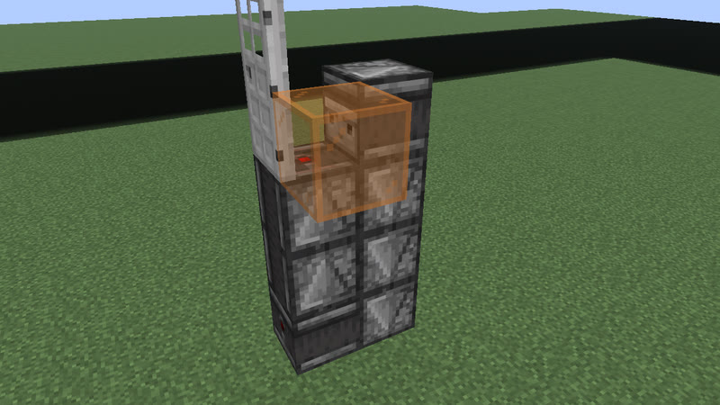 <b>n = 1</b>: 14 gt (0.7 s) · 9 blocks</td></tr></table>

Extend: insert 2 observers: the 2-wide ring one row higher. 
n = 0..47: P = 10 gt (0.5 s) .. 198 gt (9.9 s); judged in the game: n = 0, 1, 2, 23, 47.

### P = 10 + 4n gt

**clk-misc-oak_door-ring** ([base design](archive/clk-misc-oak_door-ring-n0.txt)) · P = 0.5 s + 0.2 s·n · 7 + 2n blocks · oak_door+observer

<table><tr><td align="center" valign="top"> <b>n = 0</b>: 10 gt (0.5 s) · 7 blocks</td><td align="center" valign="top">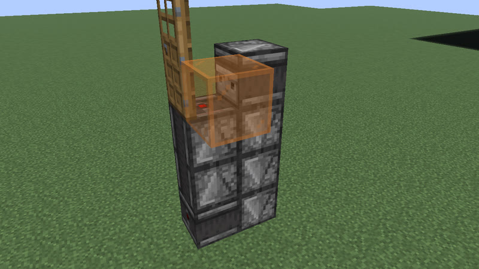 <b>n = 1</b>: 14 gt (0.7 s) · 9 blocks</td></tr></table>

Extend: insert 2 observers: the 2-wide ring one row higher. 
n = 0..47: P = 10 gt (0.5 s) .. 198 gt (9.9 s); judged in the game: n = 0, 1, 2, 23, 47.

### P = 10 + 4n gt

**clk-misc-oak_fence_gate-ring** ([base design](archive/clk-misc-oak_fence_gate-ring-n0.txt)) · P = 0.5 s + 0.2 s·n · 6 + 2n blocks · oak_fence_gate+observer

<table><tr><td align="center" valign="top"> <b>n = 0</b>: 10 gt (0.5 s) · 6 blocks</td><td align="center" valign="top">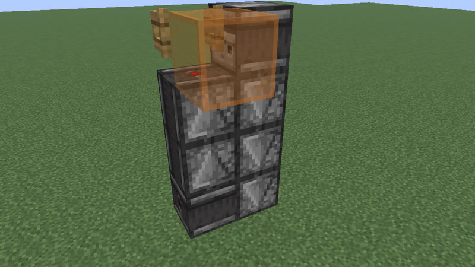 <b>n = 1</b>: 14 gt (0.7 s) · 8 blocks</td></tr></table>

Extend: insert 2 observers: the 2-wide ring one row higher. 
n = 0..47: P = 10 gt (0.5 s) .. 198 gt (9.9 s); judged in the game: n = 0, 1, 2, 23, 47.

### P = 10 + 4n gt

**clk-misc-oak_trapdoor-ring** ([base design](archive/clk-misc-oak_trapdoor-ring-n0.txt)) · P = 0.5 s + 0.2 s·n · 6 + 2n blocks · oak_trapdoor+observer

<table><tr><td align="center" valign="top"> <b>n = 0</b>: 10 gt (0.5 s) · 6 blocks</td><td align="center" valign="top">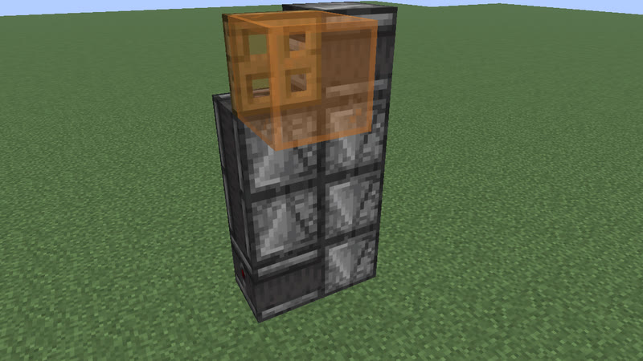 <b>n = 1</b>: 14 gt (0.7 s) · 8 blocks</td></tr></table>

Extend: insert 2 observers: the 2-wide ring one row higher. 
n = 0..47: P = 10 gt (0.5 s) .. 198 gt (9.9 s); judged in the game: n = 0, 1, 2, 23, 47.

### P = 10 + 4n gt

**clk-misc-powered_rail-ring** ([base design](archive/clk-misc-powered_rail-ring-n0.txt)) · P = 0.5 s + 0.2 s·n · 6 + 2n blocks · observer+powered_rail

<table><tr><td align="center" valign="top"> <b>n = 0</b>: 10 gt (0.5 s) · 6 blocks</td><td align="center" valign="top"> <b>n = 1</b>: 14 gt (0.7 s) · 8 blocks</td></tr></table>

Extend: insert 2 observers: the 2-wide ring one row higher. 
n = 0..47: P = 10 gt (0.5 s) .. 198 gt (9.9 s); judged in the game: n = 0, 1, 2, 23, 47.

### P = 10 + 4n gt

**clk-misc-skeleton_skull-ring** ([base design](archive/clk-misc-skeleton_skull-ring-n0.txt)) · P = 0.5 s + 0.2 s·n · 6 + 2n blocks · observer+skeleton_skull

<table><tr><td align="center" valign="top"> <b>n = 0</b>: 10 gt (0.5 s) · 6 blocks</td><td align="center" valign="top">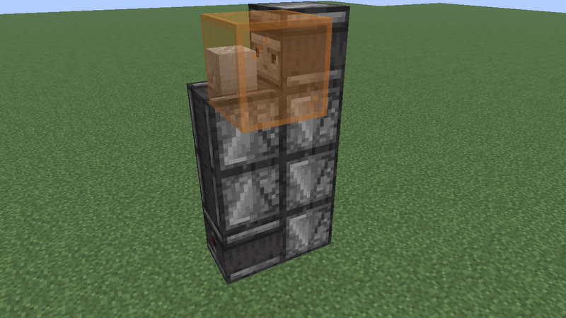 <b>n = 1</b>: 14 gt (0.7 s) · 8 blocks</td></tr></table>

Extend: insert 2 observers: the 2-wide ring one row higher. 
n = 0..47: P = 10 gt (0.5 s) .. 198 gt (9.9 s); judged in the game: n = 0, 1, 2, 23, 47.

### P = 10 + 4n gt

**clk-obs-note-ring** ([base design](archive/clk-obs-note-ring.txt)) · P = 0.5 s + 0.2 s·n · 6 + 2n blocks · note_block+observer

<table><tr><td align="center" valign="top"> <b>n = 0</b>: 10 gt (0.5 s) · 6 blocks</td><td align="center" valign="top"> <b>n = 1</b>: 14 gt (0.7 s) · 8 blocks</td></tr></table>

Extend: insert 2 observers: one more column in the 2-wide ring. 
n = 0..47: P = 10 gt (0.5 s) .. 198 gt (9.9 s); judged in the game: n = 0, 1, 2, 23, 47.

### P = 10 + 4n gt

**clk-obs-trap-ring** ([base design](archive/clk-obs-trap-ring.txt)) · P = 0.5 s + 0.2 s·n · 6 + 2n blocks · iron_trapdoor+observer

<table><tr><td align="center" valign="top"> <b>n = 0</b>: 10 gt (0.5 s) · 6 blocks</td><td align="center" valign="top">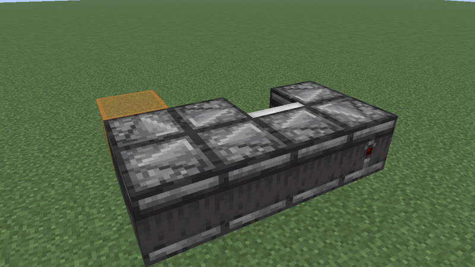 <b>n = 1</b>: 14 gt (0.7 s) · 8 blocks</td></tr></table>

Extend: insert 2 observers: one more column in the 2-wide ring. 
n = 0..47: P = 10 gt (0.5 s) .. 198 gt (9.9 s); judged in the game: n = 0, 1, 2, 23, 47.

### P = 11 + 2n gt

**clk-item-lockpair** ([base design](archive/clk-item-lockpair.txt)) · P = 0.55 s + 0.1 s·n · 9 blocks · comparator+hopper+redstone_wire+repeater

<table><tr><td align="center" valign="top"> <b>n = 0</b>: 11 gt (0.55 s) · 9 blocks</td><td align="center" valign="top"> <b>n = 1</b>: 13 gt (0.65 s) · 9 blocks</td></tr></table>

Extend: one more tick of delay on the lock repeater (same blocks). 
n = 0..2: P = 11 gt (0.55 s) .. 15 gt (0.75 s); judged in the game: n = 0, 1, 2.

### P = 11 + 4n gt

**clk-obs-odd-a** ([base design](archive/clk-obs-odd-a.txt)) · P = 0.55 s + 0.2 s·n · 8 + 2n blocks · observer+piston+redstone_block+sticky_piston

<table><tr><td align="center" valign="top"> <b>n = 0</b>: 11 gt (0.55 s) · 8 blocks</td><td align="center" valign="top"> <b>n = 1</b>: 15 gt (0.75 s) · 10 blocks</td></tr></table>

Extend: raise the observer tower by one: one more observer in each column. 
n = 0..47: P = 11 gt (0.55 s) .. 199 gt (9.95 s); judged in the game: n = 0, 1, 2, 23, 47.

### P = 12 · 2^n gt

**clk-obs-divider** ([base design](archive/clk-obs-divider.txt)) · P = 0.6 s · 2^n · 3 + 3n blocks · copper_bulb+observer

<table><tr><td align="center" valign="top"> <b>n = 0</b>: 12 gt (0.6 s) · 3 blocks</td><td align="center" valign="top"> <b>n = 1</b>: 24 gt (1.2 s) · 6 blocks</td></tr></table>

Extend: add a stage behind the last bulb: a comparator (facing the clock, reading the bulb, on a stone floor) and a bulb. 
n = 0..8: P = 12 gt (0.6 s) .. 3072 gt (2 min 33.6 s); judged in the game: n = 0, 1, 2, 4, 8.

### P = 13 + 4n gt

**clk-obs-odd-b** ([base design](archive/clk-obs-odd-b.txt)) · P = 0.65 s + 0.2 s·n · 10 + 2n blocks · observer+piston+redstone_block+sticky_piston

<table><tr><td align="center" valign="top"> <b>n = 0</b>: 13 gt (0.65 s) · 10 blocks</td><td align="center" valign="top"> <b>n = 1</b>: 17 gt (0.85 s) · 12 blocks</td></tr></table>

Extend: raise the observer tower by one: one more observer in each column. 
n = 0..46: P = 13 gt (0.65 s) .. 197 gt (9.85 s); judged in the game: n = 0, 1, 2, 23, 46.

### P = 14 + 14n gt

**clk-item-hopper-ring** ([base design](archive/clk-item-hopper-ring.txt)) · P = 0.7 s + 0.7 s·n · 4 + 2n blocks · comparator+hopper

<table><tr><td align="center" valign="top"> <b>n = 0</b>: 14 gt (0.7 s) · 4 blocks</td><td align="center" valign="top"> <b>n = 1</b>: 28 gt (1.4 s) · 6 blocks</td></tr></table>

Extend: lengthen the 2-wide hopper ring by one column (2 hoppers). 
n = 0..40: P = 14 gt (0.7 s) .. 574 gt (28.7 s); judged in the game: n = 0, 1, 2, 20, 40.

### P = 7 + 7n gt

**clk-item-hopper-ring-2** ([base design](archive/clk-item-hopper-ring-2.txt)) · P = 0.35 s + 0.35 s·n · 4 + 2n blocks · comparator+hopper

<table><tr><td align="center" valign="top"> <b>n = 1</b>: 14 gt (0.7 s) · 6 blocks</td><td align="center" valign="top">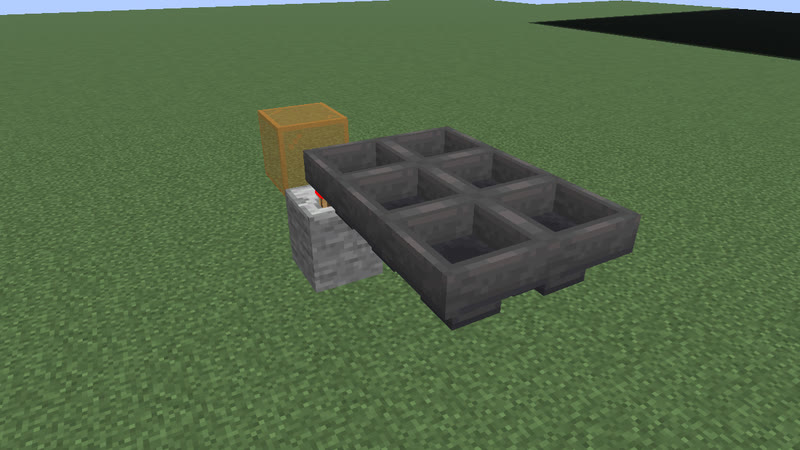 <b>n = 2</b>: 21 gt (1.05 s) · 8 blocks</td></tr></table>

Extend: lengthen the 2-wide hopper ring by one column (2 hoppers); the two items stay half a ring apart. 
n = 1..40: P = 14 gt (0.7 s) .. 287 gt (14.35 s); judged in the game: n = 1, 2, 3, 20, 40.

### P = 16 + 4n gt

**clk-item-snowdisp** ([base design](archive/clk-item-snowdisp.txt)) · P = 0.8 s + 0.2 s·n · 5 blocks · dispenser+observer+redstone_wire+repeater

<table><tr><td align="center" valign="top"> <b>n = 0</b>: 16 gt (0.8 s) · 5 blocks</td><td align="center" valign="top"> <b>n = 1</b>: 20 gt (1 s) · 5 blocks</td></tr></table>

Extend: one more tick of delay on the repeater (same blocks). 
n = 0..2: P = 16 gt (0.8 s) .. 24 gt (1.2 s); judged in the game: n = 0, 1, 2.

### P = 20 + 8n gt

**clk-obs-bulb-ring** ([base design](archive/clk-obs-bulb-ring.txt)) · P = 1 s + 0.4 s·n · 6 + 2n blocks · copper_bulb+observer

<table><tr><td align="center" valign="top"> <b>n = 0</b>: 20 gt (1 s) · 6 blocks</td><td align="center" valign="top"> <b>n = 1</b>: 28 gt (1.4 s) · 8 blocks</td></tr></table>

Extend: insert 2 observers: one more column in the 2-wide ring. 
n = 0..22: P = 20 gt (1 s) .. 196 gt (9.8 s); judged in the game: n = 0, 1, 2, 11, 22.

### P = 20 + 16n gt

**clk-rt-uloop2t** ([base design](archive/clk-rt-uloop2t.txt)) · P = 1 s + 0.8 s·n · 8 + 4n blocks · redstone_torch+repeater

<table><tr><td align="center" valign="top"> <b>n = 0</b>: 20 gt (1 s) · 8 blocks</td><td align="center" valign="top"> <b>n = 1</b>: 36 gt (1.8 s) · 12 blocks</td></tr></table>

Extend: add one delay-4 repeater (powered at placement) to each row of the 2-torch U-ring (wall torch on block A -> top row -> block F -> wall torch on F -> bottom row -> A). 
n = 0..10: P = 20 gt (1 s) .. 180 gt (9 s); judged in the game: n = 0, 1, 2, 3, 4, 5, 6, 7, 8, 9, 10.

### P = 23 + 8n gt

**clk-rt-odd-rect** ([base design](archive/clk-rt-odd-rect.txt)) · P = 1.15 s + 0.4 s·n · 16 + 4n blocks · repeater

<table><tr><td align="center" valign="top"> <b>n = 0</b>: 23 gt (1.15 s) · 16 blocks</td><td align="center" valign="top"> <b>n = 1</b>: 31 gt (1.55 s) · 20 blocks</td></tr></table>

Extend: lengthen the 3 x (4+n) ring (delay-4 repeaters, one delay-3, corner blocks) by one row: one more repeater on each long side; two pulses 23 + 8n gt apart, the second started by a temporary torch at an odd tick. 
n = 0..9: P = 23 gt (1.15 s) .. 95 gt (4.75 s); judged in the game: n = 0, 1, 2, 3, 4, 5, 6, 7, 8, 9.

### P = 27 + 14n gt

**clk-item-dropring-1d** ([base design](archive/clk-item-dropring-1d.txt)) · P = 1.35 s + 0.7 s·n · 10 + 2n blocks · comparator+dropper+hopper

<table><tr><td align="center" valign="top"> <b>n = 0</b>: 27 gt (1.35 s) · 10 blocks</td><td align="center" valign="top"> <b>n = 1</b>: 41 gt (2.05 s) · 12 blocks</td></tr></table>

Extend: widen the dropper ring by one column (2 hoppers). 
n = 0..30: P = 27 gt (1.35 s) .. 447 gt (22.35 s); judged in the game: n = 0, 1, 2, 15, 30.

### P = 30 + 16n gt

**clk-item-latch** ([base design](archive/clk-item-latch.txt)) · P = 1.5 s + 0.8 s·n · 17 blocks · comparator+copper_bulb+hopper+redstone_torch+redstone_wire

<table><tr><td align="center" valign="top"> <b>n = 0</b>: 30 gt (1.5 s) · 17 blocks</td><td align="center" valign="top"> <b>n = 1</b>: 46 gt (2.3 s) · 17 blocks</td></tr></table>

Extend: one more stone in hopper A (same blocks; up to 5 stacks of 64). 
n = 0..318: P = 30 gt (1.5 s) .. 5118 gt (4 min 15.9 s); judged in the game: n = 0, 1, 2, 159, 318.

### P = 31 + 14n gt

**clk-item-dropring-2d-r2** ([base design](archive/clk-item-dropring-2d-r2.txt)) · P = 1.55 s + 0.7 s·n · 14 + 2n blocks · comparator+dropper+hopper+repeater

<table><tr><td align="center" valign="top"> <b>n = 0</b>: 31 gt (1.55 s) · 14 blocks</td><td align="center" valign="top">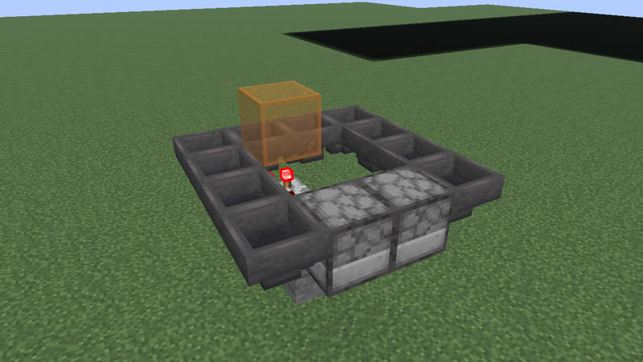 <b>n = 1</b>: 45 gt (2.25 s) · 16 blocks</td></tr></table>

Extend: widen the dropper ring by one column (2 hoppers). 
n = 0..30: P = 31 gt (1.55 s) .. 451 gt (22.55 s); judged in the game: n = 0, 1, 2, 15, 30.

### P = 4 + 9n gt

**clk-sculk-replin** ([base design](archive/clk-sculk-replin.txt)) · P = 0.2 s + 0.45 s·n · 3 + 2n blocks · calibrated_sculk_sensor+note_block+observer+repeater

<table><tr><td align="center" valign="top"> <b>n = 3</b>: 31 gt (1.55 s) · 9 blocks</td><td align="center" valign="top"> <b>n = 4</b>: 40 gt (2 s) · 11 blocks</td></tr></table>

Extend: one more delay-4 repeater on a stone at the end of the line (the observer and note block move one block out): +8 gt of delay and +1 gt of travel. 
n = 3..14: P = 31 gt (1.55 s) .. 130 gt (6.5 s); judged in the game: n = 3, 4, 5, 8, 14.

### P = 32 + 16n gt

**clk-rt-rect-pulse** ([base design](archive/clk-rt-rect-pulse.txt)) · P = 1.6 s + 0.8 s·n · 12 + 4n blocks · repeater

<table><tr><td align="center" valign="top"> <b>n = 0</b>: 32 gt (1.6 s) · 12 blocks</td><td align="center" valign="top"> <b>n = 1</b>: 48 gt (2.4 s) · 16 blocks</td></tr></table>

Extend: lengthen the 3 x (3+n) ring of delay-4 repeaters with corner blocks by one row: one more repeater on each long side (one pulse loaded at placement). 
n = 0..10: P = 32 gt (1.6 s) .. 192 gt (9.6 s); judged in the game: n = 0, 1, 2, 3, 4, 5, 6, 7, 8, 9, 10.

### P = 33 + 14n gt

**clk-item-dropring-2d-r3** ([base design](archive/clk-item-dropring-2d-r3.txt)) · P = 1.65 s + 0.7 s·n · 14 + 2n blocks · comparator+dropper+hopper+repeater

<table><tr><td align="center" valign="top"> <b>n = 0</b>: 33 gt (1.65 s) · 14 blocks</td><td align="center" valign="top"> <b>n = 1</b>: 47 gt (2.35 s) · 16 blocks</td></tr></table>

Extend: widen the dropper ring by one column (2 hoppers). 
n = 0..30: P = 33 gt (1.65 s) .. 453 gt (22.65 s); judged in the game: n = 0, 1, 2, 15, 30.

### P = 33 + 2n gt

**clk-item-lockring-2s** ([base design](archive/clk-item-lockring-2s.txt)) · P = 1.65 s + 0.1 s·n · 11 blocks · comparator+hopper+redstone_wire+repeater

<table><tr><td align="center" valign="top"> <b>n = 0</b>: 33 gt (1.65 s) · 11 blocks</td><td align="center" valign="top"> <b>n = 1</b>: 35 gt (1.75 s) · 11 blocks</td></tr></table>

Extend: one more tick of delay on the lock repeater (same blocks). 
n = 0..3: P = 33 gt (1.65 s) .. 39 gt (1.95 s); judged in the game: n = 0, 1, 2, 3.

### P = 34 + 14n gt

**clk-item-dropring-2d** ([base design](archive/clk-item-dropring-2d.txt)) · P = 1.7 s + 0.7 s·n · 12 + 2n blocks · comparator+dropper+hopper

<table><tr><td align="center" valign="top"> <b>n = 0</b>: 34 gt (1.7 s) · 12 blocks</td><td align="center" valign="top">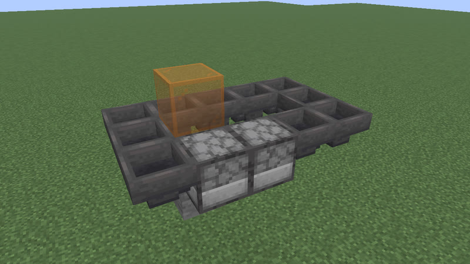 <b>n = 1</b>: 48 gt (2.4 s) · 14 blocks</td></tr></table>

Extend: widen the dropper ring by one column (2 hoppers). 
n = 0..30: P = 34 gt (1.7 s) .. 454 gt (22.7 s); judged in the game: n = 0, 1, 2, 15, 30.

### P = 35 + 14n gt

**clk-item-dropring-2d-r4** ([base design](archive/clk-item-dropring-2d-r4.txt)) · P = 1.75 s + 0.7 s·n · 14 + 2n blocks · comparator+dropper+hopper+repeater

<table><tr><td align="center" valign="top"> <b>n = 0</b>: 35 gt (1.75 s) · 14 blocks</td><td align="center" valign="top">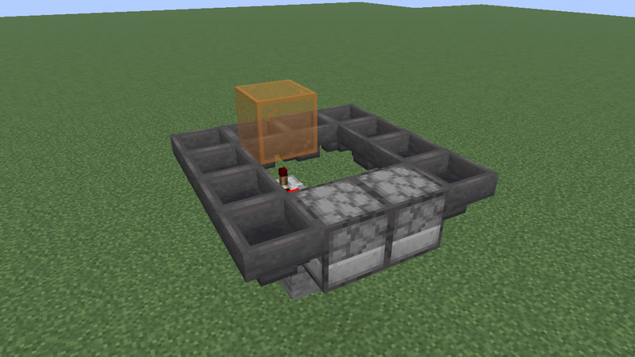 <b>n = 1</b>: 49 gt (2.45 s) · 16 blocks</td></tr></table>

Extend: widen the dropper ring by one column (2 hoppers). 
n = 0..30: P = 35 gt (1.75 s) .. 455 gt (22.75 s); judged in the game: n = 0, 1, 2, 15, 30.

### P = 3 + 16n gt

**clk-sculk-hairpin** ([base design](archive/clk-sculk-hairpin.txt)) · P = 0.15 s + 0.8 s·n · 7 + 4n blocks · calibrated_sculk_sensor+note_block+observer+redstone_wire+repeater

<table><tr><td align="center" valign="top"> <b>n = 2</b>: 35 gt (1.75 s) · 15 blocks</td><td align="center" valign="top"> <b>n = 3</b>: 51 gt (2.55 s) · 19 blocks</td></tr></table>

Extend: one more delay-4 repeater on a stone in each arm of the hairpin (the dust U-turn moves one block out). 
n = 2..12: P = 35 gt (1.75 s) .. 195 gt (9.75 s); judged in the game: n = 2, 3, 4, 7, 12.

### P = 36 + 14n gt

**clk-item-dropring-1d-r1** ([base design](archive/clk-item-dropring-1d-r1.txt)) · P = 1.8 s + 0.7 s·n · 14 + 2n blocks · comparator+dropper+hopper+repeater

<table><tr><td align="center" valign="top"> <b>n = 0</b>: 36 gt (1.8 s) · 14 blocks</td><td align="center" valign="top"> <b>n = 1</b>: 50 gt (2.5 s) · 16 blocks</td></tr></table>

Extend: widen the dropper ring by one column (2 hoppers). 
n = 0..30: P = 36 gt (1.8 s) .. 456 gt (22.8 s); judged in the game: n = 0, 1, 2, 15, 30.

### P = 36 + 32n gt

**clk-rt-uloop1t** ([base design](archive/clk-rt-uloop1t.txt)) · P = 1.8 s + 1.6 s·n · 9 + 4n blocks · redstone_torch+redstone_wire+repeater

<table><tr><td align="center" valign="top"> <b>n = 0</b>: 36 gt (1.8 s) · 9 blocks</td><td align="center" valign="top"> <b>n = 1</b>: 68 gt (3.4 s) · 13 blocks</td></tr></table>

Extend: add one delay-4 repeater (powered at placement) to each row of the 1-torch inverter U-loop (block A + a dust corner -> top row -> block F -> wall torch on F -> bottom row -> A). 
n = 0..8: P = 36 gt (1.8 s) .. 292 gt (14.6 s); judged in the game: n = 0, 1, 2, 3, 4, 5, 6, 7, 8.

### P = 38 + 14n gt

**clk-item-dropring-1d-r2** ([base design](archive/clk-item-dropring-1d-r2.txt)) · P = 1.9 s + 0.7 s·n · 14 + 2n blocks · comparator+dropper+hopper+repeater

<table><tr><td align="center" valign="top"> <b>n = 0</b>: 38 gt (1.9 s) · 14 blocks</td><td align="center" valign="top">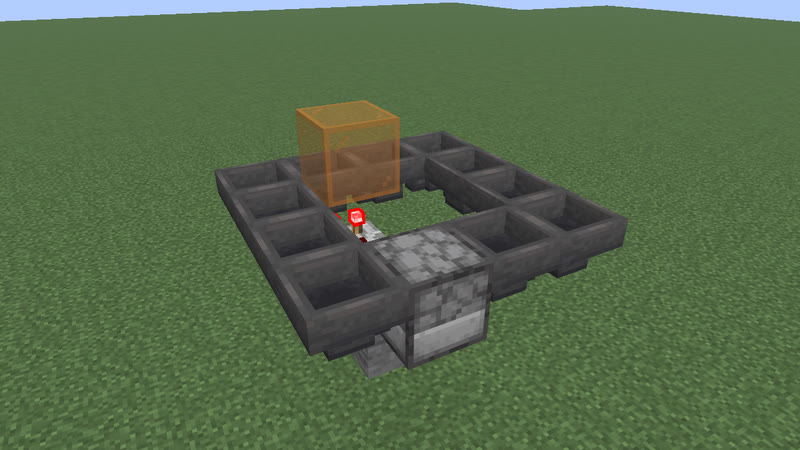 <b>n = 1</b>: 52 gt (2.6 s) · 16 blocks</td></tr></table>

Extend: widen the dropper ring by one column (2 hoppers). 
n = 0..30: P = 38 gt (1.9 s) .. 458 gt (22.9 s); judged in the game: n = 0, 1, 2, 15, 30.

### P = 38 + 5n gt

**clk-misc-cart-pingpong** ([base design](archive/clk-misc-cart-pingpong-n0.txt)) · P = 1.9 s + 0.25 s·n · 15 + 2n blocks · detector_rail+minecart

<table><tr><td align="center" valign="top"> <b>n = 0</b>: 38 gt (1.9 s) · 15 blocks</td><td align="center" valign="top"> <b>n = 1</b>: 43 gt (2.15 s) · 17 blocks</td></tr></table>

Extend: one more powered rail (on a redstone block) in the middle of the track. 
n = 0..20: P = 38 gt (1.9 s) .. 138 gt (6.9 s); judged in the game: n = 0, 1, 2, 10, 20.

### P = 40 + 14n gt

**clk-item-dropring-1d-r3** ([base design](archive/clk-item-dropring-1d-r3.txt)) · P = 2 s + 0.7 s·n · 14 + 2n blocks · comparator+dropper+hopper+repeater

<table><tr><td align="center" valign="top"> <b>n = 0</b>: 40 gt (2 s) · 14 blocks</td><td align="center" valign="top"> <b>n = 1</b>: 54 gt (2.7 s) · 16 blocks</td></tr></table>

Extend: widen the dropper ring by one column (2 hoppers). 
n = 0..30: P = 40 gt (2 s) .. 460 gt (23 s); judged in the game: n = 0, 1, 2, 15, 30.

### P = 41 + 2n gt

**clk-item-lockring-3s** ([base design](archive/clk-item-lockring-3s.txt)) · P = 2.05 s + 0.1 s·n · 11 blocks · comparator+hopper+redstone_wire+repeater

<table><tr><td align="center" valign="top"> <b>n = 0</b>: 41 gt (2.05 s) · 11 blocks</td><td align="center" valign="top"> <b>n = 1</b>: 43 gt (2.15 s) · 11 blocks</td></tr></table>

Extend: one more tick of delay on the lock repeater (same blocks). 
n = 0..3: P = 41 gt (2.05 s) .. 47 gt (2.35 s); judged in the game: n = 0, 1, 2, 3.

### P = 42 + 14n gt

**clk-item-dropring-1d-r4** ([base design](archive/clk-item-dropring-1d-r4.txt)) · P = 2.1 s + 0.7 s·n · 14 + 2n blocks · comparator+dropper+hopper+repeater

<table><tr><td align="center" valign="top"> <b>n = 0</b>: 42 gt (2.1 s) · 14 blocks</td><td align="center" valign="top">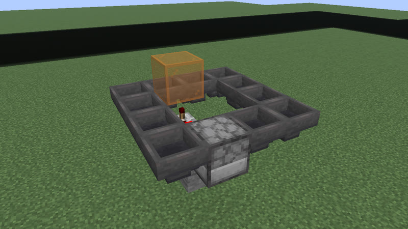 <b>n = 1</b>: 56 gt (2.8 s) · 16 blocks</td></tr></table>

Extend: widen the dropper ring by one column (2 hoppers). 
n = 0..30: P = 42 gt (2.1 s) .. 462 gt (23.1 s); judged in the game: n = 0, 1, 2, 15, 30.

### P = 43 + 14n gt

**clk-item-dropring-2d-r1** ([base design](archive/clk-item-dropring-2d-r1.txt)) · P = 2.15 s + 0.7 s·n · 16 + 2n blocks · comparator+dropper+hopper+repeater

<table><tr><td align="center" valign="top"> <b>n = 0</b>: 43 gt (2.15 s) · 16 blocks</td><td align="center" valign="top">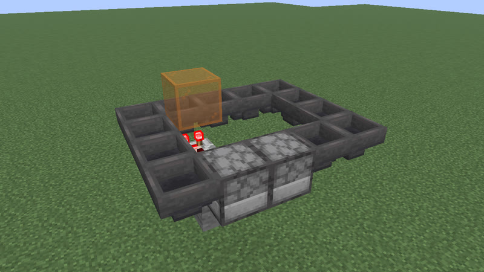 <b>n = 1</b>: 57 gt (2.85 s) · 18 blocks</td></tr></table>

Extend: widen the dropper ring by one column (2 hoppers). 
n = 0..30: P = 43 gt (2.15 s) .. 463 gt (23.15 s); judged in the game: n = 0, 1, 2, 15, 30.

### P = 44 + 14n gt

**clk-item-dropring-2d-r14** ([base design](archive/clk-item-dropring-2d-r14.txt)) · P = 2.2 s + 0.7 s·n · 18 + 2n blocks · comparator+dropper+hopper+repeater

<table><tr><td align="center" valign="top"> <b>n = 0</b>: 44 gt (2.2 s) · 18 blocks</td><td align="center" valign="top">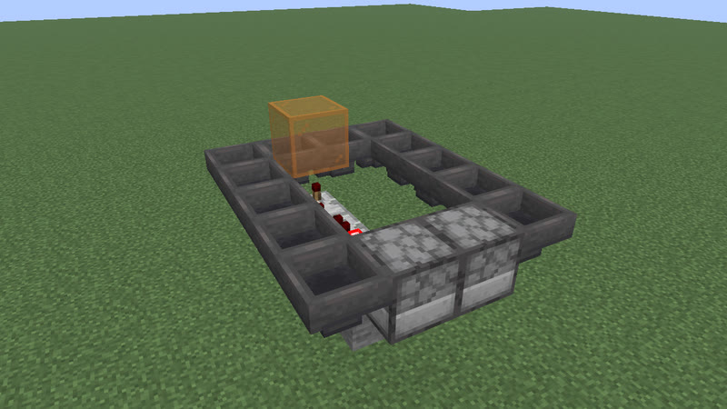 <b>n = 1</b>: 58 gt (2.9 s) · 20 blocks</td></tr></table>

Extend: widen the dropper ring by one column (2 hoppers). 
n = 0..30: P = 44 gt (2.2 s) .. 464 gt (23.2 s); judged in the game: n = 0, 1, 2, 15, 30.

### P = 46 + 14n gt

**clk-item-dropring-2d-r24** ([base design](archive/clk-item-dropring-2d-r24.txt)) · P = 2.3 s + 0.7 s·n · 18 + 2n blocks · comparator+dropper+hopper+repeater

<table><tr><td align="center" valign="top"> <b>n = 0</b>: 46 gt (2.3 s) · 18 blocks</td><td align="center" valign="top"> <b>n = 1</b>: 60 gt (3 s) · 20 blocks</td></tr></table>

Extend: widen the dropper ring by one column (2 hoppers). 
n = 0..30: P = 46 gt (2.3 s) .. 466 gt (23.3 s); judged in the game: n = 0, 1, 2, 15, 30.

### P = 51 + 14n gt

**clk-item-dropring-1d-r14** ([base design](archive/clk-item-dropring-1d-r14.txt)) · P = 2.55 s + 0.7 s·n · 18 + 2n blocks · comparator+dropper+hopper+repeater

<table><tr><td align="center" valign="top"> <b>n = 0</b>: 51 gt (2.55 s) · 18 blocks</td><td align="center" valign="top">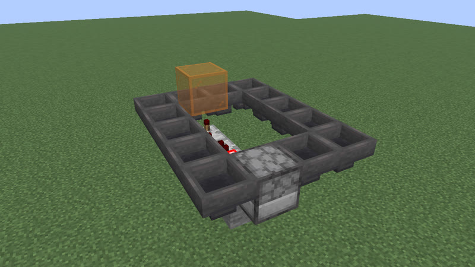 <b>n = 1</b>: 65 gt (3.25 s) · 20 blocks</td></tr></table>

Extend: widen the dropper ring by one column (2 hoppers). 
n = 0..30: P = 51 gt (2.55 s) .. 471 gt (23.55 s); judged in the game: n = 0, 1, 2, 15, 30.

### P = 3 + 16n gt

**clk-sculk-hairpin-plain** ([base design](archive/clk-sculk-hairpin-plain.txt)) · P = 0.15 s + 0.8 s·n · 7 + 4n blocks · note_block+observer+redstone_wire+repeater+sculk_sensor

<table><tr><td align="center" valign="top"> <b>n = 3</b>: 51 gt (2.55 s) · 19 blocks</td><td align="center" valign="top">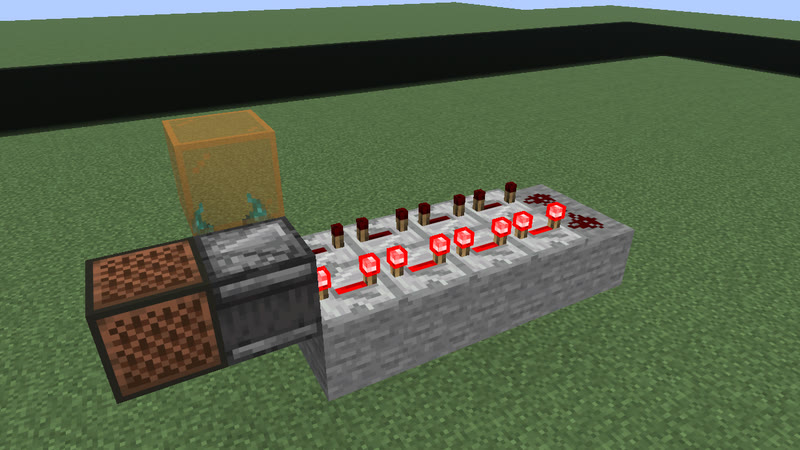 <b>n = 4</b>: 67 gt (3.35 s) · 23 blocks</td></tr></table>

Extend: one more delay-4 repeater on a stone in each arm of the hairpin (the dust U-turn moves one block out). 
n = 3..12: P = 51 gt (2.55 s) .. 195 gt (9.75 s); judged in the game: n = 3, 4, 5, 7, 12.

### P = 52 + 32n gt

**clk-rt-rect-inv** ([base design](archive/clk-rt-rect-inv.txt)) · P = 2.6 s + 1.6 s·n · 12 + 4n blocks · redstone_torch+redstone_wire+repeater

<table><tr><td align="center" valign="top"> <b>n = 0</b>: 52 gt (2.6 s) · 12 blocks</td><td align="center" valign="top"> <b>n = 1</b>: 84 gt (4.2 s) · 16 blocks</td></tr></table>

Extend: lengthen the 3 x (3+n) inverter ring (delay-4 repeaters, corner blocks, a wall torch on one corner block, the next corner dust) by one row: one more repeater on each long side. 
n = 0..8: P = 52 gt (2.6 s) .. 308 gt (15.4 s); judged in the game: n = 0, 1, 2, 3, 4, 5, 6, 7, 8.

### P = 53 + 14n gt

**clk-item-dropring-1d-r24** ([base design](archive/clk-item-dropring-1d-r24.txt)) · P = 2.65 s + 0.7 s·n · 18 + 2n blocks · comparator+dropper+hopper+repeater

<table><tr><td align="center" valign="top"> <b>n = 0</b>: 53 gt (2.65 s) · 18 blocks</td><td align="center" valign="top">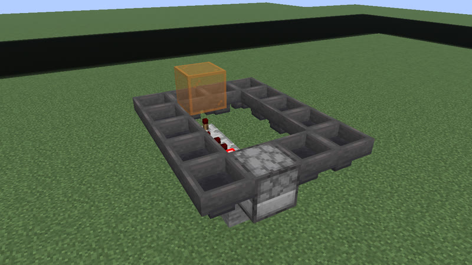 <b>n = 1</b>: 67 gt (3.35 s) · 20 blocks</td></tr></table>

Extend: widen the dropper ring by one column (2 hoppers). 
n = 0..30: P = 53 gt (2.65 s) .. 473 gt (23.65 s); judged in the game: n = 0, 1, 2, 15, 30.

### P = 28 + 32n gt

**clk-sculk-racetrack** ([base design](archive/clk-sculk-racetrack.txt)) · P = 1.4 s + 1.6 s·n · 4 + 4n blocks · calibrated_sculk_sensor+note_block

<table><tr><td align="center" valign="top"> <b>n = 1</b>: 60 gt (3 s) · 8 blocks</td><td align="center" valign="top"> <b>n = 2</b>: 92 gt (4.6 s) · 12 blocks</td></tr></table>

Extend: one more calibrated sensor + amethyst block on each straight side, 17 blocks apart (the far turn sensor moves 17 out). 
n = 1..8: P = 60 gt (3 s) .. 284 gt (14.2 s); judged in the game: n = 1, 2, 3, 4, 8.

### P = 12 + 16n gt

**clk-sculk-racetrack-plain** ([base design](archive/clk-sculk-racetrack-plain.txt)) · P = 0.6 s + 0.8 s·n · 4 + 4n blocks · note_block+sculk_sensor

<table><tr><td align="center" valign="top"> <b>n = 3</b>: 60 gt (3 s) · 16 blocks</td><td align="center" valign="top"> <b>n = 4</b>: 76 gt (3.8 s) · 20 blocks</td></tr></table>

Extend: one more plain sensor + amethyst block on each straight side, 9 blocks apart (the far turn sensor moves 9 out). 
n = 3..10: P = 60 gt (3 s) .. 172 gt (8.6 s); judged in the game: n = 3, 4, 5, 6, 10.

### P = 36 · 2^n gt

**clk-rt-div** ([base design](archive/clk-rt-div.txt)) · P = 1.8 s · 2^n · 9 + 18n blocks · redstone_torch+redstone_wire+repeater

<table><tr><td align="center" valign="top"> <b>n = 1</b>: 72 gt (3.6 s) · 27 blocks</td><td align="center" valign="top"> <b>n = 2</b>: 144 gt (7.2 s) · 45 blocks</td></tr></table>

Extend: append one master-slave T flip-flop stage (18 blocks: 2 latch repeaters, 2 lock repeaters, a target block with a wall torch, dust) to the chain on the P36 torch + repeater loop: the period doubles. 
n = 1..7: P = 72 gt (3.6 s) .. 4608 gt (3 min 50.4 s); judged in the game: n = 1, 2, 3, 4, 5, 6, 7.

### P = 76 + 14n gt

**clk-item-ringlock-rows** ([base design](archive/clk-item-ringlock-rows.txt)) · P = 3.8 s + 0.7 s·n · 12 + 2n blocks · comparator+hopper

<table><tr><td align="center" valign="top"> <b>n = 0</b>: 76 gt (3.8 s) · 12 blocks</td><td align="center" valign="top"> <b>n = 1</b>: 90 gt (4.5 s) · 14 blocks</td></tr></table>

Extend: lengthen the 3-wide ring by one row (2 hoppers), still 5 stones. 
n = 0..30: P = 76 gt (3.8 s) .. 496 gt (24.8 s); judged in the game: n = 0, 1, 2, 15, 30.

### P = 91 + 28n gt

**clk-misc-crafter-loop** ([base design](archive/clk-misc-crafter-loop-n0.txt)) · P = 4.55 s + 1.4 s·n · 7 + 2n blocks · comparator+crafter+hopper+observer

<table><tr><td align="center" valign="top"> <b>n = 0</b>: 91 gt (4.55 s) · 7 blocks</td><td align="center" valign="top"> <b>n = 1</b>: 119 gt (5.95 s) · 9 blocks</td></tr></table>

Extend: add 2 hoppers: the hopper loop one column longer. 
n = 0..20: P = 91 gt (4.55 s) .. 651 gt (32.55 s); judged in the game: n = 0, 1, 2, 10, 20.

### P = 104 + 8n gt

**clk-item-ringlock-stones-3x6** ([base design](archive/clk-item-ringlock-stones-3x6.txt)) · P = 5.2 s + 0.4 s·n · 16 blocks · comparator+hopper

<table><tr><td align="center" valign="top"> <b>n = 0</b>: 104 gt (5.2 s) · 16 blocks</td><td align="center" valign="top">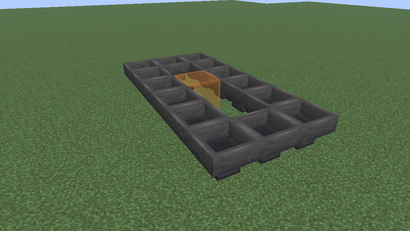 <b>n = 1</b>: 112 gt (5.6 s) · 16 blocks</td></tr></table>

Extend: one more stone in the corner hopper (same blocks). 
n = 0..4: P = 104 gt (5.2 s) .. 136 gt (6.8 s); judged in the game: n = 0, 1, 2, 4.

### P = 114 + 56n gt

**clk-rt-fade** ([base design](archive/clk-rt-fade.txt)) · P = 5.7 s + 2.8 s·n · 18 + 4n blocks · comparator+redstone_torch+redstone_wire

<table><tr><td align="center" valign="top"> <b>n = 0</b>: 114 gt (5.7 s) · 18 blocks</td><td align="center" valign="top"> <b>n = 1</b>: 170 gt (8.5 s) · 22 blocks</td></tr></table>

Extend: add one compare-mode comparator to each row of the comparator fading ring (2 + 2 comparators at n = 0, a lossy two-dust turn, a refill torch). 
n = 0..10: P = 114 gt (5.7 s) .. 674 gt (33.7 s); judged in the game: n = 0, 1, 2, 3, 4, 5, 6, 7, 8, 9, 10.

### P = 114 · 2^n gt

**clk-rt-div-fade** ([base design](archive/clk-rt-div-fade.txt)) · P = 5.7 s · 2^n · 18 + 18n blocks · comparator+redstone_torch+redstone_wire+repeater

<table><tr><td align="center" valign="top"> <b>n = 1</b>: 228 gt (11.4 s) · 36 blocks</td><td align="center" valign="top"> <b>n = 2</b>: 456 gt (22.8 s) · 54 blocks</td></tr></table>

Extend: append one master-slave T flip-flop stage (18 blocks) to the chain on the P114 comparator fading ring: the period doubles. 
n = 1..5: P = 228 gt (11.4 s) .. 3648 gt (3 min 2.4 s); judged in the game: n = 1, 2, 3, 4, 5.

### P = 300 + 8n gt

**clk-item-ringlock-stones-3x20** ([base design](archive/clk-item-ringlock-stones-3x20.txt)) · P = 15 s + 0.4 s·n · 44 blocks · comparator+hopper

<table><tr><td align="center" valign="top"> <b>n = 0</b>: 300 gt (15 s) · 44 blocks</td><td align="center" valign="top">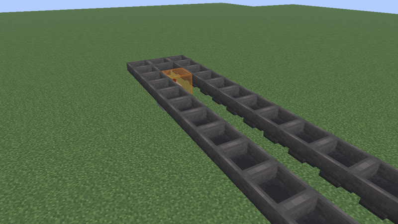 <b>n = 1</b>: 308 gt (15.4 s) · 44 blocks</td></tr></table>

Extend: one more stone in the corner hopper (same blocks). 
n = 0..28: P = 300 gt (15 s) .. 524 gt (26.2 s); judged in the game: n = 0, 1, 2, 14, 28.

### P = 114 · 14^n gt

**clk-rt-counter** ([base design](archive/clk-rt-counter.txt)) · P = 5.7 s · 14^n · 18 + 26n blocks · comparator+redstone_torch+redstone_wire

<table><tr><td align="center" valign="top"> <b>n = 1</b>: 1596 gt (1 min 19.8 s) · 44 blocks</td><td align="center" valign="top"> <b>n = 2</b>: 22344 gt (18 min 37.2 s) · 70 blocks</td></tr></table>

Extend: wrap one more counter level around the clock (a lossless 2 + 2 comparator ring with one subtract comparator, its pulse shaper and refill torch: 26 blocks): the period x 14. 
n = 1..3: P = 1596 gt (1 min 19.8 s) .. 312816 gt (4 h 20 min 40.8 s); judged in the game: n = 1, 2, 3.

## Galleries by period

| periods | clock types (+ variants listed under them) | page |
|---|---|---|
| 4 gt (0.2 s) to 18 gt (0.9 s) | 222 (+359) | [p4-18](gallery/p4-18.md) |
| 19 gt (0.95 s) to 30 gt (1.5 s) | 298 (+222) | [p19-30](gallery/p19-30.md) |
| 31 gt (1.55 s) to 44 gt (2.2 s) | 275 (+99) | [p31-44](gallery/p31-44.md) |
| 45 gt (2.25 s) to 70 gt (3.5 s) | 300 (+93) | [p45-70](gallery/p45-70.md) |
| 71 gt (3.55 s) to 172 gt (8.6 s) | 299 (+24) | [p71-172](gallery/p71-172.md) |
| 173 gt (8.65 s) to 17978 gt (14 min 58.9 s) | 103 (+9) | [p173-17978](gallery/p173-17978.md) |
