# Clock gallery

743 clocks (230 periods, 77 families), each in the real game at the most active moment of its period; **orange glass = where the output signal is** (placed only for the picture). Click a picture for its design. Generated by `mctas clock catalog` ([docs/clocks.md](../../docs/clocks.md); the period x family matrix: [coverage.md](coverage.md)).

## 4 gt (0.2 s)

<table>
<tr><td align="center"> 4 gt (0.2 s) · observer · 4 blocks</td><td align="center"> 4 gt (0.2 s) · comparator+redstone_wire · 8 blocks</td><td align="center"> 4 gt (0.2 s) · comparator+redstone_wire · 9 blocks</td></tr>
<tr><td align="center"> 4 gt (0.2 s) · redstone_wire+repeater · 10 blocks</td><td align="center"> 4 gt (0.2 s) · repeater · 12 blocks</td></tr>
</table>

## 5 gt (0.25 s)

<table>
<tr><td align="center"> 5 gt (0.25 s) · observer+piston · 6 blocks</td><td align="center"><a href="archive/clk-rt-odd-rect-p5-16b.txt">clk-rt-odd-rect-p5-16b</a> 5 gt (0.25 s) · redstone_wire+repeater · 16 blocks (picture pending)</td><td align="center"> 5 gt (0.25 s) · redstone_wire+repeater · 18 blocks</td></tr>
</table>

## 6 gt (0.3 s)

<table>
<tr><td align="center"> 6 gt (0.3 s) · observer · 2 blocks also found as census-p6-observer-2b, census-p6-observer-2b</td><td align="center"> 6 gt (0.3 s) · note_block+observer · 3 blocks</td><td align="center"> 6 gt (0.3 s) · observer+piston · 3 blocks</td></tr>
<tr><td align="center"> 6 gt (0.3 s) · observer+sticky_piston · 3 blocks</td><td align="center"> 6 gt (0.3 s) · redstone_block+sticky_piston · 3 blocks</td><td align="center"> 6 gt (0.3 s) · observer · 4 blocks</td></tr>
<tr><td align="center"> 6 gt (0.3 s) · note_block+redstone_block+sticky_piston · 4 blocks</td><td align="center"> 6 gt (0.3 s) · observer+redstone_block+sticky_piston · 4 blocks</td><td align="center"> 6 gt (0.3 s) · redstone_block+redstone_lamp+sticky_piston · 4 blocks</td></tr>
<tr><td align="center"> 6 gt (0.3 s) · redstone_block+sticky_piston · 4 blocks</td><td align="center"> 6 gt (0.3 s) · redstone_wire+repeater · 13 blocks</td><td align="center"> 6 gt (0.3 s) · comparator+redstone_wire+repeater · 14 blocks</td></tr>
<tr><td align="center"> 6 gt (0.3 s) · redstone_wire+repeater · 14 blocks</td></tr>
</table>

## 7 gt (0.35 s)

<table>
<tr><td align="center"> 7 gt (0.35 s) · sticky_piston · 5 blocks</td><td align="center"><a href="archive/clk-rt-odd-rect-p7-19b.txt">clk-rt-odd-rect-p7-19b</a> 7 gt (0.35 s) · repeater · 19 blocks (picture pending)</td><td align="center"> 7 gt (0.35 s) · redstone_wire+repeater · 22 blocks</td></tr>
</table>

## 8 gt (0.4 s)

<table>
<tr><td align="center"> 8 gt (0.4 s) · observer · 4 blocks</td><td align="center"><a href="archive/clk-obs-ring4h.txt">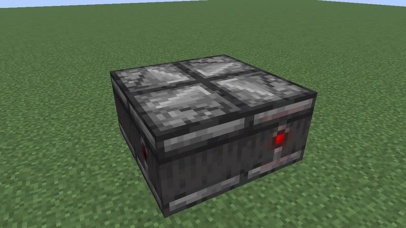</a> 8 gt (0.4 s) · observer · 4 blocks also found as census-p8-observer-4b, clk-obs-p8-obs-4b</td><td align="center"> 8 gt (0.4 s) · comparator+hopper · 4 blocks</td></tr>
<tr><td align="center"> 8 gt (0.4 s) · redstone_wire+repeater · 10 blocks</td><td align="center"> 8 gt (0.4 s) · comparator+repeater · 12 blocks</td><td align="center"> 8 gt (0.4 s) · repeater · 12 blocks</td></tr>
<tr><td align="center"> 8 gt (0.4 s) · comparator+redstone_wire+repeater · 13 blocks</td><td align="center"> 8 gt (0.4 s) · comparator+redstone_wire+repeater · 14 blocks</td></tr>
</table>

## 9 gt (0.45 s)

<table>
<tr><td align="center"> 9 gt (0.45 s) · observer+piston · 5 blocks</td><td align="center"> 9 gt (0.45 s) · comparator+hopper+redstone_wire · 8 blocks</td><td align="center"><a href="archive/clk-rt-odd-rect-p9-16b.txt">clk-rt-odd-rect-p9-16b</a> 9 gt (0.45 s) · redstone_wire+repeater · 16 blocks (picture pending)</td></tr>
<tr><td align="center"> 9 gt (0.45 s) · redstone_wire+repeater · 18 blocks</td></tr>
</table>

## 10 gt (0.5 s)

<table>
<tr><td align="center"><a href="archive/clk-obs-p10-obs-stk-4b-22a8a8.txt">clk-obs-p10-obs-stk-4b-22a8a8</a> 10 gt (0.5 s) · observer+sticky_piston · 4 blocks (picture pending)</td><td align="center"> 10 gt (0.5 s) · observer+sticky_piston · 4 blocks</td><td align="center"><a href="archive/clk-obs-notering6.txt">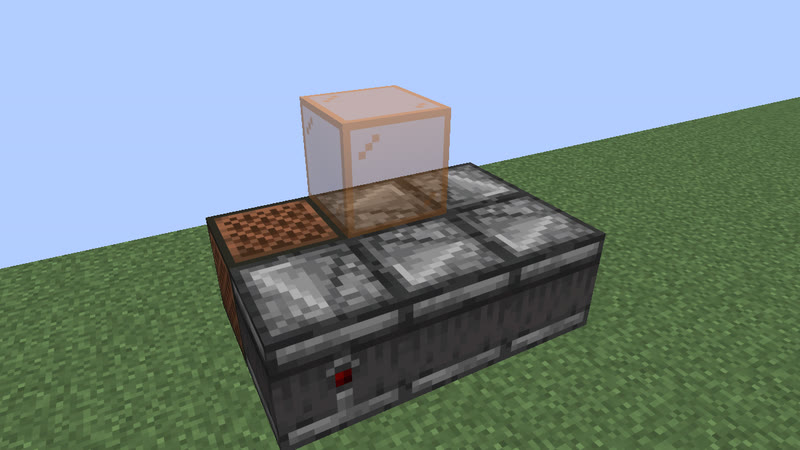</a> 10 gt (0.5 s) · note_block+observer · 6 blocks</td></tr>
<tr><td align="center"> 10 gt (0.5 s) · comparator+redstone_torch+repeater · 8 blocks</td><td align="center"> 10 gt (0.5 s) · redstone_torch+repeater · 8 blocks</td><td align="center"> 10 gt (0.5 s) · comparator+redstone_torch+redstone_wire · 12 blocks</td></tr>
<tr><td align="center"> 10 gt (0.5 s) · comparator+redstone_torch+redstone_wire+repeater · 12 blocks</td><td align="center"> 10 gt (0.5 s) · redstone_torch+redstone_wire+repeater · 12 blocks</td><td align="center"> 10 gt (0.5 s) · comparator+repeater · 12 blocks</td></tr>
<tr><td align="center"> 10 gt (0.5 s) · repeater · 12 blocks</td><td align="center"> 10 gt (0.5 s) · redstone_torch+redstone_wire+repeater · 12 blocks</td><td align="center"> 10 gt (0.5 s) · comparator+redstone_wire+repeater · 13 blocks</td></tr>
<tr><td align="center"> 10 gt (0.5 s) · redstone_wire+repeater · 13 blocks</td><td align="center"> 10 gt (0.5 s) · comparator+redstone_wire+repeater · 14 blocks</td><td align="center"> 10 gt (0.5 s) · redstone_wire+repeater · 14 blocks</td></tr>
</table>

## 11 gt (0.55 s)

<table>
<tr><td align="center"> 11 gt (0.55 s) · observer+piston · 6 blocks</td><td align="center"> 11 gt (0.55 s) · comparator+hopper+redstone_wire+repeater · 9 blocks</td><td align="center"><a href="archive/clk-rt-odd-rect-p11-16b.txt">clk-rt-odd-rect-p11-16b</a> 11 gt (0.55 s) · repeater · 16 blocks (picture pending)</td></tr>
<tr><td align="center"><a href="archive/clk-rt-uloop0t-C-2--2-2-2-2-1-d-kick-p11.txt">clk-rt-uloop0t-C-2--2-2-2-2-1-d-kick-p11</a> 11 gt (0.55 s) · redstone_wire+repeater · 18 blocks (picture pending)</td></tr>
</table>

## 12 gt (0.6 s)

<table>
<tr><td align="center"><a href="archive/census-p12-copper_bulb-observer-3b.txt">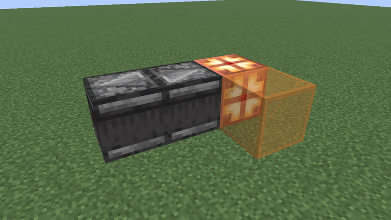</a> 12 gt (0.6 s) · copper_bulb+observer · 3 blocks also found as clk-obs-p12-bulb-obs-3b</td><td align="center"> 12 gt (0.6 s) · copper_bulb+redstone_block+sticky_piston · 4 blocks</td><td align="center"><a href="archive/snowdisp-p12.txt">snowdisp-p12</a> 12 gt (0.6 s) · dispenser+observer+redstone_wire · 5 blocks (picture pending)</td></tr>
<tr><td align="center"><a href="archive/clk-obs-ring6.txt">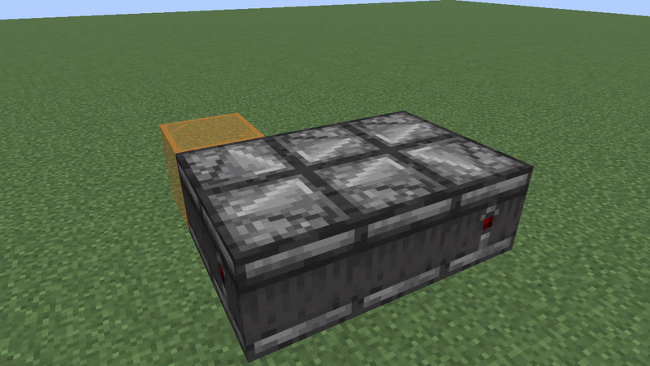</a> 12 gt (0.6 s) · observer · 6 blocks</td><td align="center"> 12 gt (0.6 s) · comparator+redstone_torch+repeater · 8 blocks</td><td align="center"> 12 gt (0.6 s) · redstone_torch+repeater · 8 blocks</td></tr>
<tr><td align="center"> 12 gt (0.6 s) · redstone_torch+redstone_wire+repeater · 9 blocks</td><td align="center"> 12 gt (0.6 s) · comparator+redstone_torch+redstone_wire · 9 blocks</td><td align="center"> 12 gt (0.6 s) · comparator+redstone_torch+redstone_wire+repeater · 9 blocks</td></tr>
<tr><td align="center"> 12 gt (0.6 s) · redstone_torch+redstone_wire+repeater · 9 blocks</td><td align="center"> 12 gt (0.6 s) · redstone_wire+repeater · 10 blocks</td><td align="center"> 12 gt (0.6 s) · comparator+redstone_torch · 12 blocks</td></tr>
<tr><td align="center"> 12 gt (0.6 s) · comparator+repeater · 12 blocks</td><td align="center"> 12 gt (0.6 s) · repeater · 12 blocks</td><td align="center"> 12 gt (0.6 s) · comparator+redstone_wire+repeater · 13 blocks</td></tr>
<tr><td align="center"> 12 gt (0.6 s) · comparator+redstone_wire+repeater · 14 blocks</td></tr>
</table>

## 13 gt (0.65 s)

<table>
<tr><td align="center"> 13 gt (0.65 s) · observer+piston · 4 blocks</td><td align="center"><a href="archive/hop2lockr2-p13.txt">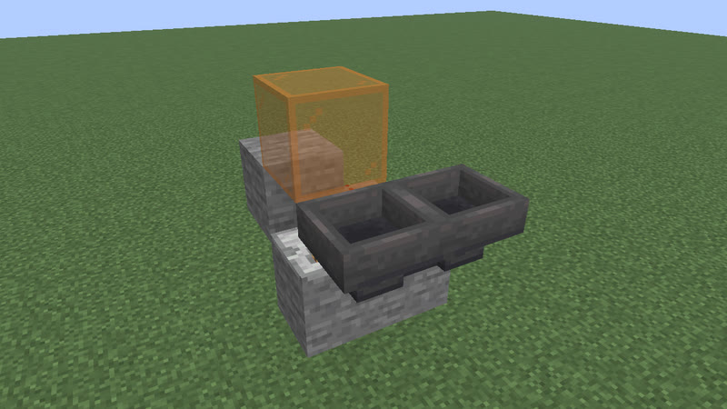</a> 13 gt (0.65 s) · comparator+hopper+redstone_wire+repeater · 9 blocks</td><td align="center"> 13 gt (0.65 s) · comparator+hopper+redstone_torch+redstone_wire · 9 blocks</td></tr>
<tr><td align="center"> 13 gt (0.65 s) · comparator+hopper+redstone_torch+redstone_wire · 9 blocks</td><td align="center"><a href="archive/clk-rt-odd-rect-p13-16b.txt">clk-rt-odd-rect-p13-16b</a> 13 gt (0.65 s) · redstone_wire+repeater · 16 blocks (picture pending)</td><td align="center"><a href="archive/clk-rt-uloop0t-C-3--3-3-2-1-1-d-kick-p13.txt">clk-rt-uloop0t-C-3--3-3-2-1-1-d-kick-p13</a> 13 gt (0.65 s) · redstone_wire+repeater · 18 blocks (picture pending)</td></tr>
</table>

## 14 gt (0.7 s)

<table>
<tr><td align="center"> 14 gt (0.7 s) · comparator+hopper · 4 blocks</td><td align="center"><a href="archive/clk-obs-p14-bulb-stk-5b-268e59.txt">clk-obs-p14-bulb-stk-5b-268e59</a> 14 gt (0.7 s) · copper_bulb+sticky_piston · 5 blocks (picture pending)</td><td align="center"> 14 gt (0.7 s) · observer+piston · 5 blocks</td></tr>
<tr><td align="center"> 14 gt (0.7 s) · redstone_torch+repeater · 8 blocks</td><td align="center"> 14 gt (0.7 s) · comparator+redstone_torch+repeater · 12 blocks</td><td align="center"> 14 gt (0.7 s) · comparator+redstone_torch+redstone_wire+repeater · 12 blocks</td></tr>
<tr><td align="center"> 14 gt (0.7 s) · redstone_torch+redstone_wire+repeater · 12 blocks</td><td align="center"> 14 gt (0.7 s) · comparator+repeater · 12 blocks</td><td align="center"> 14 gt (0.7 s) · repeater · 12 blocks</td></tr>
<tr><td align="center"> 14 gt (0.7 s) · redstone_torch+redstone_wire+repeater · 12 blocks</td><td align="center"> 14 gt (0.7 s) · comparator+redstone_wire+repeater · 13 blocks</td><td align="center"> 14 gt (0.7 s) · redstone_wire+repeater · 13 blocks</td></tr>
<tr><td align="center"> 14 gt (0.7 s) · comparator+redstone_wire+repeater · 14 blocks</td><td align="center"> 14 gt (0.7 s) · redstone_wire+repeater · 14 blocks</td></tr>
</table>

## 15 gt (0.75 s)

<table>
<tr><td align="center"> 15 gt (0.75 s) · observer+piston+redstone_lamp · 5 blocks</td><td align="center"> 15 gt (0.75 s) · comparator+hopper+redstone_wire+repeater · 9 blocks</td><td align="center"> 15 gt (0.75 s) · comparator+hopper · 10 blocks</td></tr>
<tr><td align="center"><a href="archive/clk-rt-odd-rect-p15-16b.txt">clk-rt-odd-rect-p15-16b</a> 15 gt (0.75 s) · redstone_wire+repeater · 16 blocks (picture pending)</td><td align="center"><a href="archive/clk-rt-uloop0t-C-3--3-3-3-3-d-d-kick-p15.txt">clk-rt-uloop0t-C-3--3-3-3-3-d-d-kick-p15</a> 15 gt (0.75 s) · redstone_wire+repeater · 18 blocks (picture pending)</td></tr>
</table>

## 16 gt (0.8 s)

<table>
<tr><td align="center"> 16 gt (0.8 s) · copper_bulb+observer+redstone_block+sticky_piston · 4 blocks</td><td align="center"><a href="archive/snowdisp-r1-p16.txt">snowdisp-r1-p16</a> 16 gt (0.8 s) · dispenser+observer+redstone_wire+repeater · 5 blocks (picture pending)</td><td align="center"> 16 gt (0.8 s) · redstone_torch+repeater · 8 blocks</td></tr>
<tr><td align="center"> 16 gt (0.8 s) · comparator+redstone_torch+redstone_wire+repeater · 9 blocks</td><td align="center"> 16 gt (0.8 s) · redstone_torch+redstone_wire+repeater · 9 blocks</td><td align="center"> 16 gt (0.8 s) · redstone_wire+repeater · 10 blocks</td></tr>
<tr><td align="center"> 16 gt (0.8 s) · comparator+redstone_torch+repeater · 12 blocks</td><td align="center"> 16 gt (0.8 s) · comparator+repeater · 12 blocks</td><td align="center"> 16 gt (0.8 s) · comparator+redstone_torch+redstone_wire · 12 blocks</td></tr>
<tr><td align="center"> 16 gt (0.8 s) · repeater · 12 blocks</td><td align="center"> 16 gt (0.8 s) · comparator+redstone_torch+redstone_wire · 13 blocks</td><td align="center"> 16 gt (0.8 s) · comparator+redstone_wire+repeater · 13 blocks</td></tr>
<tr><td align="center"> 16 gt (0.8 s) · comparator+redstone_wire+repeater · 14 blocks</td></tr>
</table>

## 17 gt (0.85 s)

<table>
<tr><td align="center"><a href="archive/clk-obs-p17-obs-stk-5b-883ca3.txt">clk-obs-p17-obs-stk-5b-883ca3</a> 17 gt (0.85 s) · observer+sticky_piston · 5 blocks (picture pending)</td><td align="center"> 17 gt (0.85 s) · observer+sticky_piston · 5 blocks</td><td align="center"><a href="archive/clk-rt-odd-rect-p17-16b.txt">clk-rt-odd-rect-p17-16b</a> 17 gt (0.85 s) · redstone_wire+repeater · 16 blocks (picture pending)</td></tr>
<tr><td align="center"><a href="archive/clk-rt-uloop0t-C-4--4-4-4-1-d-d-kick-p17.txt">clk-rt-uloop0t-C-4--4-4-4-1-d-d-kick-p17</a> 17 gt (0.85 s) · redstone_wire+repeater · 18 blocks (picture pending)</td></tr>
</table>

## 18 gt (0.9 s)

<table>
<tr><td align="center"> 18 gt (0.9 s) · observer+sticky_piston · 4 blocks</td><td align="center"> 18 gt (0.9 s) · redstone_torch+repeater · 8 blocks</td><td align="center"> 18 gt (0.9 s) · comparator+redstone_torch+repeater · 12 blocks</td></tr>
<tr><td align="center"> 18 gt (0.9 s) · comparator+redstone_torch+redstone_wire+repeater · 12 blocks</td><td align="center"> 18 gt (0.9 s) · redstone_torch+redstone_wire+repeater · 12 blocks</td><td align="center"> 18 gt (0.9 s) · comparator+repeater · 12 blocks</td></tr>
<tr><td align="center"> 18 gt (0.9 s) · repeater · 12 blocks</td><td align="center"> 18 gt (0.9 s) · redstone_torch+redstone_wire+repeater · 12 blocks</td><td align="center"> 18 gt (0.9 s) · comparator+redstone_wire+repeater · 13 blocks</td></tr>
<tr><td align="center"> 18 gt (0.9 s) · redstone_wire+repeater · 13 blocks</td><td align="center"> 18 gt (0.9 s) · comparator+redstone_wire+repeater · 14 blocks</td><td align="center"> 18 gt (0.9 s) · redstone_wire+repeater · 14 blocks</td></tr>
</table>

## 19 gt (0.95 s)

<table>
<tr><td align="center"> 19 gt (0.95 s) · observer+sticky_piston · 6 blocks</td><td align="center"><a href="archive/clk-rt-odd-rect-p19-16b.txt">clk-rt-odd-rect-p19-16b</a> 19 gt (0.95 s) · redstone_wire+repeater · 16 blocks (picture pending)</td><td align="center"><a href="archive/clk-rt-uloop0t-C-4--4-4-4-3-d-d-kick-p19.txt">clk-rt-uloop0t-C-4--4-4-4-3-d-d-kick-p19</a> 19 gt (0.95 s) · redstone_wire+repeater · 18 blocks (picture pending)</td></tr>
</table>

## 20 gt (1 s)

<table>
<tr><td align="center"><a href="archive/clk-obs-p20-obs-stk-5b-cc0c2e.txt">clk-obs-p20-obs-stk-5b-cc0c2e</a> 20 gt (1 s) · observer+sticky_piston · 5 blocks (picture pending)</td><td align="center"> 20 gt (1 s) · observer+sticky_piston · 5 blocks</td><td align="center"><a href="archive/snowdisp-r2-p20.txt">snowdisp-r2-p20</a> 20 gt (1 s) · dispenser+observer+redstone_wire+repeater · 5 blocks (picture pending)</td></tr>
<tr><td align="center"><a href="archive/clk-rt-uloop-p20-rt-r-8b.txt">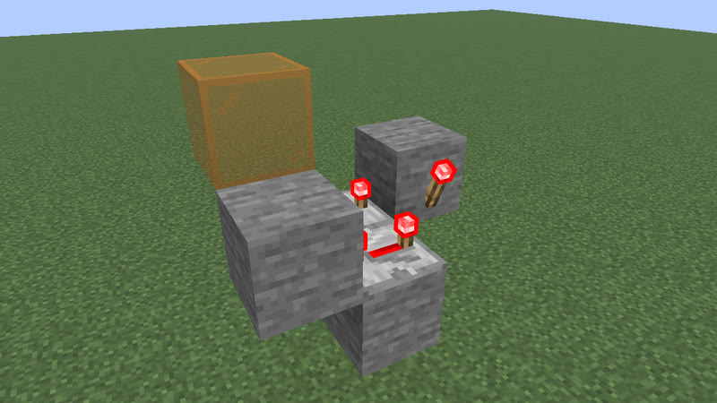</a> 20 gt (1 s) · redstone_torch+repeater · 8 blocks</td><td align="center"> 20 gt (1 s) · comparator+redstone_torch+redstone_wire+repeater · 9 blocks</td><td align="center"> 20 gt (1 s) · redstone_torch+redstone_wire+repeater · 9 blocks</td></tr>
<tr><td align="center"> 20 gt (1 s) · comparator+dropper+hopper · 10 blocks</td><td align="center"> 20 gt (1 s) · comparator+redstone_torch+repeater · 12 blocks</td><td align="center"> 20 gt (1 s) · comparator+repeater · 12 blocks</td></tr>
<tr><td align="center"> 20 gt (1 s) · repeater · 12 blocks</td><td align="center"> 20 gt (1 s) · comparator+redstone_torch+redstone_wire · 13 blocks</td><td align="center"> 20 gt (1 s) · comparator+redstone_wire+repeater · 13 blocks</td></tr>
<tr><td align="center"> 20 gt (1 s) · redstone_wire+repeater · 13 blocks</td><td align="center"> 20 gt (1 s) · comparator+redstone_wire+repeater · 14 blocks</td><td align="center"> 20 gt (1 s) · redstone_wire+repeater · 14 blocks</td></tr>
</table>

## 21 gt (1.05 s)

<table>
<tr><td align="center"> 21 gt (1.05 s) · calibrated_sculk_sensor+dispenser+observer · 5 blocks</td><td align="center"> 21 gt (1.05 s) · calibrated_sculk_sensor+note_block+observer+repeater · 6 blocks</td><td align="center"> 21 gt (1.05 s) · observer+redstone_block+sticky_piston · 6 blocks</td></tr>
<tr><td align="center"> 21 gt (1.05 s) · calibrated_sculk_sensor+note_block+redstone_torch+repeater · 6 blocks</td><td align="center"><a href="archive/loop6x2-p21.txt">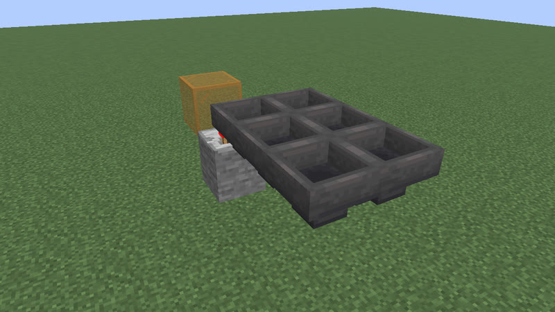</a> 21 gt (1.05 s) · comparator+hopper · 8 blocks</td><td align="center"> 21 gt (1.05 s) · calibrated_sculk_sensor+piston+redstone_wire+repeater · 10 blocks</td></tr>
<tr><td align="center"><a href="archive/clk-rt-odd-rect-p21-16b.txt">clk-rt-odd-rect-p21-16b</a> 21 gt (1.05 s) · repeater · 16 blocks (picture pending)</td><td align="center"><a href="archive/clk-rt-uloop0t-C-4--4-4-4-4-1-d-kick-p21.txt">clk-rt-uloop0t-C-4--4-4-4-4-1-d-kick-p21</a> 21 gt (1.05 s) · redstone_wire+repeater · 18 blocks (picture pending)</td></tr>
</table>

## 22 gt (1.1 s)

<table>
<tr><td align="center"><a href="archive/clk-sculk-chain-p22-10.txt">clk-sculk-chain-p22-10</a> 22 gt (1.1 s) · calibrated_sculk_sensor+oak_trapdoor+observer+repeater · 5 blocks (picture pending)</td><td align="center"> 22 gt (1.1 s) · calibrated_sculk_sensor+note_block+observer+repeater · 5 blocks</td><td align="center"><a href="archive/clk-obs-p22-obs-stk-6b-e7dec9.txt">clk-obs-p22-obs-stk-6b-e7dec9</a> 22 gt (1.1 s) · observer+sticky_piston · 6 blocks (picture pending)</td></tr>
<tr><td align="center"> 22 gt (1.1 s) · observer+sticky_piston · 6 blocks</td><td align="center"> 22 gt (1.1 s) · comparator+redstone_torch+repeater · 12 blocks</td><td align="center"> 22 gt (1.1 s) · comparator+redstone_torch+redstone_wire+repeater · 12 blocks</td></tr>
<tr><td align="center"> 22 gt (1.1 s) · redstone_torch+repeater · 12 blocks</td><td align="center"> 22 gt (1.1 s) · redstone_torch+redstone_wire+repeater · 12 blocks</td><td align="center"> 22 gt (1.1 s) · comparator+repeater · 12 blocks</td></tr>
<tr><td align="center"> 22 gt (1.1 s) · repeater · 12 blocks</td><td align="center"> 22 gt (1.1 s) · comparator+redstone_wire+repeater · 13 blocks</td><td align="center"> 22 gt (1.1 s) · redstone_wire+repeater · 13 blocks</td></tr>
<tr><td align="center"> 22 gt (1.1 s) · comparator+redstone_wire+repeater · 14 blocks</td><td align="center"> 22 gt (1.1 s) · redstone_wire+repeater · 14 blocks</td></tr>
</table>

## 23 gt (1.15 s)

<table>
<tr><td align="center"><a href="archive/census-p23-calibrated_sculk_sensor-dispenser-observer-piston-4b.txt">census-p23-calibrated_sculk_sensor-dispenser-observer-piston-4b</a> 23 gt (1.15 s) · calibrated_sculk_sensor+dispenser+observer+piston · 4 blocks (picture pending)</td><td align="center"> 23 gt (1.15 s) · calibrated_sculk_sensor+note_block+observer+repeater · 5 blocks</td><td align="center"> 23 gt (1.15 s) · observer+sticky_piston · 5 blocks</td></tr>
<tr><td align="center"><a href="archive/clk-rt-odd-rect-p23-16b.txt">clk-rt-odd-rect-p23-16b</a> 23 gt (1.15 s) · repeater · 16 blocks (picture pending)</td><td align="center"><a href="archive/clk-rt-uloop0t-C-4--4-4-4-4-3-d-kick-p23.txt">clk-rt-uloop0t-C-4--4-4-4-4-3-d-kick-p23</a> 23 gt (1.15 s) · redstone_wire+repeater · 18 blocks (picture pending)</td></tr>
</table>

## 24 gt (1.2 s)

<table>
<tr><td align="center"> 24 gt (1.2 s) · calibrated_sculk_sensor+oak_fence_gate+observer · 3 blocks</td><td align="center"> 24 gt (1.2 s) · calibrated_sculk_sensor+iron_trapdoor+observer · 3 blocks</td><td align="center"> 24 gt (1.2 s) · calibrated_sculk_sensor+oak_trapdoor+observer · 3 blocks</td></tr>
<tr><td align="center"><a href="archive/clk-sculk-chain-p24-13.txt">clk-sculk-chain-p24-13</a> 24 gt (1.2 s) · calibrated_sculk_sensor+oak_trapdoor+observer · 3 blocks (picture pending)</td><td align="center"> 24 gt (1.2 s) · calibrated_sculk_sensor+note_block+observer · 3 blocks</td><td align="center"> 24 gt (1.2 s) · calibrated_sculk_sensor+observer+piston · 3 blocks</td></tr>
<tr><td align="center"> 24 gt (1.2 s) · calibrated_sculk_sensor+observer+sticky_piston · 3 blocks</td><td align="center"> 24 gt (1.2 s) · calibrated_sculk_sensor+observer+piston · 3 blocks</td><td align="center"> 24 gt (1.2 s) · observer+sticky_piston · 4 blocks</td></tr>
<tr><td align="center"><a href="archive/snowdisp-r3-p24.txt">snowdisp-r3-p24</a> 24 gt (1.2 s) · dispenser+observer+redstone_wire+repeater · 5 blocks (picture pending)</td><td align="center"> 24 gt (1.2 s) · comparator+redstone_torch+redstone_wire+repeater · 9 blocks</td><td align="center"> 24 gt (1.2 s) · redstone_torch+redstone_wire+repeater · 9 blocks</td></tr>
<tr><td align="center"> 24 gt (1.2 s) · comparator+redstone_torch+repeater · 12 blocks</td><td align="center"> 24 gt (1.2 s) · redstone_torch+repeater · 12 blocks</td><td align="center"> 24 gt (1.2 s) · comparator+repeater · 12 blocks</td></tr>
<tr><td align="center"> 24 gt (1.2 s) · repeater · 12 blocks</td><td align="center"> 24 gt (1.2 s) · comparator+redstone_wire+repeater · 13 blocks</td><td align="center"> 24 gt (1.2 s) · redstone_wire+repeater · 13 blocks</td></tr>
<tr><td align="center"> 24 gt (1.2 s) · comparator+redstone_wire+repeater · 14 blocks</td><td align="center"> 24 gt (1.2 s) · redstone_wire+repeater · 14 blocks</td></tr>
</table>

## 25 gt (1.25 s)

<table>
<tr><td align="center"><a href="archive/clk-sculk-chain-p25-13.txt">clk-sculk-chain-p25-13</a> 25 gt (1.25 s) · calibrated_sculk_sensor+oak_trapdoor+observer · 4 blocks (picture pending)</td><td align="center"> 25 gt (1.25 s) · calibrated_sculk_sensor+note_block+observer · 4 blocks</td><td align="center"><a href="archive/clk-obs-p25-obs-rb-stk-6b-c5d39b.txt">clk-obs-p25-obs-rb-stk-6b-c5d39b</a> 25 gt (1.25 s) · observer+redstone_block+sticky_piston · 6 blocks (picture pending)</td></tr>
<tr><td align="center"> 25 gt (1.25 s) · comparator+hopper+redstone_wire+repeater · 9 blocks</td><td align="center"><a href="archive/clk-rt-odd-rect-p25-19b.txt">clk-rt-odd-rect-p25-19b</a> 25 gt (1.25 s) · repeater · 19 blocks (picture pending)</td></tr>
</table>

## 26 gt (1.3 s)

<table>
<tr><td align="center"><a href="archive/clk-sculk-hyb-p26-7.txt">clk-sculk-hyb-p26-7</a> 26 gt (1.3 s) · calibrated_sculk_sensor+oak_trapdoor+observer · 4 blocks (picture pending)</td><td align="center"> 26 gt (1.3 s) · calibrated_sculk_sensor+note_block+observer · 4 blocks</td><td align="center"><a href="archive/clk-obs-p26-obs-stk-5b-b38f3d.txt">clk-obs-p26-obs-stk-5b-b38f3d</a> 26 gt (1.3 s) · observer+sticky_piston · 5 blocks (picture pending)</td></tr>
<tr><td align="center"> 26 gt (1.3 s) · observer+sticky_piston · 5 blocks</td><td align="center"> 26 gt (1.3 s) · observer+redstone_lamp · 6 blocks</td><td align="center"> 26 gt (1.3 s) · comparator+redstone_torch+repeater · 12 blocks</td></tr>
<tr><td align="center"> 26 gt (1.3 s) · redstone_torch+repeater · 12 blocks</td><td align="center"> 26 gt (1.3 s) · redstone_torch+redstone_wire+repeater · 12 blocks</td><td align="center"> 26 gt (1.3 s) · comparator+repeater · 12 blocks</td></tr>
<tr><td align="center"> 26 gt (1.3 s) · repeater · 12 blocks</td><td align="center"> 26 gt (1.3 s) · comparator+redstone_wire+repeater · 13 blocks</td><td align="center"> 26 gt (1.3 s) · redstone_wire+repeater · 13 blocks</td></tr>
<tr><td align="center"> 26 gt (1.3 s) · comparator+redstone_wire+repeater · 14 blocks</td><td align="center"> 26 gt (1.3 s) · redstone_wire+repeater · 14 blocks</td></tr>
</table>

## 27 gt (1.35 s)

<table>
<tr><td align="center"><a href="archive/clk-sculk-hyb-p27-7.txt">clk-sculk-hyb-p27-7</a> 27 gt (1.35 s) · calibrated_sculk_sensor+oak_trapdoor+observer · 4 blocks (picture pending)</td><td align="center"> 27 gt (1.35 s) · calibrated_sculk_sensor+note_block+observer · 4 blocks</td><td align="center"> 27 gt (1.35 s) · observer+sticky_piston · 5 blocks</td></tr>
<tr><td align="center"> 27 gt (1.35 s) · calibrated_sculk_sensor+note_block+observer · 5 blocks</td><td align="center"><a href="archive/dropring-p27.txt">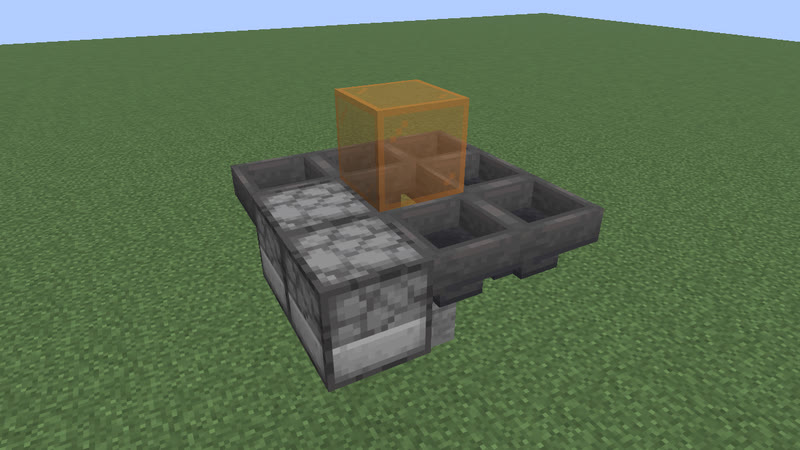</a> 27 gt (1.35 s) · comparator+dropper+hopper · 10 blocks</td><td align="center"><a href="archive/clk-rt-odd-rect-p27-19b.txt">clk-rt-odd-rect-p27-19b</a> 27 gt (1.35 s) · repeater · 19 blocks (picture pending)</td></tr>
</table>

## 28 gt (1.4 s)

<table>
<tr><td align="center"><a href="archive/clk-sculk-chaind-p28-1.txt">clk-sculk-chaind-p28-1</a> 28 gt (1.4 s) · calibrated_sculk_sensor+dispenser+observer · 3 blocks (picture pending)</td><td align="center"> 28 gt (1.4 s) · calibrated_sculk_sensor+dispenser+observer · 3 blocks</td><td align="center"> 28 gt (1.4 s) · observer+sticky_piston · 5 blocks</td></tr>
<tr><td align="center"><a href="archive/loop4-p28.txt">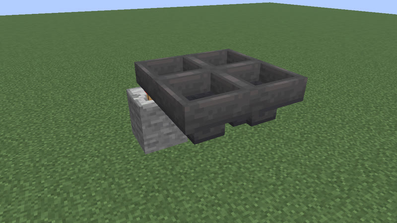</a> 28 gt (1.4 s) · comparator+hopper · 6 blocks</td><td align="center"> 28 gt (1.4 s) · redstone_torch+redstone_wire+repeater · 9 blocks</td><td align="center"> 28 gt (1.4 s) · comparator+redstone_torch+repeater · 12 blocks</td></tr>
<tr><td align="center"> 28 gt (1.4 s) · redstone_torch+repeater · 12 blocks</td><td align="center"> 28 gt (1.4 s) · comparator+redstone_torch+redstone_wire+repeater · 12 blocks</td><td align="center"> 28 gt (1.4 s) · repeater · 12 blocks</td></tr>
<tr><td align="center"> 28 gt (1.4 s) · comparator+redstone_torch+redstone_wire+repeater · 13 blocks</td><td align="center"> 28 gt (1.4 s) · redstone_wire+repeater · 13 blocks</td><td align="center"> 28 gt (1.4 s) · redstone_wire+repeater · 14 blocks</td></tr>
</table>

## 29 gt (1.45 s)

<table>
<tr><td align="center"><a href="archive/clk-sculk-chaind-p29-1.txt">clk-sculk-chaind-p29-1</a> 29 gt (1.45 s) · calibrated_sculk_sensor+dispenser+observer · 4 blocks (picture pending)</td><td align="center"> 29 gt (1.45 s) · calibrated_sculk_sensor+dispenser+observer · 4 blocks</td><td align="center"><a href="archive/clk-obs-p29-obs-stk-7b-d86167.txt">clk-obs-p29-obs-stk-7b-d86167</a> 29 gt (1.45 s) · observer+sticky_piston · 7 blocks (picture pending)</td></tr>
<tr><td align="center"><a href="archive/droprep-p29.txt">droprep-p29</a> 29 gt (1.45 s) · comparator+dropper+hopper+repeater · 14 blocks (picture pending)</td><td align="center"><a href="archive/clk-rt-odd-rect-p29-20b.txt">clk-rt-odd-rect-p29-20b</a> 29 gt (1.45 s) · repeater · 20 blocks (picture pending)</td></tr>
</table>

## 30 gt (1.5 s)

<table>
<tr><td align="center"><a href="archive/clk-sculk-obsd-p30-1.txt">clk-sculk-obsd-p30-1</a> 30 gt (1.5 s) · calibrated_sculk_sensor+dispenser+observer · 4 blocks (picture pending)</td><td align="center"> 30 gt (1.5 s) · calibrated_sculk_sensor+dispenser+observer · 4 blocks</td><td align="center"><a href="archive/clk-obs-p30-obs-stk-6b-f5eb19.txt">clk-obs-p30-obs-stk-6b-f5eb19</a> 30 gt (1.5 s) · observer+sticky_piston · 6 blocks (picture pending)</td></tr>
<tr><td align="center"> 30 gt (1.5 s) · observer+sticky_piston · 6 blocks</td><td align="center"> 30 gt (1.5 s) · comparator+hopper · 10 blocks</td><td align="center"> 30 gt (1.5 s) · comparator+redstone_torch+repeater · 12 blocks</td></tr>
<tr><td align="center"> 30 gt (1.5 s) · redstone_torch+repeater · 12 blocks</td><td align="center"> 30 gt (1.5 s) · repeater · 12 blocks</td><td align="center"> 30 gt (1.5 s) · redstone_wire+repeater · 13 blocks</td></tr>
<tr><td align="center"> 30 gt (1.5 s) · redstone_wire+repeater · 14 blocks</td></tr>
</table>

## 31 gt (1.55 s)

<table>
<tr><td align="center"><a href="archive/clk-sculk-obsd-p31-1.txt">clk-sculk-obsd-p31-1</a> 31 gt (1.55 s) · calibrated_sculk_sensor+dispenser+observer · 4 blocks (picture pending)</td><td align="center"> 31 gt (1.55 s) · calibrated_sculk_sensor+dispenser+observer · 4 blocks</td><td align="center"><a href="archive/clk-obs-p31-obs-stk-7b-4337ae.txt">clk-obs-p31-obs-stk-7b-4337ae</a> 31 gt (1.55 s) · observer+sticky_piston · 7 blocks (picture pending)</td></tr>
<tr><td align="center"><a href="archive/droprep-p31.txt">droprep-p31</a> 31 gt (1.55 s) · comparator+dropper+hopper+repeater · 14 blocks (picture pending)</td><td align="center"><a href="archive/clk-rt-odd-rect-p31-20b.txt">clk-rt-odd-rect-p31-20b</a> 31 gt (1.55 s) · repeater · 20 blocks (picture pending)</td></tr>
</table>

## 32 gt (1.6 s)

<table>
<tr><td align="center"><a href="archive/clk-sculk-obsd-p32-1.txt">clk-sculk-obsd-p32-1</a> 32 gt (1.6 s) · calibrated_sculk_sensor+dispenser+observer · 5 blocks (picture pending)</td><td align="center"> 32 gt (1.6 s) · observer+sticky_piston · 6 blocks</td><td align="center"> 32 gt (1.6 s) · redstone_torch+redstone_wire+repeater · 9 blocks</td></tr>
<tr><td align="center"> 32 gt (1.6 s) · redstone_torch+repeater · 12 blocks</td><td align="center"> 32 gt (1.6 s) · comparator+redstone_torch+redstone_wire+repeater · 12 blocks</td><td align="center"><a href="archive/clk-rt-ring3x3-p32-r-12b.txt">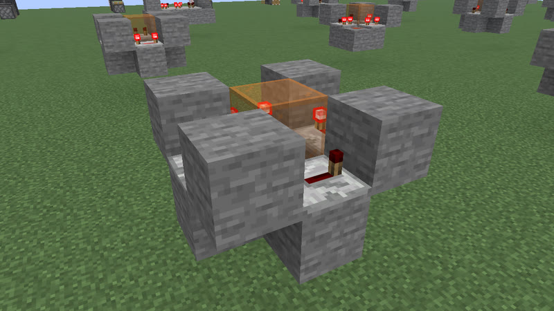</a> 32 gt (1.6 s) · repeater · 12 blocks</td></tr>
<tr><td align="center"> 32 gt (1.6 s) · comparator+redstone_torch+redstone_wire+repeater · 13 blocks</td><td align="center"> 32 gt (1.6 s) · redstone_wire+repeater · 13 blocks</td><td align="center"> 32 gt (1.6 s) · redstone_wire+repeater · 14 blocks</td></tr>
</table>

## 33 gt (1.65 s)

<table>
<tr><td align="center"><a href="archive/clk-sculk-obs-p33-1.txt">clk-sculk-obs-p33-1</a> 33 gt (1.65 s) · calibrated_sculk_sensor+note_block+observer · 6 blocks (picture pending)</td><td align="center"><a href="archive/clk-obs-p33-obs-stk-7b-b0ff0f.txt">clk-obs-p33-obs-stk-7b-b0ff0f</a> 33 gt (1.65 s) · observer+sticky_piston · 7 blocks (picture pending)</td><td align="center"><a href="archive/droprep-p33.txt">droprep-p33</a> 33 gt (1.65 s) · comparator+dropper+hopper+repeater · 14 blocks (picture pending)</td></tr>
<tr><td align="center"><a href="archive/clk-rt-odd-rect-p33-23b.txt">clk-rt-odd-rect-p33-23b</a> 33 gt (1.65 s) · repeater · 23 blocks (picture pending)</td></tr>
</table>

## 34 gt (1.7 s)

<table>
<tr><td align="center"><a href="archive/clk-sculk-obs-p34-1.txt">clk-sculk-obs-p34-1</a> 34 gt (1.7 s) · calibrated_sculk_sensor+note_block+observer · 7 blocks (picture pending)</td><td align="center"><a href="archive/clk-obs-p34-obs-stk-7b-474fa7.txt">clk-obs-p34-obs-stk-7b-474fa7</a> 34 gt (1.7 s) · observer+sticky_piston · 7 blocks (picture pending)</td><td align="center"> 34 gt (1.7 s) · redstone_torch+repeater · 12 blocks</td></tr>
<tr><td align="center"><a href="archive/dropringw-p34.txt">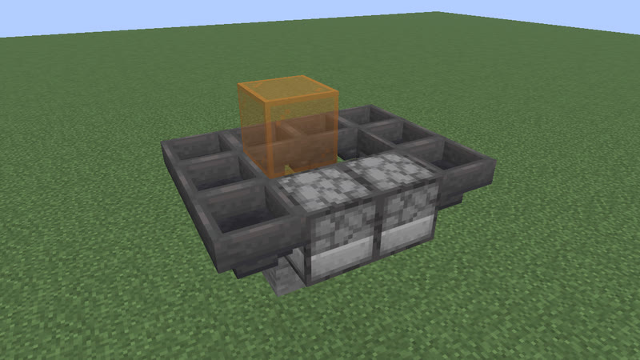</a> 34 gt (1.7 s) · comparator+dropper+hopper · 12 blocks</td></tr>
</table>

## 35 gt (1.75 s)

<table>
<tr><td align="center"> 35 gt (1.75 s) · observer+redstone_block+sticky_piston · 6 blocks</td><td align="center"><a href="archive/clk-sculk-ring3-p35-1.txt">clk-sculk-ring3-p35-1</a> 35 gt (1.75 s) · calibrated_sculk_sensor+note_block · 6 blocks (picture pending)</td><td align="center"><a href="archive/loop10x2-p35.txt">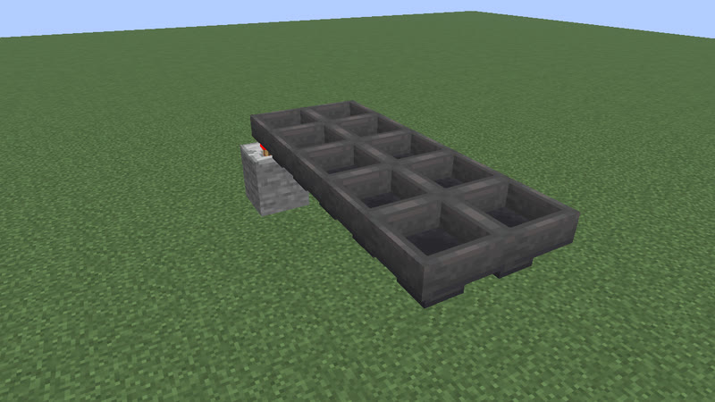</a> 35 gt (1.75 s) · comparator+hopper · 12 blocks</td></tr>
<tr><td align="center"><a href="archive/droprep-p35.txt">droprep-p35</a> 35 gt (1.75 s) · comparator+dropper+hopper+repeater · 14 blocks (picture pending)</td><td align="center"><a href="archive/clk-rt-odd-rect-p35-23b.txt">clk-rt-odd-rect-p35-23b</a> 35 gt (1.75 s) · repeater · 23 blocks (picture pending)</td></tr>
</table>

## 36 gt (1.8 s)

<table>
<tr><td align="center"> 36 gt (1.8 s) · observer+sticky_piston · 6 blocks</td><td align="center"><a href="archive/clk-sculk-ring3-p36-1.txt">clk-sculk-ring3-p36-1</a> 36 gt (1.8 s) · calibrated_sculk_sensor+note_block · 6 blocks (picture pending)</td><td align="center"><a href="archive/clk-rt-uloop-p36-rt-rw-r-9b.txt">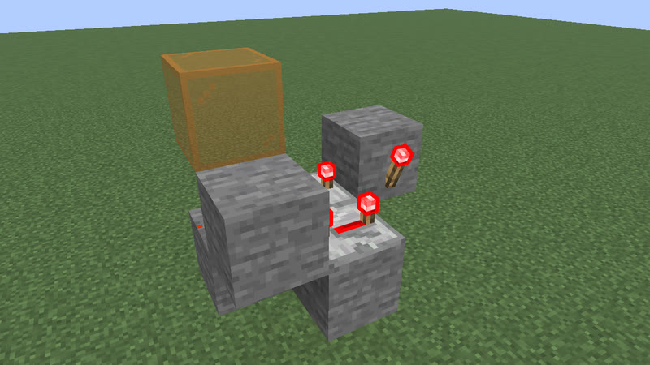</a> 36 gt (1.8 s) · redstone_torch+redstone_wire+repeater · 9 blocks</td></tr>
<tr><td align="center"> 36 gt (1.8 s) · redstone_torch+repeater · 12 blocks</td><td align="center"> 36 gt (1.8 s) · comparator+redstone_torch+redstone_wire+repeater · 12 blocks</td><td align="center"> 36 gt (1.8 s) · comparator+redstone_torch+redstone_wire+repeater · 13 blocks</td></tr>
<tr><td align="center"><a href="archive/droprep-p36.txt">droprep-p36</a> 36 gt (1.8 s) · comparator+dropper+hopper+repeater · 14 blocks (picture pending)</td></tr>
</table>

## 37 gt (1.85 s)

<table>
<tr><td align="center"> 37 gt (1.85 s) · observer+sticky_piston · 6 blocks</td><td align="center"><a href="archive/clk-sculk-ring3-p37-1.txt">clk-sculk-ring3-p37-1</a> 37 gt (1.85 s) · calibrated_sculk_sensor+note_block · 6 blocks (picture pending)</td><td align="center"><a href="archive/clk-rt-odd-rect-p37-24b.txt">clk-rt-odd-rect-p37-24b</a> 37 gt (1.85 s) · repeater · 24 blocks (picture pending)</td></tr>
</table>

## 38 gt (1.9 s)

<table>
<tr><td align="center"><a href="archive/clk-obs-p38-obs-stk-6b-8b1836.txt">clk-obs-p38-obs-stk-6b-8b1836</a> 38 gt (1.9 s) · observer+sticky_piston · 6 blocks (picture pending)</td><td align="center"> 38 gt (1.9 s) · observer+sticky_piston · 6 blocks</td><td align="center"><a href="archive/clk-sculk-ring3-p38-1.txt">clk-sculk-ring3-p38-1</a> 38 gt (1.9 s) · calibrated_sculk_sensor+note_block · 6 blocks (picture pending)</td></tr>
<tr><td align="center"><a href="archive/droprep-p38.txt">droprep-p38</a> 38 gt (1.9 s) · comparator+dropper+hopper+repeater · 14 blocks (picture pending)</td><td align="center"> 38 gt (1.9 s) · redstone_torch+repeater · 16 blocks</td></tr>
</table>

## 39 gt (1.95 s)

<table>
<tr><td align="center"><a href="archive/clk-sculk-ring3-p39-1.txt">clk-sculk-ring3-p39-1</a> 39 gt (1.95 s) · calibrated_sculk_sensor+note_block · 6 blocks (picture pending)</td><td align="center"><a href="archive/clk-obs-p39-bulb-obs-stk-7b-522598.txt">clk-obs-p39-bulb-obs-stk-7b-522598</a> 39 gt (1.95 s) · copper_bulb+observer+sticky_piston · 7 blocks (picture pending)</td><td align="center"><a href="archive/clk-rt-odd-rect-p39-24b.txt">clk-rt-odd-rect-p39-24b</a> 39 gt (1.95 s) · repeater · 24 blocks (picture pending)</td></tr>
</table>

## 40 gt (2 s)

<table>
<tr><td align="center"><a href="archive/clk-obs-p40-bulb-obs-stk-6b-31c0be.txt">clk-obs-p40-bulb-obs-stk-6b-31c0be</a> 40 gt (2 s) · copper_bulb+observer+sticky_piston · 6 blocks (picture pending)</td><td align="center"> 40 gt (2 s) · copper_bulb+observer+sticky_piston · 6 blocks</td><td align="center"><a href="archive/clk-sculk-ring3-p40-1.txt">clk-sculk-ring3-p40-1</a> 40 gt (2 s) · calibrated_sculk_sensor+note_block · 6 blocks (picture pending)</td></tr>
<tr><td align="center"> 40 gt (2 s) · comparator+redstone_torch+redstone_wire+repeater · 12 blocks</td><td align="center"> 40 gt (2 s) · redstone_torch+redstone_wire+repeater · 12 blocks</td><td align="center"> 40 gt (2 s) · comparator+redstone_torch+redstone_wire+repeater · 13 blocks</td></tr>
<tr><td align="center"> 40 gt (2 s) · redstone_torch+redstone_wire+repeater · 13 blocks</td><td align="center"><a href="archive/droprep-p40.txt">droprep-p40</a> 40 gt (2 s) · comparator+dropper+hopper+repeater · 14 blocks (picture pending)</td><td align="center"> 40 gt (2 s) · redstone_torch+redstone_wire+repeater · 27 blocks</td></tr>
</table>

## 41 gt (2.05 s)

<table>
<tr><td align="center"> 41 gt (2.05 s) · dispenser+observer+sculk_sensor · 5 blocks</td><td align="center"> 41 gt (2.05 s) · note_block+observer+repeater+sculk_sensor · 6 blocks</td><td align="center"><a href="archive/clk-obs-p41-obs-stk-7b-4310fc.txt">clk-obs-p41-obs-stk-7b-4310fc</a> 41 gt (2.05 s) · observer+sticky_piston · 7 blocks (picture pending)</td></tr>
<tr><td align="center"><a href="archive/dropringw-p41.txt">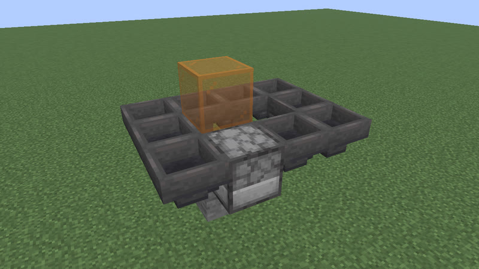</a> 41 gt (2.05 s) · comparator+dropper+hopper · 12 blocks</td><td align="center"><a href="archive/clk-rt-odd-rect-p41-27b.txt">clk-rt-odd-rect-p41-27b</a> 41 gt (2.05 s) · repeater · 27 blocks (picture pending)</td></tr>
</table>

## 42 gt (2.1 s)

<table>
<tr><td align="center"><a href="archive/census-p42-dispenser-observer-sculk_sensor-4b.txt">census-p42-dispenser-observer-sculk_sensor-4b</a> 42 gt (2.1 s) · dispenser+observer+sculk_sensor · 4 blocks (picture pending)</td><td align="center"> 42 gt (2.1 s) · note_block+observer+repeater+sculk_sensor · 5 blocks</td><td align="center"> 42 gt (2.1 s) · observer+piston · 6 blocks</td></tr>
<tr><td align="center"> 42 gt (2.1 s) · comparator+hopper · 8 blocks</td><td align="center"><a href="archive/droprep-p42.txt">droprep-p42</a> 42 gt (2.1 s) · comparator+dropper+hopper+repeater · 14 blocks (picture pending)</td><td align="center"> 42 gt (2.1 s) · redstone_torch+repeater · 16 blocks</td></tr>
</table>

## 43 gt (2.15 s)

<table>
<tr><td align="center"><a href="archive/census-p43-calibrated_sculk_sensor-dispenser-observer-sculk_sensor-4b.txt">census-p43-calibrated_sculk_sensor-dispenser-observer-sculk_sensor-4b</a> 43 gt (2.15 s) · calibrated_sculk_sensor+dispenser+observer+sculk_sensor · 4 blocks (picture pending)</td><td align="center"> 43 gt (2.15 s) · note_block+observer+repeater+sculk_sensor · 5 blocks</td><td align="center"> 43 gt (2.15 s) · observer+redstone_block+sticky_piston · 6 blocks</td></tr>
<tr><td align="center"><a href="archive/droprep-p43.txt">droprep-p43</a> 43 gt (2.15 s) · comparator+dropper+hopper+repeater · 16 blocks (picture pending)</td><td align="center"><a href="archive/clk-rt-odd-rect-p43-27b.txt">clk-rt-odd-rect-p43-27b</a> 43 gt (2.15 s) · repeater · 27 blocks (picture pending)</td></tr>
</table>

## 44 gt (2.2 s)

<table>
<tr><td align="center"><a href="archive/clk-sculk-chain-p44-39.txt">clk-sculk-chain-p44-39</a> 44 gt (2.2 s) · oak_fence_gate+observer+sculk_sensor · 3 blocks (picture pending)</td><td align="center"> 44 gt (2.2 s) · note_block+observer+sculk_sensor · 3 blocks</td><td align="center"><a href="archive/clk-obs-p44-lamp-obs-stk-7b-77ba59.txt">clk-obs-p44-lamp-obs-stk-7b-77ba59</a> 44 gt (2.2 s) · observer+redstone_lamp+sticky_piston · 7 blocks (picture pending)</td></tr>
<tr><td align="center"> 44 gt (2.2 s) · redstone_torch+redstone_wire+repeater · 12 blocks</td><td align="center"> 44 gt (2.2 s) · comparator+redstone_torch+redstone_wire+repeater · 13 blocks</td><td align="center"> 44 gt (2.2 s) · redstone_torch+redstone_wire+repeater · 13 blocks</td></tr>
<tr><td align="center"><a href="archive/droprep-p44.txt">droprep-p44</a> 44 gt (2.2 s) · comparator+dropper+hopper+repeater · 18 blocks (picture pending)</td></tr>
</table>

## 45 gt (2.25 s)

<table>
<tr><td align="center"><a href="archive/clk-sculk-chain-p45-28.txt">clk-sculk-chain-p45-28</a> 45 gt (2.25 s) · oak_fence_gate+observer+sculk_sensor · 4 blocks (picture pending)</td><td align="center"><a href="archive/clk-obs-p45-obs-stk-7b-aa692a.txt">clk-obs-p45-obs-stk-7b-aa692a</a> 45 gt (2.25 s) · observer+sticky_piston · 7 blocks (picture pending)</td><td align="center"> 45 gt (2.25 s) · calibrated_sculk_sensor · 7 blocks</td></tr>
<tr><td align="center"><a href="archive/droprep-p45.txt">droprep-p45</a> 45 gt (2.25 s) · comparator+dropper+hopper+repeater · 16 blocks (picture pending)</td><td align="center"><a href="archive/clk-rt-odd-rect-p45-28b.txt">clk-rt-odd-rect-p45-28b</a> 45 gt (2.25 s) · repeater · 28 blocks (picture pending)</td></tr>
</table>

## 46 gt (2.3 s)

<table>
<tr><td align="center"><a href="archive/clk-sculk-hyb-p46-10.txt">clk-sculk-hyb-p46-10</a> 46 gt (2.3 s) · oak_trapdoor+observer+sculk_sensor · 4 blocks (picture pending)</td><td align="center"> 46 gt (2.3 s) · observer+sticky_piston · 6 blocks</td><td align="center"> 46 gt (2.3 s) · comparator+hopper · 10 blocks</td></tr>
<tr><td align="center"> 46 gt (2.3 s) · redstone_torch+repeater · 16 blocks</td><td align="center"><a href="archive/droprep-p46.txt">droprep-p46</a> 46 gt (2.3 s) · comparator+dropper+hopper+repeater · 18 blocks (picture pending)</td></tr>
</table>

## 47 gt (2.35 s)

<table>
<tr><td align="center"><a href="archive/clk-sculk-hyb-p47-11.txt">clk-sculk-hyb-p47-11</a> 47 gt (2.35 s) · oak_trapdoor+observer+sculk_sensor · 4 blocks (picture pending)</td><td align="center"><a href="archive/clk-obs-p47-obs-stk-7b-193e30.txt">clk-obs-p47-obs-stk-7b-193e30</a> 47 gt (2.35 s) · observer+sticky_piston · 7 blocks (picture pending)</td><td align="center"><a href="archive/droprep-p47.txt">droprep-p47</a> 47 gt (2.35 s) · comparator+dropper+hopper+repeater · 16 blocks (picture pending)</td></tr>
<tr><td align="center"><a href="archive/clk-rt-odd-rect-p47-28b.txt">clk-rt-odd-rect-p47-28b</a> 47 gt (2.35 s) · repeater · 28 blocks (picture pending)</td></tr>
</table>

## 48 gt (2.4 s)

<table>
<tr><td align="center"><a href="archive/clk-sculk-chaind-p48-5.txt">clk-sculk-chaind-p48-5</a> 48 gt (2.4 s) · dispenser+observer+sculk_sensor · 3 blocks (picture pending)</td><td align="center"> 48 gt (2.4 s) · dispenser+observer+sculk_sensor · 3 blocks</td><td align="center"> 48 gt (2.4 s) · copper_bulb+observer+redstone_block+sticky_piston · 5 blocks</td></tr>
<tr><td align="center"><a href="archive/clk-obs-div3.txt">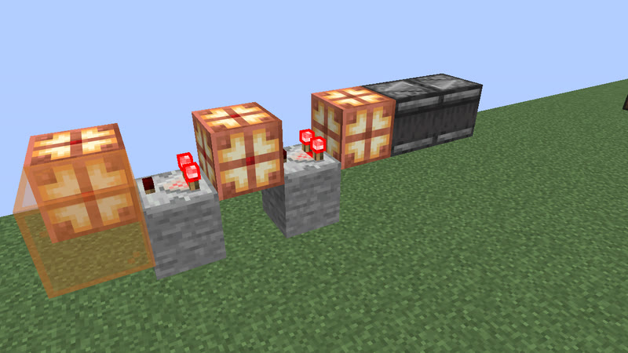</a> 48 gt (2.4 s) · comparator+copper_bulb+observer · 9 blocks</td><td align="center"> 48 gt (2.4 s) · redstone_torch+redstone_wire+repeater · 12 blocks</td><td align="center"> 48 gt (2.4 s) · comparator+redstone_torch+redstone_wire+repeater · 13 blocks</td></tr>
<tr><td align="center"> 48 gt (2.4 s) · redstone_torch+redstone_wire+repeater · 13 blocks</td><td align="center"><a href="archive/dropringw-p48.txt">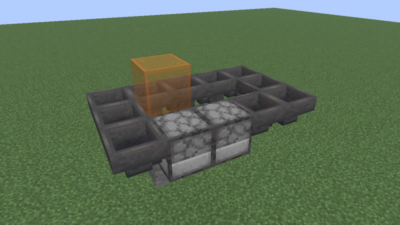</a> 48 gt (2.4 s) · comparator+dropper+hopper · 14 blocks</td><td align="center"><a href="archive/droprep-p48.txt">droprep-p48</a> 48 gt (2.4 s) · comparator+dropper+hopper+repeater · 18 blocks (picture pending)</td></tr>
</table>

## 49 gt (2.45 s)

<table>
<tr><td align="center"><a href="archive/clk-sculk-chaind-p49-5.txt">clk-sculk-chaind-p49-5</a> 49 gt (2.45 s) · dispenser+observer+sculk_sensor · 4 blocks (picture pending)</td><td align="center"><a href="archive/clk-obs-p49-obs-stk-7b-db5d66.txt">clk-obs-p49-obs-stk-7b-db5d66</a> 49 gt (2.45 s) · observer+sticky_piston · 7 blocks (picture pending)</td><td align="center"> 49 gt (2.45 s) · comparator+hopper · 10 blocks</td></tr>
<tr><td align="center"><a href="archive/droprep-p49.txt">droprep-p49</a> 49 gt (2.45 s) · comparator+dropper+hopper+repeater · 16 blocks (picture pending)</td><td align="center"><a href="archive/clk-rt-odd-rect-p49-31b.txt">clk-rt-odd-rect-p49-31b</a> 49 gt (2.45 s) · repeater · 31 blocks (picture pending)</td></tr>
</table>

## 50 gt (2.5 s)

<table>
<tr><td align="center"><a href="archive/clk-sculk-obsd-p50-1.txt">clk-sculk-obsd-p50-1</a> 50 gt (2.5 s) · dispenser+observer+sculk_sensor · 4 blocks (picture pending)</td><td align="center"> 50 gt (2.5 s) · redstone_torch+repeater · 16 blocks</td><td align="center"><a href="archive/droprep-p50.txt">droprep-p50</a> 50 gt (2.5 s) · comparator+dropper+hopper+repeater · 16 blocks (picture pending)</td></tr>
<tr><td align="center"><a href="archive/clk-obs-p50-note-obs-26b-2873f7.txt">clk-obs-p50-note-obs-26b-2873f7</a> 50 gt (2.5 s) · note_block+observer · 26 blocks (picture pending)</td></tr>
</table>

## 51 gt (2.55 s)

<table>
<tr><td align="center"><a href="archive/clk-sculk-obsd-p51-1.txt">clk-sculk-obsd-p51-1</a> 51 gt (2.55 s) · dispenser+observer+sculk_sensor · 4 blocks (picture pending)</td><td align="center"><a href="archive/droprep-p51.txt">droprep-p51</a> 51 gt (2.55 s) · comparator+dropper+hopper+repeater · 18 blocks (picture pending)</td><td align="center"><a href="archive/clk-obs-p51-obs-pis-rb-stk-28b-285572.txt">clk-obs-p51-obs-pis-rb-stk-28b-285572</a> 51 gt (2.55 s) · observer+piston+redstone_block+sticky_piston · 28 blocks (picture pending)</td></tr>
<tr><td align="center"><a href="archive/clk-rt-odd-rect-p51-31b.txt">clk-rt-odd-rect-p51-31b</a> 51 gt (2.55 s) · repeater · 31 blocks (picture pending)</td></tr>
</table>

## 52 gt (2.6 s)

<table>
<tr><td align="center"><a href="archive/clk-sculk-obsd-p52-1.txt">clk-sculk-obsd-p52-1</a> 52 gt (2.6 s) · dispenser+observer+sculk_sensor · 5 blocks (picture pending)</td><td align="center"> 52 gt (2.6 s) · observer+sticky_piston · 5 blocks</td><td align="center"><a href="archive/clk-rt-ring3x3-p52-rt-rw-r-12b.txt">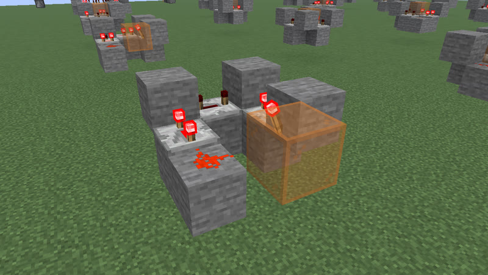</a> 52 gt (2.6 s) · redstone_torch+redstone_wire+repeater · 12 blocks</td></tr>
<tr><td align="center"> 52 gt (2.6 s) · comparator+redstone_torch+redstone_wire+repeater · 13 blocks</td><td align="center"> 52 gt (2.6 s) · redstone_torch+redstone_wire+repeater · 13 blocks</td><td align="center"><a href="archive/droprep-p52.txt">droprep-p52</a> 52 gt (2.6 s) · comparator+dropper+hopper+repeater · 16 blocks (picture pending)</td></tr>
</table>

## 53 gt (2.65 s)

<table>
<tr><td align="center"><a href="archive/clk-sculk-obs-p53-1.txt">clk-sculk-obs-p53-1</a> 53 gt (2.65 s) · note_block+observer+sculk_sensor · 6 blocks (picture pending)</td><td align="center"><a href="archive/droprep-p53.txt">droprep-p53</a> 53 gt (2.65 s) · comparator+dropper+hopper+repeater · 18 blocks (picture pending)</td><td align="center"><a href="archive/clk-obs-p53-obs-pis-rb-stk-30b-df7740.txt">clk-obs-p53-obs-pis-rb-stk-30b-df7740</a> 53 gt (2.65 s) · observer+piston+redstone_block+sticky_piston · 30 blocks (picture pending)</td></tr>
<tr><td align="center"><a href="archive/clk-rt-odd-rect-p53-32b.txt">clk-rt-odd-rect-p53-32b</a> 53 gt (2.65 s) · repeater · 32 blocks (picture pending)</td></tr>
</table>

## 54 gt (2.7 s)

<table>
<tr><td align="center"><a href="archive/clk-sculk-hyb-p54-3.txt">clk-sculk-hyb-p54-3</a> 54 gt (2.7 s) · calibrated_sculk_sensor+observer+sticky_piston · 5 blocks (picture pending)</td><td align="center"> 54 gt (2.7 s) · observer+sticky_piston · 6 blocks</td><td align="center"><a href="archive/clk-obs-p54-obs-stk-6b-ee999d.txt">clk-obs-p54-obs-stk-6b-ee999d</a> 54 gt (2.7 s) · observer+sticky_piston · 6 blocks (picture pending)</td></tr>
<tr><td align="center"> 54 gt (2.7 s) · comparator+dropper+hopper · 10 blocks</td><td align="center"><a href="archive/droprep-p54.txt">droprep-p54</a> 54 gt (2.7 s) · comparator+dropper+hopper+repeater · 16 blocks (picture pending)</td><td align="center"> 54 gt (2.7 s) · redstone_torch+repeater · 20 blocks</td></tr>
</table>

## 55 gt (2.75 s)

<table>
<tr><td align="center"><a href="archive/clk-sculk-hyb3-p55-2.txt">clk-sculk-hyb3-p55-2</a> 55 gt (2.75 s) · calibrated_sculk_sensor+observer+sticky_piston · 6 blocks (picture pending)</td><td align="center"><a href="archive/clk-obs-p55-obs-stk-7b-c5c4bf.txt">clk-obs-p55-obs-stk-7b-c5c4bf</a> 55 gt (2.75 s) · observer+sticky_piston · 7 blocks (picture pending)</td><td align="center"><a href="archive/dropringw-p55.txt">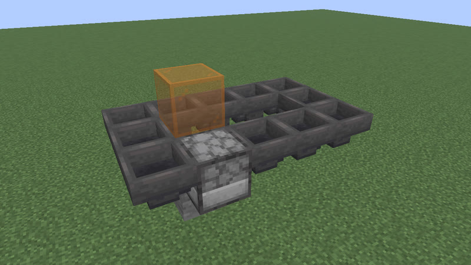</a> 55 gt (2.75 s) · comparator+dropper+hopper · 14 blocks</td></tr>
<tr><td align="center"><a href="archive/droprep-p55.txt">droprep-p55</a> 55 gt (2.75 s) · comparator+dropper+hopper+repeater · 18 blocks (picture pending)</td><td align="center"><a href="archive/clk-rt-odd-rect-p55-32b.txt">clk-rt-odd-rect-p55-32b</a> 55 gt (2.75 s) · repeater · 32 blocks (picture pending)</td></tr>
</table>

## 56 gt (2.8 s)

<table>
<tr><td align="center"><a href="archive/clk-sculk-hyb3-p56-2.txt">clk-sculk-hyb3-p56-2</a> 56 gt (2.8 s) · calibrated_sculk_sensor+observer+sticky_piston · 6 blocks (picture pending)</td><td align="center"><a href="archive/clk-obs-p56-bulb-obs-pis-7b-9f9567.txt">clk-obs-p56-bulb-obs-pis-7b-9f9567</a> 56 gt (2.8 s) · copper_bulb+observer+piston · 7 blocks (picture pending)</td><td align="center"> 56 gt (2.8 s) · comparator+hopper · 10 blocks</td></tr>
<tr><td align="center"> 56 gt (2.8 s) · comparator+redstone_torch+redstone_wire+repeater · 13 blocks</td><td align="center"> 56 gt (2.8 s) · redstone_torch+redstone_wire+repeater · 13 blocks</td><td align="center"><a href="archive/droprep-p56.txt">droprep-p56</a> 56 gt (2.8 s) · comparator+dropper+hopper+repeater · 16 blocks (picture pending)</td></tr>
</table>

## 57 gt (2.85 s)

<table>
<tr><td align="center"><a href="archive/clk-sculk-hyb3-p57-2.txt">clk-sculk-hyb3-p57-2</a> 57 gt (2.85 s) · calibrated_sculk_sensor+observer+sticky_piston · 6 blocks (picture pending)</td><td align="center"><a href="archive/droprep-p57.txt">droprep-p57</a> 57 gt (2.85 s) · comparator+dropper+hopper+repeater · 18 blocks (picture pending)</td><td align="center"><a href="archive/clk-obs-p57-obs-pis-rb-stk-32b-34d597.txt">clk-obs-p57-obs-pis-rb-stk-32b-34d597</a> 57 gt (2.85 s) · observer+piston+redstone_block+sticky_piston · 32 blocks (picture pending)</td></tr>
<tr><td align="center"><a href="archive/clk-rt-odd-rect-p57-35b.txt">clk-rt-odd-rect-p57-35b</a> 57 gt (2.85 s) · repeater · 35 blocks (picture pending)</td></tr>
</table>

## 58 gt (2.9 s)

<table>
<tr><td align="center"><a href="archive/clk-sculk-hyb3-p58-2.txt">clk-sculk-hyb3-p58-2</a> 58 gt (2.9 s) · calibrated_sculk_sensor+observer+sticky_piston · 6 blocks (picture pending)</td><td align="center"><a href="archive/clk-obs-p58-obs-pis-stk-7b-63f026.txt">clk-obs-p58-obs-pis-stk-7b-63f026</a> 58 gt (2.9 s) · observer+piston+sticky_piston · 7 blocks (picture pending)</td><td align="center"> 58 gt (2.9 s) · iron_trapdoor+observer · 10 blocks</td></tr>
<tr><td align="center"> 58 gt (2.9 s) · redstone_torch+repeater · 20 blocks</td><td align="center"><a href="archive/droprep-p58.txt">droprep-p58</a> 58 gt (2.9 s) · comparator+dropper+hopper+repeater · 20 blocks (picture pending)</td></tr>
</table>

## 59 gt (2.95 s)

<table>
<tr><td align="center"><a href="archive/clk-sculk-chain-p59-13.txt">clk-sculk-chain-p59-13</a> 59 gt (2.95 s) · oak_trapdoor+observer+repeater+sculk_sensor · 9 blocks (picture pending)</td><td align="center"><a href="archive/droprep-p59.txt">droprep-p59</a> 59 gt (2.95 s) · comparator+dropper+hopper+repeater · 18 blocks (picture pending)</td><td align="center"><a href="archive/clk-obs-p59-obs-pis-rb-stk-32b-628ad9.txt">clk-obs-p59-obs-pis-rb-stk-32b-628ad9</a> 59 gt (2.95 s) · observer+piston+redstone_block+sticky_piston · 32 blocks (picture pending)</td></tr>
<tr><td align="center"><a href="archive/clk-rt-odd-rect-p59-35b.txt">clk-rt-odd-rect-p59-35b</a> 59 gt (2.95 s) · repeater · 35 blocks (picture pending)</td></tr>
</table>

## 60 gt (3 s)

<table>
<tr><td align="center"> 60 gt (3 s) · observer+sticky_piston · 6 blocks</td><td align="center"><a href="archive/clk-sculk-ringbig4-p60-1.txt">clk-sculk-ringbig4-p60-1</a> 60 gt (3 s) · calibrated_sculk_sensor+note_block · 8 blocks (picture pending)</td><td align="center"> 60 gt (3 s) · redstone_torch+redstone_wire+repeater · 13 blocks</td></tr>
<tr><td align="center"><a href="archive/droprep-p60.txt">droprep-p60</a> 60 gt (3 s) · comparator+dropper+hopper+repeater · 20 blocks (picture pending)</td></tr>
</table>

## 61 gt (3.05 s)

<table>
<tr><td align="center"><a href="archive/clk-sculk-chain-p61-11.txt">clk-sculk-chain-p61-11</a> 61 gt (3.05 s) · oak_trapdoor+observer+repeater+sculk_sensor · 9 blocks (picture pending)</td><td align="center"><a href="archive/droprep-p61.txt">droprep-p61</a> 61 gt (3.05 s) · comparator+dropper+hopper+repeater · 18 blocks (picture pending)</td><td align="center"><a href="archive/clk-obs-p61-obs-pis-rb-stk-34b-24ce81.txt">clk-obs-p61-obs-pis-rb-stk-34b-24ce81</a> 61 gt (3.05 s) · observer+piston+redstone_block+sticky_piston · 34 blocks (picture pending)</td></tr>
<tr><td align="center"><a href="archive/clk-rt-odd-rect-p61-36b.txt">clk-rt-odd-rect-p61-36b</a> 61 gt (3.05 s) · repeater · 36 blocks (picture pending)</td></tr>
</table>

## 62 gt (3.1 s)

<table>
<tr><td align="center"><a href="archive/clk-obs-p62-lamp-obs-stk-7b-23033e.txt">clk-obs-p62-lamp-obs-stk-7b-23033e</a> 62 gt (3.1 s) · observer+redstone_lamp+sticky_piston · 7 blocks (picture pending)</td><td align="center"><a href="archive/clk-sculk-chain-p62-11.txt">clk-sculk-chain-p62-11</a> 62 gt (3.1 s) · oak_trapdoor+observer+repeater+sculk_sensor · 10 blocks (picture pending)</td><td align="center"><a href="archive/dropringw-p62.txt">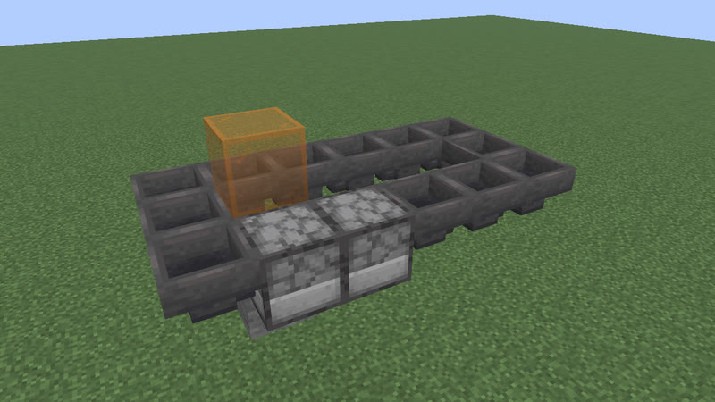</a> 62 gt (3.1 s) · comparator+dropper+hopper · 16 blocks</td></tr>
<tr><td align="center"> 62 gt (3.1 s) · redstone_torch+repeater · 20 blocks</td><td align="center"><a href="archive/droprep-p62.txt">droprep-p62</a> 62 gt (3.1 s) · comparator+dropper+hopper+repeater · 20 blocks (picture pending)</td></tr>
</table>

## 63 gt (3.15 s)

<table>
<tr><td align="center"><a href="archive/clk-sculk-chaind-p63-1.txt">clk-sculk-chaind-p63-1</a> 63 gt (3.15 s) · dispenser+observer+repeater+sculk_sensor · 9 blocks (picture pending)</td><td align="center"><a href="archive/droprep-p63.txt">droprep-p63</a> 63 gt (3.15 s) · comparator+dropper+hopper+repeater · 18 blocks (picture pending)</td><td align="center"><a href="archive/clk-obs-p63-obs-pis-rb-stk-34b-e87c32.txt">clk-obs-p63-obs-pis-rb-stk-34b-e87c32</a> 63 gt (3.15 s) · observer+piston+redstone_block+sticky_piston · 34 blocks (picture pending)</td></tr>
<tr><td align="center"><a href="archive/clk-rt-odd-rect-p63-36b.txt">clk-rt-odd-rect-p63-36b</a> 63 gt (3.15 s) · repeater · 36 blocks (picture pending)</td></tr>
</table>

## 64 gt (3.2 s)

<table>
<tr><td align="center"><a href="archive/clk-obs-p64-bulb-obs-stk-7b-bf0bf5.txt">clk-obs-p64-bulb-obs-stk-7b-bf0bf5</a> 64 gt (3.2 s) · copper_bulb+observer+sticky_piston · 7 blocks (picture pending)</td><td align="center"> 64 gt (3.2 s) · hopper+redstone_torch+redstone_wire · 8 blocks</td><td align="center"><a href="archive/clk-sculk-chaind-p64-1.txt">clk-sculk-chaind-p64-1</a> 64 gt (3.2 s) · dispenser+observer+repeater+sculk_sensor · 10 blocks (picture pending)</td></tr>
<tr><td align="center"> 64 gt (3.2 s) · redstone_torch+redstone_wire+repeater · 13 blocks</td><td align="center"><a href="archive/droprep-p64.txt">droprep-p64</a> 64 gt (3.2 s) · comparator+dropper+hopper+repeater · 18 blocks (picture pending)</td></tr>
</table>

## 65 gt (3.25 s)

<table>
<tr><td align="center"><a href="archive/clk-obs-p65-obs-stk-7b-890ba1.txt">clk-obs-p65-obs-stk-7b-890ba1</a> 65 gt (3.25 s) · observer+sticky_piston · 7 blocks (picture pending)</td><td align="center"> 65 gt (3.25 s) · comparator+hopper+redstone_torch+redstone_wire · 8 blocks</td><td align="center"><a href="archive/clk-sculk-chaind-p65-1.txt">clk-sculk-chaind-p65-1</a> 65 gt (3.25 s) · dispenser+observer+repeater+sculk_sensor · 9 blocks (picture pending)</td></tr>
<tr><td align="center"><a href="archive/droprep-p65.txt">droprep-p65</a> 65 gt (3.25 s) · comparator+dropper+hopper+repeater · 20 blocks (picture pending)</td><td align="center"><a href="archive/clk-rt-odd-rect-p65-39b.txt">clk-rt-odd-rect-p65-39b</a> 65 gt (3.25 s) · repeater · 39 blocks (picture pending)</td></tr>
</table>

## 66 gt (3.3 s)

<table>
<tr><td align="center"><a href="archive/census-p66-calibrated_sculk_sensor-dispenser-oak_trapdoor-observer-5b.txt">census-p66-calibrated_sculk_sensor-dispenser-oak_trapdoor-observer-5b</a> 66 gt (3.3 s) · calibrated_sculk_sensor+dispenser+oak_trapdoor+observer · 5 blocks (picture pending)</td><td align="center"><a href="archive/clk-obs-p66-obs-stk-7b-a36052.txt">clk-obs-p66-obs-stk-7b-a36052</a> 66 gt (3.3 s) · observer+sticky_piston · 7 blocks (picture pending)</td><td align="center"><a href="archive/droprep-p66.txt">droprep-p66</a> 66 gt (3.3 s) · comparator+dropper+hopper+repeater · 18 blocks (picture pending)</td></tr>
<tr><td align="center"> 66 gt (3.3 s) · redstone_torch+repeater · 20 blocks</td></tr>
</table>

## 67 gt (3.35 s)

<table>
<tr><td align="center"><a href="archive/clk-sculk-chain-p67-10.txt">clk-sculk-chain-p67-10</a> 67 gt (3.35 s) · oak_fence_gate+repeater+sculk_sensor · 10 blocks (picture pending)</td><td align="center"><a href="archive/droprep-p67.txt">droprep-p67</a> 67 gt (3.35 s) · comparator+dropper+hopper+repeater · 20 blocks (picture pending)</td><td align="center"><a href="archive/clk-obs-p67-obs-pis-rb-stk-36b-6f3a54.txt">clk-obs-p67-obs-pis-rb-stk-36b-6f3a54</a> 67 gt (3.35 s) · observer+piston+redstone_block+sticky_piston · 36 blocks (picture pending)</td></tr>
<tr><td align="center"><a href="archive/clk-rt-odd-rect-p67-39b.txt">clk-rt-odd-rect-p67-39b</a> 67 gt (3.35 s) · repeater · 39 blocks (picture pending)</td></tr>
</table>

## 68 gt (3.4 s)

<table>
<tr><td align="center"><a href="archive/clk-rt-uloop-p68-rt-rw-r-13b.txt">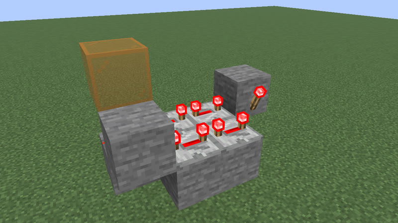</a> 68 gt (3.4 s) · redstone_torch+redstone_wire+repeater · 13 blocks</td><td align="center"><a href="archive/droprep-p68.txt">droprep-p68</a> 68 gt (3.4 s) · comparator+dropper+hopper+repeater · 18 blocks (picture pending)</td><td align="center"><a href="archive/clk-obs-p68-obs-34b-3a3c8f.txt">clk-obs-p68-obs-34b-3a3c8f</a> 68 gt (3.4 s) · observer · 34 blocks (picture pending)</td></tr>
</table>

## 69 gt (3.45 s)

<table>
<tr><td align="center"><a href="archive/dropringw-p69.txt">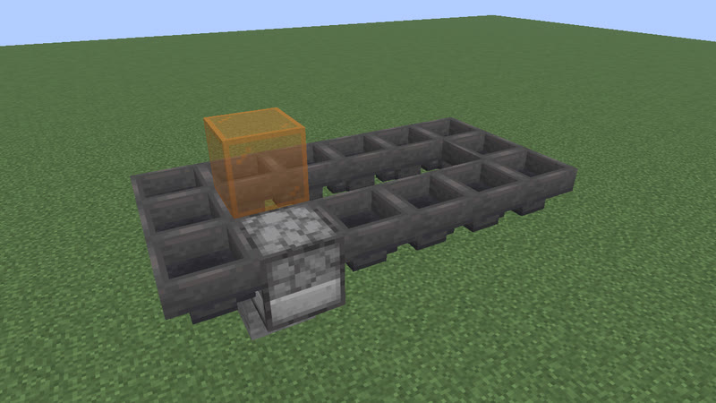</a> 69 gt (3.45 s) · comparator+dropper+hopper · 16 blocks</td><td align="center"><a href="archive/droprep-p69.txt">droprep-p69</a> 69 gt (3.45 s) · comparator+dropper+hopper+repeater · 20 blocks (picture pending)</td><td align="center"><a href="archive/clk-obs-p69-obs-pis-rb-stk-38b-9e6835.txt">clk-obs-p69-obs-pis-rb-stk-38b-9e6835</a> 69 gt (3.45 s) · observer+piston+redstone_block+sticky_piston · 38 blocks (picture pending)</td></tr>
<tr><td align="center"><a href="archive/clk-rt-odd-rect-p69-40b.txt">clk-rt-odd-rect-p69-40b</a> 69 gt (3.45 s) · repeater · 40 blocks (picture pending)</td></tr>
</table>

## 70 gt (3.5 s)

<table>
<tr><td align="center"><a href="archive/clk-sculk-hyb3b-p70-1.txt">clk-sculk-hyb3b-p70-1</a> 70 gt (3.5 s) · calibrated_sculk_sensor+dispenser+observer+sticky_piston · 6 blocks (picture pending)</td><td align="center"><a href="archive/clk-obs-p70-obs-stk-7b-108974.txt">clk-obs-p70-obs-stk-7b-108974</a> 70 gt (3.5 s) · observer+sticky_piston · 7 blocks (picture pending)</td><td align="center"><a href="archive/droprep-p70.txt">droprep-p70</a> 70 gt (3.5 s) · comparator+dropper+hopper+repeater · 18 blocks (picture pending)</td></tr>
<tr><td align="center"> 70 gt (3.5 s) · redstone_torch+repeater · 24 blocks</td></tr>
</table>

## 71 gt (3.55 s)

<table>
<tr><td align="center"><a href="archive/clk-sculk-hyb3-p71-1.txt">clk-sculk-hyb3-p71-1</a> 71 gt (3.55 s) · calibrated_sculk_sensor+observer+sticky_piston · 7 blocks (picture pending)</td><td align="center"><a href="archive/droprep-p71.txt">droprep-p71</a> 71 gt (3.55 s) · comparator+dropper+hopper+repeater · 20 blocks (picture pending)</td><td align="center"><a href="archive/clk-obs-p71-obs-pis-rb-stk-38b-c7264c.txt">clk-obs-p71-obs-pis-rb-stk-38b-c7264c</a> 71 gt (3.55 s) · observer+piston+redstone_block+sticky_piston · 38 blocks (picture pending)</td></tr>
<tr><td align="center"><a href="archive/clk-rt-odd-rect-p71-40b.txt">clk-rt-odd-rect-p71-40b</a> 71 gt (3.55 s) · repeater · 40 blocks (picture pending)</td></tr>
</table>

## 72 gt (3.6 s)

<table>
<tr><td align="center"> 72 gt (3.6 s) · calibrated_sculk_sensor+observer+sticky_piston · 6 blocks</td><td align="center"><a href="archive/clk-obs-p72-bulb-obs-stk-7b-2a79be.txt">clk-obs-p72-bulb-obs-stk-7b-2a79be</a> 72 gt (3.6 s) · copper_bulb+observer+sticky_piston · 7 blocks (picture pending)</td><td align="center"> 72 gt (3.6 s) · redstone_torch+redstone_wire+repeater · 17 blocks</td></tr>
<tr><td align="center"><a href="archive/droprep-p72.txt">droprep-p72</a> 72 gt (3.6 s) · comparator+dropper+hopper+repeater · 22 blocks (picture pending)</td></tr>
</table>

## 73 gt (3.65 s)

<table>
<tr><td align="center"><a href="archive/droprep-p73.txt">droprep-p73</a> 73 gt (3.65 s) · comparator+dropper+hopper+repeater · 20 blocks (picture pending)</td><td align="center"><a href="archive/clk-obs-p73-obs-pis-rb-stk-40b-897743.txt">clk-obs-p73-obs-pis-rb-stk-40b-897743</a> 73 gt (3.65 s) · observer+piston+redstone_block+sticky_piston · 40 blocks (picture pending)</td><td align="center"><a href="archive/clk-rt-odd-rect-p73-43b.txt">clk-rt-odd-rect-p73-43b</a> 73 gt (3.65 s) · repeater · 43 blocks (picture pending)</td></tr>
</table>

## 74 gt (3.7 s)

<table>
<tr><td align="center"><a href="archive/clk-obs-p74-bulb-obs-stk-7b-d93322.txt">clk-obs-p74-bulb-obs-stk-7b-d93322</a> 74 gt (3.7 s) · copper_bulb+observer+sticky_piston · 7 blocks (picture pending)</td><td align="center"><a href="archive/droprep-p74.txt">droprep-p74</a> 74 gt (3.7 s) · comparator+dropper+hopper+repeater · 22 blocks (picture pending)</td><td align="center"> 74 gt (3.7 s) · redstone_torch+repeater · 24 blocks</td></tr>
</table>

## 75 gt (3.75 s)

<table>
<tr><td align="center"><a href="archive/droprep-p75.txt">droprep-p75</a> 75 gt (3.75 s) · comparator+dropper+hopper+repeater · 20 blocks (picture pending)</td><td align="center"><a href="archive/clk-obs-p75-obs-pis-rb-stk-40b-52753b.txt">clk-obs-p75-obs-pis-rb-stk-40b-52753b</a> 75 gt (3.75 s) · observer+piston+redstone_block+sticky_piston · 40 blocks (picture pending)</td><td align="center"><a href="archive/clk-rt-odd-rect-p75-43b.txt">clk-rt-odd-rect-p75-43b</a> 75 gt (3.75 s) · repeater · 43 blocks (picture pending)</td></tr>
</table>

## 76 gt (3.8 s)

<table>
<tr><td align="center"><a href="archive/clk-obs-p76-bulb-obs-stk-7b-d8a316.txt">clk-obs-p76-bulb-obs-stk-7b-d8a316</a> 76 gt (3.8 s) · copper_bulb+observer+sticky_piston · 7 blocks (picture pending)</td><td align="center"><a href="archive/clk-sculk-chain-p76-5.txt">clk-sculk-chain-p76-5</a> 76 gt (3.8 s) · oak_fence_gate+repeater+sculk_sensor · 12 blocks (picture pending)</td><td align="center"> 76 gt (3.8 s) · redstone_torch+redstone_wire+repeater · 17 blocks</td></tr>
<tr><td align="center"><a href="archive/dropringw-p76.txt">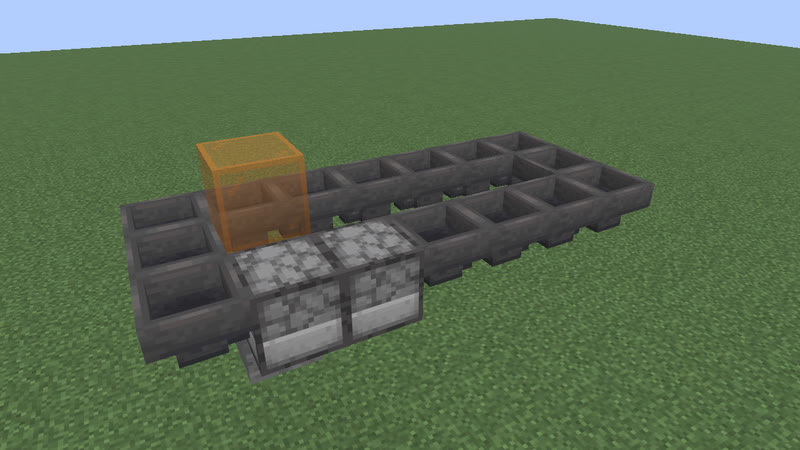</a> 76 gt (3.8 s) · comparator+dropper+hopper · 18 blocks</td><td align="center"><a href="archive/droprep-p76.txt">droprep-p76</a> 76 gt (3.8 s) · comparator+dropper+hopper+repeater · 22 blocks (picture pending)</td></tr>
</table>

## 77 gt (3.85 s)

<table>
<tr><td align="center"><a href="archive/clk-sculk-chain-p77-1.txt">clk-sculk-chain-p77-1</a> 77 gt (3.85 s) · note_block+redstone_torch+repeater+sculk_sensor · 14 blocks (picture pending)</td><td align="center"><a href="archive/droprep-p77.txt">droprep-p77</a> 77 gt (3.85 s) · comparator+dropper+hopper+repeater · 20 blocks (picture pending)</td><td align="center"><a href="archive/clk-obs-p77-obs-pis-rb-stk-42b-0cadcd.txt">clk-obs-p77-obs-pis-rb-stk-42b-0cadcd</a> 77 gt (3.85 s) · observer+piston+redstone_block+sticky_piston · 42 blocks (picture pending)</td></tr>
<tr><td align="center"><a href="archive/clk-rt-odd-rect-p77-44b.txt">clk-rt-odd-rect-p77-44b</a> 77 gt (3.85 s) · repeater · 44 blocks (picture pending)</td></tr>
</table>

## 78 gt (3.9 s)

<table>
<tr><td align="center"> 78 gt (3.9 s) · observer+piston · 6 blocks</td><td align="center"><a href="archive/droprep-p78.txt">droprep-p78</a> 78 gt (3.9 s) · comparator+dropper+hopper+repeater · 20 blocks (picture pending)</td><td align="center"> 78 gt (3.9 s) · redstone_torch+repeater · 24 blocks</td></tr>
</table>

## 79 gt (3.95 s)

<table>
<tr><td align="center"><a href="archive/clk-obs-p79-obs-pis-stk-7b-109879.txt">clk-obs-p79-obs-pis-stk-7b-109879</a> 79 gt (3.95 s) · observer+piston+sticky_piston · 7 blocks (picture pending)</td><td align="center"><a href="archive/clk-sculk-chain-p79-1.txt">clk-sculk-chain-p79-1</a> 79 gt (3.95 s) · note_block+redstone_torch+repeater+sculk_sensor · 14 blocks (picture pending)</td><td align="center"><a href="archive/droprep-p79.txt">droprep-p79</a> 79 gt (3.95 s) · comparator+dropper+hopper+repeater · 22 blocks (picture pending)</td></tr>
<tr><td align="center"><a href="archive/clk-rt-odd-rect-p79-44b.txt">clk-rt-odd-rect-p79-44b</a> 79 gt (3.95 s) · repeater · 44 blocks (picture pending)</td></tr>
</table>

## 80 gt (4 s)

<table>
<tr><td align="center"><a href="archive/clk-obs-p80-obs-stk-7b-ef523d.txt">clk-obs-p80-obs-stk-7b-ef523d</a> 80 gt (4 s) · observer+sticky_piston · 7 blocks (picture pending)</td><td align="center"> 80 gt (4 s) · redstone_torch+redstone_wire+repeater · 17 blocks</td><td align="center"><a href="archive/droprep-p80.txt">droprep-p80</a> 80 gt (4 s) · comparator+dropper+hopper+repeater · 20 blocks (picture pending)</td></tr>
</table>

## 81 gt (4.05 s)

<table>
<tr><td align="center"> 81 gt (4.05 s) · comparator+dropper+hopper · 10 blocks</td><td align="center"><a href="archive/droprep-p81.txt">droprep-p81</a> 81 gt (4.05 s) · comparator+dropper+hopper+repeater · 22 blocks (picture pending)</td><td align="center"><a href="archive/clk-obs-p81-obs-pis-rb-stk-44b-1b0e81.txt">clk-obs-p81-obs-pis-rb-stk-44b-1b0e81</a> 81 gt (4.05 s) · observer+piston+redstone_block+sticky_piston · 44 blocks (picture pending)</td></tr>
<tr><td align="center"><a href="archive/clk-rt-odd-rect-p81-47b.txt">clk-rt-odd-rect-p81-47b</a> 81 gt (4.05 s) · repeater · 47 blocks (picture pending)</td></tr>
</table>

## 82 gt (4.1 s)

<table>
<tr><td align="center"><a href="archive/droprep-p82.txt">droprep-p82</a> 82 gt (4.1 s) · comparator+dropper+hopper+repeater · 20 blocks (picture pending)</td><td align="center"> 82 gt (4.1 s) · redstone_torch+repeater · 24 blocks</td><td align="center"><a href="archive/clk-obs-p82-note-obs-42b-0f8007.txt">clk-obs-p82-note-obs-42b-0f8007</a> 82 gt (4.1 s) · note_block+observer · 42 blocks (picture pending)</td></tr>
</table>

## 83 gt (4.15 s)

<table>
<tr><td align="center"><a href="archive/dropringw-p83.txt">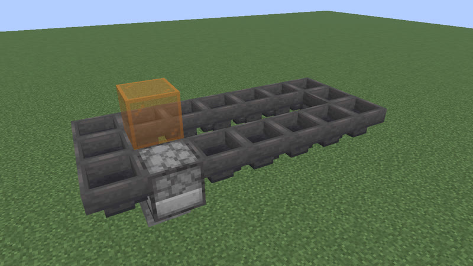</a> 83 gt (4.15 s) · comparator+dropper+hopper · 18 blocks</td><td align="center"><a href="archive/droprep-p83.txt">droprep-p83</a> 83 gt (4.15 s) · comparator+dropper+hopper+repeater · 22 blocks (picture pending)</td><td align="center"><a href="archive/clk-obs-p83-obs-pis-rb-stk-44b-c5b4c9.txt">clk-obs-p83-obs-pis-rb-stk-44b-c5b4c9</a> 83 gt (4.15 s) · observer+piston+redstone_block+sticky_piston · 44 blocks (picture pending)</td></tr>
<tr><td align="center"><a href="archive/clk-rt-odd-rect-p83-47b.txt">clk-rt-odd-rect-p83-47b</a> 83 gt (4.15 s) · repeater · 47 blocks (picture pending)</td></tr>
</table>

## 84 gt (4.2 s)

<table>
<tr><td align="center"><a href="archive/census-p84-calibrated_sculk_sensor-dispenser-observer-sculk_sensor-5b.txt">census-p84-calibrated_sculk_sensor-dispenser-observer-sculk_sensor-5b</a> 84 gt (4.2 s) · calibrated_sculk_sensor+dispenser+observer+sculk_sensor · 5 blocks (picture pending)</td><td align="center"><a href="archive/clk-obs-p84-bulb-obs-pis-7b-85bd93.txt">clk-obs-p84-bulb-obs-pis-7b-85bd93</a> 84 gt (4.2 s) · copper_bulb+observer+piston · 7 blocks (picture pending)</td><td align="center"> 84 gt (4.2 s) · redstone_torch+redstone_wire+repeater · 17 blocks</td></tr>
<tr><td align="center"><a href="archive/droprep-p84.txt">droprep-p84</a> 84 gt (4.2 s) · comparator+dropper+hopper+repeater · 20 blocks (picture pending)</td></tr>
</table>

## 85 gt (4.25 s)

<table>
<tr><td align="center"><a href="archive/clk-sculk-hyb-p85-1.txt">clk-sculk-hyb-p85-1</a> 85 gt (4.25 s) · observer+sculk_sensor+sticky_piston · 6 blocks (picture pending)</td><td align="center"><a href="archive/droprep-p85.txt">droprep-p85</a> 85 gt (4.25 s) · comparator+dropper+hopper+repeater · 22 blocks (picture pending)</td><td align="center"><a href="archive/clk-obs-p85-obs-pis-rb-stk-46b-02cad0.txt">clk-obs-p85-obs-pis-rb-stk-46b-02cad0</a> 85 gt (4.25 s) · observer+piston+redstone_block+sticky_piston · 46 blocks (picture pending)</td></tr>
<tr><td align="center"><a href="archive/clk-rt-odd-rect-p85-48b.txt">clk-rt-odd-rect-p85-48b</a> 85 gt (4.25 s) · repeater · 48 blocks (picture pending)</td></tr>
</table>

## 86 gt (4.3 s)

<table>
<tr><td align="center"><a href="archive/clk-sculk-hyb-p86-1.txt">clk-sculk-hyb-p86-1</a> 86 gt (4.3 s) · observer+sculk_sensor+sticky_piston · 6 blocks (picture pending)</td><td align="center"><a href="archive/clk-obs-p86-bulb-obs-rb-stk-7b-99c6a4.txt">clk-obs-p86-bulb-obs-rb-stk-7b-99c6a4</a> 86 gt (4.3 s) · copper_bulb+observer+redstone_block+sticky_piston · 7 blocks (picture pending)</td><td align="center"> 86 gt (4.3 s) · comparator+redstone_torch+redstone_wire · 17 blocks</td></tr>
<tr><td align="center"><a href="archive/droprep-p86.txt">droprep-p86</a> 86 gt (4.3 s) · comparator+dropper+hopper+repeater · 24 blocks (picture pending)</td><td align="center"> 86 gt (4.3 s) · redstone_torch+repeater · 28 blocks</td></tr>
</table>

## 87 gt (4.35 s)

<table>
<tr><td align="center"><a href="archive/clk-obs-p87-obs-stk-7b-8eb4b8.txt">clk-obs-p87-obs-stk-7b-8eb4b8</a> 87 gt (4.35 s) · observer+sticky_piston · 7 blocks (picture pending)</td><td align="center"><a href="archive/clk-sculk-hyb3-p87-1.txt">clk-sculk-hyb3-p87-1</a> 87 gt (4.35 s) · observer+piston+sculk_sensor+sticky_piston · 7 blocks (picture pending)</td><td align="center"><a href="archive/droprep-p87.txt">droprep-p87</a> 87 gt (4.35 s) · comparator+dropper+hopper+repeater · 22 blocks (picture pending)</td></tr>
<tr><td align="center"><a href="archive/clk-rt-odd-rect-p87-48b.txt">clk-rt-odd-rect-p87-48b</a> 87 gt (4.35 s) · repeater · 48 blocks (picture pending)</td></tr>
</table>

## 88 gt (4.4 s)

<table>
<tr><td align="center"><a href="archive/clk-sculk-hyb-p88-3.txt">clk-sculk-hyb-p88-3</a> 88 gt (4.4 s) · observer+sculk_sensor+sticky_piston · 4 blocks (picture pending)</td><td align="center"> 88 gt (4.4 s) · comparator+redstone_torch+redstone_wire · 17 blocks</td><td align="center"> 88 gt (4.4 s) · redstone_torch+redstone_wire+repeater · 17 blocks</td></tr>
<tr><td align="center"><a href="archive/droprep-p88.txt">droprep-p88</a> 88 gt (4.4 s) · comparator+dropper+hopper+repeater · 24 blocks (picture pending)</td><td align="center"><a href="archive/clk-obs-p88-obs-44b-b10bf4.txt">clk-obs-p88-obs-44b-b10bf4</a> 88 gt (4.4 s) · observer · 44 blocks (picture pending)</td></tr>
</table>

## 89 gt (4.45 s)

<table>
<tr><td align="center"><a href="archive/clk-sculk-hyb3-p89-2.txt">clk-sculk-hyb3-p89-2</a> 89 gt (4.45 s) · observer+sculk_sensor+sticky_piston · 7 blocks (picture pending)</td><td align="center"><a href="archive/droprep-p89.txt">droprep-p89</a> 89 gt (4.45 s) · comparator+dropper+hopper+repeater · 22 blocks (picture pending)</td><td align="center"><a href="archive/clk-obs-p89-obs-pis-rb-stk-48b-c5518f.txt">clk-obs-p89-obs-pis-rb-stk-48b-c5518f</a> 89 gt (4.45 s) · observer+piston+redstone_block+sticky_piston · 48 blocks (picture pending)</td></tr>
<tr><td align="center"><a href="archive/clk-rt-odd-rect-p89-51b.txt">clk-rt-odd-rect-p89-51b</a> 89 gt (4.45 s) · repeater · 51 blocks (picture pending)</td></tr>
</table>

## 90 gt (4.5 s)

<table>
<tr><td align="center"><a href="archive/census-p90-oak_trapdoor-observer-sculk_sensor-4b.txt">census-p90-oak_trapdoor-observer-sculk_sensor-4b</a> 90 gt (4.5 s) · oak_trapdoor+observer+sculk_sensor · 4 blocks (picture pending)</td><td align="center"> 90 gt (4.5 s) · calibrated_sculk_sensor+observer+sticky_piston · 6 blocks</td><td align="center"><a href="archive/clk-obs-p90-obs-stk-7b-2e3301.txt">clk-obs-p90-obs-stk-7b-2e3301</a> 90 gt (4.5 s) · observer+sticky_piston · 7 blocks (picture pending)</td></tr>
<tr><td align="center"><a href="archive/droprep-p90.txt">droprep-p90</a> 90 gt (4.5 s) · comparator+dropper+hopper+repeater · 24 blocks (picture pending)</td><td align="center"> 90 gt (4.5 s) · redstone_torch+repeater · 28 blocks</td></tr>
</table>

## 91 gt (4.55 s)

<table>
<tr><td align="center"><a href="archive/clk-sculk-hyb3-p91-2.txt">clk-sculk-hyb3-p91-2</a> 91 gt (4.55 s) · oak_trapdoor+observer+sculk_sensor+sticky_piston · 6 blocks (picture pending)</td><td align="center"><a href="archive/droprep-p91.txt">droprep-p91</a> 91 gt (4.55 s) · comparator+dropper+hopper+repeater · 22 blocks (picture pending)</td><td align="center"><a href="archive/clk-obs-p91-obs-pis-rb-stk-48b-4561d6.txt">clk-obs-p91-obs-pis-rb-stk-48b-4561d6</a> 91 gt (4.55 s) · observer+piston+redstone_block+sticky_piston · 48 blocks (picture pending)</td></tr>
<tr><td align="center"><a href="archive/clk-rt-odd-rect-p91-51b.txt">clk-rt-odd-rect-p91-51b</a> 91 gt (4.55 s) · repeater · 51 blocks (picture pending)</td></tr>
</table>

## 92 gt (4.6 s)

<table>
<tr><td align="center"><a href="archive/clk-sculk-hyb-p92-3.txt">clk-sculk-hyb-p92-3</a> 92 gt (4.6 s) · observer+sculk_sensor+sticky_piston · 5 blocks (picture pending)</td><td align="center"><a href="archive/clk-obs-p92-obs-stk-7b-c12af4.txt">clk-obs-p92-obs-stk-7b-c12af4</a> 92 gt (4.6 s) · observer+sticky_piston · 7 blocks (picture pending)</td><td align="center"> 92 gt (4.6 s) · redstone_torch+redstone_wire+repeater · 17 blocks</td></tr>
<tr><td align="center"><a href="archive/droprep-p92.txt">droprep-p92</a> 92 gt (4.6 s) · comparator+dropper+hopper+repeater · 22 blocks (picture pending)</td></tr>
</table>

## 93 gt (4.65 s)

<table>
<tr><td align="center"><a href="archive/clk-sculk-hyb3b-p93-1.txt">clk-sculk-hyb3b-p93-1</a> 93 gt (4.65 s) · dispenser+observer+sculk_sensor+sticky_piston · 6 blocks (picture pending)</td><td align="center"><a href="archive/droprep-p93.txt">droprep-p93</a> 93 gt (4.65 s) · comparator+dropper+hopper+repeater · 24 blocks (picture pending)</td><td align="center"><a href="archive/clk-obs-p93-obs-pis-rb-stk-50b-27a171.txt">clk-obs-p93-obs-pis-rb-stk-50b-27a171</a> 93 gt (4.65 s) · observer+piston+redstone_block+sticky_piston · 50 blocks (picture pending)</td></tr>
<tr><td align="center"><a href="archive/clk-rt-odd-rect-p93-52b.txt">clk-rt-odd-rect-p93-52b</a> 93 gt (4.65 s) · repeater · 52 blocks (picture pending)</td></tr>
</table>

## 94 gt (4.7 s)

<table>
<tr><td align="center"><a href="archive/clk-sculk-hyb-p94-3.txt">clk-sculk-hyb-p94-3</a> 94 gt (4.7 s) · observer+sculk_sensor+sticky_piston · 5 blocks (picture pending)</td><td align="center"><a href="archive/droprep-p94.txt">droprep-p94</a> 94 gt (4.7 s) · comparator+dropper+hopper+repeater · 22 blocks (picture pending)</td><td align="center"> 94 gt (4.7 s) · redstone_torch+repeater · 28 blocks</td></tr>
<tr><td align="center"><a href="archive/clk-obs-p94-note-obs-48b-81aa89.txt">clk-obs-p94-note-obs-48b-81aa89</a> 94 gt (4.7 s) · note_block+observer · 48 blocks (picture pending)</td></tr>
</table>

## 95 gt (4.75 s)

<table>
<tr><td align="center"><a href="archive/clk-sculk-hyb3-p95-2.txt">clk-sculk-hyb3-p95-2</a> 95 gt (4.75 s) · oak_trapdoor+observer+sculk_sensor+sticky_piston · 6 blocks (picture pending)</td><td align="center"><a href="archive/droprep-p95.txt">droprep-p95</a> 95 gt (4.75 s) · comparator+dropper+hopper+repeater · 24 blocks (picture pending)</td><td align="center"><a href="archive/clk-obs-p95-obs-pis-rb-stk-50b-ff8722.txt">clk-obs-p95-obs-pis-rb-stk-50b-ff8722</a> 95 gt (4.75 s) · observer+piston+redstone_block+sticky_piston · 50 blocks (picture pending)</td></tr>
<tr><td align="center"><a href="archive/clk-rt-odd-rect-p95-52b.txt">clk-rt-odd-rect-p95-52b</a> 95 gt (4.75 s) · repeater · 52 blocks (picture pending)</td></tr>
</table>

## 96 gt (4.8 s)

<table>
<tr><td align="center"><a href="archive/clk-sculk-hyb3-p96-2.txt">clk-sculk-hyb3-p96-2</a> 96 gt (4.8 s) · observer+sculk_sensor+sticky_piston · 6 blocks (picture pending)</td><td align="center"><a href="archive/clk-obs-p96-bulb-obs-stk-7b-cc9634.txt">clk-obs-p96-bulb-obs-stk-7b-cc9634</a> 96 gt (4.8 s) · copper_bulb+observer+sticky_piston · 7 blocks (picture pending)</td><td align="center"> 96 gt (4.8 s) · redstone_torch+redstone_wire+repeater · 17 blocks</td></tr>
<tr><td align="center"><a href="archive/droprep-p96.txt">droprep-p96</a> 96 gt (4.8 s) · comparator+dropper+hopper+repeater · 22 blocks (picture pending)</td></tr>
</table>

## 97 gt (4.85 s)

<table>
<tr><td align="center"><a href="archive/clk-sculk-hyb3-p97-2.txt">clk-sculk-hyb3-p97-2</a> 97 gt (4.85 s) · observer+sculk_sensor+sticky_piston · 6 blocks (picture pending)</td><td align="center"><a href="archive/droprep-p97.txt">droprep-p97</a> 97 gt (4.85 s) · comparator+dropper+hopper+repeater · 24 blocks (picture pending)</td><td align="center"><a href="archive/clk-obs-p97-obs-pis-rb-stk-52b-b85fcf.txt">clk-obs-p97-obs-pis-rb-stk-52b-b85fcf</a> 97 gt (4.85 s) · observer+piston+redstone_block+sticky_piston · 52 blocks (picture pending)</td></tr>
<tr><td align="center"><a href="archive/clk-rt-odd-rect-p97-55b.txt">clk-rt-odd-rect-p97-55b</a> 97 gt (4.85 s) · repeater · 55 blocks (picture pending)</td></tr>
</table>

## 98 gt (4.9 s)

<table>
<tr><td align="center"><a href="archive/clk-sculk-hyb3-p98-2.txt">clk-sculk-hyb3-p98-2</a> 98 gt (4.9 s) · observer+sculk_sensor+sticky_piston · 6 blocks (picture pending)</td><td align="center"> 98 gt (4.9 s) · comparator+hopper · 10 blocks</td><td align="center"><a href="archive/droprep-p98.txt">droprep-p98</a> 98 gt (4.9 s) · comparator+dropper+hopper+repeater · 22 blocks (picture pending)</td></tr>
<tr><td align="center"> 98 gt (4.9 s) · redstone_torch+repeater · 28 blocks</td><td align="center"><a href="archive/clk-obs-p98-note-obs-50b-5d8a0a.txt">clk-obs-p98-note-obs-50b-5d8a0a</a> 98 gt (4.9 s) · note_block+observer · 50 blocks (picture pending)</td></tr>
</table>

## 99 gt (4.95 s)

<table>
<tr><td align="center"><a href="archive/droprep-p99.txt">droprep-p99</a> 99 gt (4.95 s) · comparator+dropper+hopper+repeater · 24 blocks (picture pending)</td><td align="center"><a href="archive/clk-obs-p99-obs-pis-rb-stk-52b-4f5c58.txt">clk-obs-p99-obs-pis-rb-stk-52b-4f5c58</a> 99 gt (4.95 s) · observer+piston+redstone_block+sticky_piston · 52 blocks (picture pending)</td><td align="center"><a href="archive/clk-rt-odd-rect-p99-55b.txt">clk-rt-odd-rect-p99-55b</a> 99 gt (4.95 s) · repeater · 55 blocks (picture pending)</td></tr>
</table>

## 100 gt (5 s)

<table>
<tr><td align="center"><a href="archive/clk-sculk-hyb3-p100-2.txt">clk-sculk-hyb3-p100-2</a> 100 gt (5 s) · observer+sculk_sensor+sticky_piston · 6 blocks (picture pending)</td><td align="center"><a href="archive/clk-rt-uloop-p100-17b.txt">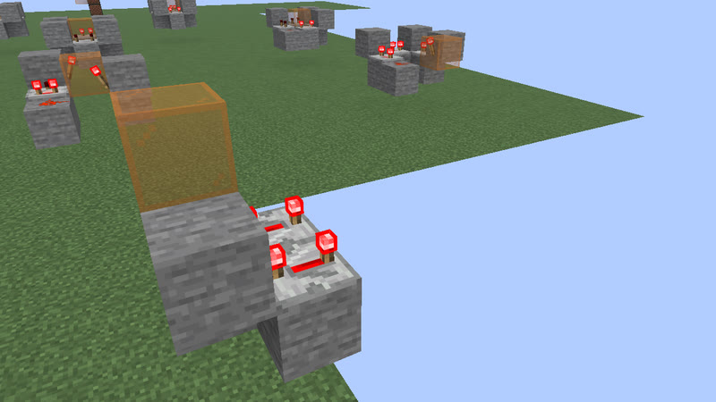</a> 100 gt (5 s) · redstone_torch+redstone_wire+repeater · 17 blocks</td><td align="center"><a href="archive/droprep-p100.txt">droprep-p100</a> 100 gt (5 s) · comparator+dropper+hopper+repeater · 26 blocks (picture pending)</td></tr>
<tr><td align="center"><a href="archive/clk-obs-p100-obs-50b-d27740.txt">clk-obs-p100-obs-50b-d27740</a> 100 gt (5 s) · observer · 50 blocks (picture pending)</td></tr>
</table>

## 101 gt (5.05 s)

<table>
<tr><td align="center"><a href="archive/droprep-p101.txt">droprep-p101</a> 101 gt (5.05 s) · comparator+dropper+hopper+repeater · 26 blocks (picture pending)</td><td align="center"><a href="archive/clk-obs-p101-obs-pis-rb-stk-54b-58b3ef.txt">clk-obs-p101-obs-pis-rb-stk-54b-58b3ef</a> 101 gt (5.05 s) · observer+piston+redstone_block+sticky_piston · 54 blocks (picture pending)</td></tr>
</table>

## 102 gt (5.1 s)

<table>
<tr><td align="center"><a href="archive/droprep-p102.txt">droprep-p102</a> 102 gt (5.1 s) · comparator+dropper+hopper+repeater · 26 blocks (picture pending)</td><td align="center"><a href="archive/clk-obs-p102-note-obs-52b-9afaf3.txt">clk-obs-p102-note-obs-52b-9afaf3</a> 102 gt (5.1 s) · note_block+observer · 52 blocks (picture pending)</td></tr>
</table>

## 103 gt (5.15 s)

<table>
<tr><td align="center"><a href="archive/droprep-p103.txt">droprep-p103</a> 103 gt (5.15 s) · comparator+dropper+hopper+repeater · 26 blocks (picture pending)</td><td align="center"><a href="archive/clk-obs-p103-obs-pis-rb-stk-54b-8a13a6.txt">clk-obs-p103-obs-pis-rb-stk-54b-8a13a6</a> 103 gt (5.15 s) · observer+piston+redstone_block+sticky_piston · 54 blocks (picture pending)</td></tr>
</table>

## 104 gt (5.2 s)

<table>
<tr><td align="center"><a href="archive/clk-obs-p104-obs-stk-7b-de77b3.txt">clk-obs-p104-obs-stk-7b-de77b3</a> 104 gt (5.2 s) · observer+sticky_piston · 7 blocks (picture pending)</td><td align="center"><a href="archive/ringlock3x6n5-p104.txt">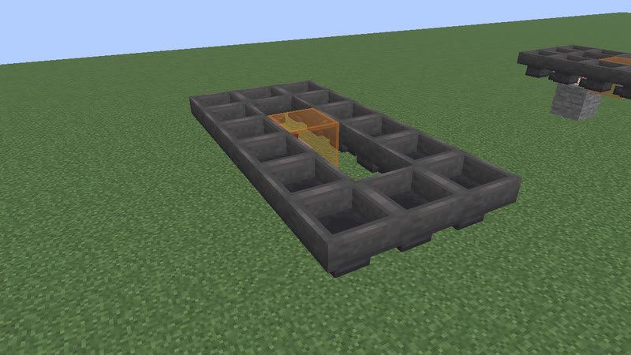</a> 104 gt (5.2 s) · comparator+hopper · 16 blocks</td><td align="center"><a href="archive/droprep-p104.txt">droprep-p104</a> 104 gt (5.2 s) · comparator+dropper+hopper+repeater · 26 blocks (picture pending)</td></tr>
</table>

## 105 gt (5.25 s)

<table>
<tr><td align="center"><a href="archive/clk-obs-p105-obs-stk-7b-fa107e.txt">clk-obs-p105-obs-stk-7b-fa107e</a> 105 gt (5.25 s) · observer+sticky_piston · 7 blocks (picture pending)</td><td align="center"><a href="archive/droprep-p105.txt">droprep-p105</a> 105 gt (5.25 s) · comparator+dropper+hopper+repeater · 26 blocks (picture pending)</td></tr>
</table>

## 106 gt (5.3 s)

<table>
<tr><td align="center"> 106 gt (5.3 s) · comparator+hopper · 10 blocks</td><td align="center"><a href="archive/droprep-p106.txt">droprep-p106</a> 106 gt (5.3 s) · comparator+dropper+hopper+repeater · 26 blocks (picture pending)</td><td align="center"><a href="archive/clk-obs-p106-note-obs-54b-4586e3.txt">clk-obs-p106-note-obs-54b-4586e3</a> 106 gt (5.3 s) · note_block+observer · 54 blocks (picture pending)</td></tr>
</table>

## 107 gt (5.35 s)

<table>
<tr><td align="center"><a href="archive/droprep-p107.txt">droprep-p107</a> 107 gt (5.35 s) · comparator+dropper+hopper+repeater · 26 blocks (picture pending)</td><td align="center"><a href="archive/clk-obs-p107-obs-pis-rb-stk-56b-2f917d.txt">clk-obs-p107-obs-pis-rb-stk-56b-2f917d</a> 107 gt (5.35 s) · observer+piston+redstone_block+sticky_piston · 56 blocks (picture pending)</td></tr>
</table>

## 108 gt (5.4 s)

<table>
<tr><td align="center"><a href="archive/clk-obs-p108-obs-stk-7b-d936ef.txt">clk-obs-p108-obs-stk-7b-d936ef</a> 108 gt (5.4 s) · observer+sticky_piston · 7 blocks (picture pending)</td></tr>
</table>

## 109 gt (5.45 s)

<table>
<tr><td align="center"><a href="archive/droprep-p109.txt">droprep-p109</a> 109 gt (5.45 s) · comparator+dropper+hopper+repeater · 26 blocks (picture pending)</td><td align="center"><a href="archive/clk-obs-p109-obs-pis-rb-stk-58b-29c47c.txt">clk-obs-p109-obs-pis-rb-stk-58b-29c47c</a> 109 gt (5.45 s) · observer+piston+redstone_block+sticky_piston · 58 blocks (picture pending)</td></tr>
</table>

## 110 gt (5.5 s)

<table>
<tr><td align="center"><a href="archive/clk-obs-p110-note-obs-56b-d957ea.txt">clk-obs-p110-note-obs-56b-d957ea</a> 110 gt (5.5 s) · note_block+observer · 56 blocks (picture pending)</td></tr>
</table>

## 111 gt (5.55 s)

<table>
<tr><td align="center"><a href="archive/droprep-p111.txt">droprep-p111</a> 111 gt (5.55 s) · comparator+dropper+hopper+repeater · 26 blocks (picture pending)</td><td align="center"><a href="archive/clk-obs-p111-obs-pis-rb-stk-58b-1a1a6a.txt">clk-obs-p111-obs-pis-rb-stk-58b-1a1a6a</a> 111 gt (5.55 s) · observer+piston+redstone_block+sticky_piston · 58 blocks (picture pending)</td></tr>
</table>

## 112 gt (5.6 s)

<table>
<tr><td align="center"><a href="archive/clk-obs-p112-obs-56b-2fc87e.txt">clk-obs-p112-obs-56b-2fc87e</a> 112 gt (5.6 s) · observer · 56 blocks (picture pending)</td></tr>
</table>

## 113 gt (5.65 s)

<table>
<tr><td align="center"><a href="archive/droprep-p113.txt">droprep-p113</a> 113 gt (5.65 s) · comparator+dropper+hopper+repeater · 26 blocks (picture pending)</td><td align="center"><a href="archive/clk-obs-p113-obs-pis-rb-stk-60b-798366.txt">clk-obs-p113-obs-pis-rb-stk-60b-798366</a> 113 gt (5.65 s) · observer+piston+redstone_block+sticky_piston · 60 blocks (picture pending)</td></tr>
</table>

## 114 gt (5.7 s)

<table>
<tr><td align="center"><a href="archive/clk-rt-uloop-p114-18b.txt">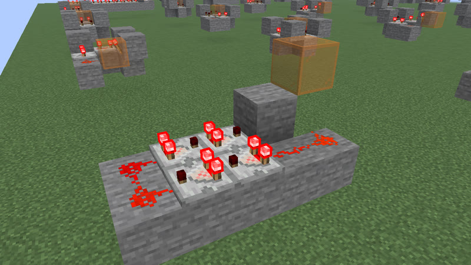</a> 114 gt (5.7 s) · comparator+redstone_torch+redstone_wire · 18 blocks</td><td align="center"><a href="archive/clk-obs-p114-note-obs-58b-a8b3a2.txt">clk-obs-p114-note-obs-58b-a8b3a2</a> 114 gt (5.7 s) · note_block+observer · 58 blocks (picture pending)</td></tr>
</table>

## 115 gt (5.75 s)

<table>
<tr><td align="center"><a href="archive/clk-obs-p115-obs-pis-rb-stk-60b-816152.txt">clk-obs-p115-obs-pis-rb-stk-60b-816152</a> 115 gt (5.75 s) · observer+piston+redstone_block+sticky_piston · 60 blocks (picture pending)</td></tr>
</table>

## 116 gt (5.8 s)

<table>
<tr><td align="center"> 116 gt (5.8 s) · copper_bulb+observer · 10 blocks</td></tr>
</table>

## 117 gt (5.85 s)

<table>
<tr><td align="center"><a href="archive/clk-obs-p117-obs-pis-rb-stk-62b-bad869.txt">clk-obs-p117-obs-pis-rb-stk-62b-bad869</a> 117 gt (5.85 s) · observer+piston+redstone_block+sticky_piston · 62 blocks (picture pending)</td></tr>
</table>

## 118 gt (5.9 s)

<table>
<tr><td align="center"><a href="archive/clk-obs-p118-note-obs-60b-56e737.txt">clk-obs-p118-note-obs-60b-56e737</a> 118 gt (5.9 s) · note_block+observer · 60 blocks (picture pending)</td></tr>
</table>

## 119 gt (5.95 s)

<table>
<tr><td align="center"><a href="archive/clk-obs-p119-obs-pis-rb-stk-62b-225b15.txt">clk-obs-p119-obs-pis-rb-stk-62b-225b15</a> 119 gt (5.95 s) · observer+piston+redstone_block+sticky_piston · 62 blocks (picture pending)</td></tr>
</table>

## 120 gt (6 s)

<table>
<tr><td align="center"><a href="archive/clk-obs-p120-obs-60b-409c74.txt">clk-obs-p120-obs-60b-409c74</a> 120 gt (6 s) · observer · 60 blocks (picture pending)</td></tr>
</table>

## 121 gt (6.05 s)

<table>
<tr><td align="center"><a href="archive/clk-obs-p121-obs-pis-rb-stk-64b-0acc16.txt">clk-obs-p121-obs-pis-rb-stk-64b-0acc16</a> 121 gt (6.05 s) · observer+piston+redstone_block+sticky_piston · 64 blocks (picture pending)</td></tr>
</table>

## 122 gt (6.1 s)

<table>
<tr><td align="center"><a href="archive/clk-obs-p122-note-obs-62b-4cada3.txt">clk-obs-p122-note-obs-62b-4cada3</a> 122 gt (6.1 s) · note_block+observer · 62 blocks (picture pending)</td></tr>
</table>

## 123 gt (6.15 s)

<table>
<tr><td align="center"><a href="archive/clk-obs-p123-obs-pis-rb-stk-64b-8f0caf.txt">clk-obs-p123-obs-pis-rb-stk-64b-8f0caf</a> 123 gt (6.15 s) · observer+piston+redstone_block+sticky_piston · 64 blocks (picture pending)</td></tr>
</table>

## 124 gt (6.2 s)

<table>
<tr><td align="center"><a href="archive/clk-obs-p124-obs-62b-a666f2.txt">clk-obs-p124-obs-62b-a666f2</a> 124 gt (6.2 s) · observer · 62 blocks (picture pending)</td></tr>
</table>

## 125 gt (6.25 s)

<table>
<tr><td align="center"><a href="archive/clk-obs-p125-obs-pis-rb-stk-66b-9d1818.txt">clk-obs-p125-obs-pis-rb-stk-66b-9d1818</a> 125 gt (6.25 s) · observer+piston+redstone_block+sticky_piston · 66 blocks (picture pending)</td></tr>
</table>

## 126 gt (6.3 s)

<table>
<tr><td align="center"><a href="archive/clk-sculk-hyb3b-p126-1.txt">clk-sculk-hyb3b-p126-1</a> 126 gt (6.3 s) · dispenser+observer+sculk_sensor+sticky_piston · 6 blocks (picture pending)</td><td align="center"> 126 gt (6.3 s) · calibrated_sculk_sensor+observer+sticky_piston · 7 blocks</td><td align="center"> 126 gt (6.3 s) · comparator+hopper+redstone_torch+redstone_wire · 8 blocks</td></tr>
<tr><td align="center"><a href="archive/clk-obs-p126-note-obs-64b-b2baa9.txt">clk-obs-p126-note-obs-64b-b2baa9</a> 126 gt (6.3 s) · note_block+observer · 64 blocks (picture pending)</td></tr>
</table>

## 127 gt (6.35 s)

<table>
<tr><td align="center"><a href="archive/clk-obs-p127-obs-pis-rb-stk-66b-b5c16a.txt">clk-obs-p127-obs-pis-rb-stk-66b-b5c16a</a> 127 gt (6.35 s) · observer+piston+redstone_block+sticky_piston · 66 blocks (picture pending)</td></tr>
</table>

## 128 gt (6.4 s)

<table>
<tr><td align="center"><a href="archive/clk-sculk-climb1-p128-5.txt">clk-sculk-climb1-p128-5</a> 128 gt (6.4 s) · oak_trapdoor+observer+sculk_sensor+sticky_piston · 8 blocks (picture pending)</td><td align="center"><a href="archive/clk-obs-p128-obs-64b-5528b0.txt">clk-obs-p128-obs-64b-5528b0</a> 128 gt (6.4 s) · observer · 64 blocks (picture pending)</td></tr>
</table>

## 129 gt (6.45 s)

<table>
<tr><td align="center"><a href="archive/clk-sculk-hyb3-p129-1.txt">clk-sculk-hyb3-p129-1</a> 129 gt (6.45 s) · observer+sculk_sensor+sticky_piston · 7 blocks (picture pending)</td><td align="center"> 129 gt (6.45 s) · comparator+hopper+redstone_torch+redstone_wire · 8 blocks</td><td align="center"><a href="archive/clk-obs-p129-obs-pis-rb-stk-68b-1e00c6.txt">clk-obs-p129-obs-pis-rb-stk-68b-1e00c6</a> 129 gt (6.45 s) · observer+piston+redstone_block+sticky_piston · 68 blocks (picture pending)</td></tr>
</table>

## 130 gt (6.5 s)

<table>
<tr><td align="center"> 130 gt (6.5 s) · calibrated_sculk_sensor+note_block+observer+sculk_sensor · 5 blocks</td><td align="center"><a href="archive/clk-obs-p130-note-obs-66b-0855e7.txt">clk-obs-p130-note-obs-66b-0855e7</a> 130 gt (6.5 s) · note_block+observer · 66 blocks (picture pending)</td></tr>
</table>

## 131 gt (6.55 s)

<table>
<tr><td align="center"><a href="archive/clk-sculk-hyb3-p131-1.txt">clk-sculk-hyb3-p131-1</a> 131 gt (6.55 s) · observer+sculk_sensor+sticky_piston · 7 blocks (picture pending)</td><td align="center"><a href="archive/clk-obs-p131-obs-pis-rb-stk-68b-5aa841.txt">clk-obs-p131-obs-pis-rb-stk-68b-5aa841</a> 131 gt (6.55 s) · observer+piston+redstone_block+sticky_piston · 68 blocks (picture pending)</td></tr>
</table>

## 132 gt (6.6 s)

<table>
<tr><td align="center"><a href="archive/clk-sculk-hyb3-p132-1.txt">clk-sculk-hyb3-p132-1</a> 132 gt (6.6 s) · observer+sculk_sensor+sticky_piston · 7 blocks (picture pending)</td><td align="center"><a href="archive/clk-obs-p132-obs-66b-c28fe6.txt">clk-obs-p132-obs-66b-c28fe6</a> 132 gt (6.6 s) · observer · 66 blocks (picture pending)</td></tr>
</table>

## 133 gt (6.65 s)

<table>
<tr><td align="center"><a href="archive/clk-obs-p133-obs-pis-rb-stk-70b-9c1934.txt">clk-obs-p133-obs-pis-rb-stk-70b-9c1934</a> 133 gt (6.65 s) · observer+piston+redstone_block+sticky_piston · 70 blocks (picture pending)</td></tr>
</table>

## 134 gt (6.7 s)

<table>
<tr><td align="center"><a href="archive/clk-obs-p134-note-obs-68b-58e50e.txt">clk-obs-p134-note-obs-68b-58e50e</a> 134 gt (6.7 s) · note_block+observer · 68 blocks (picture pending)</td></tr>
</table>

## 135 gt (6.75 s)

<table>
<tr><td align="center"><a href="archive/census-p135-calibrated_sculk_sensor-dispenser-observer-sculk_sensor-5b.txt">census-p135-calibrated_sculk_sensor-dispenser-observer-sculk_sensor-5b</a> 135 gt (6.75 s) · calibrated_sculk_sensor+dispenser+observer+sculk_sensor · 5 blocks (picture pending)</td><td align="center"><a href="archive/clk-obs-p135-obs-pis-rb-stk-70b-119034.txt">clk-obs-p135-obs-pis-rb-stk-70b-119034</a> 135 gt (6.75 s) · observer+piston+redstone_block+sticky_piston · 70 blocks (picture pending)</td></tr>
</table>

## 136 gt (6.8 s)

<table>
<tr><td align="center"><a href="archive/ringlock3x6n9-p136.txt">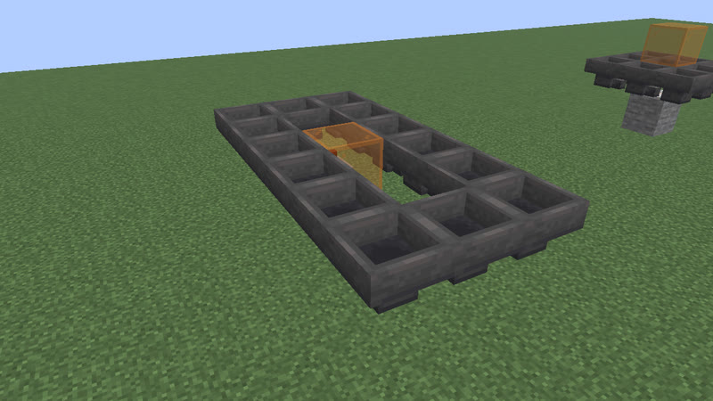</a> 136 gt (6.8 s) · comparator+hopper · 16 blocks</td><td align="center"><a href="archive/clk-sculk-ringbig10-p136-1.txt">clk-sculk-ringbig10-p136-1</a> 136 gt (6.8 s) · calibrated_sculk_sensor+note_block · 21 blocks (picture pending)</td><td align="center"><a href="archive/clk-obs-p136-obs-68b-b05f7c.txt">clk-obs-p136-obs-68b-b05f7c</a> 136 gt (6.8 s) · observer · 68 blocks (picture pending)</td></tr>
</table>

## 137 gt (6.85 s)

<table>
<tr><td align="center"><a href="archive/clk-obs-p137-obs-pis-rb-stk-72b-2ffd0d.txt">clk-obs-p137-obs-pis-rb-stk-72b-2ffd0d</a> 137 gt (6.85 s) · observer+piston+redstone_block+sticky_piston · 72 blocks (picture pending)</td></tr>
</table>

## 138 gt (6.9 s)

<table>
<tr><td align="center"><a href="archive/clk-sculk-ringbig10-p138-1.txt">clk-sculk-ringbig10-p138-1</a> 138 gt (6.9 s) · calibrated_sculk_sensor+note_block · 20 blocks (picture pending)</td><td align="center"><a href="archive/clk-obs-p138-note-obs-70b-5c6f13.txt">clk-obs-p138-note-obs-70b-5c6f13</a> 138 gt (6.9 s) · note_block+observer · 70 blocks (picture pending)</td></tr>
</table>

## 139 gt (6.95 s)

<table>
<tr><td align="center"><a href="archive/clk-obs-p139-obs-pis-rb-stk-72b-6b1bbf.txt">clk-obs-p139-obs-pis-rb-stk-72b-6b1bbf</a> 139 gt (6.95 s) · observer+piston+redstone_block+sticky_piston · 72 blocks (picture pending)</td></tr>
</table>

## 140 gt (7 s)

<table>
<tr><td align="center"><a href="archive/census-p140-calibrated_sculk_sensor-dispenser-observer-sculk_sensor-4b.txt">census-p140-calibrated_sculk_sensor-dispenser-observer-sculk_sensor-4b</a> 140 gt (7 s) · calibrated_sculk_sensor+dispenser+observer+sculk_sensor · 4 blocks (picture pending)</td><td align="center"><a href="archive/clk-sculk-ringbig10-p140-1.txt">clk-sculk-ringbig10-p140-1</a> 140 gt (7 s) · calibrated_sculk_sensor+note_block · 20 blocks (picture pending)</td><td align="center"><a href="archive/clk-obs-p140-obs-70b-c22cc6.txt">clk-obs-p140-obs-70b-c22cc6</a> 140 gt (7 s) · observer · 70 blocks (picture pending)</td></tr>
</table>

## 141 gt (7.05 s)

<table>
<tr><td align="center"><a href="archive/clk-obs-p141-obs-pis-rb-stk-74b-a7d327.txt">clk-obs-p141-obs-pis-rb-stk-74b-a7d327</a> 141 gt (7.05 s) · observer+piston+redstone_block+sticky_piston · 74 blocks (picture pending)</td></tr>
</table>

## 142 gt (7.1 s)

<table>
<tr><td align="center"><a href="archive/clk-sculk-ringbig10-p142-1.txt">clk-sculk-ringbig10-p142-1</a> 142 gt (7.1 s) · calibrated_sculk_sensor+note_block · 20 blocks (picture pending)</td><td align="center"> 142 gt (7.1 s) · comparator+redstone_torch+redstone_wire · 21 blocks</td><td align="center"><a href="archive/clk-obs-p142-note-obs-72b-03c5e4.txt">clk-obs-p142-note-obs-72b-03c5e4</a> 142 gt (7.1 s) · note_block+observer · 72 blocks (picture pending)</td></tr>
</table>

## 143 gt (7.15 s)

<table>
<tr><td align="center"><a href="archive/clk-obs-p143-obs-pis-rb-stk-74b-0d9a18.txt">clk-obs-p143-obs-pis-rb-stk-74b-0d9a18</a> 143 gt (7.15 s) · observer+piston+redstone_block+sticky_piston · 74 blocks (picture pending)</td></tr>
</table>

## 144 gt (7.2 s)

<table>
<tr><td align="center"><a href="archive/clk-sculk-ringbig10-p144-1.txt">clk-sculk-ringbig10-p144-1</a> 144 gt (7.2 s) · calibrated_sculk_sensor+note_block · 20 blocks (picture pending)</td><td align="center"> 144 gt (7.2 s) · comparator+redstone_torch+redstone_wire · 21 blocks</td><td align="center"><a href="archive/clk-obs-p144-obs-72b-c6a08a.txt">clk-obs-p144-obs-72b-c6a08a</a> 144 gt (7.2 s) · observer · 72 blocks (picture pending)</td></tr>
</table>

## 145 gt (7.25 s)

<table>
<tr><td align="center"><a href="archive/clk-obs-p145-obs-pis-rb-stk-76b-e11340.txt">clk-obs-p145-obs-pis-rb-stk-76b-e11340</a> 145 gt (7.25 s) · observer+piston+redstone_block+sticky_piston · 76 blocks (picture pending)</td></tr>
</table>

## 146 gt (7.3 s)

<table>
<tr><td align="center"><a href="archive/clk-sculk-ringbig10-p146-1.txt">clk-sculk-ringbig10-p146-1</a> 146 gt (7.3 s) · calibrated_sculk_sensor+note_block · 20 blocks (picture pending)</td><td align="center"><a href="archive/clk-obs-p146-note-obs-74b-d8973f.txt">clk-obs-p146-note-obs-74b-d8973f</a> 146 gt (7.3 s) · note_block+observer · 74 blocks (picture pending)</td></tr>
</table>

## 147 gt (7.35 s)

<table>
<tr><td align="center"><a href="archive/clk-obs-p147-obs-pis-rb-stk-76b-e3ff55.txt">clk-obs-p147-obs-pis-rb-stk-76b-e3ff55</a> 147 gt (7.35 s) · observer+piston+redstone_block+sticky_piston · 76 blocks (picture pending)</td></tr>
</table>

## 148 gt (7.4 s)

<table>
<tr><td align="center"><a href="archive/clk-sculk-ringbig10-p148-1.txt">clk-sculk-ringbig10-p148-1</a> 148 gt (7.4 s) · calibrated_sculk_sensor+note_block · 20 blocks (picture pending)</td><td align="center"><a href="archive/clk-obs-p148-obs-74b-e06e91.txt">clk-obs-p148-obs-74b-e06e91</a> 148 gt (7.4 s) · observer · 74 blocks (picture pending)</td></tr>
</table>

## 149 gt (7.45 s)

<table>
<tr><td align="center"><a href="archive/clk-obs-p149-obs-pis-rb-stk-78b-df1937.txt">clk-obs-p149-obs-pis-rb-stk-78b-df1937</a> 149 gt (7.45 s) · observer+piston+redstone_block+sticky_piston · 78 blocks (picture pending)</td></tr>
</table>

## 150 gt (7.5 s)

<table>
<tr><td align="center"><a href="archive/clk-sculk-ringbig10-p150-1.txt">clk-sculk-ringbig10-p150-1</a> 150 gt (7.5 s) · calibrated_sculk_sensor+note_block · 20 blocks (picture pending)</td><td align="center"><a href="archive/clk-obs-p150-note-obs-76b-bbc9b4.txt">clk-obs-p150-note-obs-76b-bbc9b4</a> 150 gt (7.5 s) · note_block+observer · 76 blocks (picture pending)</td></tr>
</table>

## 151 gt (7.55 s)

<table>
<tr><td align="center"><a href="archive/clk-obs-p151-obs-pis-rb-stk-78b-df2ebc.txt">clk-obs-p151-obs-pis-rb-stk-78b-df2ebc</a> 151 gt (7.55 s) · observer+piston+redstone_block+sticky_piston · 78 blocks (picture pending)</td></tr>
</table>

## 152 gt (7.6 s)

<table>
<tr><td align="center"><a href="archive/clk-obs-p152-obs-76b-99ea93.txt">clk-obs-p152-obs-76b-99ea93</a> 152 gt (7.6 s) · observer · 76 blocks (picture pending)</td></tr>
</table>

## 153 gt (7.65 s)

<table>
<tr><td align="center"><a href="archive/clk-obs-p153-obs-pis-rb-stk-80b-533726.txt">clk-obs-p153-obs-pis-rb-stk-80b-533726</a> 153 gt (7.65 s) · observer+piston+redstone_block+sticky_piston · 80 blocks (picture pending)</td></tr>
</table>

## 154 gt (7.7 s)

<table>
<tr><td align="center"><a href="archive/clk-obs-p154-note-obs-78b-83be82.txt">clk-obs-p154-note-obs-78b-83be82</a> 154 gt (7.7 s) · note_block+observer · 78 blocks (picture pending)</td></tr>
</table>

## 155 gt (7.75 s)

<table>
<tr><td align="center"><a href="archive/clk-obs-p155-obs-pis-rb-stk-80b-a9cad1.txt">clk-obs-p155-obs-pis-rb-stk-80b-a9cad1</a> 155 gt (7.75 s) · observer+piston+redstone_block+sticky_piston · 80 blocks (picture pending)</td></tr>
</table>

## 156 gt (7.8 s)

<table>
<tr><td align="center"><a href="archive/clk-obs-p156-bulb-obs-pis-7b-fa5433.txt">clk-obs-p156-bulb-obs-pis-7b-fa5433</a> 156 gt (7.8 s) · copper_bulb+observer+piston · 7 blocks (picture pending)</td></tr>
</table>

## 157 gt (7.85 s)

<table>
<tr><td align="center"><a href="archive/clk-obs-p157-obs-pis-rb-stk-82b-b982d3.txt">clk-obs-p157-obs-pis-rb-stk-82b-b982d3</a> 157 gt (7.85 s) · observer+piston+redstone_block+sticky_piston · 82 blocks (picture pending)</td></tr>
</table>

## 158 gt (7.9 s)

<table>
<tr><td align="center"> 158 gt (7.9 s) · comparator+hopper · 10 blocks</td><td align="center"><a href="archive/clk-obs-p158-note-obs-80b-81ff84.txt">clk-obs-p158-note-obs-80b-81ff84</a> 158 gt (7.9 s) · note_block+observer · 80 blocks (picture pending)</td></tr>
</table>

## 159 gt (7.95 s)

<table>
<tr><td align="center"><a href="archive/clk-obs-p159-obs-pis-rb-stk-82b-b563c9.txt">clk-obs-p159-obs-pis-rb-stk-82b-b563c9</a> 159 gt (7.95 s) · observer+piston+redstone_block+sticky_piston · 82 blocks (picture pending)</td></tr>
</table>

## 160 gt (8 s)

<table>
<tr><td align="center"><a href="archive/clk-obs-p160-obs-80b-9fce87.txt">clk-obs-p160-obs-80b-9fce87</a> 160 gt (8 s) · observer · 80 blocks (picture pending)</td></tr>
</table>

## 161 gt (8.05 s)

<table>
<tr><td align="center"><a href="archive/clk-obs-p161-obs-pis-rb-stk-84b-82b7e0.txt">clk-obs-p161-obs-pis-rb-stk-84b-82b7e0</a> 161 gt (8.05 s) · observer+piston+redstone_block+sticky_piston · 84 blocks (picture pending)</td></tr>
</table>

## 162 gt (8.1 s)

<table>
<tr><td align="center"><a href="archive/clk-sculk-hyb3-p162-2.txt">clk-sculk-hyb3-p162-2</a> 162 gt (8.1 s) · calibrated_sculk_sensor+oak_trapdoor+observer+sticky_piston · 6 blocks (picture pending)</td><td align="center"><a href="archive/clk-obs-p162-note-obs-82b-1def62.txt">clk-obs-p162-note-obs-82b-1def62</a> 162 gt (8.1 s) · note_block+observer · 82 blocks (picture pending)</td></tr>
</table>

## 163 gt (8.15 s)

<table>
<tr><td align="center"><a href="archive/clk-obs-p163-obs-pis-rb-stk-84b-d31c17.txt">clk-obs-p163-obs-pis-rb-stk-84b-d31c17</a> 163 gt (8.15 s) · observer+piston+redstone_block+sticky_piston · 84 blocks (picture pending)</td></tr>
</table>

## 164 gt (8.2 s)

<table>
<tr><td align="center"><a href="archive/clk-obs-p164-obs-82b-e06875.txt">clk-obs-p164-obs-82b-e06875</a> 164 gt (8.2 s) · observer · 82 blocks (picture pending)</td></tr>
</table>

## 165 gt (8.25 s)

<table>
<tr><td align="center"><a href="archive/clk-obs-p165-obs-pis-rb-stk-86b-615f0f.txt">clk-obs-p165-obs-pis-rb-stk-86b-615f0f</a> 165 gt (8.25 s) · observer+piston+redstone_block+sticky_piston · 86 blocks (picture pending)</td></tr>
</table>

## 166 gt (8.3 s)

<table>
<tr><td align="center"><a href="archive/clk-obs-p166-note-obs-84b-5d6951.txt">clk-obs-p166-note-obs-84b-5d6951</a> 166 gt (8.3 s) · note_block+observer · 84 blocks (picture pending)</td></tr>
</table>

## 167 gt (8.35 s)

<table>
<tr><td align="center"><a href="archive/clk-obs-p167-obs-pis-rb-stk-86b-675018.txt">clk-obs-p167-obs-pis-rb-stk-86b-675018</a> 167 gt (8.35 s) · observer+piston+redstone_block+sticky_piston · 86 blocks (picture pending)</td></tr>
</table>

## 168 gt (8.4 s)

<table>
<tr><td align="center"><a href="archive/clk-obs-p168-obs-84b-5faf59.txt">clk-obs-p168-obs-84b-5faf59</a> 168 gt (8.4 s) · observer · 84 blocks (picture pending)</td></tr>
</table>

## 169 gt (8.45 s)

<table>
<tr><td align="center"><a href="archive/clk-obs-p169-obs-pis-rb-stk-88b-0d7dde.txt">clk-obs-p169-obs-pis-rb-stk-88b-0d7dde</a> 169 gt (8.45 s) · observer+piston+redstone_block+sticky_piston · 88 blocks (picture pending)</td></tr>
</table>

## 170 gt (8.5 s)

<table>
<tr><td align="center"><a href="archive/clk-sculk-climb1-p170-4.txt">clk-sculk-climb1-p170-4</a> 170 gt (8.5 s) · note_block+observer+sculk_sensor+sticky_piston · 7 blocks (picture pending)</td><td align="center"><a href="archive/clk-rt-uloop-p170-22b.txt">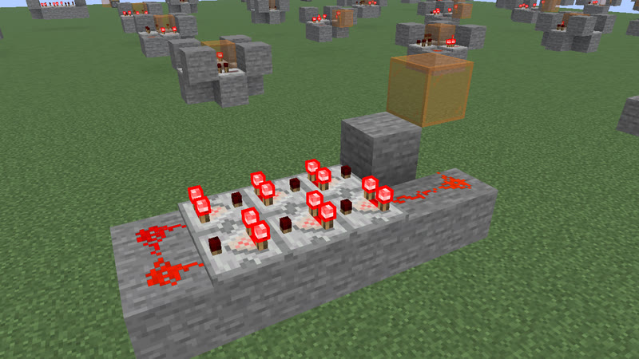</a> 170 gt (8.5 s) · comparator+redstone_torch+redstone_wire · 22 blocks</td><td align="center"><a href="archive/clk-obs-p170-note-obs-86b-e07901.txt">clk-obs-p170-note-obs-86b-e07901</a> 170 gt (8.5 s) · note_block+observer · 86 blocks (picture pending)</td></tr>
</table>

## 171 gt (8.55 s)

<table>
<tr><td align="center"><a href="archive/clk-obs-p171-obs-pis-rb-stk-88b-bac176.txt">clk-obs-p171-obs-pis-rb-stk-88b-bac176</a> 171 gt (8.55 s) · observer+piston+redstone_block+sticky_piston · 88 blocks (picture pending)</td></tr>
</table>

## 172 gt (8.6 s)

<table>
<tr><td align="center"><a href="archive/clk-obs-p172-obs-86b-b30820.txt">clk-obs-p172-obs-86b-b30820</a> 172 gt (8.6 s) · observer · 86 blocks (picture pending)</td></tr>
</table>

## 173 gt (8.65 s)

<table>
<tr><td align="center"><a href="archive/clk-obs-p173-obs-pis-rb-stk-90b-cf52b2.txt">clk-obs-p173-obs-pis-rb-stk-90b-cf52b2</a> 173 gt (8.65 s) · observer+piston+redstone_block+sticky_piston · 90 blocks (picture pending)</td></tr>
</table>

## 174 gt (8.7 s)

<table>
<tr><td align="center"><a href="archive/clk-obs-p174-note-obs-88b-d4bfeb.txt">clk-obs-p174-note-obs-88b-d4bfeb</a> 174 gt (8.7 s) · note_block+observer · 88 blocks (picture pending)</td></tr>
</table>

## 175 gt (8.75 s)

<table>
<tr><td align="center"><a href="archive/clk-obs-p175-obs-pis-rb-stk-90b-ab4edc.txt">clk-obs-p175-obs-pis-rb-stk-90b-ab4edc</a> 175 gt (8.75 s) · observer+piston+redstone_block+sticky_piston · 90 blocks (picture pending)</td></tr>
</table>

## 176 gt (8.8 s)

<table>
<tr><td align="center"><a href="archive/clk-obs-p176-obs-88b-7385c1.txt">clk-obs-p176-obs-88b-7385c1</a> 176 gt (8.8 s) · observer · 88 blocks (picture pending)</td></tr>
</table>

## 177 gt (8.85 s)

<table>
<tr><td align="center"><a href="archive/clk-obs-p177-obs-pis-rb-stk-92b-a4ad9e.txt">clk-obs-p177-obs-pis-rb-stk-92b-a4ad9e</a> 177 gt (8.85 s) · observer+piston+redstone_block+sticky_piston · 92 blocks (picture pending)</td></tr>
</table>

## 178 gt (8.9 s)

<table>
<tr><td align="center"><a href="archive/clk-obs-p178-note-obs-90b-7c2b8b.txt">clk-obs-p178-note-obs-90b-7c2b8b</a> 178 gt (8.9 s) · note_block+observer · 90 blocks (picture pending)</td></tr>
</table>

## 179 gt (8.95 s)

<table>
<tr><td align="center"><a href="archive/clk-obs-p179-obs-pis-rb-stk-92b-728b84.txt">clk-obs-p179-obs-pis-rb-stk-92b-728b84</a> 179 gt (8.95 s) · observer+piston+redstone_block+sticky_piston · 92 blocks (picture pending)</td></tr>
</table>

## 180 gt (9 s)

<table>
<tr><td align="center"><a href="archive/clk-obs-p180-obs-90b-793c55.txt">clk-obs-p180-obs-90b-793c55</a> 180 gt (9 s) · observer · 90 blocks (picture pending)</td></tr>
</table>

## 181 gt (9.05 s)

<table>
<tr><td align="center"><a href="archive/clk-obs-p181-obs-pis-rb-stk-94b-6c11a4.txt">clk-obs-p181-obs-pis-rb-stk-94b-6c11a4</a> 181 gt (9.05 s) · observer+piston+redstone_block+sticky_piston · 94 blocks (picture pending)</td></tr>
</table>

## 182 gt (9.1 s)

<table>
<tr><td align="center"><a href="archive/clk-obs-p182-note-obs-92b-1acabb.txt">clk-obs-p182-note-obs-92b-1acabb</a> 182 gt (9.1 s) · note_block+observer · 92 blocks (picture pending)</td></tr>
</table>

## 183 gt (9.15 s)

<table>
<tr><td align="center"><a href="archive/clk-obs-p183-obs-pis-rb-stk-94b-10dd59.txt">clk-obs-p183-obs-pis-rb-stk-94b-10dd59</a> 183 gt (9.15 s) · observer+piston+redstone_block+sticky_piston · 94 blocks (picture pending)</td></tr>
</table>

## 184 gt (9.2 s)

<table>
<tr><td align="center"><a href="archive/clk-obs-p184-obs-92b-a94e53.txt">clk-obs-p184-obs-92b-a94e53</a> 184 gt (9.2 s) · observer · 92 blocks (picture pending)</td></tr>
</table>

## 185 gt (9.25 s)

<table>
<tr><td align="center"><a href="archive/clk-obs-p185-obs-pis-rb-stk-96b-e3d9f7.txt">clk-obs-p185-obs-pis-rb-stk-96b-e3d9f7</a> 185 gt (9.25 s) · observer+piston+redstone_block+sticky_piston · 96 blocks (picture pending)</td></tr>
</table>

## 186 gt (9.3 s)

<table>
<tr><td align="center"><a href="archive/clk-obs-p186-note-obs-94b-9e5051.txt">clk-obs-p186-note-obs-94b-9e5051</a> 186 gt (9.3 s) · note_block+observer · 94 blocks (picture pending)</td></tr>
</table>

## 187 gt (9.35 s)

<table>
<tr><td align="center"><a href="archive/clk-obs-p187-obs-pis-rb-stk-96b-fd58a3.txt">clk-obs-p187-obs-pis-rb-stk-96b-fd58a3</a> 187 gt (9.35 s) · observer+piston+redstone_block+sticky_piston · 96 blocks (picture pending)</td></tr>
</table>

## 188 gt (9.4 s)

<table>
<tr><td align="center"><a href="archive/clk-obs-p188-obs-94b-37728c.txt">clk-obs-p188-obs-94b-37728c</a> 188 gt (9.4 s) · observer · 94 blocks (picture pending)</td></tr>
</table>

## 189 gt (9.45 s)

<table>
<tr><td align="center"><a href="archive/clk-obs-p189-obs-pis-rb-stk-98b-18fecd.txt">clk-obs-p189-obs-pis-rb-stk-98b-18fecd</a> 189 gt (9.45 s) · observer+piston+redstone_block+sticky_piston · 98 blocks (picture pending)</td></tr>
</table>

## 190 gt (9.5 s)

<table>
<tr><td align="center"><a href="archive/clk-obs-p190-note-obs-96b-d266d1.txt">clk-obs-p190-note-obs-96b-d266d1</a> 190 gt (9.5 s) · note_block+observer · 96 blocks (picture pending)</td></tr>
</table>

## 191 gt (9.55 s)

<table>
<tr><td align="center"><a href="archive/clk-obs-p191-obs-pis-rb-stk-98b-e175ae.txt">clk-obs-p191-obs-pis-rb-stk-98b-e175ae</a> 191 gt (9.55 s) · observer+piston+redstone_block+sticky_piston · 98 blocks (picture pending)</td></tr>
</table>

## 192 gt (9.6 s)

<table>
<tr><td align="center"> 192 gt (9.6 s) · hopper+redstone_torch+redstone_wire · 9 blocks</td><td align="center"><a href="archive/clk-obs-p192-obs-96b-70b7b0.txt">clk-obs-p192-obs-96b-70b7b0</a> 192 gt (9.6 s) · observer · 96 blocks (picture pending)</td></tr>
</table>

## 193 gt (9.65 s)

<table>
<tr><td align="center"><a href="archive/clk-obs-p193-obs-pis-rb-stk-100b-fe0e02.txt">clk-obs-p193-obs-pis-rb-stk-100b-fe0e02</a> 193 gt (9.65 s) · observer+piston+redstone_block+sticky_piston · 100 blocks (picture pending)</td></tr>
</table>

## 194 gt (9.7 s)

<table>
<tr><td align="center"><a href="archive/clk-obs-p194-note-obs-98b-3a6a3a.txt">clk-obs-p194-note-obs-98b-3a6a3a</a> 194 gt (9.7 s) · note_block+observer · 98 blocks (picture pending)</td></tr>
</table>

## 195 gt (9.75 s)

<table>
<tr><td align="center"> 195 gt (9.75 s) · comparator+hopper+redstone_torch+redstone_wire · 9 blocks</td><td align="center"><a href="archive/clk-obs-p195-obs-pis-rb-stk-100b-0294a9.txt">clk-obs-p195-obs-pis-rb-stk-100b-0294a9</a> 195 gt (9.75 s) · observer+piston+redstone_block+sticky_piston · 100 blocks (picture pending)</td></tr>
</table>

## 196 gt (9.8 s)

<table>
<tr><td align="center"><a href="archive/clk-obs-p196-obs-98b-eb36d1.txt">clk-obs-p196-obs-98b-eb36d1</a> 196 gt (9.8 s) · observer · 98 blocks (picture pending)</td></tr>
</table>

## 197 gt (9.85 s)

<table>
<tr><td align="center"><a href="archive/clk-obs-p197-obs-pis-rb-stk-102b-b57a65.txt">clk-obs-p197-obs-pis-rb-stk-102b-b57a65</a> 197 gt (9.85 s) · observer+piston+redstone_block+sticky_piston · 102 blocks (picture pending)</td></tr>
</table>

## 198 gt (9.9 s)

<table>
<tr><td align="center"><a href="archive/clk-obs-p198-note-obs-100b-d04cda.txt">clk-obs-p198-note-obs-100b-d04cda</a> 198 gt (9.9 s) · note_block+observer · 100 blocks (picture pending)</td></tr>
</table>

## 199 gt (9.95 s)

<table>
<tr><td align="center"><a href="archive/clk-obs-p199-obs-pis-rb-stk-102b-cd210a.txt">clk-obs-p199-obs-pis-rb-stk-102b-cd210a</a> 199 gt (9.95 s) · observer+piston+redstone_block+sticky_piston · 102 blocks (picture pending)</td></tr>
</table>

## 200 gt (10 s)

<table>
<tr><td align="center"><a href="archive/clk-obs-p200-obs-100b-b5e6ba.txt">clk-obs-p200-obs-100b-b5e6ba</a> 200 gt (10 s) · observer · 100 blocks (picture pending)</td></tr>
</table>

## 205 gt (10.25 s)

<table>
<tr><td align="center"> 205 gt (10.25 s) · redstone_torch+redstone_wire+repeater · 8 blocks</td></tr>
</table>

## 210 gt (10.5 s)

<table>
<tr><td align="center"> 210 gt (10.5 s) · comparator+hopper+redstone_torch+redstone_wire · 8 blocks</td></tr>
</table>

## 212 gt (10.6 s)

<table>
<tr><td align="center"><a href="archive/census-p212-calibrated_sculk_sensor-dispenser-note_block-observer-sculk_sensor-5b.txt">census-p212-calibrated_sculk_sensor-dispenser-note_block-observer-sculk_sensor-5b</a> 212 gt (10.6 s) · calibrated_sculk_sensor+dispenser+note_block+observer+sculk_sensor · 5 blocks (picture pending)</td></tr>
</table>

## 215 gt (10.75 s)

<table>
<tr><td align="center"><a href="archive/census-p215-calibrated_sculk_sensor-dispenser-note_block-observer-sculk_sensor-5b.txt">census-p215-calibrated_sculk_sensor-dispenser-note_block-observer-sculk_sensor-5b</a> 215 gt (10.75 s) · calibrated_sculk_sensor+dispenser+note_block+observer+sculk_sensor · 5 blocks (picture pending)</td></tr>
</table>

## 216 gt (10.8 s)

<table>
<tr><td align="center"><a href="archive/census-p216-calibrated_sculk_sensor-dispenser-note_block-observer-sculk_sensor-5b.txt">census-p216-calibrated_sculk_sensor-dispenser-note_block-observer-sculk_sensor-5b</a> 216 gt (10.8 s) · calibrated_sculk_sensor+dispenser+note_block+observer+sculk_sensor · 5 blocks (picture pending)</td><td align="center"> 216 gt (10.8 s) · observer+sculk_sensor+sticky_piston · 6 blocks</td></tr>
</table>

## 218 gt (10.9 s)

<table>
<tr><td align="center"> 218 gt (10.9 s) · comparator+hopper · 10 blocks</td></tr>
</table>

## 220 gt (11 s)

<table>
<tr><td align="center"> 220 gt (11 s) · comparator+redstone_torch · 8 blocks</td><td align="center"> 220 gt (11 s) · comparator+redstone_torch+repeater · 8 blocks</td><td align="center"> 220 gt (11 s) · redstone_torch+repeater · 8 blocks</td></tr>
<tr><td align="center"> 220 gt (11 s) · redstone_torch+redstone_wire+repeater · 8 blocks</td><td align="center"> 220 gt (11 s) · redstone_torch+redstone_wire+repeater · 9 blocks</td><td align="center"> 220 gt (11 s) · redstone_torch+redstone_wire+repeater · 10 blocks</td></tr>
<tr><td align="center"> 220 gt (11 s) · comparator+redstone_torch+redstone_wire · 12 blocks</td><td align="center"> 220 gt (11 s) · comparator+redstone_torch+redstone_wire+repeater · 12 blocks</td></tr>
</table>

## 226 gt (11.3 s)

<table>
<tr><td align="center"><a href="archive/clk-rt-uloop-p226-26b.txt">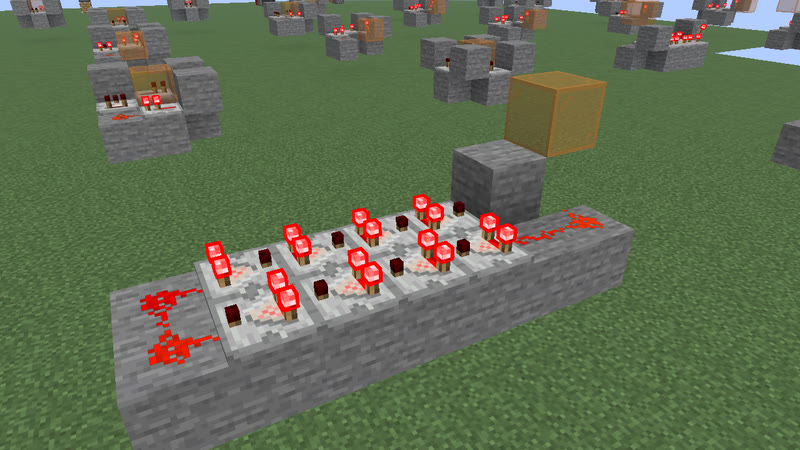</a> 226 gt (11.3 s) · comparator+redstone_torch+redstone_wire · 26 blocks</td></tr>
</table>

## 228 gt (11.4 s)

<table>
<tr><td align="center"><a href="archive/clk-rt-div-fade2-x1.txt">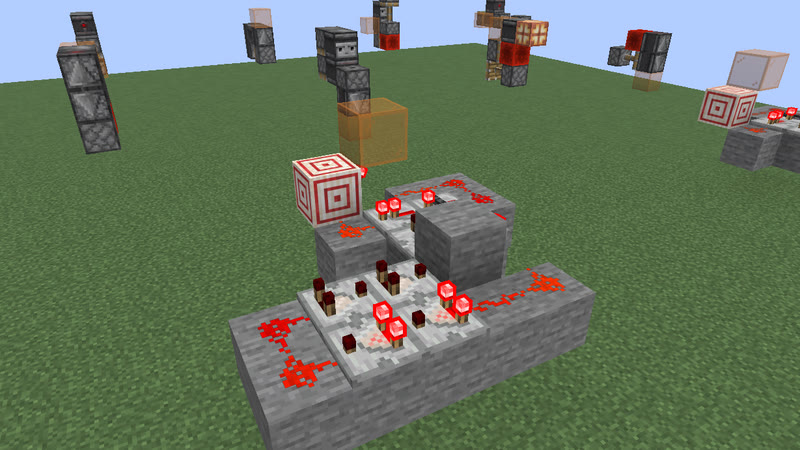</a> 228 gt (11.4 s) · comparator+redstone_torch+redstone_wire+repeater · 36 blocks</td></tr>
</table>

## 242 gt (12.1 s)

<table>
<tr><td align="center"><a href="archive/census-p242-calibrated_sculk_sensor-dispenser-observer-sculk_sensor-5b.txt">census-p242-calibrated_sculk_sensor-dispenser-observer-sculk_sensor-5b</a> 242 gt (12.1 s) · calibrated_sculk_sensor+dispenser+observer+sculk_sensor · 5 blocks (picture pending)</td></tr>
</table>

## 282 gt (14.1 s)

<table>
<tr><td align="center"><a href="archive/clk-rt-uloop-p282-30b.txt">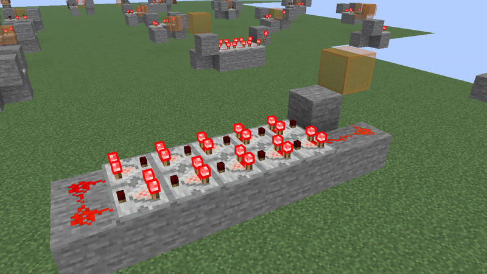</a> 282 gt (14.1 s) · comparator+redstone_torch+redstone_wire · 30 blocks</td></tr>
</table>

## 288 gt (14.4 s)

<table>
<tr><td align="center"><a href="archive/clk-rt-div-44-x3.txt">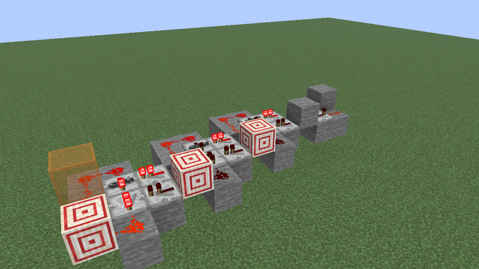</a> 288 gt (14.4 s) · redstone_torch+redstone_wire+repeater · 63 blocks</td></tr>
</table>

## 306 gt (15.3 s)

<table>
<tr><td align="center"><a href="archive/clk-sculk-hyb3-p306-2.txt">clk-sculk-hyb3-p306-2</a> 306 gt (15.3 s) · oak_trapdoor+observer+sculk_sensor+sticky_piston · 6 blocks (picture pending)</td></tr>
</table>

## 338 gt (16.9 s)

<table>
<tr><td align="center"><a href="archive/clk-rt-uloop-p338-34b.txt">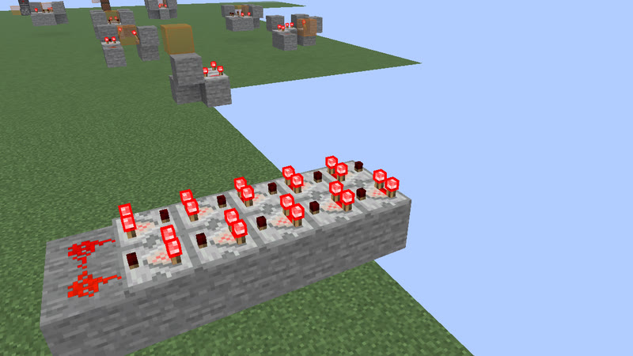</a> 338 gt (16.9 s) · comparator+redstone_torch+redstone_wire · 34 blocks</td></tr>
</table>

## 342 gt (17.1 s)

<table>
<tr><td align="center"><a href="archive/clk-sculk-hyb3-p342-2.txt">clk-sculk-hyb3-p342-2</a> 342 gt (17.1 s) · oak_trapdoor+observer+sculk_sensor+sticky_piston · 6 blocks (picture pending)</td></tr>
</table>

## 410 gt (20.5 s)

<table>
<tr><td align="center"> 410 gt (20.5 s) · comparator+redstone_torch+redstone_wire · 12 blocks</td></tr>
</table>

## 440 gt (22 s)

<table>
<tr><td align="center"> 440 gt (22 s) · redstone_torch+repeater · 8 blocks</td><td align="center"> 440 gt (22 s) · comparator+redstone_torch · 8 blocks</td><td align="center"> 440 gt (22 s) · comparator+redstone_torch+redstone_wire · 12 blocks</td></tr>
</table>

## 468 gt (23.4 s)

<table>
<tr><td align="center"><a href="archive/clk-sculk-hyb3-p468-1.txt">clk-sculk-hyb3-p468-1</a> 468 gt (23.4 s) · observer+piston+sculk_sensor+sticky_piston · 7 blocks (picture pending)</td></tr>
</table>

## 524 gt (26.2 s)

<table>
<tr><td align="center"><a href="archive/ringlock3x20n33-p524.txt">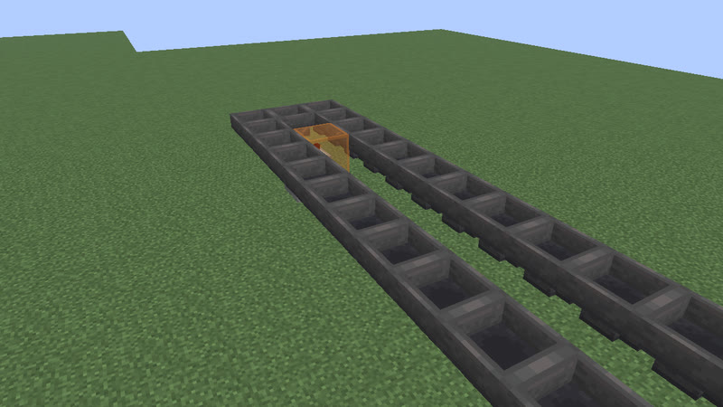</a> 524 gt (26.2 s) · comparator+hopper · 44 blocks</td></tr>
</table>

## 654 gt (32.7 s)

<table>
<tr><td align="center"> 654 gt (32.7 s) · comparator+hopper · 10 blocks</td></tr>
</table>

## 1012 gt (50.6 s)

<table>
<tr><td align="center"> 1012 gt (50.6 s) · comparator+redstone_torch+redstone_wire+repeater · 64 blocks</td></tr>
</table>

## 1152 gt (57.6 s)

<table>
<tr><td align="center"><a href="archive/clk-rt-div-44-x5.txt">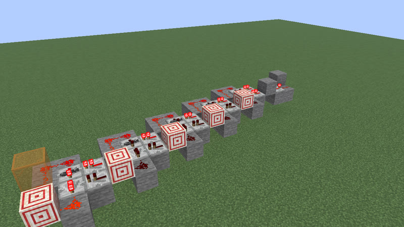</a> 1152 gt (57.6 s) · redstone_torch+redstone_wire+repeater · 99 blocks</td></tr>
</table>

## 1360 gt (1 min 8 s)

<table>
<tr><td align="center"> 1360 gt (1 min 8 s) · comparator+redstone_torch+redstone_wire+repeater · 76 blocks</td></tr>
</table>

## 1446 gt (1 min 12.3 s)

<table>
<tr><td align="center"> 1446 gt (1 min 12.3 s) · dropper+hopper+jukebox+note_block+redstone_torch+redstone_wire · 9 blocks</td></tr>
</table>

## 1596 gt (1 min 19.8 s)

<table>
<tr><td align="center"><a href="archive/clk-rt-count-i2-o2.txt">clk-rt-count-i2-o2</a> 1596 gt (1 min 19.8 s) · comparator+redstone_torch+redstone_wire · 44 blocks (picture pending)</td></tr>
</table>

## 2304 gt (1 min 55.2 s)

<table>
<tr><td align="center"><a href="archive/clk-rt-div-44-x6.txt">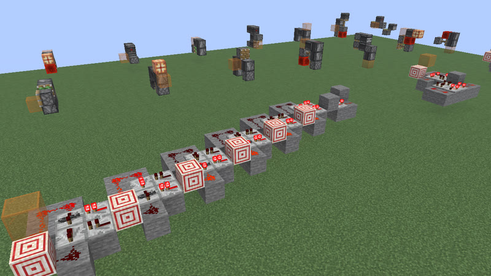</a> 2304 gt (1 min 55.2 s) · redstone_torch+redstone_wire+repeater · 117 blocks</td></tr>
</table>

## 2380 gt (1 min 59 s)

<table>
<tr><td align="center"><a href="archive/clk-rt-count-i3-o3.txt">clk-rt-count-i3-o3</a> 2380 gt (1 min 59 s) · comparator+redstone_torch+redstone_wire · 52 blocks (picture pending)</td></tr>
</table>

## 2704 gt (2 min 15.2 s)

<table>
<tr><td align="center"> 2704 gt (2 min 15.2 s) · comparator+redstone_torch+redstone_wire+repeater · 88 blocks</td></tr>
</table>

## 3164 gt (2 min 38.2 s)

<table>
<tr><td align="center"><a href="archive/clk-rt-count-i4-o4.txt">clk-rt-count-i4-o4</a> 3164 gt (2 min 38.2 s) · comparator+redstone_torch+redstone_wire · 60 blocks (picture pending)</td></tr>
</table>

## 4732 gt (3 min 56.6 s)

<table>
<tr><td align="center"><a href="archive/clk-rt-count-i6-o6.txt">clk-rt-count-i6-o6</a> 4732 gt (3 min 56.6 s) · comparator+redstone_torch+redstone_wire · 76 blocks (picture pending)</td></tr>
</table>

## 5408 gt (4 min 30.4 s)

<table>
<tr><td align="center"> 5408 gt (4 min 30.4 s) · comparator+redstone_torch+redstone_wire+repeater · 106 blocks</td></tr>
</table>

## 6926 gt (5 min 46.3 s)

<table>
<tr><td align="center"> 6926 gt (5 min 46.3 s) · dropper+hopper+jukebox+note_block+redstone_torch+redstone_wire · 9 blocks</td></tr>
</table>

## 17978 gt (14 min 58.9 s)

<table>
<tr><td align="center"> 17978 gt (14 min 58.9 s) · dropper+hopper+jukebox+note_block+redstone_torch+redstone_wire · 9 blocks</td></tr>
</table>
