# Clock catalog

2519 clocks (205 periods, 186 families), each pictured in the real game at the most active moment of its period; **orange glass = where the output signal is** (placed only for the picture); click a picture for its design. Generated by `mctas clock catalog` ([docs/clocks.md](../../docs/clocks.md); the period x family matrix: [coverage.md](coverage.md)).

## Extendable clocks

One card per family: the base design, its period and size for any n, how to extend it, the n range verified in the game (`mctas clock extend-check`); their instances are not repeated in the periods below.

<table>
<tr><td align="center" valign="top"><a href="archive/clk-obs-obs-ring.txt">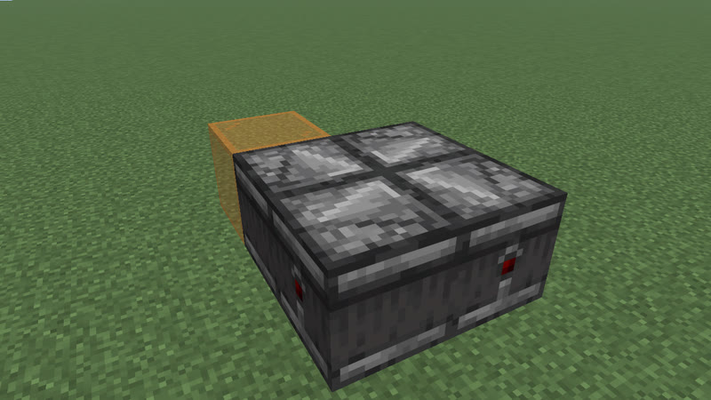</a> <b>clk-obs-obs-ring</b> P = 8 + 4n gt (0.4 s + 0.2 s·n) · 4 + 2n blocks · observer extend: insert 2 observers: one more column in the 2-wide ring (each observer watches the previous one) n = 0..48: P = 8..200 gt (judged in the game: n = 0, 1, 2, 24, 48, 0, 1, 2, 24, 48)</td><td align="center" valign="top"><a href="archive/clk-misc-activator_rail-ring-n0.txt">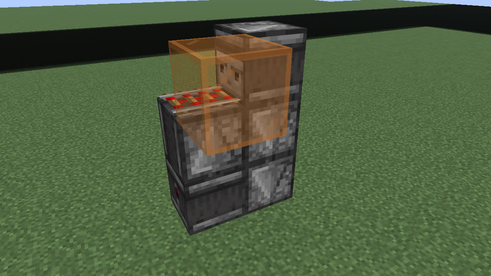</a> <b>clk-misc-activator_rail-ring</b> P = 10 + 4n gt (0.5 s + 0.2 s·n) · 6 + 2n blocks · activator_rail+observer extend: insert 2 observers: the 2-wide ring one row higher n = 0..47: P = 10..198 gt (judged in the game: n = 0, 1, 2, 23, 47)</td></tr>
<tr><td align="center" valign="top"><a href="archive/clk-misc-crafter-ring-n0.txt">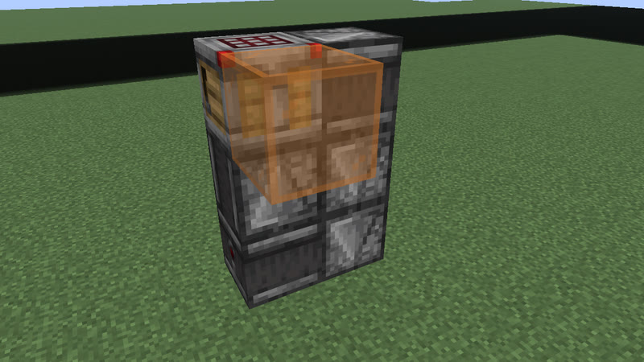</a> <b>clk-misc-crafter-ring</b> P = 10 + 4n gt (0.5 s + 0.2 s·n) · 6 + 2n blocks · crafter+observer extend: insert 2 observers: the 2-wide ring one row higher n = 0..47: P = 10..198 gt (judged in the game: n = 0, 1, 2, 23, 47)</td><td align="center" valign="top"><a href="archive/clk-misc-iron_door-ring-n0.txt">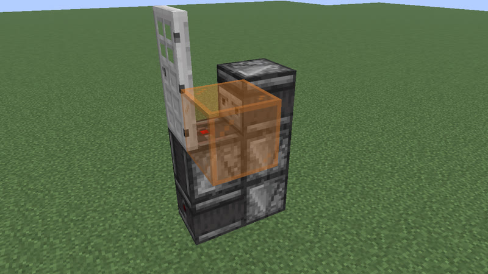</a> <b>clk-misc-iron_door-ring</b> P = 10 + 4n gt (0.5 s + 0.2 s·n) · 7 + 2n blocks · iron_door+observer extend: insert 2 observers: the 2-wide ring one row higher n = 0..47: P = 10..198 gt (judged in the game: n = 0, 1, 2, 23, 47)</td></tr>
<tr><td align="center" valign="top"><a href="archive/clk-misc-oak_door-ring-n0.txt">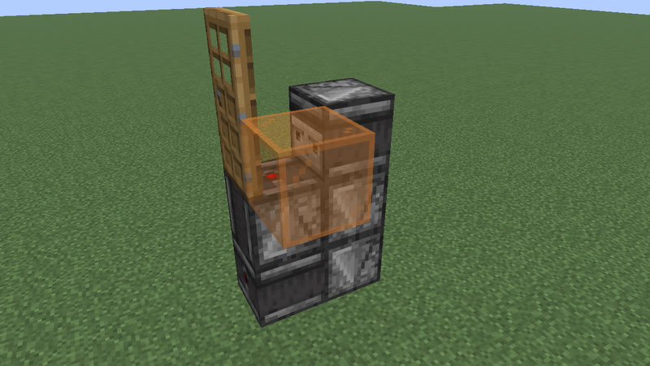</a> <b>clk-misc-oak_door-ring</b> P = 10 + 4n gt (0.5 s + 0.2 s·n) · 7 + 2n blocks · oak_door+observer extend: insert 2 observers: the 2-wide ring one row higher n = 0..47: P = 10..198 gt (judged in the game: n = 0, 1, 2, 23, 47)</td><td align="center" valign="top"><a href="archive/clk-misc-oak_fence_gate-ring-n0.txt">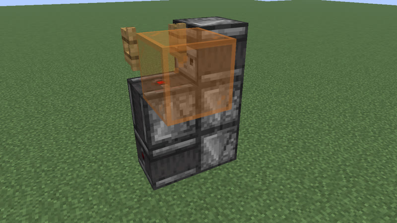</a> <b>clk-misc-oak_fence_gate-ring</b> P = 10 + 4n gt (0.5 s + 0.2 s·n) · 6 + 2n blocks · oak_fence_gate+observer extend: insert 2 observers: the 2-wide ring one row higher n = 0..47: P = 10..198 gt (judged in the game: n = 0, 1, 2, 23, 47)</td></tr>
<tr><td align="center" valign="top"><a href="archive/clk-misc-oak_trapdoor-ring-n0.txt">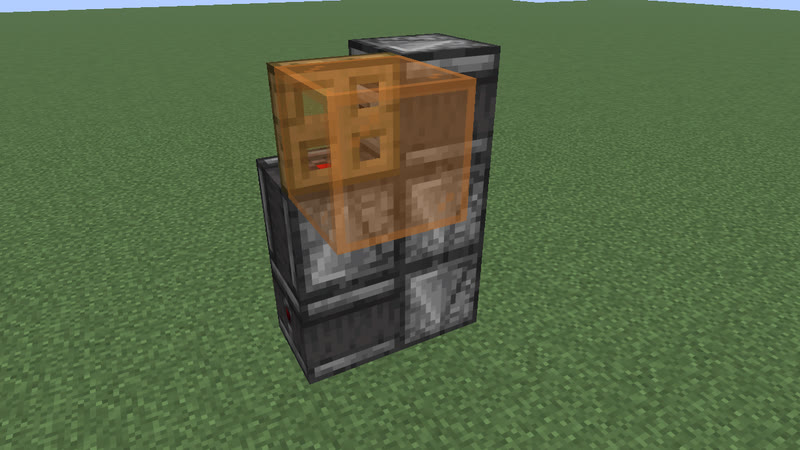</a> <b>clk-misc-oak_trapdoor-ring</b> P = 10 + 4n gt (0.5 s + 0.2 s·n) · 6 + 2n blocks · oak_trapdoor+observer extend: insert 2 observers: the 2-wide ring one row higher n = 0..47: P = 10..198 gt (judged in the game: n = 0, 1, 2, 23, 47)</td><td align="center" valign="top"> <b>clk-misc-powered_rail-ring</b> P = 10 + 4n gt (0.5 s + 0.2 s·n) · 6 + 2n blocks · observer+powered_rail extend: insert 2 observers: the 2-wide ring one row higher n = 0..47: P = 10..198 gt (judged in the game: n = 0, 1, 2, 23, 47)</td></tr>
<tr><td align="center" valign="top"><a href="archive/clk-misc-skeleton_skull-ring-n0.txt">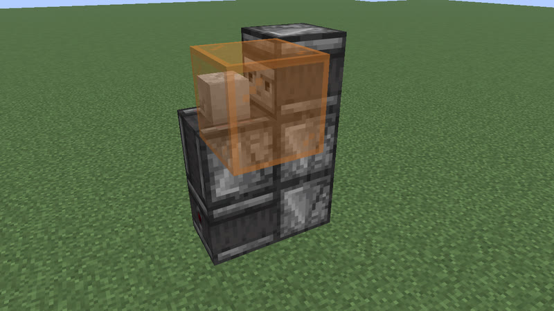</a> <b>clk-misc-skeleton_skull-ring</b> P = 10 + 4n gt (0.5 s + 0.2 s·n) · 6 + 2n blocks · observer+skeleton_skull extend: insert 2 observers: the 2-wide ring one row higher n = 0..47: P = 10..198 gt (judged in the game: n = 0, 1, 2, 23, 47)</td><td align="center" valign="top"><a href="archive/clk-obs-note-ring.txt">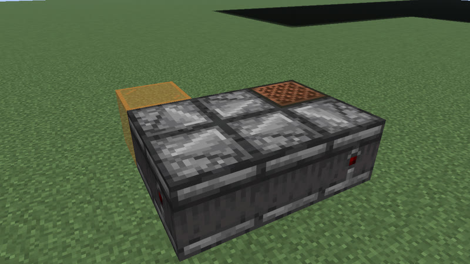</a> <b>clk-obs-note-ring</b> P = 10 + 4n gt (0.5 s + 0.2 s·n) · 6 + 2n blocks · note_block+observer extend: insert 2 observers: one more column in the 2-wide ring n = 0..47: P = 10..198 gt (judged in the game: n = 0, 1, 2, 23, 47, 0, 1, 2, 23, 47)</td></tr>
<tr><td align="center" valign="top"><a href="archive/clk-obs-trap-ring.txt">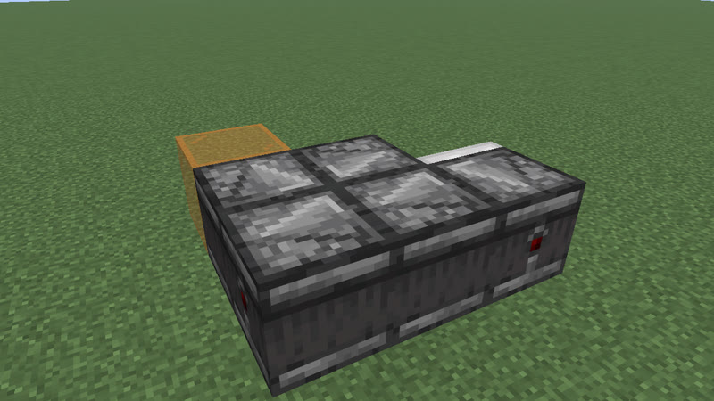</a> <b>clk-obs-trap-ring</b> P = 10 + 4n gt (0.5 s + 0.2 s·n) · 6 + 2n blocks · iron_trapdoor+observer extend: insert 2 observers: one more column in the 2-wide ring n = 0..47: P = 10..198 gt (judged in the game: n = 0, 1, 2, 23, 47, 0, 1, 2, 23, 47)</td><td align="center" valign="top"><a href="archive/clk-item-lockpair.txt">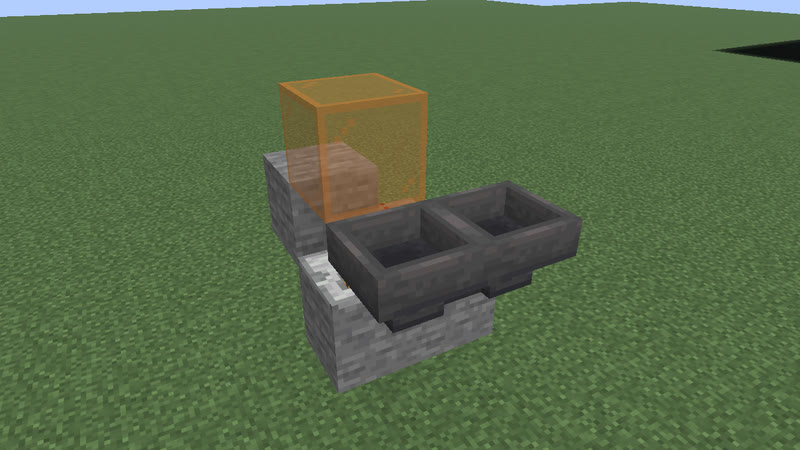</a> <b>clk-item-lockpair</b> P = 11 + 2n gt (0.55 s + 0.1 s·n) · 9 blocks · comparator+hopper+redstone_wire+repeater extend: one more tick of delay on the lock repeater (same blocks) n = 0..2: P = 11..15 gt (judged in the game: n = 0, 1, 2)</td></tr>
<tr><td align="center" valign="top"><a href="archive/clk-obs-odd-a.txt">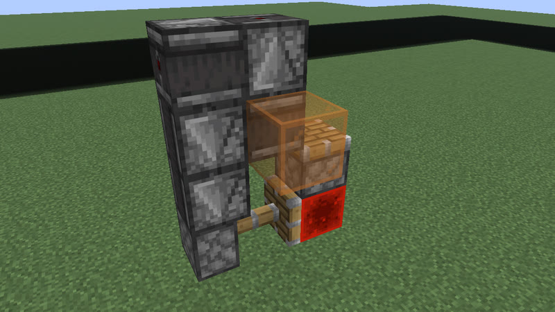</a> <b>clk-obs-odd-a</b> P = 11 + 4n gt (0.55 s + 0.2 s·n) · 8 + 2n blocks · observer+piston+redstone_block+sticky_piston extend: raise the observer tower by one: one more observer in each column n = 0..47: P = 11..199 gt (judged in the game: n = 0, 1, 2, 23, 47, 0, 1, 2, 23, 47)</td><td align="center" valign="top"><a href="archive/clk-obs-divider.txt">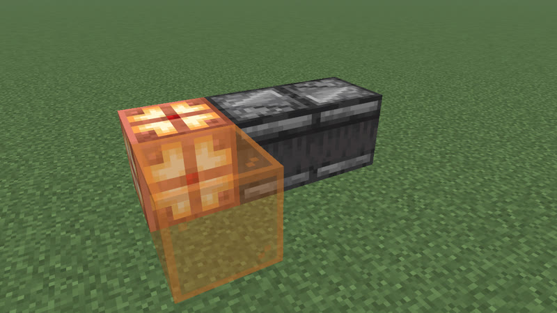</a> <b>clk-obs-divider</b> P = 12 · 2^n gt (0.6 s · 2^n) · 3 + 3n blocks · copper_bulb+observer extend: add a stage behind the last bulb: a comparator (facing the clock, reading the bulb, on a stone floor) and a bulb n = 0..8: P = 12..3072 gt (judged in the game: n = 0, 1, 2, 4, 8, 0, 1, 2, 4, 8)</td></tr>
<tr><td align="center" valign="top"><a href="archive/clk-obs-odd-b.txt">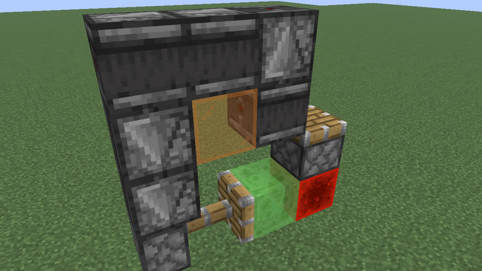</a> <b>clk-obs-odd-b</b> P = 13 + 4n gt (0.65 s + 0.2 s·n) · 10 + 2n blocks · observer+piston+redstone_block+sticky_piston extend: raise the observer tower by one: one more observer in each column n = 0..46: P = 13..197 gt (judged in the game: n = 0, 1, 2, 23, 46, 0, 1, 2, 23, 46)</td><td align="center" valign="top"><a href="archive/clk-item-hopper-ring.txt">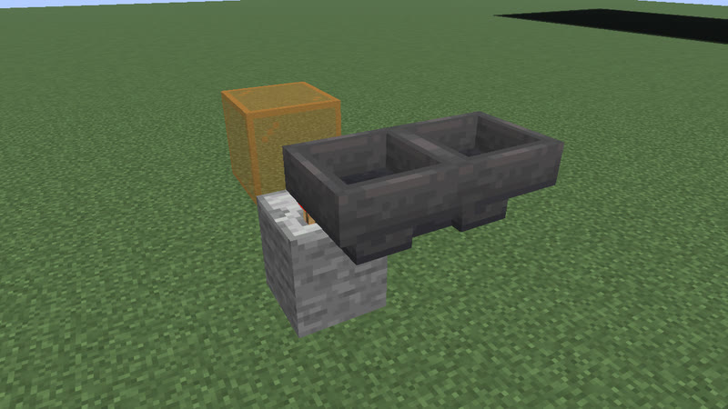</a> <b>clk-item-hopper-ring</b> P = 14 + 14n gt (0.7 s + 0.7 s·n) · 4 + 2n blocks · comparator+hopper extend: lengthen the 2-wide hopper ring by one column (2 hoppers) n = 0..40: P = 14..574 gt (judged in the game: n = 0, 1, 2, 20, 40)</td></tr>
<tr><td align="center" valign="top"><a href="archive/clk-item-hopper-ring-2.txt">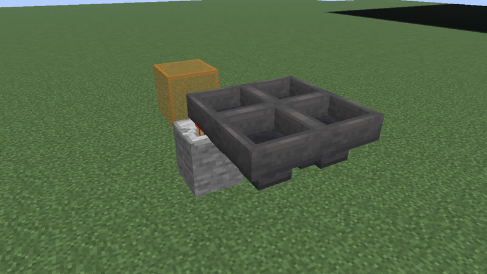</a> <b>clk-item-hopper-ring-2</b> P = 7 + 7n gt (0.35 s + 0.35 s·n) · 4 + 2n blocks · comparator+hopper extend: lengthen the 2-wide hopper ring by one column (2 hoppers); the two items stay half a ring apart n = 1..40: P = 14..287 gt (judged in the game: n = 1, 2, 3, 20, 40)</td><td align="center" valign="top"><a href="archive/clk-item-snowdisp.txt">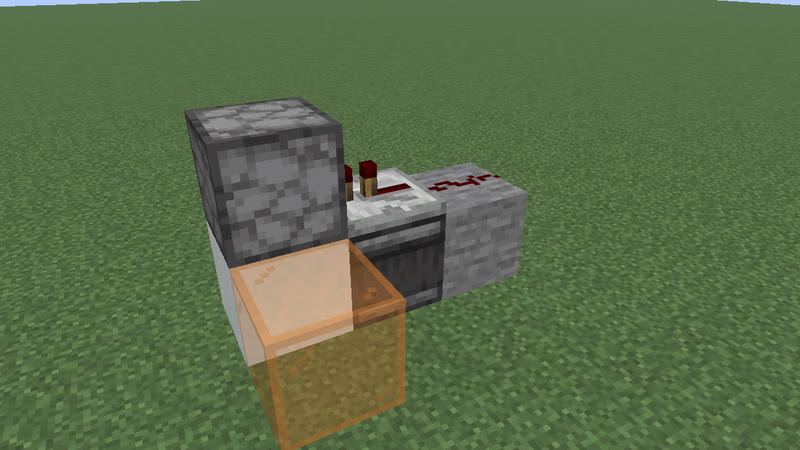</a> <b>clk-item-snowdisp</b> P = 16 + 4n gt (0.8 s + 0.2 s·n) · 5 blocks · dispenser+observer+redstone_wire+repeater extend: one more tick of delay on the repeater (same blocks) n = 0..2: P = 16..24 gt (judged in the game: n = 0, 1, 2)</td></tr>
<tr><td align="center" valign="top"><a href="archive/clk-obs-bulb-ring.txt">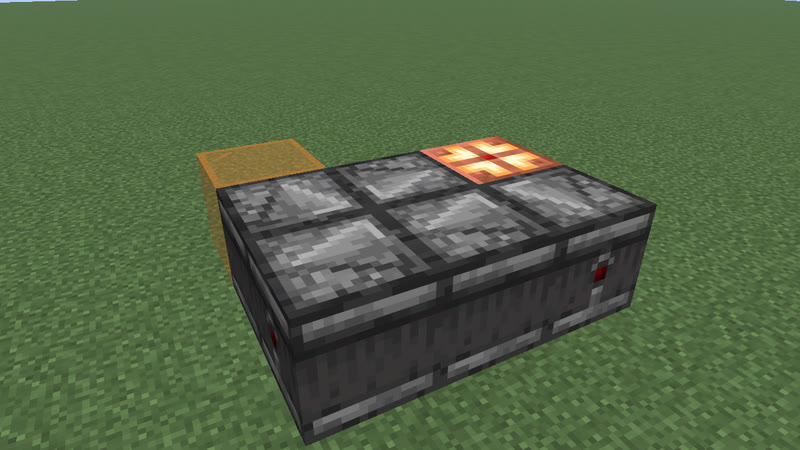</a> <b>clk-obs-bulb-ring</b> P = 20 + 8n gt (1 s + 0.4 s·n) · 6 + 2n blocks · copper_bulb+observer extend: insert 2 observers: one more column in the 2-wide ring n = 0..22: P = 20..196 gt (judged in the game: n = 0, 1, 2, 11, 22, 0, 1, 2, 11, 22)</td><td align="center" valign="top"><a href="archive/clk-rt-uloop2t.txt">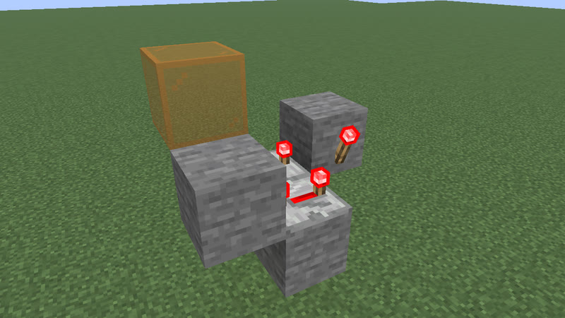</a> <b>clk-rt-uloop2t</b> P = 20 + 16n gt (1 s + 0.8 s·n) · 8 + 4n blocks · redstone_torch+repeater extend: add one delay-4 repeater (powered at placement) to each row of the 2-torch U-ring (wall torch on block A -> top row -> block F -> wall torch on F -> bottom row -> A) n = 0..10: P = 20..180 gt (judged in the game: n = 0, 1, 2, 3, 4, 5, 6, 7, 8, 9, 10)</td></tr>
<tr><td align="center" valign="top"><a href="archive/clk-rt-odd-rect.txt">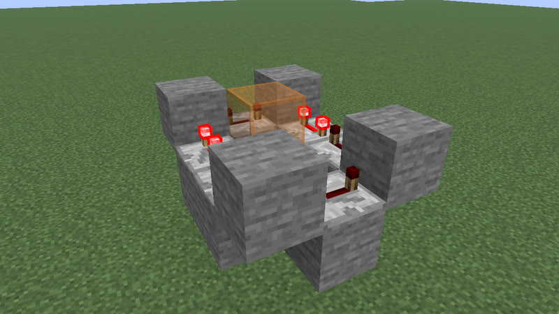</a> <b>clk-rt-odd-rect</b> P = 23 + 8n gt (1.15 s + 0.4 s·n) · 16 + 4n blocks · repeater extend: lengthen the 3 x (4+n) ring (delay-4 repeaters, one delay-3, corner blocks) by one row: one more repeater on each long side; two pulses 23 + 8n gt apart, the second started by a temporary torch at an odd tick n = 0..9: P = 23..95 gt (judged in the game: n = 0, 1, 2, 3, 4, 5, 6, 7, 8, 9)</td><td align="center" valign="top"><a href="archive/clk-misc-cart-loop-n0.txt">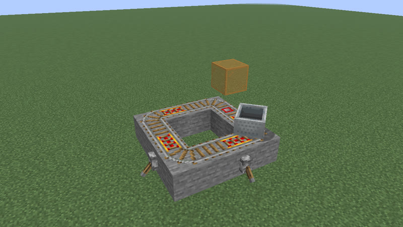</a> <b>clk-misc-cart-loop</b> P = 26 + 5n gt (1.3 s + 0.25 s·n) · 25 + 4n blocks · detector_rail+minecart extend: lengthen both long sides by one powered rail (on a redstone block) n = 0..20: P = 26..126 gt (judged in the game: n = 0, 1, 2, 10, 20)</td></tr>
<tr><td align="center" valign="top"><a href="archive/clk-item-dropring-1d.txt">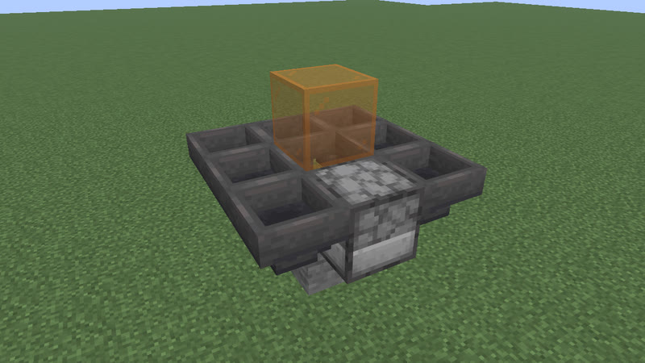</a> <b>clk-item-dropring-1d</b> P = 27 + 14n gt (1.35 s + 0.7 s·n) · 10 + 2n blocks · comparator+dropper+hopper extend: widen the dropper ring by one column (2 hoppers) n = 0..30: P = 27..447 gt (judged in the game: n = 0, 1, 2, 15, 30)</td><td align="center" valign="top"><a href="archive/clk-item-latch.txt">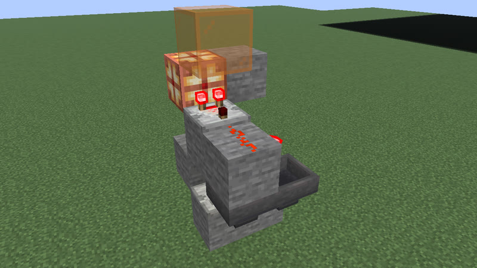</a> <b>clk-item-latch</b> P = 30 + 16n gt (1.5 s + 0.8 s·n) · 17 blocks · comparator+copper_bulb+hopper+redstone_torch+redstone_wire extend: one more stone in hopper A (same blocks; up to 5 stacks of 64) n = 0..318: P = 30..5118 gt (judged in the game: n = 0, 1, 2, 159, 318)</td></tr>
<tr><td align="center" valign="top"><a href="archive/clk-item-dropring-2d-r2.txt">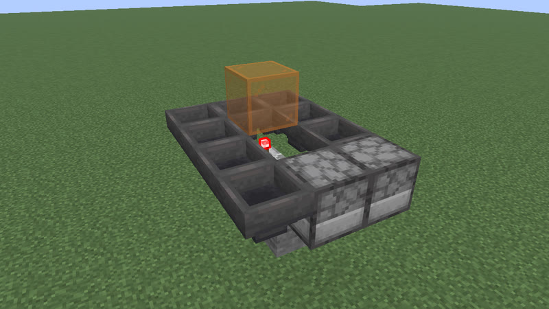</a> <b>clk-item-dropring-2d-r2</b> P = 31 + 14n gt (1.55 s + 0.7 s·n) · 14 + 2n blocks · comparator+dropper+hopper+repeater extend: widen the dropper ring by one column (2 hoppers) n = 0..30: P = 31..451 gt (judged in the game: n = 0, 1, 2, 15, 30)</td><td align="center" valign="top"><a href="archive/clk-sculk-replin.txt">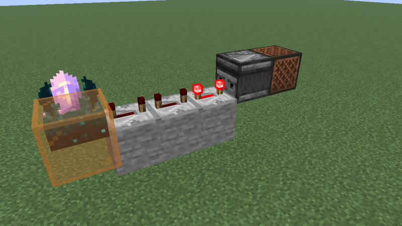</a> <b>clk-sculk-replin</b> P = 4 + 9n gt (0.2 s + 0.45 s·n) · 3 + 2n blocks · calibrated_sculk_sensor+note_block+observer+repeater extend: one more delay-4 repeater on a stone at the end of the line (the observer and note block move one block out): +8 gt of delay and +1 gt of travel n = 3..14: P = 31..130 gt (judged in the game: n = 3, 4, 5, 8, 14)</td></tr>
<tr><td align="center" valign="top"><a href="archive/clk-rt-rect-pulse.txt">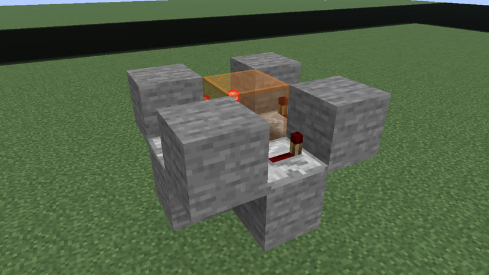</a> <b>clk-rt-rect-pulse</b> P = 32 + 16n gt (1.6 s + 0.8 s·n) · 12 + 4n blocks · repeater extend: lengthen the 3 x (3+n) ring of delay-4 repeaters with corner blocks by one row: one more repeater on each long side (one pulse loaded at placement) n = 0..10: P = 32..192 gt (judged in the game: n = 0, 1, 2, 3, 4, 5, 6, 7, 8, 9, 10)</td><td align="center" valign="top"><a href="archive/clk-item-dropring-2d-r3.txt">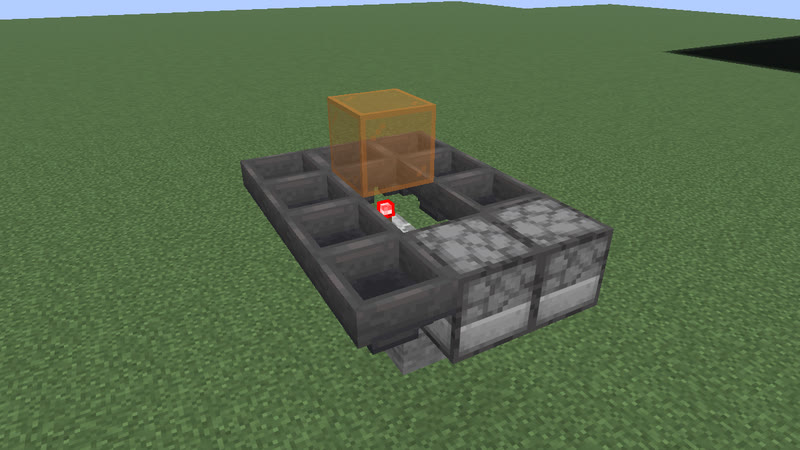</a> <b>clk-item-dropring-2d-r3</b> P = 33 + 14n gt (1.65 s + 0.7 s·n) · 14 + 2n blocks · comparator+dropper+hopper+repeater extend: widen the dropper ring by one column (2 hoppers) n = 0..30: P = 33..453 gt (judged in the game: n = 0, 1, 2, 15, 30)</td></tr>
<tr><td align="center" valign="top"><a href="archive/clk-item-lockring-2s.txt">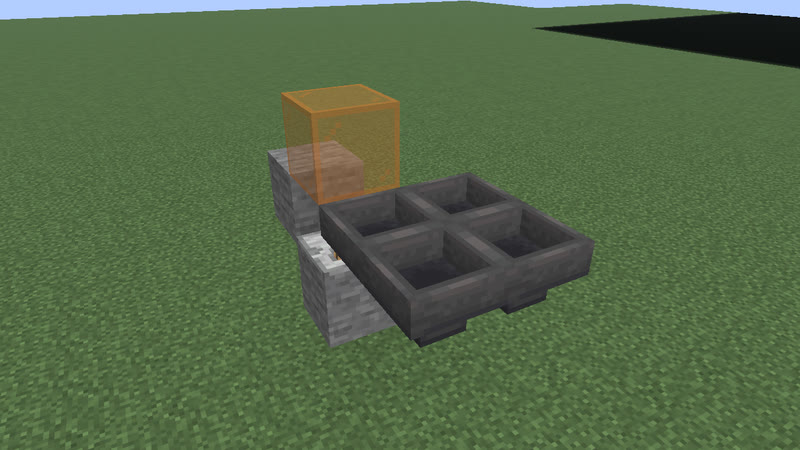</a> <b>clk-item-lockring-2s</b> P = 33 + 2n gt (1.65 s + 0.1 s·n) · 11 blocks · comparator+hopper+redstone_wire+repeater extend: one more tick of delay on the lock repeater (same blocks) n = 0..3: P = 33..39 gt (judged in the game: n = 0, 1, 2, 3)</td><td align="center" valign="top"><a href="archive/clk-item-dropring-2d.txt">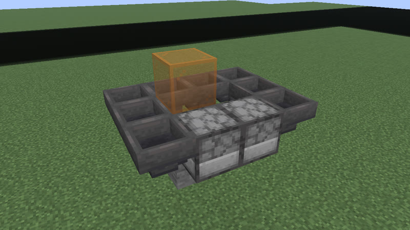</a> <b>clk-item-dropring-2d</b> P = 34 + 14n gt (1.7 s + 0.7 s·n) · 12 + 2n blocks · comparator+dropper+hopper extend: widen the dropper ring by one column (2 hoppers) n = 0..30: P = 34..454 gt (judged in the game: n = 0, 1, 2, 15, 30)</td></tr>
<tr><td align="center" valign="top"><a href="archive/clk-item-dropring-2d-r4.txt">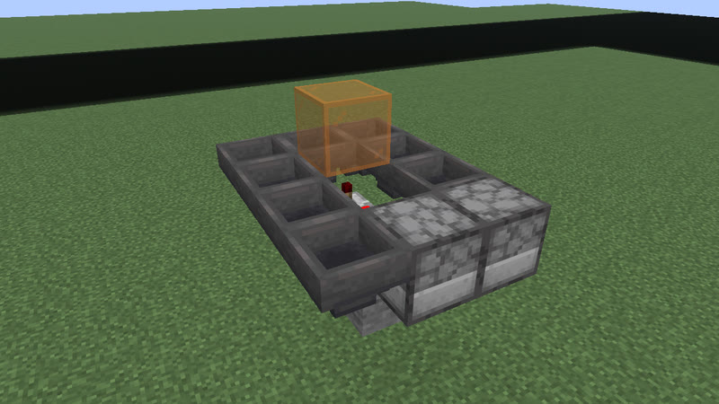</a> <b>clk-item-dropring-2d-r4</b> P = 35 + 14n gt (1.75 s + 0.7 s·n) · 14 + 2n blocks · comparator+dropper+hopper+repeater extend: widen the dropper ring by one column (2 hoppers) n = 0..30: P = 35..455 gt (judged in the game: n = 0, 1, 2, 15, 30)</td><td align="center" valign="top"><a href="archive/clk-sculk-hairpin.txt">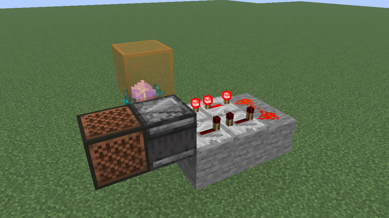</a> <b>clk-sculk-hairpin</b> P = 3 + 16n gt (0.15 s + 0.8 s·n) · 7 + 4n blocks · calibrated_sculk_sensor+note_block+observer+redstone_wire+repeater extend: one more delay-4 repeater on a stone in each arm of the hairpin (the dust U-turn moves one block out) n = 2..12: P = 35..195 gt (judged in the game: n = 2, 3, 4, 7, 12)</td></tr>
<tr><td align="center" valign="top"> <b>clk-item-dropring-1d-r1</b> P = 36 + 14n gt (1.8 s + 0.7 s·n) · 14 + 2n blocks · comparator+dropper+hopper+repeater extend: widen the dropper ring by one column (2 hoppers) n = 0..30: P = 36..456 gt (judged in the game: n = 0, 1, 2, 15, 30)</td><td align="center" valign="top"><a href="archive/clk-rt-uloop1t.txt">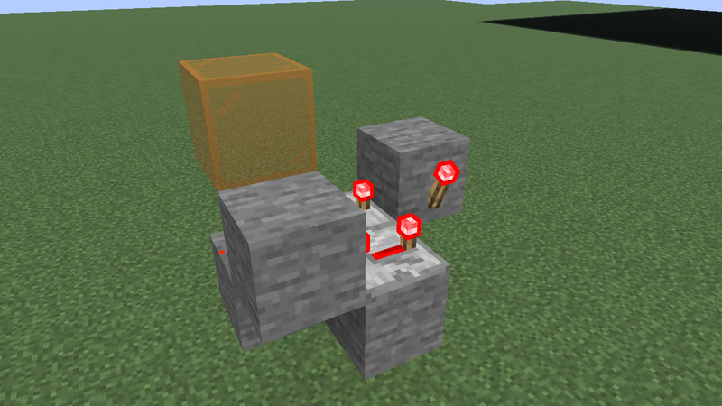</a> <b>clk-rt-uloop1t</b> P = 36 + 32n gt (1.8 s + 1.6 s·n) · 9 + 4n blocks · redstone_torch+redstone_wire+repeater extend: add one delay-4 repeater (powered at placement) to each row of the 1-torch inverter U-loop (block A + a dust corner -> top row -> block F -> wall torch on F -> bottom row -> A) n = 0..8: P = 36..292 gt (judged in the game: n = 0, 1, 2, 3, 4, 5, 6, 7, 8)</td></tr>
<tr><td align="center" valign="top"><a href="archive/clk-item-dropring-1d-r2.txt">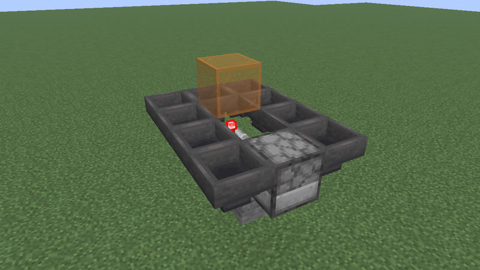</a> <b>clk-item-dropring-1d-r2</b> P = 38 + 14n gt (1.9 s + 0.7 s·n) · 14 + 2n blocks · comparator+dropper+hopper+repeater extend: widen the dropper ring by one column (2 hoppers) n = 0..30: P = 38..458 gt (judged in the game: n = 0, 1, 2, 15, 30)</td><td align="center" valign="top"><a href="archive/clk-misc-cart-pingpong-n0.txt">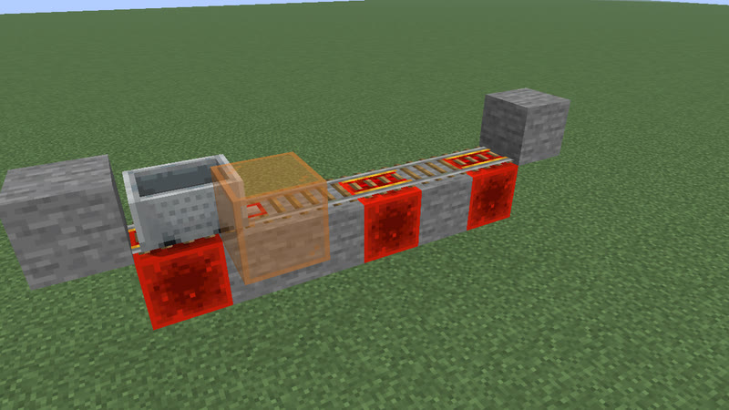</a> <b>clk-misc-cart-pingpong</b> P = 38 + 5n gt (1.9 s + 0.25 s·n) · 15 + 2n blocks · detector_rail+minecart extend: one more powered rail (on a redstone block) in the middle of the track n = 0..20: P = 38..138 gt (judged in the game: n = 0, 1, 2, 10, 20)</td></tr>
<tr><td align="center" valign="top"> <b>clk-item-dropring-1d-r3</b> P = 40 + 14n gt (2 s + 0.7 s·n) · 14 + 2n blocks · comparator+dropper+hopper+repeater extend: widen the dropper ring by one column (2 hoppers) n = 0..30: P = 40..460 gt (judged in the game: n = 0, 1, 2, 15, 30)</td><td align="center" valign="top"><a href="archive/clk-item-lockring-3s.txt">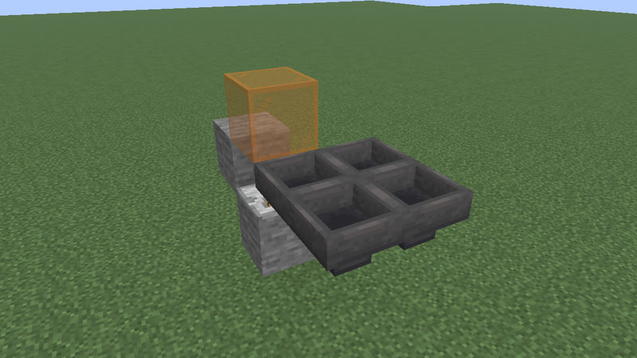</a> <b>clk-item-lockring-3s</b> P = 41 + 2n gt (2.05 s + 0.1 s·n) · 11 blocks · comparator+hopper+redstone_wire+repeater extend: one more tick of delay on the lock repeater (same blocks) n = 0..3: P = 41..47 gt (judged in the game: n = 0, 1, 2, 3)</td></tr>
<tr><td align="center" valign="top"><a href="archive/clk-item-dropring-1d-r4.txt">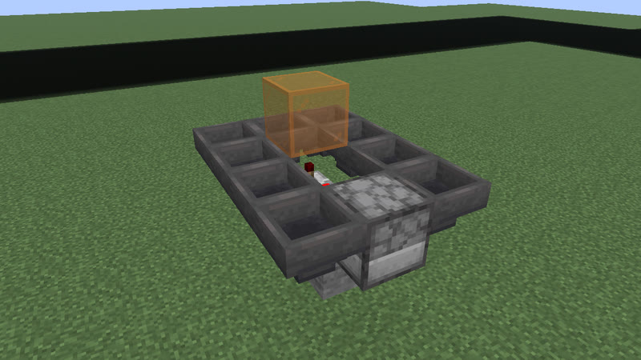</a> <b>clk-item-dropring-1d-r4</b> P = 42 + 14n gt (2.1 s + 0.7 s·n) · 14 + 2n blocks · comparator+dropper+hopper+repeater extend: widen the dropper ring by one column (2 hoppers) n = 0..30: P = 42..462 gt (judged in the game: n = 0, 1, 2, 15, 30)</td><td align="center" valign="top"> <b>clk-item-dropring-2d-r1</b> P = 43 + 14n gt (2.15 s + 0.7 s·n) · 16 + 2n blocks · comparator+dropper+hopper+repeater extend: widen the dropper ring by one column (2 hoppers) n = 0..30: P = 43..463 gt (judged in the game: n = 0, 1, 2, 15, 30)</td></tr>
<tr><td align="center" valign="top"><a href="archive/clk-item-dropring-2d-r14.txt">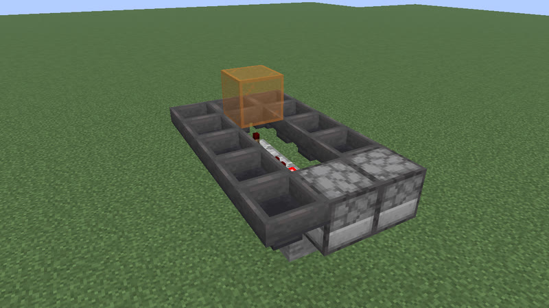</a> <b>clk-item-dropring-2d-r14</b> P = 44 + 14n gt (2.2 s + 0.7 s·n) · 18 + 2n blocks · comparator+dropper+hopper+repeater extend: widen the dropper ring by one column (2 hoppers) n = 0..30: P = 44..464 gt (judged in the game: n = 0, 1, 2, 15, 30)</td><td align="center" valign="top"><a href="archive/clk-item-dropring-2d-r24.txt">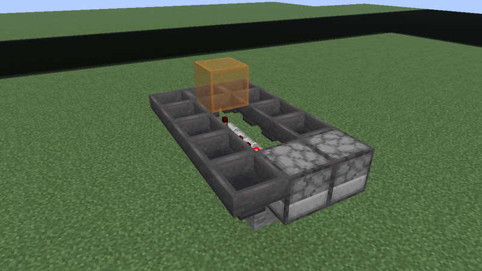</a> <b>clk-item-dropring-2d-r24</b> P = 46 + 14n gt (2.3 s + 0.7 s·n) · 18 + 2n blocks · comparator+dropper+hopper+repeater extend: widen the dropper ring by one column (2 hoppers) n = 0..30: P = 46..466 gt (judged in the game: n = 0, 1, 2, 15, 30)</td></tr>
<tr><td align="center" valign="top"><a href="archive/clk-item-dropring-1d-r14.txt">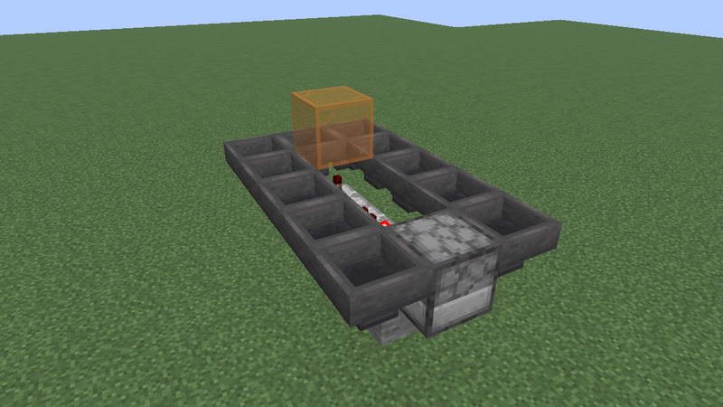</a> <b>clk-item-dropring-1d-r14</b> P = 51 + 14n gt (2.55 s + 0.7 s·n) · 18 + 2n blocks · comparator+dropper+hopper+repeater extend: widen the dropper ring by one column (2 hoppers) n = 0..30: P = 51..471 gt (judged in the game: n = 0, 1, 2, 15, 30)</td><td align="center" valign="top"><a href="archive/clk-sculk-hairpin-plain.txt">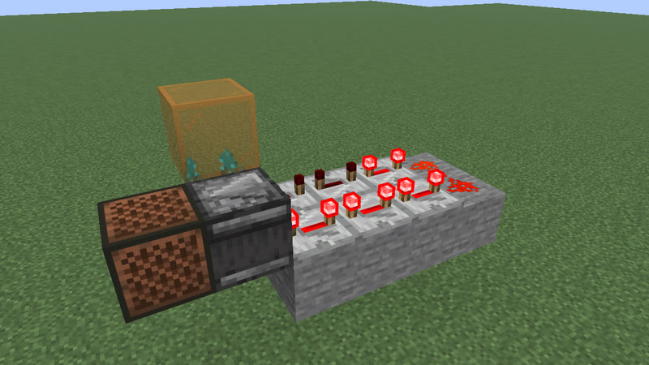</a> <b>clk-sculk-hairpin-plain</b> P = 3 + 16n gt (0.15 s + 0.8 s·n) · 7 + 4n blocks · note_block+observer+redstone_wire+repeater+sculk_sensor extend: one more delay-4 repeater on a stone in each arm of the hairpin (the dust U-turn moves one block out) n = 3..12: P = 51..195 gt (judged in the game: n = 3, 4, 5, 7, 12)</td></tr>
<tr><td align="center" valign="top"><a href="archive/clk-rt-rect-inv.txt">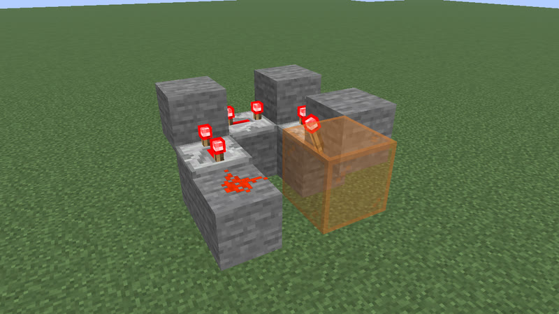</a> <b>clk-rt-rect-inv</b> P = 52 + 32n gt (2.6 s + 1.6 s·n) · 12 + 4n blocks · redstone_torch+redstone_wire+repeater extend: lengthen the 3 x (3+n) inverter ring (delay-4 repeaters, corner blocks, a wall torch on one corner block, the next corner dust) by one row: one more repeater on each long side n = 0..8: P = 52..308 gt (judged in the game: n = 0, 1, 2, 3, 4, 5, 6, 7, 8)</td><td align="center" valign="top"><a href="archive/clk-item-dropring-1d-r24.txt">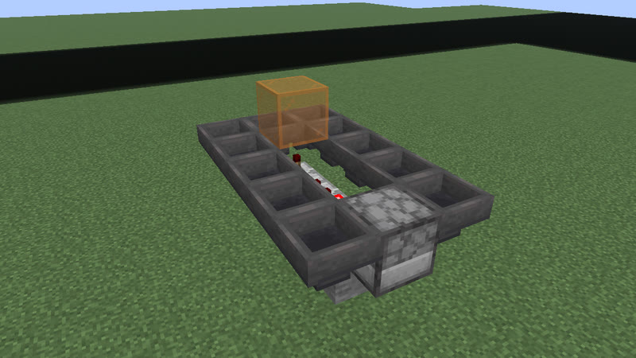</a> <b>clk-item-dropring-1d-r24</b> P = 53 + 14n gt (2.65 s + 0.7 s·n) · 18 + 2n blocks · comparator+dropper+hopper+repeater extend: widen the dropper ring by one column (2 hoppers) n = 0..30: P = 53..473 gt (judged in the game: n = 0, 1, 2, 15, 30)</td></tr>
<tr><td align="center" valign="top"><a href="archive/clk-sculk-racetrack.txt">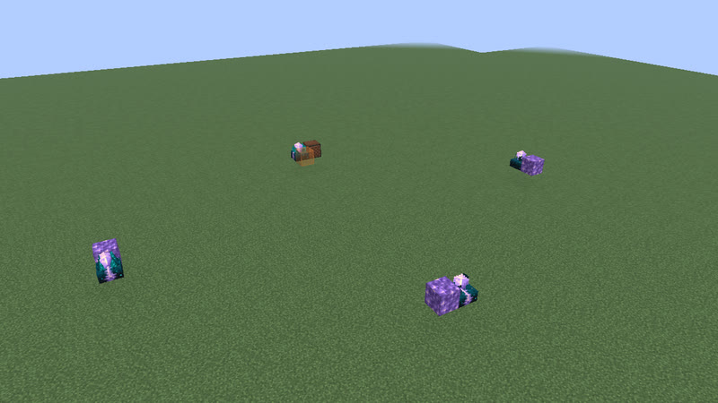</a> <b>clk-sculk-racetrack</b> P = 28 + 32n gt (1.4 s + 1.6 s·n) · 4 + 4n blocks · calibrated_sculk_sensor+note_block extend: one more calibrated sensor + amethyst block on each straight side, 17 blocks apart (the far turn sensor moves 17 out) n = 1..8: P = 60..284 gt (judged in the game: n = 1, 2, 3, 4, 8)</td><td align="center" valign="top"><a href="archive/clk-sculk-racetrack-plain.txt">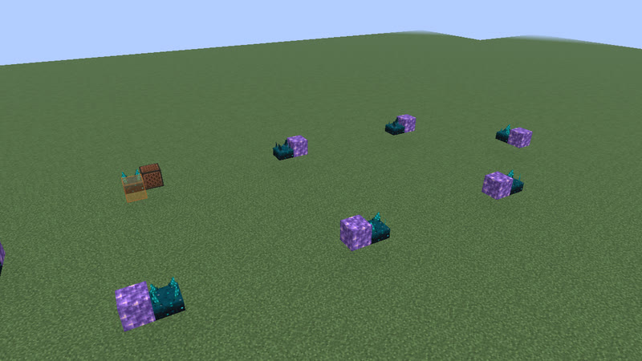</a> <b>clk-sculk-racetrack-plain</b> P = 12 + 16n gt (0.6 s + 0.8 s·n) · 4 + 4n blocks · note_block+sculk_sensor extend: one more plain sensor + amethyst block on each straight side, 9 blocks apart (the far turn sensor moves 9 out) n = 3..10: P = 60..172 gt (judged in the game: n = 3, 4, 5, 6, 10)</td></tr>
<tr><td align="center" valign="top"><a href="archive/clk-rt-div.txt">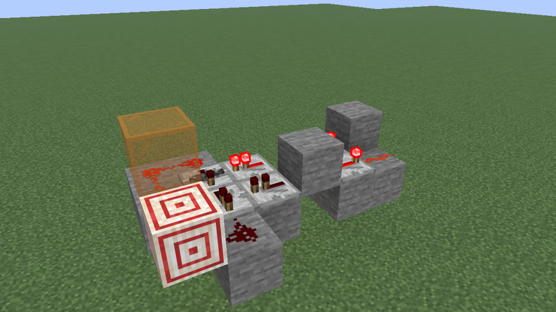</a> <b>clk-rt-div</b> P = 36 · 2^n gt (1.8 s · 2^n) · 9 + 18n blocks · redstone_torch+redstone_wire+repeater extend: append one master-slave T flip-flop stage (18 blocks: 2 latch repeaters, 2 lock repeaters, a target block with a wall torch, dust) to the chain on the P36 torch + repeater loop: the period doubles n = 1..7: P = 72..4608 gt (judged in the game: n = 1, 2, 3, 4, 5, 6, 7)</td><td align="center" valign="top"><a href="archive/clk-item-ringlock-rows.txt">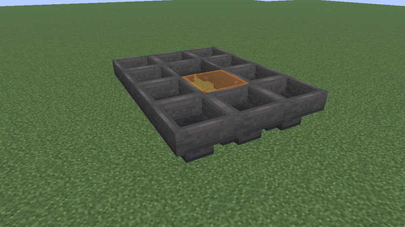</a> <b>clk-item-ringlock-rows</b> P = 76 + 14n gt (3.8 s + 0.7 s·n) · 12 + 2n blocks · comparator+hopper extend: lengthen the 3-wide ring by one row (2 hoppers), still 5 stones n = 0..30: P = 76..496 gt (judged in the game: n = 0, 1, 2, 15, 30)</td></tr>
<tr><td align="center" valign="top"><a href="archive/clk-misc-crafter-loop-n0.txt">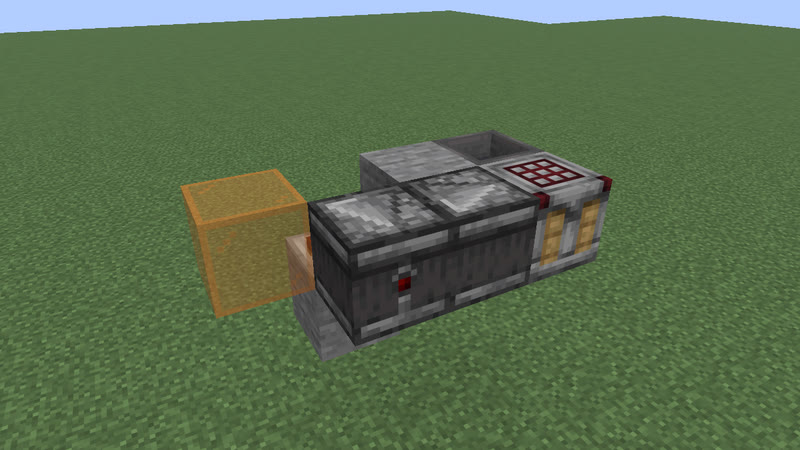</a> <b>clk-misc-crafter-loop</b> P = 91 + 28n gt (4.55 s + 1.4 s·n) · 7 + 2n blocks · comparator+crafter+hopper+observer extend: add 2 hoppers: the hopper loop one column longer n = 0..20: P = 91..651 gt (judged in the game: n = 0, 1, 2, 10, 20)</td><td align="center" valign="top"> <b>clk-item-ringlock-stones-3x6</b> P = 104 + 8n gt (5.2 s + 0.4 s·n) · 16 blocks · comparator+hopper extend: one more stone in the corner hopper (same blocks) n = 0..4: P = 104..136 gt (judged in the game: n = 0, 1, 2, 4)</td></tr>
<tr><td align="center" valign="top"><a href="archive/clk-rt-fade.txt">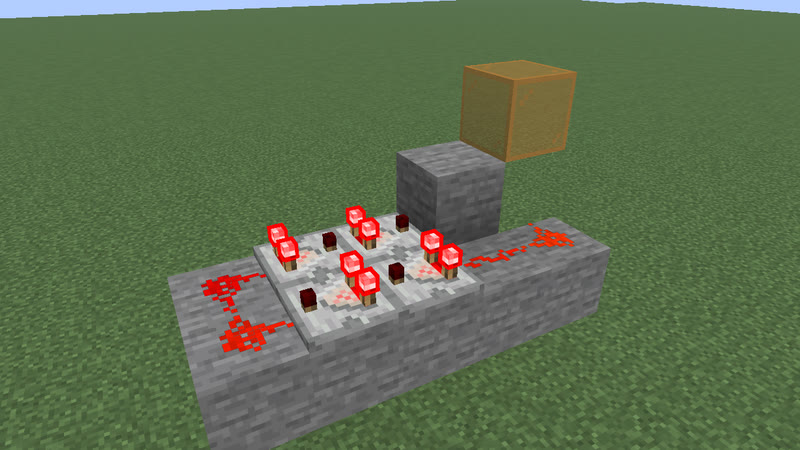</a> <b>clk-rt-fade</b> P = 114 + 56n gt (5.7 s + 2.8 s·n) · 18 + 4n blocks · comparator+redstone_torch+redstone_wire extend: add one compare-mode comparator to each row of the comparator fading ring (2 + 2 comparators at n = 0, a lossy two-dust turn, a refill torch) n = 0..10: P = 114..674 gt (judged in the game: n = 0, 1, 2, 3, 4, 5, 6, 7, 8, 9, 10)</td><td align="center" valign="top"><a href="archive/clk-rt-div-fade.txt">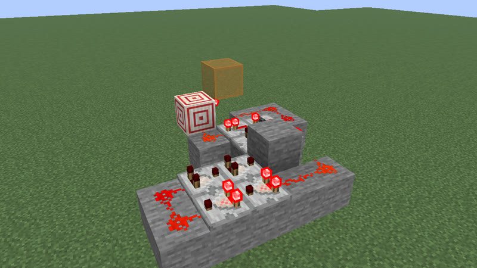</a> <b>clk-rt-div-fade</b> P = 114 · 2^n gt (5.7 s · 2^n) · 18 + 18n blocks · comparator+redstone_torch+redstone_wire+repeater extend: append one master-slave T flip-flop stage (18 blocks) to the chain on the P114 comparator fading ring: the period doubles n = 1..5: P = 228..3648 gt (judged in the game: n = 1, 2, 3, 4, 5)</td></tr>
<tr><td align="center" valign="top"> <b>clk-item-ringlock-stones-3x20</b> P = 300 + 8n gt (15 s + 0.4 s·n) · 44 blocks · comparator+hopper extend: one more stone in the corner hopper (same blocks) n = 0..28: P = 300..524 gt (judged in the game: n = 0, 1, 2, 14, 28)</td><td align="center" valign="top"><a href="archive/clk-rt-counter.txt">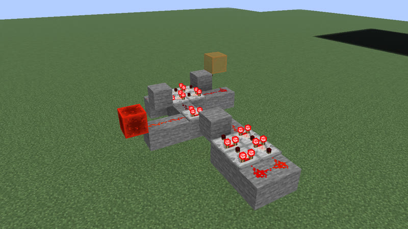</a> <b>clk-rt-counter</b> P = 114 · 14^n gt (5.7 s · 14^n) · 18 + 26n blocks · comparator+redstone_torch+redstone_wire extend: wrap one more counter level around the clock (a lossless 2 + 2 comparator ring with one subtract comparator, its pulse shaper and refill torch: 26 blocks): the period x 14 n = 1..3: P = 1596..312816 gt (judged in the game: n = 1, 2, 3)</td></tr>
</table>

## Galleries by period

| periods | clocks | page |
|---|---|---|
| 4 gt (0.2 s) to 11 gt (0.55 s) | 270 | [p4-11](gallery/p4-11.md) |
| 12 gt (0.6 s) to 16 gt (0.8 s) | 277 | [p12-16](gallery/p12-16.md) |
| 17 gt (0.85 s) to 23 gt (1.15 s) | 294 | [p17-23](gallery/p17-23.md) |
| 24 gt (1.2 s) to 28 gt (1.4 s) | 281 | [p24-28](gallery/p24-28.md) |
| 29 gt (1.45 s) to 39 gt (1.95 s) | 286 | [p29-39](gallery/p29-39.md) |
| 40 gt (2 s) to 47 gt (2.35 s) | 282 | [p40-47](gallery/p40-47.md) |
| 48 gt (2.4 s) to 65 gt (3.25 s) | 280 | [p48-65](gallery/p48-65.md) |
| 66 gt (3.3 s) to 126 gt (6.3 s) | 299 | [p66-126](gallery/p66-126.md) |
| 128 gt (6.4 s) to 17978 gt (14 min 58.9 s) | 194 | [p128-17978](gallery/p128-17978.md) |
