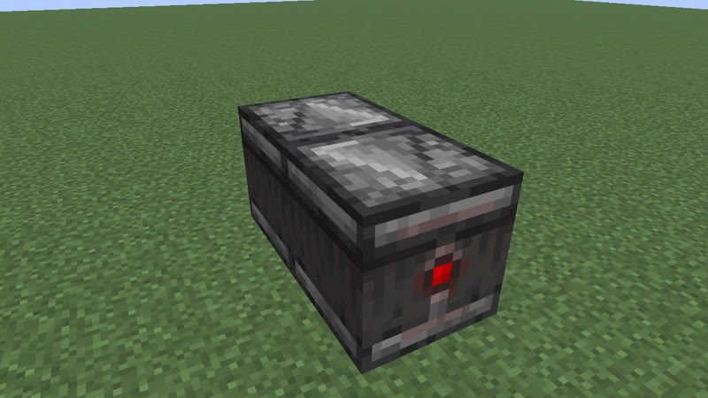
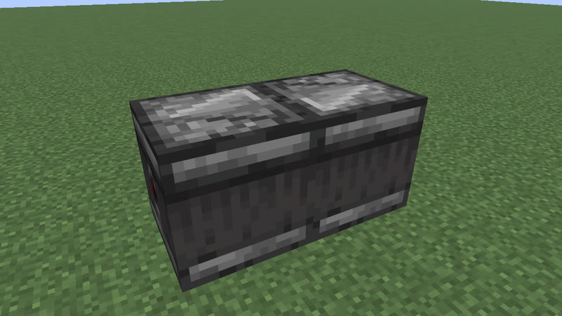
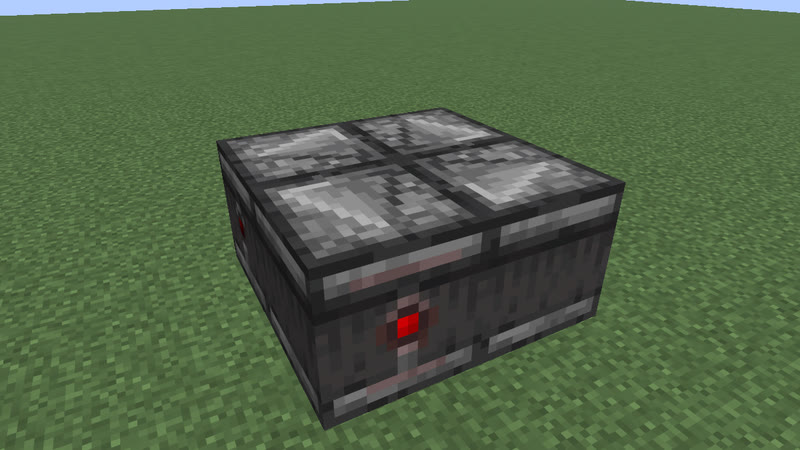

# Clock catalog

Generated by `mctas clock catalog` from `designs/clocks/archive/` (verdicts-v1.tsv, captions.tsv): never edit by hand. What a clock is and how it is judged: [docs/clocks.md](../../docs/clocks.md).

237 archived clocks, 233 distinct types (up to translation and rotation), 47 families, 80 periods.

## Coverage: period x family (fewest blocks)

| P (gt) | redstone_torch+redstone_wire+repeater | observer+sticky_piston | comparator+redstone_torch+redstone_wire+repeater | redstone_torch+repeater | redstone_wire+repeater | comparator+redstone_torch+redstone_wire | comparator+redstone_torch+repeater | comparator+hopper | comparator+redstone_wire+repeater | observer+piston | observer | calibrated_sculk_sensor+dispenser+observer | calibrated_sculk_sensor+note_block+observer | calibrated_sculk_sensor+observer+sticky_piston | comparator+dropper+hopper | comparator+hopper+redstone_torch+redstone_wire | observer+redstone_block+sticky_piston | calibrated_sculk_sensor+note_block+observer+repeater | comparator+redstone_torch | dropper+hopper+jukebox+note_block+redstone_torch+redstone_wire | note_block+observer+repeater+sculk_sensor | calibrated_sculk_sensor+observer+piston | comparator+redstone_wire | copper_bulb+observer | copper_bulb+observer+redstone_block+sticky_piston | dispenser+observer+sculk_sensor | note_block+observer | redstone_block+sticky_piston | calibrated_sculk_sensor | calibrated_sculk_sensor+iron_trapdoor+observer | calibrated_sculk_sensor+note_block+redstone_torch+repeater | calibrated_sculk_sensor+oak_fence_gate+observer | calibrated_sculk_sensor+oak_trapdoor+observer | calibrated_sculk_sensor+piston+redstone_wire+repeater | comparator+copper_bulb+observer | comparator+hopper+redstone_wire | copper_bulb+observer+sticky_piston | copper_bulb+redstone_block+sticky_piston | hopper+redstone_torch+redstone_wire | iron_trapdoor+observer | note_block+observer+sculk_sensor | note_block+redstone_block+sticky_piston | observer+piston+redstone_lamp | observer+redstone_lamp | observer+sculk_sensor+sticky_piston | redstone_block+redstone_lamp+sticky_piston | sticky_piston |
|---|---|---|---|---|---|---|---|---|---|---|---|---|---|---|---|---|---|---|---|---|---|---|---|---|---|---|---|---|---|---|---|---|---|---|---|---|---|---|---|---|---|---|---|---|---|---|---|
| 4 |  |  |  |  | [10b](archive/clk-rt-uloop-p4-rw-r-10b.txt) |  |  |  |  |  | [4b](archive/clk-obs-p4-obs-4b.txt) |  |  |  |  |  |  |  |  |  |  |  | [8b](archive/clk-rt-cmp-sub-4b.txt) |  |  |  |  |  |  |  |  |  |  |  |  |  |  |  |  |  |  |  |  |  |  |  |  |
| 5 |  |  |  |  | [18b](archive/clk-rt-uloop-C-1--1-1-1-1-d-d-kick-p5.txt) |  |  |  |  | [6b](archive/clk-obs-p5-obs-pis-6b.txt) |  |  |  |  |  |  |  |  |  |  |  |  |  |  |  |  |  |  |  |  |  |  |  |  |  |  |  |  |  |  |  |  |  |  |  |  |  |
| 6 |  | [3b](archive/census-p6-observer-sticky_piston-3b.txt) |  |  | [14b](archive/clk-rt-uloop-p6-rw-r-14b.txt) |  |  |  | [14b](archive/clk-rt-uloop-p6-c-rw-r-14b.txt) | [3b](archive/census-p6-observer-piston-3b.txt) | [2b](archive/census-p6-observer-2b-2.txt) |  |  |  |  |  | [4b](archive/census-p6-observer-redstone_block-sticky_piston-4b.txt) |  |  |  |  |  |  |  |  |  | [3b](archive/census-p6-note_block-observer-3b.txt) | [3b](archive/census-p6-redstone_block-sticky_piston-3b.txt) |  |  |  |  |  |  |  |  |  |  |  |  |  | [4b](archive/census-p6-note_block-redstone_block-sticky_piston-4b.txt) |  |  |  | [4b](archive/census-p6-redstone_block-redstone_lamp-sticky_piston-4b.txt) |  |
| 7 |  |  |  |  |  |  |  |  |  |  |  |  |  |  |  |  |  |  |  |  |  |  |  |  |  |  |  |  |  |  |  |  |  |  |  |  |  |  |  |  |  |  |  |  |  |  | [5b](archive/clk-obs-p7-obs-stk-5b.txt) |
| 8 |  |  |  |  | [10b](archive/clk-rt-uloop-p8-rw-r-10b.txt) |  |  | [4b](archive/hop2x3cd-p8a.txt) | [14b](archive/clk-rt-uloop-p8-c-rw-r-14b.txt) |  | [4b](archive/census-p8-observer-4b.txt) |  |  |  |  |  |  |  |  |  |  |  |  |  |  |  |  |  |  |  |  |  |  |  |  |  |  |  |  |  |  |  |  |  |  |  |  |
| 9 |  |  |  |  |  |  |  |  |  | [5b](archive/clk-obs-p9-obs-pis-5b.txt) |  |  |  |  |  |  |  |  |  |  |  |  |  |  |  |  |  |  |  |  |  |  |  |  |  | [8b](archive/hop2lock-p9.txt) |  |  |  |  |  |  |  |  |  |  |  |
| 10 | [12b](archive/clk-rt-uloop-p10-rt-rw-r-12b.txt) | [4b](archive/clk-obs-p10-obs-stk-4b.txt) | [12b](archive/clk-rt-uloop-p10-c-rt-rw-r-12b.txt) | [8b](archive/clk-rt-uloop-p10-rt-r-8b.txt) | [14b](archive/clk-rt-uloop-p10-rw-r-14b.txt) | [12b](archive/clk-rt-uloop-p10-c-rt-rw-12b.txt) | [8b](archive/clk-rt-uloop-p10-c-rt-r-8b.txt) |  | [14b](archive/clk-rt-uloop-p10-c-rw-r-14b.txt) |  |  |  |  |  |  |  |  |  |  |  |  |  |  |  |  |  | [6b](archive/clk-obs-notering6.txt) |  |  |  |  |  |  |  |  |  |  |  |  |  |  |  |  |  |  |  |  |
| 11 |  |  |  |  |  |  |  |  |  | [6b](archive/clk-obs-p11-obs-pis-6b.txt) |  |  |  |  |  |  |  |  |  |  |  |  |  |  |  |  |  |  |  |  |  |  |  |  |  |  |  |  |  |  |  |  |  |  |  |  |  |
| 12 | [9b](archive/clk-rt-tr-9-12.txt) |  | [9b](archive/clk-rt-uloop-p12-c-rt-rw-r-9b.txt) | [8b](archive/clk-rt-uloop-p12-rt-r-8b.txt) | [10b](archive/clk-rt-uloop-p12-rw-r-10b.txt) | [9b](archive/clk-rt-uloop-p12-c-rt-rw-9b.txt) | [8b](archive/clk-rt-uloop-p12-c-rt-r-8b.txt) |  | [14b](archive/clk-rt-uloop-p12-c-rw-r-14b.txt) |  | [6b](archive/clk-obs-ring6.txt) |  |  |  |  |  |  |  | [12b](archive/clk-rt-uloop-p12-c-rt-12b.txt) |  |  |  |  | [3b](archive/census-p12-copper_bulb-observer-3b.txt) |  |  |  |  |  |  |  |  |  |  |  |  |  | [4b](archive/census-p12-copper_bulb-redstone_block-sticky_piston-4b.txt) |  |  |  |  |  |  |  |  |  |
| 13 |  |  |  |  |  |  |  |  |  | [4b](archive/clk-obs-p13-obs-pis-4b.txt) |  |  |  |  |  |  |  |  |  |  |  |  |  |  |  |  |  |  |  |  |  |  |  |  |  |  |  |  |  |  |  |  |  |  |  |  |  |
| 14 | [12b](archive/clk-rt-uloop-p14-rt-rw-r-12b.txt) |  | [12b](archive/clk-rt-uloop-p14-c-rt-rw-r-12b.txt) | [8b](archive/clk-rt-uloop-p14-rt-r-8b.txt) | [14b](archive/clk-rt-uloop-p14-rw-r-14b.txt) |  | [12b](archive/clk-rt-uloop-p14-c-rt-r-12b.txt) | [4b](archive/hop2-p14.txt) | [14b](archive/clk-rt-uloop-p14-c-rw-r-14b.txt) | [5b](archive/clk-obs-p14-obs-pis-5b.txt) |  |  |  |  |  |  |  |  |  |  |  |  |  |  |  |  |  |  |  |  |  |  |  |  |  |  |  |  |  |  |  |  |  |  |  |  |  |
| 15 |  |  |  |  |  |  |  | [10b](archive/ringlock-p15.txt) |  |  |  |  |  |  |  |  |  |  |  |  |  |  |  |  |  |  |  |  |  |  |  |  |  |  |  |  |  |  |  |  |  |  | [5b](archive/clk-obs-p15-lamp-obs-pis-5b.txt) |  |  |  |  |
| 16 | [9b](archive/clk-rt-uloop-p16-rt-rw-r-9b.txt) |  | [9b](archive/clk-rt-uloop-p16-c-rt-rw-r-9b.txt) | [8b](archive/clk-rt-uloop-p16-rt-r-8b.txt) | [10b](archive/clk-rt-uloop-p16-rw-r-10b.txt) | [13b](archive/clk-rt-uloop-p16-c-rt-rw-13b.txt) | [12b](archive/clk-rt-uloop-p16-c-rt-r-12b.txt) |  | [14b](archive/clk-rt-uloop-p16-c-rw-r-14b.txt) |  |  |  |  |  |  |  |  |  |  |  |  |  |  |  | [4b](archive/clk-obs-p16-bulb-obs-rb-stk-4b.txt) |  |  |  |  |  |  |  |  |  |  |  |  |  |  |  |  |  |  |  |  |  |  |
| 17 |  | [5b](archive/clk-obs-p17-obs-stk-5b.txt) |  |  |  |  |  |  |  |  |  |  |  |  |  |  |  |  |  |  |  |  |  |  |  |  |  |  |  |  |  |  |  |  |  |  |  |  |  |  |  |  |  |  |  |  |  |
| 18 | [12b](archive/clk-rt-uloop-p18-rt-rw-r-12b.txt) | [4b](archive/clk-obs-p18-obs-stk-4b.txt) | [12b](archive/clk-rt-uloop-p18-c-rt-rw-r-12b.txt) | [8b](archive/clk-rt-uloop-p18-rt-r-8b.txt) | [14b](archive/clk-rt-uloop-p18-rw-r-14b.txt) |  | [12b](archive/clk-rt-uloop-p18-c-rt-r-12b.txt) |  | [14b](archive/clk-rt-uloop-p18-c-rw-r-14b.txt) |  |  |  |  |  |  |  |  |  |  |  |  |  |  |  |  |  |  |  |  |  |  |  |  |  |  |  |  |  |  |  |  |  |  |  |  |  |  |
| 19 |  | [6b](archive/clk-obs-p19-obs-stk-6b.txt) |  |  |  |  |  |  |  |  |  |  |  |  |  |  |  |  |  |  |  |  |  |  |  |  |  |  |  |  |  |  |  |  |  |  |  |  |  |  |  |  |  |  |  |  |  |
| 20 | [9b](archive/clk-rt-uloop-p20-rt-rw-r-9b.txt) | [5b](archive/clk-obs-p20-obs-stk-5b.txt) | [9b](archive/clk-rt-uloop-p20-c-rt-rw-r-9b.txt) | [8b](archive/clk-rt-uloop-p20-rt-r-8b.txt) | [14b](archive/clk-rt-uloop-p20-rw-r-14b.txt) | [13b](archive/clk-rt-uloop-p20-c-rt-rw-13b.txt) | [12b](archive/clk-rt-uloop-p20-c-rt-r-12b.txt) |  | [14b](archive/clk-rt-uloop-p20-c-rw-r-14b.txt) |  |  |  |  |  | [10b](archive/dropring-p20.txt) |  |  |  |  |  |  |  |  |  |  |  |  |  |  |  |  |  |  |  |  |  |  |  |  |  |  |  |  |  |  |  |  |
| 21 |  |  |  |  |  |  |  | [8b](archive/loop6x2-p21.txt) |  |  |  | [5b](archive/clk-sculk-c21-obs3-disp.txt) |  |  |  |  | [6b](archive/clk-obs-p21-obs-rb-stk-6b.txt) | [6b](archive/clk-sculk-c21s-rep-obs-note.txt) |  |  |  |  |  |  |  |  |  |  |  |  | [6b](archive/clk-sculk-c21s-rep-torch-note.txt) |  |  | [10b](archive/clk-sculk-c21s-rep-dust-piston.txt) |  |  |  |  |  |  |  |  |  |  |  |  |  |
| 22 | [12b](archive/clk-rt-uloop-p22-rt-rw-r-12b.txt) | [6b](archive/clk-obs-p22-obs-stk-6b.txt) | [12b](archive/clk-rt-uloop-p22-c-rt-rw-r-12b.txt) | [12b](archive/clk-rt-uloop-p22-rt-r-12b.txt) | [14b](archive/clk-rt-uloop-p22-rw-r-14b.txt) |  | [12b](archive/clk-rt-uloop-p22-c-rt-r-12b.txt) |  | [14b](archive/clk-rt-uloop-p22-c-rw-r-14b.txt) |  |  |  |  |  |  |  |  | [5b](archive/clk-sculk-c22s-rep-obs-note.txt) |  |  |  |  |  |  |  |  |  |  |  |  |  |  |  |  |  |  |  |  |  |  |  |  |  |  |  |  |  |
| 23 |  | [5b](archive/clk-obs-p23-obs-stk-5b.txt) |  |  |  |  |  |  |  |  |  |  |  |  |  |  |  | [5b](archive/clk-sculk-c23s-rep-obs-note.txt) |  |  |  |  |  |  |  |  |  |  |  |  |  |  |  |  |  |  |  |  |  |  |  |  |  |  |  |  |  |
| 24 | [9b](archive/clk-rt-uloop-p24-rt-rw-r-9b.txt) | [4b](archive/clk-obs-p24-bulb-obs-stk-4b.txt) | [9b](archive/clk-rt-uloop-p24-c-rt-rw-r-9b.txt) | [12b](archive/clk-rt-uloop-p24-rt-r-12b.txt) | [14b](archive/clk-rt-uloop-p24-rw-r-14b.txt) |  | [12b](archive/clk-rt-uloop-p24-c-rt-r-12b.txt) |  | [14b](archive/clk-rt-uloop-p24-c-rw-r-14b.txt) |  |  |  | [3b](archive/clk-sculk-c24-obs-note.txt) | [3b](archive/clk-sculk-c24-obs-sticky.txt) |  |  |  |  |  |  |  | [3b](archive/clk-sculk-c24s-obs-pistonext.txt) |  |  |  |  |  |  |  | [3b](archive/clk-sculk-c24s-obs-irontrapdoor.txt) |  | [3b](archive/clk-sculk-c24s-obs-fencegate.txt) | [3b](archive/clk-sculk-c24s-obs-trapdoor.txt) |  |  |  |  |  |  |  |  |  |  |  |  |  |  |
| 25 |  |  |  |  |  |  |  |  |  |  |  |  | [4b](archive/clk-sculk-c25-obs-stone-note.txt) |  |  |  |  |  |  |  |  |  |  |  |  |  |  |  |  |  |  |  |  |  |  |  |  |  |  |  |  |  |  |  |  |  |  |
| 26 | [12b](archive/clk-rt-uloop-p26-rt-rw-r-12b.txt) | [5b](archive/clk-obs-p26-obs-stk-5b.txt) |  | [12b](archive/clk-rt-uloop-p26-rt-r-12b.txt) | [14b](archive/clk-rt-uloop-p26-rw-r-14b.txt) |  | [12b](archive/clk-rt-uloop-p26-c-rt-r-12b.txt) |  | [14b](archive/clk-rt-uloop-p26-c-rw-r-14b.txt) |  |  |  | [4b](archive/clk-sculk-c26-obs2-note.txt) |  |  |  |  |  |  |  |  |  |  |  |  |  |  |  |  |  |  |  |  |  |  |  |  |  |  |  |  |  |  | [6b](archive/clk-obs-lampring6.txt) |  |  |  |
| 27 |  | [5b](archive/clk-obs-p27-obs-stk-5b.txt) |  |  |  |  |  |  |  |  |  |  | [4b](archive/clk-sculk-c27-obs2line-note.txt) |  | [10b](archive/dropring-p27.txt) |  |  |  |  |  |  |  |  |  |  |  |  |  |  |  |  |  |  |  |  |  |  |  |  |  |  |  |  |  |  |  |  |
| 28 | [9b](archive/clk-rt-uloop-p28-rt-rw-r-9b.txt) | [5b](archive/clk-obs-p28-obs-stk-5b.txt) | [13b](archive/clk-rt-uloop-p28-c-rt-rw-r-13b.txt) | [12b](archive/clk-rt-uloop-p28-rt-r-12b.txt) | [14b](archive/clk-rt-uloop-p28-rw-r-14b.txt) |  | [12b](archive/clk-rt-uloop-p28-c-rt-r-12b.txt) | [6b](archive/loop4-p28.txt) |  |  |  | [3b](archive/clk-sculk-c28-obs-dispenser.txt) |  |  |  |  |  |  |  |  |  |  |  |  |  |  |  |  |  |  |  |  |  |  |  |  |  |  |  |  |  |  |  |  |  |  |  |
| 29 |  |  |  |  |  |  |  |  |  |  |  | [4b](archive/clk-sculk-c29-obs-stone-disp.txt) |  |  |  |  |  |  |  |  |  |  |  |  |  |  |  |  |  |  |  |  |  |  |  |  |  |  |  |  |  |  |  |  |  |  |  |
| 30 |  | [6b](archive/clk-obs-p30-obs-stk-6b.txt) |  | [12b](archive/clk-rt-uloop-p30-rt-r-12b.txt) | [14b](archive/clk-rt-uloop-p30-rw-r-14b.txt) |  | [12b](archive/clk-rt-uloop-p30-c-rt-r-12b.txt) |  |  |  |  | [4b](archive/clk-sculk-c30-obs2-disp.txt) |  |  |  |  |  |  |  |  |  |  |  |  |  |  |  |  |  |  |  |  |  |  |  |  |  |  |  |  |  |  |  |  |  |  |  |
| 31 |  |  |  |  |  |  |  |  |  |  |  | [4b](archive/clk-sculk-c31-obs2line-disp.txt) |  |  |  |  |  |  |  |  |  |  |  |  |  |  |  |  |  |  |  |  |  |  |  |  |  |  |  |  |  |  |  |  |  |  |  |
| 32 | [9b](archive/clk-rt-uloop-p32-rt-rw-r-9b.txt) | [6b](archive/clk-obs-p32-bulb-obs-stk-6b.txt) | [13b](archive/clk-rt-uloop-p32-c-rt-rw-r-13b.txt) | [12b](archive/clk-rt-uloop-p32-rt-r-12b.txt) | [14b](archive/clk-rt-uloop-p32-rw-r-14b.txt) |  |  |  |  |  |  |  |  |  |  |  |  |  |  |  |  |  |  |  |  |  |  |  |  |  |  |  |  |  |  |  |  |  |  |  |  |  |  |  |  |  |  |
| 34 |  |  |  | [12b](archive/clk-rt-uloop-p34-rt-r-12b.txt) |  |  |  |  |  |  |  |  |  |  |  |  |  |  |  |  |  |  |  |  |  |  |  |  |  |  |  |  |  |  |  |  |  |  |  |  |  |  |  |  |  |  |  |
| 35 |  |  |  |  |  |  |  | [12b](archive/loop10x2-p35.txt) |  |  |  |  |  |  |  |  | [6b](archive/clk-obs-p35-obs-rb-stk-6b.txt) |  |  |  |  |  |  |  |  |  |  |  |  |  |  |  |  |  |  |  |  |  |  |  |  |  |  |  |  |  |  |
| 36 | [9b](archive/clk-rt-uloop-p36-rt-rw-r-9b.txt) | [6b](archive/clk-obs-p36-obs-stk-6b.txt) | [13b](archive/clk-rt-uloop-p36-c-rt-rw-r-13b.txt) | [12b](archive/clk-rt-uloop-p36-rt-r-12b.txt) |  |  |  |  |  |  |  |  |  |  |  |  |  |  |  |  |  |  |  |  |  |  |  |  |  |  |  |  |  |  |  |  |  |  |  |  |  |  |  |  |  |  |  |
| 37 |  | [6b](archive/clk-obs-p37-obs-stk-6b.txt) |  |  |  |  |  |  |  |  |  |  |  |  |  |  |  |  |  |  |  |  |  |  |  |  |  |  |  |  |  |  |  |  |  |  |  |  |  |  |  |  |  |  |  |  |  |
| 38 |  | [6b](archive/clk-obs-p38-obs-stk-6b.txt) |  |  |  |  |  |  |  |  |  |  |  |  |  |  |  |  |  |  |  |  |  |  |  |  |  |  |  |  |  |  |  |  |  |  |  |  |  |  |  |  |  |  |  |  |  |
| 40 | [13b](archive/clk-rt-uloop-p40-rt-rw-r-13b.txt) |  | [13b](archive/clk-rt-uloop-p40-c-rt-rw-r-13b.txt) |  |  |  |  |  |  |  |  |  |  |  |  |  |  |  |  |  |  |  |  |  |  |  |  |  |  |  |  |  |  |  |  |  | [6b](archive/clk-obs-p40-bulb-obs-stk-6b.txt) |  |  |  |  |  |  |  |  |  |  |
| 41 |  |  |  |  |  |  |  |  |  |  |  |  |  |  |  |  |  |  |  |  | [6b](archive/clk-sculk-p41s-rep-obs-note.txt) |  |  |  |  | [5b](archive/clk-sculk-p41-obs3-disp.txt) |  |  |  |  |  |  |  |  |  |  |  |  |  |  |  |  |  |  |  |  |  |
| 42 |  |  |  |  |  |  |  | [8b](archive/loop6-p42.txt) |  | [6b](archive/clk-obs-p42-obs-pis-6b.txt) |  |  |  |  |  |  |  |  |  |  | [5b](archive/clk-sculk-p42s-rep-obs-note.txt) |  |  |  |  |  |  |  |  |  |  |  |  |  |  |  |  |  |  |  |  |  |  |  |  |  |  |
| 43 |  |  |  |  |  |  |  |  |  |  |  |  |  |  |  |  | [6b](archive/clk-obs-p43-obs-rb-stk-6b.txt) |  |  |  | [5b](archive/clk-sculk-p43s-rep-obs-note.txt) |  |  |  |  |  |  |  |  |  |  |  |  |  |  |  |  |  |  |  |  |  |  |  |  |  |  |
| 44 | [13b](archive/clk-rt-uloop-p44-rt-rw-r-13b.txt) |  | [13b](archive/clk-rt-uloop-p44-c-rt-rw-r-13b.txt) |  |  |  |  |  |  |  |  |  |  |  |  |  |  |  |  |  |  |  |  |  |  |  |  |  |  |  |  |  |  |  |  |  |  |  |  |  | [3b](archive/clk-sculk-p44-obs-note.txt) |  |  |  |  |  |  |
| 45 |  |  |  |  |  |  |  |  |  |  |  |  |  |  |  |  |  |  |  |  |  |  |  |  |  |  |  |  | [7b](archive/clk-sculk-ring3-c45.txt) |  |  |  |  |  |  |  |  |  |  |  |  |  |  |  |  |  |  |
| 46 |  | [6b](archive/clk-obs-p46-obs-stk-6b.txt) |  |  |  |  |  |  |  |  |  |  |  |  |  |  |  |  |  |  |  |  |  |  |  |  |  |  |  |  |  |  |  |  |  |  |  |  |  |  |  |  |  |  |  |  |  |
| 48 | [13b](archive/clk-rt-uloop-p48-rt-rw-r-13b.txt) |  | [13b](archive/clk-rt-uloop-p48-c-rt-rw-r-13b.txt) |  |  |  |  |  |  |  |  |  |  |  |  |  |  |  |  |  |  |  |  |  | [5b](archive/clk-obs-p48-bulb-obs-rb-stk-5b.txt) | [3b](archive/clk-sculk-p48-obs-dispenser.txt) |  |  |  |  |  |  |  |  | [9b](archive/clk-obs-div3.txt) |  |  |  |  |  |  |  |  |  |  |  |  |
| 52 | [13b](archive/clk-rt-uloop-p52-rt-rw-r-13b.txt) | [5b](archive/clk-obs-p52-bulb-obs-stk-5b.txt) | [13b](archive/clk-rt-uloop-p52-c-rt-rw-r-13b.txt) |  |  |  |  |  |  |  |  |  |  |  |  |  |  |  |  |  |  |  |  |  |  |  |  |  |  |  |  |  |  |  |  |  |  |  |  |  |  |  |  |  |  |  |  |
| 54 |  | [6b](archive/clk-obs-p54-bulb-obs-stk-6b.txt) |  |  |  |  |  |  |  |  |  |  |  |  | [10b](archive/dropring-p54.txt) |  |  |  |  |  |  |  |  |  |  |  |  |  |  |  |  |  |  |  |  |  |  |  |  |  |  |  |  |  |  |  |  |
| 56 | [13b](archive/clk-rt-uloop-p56-rt-rw-r-13b.txt) |  | [13b](archive/clk-rt-uloop-p56-c-rt-rw-r-13b.txt) |  |  |  |  |  |  |  |  |  |  |  |  |  |  |  |  |  |  |  |  |  |  |  |  |  |  |  |  |  |  |  |  |  |  |  |  |  |  |  |  |  |  |  |  |
| 58 |  |  |  |  |  |  |  |  |  |  |  |  |  |  |  |  |  |  |  |  |  |  |  |  |  |  |  |  |  |  |  |  |  |  |  |  |  |  |  | [10b](archive/clk-obs-p58-obs-trap-10b.txt) |  |  |  |  |  |  |  |
| 60 | [13b](archive/clk-rt-uloop-p60-rt-rw-r-13b.txt) | [6b](archive/clk-obs-p60-obs-stk-6b.txt) |  |  |  |  |  |  |  |  |  |  |  |  |  |  |  |  |  |  |  |  |  |  |  |  |  |  |  |  |  |  |  |  |  |  |  |  |  |  |  |  |  |  |  |  |  |
| 64 | [13b](archive/clk-rt-uloop-p64-rt-rw-r-13b.txt) |  |  |  |  |  |  |  |  |  |  |  |  |  |  |  |  |  |  |  |  |  |  |  |  |  |  |  |  |  |  |  |  |  |  |  |  |  | [8b](archive/hopburn-p64.txt) |  |  |  |  |  |  |  |  |
| 65 |  |  |  |  |  |  |  |  |  |  |  |  |  |  |  | [8b](archive/hopburn-p65.txt) |  |  |  |  |  |  |  |  |  |  |  |  |  |  |  |  |  |  |  |  |  |  |  |  |  |  |  |  |  |  |  |
| 68 | [13b](archive/clk-rt-uloop-p68-rt-rw-r-13b.txt) |  |  |  |  |  |  |  |  |  |  |  |  |  |  |  |  |  |  |  |  |  |  |  |  |  |  |  |  |  |  |  |  |  |  |  |  |  |  |  |  |  |  |  |  |  |  |
| 72 |  |  |  |  |  |  |  |  |  |  |  |  |  | [6b](archive/clk-sculk-c72-obs-moving-sticky.txt) |  |  |  |  |  |  |  |  |  |  |  |  |  |  |  |  |  |  |  |  |  |  |  |  |  |  |  |  |  |  |  |  |  |
| 78 |  |  |  |  |  |  |  |  |  | [6b](archive/clk-obs-p78-obs-pis-6b.txt) |  |  |  |  |  |  |  |  |  |  |  |  |  |  |  |  |  |  |  |  |  |  |  |  |  |  |  |  |  |  |  |  |  |  |  |  |  |
| 81 |  |  |  |  |  |  |  |  |  |  |  |  |  |  | [10b](archive/dropring-p81.txt) |  |  |  |  |  |  |  |  |  |  |  |  |  |  |  |  |  |  |  |  |  |  |  |  |  |  |  |  |  |  |  |  |
| 86 |  |  |  |  |  | [17b](archive/clk-rt-uloop-p86-17b.txt) |  |  |  |  |  |  |  |  |  |  |  |  |  |  |  |  |  |  |  |  |  |  |  |  |  |  |  |  |  |  |  |  |  |  |  |  |  |  |  |  |  |
| 88 |  |  |  |  |  | [17b](archive/clk-rt-uloop-p88-17b.txt) |  |  |  |  |  |  |  |  |  |  |  |  |  |  |  |  |  |  |  |  |  |  |  |  |  |  |  |  |  |  |  |  |  |  |  |  |  |  |  |  |  |
| 90 |  |  |  |  |  |  |  |  |  |  |  |  |  | [6b](archive/clk-sculk-c90-obs-moving-sticky.txt) |  |  |  |  |  |  |  |  |  |  |  |  |  |  |  |  |  |  |  |  |  |  |  |  |  |  |  |  |  |  |  |  |  |
| 104 |  |  |  |  |  |  |  | [16b](archive/ringlock3x6n5-p104.txt) |  |  |  |  |  |  |  |  |  |  |  |  |  |  |  |  |  |  |  |  |  |  |  |  |  |  |  |  |  |  |  |  |  |  |  |  |  |  |  |
| 114 |  |  |  |  |  | [18b](archive/clk-rt-uloop-p114-18b.txt) |  |  |  |  |  |  |  |  |  |  |  |  |  |  |  |  |  |  |  |  |  |  |  |  |  |  |  |  |  |  |  |  |  |  |  |  |  |  |  |  |  |
| 116 |  |  |  |  |  |  |  |  |  |  |  |  |  |  |  |  |  |  |  |  |  |  |  | [10b](archive/clk-obs-p116-bulb-obs-10b.txt) |  |  |  |  |  |  |  |  |  |  |  |  |  |  |  |  |  |  |  |  |  |  |  |
| 126 |  |  |  |  |  |  |  |  |  |  |  |  |  | [7b](archive/clk-sculk-c126-obs-moving-sticky.txt) |  | [8b](archive/hopburn-p126.txt) |  |  |  |  |  |  |  |  |  |  |  |  |  |  |  |  |  |  |  |  |  |  |  |  |  |  |  |  |  |  |  |
| 129 |  |  |  |  |  |  |  |  |  |  |  |  |  |  |  | [8b](archive/hopburn-p129.txt) |  |  |  |  |  |  |  |  |  |  |  |  |  |  |  |  |  |  |  |  |  |  |  |  |  |  |  |  |  |  |  |
| 136 |  |  |  |  |  |  |  | [16b](archive/ringlock3x6n9-p136.txt) |  |  |  |  |  |  |  |  |  |  |  |  |  |  |  |  |  |  |  |  |  |  |  |  |  |  |  |  |  |  |  |  |  |  |  |  |  |  |  |
| 142 |  |  |  |  |  | [21b](archive/clk-rt-uloop-p142-21b.txt) |  |  |  |  |  |  |  |  |  |  |  |  |  |  |  |  |  |  |  |  |  |  |  |  |  |  |  |  |  |  |  |  |  |  |  |  |  |  |  |  |  |
| 144 |  |  |  |  |  | [21b](archive/clk-rt-uloop-p144-21b.txt) |  |  |  |  |  |  |  |  |  |  |  |  |  |  |  |  |  |  |  |  |  |  |  |  |  |  |  |  |  |  |  |  |  |  |  |  |  |  |  |  |  |
| 170 |  |  |  |  |  | [22b](archive/clk-rt-uloop-p170-22b.txt) |  |  |  |  |  |  |  |  |  |  |  |  |  |  |  |  |  |  |  |  |  |  |  |  |  |  |  |  |  |  |  |  |  |  |  |  |  |  |  |  |  |
| 205 | [8b](archive/clk-rt-odd-p205-8b.txt) |  |  |  |  |  |  |  |  |  |  |  |  |  |  |  |  |  |  |  |  |  |  |  |  |  |  |  |  |  |  |  |  |  |  |  |  |  |  |  |  |  |  |  |  |  |  |
| 210 |  |  |  |  |  |  |  |  |  |  |  |  |  |  |  | [8b](archive/hopburn-p210.txt) |  |  |  |  |  |  |  |  |  |  |  |  |  |  |  |  |  |  |  |  |  |  |  |  |  |  |  |  |  |  |  |
| 216 |  |  |  |  |  |  |  |  |  |  |  |  |  |  |  |  |  |  |  |  |  |  |  |  |  |  |  |  |  |  |  |  |  |  |  |  |  |  |  |  |  |  |  |  | [6b](archive/clk-sculk-p216-obs-moving-sticky.txt) |  |  |
| 220 | [8b](archive/clk-rt-uloop-p220-rt-rw-r-8b.txt) |  | [12b](archive/clk-rt-uloop-p220-c-rt-rw-r-12b.txt) | [8b](archive/clk-rt-uloop-p220-rt-r-8b.txt) |  | [12b](archive/clk-rt-uloop-p220-c-rt-rw-12b.txt) | [8b](archive/clk-rt-uloop-p220-c-rt-r-8b.txt) |  |  |  |  |  |  |  |  |  |  |  | [8b](archive/clk-rt-uloop-p220-c-rt-8b.txt) |  |  |  |  |  |  |  |  |  |  |  |  |  |  |  |  |  |  |  |  |  |  |  |  |  |  |  |  |
| 226 |  |  |  |  |  | [26b](archive/clk-rt-uloop-p226-26b.txt) |  |  |  |  |  |  |  |  |  |  |  |  |  |  |  |  |  |  |  |  |  |  |  |  |  |  |  |  |  |  |  |  |  |  |  |  |  |  |  |  |  |
| 282 |  |  |  |  |  | [30b](archive/clk-rt-uloop-p282-30b.txt) |  |  |  |  |  |  |  |  |  |  |  |  |  |  |  |  |  |  |  |  |  |  |  |  |  |  |  |  |  |  |  |  |  |  |  |  |  |  |  |  |  |
| 288 | [63b](archive/clk-rt-div-44-x3.txt) |  |  |  |  |  |  |  |  |  |  |  |  |  |  |  |  |  |  |  |  |  |  |  |  |  |  |  |  |  |  |  |  |  |  |  |  |  |  |  |  |  |  |  |  |  |  |
| 338 |  |  |  |  |  | [34b](archive/clk-rt-uloop-p338-34b.txt) |  |  |  |  |  |  |  |  |  |  |  |  |  |  |  |  |  |  |  |  |  |  |  |  |  |  |  |  |  |  |  |  |  |  |  |  |  |  |  |  |  |
| 440 |  |  |  | [8b](archive/clk-rt-burn-p440-8b.txt) |  | [12b](archive/clk-rt-uloop-p440-c-rt-rw-12b.txt) |  |  |  |  |  |  |  |  |  |  |  |  | [8b](archive/clk-rt-uloop-p440-c-rt-8b.txt) |  |  |  |  |  |  |  |  |  |  |  |  |  |  |  |  |  |  |  |  |  |  |  |  |  |  |  |  |
| 524 |  |  |  |  |  |  |  | [44b](archive/ringlock3x20n33-p524.txt) |  |  |  |  |  |  |  |  |  |  |  |  |  |  |  |  |  |  |  |  |  |  |  |  |  |  |  |  |  |  |  |  |  |  |  |  |  |  |  |
| 654 |  |  |  |  |  |  |  | [10b](archive/ringlock-p654.txt) |  |  |  |  |  |  |  |  |  |  |  |  |  |  |  |  |  |  |  |  |  |  |  |  |  |  |  |  |  |  |  |  |  |  |  |  |  |  |  |
| 1152 | [99b](archive/clk-rt-div-44-x5.txt) |  |  |  |  |  |  |  |  |  |  |  |  |  |  |  |  |  |  |  |  |  |  |  |  |  |  |  |  |  |  |  |  |  |  |  |  |  |  |  |  |  |  |  |  |  |  |
| 1446 |  |  |  |  |  |  |  |  |  |  |  |  |  |  |  |  |  |  |  | [9b](archive/jukebox9-p1446.txt) |  |  |  |  |  |  |  |  |  |  |  |  |  |  |  |  |  |  |  |  |  |  |  |  |  |  |  |
| 6926 |  |  |  |  |  |  |  |  |  |  |  |  |  |  |  |  |  |  |  | [9b](archive/jukebox9blocks-p6926.txt) |  |  |  |  |  |  |  |  |  |  |  |  |  |  |  |  |  |  |  |  |  |  |  |  |  |  |  |
| 17978 |  |  |  |  |  |  |  |  |  |  |  |  |  |  |  |  |  |  |  | [9b](archive/jukebox9mix-p17978.txt) |  |  |  |  |  |  |  |  |  |  |  |  |  |  |  |  |  |  |  |  |  |  |  |  |  |  |  |

## Periods a family cannot reach

None recorded yet (`designs/clocks/impossible.tsv`: family, periods, why: a reason from the source or the census that proves it).

## Gallery

Every archived clock in the real game (`mctas clock shot`: the most active moment of a period), by period; click a picture for its design.

**P = 4 gt**

**P = 6 gt**

**P = 8 gt**

**P = 12 gt**

**P = 14 gt**

**P = 15 gt**

**P = 21 gt**

**P = 22 gt**

**P = 23 gt**

**P = 24 gt**

**P = 25 gt**

**P = 26 gt**

**P = 27 gt**

**P = 28 gt**

**P = 29 gt**

**P = 30 gt**

**P = 31 gt**

**P = 35 gt**

**P = 41 gt**

**P = 42 gt**

**P = 43 gt**

**P = 44 gt**

**P = 45 gt**

**P = 48 gt**

**P = 220 gt**

**P = 654 gt**

## By period

### P = 4 gt: 4 types, 3 families

| picture | family | blocks | box | volume | duty | edges | start | judge | design | how it works |
|---|---|---|---|---|---|---|---|---|---|---|
|  | **comparator+redstone_wire** | 8 | 3x2x2 | 12 | 2/4 | 1 | self-start | robust, chiral | [clk-rt-cmp-sub-4b](archive/clk-rt-cmp-sub-4b.txt) | Comparator subtract clock, 8 blocks (draft, clk-rt): rear = redstone block (15); the output strongly powers block A; dust beside A carries A's strength to the comparator's side. Expected: output 15 / 1 alternating every 2 gt (period 4); the side dust 14 / 0. |
|  | comparator+redstone_wire | 9 | 3x2x2 | 12 | 2/4 | 1 | self-start | robust, chiral | [clk-rt-cmp-sub-4](archive/clk-rt-cmp-sub-4.txt) | Comparator subtract clock (draft, clk-rt): rear = redstone block (15), output -> 3 dust -> side. Expected: output alternates 15 / 2 every 2 gt (period 4), the last dust 13 / 0. |
|  | **observer** | 4 | 1x2x3 | 6 | 2/4 | 1 | self-start | robust | [clk-obs-p4-obs-4b](archive/clk-obs-p4-obs-4b.txt) | CLOCK: census-k4-p4-0000 period 4 gt, on 4/4, edges 0, warmup 3, family observer, 4 blocks, 1x2x3, self-start (clk-obs, found by census-k4-p4-0000.txt; output: the changing cell with the most rising edges, declared so every rotation reads the same cell) |
|  | **redstone_wire+repeater** | 10 | 3x2x2 | 12 | 2/4 | 1 | self-start | robust, chiral | [clk-rt-uloop-p4-rw-r-10b](archive/clk-rt-uloop-p4-rw-r-10b.txt) | U-loop (clk-rt): block A + dust beside it -> top row [delay-1 repeater (powered at placement)] -> block F -> dust beside F -> bottom row [delay-1 repeater] -> A; 0 torches = a pulse ring of loop delay 4 gt |

### P = 5 gt: 2 types, 2 families

| picture | family | blocks | box | volume | duty | edges | start | judge | design | how it works |
|---|---|---|---|---|---|---|---|---|---|---|
|  | **observer+piston** | 6 | 1x3x3 | 9 | 2/5 | 1 | kick: last 0,0,0 | robust | [clk-obs-p5-obs-pis-6b](archive/clk-obs-p5-obs-pis-6b.txt) | CLOCK: grow-p5-6b-0000 period 5 gt, on 4/5, edges 1, warmup 6, family observer+piston, 6 blocks, 1x3x3, kick: last 0,0,0 (clk-obs, found by grow-p5-6b-0000.txt; output: the changing cell with the most rising edges, declared so every rotation reads the same cell) |
|  | **redstone_wire+repeater** | 18 | 6x2x2 | 24 | 2/5 | 1 | kick: redstone_block 1 gt at -1,1,-1 at tick 3 | robust, chiral | [clk-rt-uloop-C-1--1-1-1-1-d-d-kick-p5](archive/clk-rt-uloop-C-1--1-1-1-1-d-d-kick-p5.txt) |  |

### P = 6 gt: 12 types, 10 families

| picture | family | blocks | box | volume | duty | edges | start | judge | design | how it works |
|---|---|---|---|---|---|---|---|---|---|---|
|  | **comparator+redstone_wire+repeater** | 14 | 4x2x2 | 16 | 4/6 | 1 | self-start | position-dependent, chiral | [clk-rt-uloop-p6-c-rw-r-14b](archive/clk-rt-uloop-p6-c-rw-r-14b.txt) | U-loop (clk-rt): block A + dust beside it -> top row [dust, delay-1 repeater (powered at placement)] -> block F -> dust beside F -> bottom row [delay-1 repeater (powered at placement), comparator] -> A; 0 torches = a pulse ring of loop delay 6 gt |
|  | **note_block+observer** | 3 | 3x1x1 | 3 | 2/6 | 1 | kick: last 0,0,0 | robust | [census-p6-note_block-observer-3b](archive/census-p6-note_block-observer-3b.txt) |  |
|  | **note_block+redstone_block+sticky_piston** | 4 | 3x2x1 | 6 | 5/6 | 1 | self-start | robust | [census-p6-note_block-redstone_block-sticky_piston-4b](archive/census-p6-note_block-redstone_block-sticky_piston-4b.txt) |  |
|  | **observer** | 2 | 1x1x2 | 2 | 2/6 | 1 | kick: last 0,0,0 | robust | [census-p6-observer-2b-2](archive/census-p6-observer-2b-2.txt) |  |
|  | observer | 4 | 1x1x5 | 5 | 2/6 | 1 | self-start | robust | [clk-obs-p6-obs-4b](archive/clk-obs-p6-obs-4b.txt) | CLOCK: census-k4-p6-0000 period 6 gt, on 6/6, edges 0, warmup 7, family observer, 4 blocks, 1x1x5, self-start (clk-obs, found by census-k4-p6-0000.txt; output: the changing cell with the most rising edges, declared so every rotation reads the same cell) |
|  | **observer+piston** | 3 | 4x1x1 | 4 | 4/6 | 1 | kick: last 0,0,0 | robust | [census-p6-observer-piston-3b](archive/census-p6-observer-piston-3b.txt) |  |
|  | **observer+redstone_block+sticky_piston** | 4 | 2x3x1 | 6 | 5/6 | 1 | self-start | robust | [census-p6-observer-redstone_block-sticky_piston-4b](archive/census-p6-observer-redstone_block-sticky_piston-4b.txt) |  |
|  | **observer+sticky_piston** | 3 | 4x1x1 | 4 | 4/6 | 1 | kick: last 0,0,0 | robust | [census-p6-observer-sticky_piston-3b](archive/census-p6-observer-sticky_piston-3b.txt) |  |
|  | **redstone_block+redstone_lamp+sticky_piston** | 4 | 3x2x1 | 6 | 5/6 | 1 | self-start | robust | [census-p6-redstone_block-redstone_lamp-sticky_piston-4b](archive/census-p6-redstone_block-redstone_lamp-sticky_piston-4b.txt) |  |
|  | **redstone_block+sticky_piston** | 3 | 3x2x1 | 6 | 5/6 | 1 | self-start | robust | [census-p6-redstone_block-sticky_piston-3b](archive/census-p6-redstone_block-sticky_piston-3b.txt) |  |
|  | redstone_block+sticky_piston | 4 | 2x1x3 | 6 | 5/6 | 1 | self-start | robust, chiral | [census-p6-redstone_block-sticky_piston-4b](archive/census-p6-redstone_block-sticky_piston-4b.txt) |  |
|  | **redstone_wire+repeater** | 14 | 4x2x2 | 16 | 2/6 | 1 | self-start | robust, chiral | [clk-rt-uloop-p6-rw-r-14b](archive/clk-rt-uloop-p6-rw-r-14b.txt) | U-loop (clk-rt): block A + dust beside it -> top row [delay-1 repeater (powered at placement), delay-1 repeater] -> block F -> dust beside F -> bottom row [delay-1 repeater, dust] -> A; 0 torches = a pulse ring of loop delay 6 gt |

### P = 7 gt: 1 type, 1 family

| picture | family | blocks | box | volume | duty | edges | start | judge | design | how it works |
|---|---|---|---|---|---|---|---|---|---|---|
|  | **sticky_piston** | 5 | 1x4x2 | 8 | 1/7 | 1 | self-start | robust | [clk-obs-p7-obs-stk-5b](archive/clk-obs-p7-obs-stk-5b.txt) | CLOCK: census-k5-p7-0001 period 7 gt, on 1/7, edges 1, warmup 3, family observer+sticky_piston, 5 blocks, 1x4x2, self-start (clk-obs, found by census-k5-p7-0001.txt; output: the changing cell with the most rising edges, declared so every rotation reads the same cell) |

### P = 8 gt: 6 types, 4 families

| picture | family | blocks | box | volume | duty | edges | start | judge | design | how it works |
|---|---|---|---|---|---|---|---|---|---|---|
|  | **comparator+hopper** | 4 | 2x2x2 | 8 | 8/8 | 0 | self-start | robust, chiral | [hop2x3cd-p8a](archive/hop2x3cd-p8a.txt) | Analog P=8, 4 blocks: hopper pair (facing each other) holding 3 swords (1 + 2) with the transfer cooldowns 5 gt apart (TransferCooldown 7 and 2 in the nbt). Neither hopper ever empties, so neither cooldown is reset by the empty-receive rule: each pushes one sword every 8 gt, 5 gt after the other, and the comparator reading the 1-or-2 hopper alternates 3 and 6 (never 0). redsim: P=8 gt, warmup 2, family comparator+hopper, 4 blocks, output analog (strength only) |
|  | **comparator+redstone_wire+repeater** | 14 | 4x2x2 | 16 | 4/8 | 1 | self-start | robust, chiral | [clk-rt-uloop-p8-c-rw-r-14b](archive/clk-rt-uloop-p8-c-rw-r-14b.txt) | U-loop (clk-rt): block A + dust beside it -> top row [delay-1 repeater (powered at placement), delay-1 repeater (powered at placement)] -> block F -> dust beside F -> bottom row [delay-1 repeater, comparator] -> A; 0 torches = a pulse ring of loop delay 8 gt |
|  | **observer** | 4 | 2x1x2 | 4 | 2/8 | 1 | kick: last 0,0,0 | robust, chiral | [census-p8-observer-4b](archive/census-p8-observer-4b.txt) |  |
|  | observer | 4 | 2x2x1 | 4 | 2/8 | 1 | kick: last 0,0,0 | robust | [census-p8-observer-4b-2](archive/census-p8-observer-4b-2.txt) |  |
|  | observer | 4 | 2x1x2 | 4 | 2/8 | 1 | kick: last 1,0,0 | robust, chiral | [clk-obs-ring4h](archive/clk-obs-ring4h.txt) | Four observers in a horizontal square, each watching the previous one (A <- D <- C <- B <- A): one 2 gt pulse travels around, 2 gt per observer. Kicked by placing B last. |
|  | **redstone_wire+repeater** | 10 | 3x2x2 | 12 | 4/8 | 1 | self-start | robust, chiral | [clk-rt-uloop-p8-rw-r-10b](archive/clk-rt-uloop-p8-rw-r-10b.txt) | U-loop (clk-rt): block A + dust beside it -> top row [delay-2 repeater (powered at placement)] -> block F -> dust beside F -> bottom row [delay-2 repeater] -> A; 0 torches = a pulse ring of loop delay 8 gt |

### P = 9 gt: 2 types, 2 families

| picture | family | blocks | box | volume | duty | edges | start | judge | design | how it works |
|---|---|---|---|---|---|---|---|---|---|---|
|  | **comparator+hopper+redstone_wire** | 8 | 2x2x3 | 12 | 7/9 | 1 | self-start | robust, chiral | [hop2lock-p9](archive/hop2lock-p9.txt) | Hopper pair with a lock, 8 blocks (clk-item): 2 swords; a comparator reads the west hopper A and powers stone S, a cross dust beside S powers stone T, and T locks the east hopper B while A holds a sword. B returns a sword only when A empties, A refills 2 gt later: period 9 gt. redsim: P=9 gt, warmup 1, family comparator+hopper+redstone_wire, 8 blocks, output on 7/9 gt, 1 rising edge(s) |
|  | **observer+piston** | 5 | 1x4x2 | 8 | 4/9 | 2 | kick: last 0,0,0 | robust | [clk-obs-p9-obs-pis-5b](archive/clk-obs-p9-obs-pis-5b.txt) | CLOCK: census-k5-p9-0104 period 9 gt, on 4/9, edges 2, warmup 2, family observer+piston, 5 blocks, 1x4x2, kick: last 0,0,0 (clk-obs, found by census-k5-p9-0104.txt; output: the changing cell with the most rising edges, declared so every rotation reads the same cell) |

### P = 10 gt: 9 types, 9 families

| picture | family | blocks | box | volume | duty | edges | start | judge | design | how it works |
|---|---|---|---|---|---|---|---|---|---|---|
|  | **comparator+redstone_torch+redstone_wire** | 12 | 4x2x2 | 16 | 4/10 | 1 | self-start | robust, chiral | [clk-rt-uloop-p10-c-rt-rw-12b](archive/clk-rt-uloop-p10-c-rt-rw-12b.txt) | U-loop (clk-rt): a wall torch on block A -> top row [comparator, comparator] -> block F -> a wall torch on F -> bottom row [comparator, dust] -> A; 2 torches = a pulse ring of loop delay 10 gt |
|  | **comparator+redstone_torch+redstone_wire+repeater** | 12 | 4x2x2 | 16 | 6/10 | 1 | self-start | robust, chiral | [clk-rt-uloop-p10-c-rt-rw-r-12b](archive/clk-rt-uloop-p10-c-rt-rw-r-12b.txt) | U-loop (clk-rt): a wall torch on block A -> top row [delay-1 repeater (powered at placement), delay-1 repeater] -> block F -> a wall torch on F -> bottom row [comparator, dust] -> A; 2 torches = a pulse ring of loop delay 10 gt |
|  | **comparator+redstone_torch+repeater** | 8 | 3x2x2 | 12 | 4/10 | 1 | self-start | robust, chiral | [clk-rt-uloop-p10-c-rt-r-8b](archive/clk-rt-uloop-p10-c-rt-r-8b.txt) | U-loop (clk-rt): a wall torch on block A -> top row [delay-2 repeater] -> block F -> a wall torch on F -> bottom row [comparator] -> A; 2 torches = a pulse ring of loop delay 10 gt |
|  | **comparator+redstone_wire+repeater** | 14 | 4x2x2 | 16 | 4/10 | 1 | self-start | robust, chiral | [clk-rt-uloop-p10-c-rw-r-14b](archive/clk-rt-uloop-p10-c-rw-r-14b.txt) | U-loop (clk-rt): block A + dust beside it -> top row [delay-1 repeater (powered at placement), delay-1 repeater (powered at placement)] -> block F -> dust beside F -> bottom row [delay-2 repeater, comparator] -> A; 0 torches = a pulse ring of loop delay 10 gt |
|  | **note_block+observer** | 6 | 3x1x2 | 6 | 2/10 | 1 | kick: last 1,0,1 | robust, chiral | [clk-obs-notering6](archive/clk-obs-notering6.txt) | A 3x2 loop of five observers and a note block: observer O1 (1,0,0) watches O5 (2,0,0) and powers the note block N (0,0,0) behind it; O2 (0,0,1) watches N, O3 (1,0,1) watches O2, O4 (2,0,1) watches O3, O5 watches O4. The note block follows its power with no delay, so the pulse goes around in 5 x 2 gt: P = 10, a single-pulse ring whose length is 2 mod 4 (a lattice loop of observers alone has an even number of observers, so P = 0 mod 4). |
|  | **observer+sticky_piston** | 4 | 1x2x3 | 6 | 4/10 | 2 | kick: last 0,1,2 | robust | [clk-obs-p10-obs-stk-4b](archive/clk-obs-p10-obs-stk-4b.txt) | CLOCK: census-k4-p10-0009 period 10 gt, on 4/10, edges 2, warmup 2, family observer+sticky_piston, 4 blocks, 1x2x3, kick: last 0,1,2 (clk-obs, found by census-k4-p10-0009.txt; output: the changing cell with the most rising edges, declared so every rotation reads the same cell) |
|  | **redstone_torch+redstone_wire+repeater** | 12 | 4x2x2 | 16 | 6/10 | 1 | self-start | robust, chiral | [clk-rt-uloop-p10-rt-rw-r-12b](archive/clk-rt-uloop-p10-rt-rw-r-12b.txt) | U-loop (clk-rt): a wall torch on block A -> top row [delay-1 repeater (powered at placement), delay-1 repeater (powered at placement)] -> block F -> a wall torch on F -> bottom row [delay-1 repeater (powered at placement), dust] -> A; 2 torches = a pulse ring of loop delay 10 gt |
|  | **redstone_torch+repeater** | 8 | 3x2x2 | 12 | 4/10 | 1 | self-start | robust, chiral | [clk-rt-uloop-p10-rt-r-8b](archive/clk-rt-uloop-p10-rt-r-8b.txt) | U-loop (clk-rt): a wall torch on block A -> top row [delay-1 repeater (powered at placement)] -> block F -> a wall torch on F -> bottom row [delay-2 repeater (powered at placement)] -> A; 2 torches = a pulse ring of loop delay 10 gt |
|  | **redstone_wire+repeater** | 14 | 4x2x2 | 16 | 6/10 | 1 | self-start | robust, chiral | [clk-rt-uloop-p10-rw-r-14b](archive/clk-rt-uloop-p10-rw-r-14b.txt) | U-loop (clk-rt): block A + dust beside it -> top row [delay-1 repeater (powered at placement), delay-1 repeater (powered at placement)] -> block F -> dust beside F -> bottom row [delay-1 repeater (powered at placement), delay-2 repeater] -> A; 0 torches = a pulse ring of loop delay 10 gt |

### P = 11 gt: 1 type, 1 family

| picture | family | blocks | box | volume | duty | edges | start | judge | design | how it works |
|---|---|---|---|---|---|---|---|---|---|---|
|  | **observer+piston** | 6 | 1x3x3 | 9 | 4/11 | 2 | kick: last 0,0,0 | robust | [clk-obs-p11-obs-pis-6b](archive/clk-obs-p11-obs-pis-6b.txt) | CLOCK: grow-p11-6b-0011 period 11 gt, on 9/11, edges 2, warmup 22, family observer+piston, 6 blocks, 1x3x3, kick: last 0,0,0 (clk-obs, found by grow-p11-6b-0011.txt; output: the changing cell with the most rising edges, declared so every rotation reads the same cell) |

### P = 12 gt: 12 types, 11 families

| picture | family | blocks | box | volume | duty | edges | start | judge | design | how it works |
|---|---|---|---|---|---|---|---|---|---|---|
|  | **comparator+redstone_torch** | 12 | 4x2x2 | 16 | 6/12 | 1 | self-start | robust, chiral | [clk-rt-uloop-p12-c-rt-12b](archive/clk-rt-uloop-p12-c-rt-12b.txt) | U-loop (clk-rt): a wall torch on block A -> top row [comparator, comparator] -> block F -> a wall torch on F -> bottom row [comparator, comparator] -> A; 2 torches = a pulse ring of loop delay 12 gt |
|  | **comparator+redstone_torch+redstone_wire** | 9 | 3x2x2 | 12 | 6/12 | 1 | self-start | robust, chiral | [clk-rt-uloop-p12-c-rt-rw-9b](archive/clk-rt-uloop-p12-c-rt-rw-9b.txt) | U-loop (clk-rt): block A + dust beside it -> top row [comparator] -> block F -> a wall torch on F -> bottom row [comparator] -> A; 1 torch(es) = an inverter loop of delay 6 gt (period 2 x delay) |
|  | **comparator+redstone_torch+redstone_wire+repeater** | 9 | 3x2x2 | 12 | 6/12 | 1 | self-start | robust, chiral | [clk-rt-uloop-p12-c-rt-rw-r-9b](archive/clk-rt-uloop-p12-c-rt-rw-r-9b.txt) | U-loop (clk-rt): block A + dust beside it -> top row [delay-1 repeater (powered at placement)] -> block F -> a wall torch on F -> bottom row [comparator] -> A; 1 torch(es) = an inverter loop of delay 6 gt (period 2 x delay) |
|  | **comparator+redstone_torch+repeater** | 8 | 3x2x2 | 12 | 6/12 | 1 | self-start | robust, chiral | [clk-rt-uloop-p12-c-rt-r-8b](archive/clk-rt-uloop-p12-c-rt-r-8b.txt) | U-loop (clk-rt): a wall torch on block A -> top row [delay-3 repeater] -> block F -> a wall torch on F -> bottom row [comparator] -> A; 2 torches = a pulse ring of loop delay 12 gt |
|  | **comparator+redstone_wire+repeater** | 14 | 4x2x2 | 16 | 6/12 | 1 | self-start | robust, chiral | [clk-rt-uloop-p12-c-rw-r-14b](archive/clk-rt-uloop-p12-c-rw-r-14b.txt) | U-loop (clk-rt): block A + dust beside it -> top row [delay-1 repeater (powered at placement), delay-1 repeater (powered at placement)] -> block F -> dust beside F -> bottom row [delay-3 repeater, comparator] -> A; 0 torches = a pulse ring of loop delay 12 gt |
|  | **copper_bulb+observer** | 3 | 3x1x1 | 3 | 4/12 | 2 | kick: last 0,0,0 | robust | [census-p12-copper_bulb-observer-3b](archive/census-p12-copper_bulb-observer-3b.txt) |  |
|  | **copper_bulb+redstone_block+sticky_piston** | 4 | 3x2x1 | 6 | 10/12 | 2 | self-start | robust | [census-p12-copper_bulb-redstone_block-sticky_piston-4b](archive/census-p12-copper_bulb-redstone_block-sticky_piston-4b.txt) |  |
|  | **observer** | 6 | 3x1x2 | 6 | 2/12 | 1 | kick: last 1,0,0 | robust, chiral | [clk-obs-ring6](archive/clk-obs-ring6.txt) | Six observers around a 3x2 rectangle, each watching the previous one. Kicked by placing B last. |
|  | **redstone_torch+redstone_wire+repeater** | 9 | 3x2x2 | 12 | 6/12 | 1 | self-start | robust, chiral | [clk-rt-tr-9-12](archive/clk-rt-tr-9-12.txt) | Torch + repeater loop, 9 blocks (draft, clk-rt): wall torch T on A -> repeater R reads T directly -> R strongly powers F -> dust beside F -> dust pointing into A. One inversion, loop delay 2 + 2d: period 4 (1 + d) = 12 with the delay-2 repeater (16 / 20 with delay 3 / 4). |
|  | redstone_torch+redstone_wire+repeater | 9 | 3x2x2 | 12 | 6/12 | 1 | self-start | robust, chiral | [clk-rt-uloop-p12-rt-rw-r-9b](archive/clk-rt-uloop-p12-rt-rw-r-9b.txt) | U-loop (clk-rt): block A + dust beside it -> top row [delay-1 repeater (powered at placement)] -> block F -> a wall torch on F -> bottom row [delay-1 repeater (powered at placement)] -> A; 1 torch(es) = an inverter loop of delay 6 gt (period 2 x delay) |
|  | **redstone_torch+repeater** | 8 | 3x2x2 | 12 | 6/12 | 1 | self-start | robust, chiral | [clk-rt-uloop-p12-rt-r-8b](archive/clk-rt-uloop-p12-rt-r-8b.txt) | U-loop (clk-rt): a wall torch on block A -> top row [delay-1 repeater (powered at placement)] -> block F -> a wall torch on F (unlit at placement) -> bottom row [delay-3 repeater (powered at placement)] -> A; 2 torches = a pulse ring of loop delay 12 gt |
|  | **redstone_wire+repeater** | 10 | 3x2x2 | 12 | 6/12 | 1 | self-start | robust, chiral | [clk-rt-uloop-p12-rw-r-10b](archive/clk-rt-uloop-p12-rw-r-10b.txt) | U-loop (clk-rt): block A + dust beside it -> top row [delay-3 repeater (powered at placement)] -> block F -> dust beside F -> bottom row [delay-3 repeater] -> A; 0 torches = a pulse ring of loop delay 12 gt |

### P = 13 gt: 1 type, 1 family

| picture | family | blocks | box | volume | duty | edges | start | judge | design | how it works |
|---|---|---|---|---|---|---|---|---|---|---|
|  | **observer+piston** | 4 | 1x2x3 | 6 | 6/13 | 3 | kick: last 0,0,0 | robust | [clk-obs-p13-obs-pis-4b](archive/clk-obs-p13-obs-pis-4b.txt) | CLOCK: census-k4-p13-0000 period 13 gt, on 6/13, edges 3, warmup 5, family observer+piston, 4 blocks, 1x2x3, kick: last 0,0,0 (clk-obs, found by census-k4-p13-0000.txt; output: the changing cell with the most rising edges, declared so every rotation reads the same cell) |

### P = 14 gt: 8 types, 8 families

| picture | family | blocks | box | volume | duty | edges | start | judge | design | how it works |
|---|---|---|---|---|---|---|---|---|---|---|
|  | **comparator+hopper** | 4 | 3x2x1 | 6 | 7/14 | 1 | self-start | robust | [hop2-p14](archive/hop2-p14.txt) | Hopper slosh, 4 blocks (clk-item): two hoppers facing each other hold one item; it hops back and forth, 7 gt per hop (the receiving hopper was empty: TransferCooldown 8 - 1). A comparator reading the west hopper is on 7 gt, off 7 gt. redsim: P=14 gt, warmup 3, family comparator+hopper, 4 blocks, output on 7/14 gt, 1 rising edge(s) |
|  | **comparator+redstone_torch+redstone_wire+repeater** | 12 | 4x2x2 | 16 | 6/14 | 1 | self-start | robust, chiral | [clk-rt-uloop-p14-c-rt-rw-r-12b](archive/clk-rt-uloop-p14-c-rt-rw-r-12b.txt) | U-loop (clk-rt): a wall torch on block A -> top row [delay-1 repeater (powered at placement), delay-3 repeater] -> block F -> a wall torch on F -> bottom row [comparator, dust] -> A; 2 torches = a pulse ring of loop delay 14 gt |
|  | **comparator+redstone_torch+repeater** | 12 | 4x2x2 | 16 | 6/14 | 1 | self-start | robust, chiral | [clk-rt-uloop-p14-c-rt-r-12b](archive/clk-rt-uloop-p14-c-rt-r-12b.txt) | U-loop (clk-rt): a wall torch on block A -> top row [delay-1 repeater (powered at placement), delay-1 repeater (powered at placement)] -> block F -> a wall torch on F -> bottom row [delay-2 repeater (powered at placement), comparator] -> A; 2 torches = a pulse ring of loop delay 14 gt |
|  | **comparator+redstone_wire+repeater** | 14 | 4x2x2 | 16 | 6/14 | 1 | self-start | robust, chiral | [clk-rt-uloop-p14-c-rw-r-14b](archive/clk-rt-uloop-p14-c-rw-r-14b.txt) | U-loop (clk-rt): block A + dust beside it -> top row [delay-1 repeater (powered at placement), delay-2 repeater (powered at placement)] -> block F -> dust beside F -> bottom row [delay-3 repeater, comparator] -> A; 0 torches = a pulse ring of loop delay 14 gt |
|  | **observer+piston** | 5 | 3x1x3 | 9 | 6/14 | 3 | kick: last 0,0,0 | robust, chiral | [clk-obs-p14-obs-pis-5b](archive/clk-obs-p14-obs-pis-5b.txt) | CLOCK: census-k5-p14-0027 period 14 gt, on 6/14, edges 3, warmup 6, family observer+piston, 5 blocks, 3x1x3, kick: last 0,0,0 (clk-obs, found by census-k5-p14-0027.txt; output: the changing cell with the most rising edges, declared so every rotation reads the same cell) |
|  | **redstone_torch+redstone_wire+repeater** | 12 | 4x2x2 | 16 | 8/14 | 1 | self-start | rotation-dependent, chiral | [clk-rt-uloop-p14-rt-rw-r-12b](archive/clk-rt-uloop-p14-rt-rw-r-12b.txt) | U-loop (clk-rt): a wall torch on block A -> top row [delay-1 repeater (powered at placement), delay-1 repeater (powered at placement)] -> block F -> a wall torch on F -> bottom row [delay-3 repeater (powered at placement), dust] -> A; 2 torches = a pulse ring of loop delay 14 gt |
|  | **redstone_torch+repeater** | 8 | 3x2x2 | 12 | 6/14 | 1 | self-start | robust, chiral | [clk-rt-uloop-p14-rt-r-8b](archive/clk-rt-uloop-p14-rt-r-8b.txt) | U-loop (clk-rt): a wall torch on block A -> top row [delay-2 repeater (powered at placement)] -> block F -> a wall torch on F -> bottom row [delay-3 repeater (powered at placement)] -> A; 2 torches = a pulse ring of loop delay 14 gt |
|  | **redstone_wire+repeater** | 14 | 4x2x2 | 16 | 8/14 | 1 | self-start | robust, chiral | [clk-rt-uloop-p14-rw-r-14b](archive/clk-rt-uloop-p14-rw-r-14b.txt) | U-loop (clk-rt): block A + dust beside it -> top row [delay-1 repeater (powered at placement), delay-1 repeater (powered at placement)] -> block F -> dust beside F -> bottom row [delay-2 repeater (powered at placement), delay-3 repeater] -> A; 0 torches = a pulse ring of loop delay 14 gt |

### P = 15 gt: 2 types, 2 families

| picture | family | blocks | box | volume | duty | edges | start | judge | design | how it works |
|---|---|---|---|---|---|---|---|---|---|---|
|  | **comparator+hopper** | 10 | 3x2x3 | 18 | 7/15 | 1 | self-start | rotation-dependent, chiral | [ringlock-p15](archive/ringlock-p15.txt) | Ring lock, 10 blocks (clk-item): 8 hoppers around a 3x3 square with a comparator in the middle that reads the west hopper and points into the east one, locking it whenever the west one holds an item; 4 swords. The lock makes the items queue and overtake: period 15 gt. redsim: P=15 gt, warmup 122, family comparator+hopper, 10 blocks, output on 7/15 gt, 1 rising edge(s) |
|  | **observer+piston+redstone_lamp** | 5 | 2x1x3 | 6 | 4/15 | 2 | kick: last 0,0,2 | robust, chiral | [clk-obs-p15-lamp-obs-pis-5b](archive/clk-obs-p15-lamp-obs-pis-5b.txt) | CLOCK: census-k5-p15-0012 period 15 gt, on 4/15, edges 2, warmup 0, family observer+piston+redstone_lamp, 5 blocks, 2x1x3, kick: last 0,0,2 (clk-obs, found by census-k5-p15-0012.txt; output: the changing cell with the most rising edges, declared so every rotation reads the same cell) |

### P = 16 gt: 8 types, 8 families

| picture | family | blocks | box | volume | duty | edges | start | judge | design | how it works |
|---|---|---|---|---|---|---|---|---|---|---|
|  | **comparator+redstone_torch+redstone_wire** | 13 | 4x2x2 | 16 | 8/16 | 1 | self-start | robust, chiral | [clk-rt-uloop-p16-c-rt-rw-13b](archive/clk-rt-uloop-p16-c-rt-rw-13b.txt) | U-loop (clk-rt): block A + dust beside it -> top row [comparator, comparator] -> block F -> a wall torch on F -> bottom row [comparator, dust] -> A; 1 torch(es) = an inverter loop of delay 8 gt (period 2 x delay) |
|  | **comparator+redstone_torch+redstone_wire+repeater** | 9 | 3x2x2 | 12 | 8/16 | 1 | self-start | robust, chiral | [clk-rt-uloop-p16-c-rt-rw-r-9b](archive/clk-rt-uloop-p16-c-rt-rw-r-9b.txt) | U-loop (clk-rt): block A + dust beside it -> top row [delay-2 repeater (powered at placement)] -> block F -> a wall torch on F -> bottom row [comparator] -> A; 1 torch(es) = an inverter loop of delay 8 gt (period 2 x delay) |
|  | **comparator+redstone_torch+repeater** | 12 | 4x2x2 | 16 | 10/16 | 1 | self-start | robust, chiral | [clk-rt-uloop-p16-c-rt-r-12b](archive/clk-rt-uloop-p16-c-rt-r-12b.txt) | U-loop (clk-rt): a wall torch on block A -> top row [delay-1 repeater (powered at placement), delay-1 repeater (powered at placement)] -> block F -> a wall torch on F -> bottom row [delay-3 repeater (powered at placement), comparator] -> A; 2 torches = a pulse ring of loop delay 16 gt |
|  | **comparator+redstone_wire+repeater** | 14 | 4x2x2 | 16 | 8/16 | 1 | self-start | robust, chiral | [clk-rt-uloop-p16-c-rw-r-14b](archive/clk-rt-uloop-p16-c-rw-r-14b.txt) | U-loop (clk-rt): block A + dust beside it -> top row [delay-1 repeater (powered at placement), delay-2 repeater (powered at placement)] -> block F -> dust beside F -> bottom row [delay-4 repeater, comparator] -> A; 0 torches = a pulse ring of loop delay 16 gt |
|  | **copper_bulb+observer+redstone_block+sticky_piston** | 4 | 1x2x3 | 6 | 8/16 | 4 | kick: last 0,1,2 | robust | [clk-obs-p16-bulb-obs-rb-stk-4b](archive/clk-obs-p16-bulb-obs-rb-stk-4b.txt) | CLOCK: census-k4-p16-0000 period 16 gt, on 8/16, edges 4, warmup 3, family copper_bulb+observer+redstone_block+sticky_piston, 4 blocks, 1x2x3, kick: last 0,1,2 (clk-obs, found by census-k4-p16-0000.txt; output: the changing cell with the most rising edges, declared so every rotation reads the same cell) |
|  | **redstone_torch+redstone_wire+repeater** | 9 | 3x2x2 | 12 | 8/16 | 1 | self-start | robust, chiral | [clk-rt-uloop-p16-rt-rw-r-9b](archive/clk-rt-uloop-p16-rt-rw-r-9b.txt) | U-loop (clk-rt): block A + dust beside it -> top row [delay-1 repeater (powered at placement)] -> block F -> a wall torch on F -> bottom row [delay-2 repeater (powered at placement)] -> A; 1 torch(es) = an inverter loop of delay 8 gt (period 2 x delay) |
|  | **redstone_torch+repeater** | 8 | 3x2x2 | 12 | 8/16 | 1 | self-start | robust, chiral | [clk-rt-uloop-p16-rt-r-8b](archive/clk-rt-uloop-p16-rt-r-8b.txt) | U-loop (clk-rt): a wall torch on block A -> top row [delay-2 repeater (powered at placement)] -> block F -> a wall torch on F (unlit at placement) -> bottom row [delay-4 repeater (powered at placement)] -> A; 2 torches = a pulse ring of loop delay 16 gt |
|  | **redstone_wire+repeater** | 10 | 3x2x2 | 12 | 8/16 | 1 | self-start | robust, chiral | [clk-rt-uloop-p16-rw-r-10b](archive/clk-rt-uloop-p16-rw-r-10b.txt) | U-loop (clk-rt): block A + dust beside it -> top row [delay-4 repeater (powered at placement)] -> block F -> dust beside F -> bottom row [delay-4 repeater] -> A; 0 torches = a pulse ring of loop delay 16 gt |

### P = 17 gt: 1 type, 1 family

| picture | family | blocks | box | volume | duty | edges | start | judge | design | how it works |
|---|---|---|---|---|---|---|---|---|---|---|
|  | **observer+sticky_piston** | 5 | 1x3x3 | 9 | 8/17 | 4 | kick: last 0,0,0 | robust | [clk-obs-p17-obs-stk-5b](archive/clk-obs-p17-obs-stk-5b.txt) | CLOCK: census-k5-p17-0030 period 17 gt, on 8/17, edges 4, warmup 7, family observer+sticky_piston, 5 blocks, 1x3x3, kick: last 0,0,0 (clk-obs, found by census-k5-p17-0030.txt; output: the changing cell with the most rising edges, declared so every rotation reads the same cell) |

### P = 18 gt: 7 types, 7 families

| picture | family | blocks | box | volume | duty | edges | start | judge | design | how it works |
|---|---|---|---|---|---|---|---|---|---|---|
|  | **comparator+redstone_torch+redstone_wire+repeater** | 12 | 4x2x2 | 16 | 8/18 | 1 | self-start | robust, chiral | [clk-rt-uloop-p18-c-rt-rw-r-12b](archive/clk-rt-uloop-p18-c-rt-rw-r-12b.txt) | U-loop (clk-rt): a wall torch on block A -> top row [delay-2 repeater (powered at placement), delay-4 repeater] -> block F -> a wall torch on F -> bottom row [comparator, dust] -> A; 2 torches = a pulse ring of loop delay 18 gt |
|  | **comparator+redstone_torch+repeater** | 12 | 4x2x2 | 16 | 10/18 | 1 | self-start | robust, chiral | [clk-rt-uloop-p18-c-rt-r-12b](archive/clk-rt-uloop-p18-c-rt-r-12b.txt) | U-loop (clk-rt): a wall torch on block A -> top row [delay-1 repeater (powered at placement), delay-1 repeater (powered at placement)] -> block F -> a wall torch on F -> bottom row [delay-4 repeater (powered at placement), comparator] -> A; 2 torches = a pulse ring of loop delay 18 gt |
|  | **comparator+redstone_wire+repeater** | 14 | 4x2x2 | 16 | 8/18 | 1 | self-start | robust, chiral | [clk-rt-uloop-p18-c-rw-r-14b](archive/clk-rt-uloop-p18-c-rw-r-14b.txt) | U-loop (clk-rt): block A + dust beside it -> top row [delay-1 repeater (powered at placement), delay-3 repeater (powered at placement)] -> block F -> dust beside F -> bottom row [delay-4 repeater, comparator] -> A; 0 torches = a pulse ring of loop delay 18 gt |
|  | **observer+sticky_piston** | 4 | 1x2x3 | 6 | 8/18 | 4 | kick: last 0,1,2 | robust | [clk-obs-p18-obs-stk-4b](archive/clk-obs-p18-obs-stk-4b.txt) | CLOCK: census-k4-p18-0000 period 18 gt, on 0/18, edges 0, warmup 2, family observer+sticky_piston, 4 blocks, 1x2x3, kick: last 0,1,2 (clk-obs, found by census-k4-p18-0000.txt; output: the changing cell with the most rising edges, declared so every rotation reads the same cell) |
|  | **redstone_torch+redstone_wire+repeater** | 12 | 4x2x2 | 16 | 10/18 | 1 | self-start | rotation-dependent, chiral | [clk-rt-uloop-p18-rt-rw-r-12b](archive/clk-rt-uloop-p18-rt-rw-r-12b.txt) | U-loop (clk-rt): a wall torch on block A -> top row [delay-1 repeater (powered at placement), delay-2 repeater (powered at placement)] -> block F -> a wall torch on F -> bottom row [delay-4 repeater (powered at placement), dust] -> A; 2 torches = a pulse ring of loop delay 18 gt |
|  | **redstone_torch+repeater** | 8 | 3x2x2 | 12 | 8/18 | 1 | self-start | robust, chiral | [clk-rt-uloop-p18-rt-r-8b](archive/clk-rt-uloop-p18-rt-r-8b.txt) | U-loop (clk-rt): a wall torch on block A -> top row [delay-3 repeater (powered at placement)] -> block F -> a wall torch on F -> bottom row [delay-4 repeater (powered at placement)] -> A; 2 torches = a pulse ring of loop delay 18 gt |
|  | **redstone_wire+repeater** | 14 | 4x2x2 | 16 | 10/18 | 1 | self-start | robust, chiral | [clk-rt-uloop-p18-rw-r-14b](archive/clk-rt-uloop-p18-rw-r-14b.txt) | U-loop (clk-rt): block A + dust beside it -> top row [delay-1 repeater (powered at placement), delay-1 repeater (powered at placement)] -> block F -> dust beside F -> bottom row [delay-3 repeater (powered at placement), delay-4 repeater] -> A; 0 torches = a pulse ring of loop delay 18 gt |

### P = 19 gt: 1 type, 1 family

| picture | family | blocks | box | volume | duty | edges | start | judge | design | how it works |
|---|---|---|---|---|---|---|---|---|---|---|
|  | **observer+sticky_piston** | 6 | 1x3x3 | 9 | 8/19 | 4 | kick: last 0,1,0 | robust, chiral | [clk-obs-p19-obs-stk-6b](archive/clk-obs-p19-obs-stk-6b.txt) | CLOCK: grow-p19-6b-0006 period 19 gt, on 15/19, edges 4, warmup 8, family observer+sticky_piston, 6 blocks, 1x3x3, kick: last 0,1,0 (clk-obs, found by grow-p19-6b-0006.txt; output: the changing cell with the most rising edges, declared so every rotation reads the same cell) |

### P = 20 gt: 9 types, 9 families

| picture | family | blocks | box | volume | duty | edges | start | judge | design | how it works |
|---|---|---|---|---|---|---|---|---|---|---|
|  | **comparator+dropper+hopper** | 10 | 3x2x3 | 18 | 7/20 | 1 | self-start | robust, chiral | [dropring-p20](archive/dropring-p20.txt) | Dropper ring, 10 blocks (clk-item): hoppers and droppers around a 3x3 square, each passing items to the next; a comparator in the middle reads one ring container and points into the opposite one, a dropper: each time an item arrives under the comparator, the dropper fires 4 gt later (rising edge) and pushes one item on. Items wait in the droppers for a trigger, so the cycle is not a multiple of 7: 20 gt. redsim: P=20 gt, warmup 34, family comparator+dropper+hopper, 10 blocks, output on 7/20 gt, 1 rising edge(s) |
|  | **comparator+redstone_torch+redstone_wire** | 13 | 4x2x2 | 16 | 10/20 | 1 | self-start | robust, chiral | [clk-rt-uloop-p20-c-rt-rw-13b](archive/clk-rt-uloop-p20-c-rt-rw-13b.txt) | U-loop (clk-rt): block A + dust beside it -> top row [comparator, comparator] -> block F -> a wall torch on F -> bottom row [comparator, comparator] -> A; 1 torch(es) = an inverter loop of delay 10 gt (period 2 x delay) |
|  | **comparator+redstone_torch+redstone_wire+repeater** | 9 | 3x2x2 | 12 | 10/20 | 1 | self-start | robust, chiral | [clk-rt-uloop-p20-c-rt-rw-r-9b](archive/clk-rt-uloop-p20-c-rt-rw-r-9b.txt) | U-loop (clk-rt): block A + dust beside it -> top row [delay-3 repeater (powered at placement)] -> block F -> a wall torch on F -> bottom row [comparator] -> A; 1 torch(es) = an inverter loop of delay 10 gt (period 2 x delay) |
|  | **comparator+redstone_torch+repeater** | 12 | 4x2x2 | 16 | 12/20 | 1 | self-start | robust, chiral | [clk-rt-uloop-p20-c-rt-r-12b](archive/clk-rt-uloop-p20-c-rt-r-12b.txt) | U-loop (clk-rt): a wall torch on block A -> top row [delay-1 repeater (powered at placement), delay-2 repeater (powered at placement)] -> block F -> a wall torch on F -> bottom row [delay-4 repeater (powered at placement), comparator] -> A; 2 torches = a pulse ring of loop delay 20 gt |
|  | **comparator+redstone_wire+repeater** | 14 | 4x2x2 | 16 | 10/20 | 1 | self-start | robust, chiral | [clk-rt-uloop-p20-c-rw-r-14b](archive/clk-rt-uloop-p20-c-rw-r-14b.txt) | U-loop (clk-rt): block A + dust beside it -> top row [delay-1 repeater (powered at placement), delay-4 repeater (powered at placement)] -> block F -> dust beside F -> bottom row [delay-4 repeater, comparator] -> A; 0 torches = a pulse ring of loop delay 20 gt |
|  | **observer+sticky_piston** | 5 | 1x2x3 | 6 | 10/20 | 5 | kick: last 0,0,0 | robust | [clk-obs-p20-obs-stk-5b](archive/clk-obs-p20-obs-stk-5b.txt) | CLOCK: census-k5-p20-0020 period 20 gt, on 0/20, edges 0, warmup 5, family observer+sticky_piston, 5 blocks, 1x2x3, kick: last 0,0,0 (clk-obs, found by census-k5-p20-0020.txt; output: the changing cell with the most rising edges, declared so every rotation reads the same cell) |
|  | **redstone_torch+redstone_wire+repeater** | 9 | 3x2x2 | 12 | 10/20 | 1 | self-start | robust, chiral | [clk-rt-uloop-p20-rt-rw-r-9b](archive/clk-rt-uloop-p20-rt-rw-r-9b.txt) | U-loop (clk-rt): block A + dust beside it -> top row [delay-1 repeater (powered at placement)] -> block F -> a wall torch on F -> bottom row [delay-3 repeater (powered at placement)] -> A; 1 torch(es) = an inverter loop of delay 10 gt (period 2 x delay) |
|  | **redstone_torch+repeater** | 8 | 3x2x2 | 12 | 10/20 | 1 | self-start | robust, chiral | [clk-rt-uloop-p20-rt-r-8b](archive/clk-rt-uloop-p20-rt-r-8b.txt) | U-loop (clk-rt): a wall torch on block A -> top row [delay-4 repeater (powered at placement)] -> block F -> a wall torch on F -> bottom row [delay-4 repeater (powered at placement)] -> A; 2 torches = a pulse ring of loop delay 20 gt |
|  | **redstone_wire+repeater** | 14 | 4x2x2 | 16 | 8/20 | 1 | self-start | rotation-dependent, chiral | [clk-rt-uloop-p20-rw-r-14b](archive/clk-rt-uloop-p20-rw-r-14b.txt) | U-loop (clk-rt): block A + dust beside it -> top row [delay-1 repeater (powered at placement), delay-1 repeater (powered at placement)] -> block F -> dust beside F -> bottom row [delay-4 repeater, delay-4 repeater (powered at placement)] -> A; 0 torches = a pulse ring of loop delay 20 gt |

### P = 21 gt: 6 types, 6 families

| picture | family | blocks | box | volume | duty | edges | start | judge | design | how it works |
|---|---|---|---|---|---|---|---|---|---|---|
|  | **calibrated_sculk_sensor+dispenser+observer** | 5 | 4x1x2 | 8 | 10/21 | 1 | kick: redstone_block 1 gt at -2,0,1 | robust, chiral | [clk-sculk-c21-obs3-disp](archive/clk-sculk-c21-obs3-disp.txt) | CLOCK: cand period 21 gt, on 10/21, edges 1, warmup 13, family calibrated_sculk_sensor+dispenser+observer, 5 blocks, 4x1x2, kick: redstone_block 1 gt at -2,0,1 Calibrated sensor, 3 observers curling back (each watches the previous; the first watches the sensor), empty dispenser at the last output, diagonal to the sensor (travel 1). The cooldown pulse (A+10) reaches the dispenser at A+16, it fires at A+20, right after the sensor re-arms. |
|  | **calibrated_sculk_sensor+note_block+observer+repeater** | 6 | 2x4x1 | 8 | 10/21 | 1 | self-start | robust, chiral | [clk-sculk-c21s-rep-obs-note](archive/clk-sculk-c21s-rep-obs-note.txt) | Self-starting: R is placed powered with no input; its turn-off is the first observer pulse. Calibrated sensor C strongly powers the stone below it; repeater R (delay 4) reads that stone; observer O (above R) watches R and plays note block N (diagonal to C: dist sqrt2, travel 1). |
|  | **calibrated_sculk_sensor+note_block+redstone_torch+repeater** | 6 | 3x2x2 | 12 | 11/21 | 1 | self-start | robust, chiral | [clk-sculk-c21s-rep-torch-note](archive/clk-sculk-c21s-rep-torch-note.txt) | C -> repeater (4) -> stone X -> wall torch T on X's north face -> note block N diagonal to C. |
|  | **calibrated_sculk_sensor+piston+redstone_wire+repeater** | 10 | 4x2x2 | 16 | 12/21 | 1 | self-start | robust, chiral | [clk-sculk-c21s-rep-dust-piston](archive/clk-sculk-c21s-rep-dust-piston.txt) | C -> repeater(4) -> dust -> dust -> repeater(1) -> piston behind C: retraction at A+20, dist 1. |
|  | **comparator+hopper** | 8 | 2x2x4 | 16 | 7/21 | 1 | self-start | robust, chiral | [loop6x2-p21](archive/loop6x2-p21.txt) | Hopper ring of 6 (2x3) with two items three hops apart, 8 blocks (clk-item): the state shifts by half a ring every 3 hops of 7 gt: an odd period, 21 gt, from hoppers alone. redsim: P=21 gt, warmup 3, family comparator+hopper, 8 blocks, output on 7/21 gt, 1 rising edge(s) |
|  | **observer+redstone_block+sticky_piston** | 6 | 1x4x3 | 12 | 8/21 | 4 | kick: last 0,2,0 | rotation-dependent | [clk-obs-p21-obs-rb-stk-6b](archive/clk-obs-p21-obs-rb-stk-6b.txt) | CLOCK: grow-p21-6b-0000 period 21 gt, on 13/21, edges 4, warmup 8, family observer+redstone_block+sticky_piston, 6 blocks, 1x4x3, kick: last 0,2,0 (clk-obs, found by grow-p21-6b-0000.txt; output: the changing cell with the most rising edges, declared so every rotation reads the same cell) |

### P = 22 gt: 8 types, 8 families

| picture | family | blocks | box | volume | duty | edges | start | judge | design | how it works |
|---|---|---|---|---|---|---|---|---|---|---|
|  | **calibrated_sculk_sensor+note_block+observer+repeater** | 5 | 2x2x3 | 12 | 10/22 | 1 | self-start | robust, chiral | [clk-sculk-c22s-rep-obs-note](archive/clk-sculk-c22s-rep-obs-note.txt) | Self-starting: R is placed powered with no input; its turn-off is the first observer pulse. Calibrated sensor C -> repeater R (delay 4) -> observer O watching R -> note block N (dist sqrt5). |
|  | **comparator+redstone_torch+redstone_wire+repeater** | 12 | 4x2x2 | 16 | 12/22 | 1 | self-start | robust, chiral | [clk-rt-uloop-p22-c-rt-rw-r-12b](archive/clk-rt-uloop-p22-c-rt-rw-r-12b.txt) | U-loop (clk-rt): a wall torch on block A -> top row [delay-4 repeater (powered at placement), delay-4 repeater] -> block F -> a wall torch on F -> bottom row [comparator, dust] -> A; 2 torches = a pulse ring of loop delay 22 gt |
|  | **comparator+redstone_torch+repeater** | 12 | 4x2x2 | 16 | 14/22 | 1 | self-start | robust, chiral | [clk-rt-uloop-p22-c-rt-r-12b](archive/clk-rt-uloop-p22-c-rt-r-12b.txt) | U-loop (clk-rt): a wall torch on block A -> top row [delay-1 repeater (powered at placement), delay-3 repeater (powered at placement)] -> block F -> a wall torch on F -> bottom row [delay-4 repeater (powered at placement), comparator] -> A; 2 torches = a pulse ring of loop delay 22 gt |
|  | **comparator+redstone_wire+repeater** | 14 | 4x2x2 | 16 | 12/22 | 1 | self-start | robust, chiral | [clk-rt-uloop-p22-c-rw-r-14b](archive/clk-rt-uloop-p22-c-rw-r-14b.txt) | U-loop (clk-rt): block A + dust beside it -> top row [delay-2 repeater (powered at placement), delay-4 repeater (powered at placement)] -> block F -> dust beside F -> bottom row [delay-4 repeater, comparator] -> A; 0 torches = a pulse ring of loop delay 22 gt |
|  | **observer+sticky_piston** | 6 | 1x3x5 | 15 | 10/22 | 5 | kick: last 0,0,2 | robust | [clk-obs-p22-obs-stk-6b](archive/clk-obs-p22-obs-stk-6b.txt) | CLOCK: grow-p22-6b-0032 period 22 gt, on 17/22, edges 5, warmup 5, family observer+sticky_piston, 6 blocks, 1x3x5, kick: last 0,0,2 (clk-obs, found by grow-p22-6b-0032.txt; output: the changing cell with the most rising edges, declared so every rotation reads the same cell) |
|  | **redstone_torch+redstone_wire+repeater** | 12 | 4x2x2 | 16 | 12/22 | 1 | self-start | robust, chiral | [clk-rt-uloop-p22-rt-rw-r-12b](archive/clk-rt-uloop-p22-rt-rw-r-12b.txt) | U-loop (clk-rt): a wall torch on block A -> top row [delay-1 repeater (powered at placement), delay-4 repeater (powered at placement)] -> block F -> a wall torch on F -> bottom row [dust, delay-4 repeater (powered at placement)] -> A; 2 torches = a pulse ring of loop delay 22 gt |
|  | **redstone_torch+repeater** | 12 | 4x2x2 | 16 | 8/22 | 1 | self-start | robust, chiral | [clk-rt-uloop-p22-rt-r-12b](archive/clk-rt-uloop-p22-rt-r-12b.txt) | U-loop (clk-rt): a wall torch on block A -> top row [delay-1 repeater (powered at placement), delay-1 repeater (powered at placement)] -> block F -> a wall torch on F (unlit at placement) -> bottom row [delay-3 repeater (powered at placement), delay-4 repeater (powered at placement)] -> A; 2 torches = a pulse ring of loop delay 22 gt |
|  | **redstone_wire+repeater** | 14 | 4x2x2 | 16 | 8/22 | 1 | self-start | rotation-dependent, chiral | [clk-rt-uloop-p22-rw-r-14b](archive/clk-rt-uloop-p22-rw-r-14b.txt) | U-loop (clk-rt): block A + dust beside it -> top row [delay-1 repeater (powered at placement), delay-2 repeater (powered at placement)] -> block F -> dust beside F -> bottom row [delay-4 repeater, delay-4 repeater (powered at placement)] -> A; 0 torches = a pulse ring of loop delay 22 gt |

### P = 23 gt: 2 types, 2 families

| picture | family | blocks | box | volume | duty | edges | start | judge | design | how it works |
|---|---|---|---|---|---|---|---|---|---|---|
|  | **calibrated_sculk_sensor+note_block+observer+repeater** | 5 | 4x2x1 | 8 | 10/23 | 1 | self-start | robust, chiral | [clk-sculk-c23s-rep-obs-note](archive/clk-sculk-c23s-rep-obs-note.txt) | Self-starting: calibrated C -> repeater R (delay 4, placed powered) -> observer O watching R -> note block N in line (dist 3 from C): event at A+20, travel 3. |
|  | **observer+sticky_piston** | 5 | 1x3x3 | 9 | 10/23 | 5 | kick: last 0,0,0 | robust | [clk-obs-p23-obs-stk-5b](archive/clk-obs-p23-obs-stk-5b.txt) | CLOCK: census-k5-p23-0003 period 23 gt, on 10/23, edges 5, warmup 3, family observer+sticky_piston, 5 blocks, 1x3x3, kick: last 0,0,0 (clk-obs, found by census-k5-p23-0003.txt; output: the changing cell with the most rising edges, declared so every rotation reads the same cell) |

### P = 24 gt: 14 types, 13 families

| picture | family | blocks | box | volume | duty | edges | start | judge | design | how it works |
|---|---|---|---|---|---|---|---|---|---|---|
|  | **calibrated_sculk_sensor+iron_trapdoor+observer** | 3 | 3x1x1 | 3 | 10/24 | 1 | self-start | robust, chiral | [clk-sculk-c24s-obs-irontrapdoor](archive/clk-sculk-c24s-obs-irontrapdoor.txt) | Self-starting: iron trapdoor placed open+powered with no power closes on its placement update. |
|  | **calibrated_sculk_sensor+note_block+observer** | 3 | 3x1x2 | 6 | 10/24 | 1 | kick: redstone_block 1 gt at 2,0,1 | robust, chiral | [clk-sculk-c24-obs-note](archive/clk-sculk-c24-obs-note.txt) | Calibrated sensor C watched by observer O, note block N behind O (dist 2 from C). |
|  | **calibrated_sculk_sensor+oak_fence_gate+observer** | 3 | 3x1x1 | 3 | 10/24 | 1 | self-start | robust, chiral | [clk-sculk-c24s-obs-fencegate](archive/clk-sculk-c24s-obs-fencegate.txt) | Self-starting: fence gate E placed open+powered with no power closes on its placement update (BLOCK_CLOSE); then observer O's 3rd pulse on C opens it each period. |
|  | **calibrated_sculk_sensor+oak_trapdoor+observer** | 3 | 3x1x1 | 3 | 10/24 | 1 | self-start | robust, chiral | [clk-sculk-c24s-obs-trapdoor](archive/clk-sculk-c24s-obs-trapdoor.txt) | Self-starting 3-block clock: calibrated C, observer O watching C, oak trapdoor E behind O placed open+powered with no power: it closes on its placement update (BLOCK_CLOSE wakes C); then O's pulses at A+2, A+12, A+22 open/close E and only the A+22 one is heard (C re-arms at A+20). |
|  | **calibrated_sculk_sensor+observer+piston** | 3 | 3x2x1 | 6 | 10/24 | 1 | self-start | robust, chiral | [clk-sculk-c24s-obs-pistonext](archive/clk-sculk-c24s-obs-pistonext.txt) | Self-starting: piston placed extended (with its head) and unpowered retracts on its placement update (BLOCK_DEACTIVATE); then O's 3rd pulse on C moves it each period. |
|  | calibrated_sculk_sensor+observer+piston | 3 | 3x2x2 | 12 | 10/24 | 1 | kick: redstone_block 1 gt at 2,0,1 | robust, chiral | [clk-sculk-c24-obs-piston](archive/clk-sculk-c24-obs-piston.txt) | Calibrated C, observer O watching C, piston E behind O (dist 2): O's 3rd pulse (A+22) extends E. |
|  | **calibrated_sculk_sensor+observer+sticky_piston** | 3 | 4x1x2 | 8 | 10/24 | 1 | kick: redstone_block 1 gt at 2,0,1 | robust, chiral | [clk-sculk-c24-obs-sticky](archive/clk-sculk-c24-obs-sticky.txt) | Calibrated C, observer O watching C, sticky piston E behind O (dist 2), facing away. |
|  | **comparator+redstone_torch+redstone_wire+repeater** | 9 | 3x2x2 | 12 | 12/24 | 1 | self-start | robust, chiral | [clk-rt-uloop-p24-c-rt-rw-r-9b](archive/clk-rt-uloop-p24-c-rt-rw-r-9b.txt) | U-loop (clk-rt): block A + dust beside it -> top row [delay-4 repeater (powered at placement)] -> block F -> a wall torch on F -> bottom row [comparator] -> A; 1 torch(es) = an inverter loop of delay 12 gt (period 2 x delay) |
|  | **comparator+redstone_torch+repeater** | 12 | 4x2x2 | 16 | 14/24 | 1 | self-start | robust, chiral | [clk-rt-uloop-p24-c-rt-r-12b](archive/clk-rt-uloop-p24-c-rt-r-12b.txt) | U-loop (clk-rt): a wall torch on block A -> top row [delay-1 repeater (powered at placement), delay-4 repeater (powered at placement)] -> block F -> a wall torch on F -> bottom row [comparator, delay-4 repeater (powered at placement)] -> A; 2 torches = a pulse ring of loop delay 24 gt |
|  | **comparator+redstone_wire+repeater** | 14 | 4x2x2 | 16 | 14/24 | 1 | self-start | robust, chiral | [clk-rt-uloop-p24-c-rw-r-14b](archive/clk-rt-uloop-p24-c-rw-r-14b.txt) | U-loop (clk-rt): block A + dust beside it -> top row [delay-3 repeater (powered at placement), delay-4 repeater (powered at placement)] -> block F -> dust beside F -> bottom row [delay-4 repeater, comparator] -> A; 0 torches = a pulse ring of loop delay 24 gt |
|  | **observer+sticky_piston** | 4 | 1x3x3 | 9 | 8/24 | 4 | kick: last 0,1,1 | robust | [clk-obs-p24-bulb-obs-stk-4b](archive/clk-obs-p24-bulb-obs-stk-4b.txt) | CLOCK: census-k4-p24-0000 period 24 gt, on 8/24, edges 4, warmup 2, family copper_bulb+observer+sticky_piston, 4 blocks, 1x3x3, kick: last 0,1,1 (clk-obs, found by census-k4-p24-0000.txt; output: the changing cell with the most rising edges, declared so every rotation reads the same cell) |
|  | **redstone_torch+redstone_wire+repeater** | 9 | 3x2x2 | 12 | 12/24 | 1 | self-start | robust, chiral | [clk-rt-uloop-p24-rt-rw-r-9b](archive/clk-rt-uloop-p24-rt-rw-r-9b.txt) | U-loop (clk-rt): block A + dust beside it -> top row [delay-1 repeater (powered at placement)] -> block F -> a wall torch on F -> bottom row [delay-4 repeater (powered at placement)] -> A; 1 torch(es) = an inverter loop of delay 12 gt (period 2 x delay) |
|  | **redstone_torch+repeater** | 12 | 4x2x2 | 16 | 16/24 | 1 | self-start | robust, chiral | [clk-rt-uloop-p24-rt-r-12b](archive/clk-rt-uloop-p24-rt-r-12b.txt) | U-loop (clk-rt): a wall torch on block A -> top row [delay-1 repeater (powered at placement), delay-1 repeater (powered at placement)] -> block F -> a wall torch on F (unlit at placement) -> bottom row [delay-4 repeater (powered at placement), delay-4 repeater] -> A; 2 torches = a pulse ring of loop delay 24 gt |
|  | **redstone_wire+repeater** | 14 | 4x2x2 | 16 | 8/24 | 1 | self-start | robust, chiral | [clk-rt-uloop-p24-rw-r-14b](archive/clk-rt-uloop-p24-rw-r-14b.txt) | U-loop (clk-rt): block A + dust beside it -> top row [delay-1 repeater (powered at placement), delay-3 repeater (powered at placement)] -> block F -> dust beside F -> bottom row [delay-4 repeater, delay-4 repeater] -> A; 0 torches = a pulse ring of loop delay 24 gt |

### P = 25 gt: 1 type, 1 family

| picture | family | blocks | box | volume | duty | edges | start | judge | design | how it works |
|---|---|---|---|---|---|---|---|---|---|---|
|  | **calibrated_sculk_sensor+note_block+observer** | 4 | 4x1x2 | 8 | 10/25 | 1 | kick: redstone_block 1 gt at 3,0,1 | robust, chiral | [clk-sculk-c25-obs-stone-note](archive/clk-sculk-c25-obs-stone-note.txt) | Calibrated C, observer O watching C, stone strongly powered by O, note block beyond it (dist 3). |

### P = 26 gt: 8 types, 8 families

| picture | family | blocks | box | volume | duty | edges | start | judge | design | how it works |
|---|---|---|---|---|---|---|---|---|---|---|
|  | **calibrated_sculk_sensor+note_block+observer** | 4 | 3x1x3 | 9 | 6/26 | 3 | kick: redstone_block 1 gt at 2,0,2 | robust, chiral | [clk-sculk-c26-obs2-note](archive/clk-sculk-c26-obs2-note.txt) | C, observer O watching C, observer Q watching O (sideways), note block N behind Q (dist sqrt5): Q's 3rd pulse at A+24. |
|  | **comparator+redstone_torch+repeater** | 12 | 4x2x2 | 16 | 16/26 | 1 | self-start | robust, chiral | [clk-rt-uloop-p26-c-rt-r-12b](archive/clk-rt-uloop-p26-c-rt-r-12b.txt) | U-loop (clk-rt): a wall torch on block A -> top row [delay-2 repeater (powered at placement), delay-4 repeater (powered at placement)] -> block F -> a wall torch on F -> bottom row [comparator, delay-4 repeater (powered at placement)] -> A; 2 torches = a pulse ring of loop delay 26 gt |
|  | **comparator+redstone_wire+repeater** | 14 | 4x2x2 | 16 | 16/26 | 1 | self-start | robust, chiral | [clk-rt-uloop-p26-c-rw-r-14b](archive/clk-rt-uloop-p26-c-rw-r-14b.txt) | U-loop (clk-rt): block A + dust beside it -> top row [delay-4 repeater (powered at placement), delay-4 repeater (powered at placement)] -> block F -> dust beside F -> bottom row [delay-4 repeater, comparator] -> A; 0 torches = a pulse ring of loop delay 26 gt |
|  | **observer+redstone_lamp** | 6 | 3x1x2 | 6 | 8/26 | 4 | kick: last 1,0,1 | robust, chiral | [clk-obs-lampring6](archive/clk-obs-lampring6.txt) | A 3x2 loop: observer O1 (1,0) watches O5 (2,0) and powers lamp L (0,0) behind it; O2 (0,1) watches L, O3 (1,1) watches O2, O4 (2,1) watches O3, O5 (2,0) watches O4. The lamp goes dark 4 gt after its power ends, so O2 sees two edges per pass. |
|  | **observer+sticky_piston** | 5 | 1x3x3 | 9 | 12/26 | 6 | kick: last 0,0,0 | robust | [clk-obs-p26-obs-stk-5b](archive/clk-obs-p26-obs-stk-5b.txt) | CLOCK: census-k5-p26-0021 period 26 gt, on 12/26, edges 6, warmup 5, family observer+sticky_piston, 5 blocks, 1x3x3, kick: last 0,0,0 (clk-obs, found by census-k5-p26-0021.txt; output: the changing cell with the most rising edges, declared so every rotation reads the same cell) |
|  | **redstone_torch+redstone_wire+repeater** | 12 | 4x2x2 | 16 | 16/26 | 1 | self-start | robust, chiral | [clk-rt-uloop-p26-rt-rw-r-12b](archive/clk-rt-uloop-p26-rt-rw-r-12b.txt) | U-loop (clk-rt): a wall torch on block A -> top row [delay-3 repeater (powered at placement), delay-4 repeater (powered at placement)] -> block F -> a wall torch on F -> bottom row [dust, delay-4 repeater (powered at placement)] -> A; 2 torches = a pulse ring of loop delay 26 gt |
|  | **redstone_torch+repeater** | 12 | 4x2x2 | 16 | 10/26 | 1 | self-start | robust, chiral | [clk-rt-uloop-p26-rt-r-12b](archive/clk-rt-uloop-p26-rt-r-12b.txt) | U-loop (clk-rt): a wall torch on block A -> top row [delay-1 repeater (powered at placement), delay-2 repeater (powered at placement)] -> block F -> a wall torch on F (unlit at placement) -> bottom row [delay-4 repeater (powered at placement), delay-4 repeater (powered at placement)] -> A; 2 torches = a pulse ring of loop delay 26 gt |
|  | **redstone_wire+repeater** | 14 | 4x2x2 | 16 | 10/26 | 1 | self-start | robust, chiral | [clk-rt-uloop-p26-rw-r-14b](archive/clk-rt-uloop-p26-rw-r-14b.txt) | U-loop (clk-rt): block A + dust beside it -> top row [delay-1 repeater (powered at placement), delay-4 repeater (powered at placement)] -> block F -> dust beside F -> bottom row [delay-4 repeater, delay-4 repeater] -> A; 0 torches = a pulse ring of loop delay 26 gt |

### P = 27 gt: 4 types, 3 families

| picture | family | blocks | box | volume | duty | edges | start | judge | design | how it works |
|---|---|---|---|---|---|---|---|---|---|---|
|  | **calibrated_sculk_sensor+note_block+observer** | 4 | 4x1x2 | 8 | 6/27 | 3 | kick: redstone_block 1 gt at 3,0,1 | robust, chiral | [clk-sculk-c27-obs2line-note](archive/clk-sculk-c27-obs2line-note.txt) | C, two observers in line, note block N (dist 3): 3rd pulse at A+24, travel 3. |
|  | calibrated_sculk_sensor+note_block+observer | 5 | 3x1x3 | 9 | 6/27 | 3 | kick: redstone_block 1 gt at 0,0,2 | robust, chiral | [clk-sculk-c27-obs3curl-note](archive/clk-sculk-c27-obs3curl-note.txt) | C, three observers curling back (O watches C, Q watches O, R watches Q), note block N diagonal to C: A+26, travel 1. |
|  | **comparator+dropper+hopper** | 10 | 3x2x3 | 18 | 7/27 | 1 | self-start | robust, chiral | [dropring-p27](archive/dropring-p27.txt) | Dropper ring, 10 blocks (clk-item): hoppers and droppers around a 3x3 square, each passing items to the next; a comparator in the middle reads one ring container and points into the opposite one, a dropper: each time an item arrives under the comparator, the dropper fires 4 gt later (rising edge) and pushes one item on. Items wait in the droppers for a trigger, so the cycle is not a multiple of 7: 27 gt. redsim: P=27 gt, warmup 31, family comparator+dropper+hopper, 10 blocks, output on 7/27 gt, 1 rising edge(s) |
|  | **observer+sticky_piston** | 5 | 1x3x3 | 9 | 12/27 | 6 | kick: last 0,1,2 | robust | [clk-obs-p27-obs-stk-5b](archive/clk-obs-p27-obs-stk-5b.txt) | CLOCK: census-k5-p27-0012 period 27 gt, on 11/27, edges 6, warmup 5, family observer+sticky_piston, 5 blocks, 1x3x3, kick: last 0,1,2 (clk-obs, found by census-k5-p27-0012.txt; output: the changing cell with the most rising edges, declared so every rotation reads the same cell) |

### P = 28 gt: 8 types, 8 families

| picture | family | blocks | box | volume | duty | edges | start | judge | design | how it works |
|---|---|---|---|---|---|---|---|---|---|---|
|  | **calibrated_sculk_sensor+dispenser+observer** | 3 | 3x1x2 | 6 | 10/28 | 1 | kick: redstone_block 1 gt at 2,0,1 | robust, chiral | [clk-sculk-c28-obs-dispenser](archive/clk-sculk-c28-obs-dispenser.txt) | Calibrated C, observer O watching C, EMPTY dispenser behind O: it fires 4 gt after each rising edge (empty dispense = BLOCK_ACTIVATE); the A+22 pulse fires it at A+26, heard at dist 2. |
|  | **comparator+hopper** | 6 | 2x2x3 | 12 | 7/28 | 1 | self-start | robust, chiral | [loop4-p28](archive/loop4-p28.txt) | Hopper ring of 4 (2x2), one item, 6 blocks (clk-item): the item goes around, 7 gt per hop (each receiver was empty: cooldown 8 - 1), so a comparator reading one hopper is on 7 of 28 gt. A ring of L hoppers with one item: 7L gt. redsim: P=28 gt, warmup 3, family comparator+hopper, 6 blocks, output on 7/28 gt, 1 rising edge(s) |
|  | **comparator+redstone_torch+redstone_wire+repeater** | 13 | 4x2x2 | 16 | 14/28 | 1 | self-start | robust, chiral | [clk-rt-uloop-p28-c-rt-rw-r-13b](archive/clk-rt-uloop-p28-c-rt-rw-r-13b.txt) | U-loop (clk-rt): block A + dust beside it -> top row [delay-1 repeater (powered at placement), delay-1 repeater (powered at placement)] -> block F -> a wall torch on F -> bottom row [delay-3 repeater (powered at placement), comparator] -> A; 1 torch(es) = an inverter loop of delay 14 gt (period 2 x delay) |
|  | **comparator+redstone_torch+repeater** | 12 | 4x2x2 | 16 | 18/28 | 1 | self-start | robust, chiral | [clk-rt-uloop-p28-c-rt-r-12b](archive/clk-rt-uloop-p28-c-rt-r-12b.txt) | U-loop (clk-rt): a wall torch on block A -> top row [delay-3 repeater (powered at placement), delay-4 repeater (powered at placement)] -> block F -> a wall torch on F -> bottom row [comparator, delay-4 repeater (powered at placement)] -> A; 2 torches = a pulse ring of loop delay 28 gt |
|  | **observer+sticky_piston** | 5 | 1x4x3 | 12 | 12/28 | 6 | kick: last 0,1,2 | robust | [clk-obs-p28-obs-stk-5b](archive/clk-obs-p28-obs-stk-5b.txt) | CLOCK: census-k5-p28-0000 period 28 gt, on 0/28, edges 0, warmup 4, family observer+sticky_piston, 5 blocks, 1x4x3, kick: last 0,1,2 (clk-obs, found by census-k5-p28-0000.txt; output: the changing cell with the most rising edges, declared so every rotation reads the same cell) |
|  | **redstone_torch+redstone_wire+repeater** | 9 | 3x2x2 | 12 | 14/28 | 1 | self-start | robust, chiral | [clk-rt-uloop-p28-rt-rw-r-9b](archive/clk-rt-uloop-p28-rt-rw-r-9b.txt) | U-loop (clk-rt): block A + dust beside it -> top row [delay-2 repeater (powered at placement)] -> block F -> a wall torch on F -> bottom row [delay-4 repeater (powered at placement)] -> A; 1 torch(es) = an inverter loop of delay 14 gt (period 2 x delay) |
|  | **redstone_torch+repeater** | 12 | 4x2x2 | 16 | 10/28 | 1 | self-start | robust, chiral | [clk-rt-uloop-p28-rt-r-12b](archive/clk-rt-uloop-p28-rt-r-12b.txt) | U-loop (clk-rt): a wall torch on block A -> top row [delay-1 repeater (powered at placement), delay-3 repeater (powered at placement)] -> block F -> a wall torch on F -> bottom row [delay-4 repeater (powered at placement), delay-4 repeater (powered at placement)] -> A; 2 torches = a pulse ring of loop delay 28 gt |
|  | **redstone_wire+repeater** | 14 | 4x2x2 | 16 | 12/28 | 1 | self-start | robust, chiral | [clk-rt-uloop-p28-rw-r-14b](archive/clk-rt-uloop-p28-rw-r-14b.txt) | U-loop (clk-rt): block A + dust beside it -> top row [delay-2 repeater (powered at placement), delay-4 repeater (powered at placement)] -> block F -> dust beside F -> bottom row [delay-4 repeater, delay-4 repeater] -> A; 0 torches = a pulse ring of loop delay 28 gt |

### P = 29 gt: 1 type, 1 family

| picture | family | blocks | box | volume | duty | edges | start | judge | design | how it works |
|---|---|---|---|---|---|---|---|---|---|---|
|  | **calibrated_sculk_sensor+dispenser+observer** | 4 | 4x1x2 | 8 | 10/29 | 1 | kick: redstone_block 1 gt at 3,0,1 | robust, chiral | [clk-sculk-c29-obs-stone-disp](archive/clk-sculk-c29-obs-stone-disp.txt) |  |

### P = 30 gt: 5 types, 5 families

| picture | family | blocks | box | volume | duty | edges | start | judge | design | how it works |
|---|---|---|---|---|---|---|---|---|---|---|
|  | **calibrated_sculk_sensor+dispenser+observer** | 4 | 3x1x3 | 9 | 10/30 | 1 | kick: redstone_block 1 gt at 2,0,2 | robust, chiral | [clk-sculk-c30-obs2-disp](archive/clk-sculk-c30-obs2-disp.txt) |  |
|  | **comparator+redstone_torch+repeater** | 12 | 4x2x2 | 16 | 20/30 | 1 | self-start | robust, chiral | [clk-rt-uloop-p30-c-rt-r-12b](archive/clk-rt-uloop-p30-c-rt-r-12b.txt) | U-loop (clk-rt): a wall torch on block A -> top row [delay-4 repeater (powered at placement), delay-4 repeater (powered at placement)] -> block F -> a wall torch on F -> bottom row [comparator, delay-4 repeater (powered at placement)] -> A; 2 torches = a pulse ring of loop delay 30 gt |
|  | **observer+sticky_piston** | 6 | 1x2x4 | 8 | 12/30 | 6 | kick: last 0,0,0 | robust | [clk-obs-p30-obs-stk-6b](archive/clk-obs-p30-obs-stk-6b.txt) | CLOCK: grow-p30-6b-0010 period 30 gt, on 21/30, edges 6, warmup 6, family observer+sticky_piston, 6 blocks, 1x2x4, kick: last 0,0,0 (clk-obs, found by grow-p30-6b-0010.txt; output: the changing cell with the most rising edges, declared so every rotation reads the same cell) |
|  | **redstone_torch+repeater** | 12 | 4x2x2 | 16 | 12/30 | 1 | self-start | robust, chiral | [clk-rt-uloop-p30-rt-r-12b](archive/clk-rt-uloop-p30-rt-r-12b.txt) | U-loop (clk-rt): a wall torch on block A -> top row [delay-1 repeater (powered at placement), delay-4 repeater (powered at placement)] -> block F -> a wall torch on F -> bottom row [delay-4 repeater (powered at placement), delay-4 repeater (powered at placement)] -> A; 2 torches = a pulse ring of loop delay 30 gt |
|  | **redstone_wire+repeater** | 14 | 4x2x2 | 16 | 14/30 | 1 | self-start | robust, chiral | [clk-rt-uloop-p30-rw-r-14b](archive/clk-rt-uloop-p30-rw-r-14b.txt) | U-loop (clk-rt): block A + dust beside it -> top row [delay-3 repeater (powered at placement), delay-4 repeater (powered at placement)] -> block F -> dust beside F -> bottom row [delay-4 repeater, delay-4 repeater] -> A; 0 torches = a pulse ring of loop delay 30 gt |

### P = 31 gt: 1 type, 1 family

| picture | family | blocks | box | volume | duty | edges | start | judge | design | how it works |
|---|---|---|---|---|---|---|---|---|---|---|
|  | **calibrated_sculk_sensor+dispenser+observer** | 4 | 4x1x2 | 8 | 10/31 | 1 | kick: redstone_block 1 gt at 3,0,1 | robust, chiral | [clk-sculk-c31-obs2line-disp](archive/clk-sculk-c31-obs2line-disp.txt) |  |

### P = 32 gt: 5 types, 5 families

| picture | family | blocks | box | volume | duty | edges | start | judge | design | how it works |
|---|---|---|---|---|---|---|---|---|---|---|
|  | **comparator+redstone_torch+redstone_wire+repeater** | 13 | 4x2x2 | 16 | 16/32 | 1 | self-start | robust, chiral | [clk-rt-uloop-p32-c-rt-rw-r-13b](archive/clk-rt-uloop-p32-c-rt-rw-r-13b.txt) | U-loop (clk-rt): block A + dust beside it -> top row [delay-1 repeater (powered at placement), delay-1 repeater (powered at placement)] -> block F -> a wall torch on F -> bottom row [delay-4 repeater (powered at placement), comparator] -> A; 1 torch(es) = an inverter loop of delay 16 gt (period 2 x delay) |
|  | **observer+sticky_piston** | 6 | 1x3x3 | 9 | 8/32 | 4 | kick: last 0,0,0 | robust | [clk-obs-p32-bulb-obs-stk-6b](archive/clk-obs-p32-bulb-obs-stk-6b.txt) | CLOCK: grow-p32-6b-0004 period 32 gt, on 16/32, edges 4, warmup 2, family copper_bulb+observer+sticky_piston, 6 blocks, 1x3x3, kick: last 0,0,0 (clk-obs, found by grow-p32-6b-0004.txt; output: the changing cell with the most rising edges, declared so every rotation reads the same cell) |
|  | **redstone_torch+redstone_wire+repeater** | 9 | 3x2x2 | 12 | 16/32 | 1 | self-start | robust, chiral | [clk-rt-uloop-p32-rt-rw-r-9b](archive/clk-rt-uloop-p32-rt-rw-r-9b.txt) | U-loop (clk-rt): block A + dust beside it -> top row [delay-3 repeater (powered at placement)] -> block F -> a wall torch on F -> bottom row [delay-4 repeater (powered at placement)] -> A; 1 torch(es) = an inverter loop of delay 16 gt (period 2 x delay) |
|  | **redstone_torch+repeater** | 12 | 4x2x2 | 16 | 14/32 | 1 | self-start | robust, chiral | [clk-rt-uloop-p32-rt-r-12b](archive/clk-rt-uloop-p32-rt-r-12b.txt) | U-loop (clk-rt): a wall torch on block A -> top row [delay-2 repeater (powered at placement), delay-4 repeater (powered at placement)] -> block F -> a wall torch on F -> bottom row [delay-4 repeater (powered at placement), delay-4 repeater (powered at placement)] -> A; 2 torches = a pulse ring of loop delay 32 gt |
|  | **redstone_wire+repeater** | 14 | 4x2x2 | 16 | 16/32 | 1 | self-start | robust, chiral | [clk-rt-uloop-p32-rw-r-14b](archive/clk-rt-uloop-p32-rw-r-14b.txt) | U-loop (clk-rt): block A + dust beside it -> top row [delay-4 repeater (powered at placement), delay-4 repeater (powered at placement)] -> block F -> dust beside F -> bottom row [delay-4 repeater, delay-4 repeater] -> A; 0 torches = a pulse ring of loop delay 32 gt |

### P = 34 gt: 1 type, 1 family

| picture | family | blocks | box | volume | duty | edges | start | judge | design | how it works |
|---|---|---|---|---|---|---|---|---|---|---|
|  | **redstone_torch+repeater** | 12 | 4x2x2 | 16 | 16/34 | 1 | self-start | robust, chiral | [clk-rt-uloop-p34-rt-r-12b](archive/clk-rt-uloop-p34-rt-r-12b.txt) | U-loop (clk-rt): a wall torch on block A -> top row [delay-3 repeater (powered at placement), delay-4 repeater (powered at placement)] -> block F -> a wall torch on F -> bottom row [delay-4 repeater (powered at placement), delay-4 repeater (powered at placement)] -> A; 2 torches = a pulse ring of loop delay 34 gt |

### P = 35 gt: 2 types, 2 families

| picture | family | blocks | box | volume | duty | edges | start | judge | design | how it works |
|---|---|---|---|---|---|---|---|---|---|---|
|  | **comparator+hopper** | 12 | 2x2x6 | 24 | 7/35 | 1 | self-start | robust, chiral | [loop10x2-p35](archive/loop10x2-p35.txt) | Hopper ring of 10 (2x5) with two items five hops apart, 12 blocks (clk-item): the state repeats every half turn, 5 hops of 7 gt = 35 gt. Two items spread on a ring of 2k hoppers: 7k gt (every multiple of 7 from 14 up). redsim: P=35 gt, warmup 3, family comparator+hopper, 12 blocks, output on 7/35 gt, 1 rising edge(s) |
|  | **observer+redstone_block+sticky_piston** | 6 | 1x3x3 | 9 | 16/35 | 8 | kick: last 0,0,0 | robust | [clk-obs-p35-obs-rb-stk-6b](archive/clk-obs-p35-obs-rb-stk-6b.txt) | CLOCK: grow-p35-6b-0001 period 35 gt, on 27/35, edges 8, warmup 8, family observer+redstone_block+sticky_piston, 6 blocks, 1x3x3, kick: last 0,0,0 (clk-obs, found by grow-p35-6b-0001.txt; output: the changing cell with the most rising edges, declared so every rotation reads the same cell) |

### P = 36 gt: 4 types, 4 families

| picture | family | blocks | box | volume | duty | edges | start | judge | design | how it works |
|---|---|---|---|---|---|---|---|---|---|---|
|  | **comparator+redstone_torch+redstone_wire+repeater** | 13 | 4x2x2 | 16 | 18/36 | 1 | self-start | robust, chiral | [clk-rt-uloop-p36-c-rt-rw-r-13b](archive/clk-rt-uloop-p36-c-rt-rw-r-13b.txt) | U-loop (clk-rt): block A + dust beside it -> top row [delay-1 repeater (powered at placement), delay-2 repeater (powered at placement)] -> block F -> a wall torch on F -> bottom row [delay-4 repeater (powered at placement), comparator] -> A; 1 torch(es) = an inverter loop of delay 18 gt (period 2 x delay) |
|  | **observer+sticky_piston** | 6 | 1x3x3 | 9 | 12/36 | 6 | kick: last 0,0,0 | robust | [clk-obs-p36-obs-stk-6b](archive/clk-obs-p36-obs-stk-6b.txt) | CLOCK: grow-p36-6b-0025 period 36 gt, on 24/36, edges 6, warmup 7, family observer+sticky_piston, 6 blocks, 1x3x3, kick: last 0,0,0 (clk-obs, found by grow-p36-6b-0025.txt; output: the changing cell with the most rising edges, declared so every rotation reads the same cell) |
|  | **redstone_torch+redstone_wire+repeater** | 9 | 3x2x2 | 12 | 18/36 | 1 | self-start | robust, chiral | [clk-rt-uloop-p36-rt-rw-r-9b](archive/clk-rt-uloop-p36-rt-rw-r-9b.txt) | U-loop (clk-rt): block A + dust beside it -> top row [delay-4 repeater (powered at placement)] -> block F -> a wall torch on F -> bottom row [delay-4 repeater (powered at placement)] -> A; 1 torch(es) = an inverter loop of delay 18 gt (period 2 x delay) |
|  | **redstone_torch+repeater** | 12 | 4x2x2 | 16 | 18/36 | 1 | self-start | robust, chiral | [clk-rt-uloop-p36-rt-r-12b](archive/clk-rt-uloop-p36-rt-r-12b.txt) | U-loop (clk-rt): a wall torch on block A -> top row [delay-4 repeater (powered at placement), delay-4 repeater (powered at placement)] -> block F -> a wall torch on F -> bottom row [delay-4 repeater (powered at placement), delay-4 repeater (powered at placement)] -> A; 2 torches = a pulse ring of loop delay 36 gt |

### P = 37 gt: 1 type, 1 family

| picture | family | blocks | box | volume | duty | edges | start | judge | design | how it works |
|---|---|---|---|---|---|---|---|---|---|---|
|  | **observer+sticky_piston** | 6 | 3x3x3 | 27 | 16/37 | 8 | kick: last 0,0,2 | robust, chiral | [clk-obs-p37-obs-stk-6b](archive/clk-obs-p37-obs-stk-6b.txt) | CLOCK: grow-p37-6b-0010 period 37 gt, on 27/37, edges 8, warmup 3, family observer+sticky_piston, 6 blocks, 3x3x3, kick: last 0,0,2 (clk-obs, found by grow-p37-6b-0010.txt; output: the changing cell with the most rising edges, declared so every rotation reads the same cell) |

### P = 38 gt: 1 type, 1 family

| picture | family | blocks | box | volume | duty | edges | start | judge | design | how it works |
|---|---|---|---|---|---|---|---|---|---|---|
|  | **observer+sticky_piston** | 6 | 1x3x4 | 12 | 12/38 | 6 | kick: last 0,0,2 | robust, chiral | [clk-obs-p38-obs-stk-6b](archive/clk-obs-p38-obs-stk-6b.txt) | CLOCK: grow-p38-6b-0019 period 38 gt, on 17/38, edges 7, warmup 3, family observer+sticky_piston, 6 blocks, 1x3x4, kick: last 0,0,2 (clk-obs, found by grow-p38-6b-0019.txt; output: the changing cell with the most rising edges, declared so every rotation reads the same cell) |

### P = 40 gt: 4 types, 3 families

| picture | family | blocks | box | volume | duty | edges | start | judge | design | how it works |
|---|---|---|---|---|---|---|---|---|---|---|
|  | **comparator+redstone_torch+redstone_wire+repeater** | 13 | 4x2x2 | 16 | 20/40 | 1 | self-start | robust, chiral | [clk-rt-uloop-p40-c-rt-rw-r-13b](archive/clk-rt-uloop-p40-c-rt-rw-r-13b.txt) | U-loop (clk-rt): block A + dust beside it -> top row [delay-1 repeater (powered at placement), delay-3 repeater (powered at placement)] -> block F -> a wall torch on F -> bottom row [delay-4 repeater (powered at placement), comparator] -> A; 1 torch(es) = an inverter loop of delay 20 gt (period 2 x delay) |
|  | **copper_bulb+observer+sticky_piston** | 6 | 1x3x3 | 9 | 20/40 | 10 | kick: last 0,0,0 | robust, chiral | [clk-obs-p40-bulb-obs-stk-6b](archive/clk-obs-p40-bulb-obs-stk-6b.txt) | CLOCK: grow-p40-6b-0029 period 40 gt, on 20/40, edges 10, warmup 5, family copper_bulb+observer+sticky_piston, 6 blocks, 1x3x3, kick: last 0,0,0 (clk-obs, found by grow-p40-6b-0029.txt; output: the changing cell with the most rising edges, declared so every rotation reads the same cell) |
|  | **redstone_torch+redstone_wire+repeater** | 13 | 4x2x2 | 16 | 20/40 | 1 | self-start | robust, chiral | [clk-rt-uloop-p40-rt-rw-r-13b](archive/clk-rt-uloop-p40-rt-rw-r-13b.txt) | U-loop (clk-rt): block A + dust beside it -> top row [delay-1 repeater (powered at placement), delay-1 repeater (powered at placement)] -> block F -> a wall torch on F -> bottom row [delay-3 repeater (powered at placement), delay-4 repeater (powered at placement)] -> A; 1 torch(es) = an inverter loop of delay 20 gt (period 2 x delay) |
|  | redstone_torch+redstone_wire+repeater | 27 | 6x2x4 | 48 | 20/40 | 1 | self-start | robust, chiral | [clk-rt-div-22-x1](archive/clk-rt-div-22-x1.txt) | Divider chain (clk-rt): a base torch + repeater U-loop (delays 2/2: period 20 gt) and 1 master-slave T flip-flop stage(s); each stage = two latch repeaters (master, slave) locked alternately by repeaters reading the previous stage's torch (not S) and block (S), the slave's block holds a torch whose output runs back (dust) to the master: one toggle per period of the previous stage, period 20 x 2^1 = 40 gt |

### P = 41 gt: 2 types, 2 families

| picture | family | blocks | box | volume | duty | edges | start | judge | design | how it works |
|---|---|---|---|---|---|---|---|---|---|---|
|  | **dispenser+observer+sculk_sensor** | 5 | 4x1x2 | 8 | 30/41 | 1 | kick: redstone_block 1 gt at -2,0,1 | robust, chiral | [clk-sculk-p41-obs3-disp](archive/clk-sculk-p41-obs3-disp.txt) | CLOCK: cand period 41 gt, on 30/41, edges 1, warmup 13, family dispenser+observer+sculk_sensor, 5 blocks, 4x1x2, kick: redstone_block 1 gt at -2,0,1 Plain sensor, 3 observers curling back, empty dispenser diagonal to the sensor: the cooldown pulse (A+30) reaches the dispenser at A+36, it fires at A+40 right after the re-arm (travel 1). |
|  | **note_block+observer+repeater+sculk_sensor** | 6 | 2x4x1 | 8 | 4/41 | 2 | self-start | robust | [clk-sculk-p41s-rep-obs-note](archive/clk-sculk-p41s-rep-obs-note.txt) |  |

### P = 42 gt: 3 types, 3 families

| picture | family | blocks | box | volume | duty | edges | start | judge | design | how it works |
|---|---|---|---|---|---|---|---|---|---|---|
|  | **comparator+hopper** | 8 | 2x2x4 | 16 | 7/42 | 1 | self-start | robust, chiral | [loop6-p42](archive/loop6-p42.txt) | Hopper ring of 6 (2x3), one item, 8 blocks (clk-item): one hop every 7 gt, the comparator reading one hopper is on 7 of 42 gt. redsim: P=42 gt, warmup 3, family comparator+hopper, 8 blocks, output on 7/42 gt, 1 rising edge(s) |
|  | **note_block+observer+repeater+sculk_sensor** | 5 | 2x2x3 | 12 | 4/42 | 2 | self-start | robust, chiral | [clk-sculk-p42s-rep-obs-note](archive/clk-sculk-p42s-rep-obs-note.txt) |  |
|  | **observer+piston** | 6 | 1x3x3 | 9 | 18/42 | 9 | kick: last 0,0,0 | robust | [clk-obs-p42-obs-pis-6b](archive/clk-obs-p42-obs-pis-6b.txt) | CLOCK: grow-p42-6b-0008 period 42 gt, on 33/42, edges 9, warmup 6, family observer+piston, 6 blocks, 1x3x3, kick: last 0,0,0 (clk-obs, found by grow-p42-6b-0008.txt; output: the changing cell with the most rising edges, declared so every rotation reads the same cell) |

### P = 43 gt: 2 types, 2 families

| picture | family | blocks | box | volume | duty | edges | start | judge | design | how it works |
|---|---|---|---|---|---|---|---|---|---|---|
|  | **note_block+observer+repeater+sculk_sensor** | 5 | 4x2x1 | 8 | 4/43 | 2 | self-start | robust | [clk-sculk-p43s-rep-obs-note](archive/clk-sculk-p43s-rep-obs-note.txt) |  |
|  | **observer+redstone_block+sticky_piston** | 6 | 1x3x3 | 9 | 18/43 | 9 | kick: last 0,2,1 | robust | [clk-obs-p43-obs-rb-stk-6b](archive/clk-obs-p43-obs-rb-stk-6b.txt) | CLOCK: grow-p43-6b-0000 period 43 gt, on 18/43, edges 9, warmup 2, family observer+redstone_block+sticky_piston, 6 blocks, 1x3x3, kick: last 0,2,1 (clk-obs, found by grow-p43-6b-0000.txt; output: the changing cell with the most rising edges, declared so every rotation reads the same cell) |

### P = 44 gt: 3 types, 3 families

| picture | family | blocks | box | volume | duty | edges | start | judge | design | how it works |
|---|---|---|---|---|---|---|---|---|---|---|
|  | **comparator+redstone_torch+redstone_wire+repeater** | 13 | 4x2x2 | 16 | 22/44 | 1 | self-start | robust, chiral | [clk-rt-uloop-p44-c-rt-rw-r-13b](archive/clk-rt-uloop-p44-c-rt-rw-r-13b.txt) | U-loop (clk-rt): block A + dust beside it -> top row [delay-1 repeater (powered at placement), delay-4 repeater (powered at placement)] -> block F -> a wall torch on F -> bottom row [delay-4 repeater (powered at placement), comparator] -> A; 1 torch(es) = an inverter loop of delay 22 gt (period 2 x delay) |
|  | **note_block+observer+sculk_sensor** | 3 | 3x1x2 | 6 | 30/44 | 1 | kick: redstone_block 1 gt at 2,0,1 | robust | [clk-sculk-p44-obs-note](archive/clk-sculk-p44-obs-note.txt) | Plain sensor C (30 active + 10 cooldown), observer O watching C, note block behind O (dist 2): O's pulse after C's COOLDOWN->INACTIVE (A+42) plays the note. |
|  | **redstone_torch+redstone_wire+repeater** | 13 | 4x2x2 | 16 | 22/44 | 1 | self-start | robust, chiral | [clk-rt-uloop-p44-rt-rw-r-13b](archive/clk-rt-uloop-p44-rt-rw-r-13b.txt) | U-loop (clk-rt): block A + dust beside it -> top row [delay-1 repeater (powered at placement), delay-1 repeater (powered at placement)] -> block F -> a wall torch on F -> bottom row [delay-4 repeater (powered at placement), delay-4 repeater (powered at placement)] -> A; 1 torch(es) = an inverter loop of delay 22 gt (period 2 x delay) |

### P = 45 gt: 1 type, 1 family

| picture | family | blocks | box | volume | duty | edges | start | judge | design | how it works |
|---|---|---|---|---|---|---|---|---|---|---|
|  | **calibrated_sculk_sensor** | 7 | 16x1x17 | 272 | 10/45 | 1 | kick: use 0,0,0 | robust, chiral | [clk-sculk-ring3-c45](archive/clk-sculk-ring3-c45.txt) | Pure vibration ring (nothing but sensors changes state): calibrated sensors S1 (1,0,0), S2 (15,0,8), S3 (1,0,16), each with an amethyst block beside it; when S_i activates its amethyst resonates and S_(i+1) hears it floor(dist) = 15 gt later. P = 3 x 15. A1 is out of S3's range (dist^2 257), so after the kick only S2 wakes; afterwards the sensor two hops ahead is always still in its 20 gt dead time. Kick: right-click the note block K (only S1 is within 16 of it; S1 faces east so its back, K, gets no power from it). |

### P = 46 gt: 1 type, 1 family

| picture | family | blocks | box | volume | duty | edges | start | judge | design | how it works |
|---|---|---|---|---|---|---|---|---|---|---|
|  | **observer+sticky_piston** | 6 | 1x3x3 | 9 | 22/46 | 11 | kick: last 0,0,0 | robust | [clk-obs-p46-obs-stk-6b](archive/clk-obs-p46-obs-stk-6b.txt) | CLOCK: grow-p46-6b-0003 period 46 gt, on 22/46, edges 11, warmup 3, family observer+sticky_piston, 6 blocks, 1x3x3, kick: last 0,0,0 (clk-obs, found by grow-p46-6b-0003.txt; output: the changing cell with the most rising edges, declared so every rotation reads the same cell) |

### P = 48 gt: 5 types, 5 families

| picture | family | blocks | box | volume | duty | edges | start | judge | design | how it works |
|---|---|---|---|---|---|---|---|---|---|---|
|  | **comparator+copper_bulb+observer** | 9 | 7x2x1 | 14 | 24/48 | 1 | kick: last 1,0,0 | robust | [clk-obs-div3](archive/clk-obs-div3.txt) | Divider chain (copper bulbs + comparators) on the observer pair: the pair A-B runs at 6 gt; A powers bulb B1 behind it, which toggles on every pulse (12 gt); comparator C1 reads B1 and powers bulb B2 (toggles every 12 gt: 24); C2 reads B2 and powers B3 (48). Each stage (bulb + comparator + its floor) doubles the period: P = 6 x 2^bulbs. |
|  | **comparator+redstone_torch+redstone_wire+repeater** | 13 | 4x2x2 | 16 | 24/48 | 1 | self-start | robust, chiral | [clk-rt-uloop-p48-c-rt-rw-r-13b](archive/clk-rt-uloop-p48-c-rt-rw-r-13b.txt) | U-loop (clk-rt): block A + dust beside it -> top row [delay-2 repeater (powered at placement), delay-4 repeater (powered at placement)] -> block F -> a wall torch on F -> bottom row [delay-4 repeater (powered at placement), comparator] -> A; 1 torch(es) = an inverter loop of delay 24 gt (period 2 x delay) |
|  | **copper_bulb+observer+redstone_block+sticky_piston** | 5 | 1x3x3 | 9 | 24/48 | 12 | kick: last 0,2,2 | robust | [clk-obs-p48-bulb-obs-rb-stk-5b](archive/clk-obs-p48-bulb-obs-rb-stk-5b.txt) | CLOCK: census-k5-p48-0001 period 48 gt, on 24/48, edges 12, warmup 3, family copper_bulb+observer+redstone_block+sticky_piston, 5 blocks, 1x3x3, kick: last 0,2,2 (clk-obs, found by census-k5-p48-0001.txt; output: the changing cell with the most rising edges, declared so every rotation reads the same cell) |
|  | **dispenser+observer+sculk_sensor** | 3 | 3x1x2 | 6 | 30/48 | 1 | kick: redstone_block 1 gt at 2,0,1 | robust | [clk-sculk-p48-obs-dispenser](archive/clk-sculk-p48-obs-dispenser.txt) | Plain sensor C, observer O watching C, empty dispenser behind O (fires 4 gt after O's A+42 pulse). |
|  | **redstone_torch+redstone_wire+repeater** | 13 | 4x2x2 | 16 | 24/48 | 1 | self-start | robust, chiral | [clk-rt-uloop-p48-rt-rw-r-13b](archive/clk-rt-uloop-p48-rt-rw-r-13b.txt) | U-loop (clk-rt): block A + dust beside it -> top row [delay-1 repeater (powered at placement), delay-2 repeater (powered at placement)] -> block F -> a wall torch on F -> bottom row [delay-4 repeater (powered at placement), delay-4 repeater (powered at placement)] -> A; 1 torch(es) = an inverter loop of delay 24 gt (period 2 x delay) |

### P = 52 gt: 3 types, 3 families

| picture | family | blocks | box | volume | duty | edges | start | judge | design | how it works |
|---|---|---|---|---|---|---|---|---|---|---|
|  | **comparator+redstone_torch+redstone_wire+repeater** | 13 | 4x2x2 | 16 | 26/52 | 1 | self-start | robust, chiral | [clk-rt-uloop-p52-c-rt-rw-r-13b](archive/clk-rt-uloop-p52-c-rt-rw-r-13b.txt) | U-loop (clk-rt): block A + dust beside it -> top row [delay-3 repeater (powered at placement), delay-4 repeater (powered at placement)] -> block F -> a wall torch on F -> bottom row [delay-4 repeater (powered at placement), comparator] -> A; 1 torch(es) = an inverter loop of delay 26 gt (period 2 x delay) |
|  | **observer+sticky_piston** | 5 | 1x3x3 | 9 | 24/52 | 12 | kick: last 0,0,0 | robust | [clk-obs-p52-bulb-obs-stk-5b](archive/clk-obs-p52-bulb-obs-stk-5b.txt) | CLOCK: census-k5-p52-0001 period 52 gt, on 24/52, edges 12, warmup 5, family copper_bulb+observer+sticky_piston, 5 blocks, 1x3x3, kick: last 0,0,0 (clk-obs, found by census-k5-p52-0001.txt; output: the changing cell with the most rising edges, declared so every rotation reads the same cell) |
|  | **redstone_torch+redstone_wire+repeater** | 13 | 4x2x2 | 16 | 26/52 | 1 | self-start | robust, chiral | [clk-rt-uloop-p52-rt-rw-r-13b](archive/clk-rt-uloop-p52-rt-rw-r-13b.txt) | U-loop (clk-rt): block A + dust beside it -> top row [delay-1 repeater (powered at placement), delay-3 repeater (powered at placement)] -> block F -> a wall torch on F -> bottom row [delay-4 repeater (powered at placement), delay-4 repeater (powered at placement)] -> A; 1 torch(es) = an inverter loop of delay 26 gt (period 2 x delay) |

### P = 54 gt: 2 types, 2 families

| picture | family | blocks | box | volume | duty | edges | start | judge | design | how it works |
|---|---|---|---|---|---|---|---|---|---|---|
|  | **comparator+dropper+hopper** | 10 | 3x2x3 | 18 | 14/54 | 2 | self-start | robust, chiral | [dropring-p54](archive/dropring-p54.txt) | Dropper ring, 10 blocks (clk-item): hoppers and droppers around a 3x3 square, each passing items to the next; a comparator in the middle reads one ring container and points into the opposite one, a dropper: each time an item arrives under the comparator, the dropper fires 4 gt later (rising edge) and pushes one item on. Items wait in the droppers for a trigger, so the cycle is not a multiple of 7: 54 gt. redsim: P=54 gt, warmup 24, family comparator+dropper+hopper, 10 blocks, output on 14/54 gt, 2 rising edge(s) |
|  | **observer+sticky_piston** | 6 | 1x4x3 | 12 | 24/54 | 12 | kick: last 0,1,2 | robust | [clk-obs-p54-bulb-obs-stk-6b](archive/clk-obs-p54-bulb-obs-stk-6b.txt) | CLOCK: grow-p54-6b-0007 period 54 gt, on 42/54, edges 12, warmup 5, family copper_bulb+observer+sticky_piston, 6 blocks, 1x4x3, kick: last 0,1,2 (clk-obs, found by grow-p54-6b-0007.txt; output: the changing cell with the most rising edges, declared so every rotation reads the same cell) |

### P = 56 gt: 2 types, 2 families

| picture | family | blocks | box | volume | duty | edges | start | judge | design | how it works |
|---|---|---|---|---|---|---|---|---|---|---|
|  | **comparator+redstone_torch+redstone_wire+repeater** | 13 | 4x2x2 | 16 | 28/56 | 1 | self-start | robust, chiral | [clk-rt-uloop-p56-c-rt-rw-r-13b](archive/clk-rt-uloop-p56-c-rt-rw-r-13b.txt) | U-loop (clk-rt): block A + dust beside it -> top row [delay-4 repeater (powered at placement), delay-4 repeater (powered at placement)] -> block F -> a wall torch on F -> bottom row [delay-4 repeater (powered at placement), comparator] -> A; 1 torch(es) = an inverter loop of delay 28 gt (period 2 x delay) |
|  | **redstone_torch+redstone_wire+repeater** | 13 | 4x2x2 | 16 | 28/56 | 1 | self-start | robust, chiral | [clk-rt-uloop-p56-rt-rw-r-13b](archive/clk-rt-uloop-p56-rt-rw-r-13b.txt) | U-loop (clk-rt): block A + dust beside it -> top row [delay-1 repeater (powered at placement), delay-4 repeater (powered at placement)] -> block F -> a wall torch on F -> bottom row [delay-4 repeater (powered at placement), delay-4 repeater (powered at placement)] -> A; 1 torch(es) = an inverter loop of delay 28 gt (period 2 x delay) |

### P = 58 gt: 1 type, 1 family

| picture | family | blocks | box | volume | duty | edges | start | judge | design | how it works |
|---|---|---|---|---|---|---|---|---|---|---|
|  | **iron_trapdoor+observer** | 10 | 1x3x4 | 12 | 24/58 | 12 | kick: last 0,0,0 | robust | [clk-obs-p58-obs-trap-10b](archive/clk-obs-p58-obs-trap-10b.txt) | CLOCK: clk-obs-trapring10-p58 period 58 gt, on 24/58, edges 12, warmup 32, family iron_trapdoor+observer, 10 blocks, 1x3x4, kick: last 0,0,0 (clk-obs, found by clk-obs-trapring10-p58.txt; output: the changing cell with the most rising edges, declared so every rotation reads the same cell) |

### P = 60 gt: 2 types, 2 families

| picture | family | blocks | box | volume | duty | edges | start | judge | design | how it works |
|---|---|---|---|---|---|---|---|---|---|---|
|  | **observer+sticky_piston** | 6 | 1x4x3 | 12 | 20/60 | 10 | kick: last 0,1,2 | robust | [clk-obs-p60-obs-stk-6b](archive/clk-obs-p60-obs-stk-6b.txt) | CLOCK: grow-p60-6b-0001 period 60 gt, on 26/60, edges 12, warmup 0, family observer+sticky_piston, 6 blocks, 1x4x3, kick: last 0,1,2 (clk-obs, found by grow-p60-6b-0001.txt; output: the changing cell with the most rising edges, declared so every rotation reads the same cell) |
|  | **redstone_torch+redstone_wire+repeater** | 13 | 4x2x2 | 16 | 30/60 | 1 | self-start | robust, chiral | [clk-rt-uloop-p60-rt-rw-r-13b](archive/clk-rt-uloop-p60-rt-rw-r-13b.txt) | U-loop (clk-rt): block A + dust beside it -> top row [delay-2 repeater (powered at placement), delay-4 repeater (powered at placement)] -> block F -> a wall torch on F -> bottom row [delay-4 repeater (powered at placement), delay-4 repeater (powered at placement)] -> A; 1 torch(es) = an inverter loop of delay 30 gt (period 2 x delay) |

### P = 64 gt: 2 types, 2 families

| picture | family | blocks | box | volume | duty | edges | start | judge | design | how it works |
|---|---|---|---|---|---|---|---|---|---|---|
|  | **hopper+redstone_torch+redstone_wire** | 8 | 2x3x4 | 24 | 16/64 | 8 | self-start | robust, chiral | [hopburn-p64](archive/hopburn-p64.txt) | Burnout hybrid (found by clock item fill on the hopper pair): 2 swords slosh between 2 hoppers (one move per 8 gt) and the comparator reading the east-facing hopper, in compare mode, re-ticks on every 1-gt dip and updates the cell in front of it even when its output stays 3. That poke reaches a wall torch on stone whose dust (on the same stone) burns it out: 8 flips in 2-gt steps, then the 60-gt burnout window; the first poke after the window relights it. Torch period 64 = 8 hopper moves. redsim: P=64 gt, warmup 95, family hopper+redstone_wall_torch+redstone_wire, 8 blocks, output on 16/64 gt, 8 rising edge(s) |
|  | **redstone_torch+redstone_wire+repeater** | 13 | 4x2x2 | 16 | 32/64 | 1 | self-start | robust, chiral | [clk-rt-uloop-p64-rt-rw-r-13b](archive/clk-rt-uloop-p64-rt-rw-r-13b.txt) | U-loop (clk-rt): block A + dust beside it -> top row [delay-3 repeater (powered at placement), delay-4 repeater (powered at placement)] -> block F -> a wall torch on F -> bottom row [delay-4 repeater (powered at placement), delay-4 repeater (powered at placement)] -> A; 1 torch(es) = an inverter loop of delay 32 gt (period 2 x delay) |

### P = 65 gt: 1 type, 1 family

| picture | family | blocks | box | volume | duty | edges | start | judge | design | how it works |
|---|---|---|---|---|---|---|---|---|---|---|
|  | **comparator+hopper+redstone_torch+redstone_wire** | 8 | 2x3x3 | 18 | 63/65 | 1 | self-start | robust, chiral | [hopburn-p65](archive/hopburn-p65.txt) | Burnout hybrid (found by clock item fill on the hopper pair): a wall torch on the stone next to the west-facing hopper, with a block above the torch and dust on the stone, burns out (8 flips, then the 60-gt window); while its dust is lit the stone locks that hopper, which shifts the 2-sword slosh and the comparator reading the other hopper by one move, so the comparator dips once per cycle and its update relights the torch: P = 65. redsim: P=65 gt, warmup 95, family comparator+hopper+redstone_wall_torch+redstone_wire, 8 blocks, output on 63/65 gt, 1 rising edge(s) |

### P = 68 gt: 1 type, 1 family

| picture | family | blocks | box | volume | duty | edges | start | judge | design | how it works |
|---|---|---|---|---|---|---|---|---|---|---|
|  | **redstone_torch+redstone_wire+repeater** | 13 | 4x2x2 | 16 | 34/68 | 1 | self-start | robust, chiral | [clk-rt-uloop-p68-rt-rw-r-13b](archive/clk-rt-uloop-p68-rt-rw-r-13b.txt) | U-loop (clk-rt): block A + dust beside it -> top row [delay-4 repeater (powered at placement), delay-4 repeater (powered at placement)] -> block F -> a wall torch on F -> bottom row [delay-4 repeater (powered at placement), delay-4 repeater (powered at placement)] -> A; 1 torch(es) = an inverter loop of delay 34 gt (period 2 x delay) |

### P = 72 gt: 1 type, 1 family

| picture | family | blocks | box | volume | duty | edges | start | judge | design | how it works |
|---|---|---|---|---|---|---|---|---|---|---|
|  | **calibrated_sculk_sensor+observer+sticky_piston** | 6 | 5x1x2 | 10 | 30/72 | 3 | kick: redstone_block 1 gt at 4,0,0 | robust, chiral | [clk-sculk-c72-obs-moving-sticky](archive/clk-sculk-c72-obs-moving-sticky.txt) | CLOCK: cand period 72 gt, on 30/72, edges 3, warmup 32, family calibrated_sculk_sensor+observer+sticky_piston, 6 blocks, 5x1x2, kick: redstone_block 1 gt at 4,0,0 built by `mctas clock sculk`: obs cal k=3 path 1,0,0 1,0,1 2,0,1 stone at the output, emitter sticky-west beside it (travel 3) |

### P = 78 gt: 1 type, 1 family

| picture | family | blocks | box | volume | duty | edges | start | judge | design | how it works |
|---|---|---|---|---|---|---|---|---|---|---|
|  | **observer+piston** | 6 | 1x3x3 | 9 | 36/78 | 18 | kick: last 0,1,0 | robust | [clk-obs-p78-obs-pis-6b](archive/clk-obs-p78-obs-pis-6b.txt) | CLOCK: grow-p78-6b-0000 period 78 gt, on 60/78, edges 18, warmup 6, family observer+piston, 6 blocks, 1x3x3, kick: last 0,1,0 (clk-obs, found by grow-p78-6b-0000.txt; output: the changing cell with the most rising edges, declared so every rotation reads the same cell) |

### P = 81 gt: 1 type, 1 family

| picture | family | blocks | box | volume | duty | edges | start | judge | design | how it works |
|---|---|---|---|---|---|---|---|---|---|---|
|  | **comparator+dropper+hopper** | 10 | 3x2x3 | 18 | 21/81 | 3 | self-start | robust, chiral | [dropring-p81](archive/dropring-p81.txt) | Dropper ring, 10 blocks (clk-item): hoppers and droppers around a 3x3 square, each passing items to the next; a comparator in the middle reads one ring container and points into the opposite one, a dropper: each time an item arrives under the comparator, the dropper fires 4 gt later (rising edge) and pushes one item on. Items wait in the droppers for a trigger, so the cycle is not a multiple of 7: 81 gt. redsim: P=81 gt, warmup 21, family comparator+dropper+hopper, 10 blocks, output on 21/81 gt, 3 rising edge(s) |

### P = 86 gt: 1 type, 1 family

| picture | family | blocks | box | volume | duty | edges | start | judge | design | how it works |
|---|---|---|---|---|---|---|---|---|---|---|
|  | **comparator+redstone_torch+redstone_wire** | 17 | 5x2x2 | 20 | 6/86 | 1 | self-start | robust, chiral | [clk-rt-uloop-p86-17b](archive/clk-rt-uloop-p86-17b.txt) | Comparator FADING ring (clk-rt): block A + dust beside it -> top row [dust, comparator] -> block F -> dust beside F (a wall torch on F lights when the ring is empty and refills it through a dust beside it) -> bottom row [comparator, comparator] -> back; the compare-mode comparators keep a signal strength, each dust-to-dust step loses one level per lap, and the torch refills the ring at 0 |

### P = 88 gt: 1 type, 1 family

| picture | family | blocks | box | volume | duty | edges | start | judge | design | how it works |
|---|---|---|---|---|---|---|---|---|---|---|
|  | **comparator+redstone_torch+redstone_wire** | 17 | 5x2x2 | 20 | 8/88 | 1 | self-start | robust, chiral | [clk-rt-uloop-p88-17b](archive/clk-rt-uloop-p88-17b.txt) | Comparator FADING ring (clk-rt): block A + dust beside it -> top row [comparator, comparator] -> block F -> dust beside F (a wall torch on F lights when the ring is empty and refills it through a dust beside it) -> bottom row [comparator, dust] -> back; the compare-mode comparators keep a signal strength, each dust-to-dust step loses one level per lap, and the torch refills the ring at 0 |

### P = 90 gt: 1 type, 1 family

| picture | family | blocks | box | volume | duty | edges | start | judge | design | how it works |
|---|---|---|---|---|---|---|---|---|---|---|
|  | **calibrated_sculk_sensor+observer+sticky_piston** | 6 | 3x1x3 | 9 | 40/90 | 4 | kick: redstone_block 1 gt at 0,0,2 | robust, chiral | [clk-sculk-c90-obs-moving-sticky](archive/clk-sculk-c90-obs-moving-sticky.txt) | CLOCK: cand period 90 gt, on 40/90, edges 4, warmup 25, family calibrated_sculk_sensor+observer+sticky_piston, 6 blocks, 3x1x3, kick: redstone_block 1 gt at 0,0,2 built by `mctas clock sculk`: obs cal k=3 path 1,0,0 2,0,0 2,0,1 stone at the output, emitter sticky-north beside it (travel 2) |

### P = 104 gt: 1 type, 1 family

| picture | family | blocks | box | volume | duty | edges | start | judge | design | how it works |
|---|---|---|---|---|---|---|---|---|---|---|
|  | **comparator+hopper** | 16 | 3x2x6 | 36 | 39/104 | 1 | self-start | robust, chiral | [ringlock3x6n5-p104](archive/ringlock3x6n5-p104.txt) | Ring lock, item-count tuned: a 3-wide clockwise hopper ring L hoppers long with a comparator in the inner column (on stone) that reads the west hopper of its row and locks the east one; N stone start in the corner hopper. For 5 <= N <= about 7L/8 - 3 the period is 7L + 8N - 34 (each extra item adds one 8 gt hopper move to the queue in front of the locked hopper); more items saturate. redsim: P=104 gt, warmup 55, family comparator+hopper, 16 blocks, output on 39/104 gt, 1 rising edge(s) |

### P = 114 gt: 1 type, 1 family

| picture | family | blocks | box | volume | duty | edges | start | judge | design | how it works |
|---|---|---|---|---|---|---|---|---|---|---|
|  | **comparator+redstone_torch+redstone_wire** | 18 | 5x2x2 | 20 | 8/114 | 1 | self-start | robust, chiral | [clk-rt-uloop-p114-18b](archive/clk-rt-uloop-p114-18b.txt) | Comparator FADING ring (clk-rt): two dust (one level lost per lap) -> top row [comparator, comparator] -> block F -> dust beside F (a wall torch on F lights when the ring is empty and refills it through a dust beside it) -> bottom row [comparator, comparator] -> back; the compare-mode comparators keep a signal strength, each dust-to-dust step loses one level per lap, and the torch refills the ring at 0 |

### P = 116 gt: 1 type, 1 family

| picture | family | blocks | box | volume | duty | edges | start | judge | design | how it works |
|---|---|---|---|---|---|---|---|---|---|---|
|  | **copper_bulb+observer** | 10 | 1x3x4 | 12 | 48/116 | 24 | kick: last 0,0,0 | robust | [clk-obs-p116-bulb-obs-10b](archive/clk-obs-p116-bulb-obs-10b.txt) | CLOCK: clk-obs-bulbring10-p116 period 116 gt, on 48/116, edges 24, warmup 32, family copper_bulb+observer, 10 blocks, 1x3x4, kick: last 0,0,0 (clk-obs, found by clk-obs-bulbring10-p116.txt; output: the changing cell with the most rising edges, declared so every rotation reads the same cell) |

### P = 126 gt: 2 types, 2 families

| picture | family | blocks | box | volume | duty | edges | start | judge | design | how it works |
|---|---|---|---|---|---|---|---|---|---|---|
|  | **calibrated_sculk_sensor+observer+sticky_piston** | 7 | 6x1x2 | 12 | 50/126 | 5 | kick: redstone_block 1 gt at 5,0,0 | robust, chiral | [clk-sculk-c126-obs-moving-sticky](archive/clk-sculk-c126-obs-moving-sticky.txt) | CLOCK: cand period 126 gt, on 50/126, edges 5, warmup 103, family calibrated_sculk_sensor+observer+sticky_piston, 7 blocks, 6x1x2, kick: redstone_block 1 gt at 5,0,0 built by `mctas clock sculk`: obs cal k=4 path 1,0,0 2,0,0 2,0,1 3,0,1 stone at the output, emitter sticky-west beside it (travel 4) |
|  | **comparator+hopper+redstone_torch+redstone_wire** | 8 | 2x3x4 | 24 | 63/126 | 9 | self-start | robust, chiral | [hopburn-p126](archive/hopburn-p126.txt) | Burnout hybrid, 1 stone (fill on the hopper pair): same layout as hopburn-p64 with one stone sloshing (P 14 slosh): every slosh the compare-mode comparator updates the cell in front of it and pokes the burnt-out wall torch (dust on its own stone); the torch relights after the 60-gt window at the first poke, flips 8 times and burns out again: P = 9 sloshes = 126. redsim: P=126 gt, warmup 96, family comparator+hopper+redstone_wall_torch+redstone_wire, 8 blocks, output on 63/126 gt, 9 rising edge(s) |

### P = 129 gt: 1 type, 1 family

| picture | family | blocks | box | volume | duty | edges | start | judge | design | how it works |
|---|---|---|---|---|---|---|---|---|---|---|
|  | **comparator+hopper+redstone_torch+redstone_wire** | 8 | 2x3x3 | 18 | 63/129 | 9 | self-start | robust, chiral | [hopburn-p129](archive/hopburn-p129.txt) | Burnout hybrid, 1 stone (fill on the hopper pair): layout of hopburn-p65 with one stone: the burnout torch locks the west-facing hopper while its dust is lit, which delays the stone by 3 gt once per cycle; the comparator pokes relight the torch: P = 129. redsim: P=129 gt, warmup 27, family comparator+hopper+redstone_wall_torch+redstone_wire, 8 blocks, output on 63/129 gt, 9 rising edge(s) |

### P = 136 gt: 1 type, 1 family

| picture | family | blocks | box | volume | duty | edges | start | judge | design | how it works |
|---|---|---|---|---|---|---|---|---|---|---|
|  | **comparator+hopper** | 16 | 3x2x6 | 36 | 71/136 | 1 | self-start | robust, chiral | [ringlock3x6n9-p136](archive/ringlock3x6n9-p136.txt) | Ring lock, item-count tuned: a 3-wide clockwise hopper ring L hoppers long with a comparator in the inner column (on stone) that reads the west hopper of its row and locks the east one; N stone start in the corner hopper. For 5 <= N <= about 7L/8 - 3 the period is 7L + 8N - 34 (each extra item adds one 8 gt hopper move to the queue in front of the locked hopper); more items saturate. redsim: P=136 gt, warmup 87, family comparator+hopper, 16 blocks, output on 71/136 gt, 1 rising edge(s) |

### P = 142 gt: 1 type, 1 family

| picture | family | blocks | box | volume | duty | edges | start | judge | design | how it works |
|---|---|---|---|---|---|---|---|---|---|---|
|  | **comparator+redstone_torch+redstone_wire** | 21 | 6x2x2 | 24 | 10/142 | 1 | self-start | robust, chiral | [clk-rt-uloop-p142-21b](archive/clk-rt-uloop-p142-21b.txt) | Comparator FADING ring (clk-rt): block A + dust beside it -> top row [dust, comparator, comparator] -> block F -> dust beside F (a wall torch on F lights when the ring is empty and refills it through a dust beside it) -> bottom row [comparator, comparator, comparator] -> back; the compare-mode comparators keep a signal strength, each dust-to-dust step loses one level per lap, and the torch refills the ring at 0 |

### P = 144 gt: 1 type, 1 family

| picture | family | blocks | box | volume | duty | edges | start | judge | design | how it works |
|---|---|---|---|---|---|---|---|---|---|---|
|  | **comparator+redstone_torch+redstone_wire** | 21 | 6x2x2 | 24 | 12/144 | 1 | self-start | robust, chiral | [clk-rt-uloop-p144-21b](archive/clk-rt-uloop-p144-21b.txt) | Comparator FADING ring (clk-rt): block A + dust beside it -> top row [comparator, comparator, comparator] -> block F -> dust beside F (a wall torch on F lights when the ring is empty and refills it through a dust beside it) -> bottom row [comparator, comparator, dust] -> back; the compare-mode comparators keep a signal strength, each dust-to-dust step loses one level per lap, and the torch refills the ring at 0 |

### P = 170 gt: 1 type, 1 family

| picture | family | blocks | box | volume | duty | edges | start | judge | design | how it works |
|---|---|---|---|---|---|---|---|---|---|---|
|  | **comparator+redstone_torch+redstone_wire** | 22 | 6x2x2 | 24 | 12/170 | 1 | self-start | robust, chiral | [clk-rt-uloop-p170-22b](archive/clk-rt-uloop-p170-22b.txt) | Comparator FADING ring (clk-rt): two dust (one level lost per lap) -> top row [comparator, comparator, comparator] -> block F -> dust beside F (a wall torch on F lights when the ring is empty and refills it through a dust beside it) -> bottom row [comparator, comparator, comparator] -> back; the compare-mode comparators keep a signal strength, each dust-to-dust step loses one level per lap, and the torch refills the ring at 0 |

### P = 205 gt: 1 type, 1 family

| picture | family | blocks | box | volume | duty | edges | start | judge | design | how it works |
|---|---|---|---|---|---|---|---|---|---|---|
|  | **redstone_torch+redstone_wire+repeater** | 8 | 3x2x2 | 12 | 24/205 | 8 | kick: redstone_wall_torch[facing=west,lit=true] 2 gt at 0,0,0 at tick 1 | robust, chiral | [clk-rt-odd-p205-8b](archive/clk-rt-odd-p205-8b.txt) |  |

### P = 210 gt: 1 type, 1 family

| picture | family | blocks | box | volume | duty | edges | start | judge | design | how it works |
|---|---|---|---|---|---|---|---|---|---|---|
|  | **comparator+hopper+redstone_torch+redstone_wire** | 8 | 2x2x3 | 12 | 105/210 | 15 | self-start | robust, chiral | [hopburn-p210](archive/hopburn-p210.txt) | Burnout hybrid, 1 stone (fill on the hopper pair): the comparator reading the east-facing hopper (strength 1) powers a stone, a dust beside it and that dust floor; a wall torch on the floor block powers the block above it (the comparator output block): a torch-dust loop that burns out, then sits until the slosh brings the comparator back on and off: P = 15 sloshes = 210. redsim: P=210 gt, warmup 110, family comparator+hopper+redstone_wall_torch+redstone_wire, 8 blocks, output on 105/210 gt, 15 rising edge(s) |

### P = 216 gt: 1 type, 1 family

| picture | family | blocks | box | volume | duty | edges | start | judge | design | how it works |
|---|---|---|---|---|---|---|---|---|---|---|
|  | **observer+sculk_sensor+sticky_piston** | 6 | 3x1x3 | 9 | 150/216 | 5 | kick: redstone_block 1 gt at 0,0,-2 | robust, chiral | [clk-sculk-p216-obs-moving-sticky](archive/clk-sculk-p216-obs-moving-sticky.txt) | CLOCK: cand period 216 gt, on 150/216, edges 5, warmup 130, family observer+sculk_sensor+sticky_piston, 6 blocks, 3x1x3, kick: redstone_block 1 gt at 0,0,-2 built by `mctas clock sculk`: obs plain k=3 path 1,0,0 2,0,0 2,0,-1 stone at the output, emitter sticky-south beside it (travel 2) |

### P = 220 gt: 8 types, 6 families

| picture | family | blocks | box | volume | duty | edges | start | judge | design | how it works |
|---|---|---|---|---|---|---|---|---|---|---|
|  | **comparator+redstone_torch** | 8 | 3x2x2 | 12 | 32/220 | 8 | self-start | robust, chiral | [clk-rt-uloop-p220-c-rt-8b](archive/clk-rt-uloop-p220-c-rt-8b.txt) | U-loop (clk-rt): a wall torch on block A -> top row [comparator] -> block F -> a wall torch on F -> bottom row [comparator] -> A; 2 torches = a pulse ring of loop delay 8 gt |
|  | **comparator+redstone_torch+redstone_wire** | 12 | 4x2x2 | 16 | 32/220 | 8 | self-start | robust, chiral | [clk-rt-uloop-p220-c-rt-rw-12b](archive/clk-rt-uloop-p220-c-rt-rw-12b.txt) | U-loop (clk-rt): a wall torch on block A -> top row [dust, comparator] -> block F -> a wall torch on F -> bottom row [comparator, dust] -> A; 2 torches = a pulse ring of loop delay 8 gt |
|  | **comparator+redstone_torch+redstone_wire+repeater** | 12 | 4x2x2 | 16 | 32/220 | 8 | self-start | robust, chiral | [clk-rt-uloop-p220-c-rt-rw-r-12b](archive/clk-rt-uloop-p220-c-rt-rw-r-12b.txt) | U-loop (clk-rt): a wall torch on block A -> top row [delay-1 repeater (powered at placement), comparator] -> block F -> a wall torch on F -> bottom row [dust, dust] -> A; 2 torches = a pulse ring of loop delay 8 gt |
|  | **comparator+redstone_torch+repeater** | 8 | 3x2x2 | 12 | 32/220 | 8 | self-start | robust, chiral | [clk-rt-uloop-p220-c-rt-r-8b](archive/clk-rt-uloop-p220-c-rt-r-8b.txt) | U-loop (clk-rt): a wall torch on block A -> top row [delay-1 repeater] -> block F -> a wall torch on F -> bottom row [comparator] -> A; 2 torches = a pulse ring of loop delay 8 gt |
|  | **redstone_torch+redstone_wire+repeater** | 8 | 3x2x2 | 12 | 32/220 | 8 | self-start | robust, chiral | [clk-rt-uloop-p220-rt-rw-r-8b](archive/clk-rt-uloop-p220-rt-rw-r-8b.txt) | U-loop (clk-rt): a wall torch on block A -> top row [delay-2 repeater] -> block F -> a wall torch on F -> bottom row [dust] -> A; 2 torches = a pulse ring of loop delay 8 gt |
|  | redstone_torch+redstone_wire+repeater | 9 | 3x2x2 | 12 | 32/220 | 8 | self-start | robust, chiral | [clk-rt-burnout-tr9](archive/clk-rt-burnout-tr9.txt) | BURNOUT clock, 9 blocks (clk-rt): the 9-block torch + repeater loop with a delay-1 repeater. Inner loop period 8 (7 x 8 = 56 <= 60): the torch burns out at its 8th turn-off and relights 160 gt later (the repeater still powers it at that turn-off): period 4 + 56 + 160 = 220. |
|  | redstone_torch+redstone_wire+repeater | 10 | 3x2x2 | 12 | 32/220 | 8 | self-start | robust, chiral | [clk-rt-burnout-tr1](archive/clk-rt-burnout-tr1.txt) | Torch + delay-1 repeater loop (draft, clk-rt): T (wall torch on A) -> 3 dust -> repeater R -> A. Inner loop period 4 * (1 + 1) = 8 gt: 7 x 8 = 56 <= 60, so the torch burns out at its 8th turn-off; R keeps T's input powered past that turn-off, so the 160 gt burnout re-check is not replaced by a relight tick, and T relights 160 gt after its 8th turn-off. Predicted period 220. |
|  | **redstone_torch+repeater** | 8 | 3x2x2 | 12 | 32/220 | 8 | self-start | robust, chiral | [clk-rt-uloop-p220-rt-r-8b](archive/clk-rt-uloop-p220-rt-r-8b.txt) | U-loop (clk-rt): a wall torch on block A -> top row [delay-1 repeater (powered at placement)] -> block F -> a wall torch on F -> bottom row [delay-1 repeater (powered at placement)] -> A; 2 torches = a pulse ring of loop delay 8 gt |

### P = 226 gt: 1 type, 1 family

| picture | family | blocks | box | volume | duty | edges | start | judge | design | how it works |
|---|---|---|---|---|---|---|---|---|---|---|
|  | **comparator+redstone_torch+redstone_wire** | 26 | 7x2x2 | 28 | 16/226 | 1 | self-start | robust, chiral | [clk-rt-uloop-p226-26b](archive/clk-rt-uloop-p226-26b.txt) | Comparator FADING ring (clk-rt): two dust (one level lost per lap) -> top row [comparator, comparator, comparator, comparator] -> block F -> dust beside F (a wall torch on F lights when the ring is empty and refills it through a dust beside it) -> bottom row [comparator, comparator, comparator, comparator] -> back; the compare-mode comparators keep a signal strength, each dust-to-dust step loses one level per lap, and the torch refills the ring at 0 |

### P = 282 gt: 1 type, 1 family

| picture | family | blocks | box | volume | duty | edges | start | judge | design | how it works |
|---|---|---|---|---|---|---|---|---|---|---|
|  | **comparator+redstone_torch+redstone_wire** | 30 | 8x2x2 | 32 | 20/282 | 1 | self-start | robust, chiral | [clk-rt-uloop-p282-30b](archive/clk-rt-uloop-p282-30b.txt) | Comparator FADING ring (clk-rt): two dust (one level lost per lap) -> top row [comparator, comparator, comparator, comparator, comparator] -> block F -> dust beside F (a wall torch on F lights when the ring is empty and refills it through a dust beside it) -> bottom row [comparator, comparator, comparator, comparator, comparator] -> back; the compare-mode comparators keep a signal strength, each dust-to-dust step loses one level per lap, and the torch refills the ring at 0 |

### P = 288 gt: 1 type, 1 family

| picture | family | blocks | box | volume | duty | edges | start | judge | design | how it works |
|---|---|---|---|---|---|---|---|---|---|---|
|  | **redstone_torch+redstone_wire+repeater** | 63 | 12x2x6 | 144 | 144/288 | 1 | self-start | robust, chiral | [clk-rt-div-44-x3](archive/clk-rt-div-44-x3.txt) | Divider chain (clk-rt): a base torch + repeater U-loop (delays 4/4: period 36 gt) and 3 master-slave T flip-flop stage(s); each stage = two latch repeaters (master, slave) locked alternately by repeaters reading the previous stage's torch (not S) and block (S), the slave's block holds a torch whose output runs back (dust) to the master: one toggle per period of the previous stage, period 36 x 2^3 = 288 gt |

### P = 338 gt: 1 type, 1 family

| picture | family | blocks | box | volume | duty | edges | start | judge | design | how it works |
|---|---|---|---|---|---|---|---|---|---|---|
|  | **comparator+redstone_torch+redstone_wire** | 34 | 9x2x2 | 36 | 24/338 | 1 | self-start | robust, chiral | [clk-rt-uloop-p338-34b](archive/clk-rt-uloop-p338-34b.txt) | Comparator FADING ring (clk-rt): two dust (one level lost per lap) -> top row [comparator, comparator, comparator, comparator, comparator, comparator] -> block F -> dust beside F (a wall torch on F lights when the ring is empty and refills it through a dust beside it) -> bottom row [comparator, comparator, comparator, comparator, comparator, comparator] -> back; the compare-mode comparators keep a signal strength, each dust-to-dust step loses one level per lap, and the torch refills the ring at 0 |

### P = 440 gt: 3 types, 3 families

| picture | family | blocks | box | volume | duty | edges | start | judge | design | how it works |
|---|---|---|---|---|---|---|---|---|---|---|
|  | **comparator+redstone_torch** | 8 | 3x2x2 | 12 | 64/440 | 16 | self-start | rotation-dependent, chiral | [clk-rt-uloop-p440-c-rt-8b](archive/clk-rt-uloop-p440-c-rt-8b.txt) | U-loop (clk-rt): a wall torch on block A (unlit at placement) -> top row [comparator] -> block F -> a wall torch on F -> bottom row [comparator] -> A; 2 torches = a pulse ring of loop delay 8 gt |
|  | **comparator+redstone_torch+redstone_wire** | 12 | 4x2x2 | 16 | 64/440 | 16 | self-start | rotation-dependent, chiral | [clk-rt-uloop-p440-c-rt-rw-12b](archive/clk-rt-uloop-p440-c-rt-rw-12b.txt) | U-loop (clk-rt): a wall torch on block A (unlit at placement) -> top row [dust, comparator] -> block F -> a wall torch on F -> bottom row [comparator, dust] -> A; 2 torches = a pulse ring of loop delay 8 gt |
|  | **redstone_torch+repeater** | 8 | 3x2x2 | 12 | 64/440 | 16 | kick: redstone_wall_torch[facing=west,lit=true] 1 gt at 0,0,0 at tick 15 | robust, chiral | [clk-rt-burn-p440-8b](archive/clk-rt-burn-p440-8b.txt) | BURNOUT clock: U-loop (clk-rt): a wall torch on block A -> top row [delay-1 repeater (powered at placement)] -> block F -> a wall torch on F -> bottom row [delay-1 repeater (powered at placement)] -> A; 2 torches = a pulse ring of loop delay 8 gt; kicked by a redstone_wall_torch[facing=west,lit=true] at [0, 0, 0] for 1 gt at tick 15 |

### P = 524 gt: 1 type, 1 family

| picture | family | blocks | box | volume | duty | edges | start | judge | design | how it works |
|---|---|---|---|---|---|---|---|---|---|---|
|  | **comparator+hopper** | 44 | 3x2x20 | 120 | 263/524 | 1 | self-start | robust, chiral | [ringlock3x20n33-p524](archive/ringlock3x20n33-p524.txt) | Ring lock, item-count tuned: a 3-wide clockwise hopper ring L hoppers long with a comparator in the inner column (on stone) that reads the west hopper of its row and locks the east one; N stone start in the corner hopper. For 5 <= N <= about 7L/8 - 3 the period is 7L + 8N - 34 (each extra item adds one 8 gt hopper move to the queue in front of the locked hopper); more items saturate. redsim: P=524 gt, warmup 279, family comparator+hopper, 44 blocks, output on 263/524 gt, 1 rising edge(s) |

### P = 654 gt: 1 type, 1 family

| picture | family | blocks | box | volume | duty | edges | start | judge | design | how it works |
|---|---|---|---|---|---|---|---|---|---|---|
|  | **comparator+hopper** | 10 | 3x2x3 | 18 | 234/654 | 30 | self-start | robust, chiral | [ringlock-p654](archive/ringlock-p654.txt) | Ring lock, 10 blocks (clk-item): 8 hoppers around a 3x3 square, a comparator in the middle reads the west hopper and locks the east one (it points into it); 3 items (2 stone + 1 sword). Items queue at the locked hopper and are released in an irregular order: the whole pattern repeats only every 654 gt. redsim: P=654 gt, warmup 22, family comparator+hopper, 10 blocks, output on 234/654 gt, 30 rising edge(s) |

### P = 1152 gt: 1 type, 1 family

| picture | family | blocks | box | volume | duty | edges | start | judge | design | how it works |
|---|---|---|---|---|---|---|---|---|---|---|
|  | **redstone_torch+redstone_wire+repeater** | 99 | 18x2x8 | 288 | 576/1152 | 1 | self-start | robust, chiral | [clk-rt-div-44-x5](archive/clk-rt-div-44-x5.txt) | Divider chain (clk-rt): a base torch + repeater U-loop (delays 4/4: period 36 gt) and 5 master-slave T flip-flop stage(s); each stage = two latch repeaters (master, slave) locked alternately by repeaters reading the previous stage's torch (not S) and block (S), the slave's block holds a torch whose output runs back (dust) to the master: one toggle per period of the previous stage, period 36 x 2^5 = 1152 gt |

### P = 1446 gt: 1 type, 1 family

| picture | family | blocks | box | volume | duty | edges | start | judge | design | how it works |
|---|---|---|---|---|---|---|---|---|---|---|
|  | **dropper+hopper+jukebox+note_block+redstone_torch+redstone_wire** | 9 | 2x3x2 | 12 | 6/1446 | 1 | self-start | robust, chiral | [jukebox9-p1446](archive/jukebox9-p1446.txt) | Jukebox carousel, 9 blocks (clk-item): 3 copies of disc 11 go around a jukebox J. A playing jukebox emits 15: it locks the extractor hopper below it, powers the inserter dropper beside it, keeps the torch standing on it off, and lights a 2-dust line whose second dust sits on a note block next to the lift dropper. When the song ends (lengthInTicks + 20 gt) the extractor pushes its waiting disc into the lift and pulls the played one; the torch relights 2 gt later and fires the inserter through the cell above it (4 gt): the next disc goes in. The new song lights the dust, the note block flips and fires the lift 4 gt later: the waiting disc rises into the inserter. Period = song + 6 gt, whatever the hopper tick order. |

### P = 6926 gt: 1 type, 1 family

| picture | family | blocks | box | volume | duty | edges | start | judge | design | how it works |
|---|---|---|---|---|---|---|---|---|---|---|
|  | **dropper+hopper+jukebox+note_block+redstone_torch+redstone_wire** | 9 | 2x3x2 | 12 | 6/6926 | 1 | self-start | robust, chiral | [jukebox9blocks-p6926](archive/jukebox9blocks-p6926.txt) | Jukebox carousel, 9 blocks (clk-item): 3 copies of the disc "blocks" (345 s) go around a jukebox J. A playing jukebox emits 15: it locks the extractor hopper below it, powers the inserter dropper beside it, keeps the torch standing on it off, and lights a 2-dust line whose second dust sits on a note block next to the lift dropper. When the song ends (lengthInTicks + 20 gt) the extractor pushes its waiting disc into the lift and pulls the played one; the torch relights 2 gt later and fires the inserter through the cell above it (4 gt): the next disc goes in. The new song lights the dust, the note block flips and fires the lift 4 gt later: the waiting disc rises into the inserter. Period = song + 6 gt, whatever the hopper tick order. |

### P = 17978 gt: 1 type, 1 family

| picture | family | blocks | box | volume | duty | edges | start | judge | design | how it works |
|---|---|---|---|---|---|---|---|---|---|---|
|  | **dropper+hopper+jukebox+note_block+redstone_torch+redstone_wire** | 9 | 2x3x2 | 12 | 18/17978 | 3 | self-start | robust, chiral | [jukebox9mix-p17978](archive/jukebox9mix-p17978.txt) | Jukebox carousel, 9 blocks (clk-item): three different discs (blocks 345 s, precipice 299 s, ward 251 s) take turns in a jukebox J. A playing jukebox emits 15: it locks the extractor hopper below it, powers the inserter dropper beside it, keeps the torch standing on it off, and lights a 2-dust line whose second dust sits on a note block next to the lift dropper. When the song ends (lengthInTicks + 20 gt) the extractor pushes its waiting disc into the lift and pulls the played one; the torch relights 2 gt later and fires the inserter through the cell above it (4 gt): the next disc goes in. The new song lights the dust, the note block flips and fires the lift 4 gt later: the waiting disc rises into the inserter. Period = the three songs + 6 gt each = 17978 gt (15 min), whatever the hopper tick order. (A hopper ejects and refills the same slot, so only 3 discs can take turns.) |
