# Clock gallery

1409 clocks (175 periods, 143 families), each in the real game at the most active moment of its period; **orange glass = where the output signal is** (placed only for the picture). Click a picture for its design. Generated by `mctas clock catalog` ([docs/clocks.md](../../docs/clocks.md); the period x family matrix: [coverage.md](coverage.md)).

## Extendable clocks

One card per family: the base design, its period and size for any n, how to extend it, the n range verified in the game (`mctas clock extend-check`); their instances are not repeated in the periods below.

<table>
<tr><td align="center" valign="top"> <b>clk-obs-obs-ring</b> P = 8 + 4n gt (0.4 s + 0.2 s·n) · 4 + 2n blocks · observer extend: insert 2 observers: one more column in the 2-wide ring (each observer watches the previous one) n = 0..48: P = 8..200 gt (judged in the game: n = 0, 1, 2, 24, 48)</td><td align="center" valign="top"> <b>clk-misc-activator_rail-ring</b> P = 10 + 4n gt (0.5 s + 0.2 s·n) · 6 + 2n blocks · activator_rail+observer extend: insert 2 observers: the 2-wide ring one row higher n = 0..47: P = 10..198 gt (judged in the game: n = 0, 1, 2, 23, 47)</td></tr>
<tr><td align="center" valign="top"> <b>clk-misc-crafter-ring</b> P = 10 + 4n gt (0.5 s + 0.2 s·n) · 6 + 2n blocks · crafter+observer extend: insert 2 observers: the 2-wide ring one row higher n = 0..47: P = 10..198 gt (judged in the game: n = 0, 1, 2, 23, 47)</td><td align="center" valign="top"> <b>clk-misc-iron_door-ring</b> P = 10 + 4n gt (0.5 s + 0.2 s·n) · 7 + 2n blocks · iron_door+observer extend: insert 2 observers: the 2-wide ring one row higher n = 0..47: P = 10..198 gt (judged in the game: n = 0, 1, 2, 23, 47)</td></tr>
<tr><td align="center" valign="top"> <b>clk-misc-oak_door-ring</b> P = 10 + 4n gt (0.5 s + 0.2 s·n) · 7 + 2n blocks · oak_door+observer extend: insert 2 observers: the 2-wide ring one row higher n = 0..47: P = 10..198 gt (judged in the game: n = 0, 1, 2, 23, 47)</td><td align="center" valign="top"> <b>clk-misc-oak_fence_gate-ring</b> P = 10 + 4n gt (0.5 s + 0.2 s·n) · 6 + 2n blocks · oak_fence_gate+observer extend: insert 2 observers: the 2-wide ring one row higher n = 0..47: P = 10..198 gt (judged in the game: n = 0, 1, 2, 23, 47)</td></tr>
<tr><td align="center" valign="top"> <b>clk-misc-oak_trapdoor-ring</b> P = 10 + 4n gt (0.5 s + 0.2 s·n) · 6 + 2n blocks · oak_trapdoor+observer extend: insert 2 observers: the 2-wide ring one row higher n = 0..47: P = 10..198 gt (judged in the game: n = 0, 1, 2, 23, 47)</td><td align="center" valign="top"> <b>clk-misc-powered_rail-ring</b> P = 10 + 4n gt (0.5 s + 0.2 s·n) · 6 + 2n blocks · observer+powered_rail extend: insert 2 observers: the 2-wide ring one row higher n = 0..47: P = 10..198 gt (judged in the game: n = 0, 1, 2, 23, 47)</td></tr>
<tr><td align="center" valign="top"> <b>clk-misc-skeleton_skull-ring</b> P = 10 + 4n gt (0.5 s + 0.2 s·n) · 6 + 2n blocks · observer+skeleton_skull extend: insert 2 observers: the 2-wide ring one row higher n = 0..47: P = 10..198 gt (judged in the game: n = 0, 1, 2, 23, 47)</td><td align="center" valign="top"> <b>clk-obs-note-ring</b> P = 10 + 4n gt (0.5 s + 0.2 s·n) · 6 + 2n blocks · note_block+observer extend: insert 2 observers: one more column in the 2-wide ring n = 0..47: P = 10..198 gt (judged in the game: n = 0, 1, 2, 23, 47)</td></tr>
<tr><td align="center" valign="top"> <b>clk-obs-trap-ring</b> P = 10 + 4n gt (0.5 s + 0.2 s·n) · 6 + 2n blocks · iron_trapdoor+observer extend: insert 2 observers: one more column in the 2-wide ring n = 0..47: P = 10..198 gt (judged in the game: n = 0, 1, 2, 23, 47)</td><td align="center" valign="top"> <b>clk-item-lockpair</b> P = 11 + 2n gt (0.55 s + 0.1 s·n) · 9 blocks · comparator+hopper+redstone_wire+repeater extend: one more tick of delay on the lock repeater (same blocks) n = 0..2: P = 11..15 gt (judged in the game: n = 0, 1, 2)</td></tr>
<tr><td align="center" valign="top"> <b>clk-obs-odd-a</b> P = 11 + 4n gt (0.55 s + 0.2 s·n) · 8 + 2n blocks · observer+piston+redstone_block+sticky_piston extend: raise the observer tower by one: one more observer in each column n = 0..47: P = 11..199 gt (judged in the game: n = 0, 1, 2, 23, 47)</td><td align="center" valign="top"> <b>clk-obs-divider</b> P = 12 · 2^n gt (0.6 s · 2^n) · 3 + 3n blocks · copper_bulb+observer extend: add a stage behind the last bulb: a comparator (facing the clock, reading the bulb, on a stone floor) and a bulb n = 0..8: P = 12..3072 gt (judged in the game: n = 0, 1, 2, 4, 8)</td></tr>
<tr><td align="center" valign="top"> <b>clk-obs-odd-b</b> P = 13 + 4n gt (0.65 s + 0.2 s·n) · 10 + 2n blocks · observer+piston+redstone_block+sticky_piston extend: raise the observer tower by one: one more observer in each column n = 0..46: P = 13..197 gt (judged in the game: n = 0, 1, 2, 23, 46)</td><td align="center" valign="top"> <b>clk-item-hopper-ring</b> P = 14 + 14n gt (0.7 s + 0.7 s·n) · 4 + 2n blocks · comparator+hopper extend: lengthen the 2-wide hopper ring by one column (2 hoppers) n = 0..40: P = 14..574 gt (judged in the game: n = 0, 1, 2, 20, 40)</td></tr>
<tr><td align="center" valign="top"> <b>clk-item-hopper-ring-2</b> P = 7 + 7n gt (0.35 s + 0.35 s·n) · 4 + 2n blocks · comparator+hopper extend: lengthen the 2-wide hopper ring by one column (2 hoppers); the two items stay half a ring apart n = 1..40: P = 14..287 gt (judged in the game: n = 1, 2, 3, 20, 40)</td><td align="center" valign="top"> <b>clk-item-snowdisp</b> P = 16 + 4n gt (0.8 s + 0.2 s·n) · 5 blocks · dispenser+observer+redstone_wire+repeater extend: one more tick of delay on the repeater (same blocks) n = 0..2: P = 16..24 gt (judged in the game: n = 0, 1, 2)</td></tr>
<tr><td align="center" valign="top"> <b>clk-obs-bulb-ring</b> P = 20 + 8n gt (1 s + 0.4 s·n) · 6 + 2n blocks · copper_bulb+observer extend: insert 2 observers: one more column in the 2-wide ring n = 0..22: P = 20..196 gt (judged in the game: n = 0, 1, 2, 11, 22)</td><td align="center" valign="top"> <b>clk-rt-uloop2t</b> P = 20 + 16n gt (1 s + 0.8 s·n) · 8 + 4n blocks · redstone_torch+repeater extend: add one delay-4 repeater (powered at placement) to each row of the 2-torch U-ring (wall torch on block A -> top row -> block F -> wall torch on F -> bottom row -> A) n = 0..10: P = 20..180 gt (judged in the game: n = 0, 1, 2, 3, 4, 5, 6, 7, 8, 9, 10)</td></tr>
<tr><td align="center" valign="top"> <b>clk-rt-odd-rect</b> P = 23 + 8n gt (1.15 s + 0.4 s·n) · 16 + 4n blocks · repeater extend: lengthen the 3 x (4+n) ring (delay-4 repeaters, one delay-3, corner blocks) by one row: one more repeater on each long side; two pulses 23 + 8n gt apart, the second started by a temporary torch at an odd tick n = 0..9: P = 23..95 gt (judged in the game: n = 0, 1, 2, 3, 4, 5, 6, 7, 8, 9)</td><td align="center" valign="top"> <b>clk-item-dropring-1d</b> P = 27 + 14n gt (1.35 s + 0.7 s·n) · 10 + 2n blocks · comparator+dropper+hopper extend: widen the dropper ring by one column (2 hoppers) n = 0..30: P = 27..447 gt (judged in the game: n = 0, 1, 2, 15, 30)</td></tr>
<tr><td align="center" valign="top"> <b>clk-item-latch</b> P = 30 + 16n gt (1.5 s + 0.8 s·n) · 17 blocks · comparator+copper_bulb+hopper+redstone_torch+redstone_wire extend: one more stone in hopper A (same blocks; up to 5 stacks of 64) n = 0..318: P = 30..5118 gt (judged in the game: n = 0, 1, 2, 159, 318)</td><td align="center" valign="top"> <b>clk-item-dropring-2d-r2</b> P = 31 + 14n gt (1.55 s + 0.7 s·n) · 14 + 2n blocks · comparator+dropper+hopper+repeater extend: widen the dropper ring by one column (2 hoppers) n = 0..30: P = 31..451 gt (judged in the game: n = 0, 1, 2, 15, 30)</td></tr>
<tr><td align="center" valign="top"> <b>clk-sculk-replin</b> P = 4 + 9n gt (0.2 s + 0.45 s·n) · 3 + 2n blocks · calibrated_sculk_sensor+note_block+observer+repeater extend: one more delay-4 repeater on a stone at the end of the line (the observer and note block move one block out): +8 gt of delay and +1 gt of travel n = 3..14: P = 31..130 gt (judged in the game: n = 3, 4, 5, 8, 14)</td><td align="center" valign="top"> <b>clk-rt-rect-pulse</b> P = 32 + 16n gt (1.6 s + 0.8 s·n) · 12 + 4n blocks · repeater extend: lengthen the 3 x (3+n) ring of delay-4 repeaters with corner blocks by one row: one more repeater on each long side (one pulse loaded at placement) n = 0..10: P = 32..192 gt (judged in the game: n = 0, 1, 2, 3, 4, 5, 6, 7, 8, 9, 10)</td></tr>
<tr><td align="center" valign="top"> <b>clk-item-dropring-2d-r3</b> P = 33 + 14n gt (1.65 s + 0.7 s·n) · 14 + 2n blocks · comparator+dropper+hopper+repeater extend: widen the dropper ring by one column (2 hoppers) n = 0..30: P = 33..453 gt (judged in the game: n = 0, 1, 2, 15, 30)</td><td align="center" valign="top"> <b>clk-item-lockring-2s</b> P = 33 + 2n gt (1.65 s + 0.1 s·n) · 11 blocks · comparator+hopper+redstone_wire+repeater extend: one more tick of delay on the lock repeater (same blocks) n = 0..3: P = 33..39 gt (judged in the game: n = 0, 1, 2, 3)</td></tr>
<tr><td align="center" valign="top"> <b>clk-item-dropring-2d</b> P = 34 + 14n gt (1.7 s + 0.7 s·n) · 12 + 2n blocks · comparator+dropper+hopper extend: widen the dropper ring by one column (2 hoppers) n = 0..30: P = 34..454 gt (judged in the game: n = 0, 1, 2, 15, 30)</td><td align="center" valign="top"> <b>clk-item-dropring-2d-r4</b> P = 35 + 14n gt (1.75 s + 0.7 s·n) · 14 + 2n blocks · comparator+dropper+hopper+repeater extend: widen the dropper ring by one column (2 hoppers) n = 0..30: P = 35..455 gt (judged in the game: n = 0, 1, 2, 15, 30)</td></tr>
<tr><td align="center" valign="top"> <b>clk-sculk-hairpin</b> P = 3 + 16n gt (0.15 s + 0.8 s·n) · 7 + 4n blocks · calibrated_sculk_sensor+note_block+observer+redstone_wire+repeater extend: one more delay-4 repeater on a stone in each arm of the hairpin (the dust U-turn moves one block out) n = 2..12: P = 35..195 gt (judged in the game: n = 2, 3, 4, 7, 12)</td><td align="center" valign="top"> <b>clk-item-dropring-1d-r1</b> P = 36 + 14n gt (1.8 s + 0.7 s·n) · 14 + 2n blocks · comparator+dropper+hopper+repeater extend: widen the dropper ring by one column (2 hoppers) n = 0..30: P = 36..456 gt (judged in the game: n = 0, 1, 2, 15, 30)</td></tr>
<tr><td align="center" valign="top"> <b>clk-rt-uloop1t</b> P = 36 + 32n gt (1.8 s + 1.6 s·n) · 9 + 4n blocks · redstone_torch+redstone_wire+repeater extend: add one delay-4 repeater (powered at placement) to each row of the 1-torch inverter U-loop (block A + a dust corner -> top row -> block F -> wall torch on F -> bottom row -> A) n = 0..8: P = 36..292 gt (judged in the game: n = 0, 1, 2, 3, 4, 5, 6, 7, 8)</td><td align="center" valign="top"> <b>clk-item-dropring-1d-r2</b> P = 38 + 14n gt (1.9 s + 0.7 s·n) · 14 + 2n blocks · comparator+dropper+hopper+repeater extend: widen the dropper ring by one column (2 hoppers) n = 0..30: P = 38..458 gt (judged in the game: n = 0, 1, 2, 15, 30)</td></tr>
<tr><td align="center" valign="top"> <b>clk-item-dropring-1d-r3</b> P = 40 + 14n gt (2 s + 0.7 s·n) · 14 + 2n blocks · comparator+dropper+hopper+repeater extend: widen the dropper ring by one column (2 hoppers) n = 0..30: P = 40..460 gt (judged in the game: n = 0, 1, 2, 15, 30)</td><td align="center" valign="top"> <b>clk-item-lockring-3s</b> P = 41 + 2n gt (2.05 s + 0.1 s·n) · 11 blocks · comparator+hopper+redstone_wire+repeater extend: one more tick of delay on the lock repeater (same blocks) n = 0..3: P = 41..47 gt (judged in the game: n = 0, 1, 2, 3)</td></tr>
<tr><td align="center" valign="top"> <b>clk-item-dropring-1d-r4</b> P = 42 + 14n gt (2.1 s + 0.7 s·n) · 14 + 2n blocks · comparator+dropper+hopper+repeater extend: widen the dropper ring by one column (2 hoppers) n = 0..30: P = 42..462 gt (judged in the game: n = 0, 1, 2, 15, 30)</td><td align="center" valign="top"> <b>clk-item-dropring-2d-r1</b> P = 43 + 14n gt (2.15 s + 0.7 s·n) · 16 + 2n blocks · comparator+dropper+hopper+repeater extend: widen the dropper ring by one column (2 hoppers) n = 0..30: P = 43..463 gt (judged in the game: n = 0, 1, 2, 15, 30)</td></tr>
<tr><td align="center" valign="top"> <b>clk-item-dropring-2d-r14</b> P = 44 + 14n gt (2.2 s + 0.7 s·n) · 18 + 2n blocks · comparator+dropper+hopper+repeater extend: widen the dropper ring by one column (2 hoppers) n = 0..30: P = 44..464 gt (judged in the game: n = 0, 1, 2, 15, 30)</td><td align="center" valign="top"> <b>clk-item-dropring-2d-r24</b> P = 46 + 14n gt (2.3 s + 0.7 s·n) · 18 + 2n blocks · comparator+dropper+hopper+repeater extend: widen the dropper ring by one column (2 hoppers) n = 0..30: P = 46..466 gt (judged in the game: n = 0, 1, 2, 15, 30)</td></tr>
<tr><td align="center" valign="top"> <b>clk-item-dropring-1d-r14</b> P = 51 + 14n gt (2.55 s + 0.7 s·n) · 18 + 2n blocks · comparator+dropper+hopper+repeater extend: widen the dropper ring by one column (2 hoppers) n = 0..30: P = 51..471 gt (judged in the game: n = 0, 1, 2, 15, 30)</td><td align="center" valign="top"> <b>clk-sculk-hairpin-plain</b> P = 3 + 16n gt (0.15 s + 0.8 s·n) · 7 + 4n blocks · note_block+observer+redstone_wire+repeater+sculk_sensor extend: one more delay-4 repeater on a stone in each arm of the hairpin (the dust U-turn moves one block out) n = 3..12: P = 51..195 gt (judged in the game: n = 3, 4, 5, 7, 12)</td></tr>
<tr><td align="center" valign="top"> <b>clk-rt-rect-inv</b> P = 52 + 32n gt (2.6 s + 1.6 s·n) · 12 + 4n blocks · redstone_torch+redstone_wire+repeater extend: lengthen the 3 x (3+n) inverter ring (delay-4 repeaters, corner blocks, a wall torch on one corner block, the next corner dust) by one row: one more repeater on each long side n = 0..8: P = 52..308 gt (judged in the game: n = 0, 1, 2, 3, 4, 5, 6, 7, 8)</td><td align="center" valign="top"> <b>clk-item-dropring-1d-r24</b> P = 53 + 14n gt (2.65 s + 0.7 s·n) · 18 + 2n blocks · comparator+dropper+hopper+repeater extend: widen the dropper ring by one column (2 hoppers) n = 0..30: P = 53..473 gt (judged in the game: n = 0, 1, 2, 15, 30)</td></tr>
<tr><td align="center" valign="top"> <b>clk-sculk-racetrack</b> P = 28 + 32n gt (1.4 s + 1.6 s·n) · 4 + 4n blocks · calibrated_sculk_sensor+note_block extend: one more calibrated sensor + amethyst block on each straight side, 17 blocks apart (the far turn sensor moves 17 out) n = 1..8: P = 60..284 gt (judged in the game: n = 1, 2, 3, 4, 8)</td><td align="center" valign="top"> <b>clk-sculk-racetrack-plain</b> P = 12 + 16n gt (0.6 s + 0.8 s·n) · 4 + 4n blocks · note_block+sculk_sensor extend: one more plain sensor + amethyst block on each straight side, 9 blocks apart (the far turn sensor moves 9 out) n = 3..10: P = 60..172 gt (judged in the game: n = 3, 4, 5, 6, 10)</td></tr>
<tr><td align="center" valign="top"> <b>clk-rt-div</b> P = 36 · 2^n gt (1.8 s · 2^n) · 9 + 18n blocks · redstone_torch+redstone_wire+repeater extend: append one master-slave T flip-flop stage (18 blocks: 2 latch repeaters, 2 lock repeaters, a target block with a wall torch, dust) to the chain on the P36 torch + repeater loop: the period doubles n = 1..7: P = 72..4608 gt (judged in the game: n = 1, 2, 3, 4, 5, 6, 7)</td><td align="center" valign="top"> <b>clk-item-ringlock-rows</b> P = 76 + 14n gt (3.8 s + 0.7 s·n) · 12 + 2n blocks · comparator+hopper extend: lengthen the 3-wide ring by one row (2 hoppers), still 5 stones n = 0..30: P = 76..496 gt (judged in the game: n = 0, 1, 2, 15, 30)</td></tr>
<tr><td align="center" valign="top"> <b>clk-misc-crafter-loop</b> P = 91 + 28n gt (4.55 s + 1.4 s·n) · 7 + 2n blocks · comparator+crafter+hopper+observer extend: add 2 hoppers: the hopper loop one column longer n = 0..20: P = 91..651 gt (judged in the game: n = 0, 1, 2, 10, 20)</td><td align="center" valign="top"> <b>clk-item-ringlock-stones-3x6</b> P = 104 + 8n gt (5.2 s + 0.4 s·n) · 16 blocks · comparator+hopper extend: one more stone in the corner hopper (same blocks) n = 0..4: P = 104..136 gt (judged in the game: n = 0, 1, 2, 4)</td></tr>
<tr><td align="center" valign="top"> <b>clk-rt-fade</b> P = 114 + 56n gt (5.7 s + 2.8 s·n) · 18 + 4n blocks · comparator+redstone_torch+redstone_wire extend: add one compare-mode comparator to each row of the comparator fading ring (2 + 2 comparators at n = 0, a lossy two-dust turn, a refill torch) n = 0..10: P = 114..674 gt (judged in the game: n = 0, 1, 2, 3, 4, 5, 6, 7, 8, 9, 10)</td><td align="center" valign="top"> <b>clk-rt-div-fade</b> P = 114 · 2^n gt (5.7 s · 2^n) · 18 + 18n blocks · comparator+redstone_torch+redstone_wire+repeater extend: append one master-slave T flip-flop stage (18 blocks) to the chain on the P114 comparator fading ring: the period doubles n = 1..5: P = 228..3648 gt (judged in the game: n = 1, 2, 3, 4, 5)</td></tr>
<tr><td align="center" valign="top"> <b>clk-item-ringlock-stones-3x20</b> P = 300 + 8n gt (15 s + 0.4 s·n) · 44 blocks · comparator+hopper extend: one more stone in the corner hopper (same blocks) n = 0..28: P = 300..524 gt (judged in the game: n = 0, 1, 2, 14, 28)</td><td align="center" valign="top"> <b>clk-rt-counter</b> P = 114 · 14^n gt (5.7 s · 14^n) · 18 + 26n blocks · comparator+redstone_torch+redstone_wire extend: wrap one more counter level around the clock (a lossless 2 + 2 comparator ring with one subtract comparator, its pulse shaper and refill torch: 26 blocks): the period x 14 n = 1..3: P = 1596..312816 gt (judged in the game: n = 1, 2, 3)</td></tr>
</table>

## 4 gt (0.2 s)

<table>
<tr><td align="center"> 4 gt (0.2 s) · observer · 4 blocks</td><td align="center"> 4 gt (0.2 s) · observer · 4 blocks</td><td align="center"> 4 gt (0.2 s) · observer+piston · 4 blocks</td></tr>
<tr><td align="center"> 4 gt (0.2 s) · note_block+observer+piston · 5 blocks</td><td align="center"> 4 gt (0.2 s) · note_block+observer+sticky_piston · 5 blocks</td><td align="center"> 4 gt (0.2 s) · observer+sticky_piston · 5 blocks</td></tr>
<tr><td align="center"><a href="archive/clk-obs-p4-note-obs-pis-stk-5b-7982cd.txt">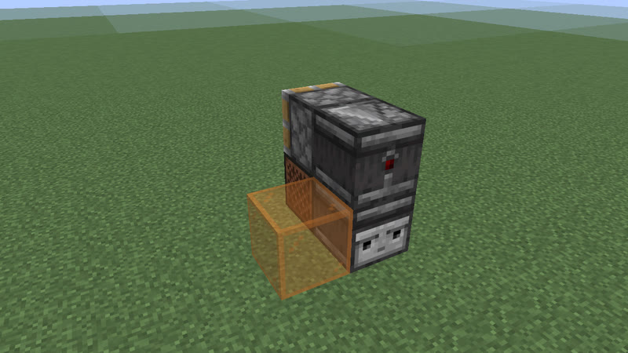</a> 4 gt (0.2 s) · note_block+observer+piston+sticky_piston · 5 blocks</td><td align="center"><a href="archive/clk-obs-p4-obs-pis-stk-5b-11b2d9.txt">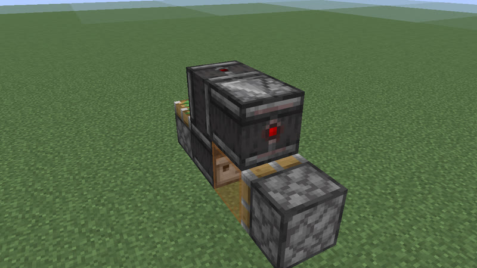</a> 4 gt (0.2 s) · observer+piston+sticky_piston · 5 blocks</td><td align="center"><a href="archive/clk-obs-p4-note-obs-5b-dba507.txt">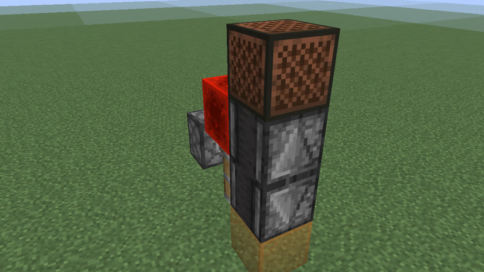</a> 4 gt (0.2 s) · note_block+observer · 5 blocks</td></tr>
<tr><td align="center"> 4 gt (0.2 s) · crafter+observer · 6 blocks</td><td align="center"> 4 gt (0.2 s) · crafter+observer · 6 blocks</td><td align="center"> 4 gt (0.2 s) · crafter+observer · 6 blocks</td></tr>
<tr><td align="center"> 4 gt (0.2 s) · comparator+redstone_wire · 8 blocks</td><td align="center"><a href="archive/clk-rt-cmp-sub-4.txt">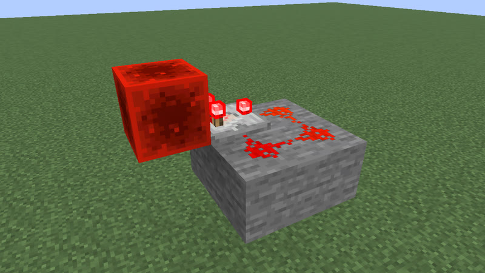</a> 4 gt (0.2 s) · comparator+redstone_wire · 9 blocks</td><td align="center"> 4 gt (0.2 s) · redstone_wire+repeater · 10 blocks</td></tr>
<tr><td align="center"> 4 gt (0.2 s) · repeater · 12 blocks</td></tr>
</table>

## 5 gt (0.25 s)

<table>
<tr><td align="center"> 5 gt (0.25 s) · observer+piston · 6 blocks</td><td align="center"> 5 gt (0.25 s) · observer+piston · 6 blocks</td><td align="center"><a href="archive/clk-obs-p5-obs-pis-stk-6b-1877b8.txt">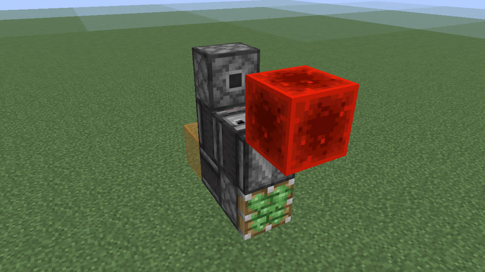</a> 5 gt (0.25 s) · observer+piston+sticky_piston · 6 blocks</td></tr>
<tr><td align="center"><a href="archive/clk-obs-p5-note-obs-pis-7b-356621.txt">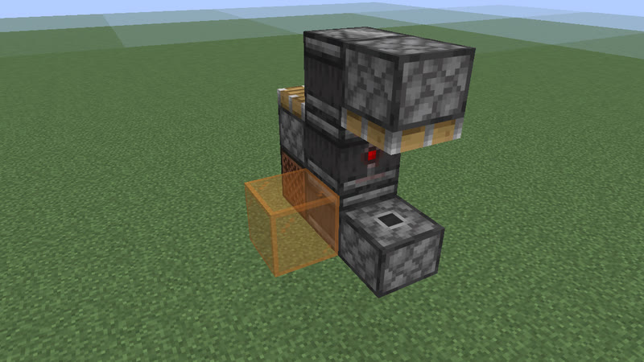</a> 5 gt (0.25 s) · note_block+observer+piston · 7 blocks</td><td align="center"><a href="archive/clk-obs-p5-note-obs-pis-stk-7b-219df6.txt">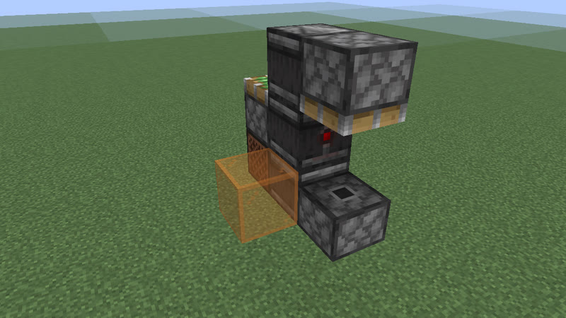</a> 5 gt (0.25 s) · note_block+observer+piston+sticky_piston · 7 blocks</td><td align="center"><a href="archive/clk-obs-p5-note-obs-stk-7b-b78b30.txt">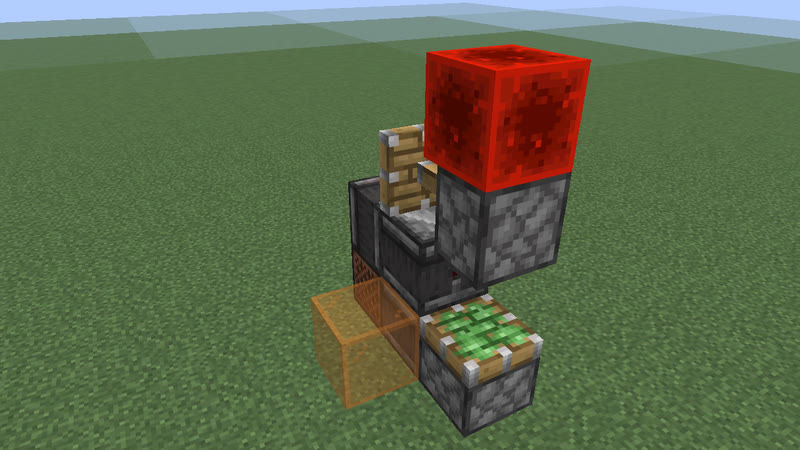</a> 5 gt (0.25 s) · note_block+observer+sticky_piston · 7 blocks</td></tr>
<tr><td align="center"> 5 gt (0.25 s) · observer+sticky_piston · 7 blocks</td><td align="center"> 5 gt (0.25 s) · redstone_wire+repeater · 16 blocks</td><td align="center"><a href="archive/clk-rt-uloop-C-1--1-1-1-1-d-d-kick-p5.txt">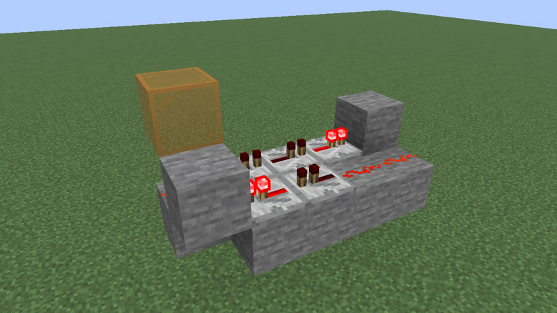</a> 5 gt (0.25 s) · redstone_wire+repeater · 18 blocks</td></tr>
</table>

## 6 gt (0.3 s)

<table>
<tr><td align="center"> 6 gt (0.3 s) · observer · 2 blocks also found as census-p6-observer-2b, census-p6-observer-2b</td><td align="center"><a href="archive/census-p6-note_block-observer-3b.txt">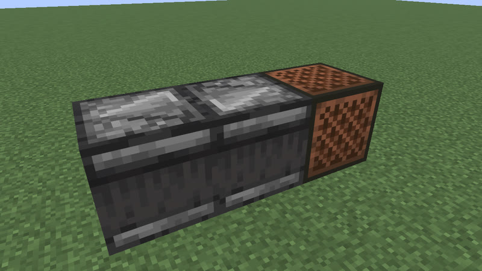</a> 6 gt (0.3 s) · note_block+observer · 3 blocks</td><td align="center"><a href="archive/clk-misc-p6-crafter-obs-3b-a-b2139d.txt">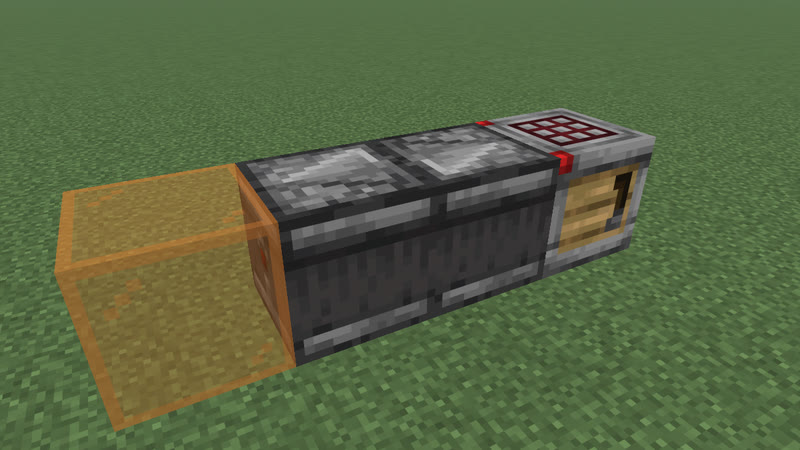</a> 6 gt (0.3 s) · crafter+observer · 3 blocks</td></tr>
<tr><td align="center"> 6 gt (0.3 s) · observer+piston · 3 blocks</td><td align="center"><a href="archive/census-p6-observer-sticky_piston-3b.txt">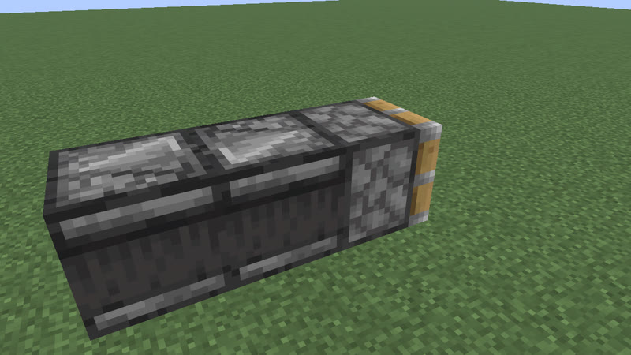</a> 6 gt (0.3 s) · observer+sticky_piston · 3 blocks</td><td align="center"> 6 gt (0.3 s) · redstone_block+sticky_piston · 3 blocks</td></tr>
<tr><td align="center"><a href="archive/clk-obs-p6-obs-4b-fae0d6.txt">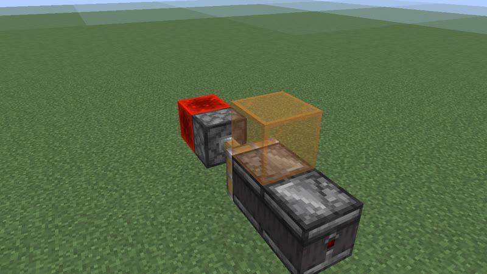</a> 6 gt (0.3 s) · observer · 4 blocks</td><td align="center"><a href="archive/clk-obs-p6-obs-4b.txt">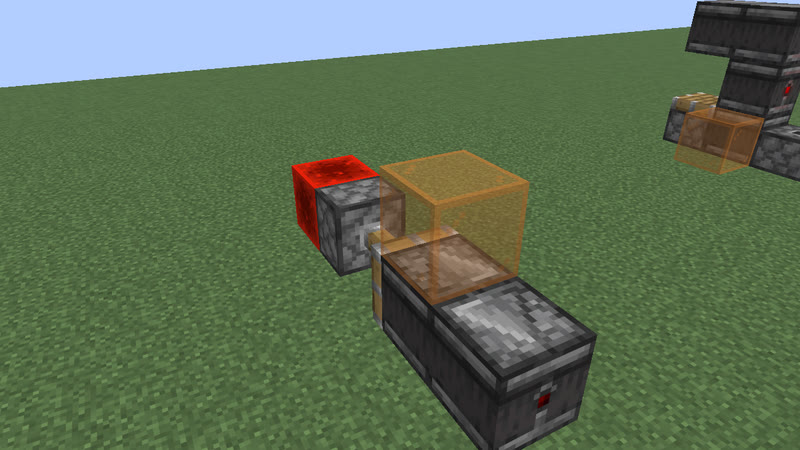</a> 6 gt (0.3 s) · observer · 4 blocks</td><td align="center"><a href="archive/census-p6-note_block-redstone_block-sticky_piston-4b.txt">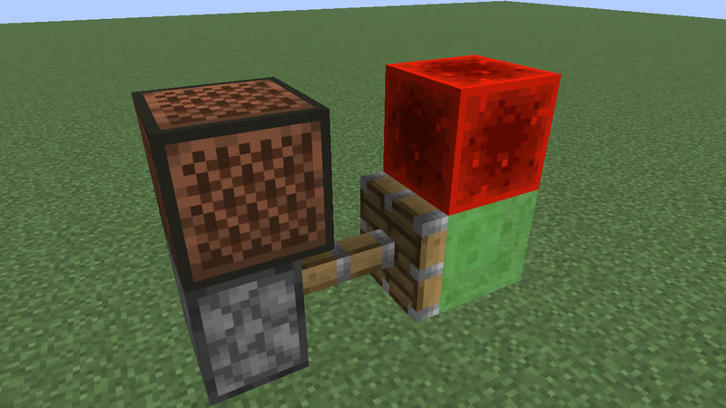</a> 6 gt (0.3 s) · note_block+redstone_block+sticky_piston · 4 blocks</td></tr>
<tr><td align="center"><a href="archive/census-p6-observer-redstone_block-sticky_piston-4b.txt">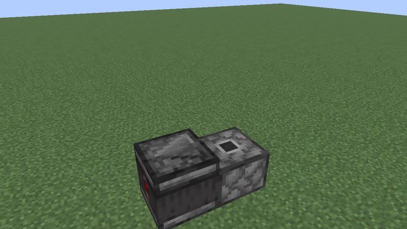</a> 6 gt (0.3 s) · observer+redstone_block+sticky_piston · 4 blocks</td><td align="center"><a href="archive/census-p6-redstone_block-redstone_lamp-sticky_piston-4b.txt">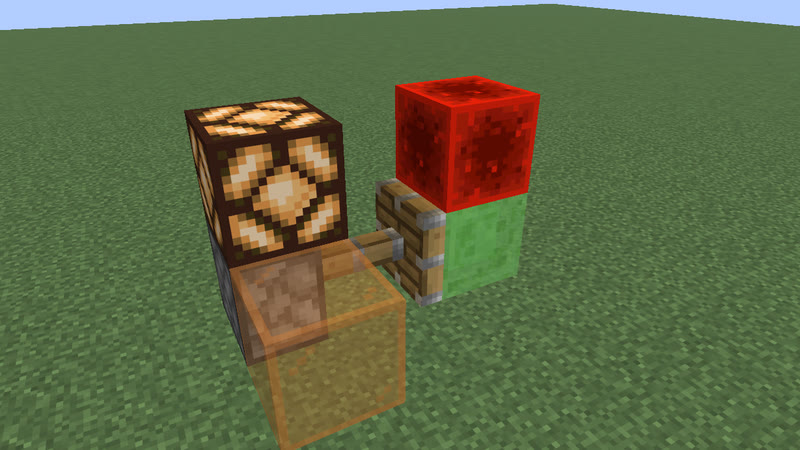</a> 6 gt (0.3 s) · redstone_block+redstone_lamp+sticky_piston · 4 blocks</td><td align="center"> 6 gt (0.3 s) · redstone_block+sticky_piston · 4 blocks</td></tr>
<tr><td align="center"><a href="archive/clk-obs-p6-note-obs-5b-5abe25.txt">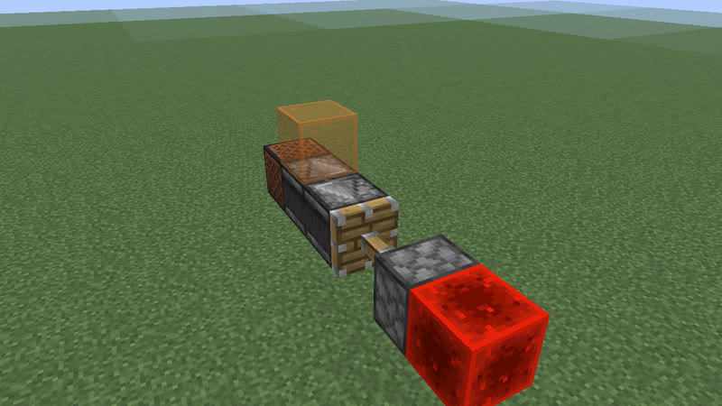</a> 6 gt (0.3 s) · note_block+observer · 5 blocks</td><td align="center"><a href="archive/clk-obs-p6-note-obs-pis-5b-8011ce.txt">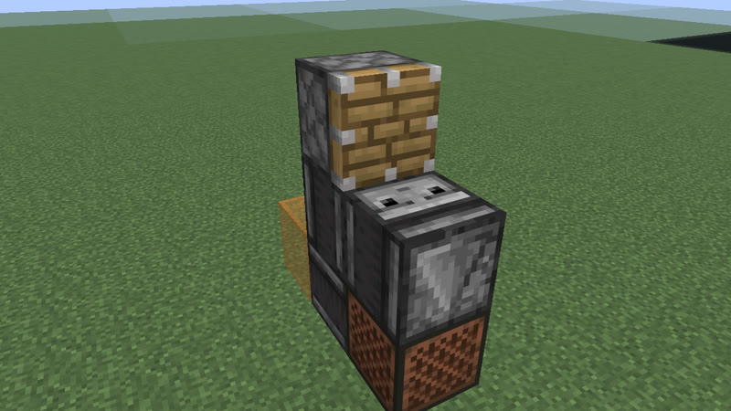</a> 6 gt (0.3 s) · note_block+observer+piston · 5 blocks</td><td align="center"><a href="archive/clk-obs-p6-note-obs-stk-5b-cf22a1.txt">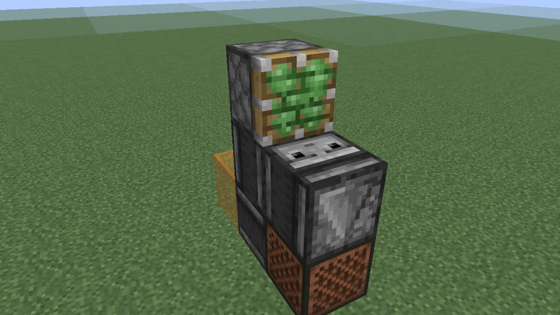</a> 6 gt (0.3 s) · note_block+observer+sticky_piston · 5 blocks</td></tr>
<tr><td align="center"><a href="archive/clk-obs-p6-obs-pis-5b-22bdb4.txt">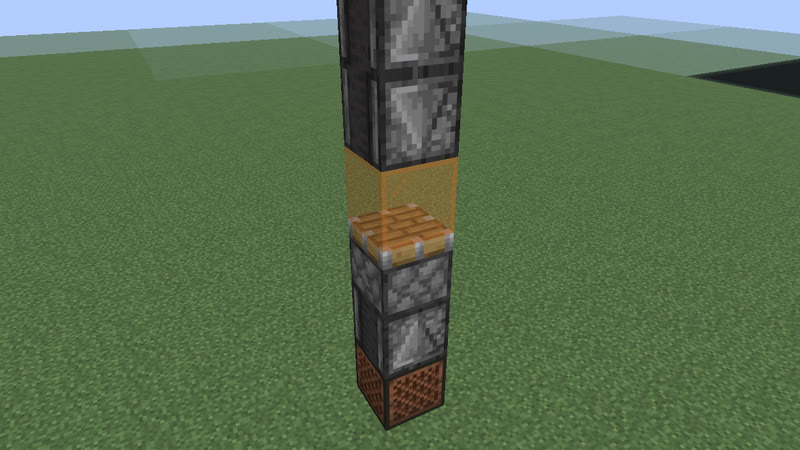</a> 6 gt (0.3 s) · observer+piston · 5 blocks</td><td align="center"><a href="archive/clk-obs-p6-obs-stk-5b-bbfe2d.txt">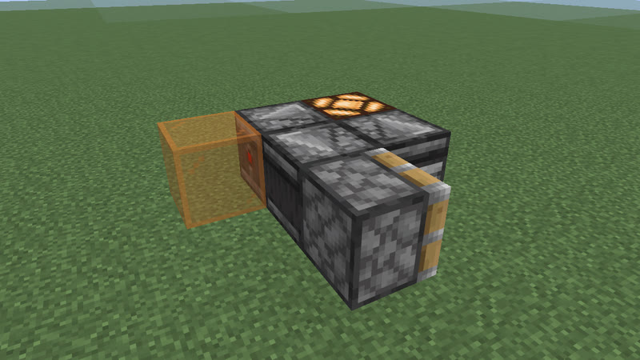</a> 6 gt (0.3 s) · observer+sticky_piston · 5 blocks</td><td align="center"><a href="archive/clk-obs-p6-lamp-rb-stk-5b-12962e.txt">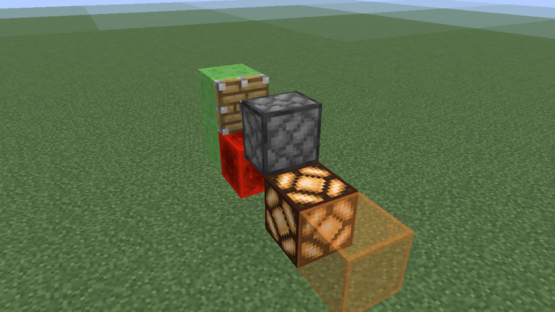</a> 6 gt (0.3 s) · redstone_block+redstone_lamp+sticky_piston · 5 blocks</td></tr>
<tr><td align="center"><a href="archive/clk-obs-p6-note-rb-stk-5b-182866.txt">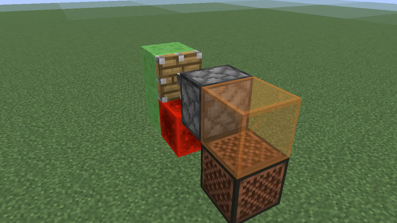</a> 6 gt (0.3 s) · note_block+redstone_block+sticky_piston · 5 blocks</td><td align="center"><a href="archive/clk-obs-p6-obs-pis-stk-5b-4b1050.txt">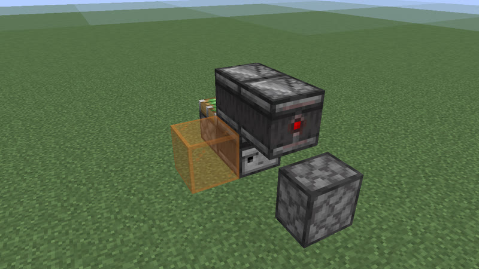</a> 6 gt (0.3 s) · observer+piston+sticky_piston · 5 blocks</td><td align="center"><a href="archive/clk-obs-p6-rb-stk-5b-1b4a60.txt">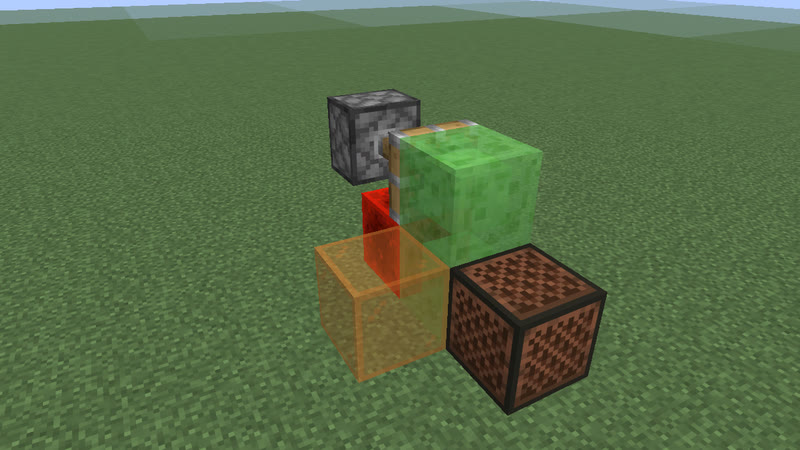</a> 6 gt (0.3 s) · redstone_block+sticky_piston · 5 blocks</td></tr>
<tr><td align="center"><a href="archive/clk-misc-p6-crafter-obs-6b-c-dc59ec.txt">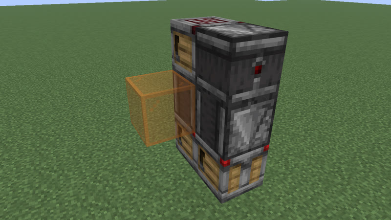</a> 6 gt (0.3 s) · crafter+observer · 6 blocks</td><td align="center"><a href="archive/clk-obs-p6-note-obs-pis-rb-stk-6b-52c97f.txt">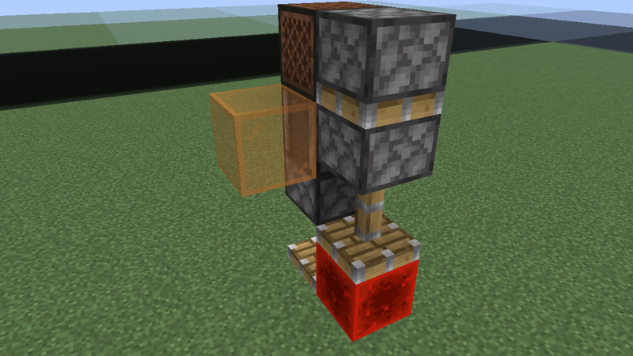</a> 6 gt (0.3 s) · note_block+observer+piston+redstone_block+sticky_piston · 6 blocks</td><td align="center"><a href="archive/clk-obs-p6-note-obs-pis-stk-6b-390a4c.txt">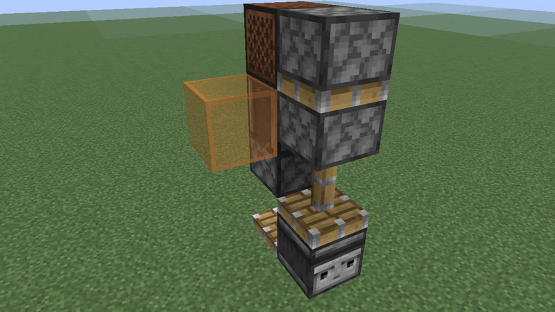</a> 6 gt (0.3 s) · note_block+observer+piston+sticky_piston · 6 blocks</td></tr>
<tr><td align="center"><a href="archive/clk-obs-p6-note-obs-rb-stk-6b-104453.txt">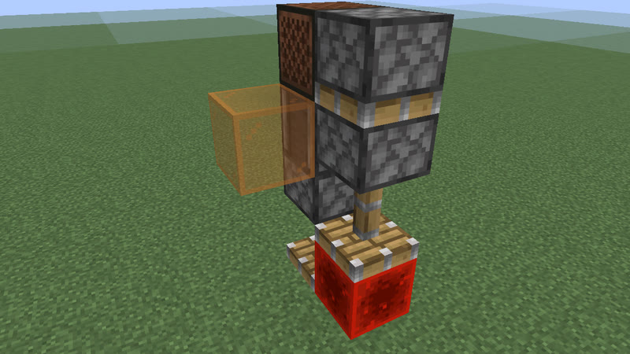</a> 6 gt (0.3 s) · note_block+observer+redstone_block+sticky_piston · 6 blocks</td><td align="center"><a href="archive/clk-obs-p6-obs-pis-rb-stk-6b-2ab6ca.txt">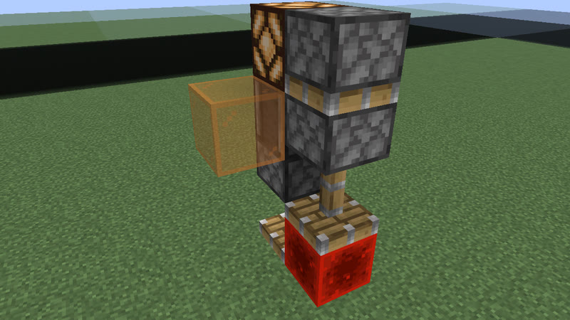</a> 6 gt (0.3 s) · observer+piston+redstone_block+sticky_piston · 6 blocks</td><td align="center"><a href="archive/clk-obs-p6-obs-rb-stk-6b-9654c8.txt">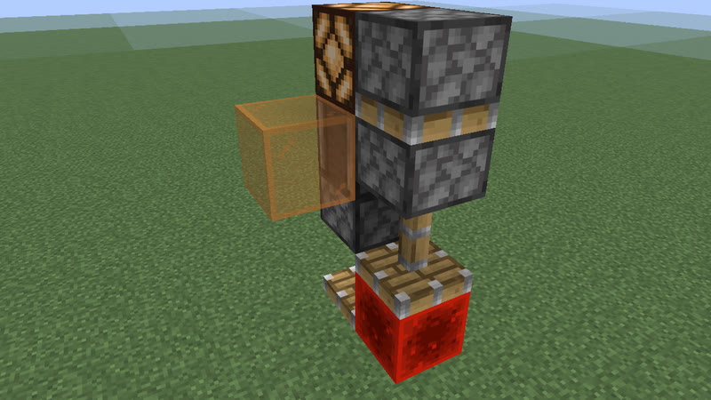</a> 6 gt (0.3 s) · observer+redstone_block+sticky_piston · 6 blocks</td></tr>
<tr><td align="center"> 6 gt (0.3 s) · redstone_wire+repeater · 13 blocks</td><td align="center"><a href="archive/clk-rt-uloop-p6-c-rw-r-14b.txt">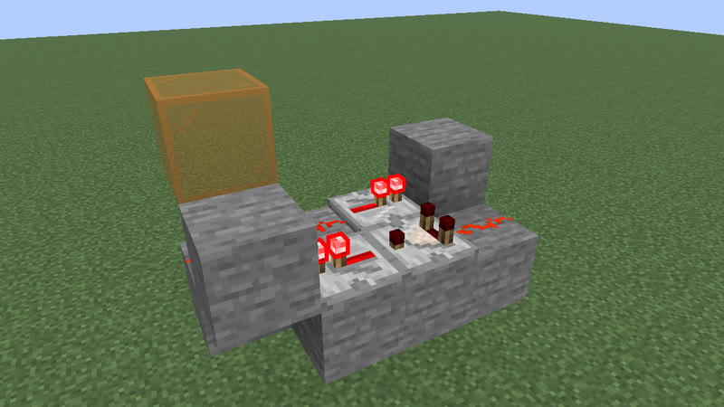</a> 6 gt (0.3 s) · comparator+redstone_wire+repeater · 14 blocks</td><td align="center"><a href="archive/clk-rt-uloop-p6-rw-r-14b.txt">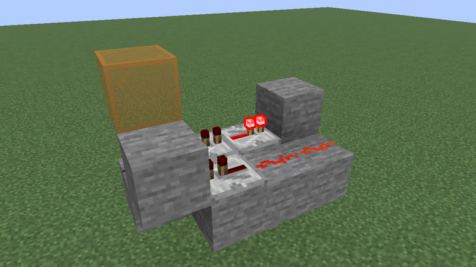</a> 6 gt (0.3 s) · redstone_wire+repeater · 14 blocks</td></tr>
</table>

## 7 gt (0.35 s)

<table>
<tr><td align="center"> 7 gt (0.35 s) · redstone_lamp+sticky_piston · 5 blocks</td><td align="center"> 7 gt (0.35 s) · sticky_piston · 5 blocks</td><td align="center"> 7 gt (0.35 s) · sticky_piston · 5 blocks</td></tr>
<tr><td align="center"> 7 gt (0.35 s) · note_block+sticky_piston · 5 blocks</td><td align="center"> 7 gt (0.35 s) · note_block+observer+sticky_piston · 6 blocks</td><td align="center"> 7 gt (0.35 s) · repeater · 19 blocks</td></tr>
<tr><td align="center"><a href="archive/clk-rt-odd-ring-p7.txt">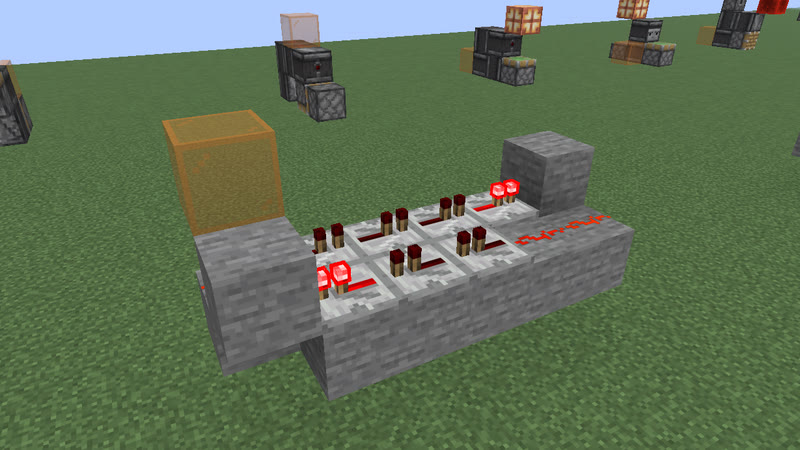</a> 7 gt (0.35 s) · redstone_wire+repeater · 22 blocks</td></tr>
</table>

## 8 gt (0.4 s)

Also reachable by: clk-obs-obs-ring (n = 0).

<table>
<tr><td align="center"> 8 gt (0.4 s) · observer · 4 blocks</td><td align="center"> 8 gt (0.4 s) · note_block+observer+redstone_block+sticky_piston · 4 blocks</td><td align="center"> 8 gt (0.4 s) · note_block+observer+sticky_piston · 4 blocks</td></tr>
<tr><td align="center"> 8 gt (0.4 s) · iron_trapdoor+observer+redstone_block+sticky_piston · 4 blocks</td><td align="center"> 8 gt (0.4 s) · observer+piston+redstone_block+sticky_piston · 4 blocks</td><td align="center"> 8 gt (0.4 s) · observer+redstone_block+sticky_piston · 4 blocks</td></tr>
<tr><td align="center"> 8 gt (0.4 s) · comparator+hopper · 4 blocks</td><td align="center"><a href="archive/clk-misc-p8-crafter-obs-5b-a-c605a5.txt">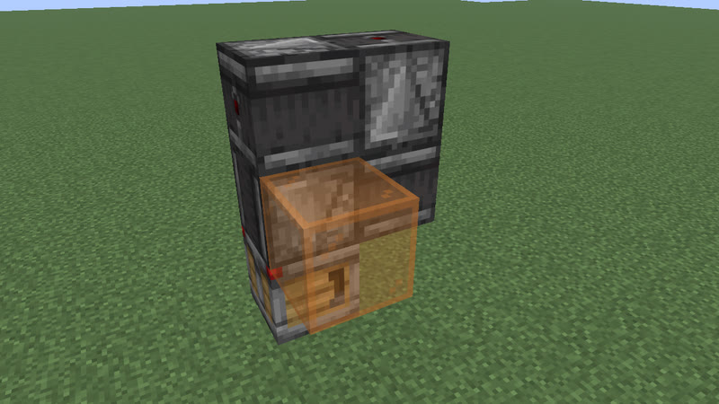</a> 8 gt (0.4 s) · crafter+observer · 5 blocks</td><td align="center"><a href="archive/clk-obs-p8-bulb-note-obs-pis-5b-cf0277.txt">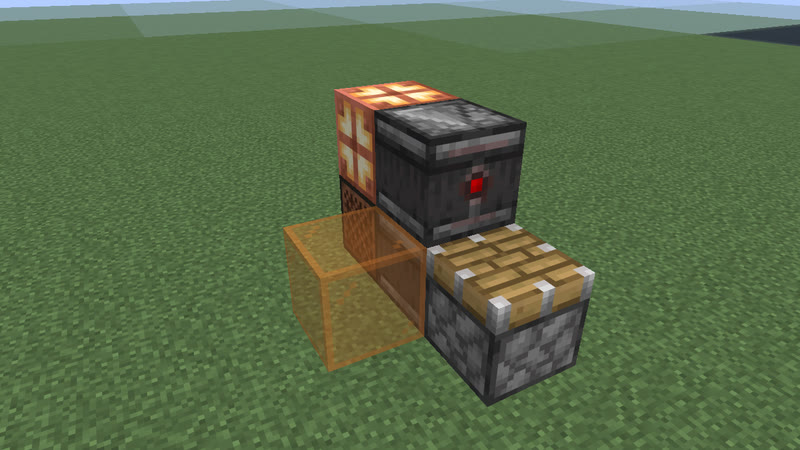</a> 8 gt (0.4 s) · copper_bulb+note_block+observer+piston · 5 blocks</td></tr>
<tr><td align="center"><a href="archive/clk-obs-p8-bulb-note-obs-rb-stk-5b-4a27ee.txt">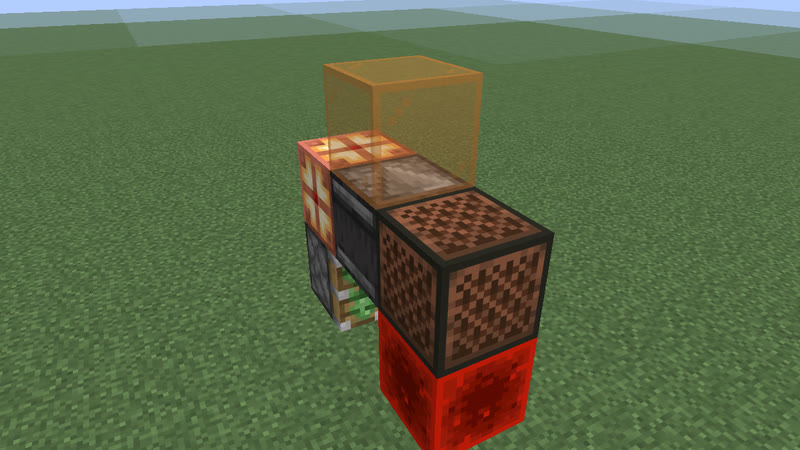</a> 8 gt (0.4 s) · copper_bulb+note_block+observer+redstone_block+sticky_piston · 5 blocks</td><td align="center"><a href="archive/clk-obs-p8-bulb-note-obs-stk-5b-9f15af.txt">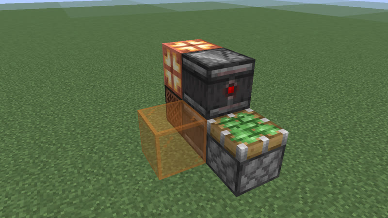</a> 8 gt (0.4 s) · copper_bulb+note_block+observer+sticky_piston · 5 blocks</td><td align="center"><a href="archive/clk-obs-p8-bulb-obs-pis-5b-da1a6f.txt">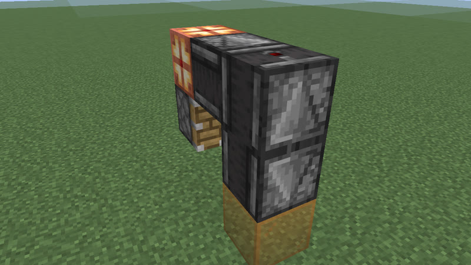</a> 8 gt (0.4 s) · copper_bulb+observer+piston · 5 blocks</td></tr>
<tr><td align="center"><a href="archive/clk-obs-p8-bulb-obs-stk-5b-388177.txt">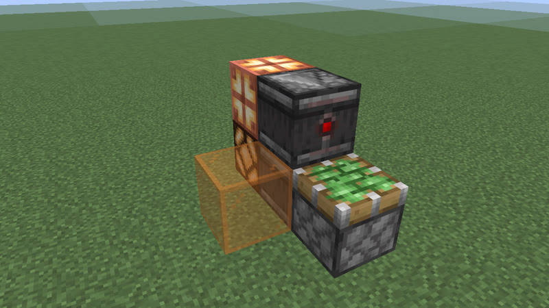</a> 8 gt (0.4 s) · copper_bulb+observer+sticky_piston · 5 blocks</td><td align="center"> 8 gt (0.4 s) · observer+piston · 5 blocks</td><td align="center"><a href="archive/clk-obs-p8-obs-stk-5b-1a14af.txt">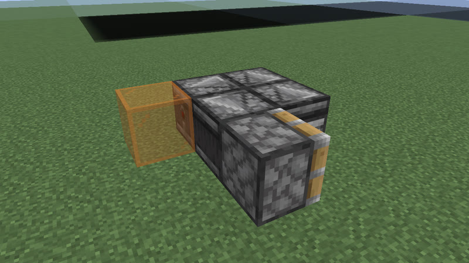</a> 8 gt (0.4 s) · observer+sticky_piston · 5 blocks</td></tr>
<tr><td align="center"><a href="archive/clk-obs-p8-bulb-note-obs-pis-stk-5b-92fcab.txt">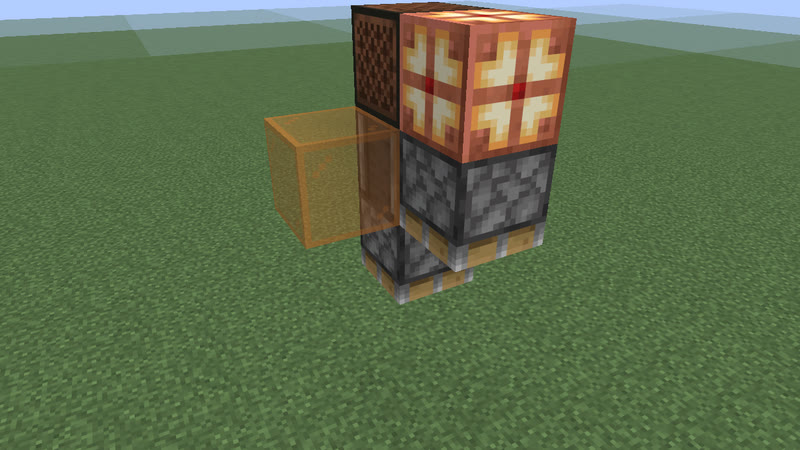</a> 8 gt (0.4 s) · copper_bulb+note_block+observer+piston+sticky_piston · 5 blocks</td><td align="center"><a href="archive/clk-obs-p8-bulb-obs-pis-rb-stk-5b-5cb135.txt">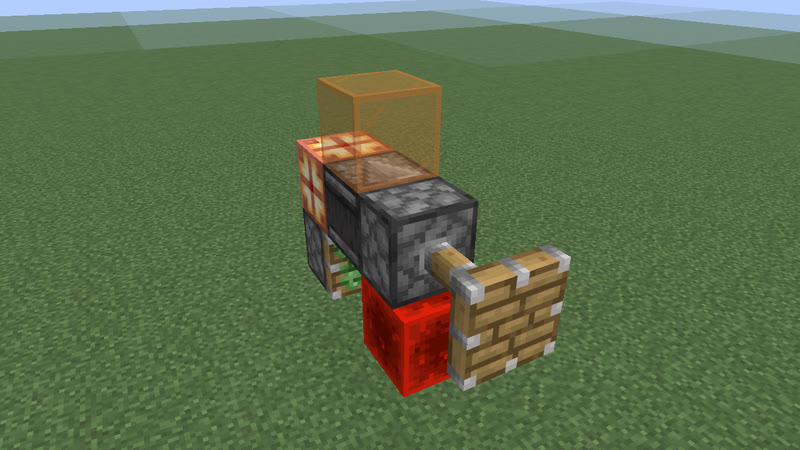</a> 8 gt (0.4 s) · copper_bulb+observer+piston+redstone_block+sticky_piston · 5 blocks</td><td align="center"><a href="archive/clk-obs-p8-bulb-obs-pis-stk-5b-a0c77a.txt">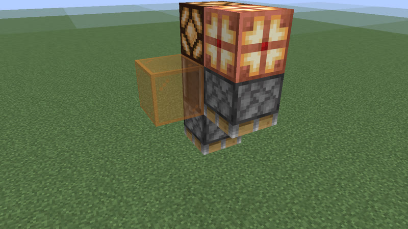</a> 8 gt (0.4 s) · copper_bulb+observer+piston+sticky_piston · 5 blocks</td></tr>
<tr><td align="center"><a href="archive/clk-obs-p8-bulb-obs-rb-stk-5b-d7c67a.txt">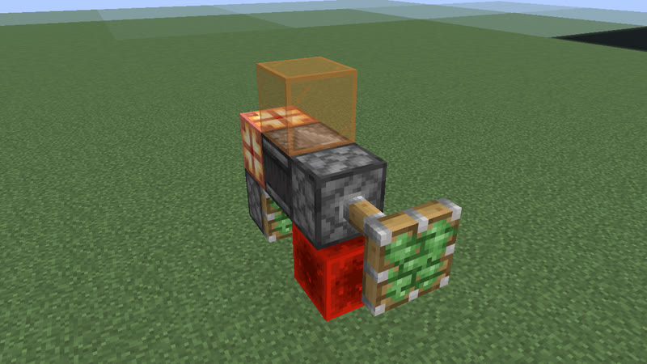</a> 8 gt (0.4 s) · copper_bulb+observer+redstone_block+sticky_piston · 5 blocks</td><td align="center"><a href="archive/clk-obs-p8-lamp-note-obs-stk-5b-547016.txt">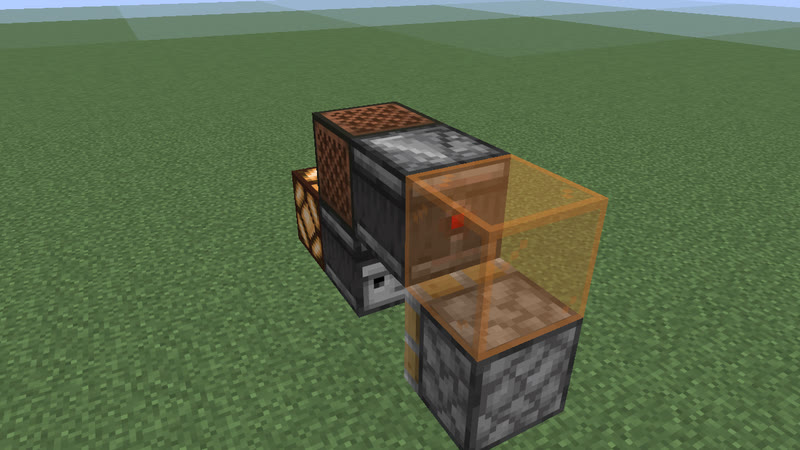</a> 8 gt (0.4 s) · note_block+observer+redstone_lamp+sticky_piston · 5 blocks</td><td align="center"><a href="archive/clk-obs-p8-note-obs-pis-rb-stk-5b-a3e081.txt">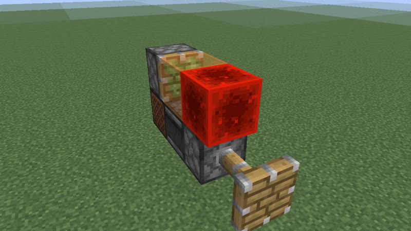</a> 8 gt (0.4 s) · note_block+observer+piston+redstone_block+sticky_piston · 5 blocks</td></tr>
<tr><td align="center"><a href="archive/clk-obs-p8-note-obs-pis-stk-5b-244a9f.txt">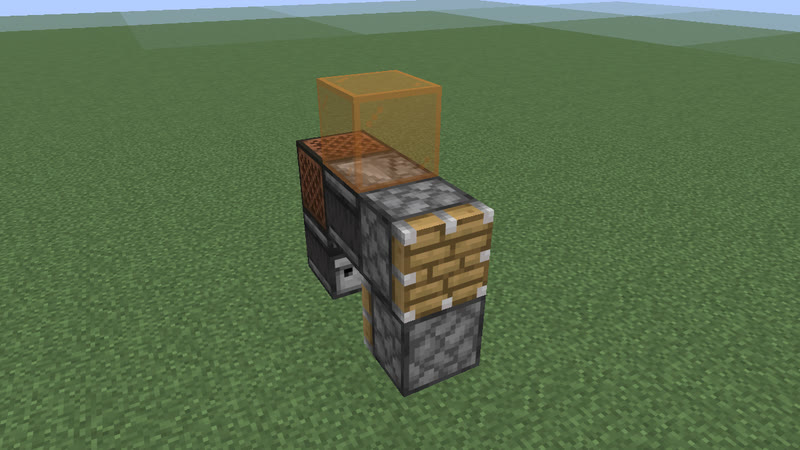</a> 8 gt (0.4 s) · note_block+observer+piston+sticky_piston · 5 blocks</td><td align="center"><a href="archive/clk-obs-p8-obs-pis-stk-5b-278994.txt">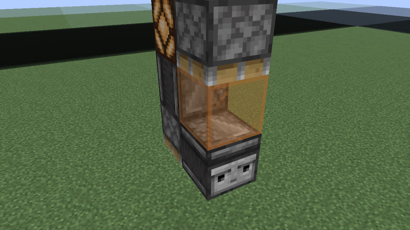</a> 8 gt (0.4 s) · observer+piston+sticky_piston · 5 blocks</td><td align="center"> 8 gt (0.4 s) · copper_bulb+observer · 5 blocks</td></tr>
<tr><td align="center"> 8 gt (0.4 s) · crafter+observer · 6 blocks</td><td align="center"> 8 gt (0.4 s) · copper_bulb+note_block+observer · 6 blocks</td><td align="center"> 8 gt (0.4 s) · note_block+observer+redstone_lamp · 6 blocks</td></tr>
<tr><td align="center"> 8 gt (0.4 s) · note_block+observer · 6 blocks</td><td align="center"> 8 gt (0.4 s) · note_block+observer+piston+redstone_lamp · 6 blocks</td><td align="center"> 8 gt (0.4 s) · note_block+observer+piston+redstone_lamp+sticky_piston · 6 blocks</td></tr>
<tr><td align="center"> 8 gt (0.4 s) · observer+piston+redstone_lamp+sticky_piston · 6 blocks</td><td align="center"> 8 gt (0.4 s) · observer+redstone_lamp+sticky_piston · 6 blocks</td><td align="center"> 8 gt (0.4 s) · note_block+observer+piston · 6 blocks</td></tr>
<tr><td align="center"> 8 gt (0.4 s) · note_block+observer+redstone_block+redstone_lamp+sticky_piston · 6 blocks</td><td align="center"> 8 gt (0.4 s) · observer+redstone_block+redstone_lamp+sticky_piston · 6 blocks</td><td align="center"> 8 gt (0.4 s) · observer+piston+redstone_lamp · 6 blocks</td></tr>
<tr><td align="center"> 8 gt (0.4 s) · comparator+hopper · 7 blocks</td><td align="center"> 8 gt (0.4 s) · observer+redstone_lamp · 10 blocks</td><td align="center"> 8 gt (0.4 s) · redstone_wire+repeater · 10 blocks</td></tr>
<tr><td align="center"> 8 gt (0.4 s) · comparator · 12 blocks</td><td align="center"> 8 gt (0.4 s) · comparator+repeater · 12 blocks</td><td align="center"> 8 gt (0.4 s) · repeater · 12 blocks</td></tr>
<tr><td align="center"> 8 gt (0.4 s) · comparator+redstone_wire+repeater · 13 blocks</td><td align="center"> 8 gt (0.4 s) · comparator+redstone_wire+repeater · 14 blocks</td></tr>
</table>

## 9 gt (0.45 s)

<table>
<tr><td align="center"> 9 gt (0.45 s) · copper_bulb+note_block+observer+piston · 5 blocks</td><td align="center"> 9 gt (0.45 s) · copper_bulb+note_block+observer+sticky_piston · 5 blocks</td><td align="center"> 9 gt (0.45 s) · copper_bulb+observer+piston · 5 blocks</td></tr>
<tr><td align="center"> 9 gt (0.45 s) · copper_bulb+observer+sticky_piston · 5 blocks</td><td align="center"> 9 gt (0.45 s) · note_block+observer+piston · 5 blocks</td><td align="center"> 9 gt (0.45 s) · note_block+observer+sticky_piston · 5 blocks</td></tr>
<tr><td align="center"> 9 gt (0.45 s) · note_block+observer+piston+sticky_piston · 5 blocks</td><td align="center"> 9 gt (0.45 s) · observer+piston · 5 blocks</td><td align="center"> 9 gt (0.45 s) · observer+piston · 5 blocks</td></tr>
<tr><td align="center"> 9 gt (0.45 s) · observer+piston+sticky_piston · 5 blocks</td><td align="center"> 9 gt (0.45 s) · observer+sticky_piston · 5 blocks</td><td align="center"> 9 gt (0.45 s) · observer+piston+redstone_block+sticky_piston · 5 blocks</td></tr>
<tr><td align="center"> 9 gt (0.45 s) · observer+redstone_block+sticky_piston · 5 blocks</td><td align="center"> 9 gt (0.45 s) · piston+redstone_block · 5 blocks</td><td align="center"> 9 gt (0.45 s) · piston+redstone_block+sticky_piston · 5 blocks</td></tr>
<tr><td align="center"> 9 gt (0.45 s) · observer+redstone_block+redstone_lamp+sticky_piston · 6 blocks</td><td align="center"> 9 gt (0.45 s) · note_block+observer+redstone_block+sticky_piston · 6 blocks</td><td align="center"> 9 gt (0.45 s) · note_block+observer+piston+redstone_block+redstone_lamp+sticky_piston · 7 blocks</td></tr>
<tr><td align="center"> 9 gt (0.45 s) · observer+piston+redstone_block+redstone_lamp+sticky_piston · 7 blocks</td><td align="center"> 9 gt (0.45 s) · note_block+observer+piston+redstone_block+sticky_piston · 7 blocks</td><td align="center"> 9 gt (0.45 s) · comparator+hopper+redstone_wire · 8 blocks</td></tr>
<tr><td align="center"> 9 gt (0.45 s) · redstone_wire+repeater · 16 blocks</td><td align="center"> 9 gt (0.45 s) · redstone_wire+repeater · 18 blocks</td></tr>
</table>

## 10 gt (0.5 s)

Also reachable by: clk-misc-activator_rail-ring (n = 0), clk-misc-crafter-ring (n = 0), clk-misc-iron_door-ring (n = 0), clk-misc-oak_door-ring (n = 0), clk-misc-oak_fence_gate-ring (n = 0), clk-misc-oak_trapdoor-ring (n = 0), clk-misc-powered_rail-ring (n = 0), clk-misc-skeleton_skull-ring (n = 0), clk-obs-note-ring (n = 0), clk-obs-trap-ring (n = 0).

<table>
<tr><td align="center"> 10 gt (0.5 s) · observer+redstone_block+sticky_piston · 4 blocks</td><td align="center"> 10 gt (0.5 s) · observer+sticky_piston · 4 blocks</td><td align="center"> 10 gt (0.5 s) · observer+sticky_piston · 4 blocks</td></tr>
<tr><td align="center"> 10 gt (0.5 s) · observer+piston+sticky_piston · 4 blocks</td><td align="center"> 10 gt (0.5 s) · note_block+observer+redstone_block+sticky_piston · 5 blocks</td><td align="center"> 10 gt (0.5 s) · note_block+observer+sticky_piston · 5 blocks</td></tr>
<tr><td align="center"> 10 gt (0.5 s) · observer+redstone_block+redstone_lamp+sticky_piston · 5 blocks</td><td align="center"> 10 gt (0.5 s) · note_block+observer+piston+sticky_piston · 5 blocks</td><td align="center"> 10 gt (0.5 s) · copper_bulb+note_block+observer+sticky_piston · 6 blocks</td></tr>
<tr><td align="center"> 10 gt (0.5 s) · copper_bulb+note_block+observer+sticky_piston · 6 blocks</td><td align="center"> 10 gt (0.5 s) · copper_bulb+observer+sticky_piston · 6 blocks</td><td align="center"> 10 gt (0.5 s) · observer+piston+redstone_lamp+sticky_piston · 6 blocks</td></tr>
<tr><td align="center"> 10 gt (0.5 s) · observer+piston+redstone_block+sticky_piston · 6 blocks</td><td align="center"> 10 gt (0.5 s) · observer+redstone_lamp+sticky_piston · 6 blocks</td><td align="center"> 10 gt (0.5 s) · note_block+observer+piston+redstone_block+sticky_piston · 6 blocks</td></tr>
<tr><td align="center"> 10 gt (0.5 s) · note_block+observer+piston+redstone_lamp+sticky_piston · 7 blocks</td><td align="center"> 10 gt (0.5 s) · copper_bulb+note_block+observer+redstone_block+sticky_piston · 7 blocks</td><td align="center"> 10 gt (0.5 s) · copper_bulb+observer+piston · 7 blocks</td></tr>
<tr><td align="center"> 10 gt (0.5 s) · copper_bulb+observer+redstone_block+sticky_piston · 7 blocks</td><td align="center"> 10 gt (0.5 s) · copper_bulb+observer+piston · 7 blocks</td><td align="center"> 10 gt (0.5 s) · comparator+redstone_torch+repeater · 8 blocks</td></tr>
<tr><td align="center"> 10 gt (0.5 s) · redstone_torch+repeater · 8 blocks</td><td align="center"> 10 gt (0.5 s) · comparator+redstone_torch+redstone_wire · 12 blocks</td><td align="center"> 10 gt (0.5 s) · comparator+redstone_torch+redstone_wire+repeater · 12 blocks</td></tr>
<tr><td align="center"> 10 gt (0.5 s) · redstone_torch+redstone_wire+repeater · 12 blocks</td><td align="center"> 10 gt (0.5 s) · comparator+repeater · 12 blocks</td><td align="center"> 10 gt (0.5 s) · repeater · 12 blocks</td></tr>
<tr><td align="center"> 10 gt (0.5 s) · redstone_torch+redstone_wire+repeater · 12 blocks</td><td align="center"> 10 gt (0.5 s) · comparator+redstone_wire+repeater · 13 blocks</td><td align="center"> 10 gt (0.5 s) · redstone_wire+repeater · 13 blocks</td></tr>
<tr><td align="center"> 10 gt (0.5 s) · comparator+redstone_wire+repeater · 14 blocks</td><td align="center"> 10 gt (0.5 s) · redstone_wire+repeater · 14 blocks</td></tr>
</table>

## 11 gt (0.55 s)

Also reachable by: clk-item-lockpair (n = 0), clk-obs-odd-a (n = 0).

<table>
<tr><td align="center"> 11 gt (0.55 s) · note_block+observer+piston · 6 blocks</td><td align="center"> 11 gt (0.55 s) · observer+piston · 6 blocks</td><td align="center"> 11 gt (0.55 s) · observer+piston · 6 blocks</td></tr>
<tr><td align="center"> 11 gt (0.55 s) · observer+piston+sticky_piston · 6 blocks</td><td align="center"> 11 gt (0.55 s) · observer+sticky_piston · 6 blocks</td><td align="center"> 11 gt (0.55 s) · note_block+observer+piston+redstone_block+redstone_lamp+sticky_piston · 7 blocks</td></tr>
<tr><td align="center"> 11 gt (0.55 s) · note_block+observer+piston+redstone_block+sticky_piston · 7 blocks</td><td align="center"> 11 gt (0.55 s) · observer+piston+redstone_block+redstone_lamp+sticky_piston · 7 blocks</td><td align="center"> 11 gt (0.55 s) · observer+piston+redstone_block+sticky_piston · 7 blocks</td></tr>
<tr><td align="center"> 11 gt (0.55 s) · repeater · 16 blocks</td><td align="center"> 11 gt (0.55 s) · redstone_wire+repeater · 18 blocks</td></tr>
</table>

## 12 gt (0.6 s)

Also reachable by: clk-obs-obs-ring (n = 1), clk-obs-divider (n = 0).

<table>
<tr><td align="center"> 12 gt (0.6 s) · copper_bulb+observer · 3 blocks</td><td align="center"> 12 gt (0.6 s) · copper_bulb+note_block+observer · 4 blocks</td><td align="center"> 12 gt (0.6 s) · observer+piston · 4 blocks</td></tr>
<tr><td align="center"> 12 gt (0.6 s) · observer+redstone_block+sticky_piston · 4 blocks</td><td align="center"> 12 gt (0.6 s) · observer+sticky_piston · 4 blocks</td><td align="center"> 12 gt (0.6 s) · copper_bulb+redstone_block+sticky_piston · 4 blocks</td></tr>
<tr><td align="center"> 12 gt (0.6 s) · observer+redstone_block+redstone_lamp+sticky_piston · 4 blocks</td><td align="center"> 12 gt (0.6 s) · observer+redstone_lamp+sticky_piston · 4 blocks</td><td align="center"> 12 gt (0.6 s) · copper_bulb+observer+redstone_block+redstone_lamp+sticky_piston · 5 blocks</td></tr>
<tr><td align="center"> 12 gt (0.6 s) · copper_bulb+observer+piston · 5 blocks</td><td align="center"> 12 gt (0.6 s) · copper_bulb+observer+sticky_piston · 5 blocks</td><td align="center"> 12 gt (0.6 s) · note_block+observer+redstone_block+redstone_lamp+sticky_piston · 5 blocks</td></tr>
<tr><td align="center"> 12 gt (0.6 s) · note_block+observer+redstone_block+sticky_piston · 5 blocks</td><td align="center"> 12 gt (0.6 s) · note_block+observer+sticky_piston · 5 blocks</td><td align="center"> 12 gt (0.6 s) · observer+piston+redstone_block+redstone_lamp+sticky_piston · 5 blocks</td></tr>
<tr><td align="center"> 12 gt (0.6 s) · observer+piston+redstone_lamp+sticky_piston · 5 blocks</td><td align="center"> 12 gt (0.6 s) · note_block+observer+piston · 5 blocks</td><td align="center"> 12 gt (0.6 s) · note_block+observer+piston+sticky_piston · 5 blocks</td></tr>
<tr><td align="center"> 12 gt (0.6 s) · observer+piston+sticky_piston · 5 blocks</td><td align="center"> 12 gt (0.6 s) · redstone_block+redstone_lamp+sticky_piston · 5 blocks</td><td align="center"> 12 gt (0.6 s) · note_block+redstone_block+sticky_piston · 5 blocks</td></tr>
<tr><td align="center"> 12 gt (0.6 s) · redstone_block+sticky_piston · 5 blocks</td><td align="center"> 12 gt (0.6 s) · dispenser+observer+redstone_wire · 5 blocks</td><td align="center"> 12 gt (0.6 s) · observer · 5 blocks</td></tr>
<tr><td align="center"> 12 gt (0.6 s) · observer+piston+redstone_block+sticky_piston · 5 blocks</td><td align="center"> 12 gt (0.6 s) · copper_bulb+note_block+observer+piston · 6 blocks</td><td align="center"> 12 gt (0.6 s) · observer+piston+redstone_lamp · 6 blocks</td></tr>
<tr><td align="center"> 12 gt (0.6 s) · copper_bulb+note_block+observer+piston+sticky_piston · 6 blocks</td><td align="center"> 12 gt (0.6 s) · copper_bulb+note_block+observer+sticky_piston · 6 blocks</td><td align="center"> 12 gt (0.6 s) · copper_bulb+observer+piston+sticky_piston · 6 blocks</td></tr>
<tr><td align="center"> 12 gt (0.6 s) · copper_bulb+observer+redstone_lamp+sticky_piston · 6 blocks</td><td align="center"> 12 gt (0.6 s) · copper_bulb+observer+redstone_block+sticky_piston · 6 blocks</td><td align="center"> 12 gt (0.6 s) · note_block+observer+piston+redstone_block+redstone_lamp+sticky_piston · 6 blocks</td></tr>
<tr><td align="center"> 12 gt (0.6 s) · note_block+observer+piston+redstone_block+sticky_piston · 6 blocks</td><td align="center"> 12 gt (0.6 s) · comparator+redstone_torch+repeater · 8 blocks</td><td align="center"> 12 gt (0.6 s) · redstone_torch+repeater · 8 blocks</td></tr>
<tr><td align="center"> 12 gt (0.6 s) · redstone_torch+redstone_wire+repeater · 9 blocks</td><td align="center"> 12 gt (0.6 s) · comparator+redstone_torch+redstone_wire · 9 blocks</td><td align="center"> 12 gt (0.6 s) · comparator+redstone_torch+redstone_wire+repeater · 9 blocks</td></tr>
<tr><td align="center"> 12 gt (0.6 s) · redstone_torch+redstone_wire+repeater · 9 blocks</td><td align="center"> 12 gt (0.6 s) · redstone_wire+repeater · 10 blocks</td><td align="center"> 12 gt (0.6 s) · comparator+redstone_torch · 12 blocks</td></tr>
<tr><td align="center"> 12 gt (0.6 s) · comparator+repeater · 12 blocks</td><td align="center"> 12 gt (0.6 s) · repeater · 12 blocks</td><td align="center"> 12 gt (0.6 s) · comparator+redstone_wire+repeater · 13 blocks</td></tr>
<tr><td align="center"> 12 gt (0.6 s) · comparator+redstone_wire+repeater · 14 blocks</td><td align="center"> 12 gt (0.6 s) · redstone_torch+redstone_wire · 14 blocks</td><td align="center"> 12 gt (0.6 s) · comparator · 16 blocks</td></tr>
</table>

## 13 gt (0.65 s)

Also reachable by: clk-item-lockpair (n = 1), clk-obs-odd-b (n = 0).

<table>
<tr><td align="center"> 13 gt (0.65 s) · observer+piston · 4 blocks</td><td align="center"> 13 gt (0.65 s) · observer+piston+sticky_piston · 4 blocks</td><td align="center"> 13 gt (0.65 s) · observer+sticky_piston · 4 blocks</td></tr>
<tr><td align="center"> 13 gt (0.65 s) · observer+piston · 4 blocks</td><td align="center"> 13 gt (0.65 s) · note_block+observer+piston · 5 blocks</td><td align="center"> 13 gt (0.65 s) · note_block+observer+piston+sticky_piston · 5 blocks</td></tr>
<tr><td align="center"> 13 gt (0.65 s) · note_block+observer+sticky_piston · 5 blocks</td><td align="center"> 13 gt (0.65 s) · observer+piston+redstone_block+sticky_piston · 5 blocks</td><td align="center"> 13 gt (0.65 s) · observer+redstone_block+sticky_piston · 5 blocks</td></tr>
<tr><td align="center"> 13 gt (0.65 s) · observer+redstone_lamp+sticky_piston · 6 blocks</td><td align="center"> 13 gt (0.65 s) · note_block+observer+piston+redstone_block+sticky_piston · 6 blocks</td><td align="center"> 13 gt (0.65 s) · note_block+observer+redstone_block+sticky_piston · 6 blocks</td></tr>
<tr><td align="center"> 13 gt (0.65 s) · observer+piston+redstone_lamp+sticky_piston · 6 blocks</td><td align="center"> 13 gt (0.65 s) · note_block+observer+piston+redstone_lamp+sticky_piston · 7 blocks</td><td align="center"> 13 gt (0.65 s) · note_block+observer+redstone_lamp+sticky_piston · 7 blocks</td></tr>
<tr><td align="center"> 13 gt (0.65 s) · comparator+hopper+redstone_torch+redstone_wire · 9 blocks</td><td align="center"> 13 gt (0.65 s) · comparator+hopper+redstone_torch+redstone_wire · 9 blocks</td><td align="center"> 13 gt (0.65 s) · redstone_wire+repeater · 16 blocks</td></tr>
<tr><td align="center"> 13 gt (0.65 s) · redstone_wire+repeater · 18 blocks</td></tr>
</table>

## 14 gt (0.7 s)

Also reachable by: clk-misc-activator_rail-ring (n = 1), clk-misc-crafter-ring (n = 1), clk-misc-iron_door-ring (n = 1), clk-misc-oak_door-ring (n = 1), clk-misc-oak_fence_gate-ring (n = 1), clk-misc-oak_trapdoor-ring (n = 1), clk-misc-powered_rail-ring (n = 1), clk-misc-skeleton_skull-ring (n = 1), clk-obs-note-ring (n = 1), clk-obs-trap-ring (n = 1), clk-item-hopper-ring (n = 0), clk-item-hopper-ring-2 (n = 1).

<table>
<tr><td align="center"> 14 gt (0.7 s) · comparator+hopper · 4 blocks</td><td align="center"> 14 gt (0.7 s) · copper_bulb+redstone_lamp+sticky_piston · 5 blocks</td><td align="center"> 14 gt (0.7 s) · copper_bulb+sticky_piston · 5 blocks</td></tr>
<tr><td align="center"> 14 gt (0.7 s) · copper_bulb+observer+redstone_lamp+sticky_piston · 5 blocks</td><td align="center"> 14 gt (0.7 s) · copper_bulb+note_block+observer+sticky_piston · 5 blocks</td><td align="center"> 14 gt (0.7 s) · copper_bulb+note_block+sticky_piston · 5 blocks</td></tr>
<tr><td align="center"> 14 gt (0.7 s) · copper_bulb+observer+sticky_piston · 5 blocks</td><td align="center"> 14 gt (0.7 s) · observer+redstone_lamp+sticky_piston · 5 blocks</td><td align="center"> 14 gt (0.7 s) · note_block+observer+sticky_piston · 5 blocks</td></tr>
<tr><td align="center"> 14 gt (0.7 s) · observer+piston · 5 blocks</td><td align="center"> 14 gt (0.7 s) · observer+piston · 5 blocks</td><td align="center"> 14 gt (0.7 s) · observer+piston+sticky_piston · 5 blocks</td></tr>
<tr><td align="center"> 14 gt (0.7 s) · observer+sticky_piston · 5 blocks</td><td align="center"> 14 gt (0.7 s) · copper_bulb+observer+redstone_lamp · 6 blocks</td><td align="center"> 14 gt (0.7 s) · note_block+observer+redstone_lamp · 6 blocks</td></tr>
<tr><td align="center"> 14 gt (0.7 s) · observer+redstone_lamp · 6 blocks</td><td align="center"> 14 gt (0.7 s) · note_block+observer+piston+redstone_lamp · 6 blocks</td><td align="center"> 14 gt (0.7 s) · note_block+observer+redstone_lamp+sticky_piston · 6 blocks</td></tr>
<tr><td align="center"> 14 gt (0.7 s) · observer+piston+redstone_lamp · 6 blocks</td><td align="center"> 14 gt (0.7 s) · note_block+observer+piston · 6 blocks</td><td align="center"> 14 gt (0.7 s) · note_block+observer+redstone_block+redstone_lamp+sticky_piston · 6 blocks</td></tr>
<tr><td align="center"> 14 gt (0.7 s) · observer+piston+redstone_lamp+sticky_piston · 6 blocks</td><td align="center"> 14 gt (0.7 s) · observer+redstone_block+redstone_lamp+sticky_piston · 6 blocks</td><td align="center"> 14 gt (0.7 s) · note_block+observer+piston+sticky_piston · 6 blocks</td></tr>
<tr><td align="center"> 14 gt (0.7 s) · observer+piston+redstone_block+sticky_piston · 6 blocks</td><td align="center"> 14 gt (0.7 s) · observer+redstone_block+sticky_piston · 6 blocks</td><td align="center"> 14 gt (0.7 s) · note_block+observer+piston+redstone_lamp+sticky_piston · 6 blocks</td></tr>
<tr><td align="center"> 14 gt (0.7 s) · copper_bulb+note_block+observer+piston+sticky_piston · 6 blocks</td><td align="center"> 14 gt (0.7 s) · note_block+observer+piston+redstone_block+sticky_piston · 7 blocks</td><td align="center"> 14 gt (0.7 s) · note_block+observer+redstone_block+sticky_piston · 7 blocks</td></tr>
<tr><td align="center"> 14 gt (0.7 s) · copper_bulb+observer+piston+redstone_lamp+sticky_piston · 7 blocks</td><td align="center"> 14 gt (0.7 s) · redstone_torch+repeater · 8 blocks</td><td align="center"> 14 gt (0.7 s) · comparator+redstone_torch+repeater · 12 blocks</td></tr>
<tr><td align="center"> 14 gt (0.7 s) · comparator+redstone_torch+redstone_wire+repeater · 12 blocks</td><td align="center"> 14 gt (0.7 s) · redstone_torch+redstone_wire+repeater · 12 blocks</td><td align="center"> 14 gt (0.7 s) · comparator+repeater · 12 blocks</td></tr>
<tr><td align="center"> 14 gt (0.7 s) · repeater · 12 blocks</td><td align="center"> 14 gt (0.7 s) · redstone_torch+redstone_wire+repeater · 12 blocks</td><td align="center"> 14 gt (0.7 s) · comparator+redstone_wire+repeater · 13 blocks</td></tr>
<tr><td align="center"> 14 gt (0.7 s) · redstone_wire+repeater · 13 blocks</td><td align="center"> 14 gt (0.7 s) · comparator+redstone_wire+repeater · 14 blocks</td><td align="center"> 14 gt (0.7 s) · redstone_wire+repeater · 14 blocks</td></tr>
</table>

## 15 gt (0.75 s)

Also reachable by: clk-item-lockpair (n = 2), clk-obs-odd-a (n = 1).

<table>
<tr><td align="center"> 15 gt (0.75 s) · note_block+observer+piston+redstone_lamp · 5 blocks</td><td align="center"> 15 gt (0.75 s) · note_block+observer+redstone_lamp+sticky_piston · 5 blocks</td><td align="center"> 15 gt (0.75 s) · observer+piston+redstone_lamp · 5 blocks</td></tr>
<tr><td align="center"> 15 gt (0.75 s) · observer+piston+redstone_lamp · 5 blocks</td><td align="center"> 15 gt (0.75 s) · observer+redstone_lamp+sticky_piston · 5 blocks</td><td align="center"> 15 gt (0.75 s) · observer+redstone_block+sticky_piston · 5 blocks</td></tr>
<tr><td align="center"> 15 gt (0.75 s) · observer+sticky_piston · 6 blocks</td><td align="center"> 15 gt (0.75 s) · observer+piston+sticky_piston · 6 blocks</td><td align="center"> 15 gt (0.75 s) · note_block+observer+piston+sticky_piston · 6 blocks</td></tr>
<tr><td align="center"> 15 gt (0.75 s) · note_block+observer+sticky_piston · 6 blocks</td><td align="center"> 15 gt (0.75 s) · copper_bulb+note_block+observer+redstone_block+sticky_piston · 7 blocks</td><td align="center"> 15 gt (0.75 s) · copper_bulb+observer+redstone_block+sticky_piston · 7 blocks</td></tr>
<tr><td align="center"> 15 gt (0.75 s) · observer+piston+redstone_block+redstone_lamp+sticky_piston · 7 blocks</td><td align="center"> 15 gt (0.75 s) · observer+redstone_block+redstone_lamp+sticky_piston · 7 blocks</td><td align="center"> 15 gt (0.75 s) · note_block+observer+piston+redstone_block+sticky_piston · 7 blocks</td></tr>
<tr><td align="center"> 15 gt (0.75 s) · note_block+observer+redstone_block+sticky_piston · 7 blocks</td><td align="center"> 15 gt (0.75 s) · observer+piston+redstone_block+sticky_piston · 7 blocks</td><td align="center"> 15 gt (0.75 s) · comparator+hopper+redstone_torch+repeater · 9 blocks</td></tr>
<tr><td align="center"> 15 gt (0.75 s) · comparator+hopper · 10 blocks</td><td align="center"> 15 gt (0.75 s) · redstone_wire+repeater · 16 blocks</td><td align="center"> 15 gt (0.75 s) · redstone_wire+repeater · 18 blocks</td></tr>
<tr><td align="center"> 15 gt (0.75 s) · observer+sticky_piston+water · 24 blocks</td></tr>
</table>

## 16 gt (0.8 s)

Also reachable by: clk-obs-obs-ring (n = 2), clk-item-snowdisp (n = 0).

<table>
<tr><td align="center"> 16 gt (0.8 s) · copper_bulb+observer+redstone_block+sticky_piston · 4 blocks</td><td align="center"> 16 gt (0.8 s) · copper_bulb+note_block+observer+redstone_block+sticky_piston · 5 blocks</td><td align="center"> 16 gt (0.8 s) · copper_bulb+observer · 5 blocks</td></tr>
<tr><td align="center"> 16 gt (0.8 s) · copper_bulb+observer+redstone_block+sticky_piston · 5 blocks</td><td align="center"> 16 gt (0.8 s) · copper_bulb+note_block+observer+sticky_piston · 5 blocks</td><td align="center"> 16 gt (0.8 s) · copper_bulb+observer+piston+redstone_block+sticky_piston · 5 blocks</td></tr>
<tr><td align="center"> 16 gt (0.8 s) · observer+piston+redstone_block+sticky_piston · 5 blocks</td><td align="center"> 16 gt (0.8 s) · observer+redstone_block+sticky_piston · 5 blocks</td><td align="center"> 16 gt (0.8 s) · note_block+observer+piston+redstone_block+sticky_piston · 5 blocks</td></tr>
<tr><td align="center"> 16 gt (0.8 s) · note_block+observer+redstone_block+sticky_piston · 5 blocks</td><td align="center"> 16 gt (0.8 s) · observer+piston+sticky_piston · 5 blocks</td><td align="center"> 16 gt (0.8 s) · observer+sticky_piston · 5 blocks</td></tr>
<tr><td align="center"> 16 gt (0.8 s) · copper_bulb+observer+redstone_lamp · 6 blocks</td><td align="center"> 16 gt (0.8 s) · copper_bulb+note_block+observer · 6 blocks</td><td align="center"> 16 gt (0.8 s) · copper_bulb+note_block+observer+redstone_lamp+sticky_piston · 6 blocks</td></tr>
<tr><td align="center"> 16 gt (0.8 s) · copper_bulb+note_block+observer+piston+redstone_block+sticky_piston · 6 blocks</td><td align="center"> 16 gt (0.8 s) · copper_bulb+observer+piston · 6 blocks</td><td align="center"> 16 gt (0.8 s) · copper_bulb+observer+sticky_piston · 6 blocks</td></tr>
<tr><td align="center"> 16 gt (0.8 s) · note_block+observer+piston+sticky_piston · 6 blocks</td><td align="center"> 16 gt (0.8 s) · note_block+observer+sticky_piston · 6 blocks</td><td align="center"> 16 gt (0.8 s) · note_block+observer+redstone_lamp+sticky_piston · 6 blocks</td></tr>
<tr><td align="center"> 16 gt (0.8 s) · observer+redstone_lamp+sticky_piston · 6 blocks</td><td align="center"> 16 gt (0.8 s) · copper_bulb+note_block+observer+piston+sticky_piston · 6 blocks</td><td align="center"> 16 gt (0.8 s) · observer+redstone_block+redstone_lamp+sticky_piston · 6 blocks</td></tr>
<tr><td align="center"> 16 gt (0.8 s) · copper_bulb+observer+piston+sticky_piston · 6 blocks</td><td align="center"> 16 gt (0.8 s) · copper_bulb+observer+redstone_block+redstone_lamp+sticky_piston · 7 blocks</td><td align="center"> 16 gt (0.8 s) · note_block+observer+piston · 7 blocks</td></tr>
<tr><td align="center"> 16 gt (0.8 s) · note_block+observer+redstone_block+redstone_lamp+sticky_piston · 7 blocks</td><td align="center"> 16 gt (0.8 s) · observer+piston · 7 blocks</td><td align="center"> 16 gt (0.8 s) · copper_bulb+observer+piston+redstone_lamp · 7 blocks</td></tr>
<tr><td align="center"> 16 gt (0.8 s) · copper_bulb+observer+piston+redstone_lamp+sticky_piston · 7 blocks</td><td align="center"> 16 gt (0.8 s) · copper_bulb+observer+redstone_lamp+sticky_piston · 7 blocks</td><td align="center"> 16 gt (0.8 s) · note_block+observer+piston+redstone_block+redstone_lamp+sticky_piston · 7 blocks</td></tr>
<tr><td align="center"> 16 gt (0.8 s) · observer+piston+redstone_lamp · 7 blocks</td><td align="center"> 16 gt (0.8 s) · observer+piston+redstone_block+redstone_lamp+sticky_piston · 7 blocks</td><td align="center"> 16 gt (0.8 s) · redstone_torch+repeater · 8 blocks</td></tr>
<tr><td align="center"> 16 gt (0.8 s) · comparator+redstone_torch+redstone_wire+repeater · 9 blocks</td><td align="center"> 16 gt (0.8 s) · redstone_torch+redstone_wire+repeater · 9 blocks</td><td align="center"> 16 gt (0.8 s) · comparator+hopper · 9 blocks</td></tr>
<tr><td align="center"> 16 gt (0.8 s) · redstone_wire+repeater · 10 blocks</td><td align="center"> 16 gt (0.8 s) · comparator+redstone_torch+repeater · 12 blocks</td><td align="center"> 16 gt (0.8 s) · comparator+repeater · 12 blocks</td></tr>
<tr><td align="center"> 16 gt (0.8 s) · comparator+redstone_torch+redstone_wire · 12 blocks</td><td align="center"> 16 gt (0.8 s) · repeater · 12 blocks</td><td align="center"> 16 gt (0.8 s) · comparator+redstone_torch+redstone_wire · 13 blocks</td></tr>
<tr><td align="center"> 16 gt (0.8 s) · comparator+redstone_wire+repeater · 13 blocks</td><td align="center"> 16 gt (0.8 s) · comparator+redstone_wire+repeater · 14 blocks</td></tr>
</table>

## 17 gt (0.85 s)

Also reachable by: clk-obs-odd-b (n = 1).

<table>
<tr><td align="center"> 17 gt (0.85 s) · observer+piston+sticky_piston · 5 blocks</td><td align="center"> 17 gt (0.85 s) · observer+sticky_piston · 5 blocks</td><td align="center"> 17 gt (0.85 s) · observer+sticky_piston · 5 blocks</td></tr>
<tr><td align="center"> 17 gt (0.85 s) · observer+piston · 6 blocks</td><td align="center"> 17 gt (0.85 s) · observer+redstone_block+redstone_lamp+sticky_piston · 6 blocks</td><td align="center"> 17 gt (0.85 s) · observer+redstone_lamp+sticky_piston · 6 blocks</td></tr>
<tr><td align="center"> 17 gt (0.85 s) · note_block+observer+redstone_block+sticky_piston · 6 blocks</td><td align="center"> 17 gt (0.85 s) · note_block+observer+sticky_piston · 6 blocks</td><td align="center"> 17 gt (0.85 s) · observer+piston+redstone_block+sticky_piston · 6 blocks</td></tr>
<tr><td align="center"> 17 gt (0.85 s) · observer+redstone_block+sticky_piston · 6 blocks</td><td align="center"> 17 gt (0.85 s) · note_block+observer+piston+redstone_block+sticky_piston · 6 blocks</td><td align="center"> 17 gt (0.85 s) · note_block+observer+piston+sticky_piston · 6 blocks</td></tr>
<tr><td align="center"> 17 gt (0.85 s) · observer+piston+redstone_lamp+sticky_piston · 7 blocks</td><td align="center"> 17 gt (0.85 s) · note_block+observer+redstone_block+redstone_lamp+sticky_piston · 7 blocks</td><td align="center"> 17 gt (0.85 s) · note_block+observer+redstone_lamp+sticky_piston · 7 blocks</td></tr>
<tr><td align="center"> 17 gt (0.85 s) · note_block+observer+piston · 7 blocks</td><td align="center"> 17 gt (0.85 s) · comparator+hopper+redstone_torch+repeater · 9 blocks</td><td align="center"> 17 gt (0.85 s) · redstone_wire+repeater · 16 blocks</td></tr>
<tr><td align="center"> 17 gt (0.85 s) · redstone_wire+repeater · 18 blocks</td></tr>
</table>

## 18 gt (0.9 s)

Also reachable by: clk-misc-activator_rail-ring (n = 2), clk-misc-crafter-ring (n = 2), clk-misc-iron_door-ring (n = 2), clk-misc-oak_door-ring (n = 2), clk-misc-oak_fence_gate-ring (n = 2), clk-misc-oak_trapdoor-ring (n = 2), clk-misc-powered_rail-ring (n = 2), clk-misc-skeleton_skull-ring (n = 2), clk-obs-note-ring (n = 2), clk-obs-trap-ring (n = 2).

<table>
<tr><td align="center"> 18 gt (0.9 s) · observer+sticky_piston · 4 blocks</td><td align="center"> 18 gt (0.9 s) · observer+sticky_piston · 4 blocks</td><td align="center"> 18 gt (0.9 s) · note_block+observer+piston+redstone_lamp · 5 blocks</td></tr>
<tr><td align="center"> 18 gt (0.9 s) · note_block+observer+redstone_lamp+sticky_piston · 5 blocks</td><td align="center"> 18 gt (0.9 s) · observer+piston+redstone_lamp · 5 blocks</td><td align="center"> 18 gt (0.9 s) · observer+redstone_lamp+sticky_piston · 5 blocks</td></tr>
<tr><td align="center"> 18 gt (0.9 s) · note_block+observer+sticky_piston · 5 blocks</td><td align="center"> 18 gt (0.9 s) · copper_bulb+observer+sticky_piston · 5 blocks</td><td align="center"> 18 gt (0.9 s) · observer+piston+sticky_piston · 5 blocks</td></tr>
<tr><td align="center"> 18 gt (0.9 s) · copper_bulb+note_block+observer+sticky_piston · 6 blocks</td><td align="center"> 18 gt (0.9 s) · copper_bulb+observer+piston+redstone_block+sticky_piston · 6 blocks</td><td align="center"> 18 gt (0.9 s) · copper_bulb+observer+piston+sticky_piston · 6 blocks</td></tr>
<tr><td align="center"> 18 gt (0.9 s) · copper_bulb+observer+redstone_block+sticky_piston · 6 blocks</td><td align="center"> 18 gt (0.9 s) · observer+redstone_block+redstone_lamp+sticky_piston · 6 blocks</td><td align="center"> 18 gt (0.9 s) · note_block+observer+redstone_block+sticky_piston · 6 blocks</td></tr>
<tr><td align="center"> 18 gt (0.9 s) · observer+redstone_block+sticky_piston · 6 blocks</td><td align="center"> 18 gt (0.9 s) · note_block+observer+piston+redstone_lamp+sticky_piston · 6 blocks</td><td align="center"> 18 gt (0.9 s) · observer+piston+redstone_lamp+sticky_piston · 6 blocks</td></tr>
<tr><td align="center"> 18 gt (0.9 s) · note_block+observer+piston · 6 blocks</td><td align="center"> 18 gt (0.9 s) · note_block+observer+piston+sticky_piston · 6 blocks</td><td align="center"> 18 gt (0.9 s) · observer+piston · 6 blocks</td></tr>
<tr><td align="center"> 18 gt (0.9 s) · observer+piston+redstone_block+sticky_piston · 6 blocks</td><td align="center"> 18 gt (0.9 s) · copper_bulb+note_block+observer+piston · 7 blocks</td><td align="center"> 18 gt (0.9 s) · copper_bulb+observer+piston · 7 blocks</td></tr>
<tr><td align="center"> 18 gt (0.9 s) · copper_bulb+note_block+observer+redstone_block+sticky_piston · 7 blocks</td><td align="center"> 18 gt (0.9 s) · copper_bulb+observer+redstone_block+redstone_lamp+sticky_piston · 7 blocks</td><td align="center"> 18 gt (0.9 s) · observer+piston+redstone_block+redstone_lamp+sticky_piston · 7 blocks</td></tr>
<tr><td align="center"> 18 gt (0.9 s) · note_block+observer+piston+redstone_block+sticky_piston · 7 blocks</td><td align="center"> 18 gt (0.9 s) · redstone_torch+repeater · 8 blocks</td><td align="center"> 18 gt (0.9 s) · comparator+hopper+redstone_wire+repeater · 9 blocks</td></tr>
<tr><td align="center"> 18 gt (0.9 s) · comparator+redstone_torch+repeater · 12 blocks</td><td align="center"> 18 gt (0.9 s) · comparator+redstone_torch+redstone_wire+repeater · 12 blocks</td><td align="center"> 18 gt (0.9 s) · redstone_torch+redstone_wire+repeater · 12 blocks</td></tr>
<tr><td align="center"> 18 gt (0.9 s) · comparator+repeater · 12 blocks</td><td align="center"> 18 gt (0.9 s) · repeater · 12 blocks</td><td align="center"> 18 gt (0.9 s) · redstone_torch+redstone_wire+repeater · 12 blocks</td></tr>
<tr><td align="center"> 18 gt (0.9 s) · comparator+redstone_wire+repeater · 13 blocks</td><td align="center"> 18 gt (0.9 s) · redstone_wire+repeater · 13 blocks</td><td align="center"> 18 gt (0.9 s) · comparator+redstone_wire+repeater · 14 blocks</td></tr>
<tr><td align="center"> 18 gt (0.9 s) · redstone_wire+repeater · 14 blocks</td><td align="center"> 18 gt (0.9 s) · comparator+dropper+hopper+repeater · 14 blocks</td></tr>
</table>

## 19 gt (0.95 s)

Also reachable by: clk-obs-odd-a (n = 2).

<table>
<tr><td align="center"> 19 gt (0.95 s) · observer+piston+sticky_piston · 6 blocks</td><td align="center"> 19 gt (0.95 s) · observer+sticky_piston · 6 blocks</td><td align="center"> 19 gt (0.95 s) · observer+sticky_piston · 6 blocks</td></tr>
<tr><td align="center"> 19 gt (0.95 s) · copper_bulb+observer+piston+sticky_piston · 6 blocks</td><td align="center"> 19 gt (0.95 s) · copper_bulb+observer+sticky_piston · 6 blocks</td><td align="center"> 19 gt (0.95 s) · observer+piston+redstone_lamp+sticky_piston · 6 blocks</td></tr>
<tr><td align="center"> 19 gt (0.95 s) · observer+redstone_lamp+sticky_piston · 6 blocks</td><td align="center"> 19 gt (0.95 s) · note_block+observer+piston+sticky_piston · 6 blocks</td><td align="center"> 19 gt (0.95 s) · note_block+observer+sticky_piston · 6 blocks</td></tr>
<tr><td align="center"> 19 gt (0.95 s) · copper_bulb+observer+piston+redstone_block+sticky_piston · 7 blocks</td><td align="center"> 19 gt (0.95 s) · observer+redstone_block+redstone_lamp+sticky_piston · 7 blocks</td><td align="center"> 19 gt (0.95 s) · note_block+observer+redstone_block+sticky_piston · 7 blocks</td></tr>
<tr><td align="center"> 19 gt (0.95 s) · observer+piston+redstone_block+sticky_piston · 7 blocks</td><td align="center"> 19 gt (0.95 s) · observer+redstone_block+sticky_piston · 7 blocks</td><td align="center"> 19 gt (0.95 s) · comparator+dropper+hopper+repeater · 14 blocks</td></tr>
<tr><td align="center"> 19 gt (0.95 s) · redstone_wire+repeater · 16 blocks</td><td align="center"> 19 gt (0.95 s) · redstone_wire+repeater · 18 blocks</td></tr>
</table>

## 20 gt (1 s)

Also reachable by: clk-obs-obs-ring (n = 3), clk-item-snowdisp (n = 1), clk-obs-bulb-ring (n = 0), clk-rt-uloop2t (n = 0).

<table>
<tr><td align="center"> 20 gt (1 s) · observer+piston+redstone_lamp · 5 blocks</td><td align="center"> 20 gt (1 s) · observer+redstone_lamp+sticky_piston · 5 blocks</td><td align="center"> 20 gt (1 s) · observer+redstone_block+sticky_piston · 5 blocks</td></tr>
<tr><td align="center"> 20 gt (1 s) · observer+sticky_piston · 5 blocks</td><td align="center"> 20 gt (1 s) · observer+sticky_piston · 5 blocks</td><td align="center"> 20 gt (1 s) · copper_bulb+observer+redstone_block+sticky_piston · 5 blocks</td></tr>
<tr><td align="center"> 20 gt (1 s) · observer+piston+sticky_piston · 5 blocks</td><td align="center"> 20 gt (1 s) · observer+redstone_lamp · 6 blocks</td><td align="center"> 20 gt (1 s) · copper_bulb+note_block+observer+redstone_block+sticky_piston · 6 blocks</td></tr>
<tr><td align="center"> 20 gt (1 s) · note_block+observer+piston+redstone_lamp · 6 blocks</td><td align="center"> 20 gt (1 s) · note_block+observer+redstone_lamp+sticky_piston · 6 blocks</td><td align="center"> 20 gt (1 s) · observer+redstone_block+redstone_lamp+sticky_piston · 6 blocks</td></tr>
<tr><td align="center"> 20 gt (1 s) · note_block+observer+piston+sticky_piston · 6 blocks</td><td align="center"> 20 gt (1 s) · note_block+observer+redstone_block+sticky_piston · 6 blocks</td><td align="center"> 20 gt (1 s) · note_block+observer+sticky_piston · 6 blocks</td></tr>
<tr><td align="center"> 20 gt (1 s) · copper_bulb+observer+sticky_piston · 6 blocks</td><td align="center"> 20 gt (1 s) · observer+piston+redstone_block+sticky_piston · 6 blocks</td><td align="center"> 20 gt (1 s) · copper_bulb+observer+redstone_block+redstone_lamp+sticky_piston · 6 blocks</td></tr>
<tr><td align="center"> 20 gt (1 s) · note_block+observer+piston+redstone_block+sticky_piston · 6 blocks</td><td align="center"> 20 gt (1 s) · observer+piston+redstone_lamp+sticky_piston · 7 blocks</td><td align="center"> 20 gt (1 s) · copper_bulb+observer+piston+redstone_lamp+sticky_piston · 7 blocks</td></tr>
<tr><td align="center"> 20 gt (1 s) · copper_bulb+note_block+observer+piston+redstone_block+sticky_piston · 7 blocks</td><td align="center"> 20 gt (1 s) · copper_bulb+observer+piston+redstone_block+sticky_piston · 7 blocks</td><td align="center"> 20 gt (1 s) · comparator+redstone_torch+redstone_wire+repeater · 9 blocks</td></tr>
<tr><td align="center"> 20 gt (1 s) · redstone_torch+redstone_wire+repeater · 9 blocks</td><td align="center"> 20 gt (1 s) · comparator+hopper+redstone_torch+repeater · 9 blocks</td><td align="center"> 20 gt (1 s) · comparator+dropper+hopper · 10 blocks</td></tr>
<tr><td align="center"> 20 gt (1 s) · comparator+redstone_torch+repeater · 12 blocks</td><td align="center"> 20 gt (1 s) · comparator+repeater · 12 blocks</td><td align="center"> 20 gt (1 s) · repeater · 12 blocks</td></tr>
<tr><td align="center"> 20 gt (1 s) · comparator+redstone_torch+redstone_wire · 13 blocks</td><td align="center"> 20 gt (1 s) · comparator+redstone_wire+repeater · 13 blocks</td><td align="center"> 20 gt (1 s) · redstone_wire+repeater · 13 blocks</td></tr>
<tr><td align="center"> 20 gt (1 s) · comparator+redstone_wire+repeater · 14 blocks</td><td align="center"> 20 gt (1 s) · redstone_wire+repeater · 14 blocks</td></tr>
</table>

## 21 gt (1.05 s)

Also reachable by: clk-obs-odd-b (n = 2), clk-item-hopper-ring-2 (n = 2).

<table>
<tr><td align="center"> 21 gt (1.05 s) · calibrated_sculk_sensor+dispenser+observer · 5 blocks</td><td align="center"> 21 gt (1.05 s) · calibrated_sculk_sensor+note_block+observer+repeater · 6 blocks</td><td align="center"> 21 gt (1.05 s) · observer+redstone_block+sticky_piston · 6 blocks</td></tr>
<tr><td align="center"> 21 gt (1.05 s) · observer+redstone_block+sticky_piston · 6 blocks</td><td align="center"> 21 gt (1.05 s) · calibrated_sculk_sensor+note_block+redstone_torch+repeater · 6 blocks</td><td align="center"> 21 gt (1.05 s) · calibrated_sculk_sensor+dispenser+observer+repeater · 6 blocks</td></tr>
<tr><td align="center"> 21 gt (1.05 s) · calibrated_sculk_sensor+dispenser+redstone_torch+repeater · 6 blocks</td><td align="center"> 21 gt (1.05 s) · calibrated_sculk_sensor+oak_fence_gate+observer+sticky_piston · 6 blocks</td><td align="center"> 21 gt (1.05 s) · calibrated_sculk_sensor+iron_trapdoor+observer+sticky_piston · 6 blocks</td></tr>
<tr><td align="center"> 21 gt (1.05 s) · observer+piston+redstone_block+redstone_lamp+sticky_piston · 7 blocks</td><td align="center"> 21 gt (1.05 s) · note_block+observer+piston+redstone_block+sticky_piston · 7 blocks</td><td align="center"> 21 gt (1.05 s) · observer+piston+redstone_block+sticky_piston · 7 blocks</td></tr>
<tr><td align="center"> 21 gt (1.05 s) · observer+piston+sticky_piston · 7 blocks</td><td align="center"> 21 gt (1.05 s) · observer+sticky_piston · 7 blocks</td><td align="center"> 21 gt (1.05 s) · note_block+observer+sticky_piston · 7 blocks</td></tr>
<tr><td align="center"> 21 gt (1.05 s) · observer+redstone_lamp+sticky_piston · 7 blocks</td><td align="center"> 21 gt (1.05 s) · calibrated_sculk_sensor+piston+redstone_wire+repeater · 10 blocks</td><td align="center"> 21 gt (1.05 s) · comparator+dropper+hopper+repeater · 14 blocks</td></tr>
<tr><td align="center"> 21 gt (1.05 s) · repeater · 16 blocks</td><td align="center"> 21 gt (1.05 s) · redstone_wire+repeater · 18 blocks</td></tr>
</table>

## 22 gt (1.1 s)

Also reachable by: clk-misc-activator_rail-ring (n = 3), clk-misc-crafter-ring (n = 3), clk-misc-iron_door-ring (n = 3), clk-misc-oak_door-ring (n = 3), clk-misc-oak_fence_gate-ring (n = 3), clk-misc-oak_trapdoor-ring (n = 3), clk-misc-powered_rail-ring (n = 3), clk-misc-skeleton_skull-ring (n = 3), clk-obs-note-ring (n = 3), clk-obs-trap-ring (n = 3).

<table>
<tr><td align="center"> 22 gt (1.1 s) · calibrated_sculk_sensor+oak_trapdoor+observer+repeater · 5 blocks</td><td align="center"> 22 gt (1.1 s) · calibrated_sculk_sensor+oak_fence_gate+observer+sticky_piston · 5 blocks</td><td align="center"> 22 gt (1.1 s) · calibrated_sculk_sensor+iron_trapdoor+observer+sticky_piston · 5 blocks</td></tr>
<tr><td align="center"> 22 gt (1.1 s) · calibrated_sculk_sensor+note_block+observer+repeater · 5 blocks</td><td align="center"> 22 gt (1.1 s) · calibrated_sculk_sensor+dispenser+observer+repeater · 5 blocks</td><td align="center"> 22 gt (1.1 s) · calibrated_sculk_sensor+dispenser+observer · 5 blocks</td></tr>
<tr><td align="center"> 22 gt (1.1 s) · calibrated_sculk_sensor+dispenser+observer+sticky_piston · 5 blocks</td><td align="center"> 22 gt (1.1 s) · calibrated_sculk_sensor+dispenser+observer+piston · 6 blocks</td><td align="center"> 22 gt (1.1 s) · observer+piston+redstone_lamp+sticky_piston · 6 blocks</td></tr>
<tr><td align="center"> 22 gt (1.1 s) · note_block+observer+piston+sticky_piston · 6 blocks</td><td align="center"> 22 gt (1.1 s) · observer+piston+sticky_piston · 6 blocks</td><td align="center"> 22 gt (1.1 s) · observer+redstone_block+redstone_lamp+sticky_piston · 6 blocks</td></tr>
<tr><td align="center"> 22 gt (1.1 s) · observer+redstone_lamp+sticky_piston · 6 blocks</td><td align="center"> 22 gt (1.1 s) · note_block+observer+sticky_piston · 6 blocks</td><td align="center"> 22 gt (1.1 s) · observer+redstone_block+sticky_piston · 6 blocks</td></tr>
<tr><td align="center"> 22 gt (1.1 s) · observer+sticky_piston · 6 blocks</td><td align="center"> 22 gt (1.1 s) · observer+sticky_piston · 6 blocks</td><td align="center"> 22 gt (1.1 s) · calibrated_sculk_sensor+dispenser+redstone_torch+repeater · 6 blocks</td></tr>
<tr><td align="center"> 22 gt (1.1 s) · calibrated_sculk_sensor+oak_fence_gate+observer+piston · 7 blocks</td><td align="center"> 22 gt (1.1 s) · calibrated_sculk_sensor+iron_trapdoor+observer+piston · 7 blocks</td><td align="center"> 22 gt (1.1 s) · copper_bulb+observer+piston+sticky_piston · 7 blocks</td></tr>
<tr><td align="center"> 22 gt (1.1 s) · copper_bulb+observer+sticky_piston · 7 blocks</td><td align="center"> 22 gt (1.1 s) · observer+piston+redstone_block+sticky_piston · 7 blocks</td><td align="center"> 22 gt (1.1 s) · comparator+redstone_torch+repeater · 12 blocks</td></tr>
<tr><td align="center"> 22 gt (1.1 s) · comparator+redstone_torch+redstone_wire+repeater · 12 blocks</td><td align="center"> 22 gt (1.1 s) · redstone_torch+repeater · 12 blocks</td><td align="center"> 22 gt (1.1 s) · redstone_torch+redstone_wire+repeater · 12 blocks</td></tr>
<tr><td align="center"> 22 gt (1.1 s) · comparator+repeater · 12 blocks</td><td align="center"> 22 gt (1.1 s) · repeater · 12 blocks</td><td align="center"> 22 gt (1.1 s) · comparator+redstone_wire+repeater · 13 blocks</td></tr>
<tr><td align="center"> 22 gt (1.1 s) · redstone_wire+repeater · 13 blocks</td><td align="center"> 22 gt (1.1 s) · comparator+redstone_wire+repeater · 14 blocks</td><td align="center"> 22 gt (1.1 s) · redstone_wire+repeater · 14 blocks</td></tr>
<tr><td align="center"> 22 gt (1.1 s) · comparator+dropper+hopper+repeater · 18 blocks</td></tr>
</table>

## 23 gt (1.15 s)

Also reachable by: clk-obs-odd-a (n = 3), clk-rt-odd-rect (n = 0).

<table>
<tr><td align="center"> 23 gt (1.15 s) · calibrated_sculk_sensor+dispenser+observer+piston · 4 blocks</td><td align="center"> 23 gt (1.15 s) · calibrated_sculk_sensor+note_block+observer+repeater · 5 blocks</td><td align="center"> 23 gt (1.15 s) · observer+piston+sticky_piston · 5 blocks</td></tr>
<tr><td align="center"> 23 gt (1.15 s) · observer+sticky_piston · 5 blocks</td><td align="center"> 23 gt (1.15 s) · calibrated_sculk_sensor+dispenser+observer+repeater · 5 blocks</td><td align="center"> 23 gt (1.15 s) · observer+sticky_piston · 5 blocks</td></tr>
<tr><td align="center"> 23 gt (1.15 s) · calibrated_sculk_sensor+observer+piston · 5 blocks</td><td align="center"> 23 gt (1.15 s) · calibrated_sculk_sensor+iron_trapdoor+observer+sticky_piston · 5 blocks</td><td align="center"> 23 gt (1.15 s) · calibrated_sculk_sensor+oak_fence_gate+observer+sticky_piston · 5 blocks</td></tr>
<tr><td align="center"> 23 gt (1.15 s) · observer+redstone_lamp+sticky_piston · 6 blocks</td><td align="center"> 23 gt (1.15 s) · note_block+observer+sticky_piston · 6 blocks</td><td align="center"> 23 gt (1.15 s) · calibrated_sculk_sensor+dispenser+repeater · 6 blocks</td></tr>
<tr><td align="center"> 23 gt (1.15 s) · calibrated_sculk_sensor+dispenser+redstone_torch+repeater · 6 blocks</td><td align="center"> 23 gt (1.15 s) · observer+piston+redstone_lamp+sticky_piston · 7 blocks</td><td align="center"> 23 gt (1.15 s) · note_block+observer+piston+sticky_piston · 7 blocks</td></tr>
<tr><td align="center"> 23 gt (1.15 s) · comparator+dropper+hopper · 10 blocks</td><td align="center"> 23 gt (1.15 s) · redstone_wire+repeater · 18 blocks</td></tr>
</table>

## 24 gt (1.2 s)

Also reachable by: clk-obs-obs-ring (n = 4), clk-obs-divider (n = 1), clk-item-snowdisp (n = 2).

<table>
<tr><td align="center"> 24 gt (1.2 s) · calibrated_sculk_sensor+oak_fence_gate+observer · 3 blocks</td><td align="center"> 24 gt (1.2 s) · calibrated_sculk_sensor+iron_trapdoor+observer · 3 blocks</td><td align="center"> 24 gt (1.2 s) · calibrated_sculk_sensor+oak_trapdoor+observer · 3 blocks</td></tr>
<tr><td align="center"> 24 gt (1.2 s) · calibrated_sculk_sensor+oak_trapdoor+observer · 3 blocks</td><td align="center"> 24 gt (1.2 s) · calibrated_sculk_sensor+note_block+observer · 3 blocks</td><td align="center"> 24 gt (1.2 s) · calibrated_sculk_sensor+observer+piston · 3 blocks</td></tr>
<tr><td align="center"> 24 gt (1.2 s) · calibrated_sculk_sensor+observer+sticky_piston · 3 blocks</td><td align="center"> 24 gt (1.2 s) · calibrated_sculk_sensor+observer+piston · 3 blocks</td><td align="center"> 24 gt (1.2 s) · observer+sticky_piston · 4 blocks</td></tr>
<tr><td align="center"> 24 gt (1.2 s) · copper_bulb+observer+piston · 5 blocks</td><td align="center"> 24 gt (1.2 s) · copper_bulb+observer+redstone_block+sticky_piston · 5 blocks</td><td align="center"> 24 gt (1.2 s) · copper_bulb+observer+sticky_piston · 5 blocks</td></tr>
<tr><td align="center"> 24 gt (1.2 s) · observer+sticky_piston · 5 blocks</td><td align="center"> 24 gt (1.2 s) · copper_bulb+observer+redstone_block+redstone_lamp+sticky_piston · 5 blocks</td><td align="center"> 24 gt (1.2 s) · note_block+observer+piston+redstone_block+sticky_piston · 5 blocks</td></tr>
<tr><td align="center"> 24 gt (1.2 s) · note_block+observer+redstone_block+sticky_piston · 5 blocks</td><td align="center"> 24 gt (1.2 s) · copper_bulb+observer+redstone_lamp+sticky_piston · 5 blocks</td><td align="center"> 24 gt (1.2 s) · observer+piston+redstone_block+sticky_piston · 5 blocks</td></tr>
<tr><td align="center"> 24 gt (1.2 s) · observer+redstone_block+sticky_piston · 5 blocks</td><td align="center"> 24 gt (1.2 s) · calibrated_sculk_sensor+dispenser+observer+repeater · 5 blocks</td><td align="center"> 24 gt (1.2 s) · copper_bulb+note_block+observer+redstone_block+sticky_piston · 6 blocks</td></tr>
<tr><td align="center"> 24 gt (1.2 s) · copper_bulb+observer+piston+redstone_block+sticky_piston · 6 blocks</td><td align="center"> 24 gt (1.2 s) · note_block+observer+sticky_piston · 6 blocks</td><td align="center"> 24 gt (1.2 s) · observer+piston · 6 blocks</td></tr>
<tr><td align="center"> 24 gt (1.2 s) · observer+piston+redstone_block · 6 blocks</td><td align="center"> 24 gt (1.2 s) · observer+piston+sticky_piston · 6 blocks</td><td align="center"> 24 gt (1.2 s) · copper_bulb+note_block+observer+redstone_block+redstone_lamp+sticky_piston · 6 blocks</td></tr>
<tr><td align="center"> 24 gt (1.2 s) · copper_bulb+observer+piston+redstone_lamp+sticky_piston · 6 blocks</td><td align="center"> 24 gt (1.2 s) · copper_bulb+note_block+observer+piston · 6 blocks</td><td align="center"> 24 gt (1.2 s) · copper_bulb+note_block+observer+piston+sticky_piston · 6 blocks</td></tr>
<tr><td align="center"> 24 gt (1.2 s) · copper_bulb+note_block+observer+sticky_piston · 6 blocks</td><td align="center"> 24 gt (1.2 s) · copper_bulb+observer+piston+sticky_piston · 6 blocks</td><td align="center"> 24 gt (1.2 s) · copper_bulb+note_block+observer+piston+redstone_block+sticky_piston · 6 blocks</td></tr>
<tr><td align="center"> 24 gt (1.2 s) · observer+redstone_lamp+sticky_piston · 6 blocks</td><td align="center"> 24 gt (1.2 s) · copper_bulb+observer+piston+redstone_block+redstone_lamp+sticky_piston · 6 blocks</td><td align="center"> 24 gt (1.2 s) · observer+piston+redstone_lamp+sticky_piston · 6 blocks</td></tr>
<tr><td align="center"> 24 gt (1.2 s) · observer+redstone_block+redstone_lamp+sticky_piston · 6 blocks</td><td align="center"> 24 gt (1.2 s) · note_block+observer+piston+sticky_piston · 6 blocks</td><td align="center"> 24 gt (1.2 s) · copper_bulb+observer · 6 blocks</td></tr>
<tr><td align="center"> 24 gt (1.2 s) · calibrated_sculk_sensor+dispenser+redstone_torch+repeater · 6 blocks</td><td align="center"> 24 gt (1.2 s) · note_block+observer+redstone_lamp+sticky_piston · 7 blocks</td><td align="center"> 24 gt (1.2 s) · observer+piston+redstone_lamp · 7 blocks</td></tr>
<tr><td align="center"> 24 gt (1.2 s) · observer+piston+redstone_block+redstone_lamp+sticky_piston · 7 blocks</td><td align="center"> 24 gt (1.2 s) · note_block+observer+piston · 7 blocks</td><td align="center"> 24 gt (1.2 s) · calibrated_sculk_sensor+dispenser+repeater · 8 blocks</td></tr>
<tr><td align="center"> 24 gt (1.2 s) · comparator+redstone_torch+redstone_wire+repeater · 9 blocks</td><td align="center"> 24 gt (1.2 s) · redstone_torch+redstone_wire+repeater · 9 blocks</td><td align="center"> 24 gt (1.2 s) · comparator+hopper · 9 blocks</td></tr>
<tr><td align="center"> 24 gt (1.2 s) · comparator+redstone_torch+repeater · 12 blocks</td><td align="center"> 24 gt (1.2 s) · redstone_torch+repeater · 12 blocks</td><td align="center"> 24 gt (1.2 s) · comparator+repeater · 12 blocks</td></tr>
<tr><td align="center"> 24 gt (1.2 s) · repeater · 12 blocks</td><td align="center"> 24 gt (1.2 s) · comparator+redstone_wire+repeater · 13 blocks</td><td align="center"> 24 gt (1.2 s) · redstone_wire+repeater · 13 blocks</td></tr>
<tr><td align="center"> 24 gt (1.2 s) · comparator+redstone_wire+repeater · 14 blocks</td><td align="center"> 24 gt (1.2 s) · redstone_wire+repeater · 14 blocks</td></tr>
</table>

## 25 gt (1.25 s)

Also reachable by: clk-obs-odd-b (n = 3).

<table>
<tr><td align="center"> 25 gt (1.25 s) · calibrated_sculk_sensor+oak_trapdoor+observer · 4 blocks</td><td align="center"> 25 gt (1.25 s) · calibrated_sculk_sensor+note_block+observer · 4 blocks</td><td align="center"> 25 gt (1.25 s) · calibrated_sculk_sensor+dispenser+observer+repeater · 5 blocks</td></tr>
<tr><td align="center"> 25 gt (1.25 s) · observer+redstone_block+sticky_piston · 6 blocks</td><td align="center"> 25 gt (1.25 s) · calibrated_sculk_sensor+dispenser+redstone_torch+repeater · 6 blocks</td><td align="center"> 25 gt (1.25 s) · note_block+observer+redstone_lamp+sticky_piston · 7 blocks</td></tr>
<tr><td align="center"> 25 gt (1.25 s) · observer+piston+redstone_lamp+sticky_piston · 7 blocks</td><td align="center"> 25 gt (1.25 s) · observer+redstone_lamp+sticky_piston · 7 blocks</td><td align="center"> 25 gt (1.25 s) · note_block+observer+piston+sticky_piston · 7 blocks</td></tr>
<tr><td align="center"> 25 gt (1.25 s) · note_block+observer+sticky_piston · 7 blocks</td><td align="center"> 25 gt (1.25 s) · observer+piston+sticky_piston · 7 blocks</td><td align="center"> 25 gt (1.25 s) · observer+sticky_piston · 7 blocks</td></tr>
<tr><td align="center"> 25 gt (1.25 s) · comparator+hopper+redstone_wire+repeater · 9 blocks</td><td align="center"> 25 gt (1.25 s) · comparator+dropper+hopper+repeater · 16 blocks</td><td align="center"> 25 gt (1.25 s) · repeater · 19 blocks</td></tr>
</table>

## 26 gt (1.3 s)

Also reachable by: clk-misc-activator_rail-ring (n = 4), clk-misc-crafter-ring (n = 4), clk-misc-iron_door-ring (n = 4), clk-misc-oak_door-ring (n = 4), clk-misc-oak_fence_gate-ring (n = 4), clk-misc-oak_trapdoor-ring (n = 4), clk-misc-powered_rail-ring (n = 4), clk-misc-skeleton_skull-ring (n = 4), clk-obs-note-ring (n = 4), clk-obs-trap-ring (n = 4).

<table>
<tr><td align="center"> 26 gt (1.3 s) · calibrated_sculk_sensor+oak_trapdoor+observer · 4 blocks</td><td align="center"> 26 gt (1.3 s) · calibrated_sculk_sensor+note_block+observer · 4 blocks</td><td align="center"> 26 gt (1.3 s) · copper_bulb+observer+piston · 5 blocks</td></tr>
<tr><td align="center"> 26 gt (1.3 s) · copper_bulb+observer+piston+sticky_piston · 5 blocks</td><td align="center"> 26 gt (1.3 s) · copper_bulb+observer+sticky_piston · 5 blocks</td><td align="center"> 26 gt (1.3 s) · observer+piston+redstone_lamp+sticky_piston · 5 blocks</td></tr>
<tr><td align="center"> 26 gt (1.3 s) · observer+redstone_lamp+sticky_piston · 5 blocks</td><td align="center"> 26 gt (1.3 s) · observer+piston+sticky_piston · 5 blocks</td><td align="center"> 26 gt (1.3 s) · observer+sticky_piston · 5 blocks</td></tr>
<tr><td align="center"> 26 gt (1.3 s) · observer+sticky_piston · 5 blocks</td><td align="center"> 26 gt (1.3 s) · observer+piston+redstone_block+sticky_piston · 5 blocks</td><td align="center"> 26 gt (1.3 s) · observer+redstone_block+sticky_piston · 5 blocks</td></tr>
<tr><td align="center"> 26 gt (1.3 s) · observer+redstone_lamp · 6 blocks</td><td align="center"> 26 gt (1.3 s) · observer+redstone_lamp · 6 blocks</td><td align="center"> 26 gt (1.3 s) · copper_bulb+note_block+observer+piston · 6 blocks</td></tr>
<tr><td align="center"> 26 gt (1.3 s) · copper_bulb+note_block+observer+piston+sticky_piston · 6 blocks</td><td align="center"> 26 gt (1.3 s) · copper_bulb+note_block+observer+sticky_piston · 6 blocks</td><td align="center"> 26 gt (1.3 s) · observer+piston+redstone_lamp · 6 blocks</td></tr>
<tr><td align="center"> 26 gt (1.3 s) · copper_bulb+observer+piston+redstone_block+sticky_piston · 6 blocks</td><td align="center"> 26 gt (1.3 s) · copper_bulb+observer+redstone_block+sticky_piston · 6 blocks</td><td align="center"> 26 gt (1.3 s) · note_block+observer+piston+redstone_block+sticky_piston · 6 blocks</td></tr>
<tr><td align="center"> 26 gt (1.3 s) · note_block+observer+piston+sticky_piston · 6 blocks</td><td align="center"> 26 gt (1.3 s) · note_block+observer+redstone_block+sticky_piston · 6 blocks</td><td align="center"> 26 gt (1.3 s) · note_block+observer+sticky_piston · 6 blocks</td></tr>
<tr><td align="center"> 26 gt (1.3 s) · copper_bulb+observer+piston+redstone_lamp+sticky_piston · 7 blocks</td><td align="center"> 26 gt (1.3 s) · copper_bulb+observer+redstone_lamp+sticky_piston · 7 blocks</td><td align="center"> 26 gt (1.3 s) · observer+piston+redstone_block+redstone_lamp+sticky_piston · 7 blocks</td></tr>
<tr><td align="center"> 26 gt (1.3 s) · observer+redstone_block+redstone_lamp+sticky_piston · 7 blocks</td><td align="center"> 26 gt (1.3 s) · copper_bulb+observer+redstone_block+redstone_lamp+sticky_piston · 7 blocks</td><td align="center"> 26 gt (1.3 s) · copper_bulb+note_block+observer+redstone_block+sticky_piston · 7 blocks</td></tr>
<tr><td align="center"> 26 gt (1.3 s) · comparator+redstone_torch+repeater · 12 blocks</td><td align="center"> 26 gt (1.3 s) · redstone_torch+repeater · 12 blocks</td><td align="center"> 26 gt (1.3 s) · redstone_torch+redstone_wire+repeater · 12 blocks</td></tr>
<tr><td align="center"> 26 gt (1.3 s) · comparator+repeater · 12 blocks</td><td align="center"> 26 gt (1.3 s) · repeater · 12 blocks</td><td align="center"> 26 gt (1.3 s) · comparator+redstone_wire+repeater · 13 blocks</td></tr>
<tr><td align="center"> 26 gt (1.3 s) · redstone_wire+repeater · 13 blocks</td><td align="center"> 26 gt (1.3 s) · comparator+redstone_wire+repeater · 14 blocks</td><td align="center"> 26 gt (1.3 s) · redstone_wire+repeater · 14 blocks</td></tr>
<tr><td align="center"> 26 gt (1.3 s) · comparator+dropper+hopper+repeater · 16 blocks</td></tr>
</table>

## 27 gt (1.35 s)

Also reachable by: clk-obs-odd-a (n = 4), clk-item-dropring-1d (n = 0).

<table>
<tr><td align="center"> 27 gt (1.35 s) · calibrated_sculk_sensor+oak_trapdoor+observer · 4 blocks</td><td align="center"> 27 gt (1.35 s) · calibrated_sculk_sensor+note_block+observer · 4 blocks</td><td align="center"> 27 gt (1.35 s) · observer+piston+sticky_piston · 5 blocks</td></tr>
<tr><td align="center"> 27 gt (1.35 s) · observer+sticky_piston · 5 blocks</td><td align="center"> 27 gt (1.35 s) · observer+sticky_piston · 5 blocks</td><td align="center"> 27 gt (1.35 s) · calibrated_sculk_sensor+note_block+observer · 5 blocks</td></tr>
<tr><td align="center"> 27 gt (1.35 s) · observer+redstone_block+sticky_piston · 7 blocks</td><td align="center"> 27 gt (1.35 s) · copper_bulb+note_block+observer+piston+sticky_piston · 7 blocks</td><td align="center"> 27 gt (1.35 s) · repeater · 19 blocks</td></tr>
</table>

## 28 gt (1.4 s)

Also reachable by: clk-obs-obs-ring (n = 5), clk-item-hopper-ring (n = 1), clk-item-hopper-ring-2 (n = 3), clk-obs-bulb-ring (n = 1).

<table>
<tr><td align="center"> 28 gt (1.4 s) · calibrated_sculk_sensor+dispenser+observer · 3 blocks</td><td align="center"> 28 gt (1.4 s) · calibrated_sculk_sensor+dispenser+observer · 3 blocks</td><td align="center"> 28 gt (1.4 s) · observer+sticky_piston · 5 blocks</td></tr>
<tr><td align="center"> 28 gt (1.4 s) · copper_bulb+observer+piston+sticky_piston · 6 blocks</td><td align="center"> 28 gt (1.4 s) · copper_bulb+observer+sticky_piston · 6 blocks</td><td align="center"> 28 gt (1.4 s) · note_block+observer+sticky_piston · 6 blocks</td></tr>
<tr><td align="center"> 28 gt (1.4 s) · observer+piston · 6 blocks</td><td align="center"> 28 gt (1.4 s) · observer+piston+redstone_block+sticky_piston · 6 blocks</td><td align="center"> 28 gt (1.4 s) · observer+piston+sticky_piston · 6 blocks</td></tr>
<tr><td align="center"> 28 gt (1.4 s) · observer+sticky_piston · 6 blocks</td><td align="center"> 28 gt (1.4 s) · copper_bulb+observer+redstone_lamp+sticky_piston · 6 blocks</td><td align="center"> 28 gt (1.4 s) · copper_bulb+note_block+observer+sticky_piston · 6 blocks</td></tr>
<tr><td align="center"> 28 gt (1.4 s) · copper_bulb+observer+piston · 6 blocks</td><td align="center"> 28 gt (1.4 s) · observer+redstone_block+sticky_piston · 6 blocks</td><td align="center"> 28 gt (1.4 s) · copper_bulb+note_block+observer+redstone_block+redstone_lamp+sticky_piston · 7 blocks</td></tr>
<tr><td align="center"> 28 gt (1.4 s) · copper_bulb+note_block+observer+redstone_lamp+sticky_piston · 7 blocks</td><td align="center"> 28 gt (1.4 s) · copper_bulb+observer+redstone_block+redstone_lamp+sticky_piston · 7 blocks</td><td align="center"> 28 gt (1.4 s) · copper_bulb+note_block+observer+piston · 7 blocks</td></tr>
<tr><td align="center"> 28 gt (1.4 s) · copper_bulb+note_block+observer+piston+sticky_piston · 7 blocks</td><td align="center"> 28 gt (1.4 s) · note_block+observer+piston+redstone_lamp+sticky_piston · 7 blocks</td><td align="center"> 28 gt (1.4 s) · note_block+observer+redstone_lamp+sticky_piston · 7 blocks</td></tr>
<tr><td align="center"> 28 gt (1.4 s) · observer+piston+redstone_lamp+sticky_piston · 7 blocks</td><td align="center"> 28 gt (1.4 s) · observer+redstone_lamp+sticky_piston · 7 blocks</td><td align="center"> 28 gt (1.4 s) · copper_bulb+observer+piston+redstone_block+sticky_piston · 7 blocks</td></tr>
<tr><td align="center"> 28 gt (1.4 s) · copper_bulb+observer+redstone_block+sticky_piston · 7 blocks</td><td align="center"> 28 gt (1.4 s) · note_block+observer+piston+sticky_piston · 7 blocks</td><td align="center"> 28 gt (1.4 s) · observer+redstone_block+redstone_lamp+sticky_piston · 7 blocks</td></tr>
<tr><td align="center"> 28 gt (1.4 s) · note_block+observer+redstone_block+sticky_piston · 7 blocks</td><td align="center"> 28 gt (1.4 s) · redstone_torch+redstone_wire+repeater · 9 blocks</td><td align="center"> 28 gt (1.4 s) · comparator+redstone_torch+repeater · 12 blocks</td></tr>
<tr><td align="center"> 28 gt (1.4 s) · redstone_torch+repeater · 12 blocks</td><td align="center"> 28 gt (1.4 s) · comparator+redstone_torch+redstone_wire+repeater · 12 blocks</td><td align="center"> 28 gt (1.4 s) · repeater · 12 blocks</td></tr>
<tr><td align="center"> 28 gt (1.4 s) · comparator+redstone_torch+redstone_wire+repeater · 13 blocks</td><td align="center"> 28 gt (1.4 s) · redstone_wire+repeater · 13 blocks</td><td align="center"> 28 gt (1.4 s) · redstone_wire+repeater · 14 blocks</td></tr>
<tr><td align="center"> 28 gt (1.4 s) · comparator+repeater · 16 blocks</td><td align="center"> 28 gt (1.4 s) · comparator+dropper+hopper+repeater · 16 blocks</td></tr>
</table>

## 29 gt (1.45 s)

Also reachable by: clk-obs-odd-b (n = 4).

<table>
<tr><td align="center"> 29 gt (1.45 s) · calibrated_sculk_sensor+dispenser+observer · 4 blocks</td><td align="center"> 29 gt (1.45 s) · calibrated_sculk_sensor+dispenser+observer · 4 blocks</td><td align="center"> 29 gt (1.45 s) · note_block+observer+redstone_block+redstone_lamp+sticky_piston · 7 blocks</td></tr>
<tr><td align="center"> 29 gt (1.45 s) · note_block+observer+redstone_lamp+sticky_piston · 7 blocks</td><td align="center"> 29 gt (1.45 s) · observer+redstone_block+redstone_lamp+sticky_piston · 7 blocks</td><td align="center"> 29 gt (1.45 s) · observer+redstone_lamp+sticky_piston · 7 blocks</td></tr>
<tr><td align="center"> 29 gt (1.45 s) · note_block+observer+sticky_piston · 7 blocks</td><td align="center"> 29 gt (1.45 s) · observer+sticky_piston · 7 blocks</td><td align="center"> 29 gt (1.45 s) · copper_bulb+observer+sticky_piston · 7 blocks</td></tr>
<tr><td align="center"> 29 gt (1.45 s) · comparator+dropper+hopper+repeater · 14 blocks</td><td align="center"> 29 gt (1.45 s) · repeater · 20 blocks</td></tr>
</table>

## 30 gt (1.5 s)

Also reachable by: clk-misc-activator_rail-ring (n = 5), clk-misc-crafter-ring (n = 5), clk-misc-iron_door-ring (n = 5), clk-misc-oak_door-ring (n = 5), clk-misc-oak_fence_gate-ring (n = 5), clk-misc-oak_trapdoor-ring (n = 5), clk-misc-powered_rail-ring (n = 5), clk-misc-skeleton_skull-ring (n = 5), clk-obs-note-ring (n = 5), clk-obs-trap-ring (n = 5), clk-item-latch (n = 0).

<table>
<tr><td align="center"> 30 gt (1.5 s) · calibrated_sculk_sensor+dispenser+observer · 4 blocks</td><td align="center"> 30 gt (1.5 s) · calibrated_sculk_sensor+dispenser+observer · 4 blocks</td><td align="center"> 30 gt (1.5 s) · observer+redstone_block+sticky_piston · 6 blocks</td></tr>
<tr><td align="center"> 30 gt (1.5 s) · observer+sticky_piston · 6 blocks</td><td align="center"> 30 gt (1.5 s) · observer+sticky_piston · 6 blocks</td><td align="center"> 30 gt (1.5 s) · note_block+observer+sticky_piston · 6 blocks</td></tr>
<tr><td align="center"> 30 gt (1.5 s) · copper_bulb+observer+redstone_block+sticky_piston · 6 blocks</td><td align="center"> 30 gt (1.5 s) · observer+redstone_lamp+sticky_piston · 6 blocks</td><td align="center"> 30 gt (1.5 s) · note_block+observer+piston+redstone_lamp+sticky_piston · 7 blocks</td></tr>
<tr><td align="center"> 30 gt (1.5 s) · note_block+observer+redstone_lamp+sticky_piston · 7 blocks</td><td align="center"> 30 gt (1.5 s) · observer+piston+redstone_lamp+sticky_piston · 7 blocks</td><td align="center"> 30 gt (1.5 s) · note_block+observer+piston+sticky_piston · 7 blocks</td></tr>
<tr><td align="center"> 30 gt (1.5 s) · note_block+observer+redstone_block+sticky_piston · 7 blocks</td><td align="center"> 30 gt (1.5 s) · observer+piston+sticky_piston · 7 blocks</td><td align="center"> 30 gt (1.5 s) · copper_bulb+note_block+observer+redstone_block+redstone_lamp+sticky_piston · 7 blocks</td></tr>
<tr><td align="center"> 30 gt (1.5 s) · copper_bulb+observer+redstone_block+redstone_lamp+sticky_piston · 7 blocks</td><td align="center"> 30 gt (1.5 s) · observer+redstone_block+redstone_lamp+sticky_piston · 7 blocks</td><td align="center"> 30 gt (1.5 s) · observer+piston · 7 blocks</td></tr>
<tr><td align="center"> 30 gt (1.5 s) · observer+piston+redstone_block+sticky_piston · 7 blocks</td><td align="center"> 30 gt (1.5 s) · copper_bulb+observer+piston+redstone_block+redstone_lamp+sticky_piston · 7 blocks</td><td align="center"> 30 gt (1.5 s) · copper_bulb+note_block+observer+piston+redstone_block+sticky_piston · 7 blocks</td></tr>
<tr><td align="center"> 30 gt (1.5 s) · copper_bulb+note_block+observer+redstone_block+sticky_piston · 7 blocks</td><td align="center"> 30 gt (1.5 s) · copper_bulb+observer+piston+redstone_block+sticky_piston · 7 blocks</td><td align="center"> 30 gt (1.5 s) · comparator+hopper · 10 blocks</td></tr>
<tr><td align="center"> 30 gt (1.5 s) · comparator+redstone_torch+repeater · 12 blocks</td><td align="center"> 30 gt (1.5 s) · redstone_torch+repeater · 12 blocks</td><td align="center"> 30 gt (1.5 s) · repeater · 12 blocks</td></tr>
<tr><td align="center"> 30 gt (1.5 s) · redstone_wire+repeater · 13 blocks</td><td align="center"> 30 gt (1.5 s) · redstone_wire+repeater · 14 blocks</td><td align="center"> 30 gt (1.5 s) · comparator+repeater · 16 blocks</td></tr>
</table>

## 31 gt (1.55 s)

Also reachable by: clk-obs-odd-a (n = 5), clk-rt-odd-rect (n = 1), clk-item-dropring-2d-r2 (n = 0), clk-sculk-replin (n = 3).

<table>
<tr><td align="center"> 31 gt (1.55 s) · calibrated_sculk_sensor+dispenser+observer · 4 blocks</td><td align="center"> 31 gt (1.55 s) · calibrated_sculk_sensor+dispenser+observer · 4 blocks</td><td align="center"> 31 gt (1.55 s) · observer+piston+sticky_piston · 7 blocks</td></tr>
<tr><td align="center"> 31 gt (1.55 s) · observer+piston+redstone_lamp+sticky_piston · 7 blocks</td><td align="center"> 31 gt (1.55 s) · observer+redstone_lamp+sticky_piston · 7 blocks</td><td align="center"> 31 gt (1.55 s) · note_block+observer+piston+sticky_piston · 7 blocks</td></tr>
<tr><td align="center"> 31 gt (1.55 s) · note_block+observer+sticky_piston · 7 blocks</td><td align="center"> 31 gt (1.55 s) · observer+piston+redstone_block+sticky_piston · 7 blocks</td><td align="center"> 31 gt (1.55 s) · observer+redstone_block+sticky_piston · 7 blocks</td></tr>
<tr><td align="center"> 31 gt (1.55 s) · observer+sticky_piston · 7 blocks</td></tr>
</table>

## 32 gt (1.6 s)

Also reachable by: clk-obs-obs-ring (n = 6), clk-rt-rect-pulse (n = 0).

<table>
<tr><td align="center"> 32 gt (1.6 s) · calibrated_sculk_sensor+dispenser+observer · 5 blocks</td><td align="center"> 32 gt (1.6 s) · copper_bulb+observer+redstone_block+sticky_piston · 6 blocks</td><td align="center"> 32 gt (1.6 s) · copper_bulb+observer+sticky_piston · 6 blocks</td></tr>
<tr><td align="center"> 32 gt (1.6 s) · observer+sticky_piston · 6 blocks</td><td align="center"> 32 gt (1.6 s) · note_block+observer+redstone_lamp+sticky_piston · 6 blocks</td><td align="center"> 32 gt (1.6 s) · observer+redstone_lamp+sticky_piston · 6 blocks</td></tr>
<tr><td align="center"> 32 gt (1.6 s) · observer+piston+redstone_block+sticky_piston · 6 blocks</td><td align="center"> 32 gt (1.6 s) · observer+sticky_piston · 6 blocks</td><td align="center"> 32 gt (1.6 s) · observer+redstone_block+sticky_piston · 6 blocks</td></tr>
<tr><td align="center"> 32 gt (1.6 s) · copper_bulb+observer+piston+redstone_block+sticky_piston · 6 blocks</td><td align="center"> 32 gt (1.6 s) · note_block+observer+sticky_piston · 6 blocks</td><td align="center"> 32 gt (1.6 s) · copper_bulb+observer+piston+sticky_piston · 7 blocks</td></tr>
<tr><td align="center"> 32 gt (1.6 s) · copper_bulb+note_block+observer+piston+redstone_block+sticky_piston · 7 blocks</td><td align="center"> 32 gt (1.6 s) · copper_bulb+note_block+observer+redstone_block+sticky_piston · 7 blocks</td><td align="center"> 32 gt (1.6 s) · note_block+observer+piston+redstone_block+sticky_piston · 7 blocks</td></tr>
<tr><td align="center"> 32 gt (1.6 s) · note_block+observer+redstone_block+sticky_piston · 7 blocks</td><td align="center"> 32 gt (1.6 s) · observer+piston+sticky_piston · 7 blocks</td><td align="center"> 32 gt (1.6 s) · copper_bulb+note_block+observer+redstone_lamp+sticky_piston · 7 blocks</td></tr>
<tr><td align="center"> 32 gt (1.6 s) · copper_bulb+note_block+observer+sticky_piston · 7 blocks</td><td align="center"> 32 gt (1.6 s) · note_block+observer+piston+sticky_piston · 7 blocks</td><td align="center"> 32 gt (1.6 s) · redstone_torch+redstone_wire+repeater · 9 blocks</td></tr>
<tr><td align="center"> 32 gt (1.6 s) · redstone_torch+repeater · 12 blocks</td><td align="center"> 32 gt (1.6 s) · comparator+redstone_torch+redstone_wire+repeater · 12 blocks</td><td align="center"> 32 gt (1.6 s) · comparator+redstone_torch+redstone_wire+repeater · 13 blocks</td></tr>
<tr><td align="center"> 32 gt (1.6 s) · redstone_wire+repeater · 13 blocks</td><td align="center"> 32 gt (1.6 s) · redstone_wire+repeater · 14 blocks</td><td align="center"> 32 gt (1.6 s) · comparator+repeater · 16 blocks</td></tr>
<tr><td align="center"> 32 gt (1.6 s) · comparator+dropper+hopper+repeater · 18 blocks</td></tr>
</table>

## 33 gt (1.65 s)

Also reachable by: clk-obs-odd-b (n = 5), clk-item-dropring-2d-r3 (n = 0), clk-item-lockring-2s (n = 0).

<table>
<tr><td align="center"> 33 gt (1.65 s) · calibrated_sculk_sensor+note_block+observer · 6 blocks</td><td align="center"> 33 gt (1.65 s) · note_block+observer+redstone_lamp+sticky_piston · 7 blocks</td><td align="center"> 33 gt (1.65 s) · observer+redstone_lamp+sticky_piston · 7 blocks</td></tr>
<tr><td align="center"> 33 gt (1.65 s) · note_block+observer+sticky_piston · 7 blocks</td><td align="center"> 33 gt (1.65 s) · observer+sticky_piston · 7 blocks</td><td align="center"> 33 gt (1.65 s) · repeater · 23 blocks</td></tr>
</table>

## 34 gt (1.7 s)

Also reachable by: clk-misc-activator_rail-ring (n = 6), clk-misc-crafter-ring (n = 6), clk-misc-iron_door-ring (n = 6), clk-misc-oak_door-ring (n = 6), clk-misc-oak_fence_gate-ring (n = 6), clk-misc-oak_trapdoor-ring (n = 6), clk-misc-powered_rail-ring (n = 6), clk-misc-skeleton_skull-ring (n = 6), clk-obs-note-ring (n = 6), clk-obs-trap-ring (n = 6), clk-item-dropring-2d (n = 0).

<table>
<tr><td align="center"> 34 gt (1.7 s) · calibrated_sculk_sensor+note_block+observer · 7 blocks</td><td align="center"> 34 gt (1.7 s) · copper_bulb+note_block+observer+redstone_block+sticky_piston · 7 blocks</td><td align="center"> 34 gt (1.7 s) · copper_bulb+note_block+observer+sticky_piston · 7 blocks</td></tr>
<tr><td align="center"> 34 gt (1.7 s) · copper_bulb+observer+piston+sticky_piston · 7 blocks</td><td align="center"> 34 gt (1.7 s) · copper_bulb+observer+redstone_block+sticky_piston · 7 blocks</td><td align="center"> 34 gt (1.7 s) · copper_bulb+observer+sticky_piston · 7 blocks</td></tr>
<tr><td align="center"> 34 gt (1.7 s) · copper_bulb+observer+redstone_block+redstone_lamp+sticky_piston · 7 blocks</td><td align="center"> 34 gt (1.7 s) · copper_bulb+observer+redstone_lamp+sticky_piston · 7 blocks</td><td align="center"> 34 gt (1.7 s) · observer+piston+redstone_lamp+sticky_piston · 7 blocks</td></tr>
<tr><td align="center"> 34 gt (1.7 s) · observer+redstone_lamp+sticky_piston · 7 blocks</td><td align="center"> 34 gt (1.7 s) · note_block+observer+piston+sticky_piston · 7 blocks</td><td align="center"> 34 gt (1.7 s) · note_block+observer+redstone_block+sticky_piston · 7 blocks</td></tr>
<tr><td align="center"> 34 gt (1.7 s) · note_block+observer+sticky_piston · 7 blocks</td><td align="center"> 34 gt (1.7 s) · observer+piston+sticky_piston · 7 blocks</td><td align="center"> 34 gt (1.7 s) · observer+redstone_block+sticky_piston · 7 blocks</td></tr>
<tr><td align="center"> 34 gt (1.7 s) · observer+sticky_piston · 7 blocks</td><td align="center"> 34 gt (1.7 s) · observer+piston+redstone_block+sticky_piston · 7 blocks</td><td align="center"> 34 gt (1.7 s) · note_block+observer+piston+redstone_block+sticky_piston · 7 blocks</td></tr>
<tr><td align="center"> 34 gt (1.7 s) · redstone_torch+repeater · 12 blocks</td><td align="center"> 34 gt (1.7 s) · redstone_wire+repeater · 16 blocks</td><td align="center"> 34 gt (1.7 s) · comparator+repeater · 16 blocks</td></tr>
</table>

## 35 gt (1.75 s)

Also reachable by: clk-obs-odd-a (n = 6), clk-item-hopper-ring-2 (n = 4), clk-item-lockring-2s (n = 1), clk-item-dropring-2d-r4 (n = 0), clk-sculk-hairpin (n = 2).

<table>
<tr><td align="center"> 35 gt (1.75 s) · observer+piston+redstone_block+sticky_piston · 6 blocks</td><td align="center"> 35 gt (1.75 s) · observer+redstone_block+sticky_piston · 6 blocks</td><td align="center"> 35 gt (1.75 s) · observer+redstone_block+sticky_piston · 6 blocks</td></tr>
<tr><td align="center"> 35 gt (1.75 s) · calibrated_sculk_sensor+note_block · 6 blocks</td><td align="center"> 35 gt (1.75 s) · observer+sticky_piston · 7 blocks</td><td align="center"> 35 gt (1.75 s) · observer+piston+sticky_piston · 7 blocks</td></tr>
<tr><td align="center"> 35 gt (1.75 s) · repeater · 23 blocks</td></tr>
</table>

## 36 gt (1.8 s)

Also reachable by: clk-obs-obs-ring (n = 7), clk-obs-bulb-ring (n = 2), clk-rt-uloop2t (n = 1), clk-item-dropring-1d-r1 (n = 0), clk-rt-uloop1t (n = 0).

<table>
<tr><td align="center"> 36 gt (1.8 s) · copper_bulb+note_block+observer+piston+redstone_lamp · 6 blocks</td><td align="center"> 36 gt (1.8 s) · copper_bulb+note_block+observer+redstone_lamp+sticky_piston · 6 blocks</td><td align="center"> 36 gt (1.8 s) · copper_bulb+observer+piston+redstone_lamp · 6 blocks</td></tr>
<tr><td align="center"> 36 gt (1.8 s) · copper_bulb+observer+redstone_lamp+sticky_piston · 6 blocks</td><td align="center"> 36 gt (1.8 s) · copper_bulb+observer+piston+sticky_piston · 6 blocks</td><td align="center"> 36 gt (1.8 s) · copper_bulb+observer+sticky_piston · 6 blocks</td></tr>
<tr><td align="center"> 36 gt (1.8 s) · note_block+observer+redstone_lamp+sticky_piston · 6 blocks</td><td align="center"> 36 gt (1.8 s) · observer+sticky_piston · 6 blocks</td><td align="center"> 36 gt (1.8 s) · observer+sticky_piston · 6 blocks</td></tr>
<tr><td align="center"> 36 gt (1.8 s) · copper_bulb+observer+redstone_block+sticky_piston · 6 blocks</td><td align="center"> 36 gt (1.8 s) · calibrated_sculk_sensor+note_block · 6 blocks</td><td align="center"> 36 gt (1.8 s) · copper_bulb+observer+piston+redstone_lamp+sticky_piston · 7 blocks</td></tr>
<tr><td align="center"> 36 gt (1.8 s) · copper_bulb+note_block+observer+piston+sticky_piston · 7 blocks</td><td align="center"> 36 gt (1.8 s) · copper_bulb+note_block+observer+sticky_piston · 7 blocks</td><td align="center"> 36 gt (1.8 s) · note_block+observer+redstone_block+sticky_piston · 7 blocks</td></tr>
<tr><td align="center"> 36 gt (1.8 s) · observer+redstone_block+sticky_piston · 7 blocks</td><td align="center"> 36 gt (1.8 s) · copper_bulb+note_block+observer+redstone_block+sticky_piston · 7 blocks</td><td align="center"> 36 gt (1.8 s) · copper_bulb+observer+piston+redstone_block+sticky_piston · 7 blocks</td></tr>
<tr><td align="center"> 36 gt (1.8 s) · observer+redstone_block+redstone_lamp+sticky_piston · 7 blocks</td><td align="center"> 36 gt (1.8 s) · observer+redstone_lamp+sticky_piston · 7 blocks</td><td align="center"> 36 gt (1.8 s) · note_block+observer+sticky_piston · 7 blocks</td></tr>
<tr><td align="center"> 36 gt (1.8 s) · observer+piston · 7 blocks</td><td align="center"> 36 gt (1.8 s) · observer+piston+redstone_block+sticky_piston · 7 blocks</td><td align="center"> 36 gt (1.8 s) · observer+piston+sticky_piston · 7 blocks</td></tr>
<tr><td align="center"> 36 gt (1.8 s) · comparator+redstone_torch+redstone_wire+repeater · 12 blocks</td><td align="center"> 36 gt (1.8 s) · comparator+redstone_torch+redstone_wire+repeater · 13 blocks</td><td align="center"> 36 gt (1.8 s) · redstone_wire+repeater · 16 blocks</td></tr>
<tr><td align="center"> 36 gt (1.8 s) · comparator+repeater · 16 blocks</td></tr>
</table>

## 37 gt (1.85 s)

Also reachable by: clk-obs-odd-b (n = 6), clk-item-lockring-2s (n = 2).

<table>
<tr><td align="center"> 37 gt (1.85 s) · observer+piston+sticky_piston · 6 blocks</td><td align="center"> 37 gt (1.85 s) · observer+sticky_piston · 6 blocks</td><td align="center"> 37 gt (1.85 s) · observer+sticky_piston · 6 blocks</td></tr>
<tr><td align="center"> 37 gt (1.85 s) · calibrated_sculk_sensor+note_block · 6 blocks</td><td align="center"> 37 gt (1.85 s) · observer+redstone_lamp+sticky_piston · 7 blocks</td><td align="center"> 37 gt (1.85 s) · note_block+observer+sticky_piston · 7 blocks</td></tr>
<tr><td align="center"> 37 gt (1.85 s) · repeater · 24 blocks</td></tr>
</table>

## 38 gt (1.9 s)

Also reachable by: clk-misc-activator_rail-ring (n = 7), clk-misc-crafter-ring (n = 7), clk-misc-iron_door-ring (n = 7), clk-misc-oak_door-ring (n = 7), clk-misc-oak_fence_gate-ring (n = 7), clk-misc-oak_trapdoor-ring (n = 7), clk-misc-powered_rail-ring (n = 7), clk-misc-skeleton_skull-ring (n = 7), clk-obs-note-ring (n = 7), clk-obs-trap-ring (n = 7), clk-item-dropring-1d-r2 (n = 0).

<table>
<tr><td align="center"> 38 gt (1.9 s) · observer+redstone_block+sticky_piston · 6 blocks</td><td align="center"> 38 gt (1.9 s) · observer+sticky_piston · 6 blocks</td><td align="center"> 38 gt (1.9 s) · observer+sticky_piston · 6 blocks</td></tr>
<tr><td align="center"> 38 gt (1.9 s) · calibrated_sculk_sensor+note_block · 6 blocks</td><td align="center"> 38 gt (1.9 s) · observer+redstone_lamp+sticky_piston · 7 blocks</td><td align="center"> 38 gt (1.9 s) · copper_bulb+note_block+observer+redstone_block+redstone_lamp+sticky_piston · 7 blocks</td></tr>
<tr><td align="center"> 38 gt (1.9 s) · copper_bulb+note_block+observer+redstone_block+sticky_piston · 7 blocks</td><td align="center"> 38 gt (1.9 s) · note_block+observer+piston+sticky_piston · 7 blocks</td><td align="center"> 38 gt (1.9 s) · note_block+observer+sticky_piston · 7 blocks</td></tr>
<tr><td align="center"> 38 gt (1.9 s) · redstone_torch+repeater · 16 blocks</td><td align="center"> 38 gt (1.9 s) · redstone_wire+repeater · 16 blocks</td><td align="center"> 38 gt (1.9 s) · comparator+repeater · 16 blocks</td></tr>
</table>

## 39 gt (1.95 s)

Also reachable by: clk-obs-odd-a (n = 7), clk-rt-odd-rect (n = 2), clk-item-lockring-2s (n = 3).

<table>
<tr><td align="center"> 39 gt (1.95 s) · calibrated_sculk_sensor+note_block · 6 blocks</td><td align="center"> 39 gt (1.95 s) · copper_bulb+note_block+observer+piston+sticky_piston · 7 blocks</td><td align="center"> 39 gt (1.95 s) · copper_bulb+note_block+observer+sticky_piston · 7 blocks</td></tr>
<tr><td align="center"> 39 gt (1.95 s) · copper_bulb+observer+piston+sticky_piston · 7 blocks</td><td align="center"> 39 gt (1.95 s) · copper_bulb+observer+sticky_piston · 7 blocks</td><td align="center"> 39 gt (1.95 s) · observer+piston+sticky_piston · 7 blocks</td></tr>
<tr><td align="center"> 39 gt (1.95 s) · observer+piston+redstone_lamp+sticky_piston · 7 blocks</td><td align="center"> 39 gt (1.95 s) · note_block+observer+piston+sticky_piston · 7 blocks</td><td align="center"> 39 gt (1.95 s) · note_block+observer+sticky_piston · 7 blocks</td></tr>
<tr><td align="center"> 39 gt (1.95 s) · observer+sticky_piston · 7 blocks</td><td align="center"> 39 gt (1.95 s) · note_block+observer+redstone_lamp+sticky_piston · 7 blocks</td><td align="center"> 39 gt (1.95 s) · observer+redstone_lamp+sticky_piston · 7 blocks</td></tr>
</table>

## 40 gt (2 s)

Also reachable by: clk-obs-obs-ring (n = 8), clk-sculk-replin (n = 4), clk-item-dropring-1d-r3 (n = 0).

<table>
<tr><td align="center"> 40 gt (2 s) · daylight_detector+observer+sticky_piston · 5 blocks</td><td align="center"> 40 gt (2 s) · copper_bulb+observer+piston+redstone_lamp · 6 blocks</td><td align="center"> 40 gt (2 s) · copper_bulb+observer+redstone_lamp+sticky_piston · 6 blocks</td></tr>
<tr><td align="center"> 40 gt (2 s) · copper_bulb+observer+redstone_block+sticky_piston · 6 blocks</td><td align="center"> 40 gt (2 s) · copper_bulb+observer+sticky_piston · 6 blocks</td><td align="center"> 40 gt (2 s) · copper_bulb+observer+sticky_piston · 6 blocks</td></tr>
<tr><td align="center"> 40 gt (2 s) · observer+redstone_lamp+sticky_piston · 6 blocks</td><td align="center"> 40 gt (2 s) · calibrated_sculk_sensor+note_block · 6 blocks</td><td align="center"> 40 gt (2 s) · copper_bulb+note_block+observer+redstone_lamp+sticky_piston · 7 blocks</td></tr>
<tr><td align="center"> 40 gt (2 s) · copper_bulb+observer+redstone_block+redstone_lamp+sticky_piston · 7 blocks</td><td align="center"> 40 gt (2 s) · note_block+observer+redstone_lamp+sticky_piston · 7 blocks</td><td align="center"> 40 gt (2 s) · copper_bulb+note_block+observer+redstone_block+sticky_piston · 7 blocks</td></tr>
<tr><td align="center"> 40 gt (2 s) · copper_bulb+note_block+observer+sticky_piston · 7 blocks</td><td align="center"> 40 gt (2 s) · observer+sticky_piston · 7 blocks</td><td align="center"> 40 gt (2 s) · observer+redstone_block+sticky_piston · 7 blocks</td></tr>
<tr><td align="center"> 40 gt (2 s) · comparator+redstone_torch+redstone_wire+repeater · 12 blocks</td><td align="center"> 40 gt (2 s) · redstone_torch+redstone_wire+repeater · 12 blocks</td><td align="center"> 40 gt (2 s) · comparator+redstone_torch+redstone_wire+repeater · 13 blocks</td></tr>
<tr><td align="center"> 40 gt (2 s) · redstone_torch+redstone_wire+repeater · 13 blocks</td><td align="center"> 40 gt (2 s) · redstone_wire+repeater · 16 blocks</td><td align="center"> 40 gt (2 s) · comparator+repeater · 16 blocks</td></tr>
<tr><td align="center"> 40 gt (2 s) · redstone_torch+redstone_wire+repeater · 27 blocks</td></tr>
</table>

## 41 gt (2.05 s)

Also reachable by: clk-obs-odd-b (n = 7), clk-item-dropring-1d (n = 1), clk-item-lockring-3s (n = 0).

<table>
<tr><td align="center"> 41 gt (2.05 s) · dispenser+observer+sculk_sensor · 5 blocks</td><td align="center"> 41 gt (2.05 s) · note_block+observer+repeater+sculk_sensor · 6 blocks</td><td align="center"> 41 gt (2.05 s) · observer+piston+sticky_piston · 7 blocks</td></tr>
<tr><td align="center"> 41 gt (2.05 s) · observer+sticky_piston · 7 blocks</td><td align="center"> 41 gt (2.05 s) · repeater · 27 blocks</td></tr>
</table>

## 42 gt (2.1 s)

Also reachable by: clk-misc-activator_rail-ring (n = 8), clk-misc-crafter-ring (n = 8), clk-misc-iron_door-ring (n = 8), clk-misc-oak_door-ring (n = 8), clk-misc-oak_fence_gate-ring (n = 8), clk-misc-oak_trapdoor-ring (n = 8), clk-misc-powered_rail-ring (n = 8), clk-misc-skeleton_skull-ring (n = 8), clk-obs-note-ring (n = 8), clk-obs-trap-ring (n = 8), clk-item-hopper-ring (n = 2), clk-item-hopper-ring-2 (n = 5), clk-item-dropring-1d-r4 (n = 0).

<table>
<tr><td align="center"> 42 gt (2.1 s) · dispenser+observer+sculk_sensor · 4 blocks</td><td align="center"> 42 gt (2.1 s) · note_block+observer+repeater+sculk_sensor · 5 blocks</td><td align="center"> 42 gt (2.1 s) · copper_bulb+observer+redstone_lamp+sticky_piston · 6 blocks</td></tr>
<tr><td align="center"> 42 gt (2.1 s) · copper_bulb+note_block+observer+sticky_piston · 6 blocks</td><td align="center"> 42 gt (2.1 s) · copper_bulb+observer+sticky_piston · 6 blocks</td><td align="center"> 42 gt (2.1 s) · observer+piston+redstone_lamp+sticky_piston · 6 blocks</td></tr>
<tr><td align="center"> 42 gt (2.1 s) · observer+redstone_lamp+sticky_piston · 6 blocks</td><td align="center"> 42 gt (2.1 s) · note_block+observer+piston+sticky_piston · 6 blocks</td><td align="center"> 42 gt (2.1 s) · note_block+observer+sticky_piston · 6 blocks</td></tr>
<tr><td align="center"> 42 gt (2.1 s) · observer+piston · 6 blocks</td><td align="center"> 42 gt (2.1 s) · observer+piston · 6 blocks</td><td align="center"> 42 gt (2.1 s) · observer+piston+sticky_piston · 6 blocks</td></tr>
<tr><td align="center"> 42 gt (2.1 s) · observer+redstone_block+sticky_piston · 6 blocks</td><td align="center"> 42 gt (2.1 s) · observer+sticky_piston · 6 blocks</td><td align="center"> 42 gt (2.1 s) · note_block+observer+piston · 7 blocks</td></tr>
<tr><td align="center"> 42 gt (2.1 s) · observer+piston+redstone_block+sticky_piston · 7 blocks</td><td align="center"> 42 gt (2.1 s) · redstone_torch+repeater · 16 blocks</td><td align="center"> 42 gt (2.1 s) · repeater · 16 blocks</td></tr>
<tr><td align="center"> 42 gt (2.1 s) · comparator+repeater · 16 blocks</td></tr>
</table>

## 43 gt (2.15 s)

Also reachable by: clk-obs-odd-a (n = 8), clk-item-lockring-3s (n = 1), clk-item-dropring-2d-r1 (n = 0).

<table>
<tr><td align="center"> 43 gt (2.15 s) · calibrated_sculk_sensor+dispenser+observer+sculk_sensor · 4 blocks</td><td align="center"> 43 gt (2.15 s) · note_block+observer+repeater+sculk_sensor · 5 blocks</td><td align="center"> 43 gt (2.15 s) · observer+redstone_block+sticky_piston · 6 blocks</td></tr>
<tr><td align="center"> 43 gt (2.15 s) · observer+redstone_block+sticky_piston · 6 blocks</td><td align="center"> 43 gt (2.15 s) · repeater · 27 blocks</td></tr>
</table>

## 44 gt (2.2 s)

Also reachable by: clk-obs-obs-ring (n = 9), clk-obs-bulb-ring (n = 3), clk-item-dropring-2d-r14 (n = 0).

<table>
<tr><td align="center"> 44 gt (2.2 s) · oak_fence_gate+observer+sculk_sensor · 3 blocks</td><td align="center"> 44 gt (2.2 s) · note_block+observer+sculk_sensor · 3 blocks</td><td align="center"> 44 gt (2.2 s) · copper_bulb+note_block+observer+piston+sticky_piston · 7 blocks</td></tr>
<tr><td align="center"> 44 gt (2.2 s) · copper_bulb+observer+piston+sticky_piston · 7 blocks</td><td align="center"> 44 gt (2.2 s) · note_block+observer+redstone_block+redstone_lamp+sticky_piston · 7 blocks</td><td align="center"> 44 gt (2.2 s) · note_block+observer+redstone_lamp+sticky_piston · 7 blocks</td></tr>
<tr><td align="center"> 44 gt (2.2 s) · observer+redstone_block+redstone_lamp+sticky_piston · 7 blocks</td><td align="center"> 44 gt (2.2 s) · observer+redstone_lamp+sticky_piston · 7 blocks</td><td align="center"> 44 gt (2.2 s) · copper_bulb+observer+redstone_block+sticky_piston · 7 blocks</td></tr>
<tr><td align="center"> 44 gt (2.2 s) · observer+piston+sticky_piston · 7 blocks</td><td align="center"> 44 gt (2.2 s) · copper_bulb+observer+sticky_piston · 7 blocks</td><td align="center"> 44 gt (2.2 s) · copper_bulb+note_block+observer+sticky_piston · 7 blocks</td></tr>
<tr><td align="center"> 44 gt (2.2 s) · redstone_torch+redstone_wire+repeater · 12 blocks</td><td align="center"> 44 gt (2.2 s) · comparator+hopper · 12 blocks</td><td align="center"> 44 gt (2.2 s) · comparator+redstone_torch+redstone_wire+repeater · 13 blocks</td></tr>
<tr><td align="center"> 44 gt (2.2 s) · redstone_torch+redstone_wire+repeater · 13 blocks</td><td align="center"> 44 gt (2.2 s) · repeater · 16 blocks</td></tr>
</table>

## 45 gt (2.25 s)

Also reachable by: clk-obs-odd-b (n = 8), clk-item-dropring-2d-r2 (n = 1), clk-item-lockring-3s (n = 2).

<table>
<tr><td align="center"> 45 gt (2.25 s) · oak_fence_gate+observer+sculk_sensor · 4 blocks</td><td align="center"> 45 gt (2.25 s) · copper_bulb+observer+piston+sticky_piston · 7 blocks</td><td align="center"> 45 gt (2.25 s) · copper_bulb+observer+sticky_piston · 7 blocks</td></tr>
<tr><td align="center"> 45 gt (2.25 s) · observer+piston+redstone_lamp+sticky_piston · 7 blocks</td><td align="center"> 45 gt (2.25 s) · observer+redstone_lamp+sticky_piston · 7 blocks</td><td align="center"> 45 gt (2.25 s) · note_block+observer+piston+sticky_piston · 7 blocks</td></tr>
<tr><td align="center"> 45 gt (2.25 s) · note_block+observer+sticky_piston · 7 blocks</td><td align="center"> 45 gt (2.25 s) · observer+piston+sticky_piston · 7 blocks</td><td align="center"> 45 gt (2.25 s) · observer+sticky_piston · 7 blocks</td></tr>
<tr><td align="center"> 45 gt (2.25 s) · calibrated_sculk_sensor · 7 blocks</td><td align="center"> 45 gt (2.25 s) · repeater · 28 blocks</td></tr>
</table>

## 46 gt (2.3 s)

Also reachable by: clk-misc-activator_rail-ring (n = 9), clk-misc-crafter-ring (n = 9), clk-misc-iron_door-ring (n = 9), clk-misc-oak_door-ring (n = 9), clk-misc-oak_fence_gate-ring (n = 9), clk-misc-oak_trapdoor-ring (n = 9), clk-misc-powered_rail-ring (n = 9), clk-misc-skeleton_skull-ring (n = 9), clk-obs-note-ring (n = 9), clk-obs-trap-ring (n = 9), clk-item-latch (n = 1), clk-item-dropring-2d-r24 (n = 0).

<table>
<tr><td align="center"> 46 gt (2.3 s) · oak_trapdoor+observer+sculk_sensor · 4 blocks</td><td align="center"> 46 gt (2.3 s) · observer+piston+sticky_piston · 6 blocks</td><td align="center"> 46 gt (2.3 s) · observer+sticky_piston · 6 blocks</td></tr>
<tr><td align="center"> 46 gt (2.3 s) · observer+sticky_piston · 6 blocks</td><td align="center"> 46 gt (2.3 s) · copper_bulb+observer+piston+redstone_block+sticky_piston · 7 blocks</td><td align="center"> 46 gt (2.3 s) · copper_bulb+observer+piston+sticky_piston · 7 blocks</td></tr>
<tr><td align="center"> 46 gt (2.3 s) · copper_bulb+observer+redstone_block+sticky_piston · 7 blocks</td><td align="center"> 46 gt (2.3 s) · copper_bulb+observer+sticky_piston · 7 blocks</td><td align="center"> 46 gt (2.3 s) · observer+piston+redstone_block+sticky_piston · 7 blocks</td></tr>
<tr><td align="center"> 46 gt (2.3 s) · observer+redstone_block+sticky_piston · 7 blocks</td><td align="center"> 46 gt (2.3 s) · copper_bulb+note_block+observer+piston+sticky_piston · 7 blocks</td><td align="center"> 46 gt (2.3 s) · copper_bulb+note_block+observer+sticky_piston · 7 blocks</td></tr>
<tr><td align="center"> 46 gt (2.3 s) · comparator+hopper · 10 blocks</td><td align="center"> 46 gt (2.3 s) · redstone_torch+repeater · 16 blocks</td><td align="center"> 46 gt (2.3 s) · repeater · 16 blocks</td></tr>
</table>

## 47 gt (2.35 s)

Also reachable by: clk-obs-odd-a (n = 9), clk-rt-odd-rect (n = 3), clk-item-dropring-2d-r3 (n = 1), clk-item-lockring-3s (n = 3).

<table>
<tr><td align="center"> 47 gt (2.35 s) · oak_trapdoor+observer+sculk_sensor · 4 blocks</td><td align="center"> 47 gt (2.35 s) · observer+piston+redstone_block+redstone_lamp+sticky_piston · 7 blocks</td><td align="center"> 47 gt (2.35 s) · note_block+observer+piston+redstone_block+sticky_piston · 7 blocks</td></tr>
<tr><td align="center"> 47 gt (2.35 s) · observer+piston+redstone_block+sticky_piston · 7 blocks</td><td align="center"> 47 gt (2.35 s) · observer+sticky_piston · 7 blocks</td></tr>
</table>

## 48 gt (2.4 s)

Also reachable by: clk-obs-obs-ring (n = 10), clk-obs-divider (n = 2), clk-rt-rect-pulse (n = 1), clk-item-dropring-2d (n = 1).

<table>
<tr><td align="center"> 48 gt (2.4 s) · dispenser+observer+sculk_sensor · 3 blocks</td><td align="center"> 48 gt (2.4 s) · dispenser+observer+sculk_sensor · 3 blocks</td><td align="center"> 48 gt (2.4 s) · copper_bulb+observer+piston+redstone_block+sticky_piston · 5 blocks</td></tr>
<tr><td align="center"> 48 gt (2.4 s) · copper_bulb+observer+redstone_block+sticky_piston · 5 blocks</td><td align="center"> 48 gt (2.4 s) · copper_bulb+observer+redstone_block+sticky_piston · 5 blocks</td><td align="center"> 48 gt (2.4 s) · copper_bulb+note_block+observer+piston+redstone_block+sticky_piston · 6 blocks</td></tr>
<tr><td align="center"> 48 gt (2.4 s) · copper_bulb+note_block+observer+redstone_block+sticky_piston · 6 blocks</td><td align="center"> 48 gt (2.4 s) · copper_bulb+observer+sticky_piston · 6 blocks</td><td align="center"> 48 gt (2.4 s) · observer+redstone_lamp+sticky_piston · 6 blocks</td></tr>
<tr><td align="center"> 48 gt (2.4 s) · note_block+observer+sticky_piston · 6 blocks</td><td align="center"> 48 gt (2.4 s) · observer+sticky_piston · 6 blocks</td><td align="center"> 48 gt (2.4 s) · observer+piston+sticky_piston · 6 blocks</td></tr>
<tr><td align="center"> 48 gt (2.4 s) · observer+redstone_block+sticky_piston · 6 blocks</td><td align="center"> 48 gt (2.4 s) · copper_bulb+note_block+observer+sticky_piston · 7 blocks</td><td align="center"> 48 gt (2.4 s) · copper_bulb+observer+piston+sticky_piston · 7 blocks</td></tr>
<tr><td align="center"> 48 gt (2.4 s) · observer+piston · 7 blocks</td><td align="center"> 48 gt (2.4 s) · copper_bulb+observer+redstone_block+redstone_lamp+sticky_piston · 7 blocks</td><td align="center"> 48 gt (2.4 s) · copper_bulb+observer+redstone_lamp+sticky_piston · 7 blocks</td></tr>
<tr><td align="center"> 48 gt (2.4 s) · note_block+observer+piston+redstone_block+sticky_piston · 7 blocks</td><td align="center"> 48 gt (2.4 s) · note_block+observer+redstone_block+sticky_piston · 7 blocks</td><td align="center"> 48 gt (2.4 s) · observer+piston+redstone_block+sticky_piston · 7 blocks</td></tr>
<tr><td align="center"> 48 gt (2.4 s) · note_block+observer+redstone_lamp+sticky_piston · 7 blocks</td><td align="center"> 48 gt (2.4 s) · note_block+observer+piston+sticky_piston · 7 blocks</td><td align="center"> 48 gt (2.4 s) · observer+piston+redstone_lamp+sticky_piston · 7 blocks</td></tr>
<tr><td align="center"> 48 gt (2.4 s) · observer+redstone_block+redstone_lamp+sticky_piston · 7 blocks</td><td align="center"> 48 gt (2.4 s) · redstone_torch+redstone_wire+repeater · 12 blocks</td><td align="center"> 48 gt (2.4 s) · comparator+redstone_torch+redstone_wire+repeater · 13 blocks</td></tr>
<tr><td align="center"> 48 gt (2.4 s) · redstone_torch+redstone_wire+repeater · 13 blocks</td></tr>
</table>

## 49 gt (2.45 s)

Also reachable by: clk-obs-odd-b (n = 9), clk-item-hopper-ring-2 (n = 6), clk-sculk-replin (n = 5), clk-item-dropring-2d-r4 (n = 1).

<table>
<tr><td align="center"> 49 gt (2.45 s) · dispenser+observer+sculk_sensor · 4 blocks</td><td align="center"> 49 gt (2.45 s) · note_block+observer+redstone_lamp+sticky_piston · 7 blocks</td><td align="center"> 49 gt (2.45 s) · observer+redstone_lamp+sticky_piston · 7 blocks</td></tr>
<tr><td align="center"> 49 gt (2.45 s) · observer+sticky_piston · 7 blocks</td><td align="center"> 49 gt (2.45 s) · comparator+hopper · 10 blocks</td><td align="center"> 49 gt (2.45 s) · repeater · 31 blocks</td></tr>
</table>

## 50 gt (2.5 s)

Also reachable by: clk-misc-activator_rail-ring (n = 10), clk-misc-crafter-ring (n = 10), clk-misc-iron_door-ring (n = 10), clk-misc-oak_door-ring (n = 10), clk-misc-oak_fence_gate-ring (n = 10), clk-misc-oak_trapdoor-ring (n = 10), clk-misc-powered_rail-ring (n = 10), clk-misc-skeleton_skull-ring (n = 10), clk-obs-note-ring (n = 10), clk-obs-trap-ring (n = 10), clk-item-dropring-1d-r1 (n = 1).

<table>
<tr><td align="center"> 50 gt (2.5 s) · dispenser+observer+sculk_sensor · 4 blocks</td><td align="center"> 50 gt (2.5 s) · redstone_torch+repeater · 16 blocks</td><td align="center"> 50 gt (2.5 s) · repeater · 19 blocks</td></tr>
</table>

## 51 gt (2.55 s)

Also reachable by: clk-obs-odd-a (n = 10), clk-sculk-hairpin (n = 3), clk-item-dropring-1d-r14 (n = 0), clk-sculk-hairpin-plain (n = 3).

<table>
<tr><td align="center"> 51 gt (2.55 s) · dispenser+observer+sculk_sensor · 4 blocks</td><td align="center"> 51 gt (2.55 s) · repeater · 31 blocks</td></tr>
</table>

## 52 gt (2.6 s)

Also reachable by: clk-obs-obs-ring (n = 11), clk-obs-bulb-ring (n = 4), clk-rt-uloop2t (n = 2), clk-item-dropring-1d-r2 (n = 1), clk-rt-rect-inv (n = 0).

<table>
<tr><td align="center"> 52 gt (2.6 s) · dispenser+observer+sculk_sensor · 5 blocks</td><td align="center"> 52 gt (2.6 s) · observer+sticky_piston · 5 blocks</td><td align="center"> 52 gt (2.6 s) · observer+piston+sticky_piston · 5 blocks</td></tr>
<tr><td align="center"> 52 gt (2.6 s) · copper_bulb+observer+sticky_piston · 6 blocks</td><td align="center"> 52 gt (2.6 s) · copper_bulb+observer+piston+redstone_block+sticky_piston · 6 blocks</td><td align="center"> 52 gt (2.6 s) · copper_bulb+observer+redstone_block+sticky_piston · 6 blocks</td></tr>
<tr><td align="center"> 52 gt (2.6 s) · observer+sticky_piston · 6 blocks</td><td align="center"> 52 gt (2.6 s) · copper_bulb+observer+piston+redstone_lamp+sticky_piston · 6 blocks</td><td align="center"> 52 gt (2.6 s) · copper_bulb+observer+redstone_lamp+sticky_piston · 6 blocks</td></tr>
<tr><td align="center"> 52 gt (2.6 s) · copper_bulb+observer+piston+sticky_piston · 6 blocks</td><td align="center"> 52 gt (2.6 s) · observer+piston · 6 blocks</td><td align="center"> 52 gt (2.6 s) · copper_bulb+note_block+observer+piston+sticky_piston · 7 blocks</td></tr>
<tr><td align="center"> 52 gt (2.6 s) · note_block+observer+piston+sticky_piston · 7 blocks</td><td align="center"> 52 gt (2.6 s) · copper_bulb+note_block+observer+piston+redstone_block+sticky_piston · 7 blocks</td><td align="center"> 52 gt (2.6 s) · copper_bulb+note_block+observer+redstone_block+sticky_piston · 7 blocks</td></tr>
<tr><td align="center"> 52 gt (2.6 s) · note_block+observer+sticky_piston · 7 blocks</td><td align="center"> 52 gt (2.6 s) · note_block+observer+piston · 7 blocks</td><td align="center"> 52 gt (2.6 s) · observer+piston+redstone_block+sticky_piston · 7 blocks</td></tr>
<tr><td align="center"> 52 gt (2.6 s) · comparator+hopper · 12 blocks</td><td align="center"> 52 gt (2.6 s) · comparator+redstone_torch+redstone_wire+repeater · 13 blocks</td><td align="center"> 52 gt (2.6 s) · redstone_torch+redstone_wire+repeater · 13 blocks</td></tr>
<tr><td align="center"> 52 gt (2.6 s) · repeater · 19 blocks</td></tr>
</table>

## 53 gt (2.65 s)

Also reachable by: clk-obs-odd-b (n = 10), clk-item-dropring-1d-r24 (n = 0).

<table>
<tr><td align="center"> 53 gt (2.65 s) · note_block+observer+sculk_sensor · 6 blocks</td><td align="center"> 53 gt (2.65 s) · repeater · 32 blocks</td></tr>
</table>

## 54 gt (2.7 s)

Also reachable by: clk-misc-activator_rail-ring (n = 11), clk-misc-crafter-ring (n = 11), clk-misc-iron_door-ring (n = 11), clk-misc-oak_door-ring (n = 11), clk-misc-oak_fence_gate-ring (n = 11), clk-misc-oak_trapdoor-ring (n = 11), clk-misc-powered_rail-ring (n = 11), clk-misc-skeleton_skull-ring (n = 11), clk-obs-note-ring (n = 11), clk-obs-trap-ring (n = 11), clk-item-dropring-1d-r3 (n = 1).

<table>
<tr><td align="center"> 54 gt (2.7 s) · calibrated_sculk_sensor+observer+sticky_piston · 5 blocks</td><td align="center"> 54 gt (2.7 s) · copper_bulb+observer+piston+sticky_piston · 6 blocks</td><td align="center"> 54 gt (2.7 s) · copper_bulb+observer+sticky_piston · 6 blocks</td></tr>
<tr><td align="center"> 54 gt (2.7 s) · observer+sticky_piston · 6 blocks</td><td align="center"> 54 gt (2.7 s) · observer+sticky_piston · 6 blocks</td><td align="center"> 54 gt (2.7 s) · observer+piston+sticky_piston · 7 blocks</td></tr>
<tr><td align="center"> 54 gt (2.7 s) · observer+piston+redstone_lamp+sticky_piston · 7 blocks</td><td align="center"> 54 gt (2.7 s) · observer+redstone_lamp+sticky_piston · 7 blocks</td><td align="center"> 54 gt (2.7 s) · note_block+observer+piston+sticky_piston · 7 blocks</td></tr>
<tr><td align="center"> 54 gt (2.7 s) · note_block+observer+sticky_piston · 7 blocks</td><td align="center"> 54 gt (2.7 s) · comparator+dropper+hopper · 10 blocks</td><td align="center"> 54 gt (2.7 s) · repeater · 19 blocks</td></tr>
<tr><td align="center"> 54 gt (2.7 s) · redstone_torch+repeater · 20 blocks</td></tr>
</table>

## 55 gt (2.75 s)

Also reachable by: clk-obs-odd-a (n = 11), clk-rt-odd-rect (n = 4), clk-item-dropring-1d (n = 2).

<table>
<tr><td align="center"> 55 gt (2.75 s) · calibrated_sculk_sensor+observer+sticky_piston · 6 blocks</td><td align="center"> 55 gt (2.75 s) · note_block+observer+piston+sticky_piston · 7 blocks</td><td align="center"> 55 gt (2.75 s) · note_block+observer+sticky_piston · 7 blocks</td></tr>
<tr><td align="center"> 55 gt (2.75 s) · observer+piston+sticky_piston · 7 blocks</td><td align="center"> 55 gt (2.75 s) · observer+sticky_piston · 7 blocks</td><td align="center"> 55 gt (2.75 s) · observer+redstone_block+sticky_piston · 7 blocks</td></tr>
</table>

## 56 gt (2.8 s)

Also reachable by: clk-obs-obs-ring (n = 12), clk-item-hopper-ring (n = 3), clk-item-hopper-ring-2 (n = 7), clk-item-dropring-1d-r4 (n = 1).

<table>
<tr><td align="center"> 56 gt (2.8 s) · calibrated_sculk_sensor+observer+sticky_piston · 6 blocks</td><td align="center"> 56 gt (2.8 s) · copper_bulb+observer+piston · 7 blocks</td><td align="center"> 56 gt (2.8 s) · copper_bulb+observer+piston+sticky_piston · 7 blocks</td></tr>
<tr><td align="center"> 56 gt (2.8 s) · copper_bulb+observer+redstone_lamp+sticky_piston · 7 blocks</td><td align="center"> 56 gt (2.8 s) · copper_bulb+observer+piston+redstone_block+sticky_piston · 7 blocks</td><td align="center"> 56 gt (2.8 s) · copper_bulb+observer+sticky_piston · 7 blocks</td></tr>
<tr><td align="center"> 56 gt (2.8 s) · observer+redstone_lamp+sticky_piston · 7 blocks</td><td align="center"> 56 gt (2.8 s) · comparator+hopper · 10 blocks</td><td align="center"> 56 gt (2.8 s) · comparator+redstone_torch+redstone_wire+repeater · 13 blocks</td></tr>
<tr><td align="center"> 56 gt (2.8 s) · redstone_torch+redstone_wire+repeater · 13 blocks</td><td align="center"> 56 gt (2.8 s) · repeater · 19 blocks</td></tr>
</table>

## 57 gt (2.85 s)

Also reachable by: clk-obs-odd-b (n = 11), clk-item-dropring-2d-r1 (n = 1).

<table>
<tr><td align="center"> 57 gt (2.85 s) · calibrated_sculk_sensor+observer+sticky_piston · 6 blocks</td><td align="center"> 57 gt (2.85 s) · repeater · 35 blocks</td></tr>
</table>

## 58 gt (2.9 s)

Also reachable by: clk-misc-activator_rail-ring (n = 12), clk-misc-crafter-ring (n = 12), clk-misc-iron_door-ring (n = 12), clk-misc-oak_door-ring (n = 12), clk-misc-oak_fence_gate-ring (n = 12), clk-misc-oak_trapdoor-ring (n = 12), clk-misc-powered_rail-ring (n = 12), clk-misc-skeleton_skull-ring (n = 12), clk-obs-note-ring (n = 12), clk-obs-trap-ring (n = 12), clk-sculk-replin (n = 6), clk-item-dropring-2d-r14 (n = 1).

<table>
<tr><td align="center"> 58 gt (2.9 s) · calibrated_sculk_sensor+observer+sticky_piston · 6 blocks</td><td align="center"> 58 gt (2.9 s) · observer+piston+redstone_lamp+sticky_piston · 7 blocks</td><td align="center"> 58 gt (2.9 s) · note_block+observer+piston+sticky_piston · 7 blocks</td></tr>
<tr><td align="center"> 58 gt (2.9 s) · observer+piston+sticky_piston · 7 blocks</td><td align="center"> 58 gt (2.9 s) · note_block+observer · 10 blocks</td><td align="center"> 58 gt (2.9 s) · iron_trapdoor+observer · 10 blocks</td></tr>
<tr><td align="center"> 58 gt (2.9 s) · comparator+hopper · 14 blocks</td><td align="center"> 58 gt (2.9 s) · redstone_torch+repeater · 20 blocks</td><td align="center"> 58 gt (2.9 s) · repeater · 20 blocks</td></tr>
</table>

## 59 gt (2.95 s)

Also reachable by: clk-obs-odd-a (n = 12), clk-item-dropring-2d-r2 (n = 2).

<table>
<tr><td align="center"> 59 gt (2.95 s) · oak_trapdoor+observer+repeater+sculk_sensor · 9 blocks</td><td align="center"> 59 gt (2.95 s) · repeater · 35 blocks</td></tr>
</table>

## 60 gt (3 s)

Also reachable by: clk-obs-obs-ring (n = 13), clk-obs-bulb-ring (n = 5), clk-item-dropring-2d-r24 (n = 1), clk-sculk-racetrack (n = 1), clk-sculk-racetrack-plain (n = 3).

<table>
<tr><td align="center"> 60 gt (3 s) · observer+sticky_piston · 6 blocks</td><td align="center"> 60 gt (3 s) · observer+sticky_piston · 6 blocks</td><td align="center"> 60 gt (3 s) · observer+redstone_block+sticky_piston · 7 blocks</td></tr>
<tr><td align="center"> 60 gt (3 s) · copper_bulb+observer+sticky_piston · 7 blocks</td><td align="center"> 60 gt (3 s) · observer+redstone_lamp+sticky_piston · 7 blocks</td><td align="center"> 60 gt (3 s) · copper_bulb+note_block+observer+sticky_piston · 7 blocks</td></tr>
<tr><td align="center"> 60 gt (3 s) · copper_bulb+observer+redstone_block+sticky_piston · 7 blocks</td><td align="center"> 60 gt (3 s) · calibrated_sculk_sensor+note_block · 8 blocks</td><td align="center"> 60 gt (3 s) · redstone_torch+redstone_wire+repeater · 13 blocks</td></tr>
<tr><td align="center"> 60 gt (3 s) · repeater · 20 blocks</td></tr>
</table>

## 61 gt (3.05 s)

Also reachable by: clk-obs-odd-b (n = 12), clk-item-dropring-2d-r3 (n = 2).

<table>
<tr><td align="center"> 61 gt (3.05 s) · oak_trapdoor+observer+repeater+sculk_sensor · 9 blocks</td><td align="center"> 61 gt (3.05 s) · repeater · 36 blocks</td></tr>
</table>

## 62 gt (3.1 s)

Also reachable by: clk-misc-activator_rail-ring (n = 13), clk-misc-crafter-ring (n = 13), clk-misc-iron_door-ring (n = 13), clk-misc-oak_door-ring (n = 13), clk-misc-oak_fence_gate-ring (n = 13), clk-misc-oak_trapdoor-ring (n = 13), clk-misc-powered_rail-ring (n = 13), clk-misc-skeleton_skull-ring (n = 13), clk-obs-note-ring (n = 13), clk-obs-trap-ring (n = 13), clk-item-latch (n = 2), clk-item-dropring-2d (n = 2).

<table>
<tr><td align="center"> 62 gt (3.1 s) · note_block+observer+redstone_lamp+sticky_piston · 7 blocks</td><td align="center"> 62 gt (3.1 s) · observer+redstone_lamp+sticky_piston · 7 blocks</td><td align="center"> 62 gt (3.1 s) · oak_trapdoor+observer+repeater+sculk_sensor · 10 blocks</td></tr>
<tr><td align="center"> 62 gt (3.1 s) · redstone_torch+repeater · 20 blocks</td><td align="center"> 62 gt (3.1 s) · repeater · 20 blocks</td></tr>
</table>

## 63 gt (3.15 s)

Also reachable by: clk-obs-odd-a (n = 13), clk-item-hopper-ring-2 (n = 8), clk-rt-odd-rect (n = 5), clk-item-dropring-2d-r4 (n = 2).

<table>
<tr><td align="center"> 63 gt (3.15 s) · dispenser+observer+repeater+sculk_sensor · 9 blocks</td></tr>
</table>

## 64 gt (3.2 s)

Also reachable by: clk-obs-obs-ring (n = 14), clk-rt-rect-pulse (n = 2), clk-item-dropring-1d-r1 (n = 2).

<table>
<tr><td align="center"> 64 gt (3.2 s) · copper_bulb+note_block+observer+redstone_lamp+sticky_piston · 7 blocks</td><td align="center"> 64 gt (3.2 s) · copper_bulb+observer+redstone_lamp+sticky_piston · 7 blocks</td><td align="center"> 64 gt (3.2 s) · copper_bulb+observer+piston+redstone_block+sticky_piston · 7 blocks</td></tr>
<tr><td align="center"> 64 gt (3.2 s) · copper_bulb+observer+redstone_block+sticky_piston · 7 blocks</td><td align="center"> 64 gt (3.2 s) · copper_bulb+observer+sticky_piston · 7 blocks</td><td align="center"> 64 gt (3.2 s) · hopper+redstone_torch+redstone_wire · 8 blocks</td></tr>
<tr><td align="center"> 64 gt (3.2 s) · dispenser+observer+repeater+sculk_sensor · 10 blocks</td><td align="center"> 64 gt (3.2 s) · redstone_torch+redstone_wire+repeater · 13 blocks</td></tr>
</table>

## 65 gt (3.25 s)

Also reachable by: clk-obs-odd-b (n = 13), clk-item-dropring-1d-r14 (n = 1).

<table>
<tr><td align="center"> 65 gt (3.25 s) · observer+sticky_piston · 7 blocks</td><td align="center"> 65 gt (3.25 s) · comparator+hopper+redstone_torch+redstone_wire · 8 blocks</td><td align="center"> 65 gt (3.25 s) · dispenser+observer+repeater+sculk_sensor · 9 blocks</td></tr>
<tr><td align="center"> 65 gt (3.25 s) · repeater · 39 blocks</td></tr>
</table>

## 66 gt (3.3 s)

Also reachable by: clk-misc-activator_rail-ring (n = 14), clk-misc-crafter-ring (n = 14), clk-misc-iron_door-ring (n = 14), clk-misc-oak_door-ring (n = 14), clk-misc-oak_fence_gate-ring (n = 14), clk-misc-oak_trapdoor-ring (n = 14), clk-misc-powered_rail-ring (n = 14), clk-misc-skeleton_skull-ring (n = 14), clk-obs-note-ring (n = 14), clk-obs-trap-ring (n = 14), clk-item-dropring-1d-r2 (n = 2).

<table>
<tr><td align="center"> 66 gt (3.3 s) · calibrated_sculk_sensor+dispenser+oak_trapdoor+observer · 5 blocks</td><td align="center"> 66 gt (3.3 s) · observer+piston+redstone_lamp+sticky_piston · 7 blocks</td><td align="center"> 66 gt (3.3 s) · note_block+observer+piston+sticky_piston · 7 blocks</td></tr>
<tr><td align="center"> 66 gt (3.3 s) · observer+piston+sticky_piston · 7 blocks</td><td align="center"> 66 gt (3.3 s) · observer+redstone_lamp+sticky_piston · 7 blocks</td><td align="center"> 66 gt (3.3 s) · note_block+observer+sticky_piston · 7 blocks</td></tr>
<tr><td align="center"> 66 gt (3.3 s) · observer+sticky_piston · 7 blocks</td><td align="center"> 66 gt (3.3 s) · redstone_torch+repeater · 20 blocks</td><td align="center"> 66 gt (3.3 s) · repeater · 23 blocks</td></tr>
</table>

## 67 gt (3.35 s)

Also reachable by: clk-obs-odd-a (n = 14), clk-sculk-replin (n = 7), clk-sculk-hairpin (n = 4), clk-sculk-hairpin-plain (n = 4), clk-item-dropring-1d-r24 (n = 1).

<table>
<tr><td align="center"> 67 gt (3.35 s) · oak_fence_gate+repeater+sculk_sensor · 10 blocks</td><td align="center"> 67 gt (3.35 s) · repeater · 39 blocks</td></tr>
</table>

## 68 gt (3.4 s)

Also reachable by: clk-obs-obs-ring (n = 15), clk-obs-bulb-ring (n = 6), clk-rt-uloop2t (n = 3), clk-rt-uloop1t (n = 1), clk-item-dropring-1d-r3 (n = 2).

<table>
<tr><td align="center"> 68 gt (3.4 s) · repeater · 23 blocks</td></tr>
</table>

## 69 gt (3.45 s)

Also reachable by: clk-obs-odd-b (n = 14), clk-item-dropring-1d (n = 3).

<table>
<tr><td align="center"> 69 gt (3.45 s) · repeater · 40 blocks</td></tr>
</table>

## 70 gt (3.5 s)

Also reachable by: clk-misc-activator_rail-ring (n = 15), clk-misc-crafter-ring (n = 15), clk-misc-iron_door-ring (n = 15), clk-misc-oak_door-ring (n = 15), clk-misc-oak_fence_gate-ring (n = 15), clk-misc-oak_trapdoor-ring (n = 15), clk-misc-powered_rail-ring (n = 15), clk-misc-skeleton_skull-ring (n = 15), clk-obs-note-ring (n = 15), clk-obs-trap-ring (n = 15), clk-item-hopper-ring (n = 4), clk-item-hopper-ring-2 (n = 9), clk-item-dropring-1d-r4 (n = 2).

<table>
<tr><td align="center"> 70 gt (3.5 s) · calibrated_sculk_sensor+dispenser+observer+sticky_piston · 6 blocks</td><td align="center"> 70 gt (3.5 s) · note_block+observer+piston+sticky_piston · 7 blocks</td><td align="center"> 70 gt (3.5 s) · note_block+observer+sticky_piston · 7 blocks</td></tr>
<tr><td align="center"> 70 gt (3.5 s) · observer+piston+sticky_piston · 7 blocks</td><td align="center"> 70 gt (3.5 s) · observer+sticky_piston · 7 blocks</td><td align="center"> 70 gt (3.5 s) · repeater · 23 blocks</td></tr>
<tr><td align="center"> 70 gt (3.5 s) · redstone_torch+repeater · 24 blocks</td></tr>
</table>

## 71 gt (3.55 s)

Also reachable by: clk-obs-odd-a (n = 15), clk-rt-odd-rect (n = 6), clk-item-dropring-2d-r1 (n = 2).

<table>
<tr><td align="center"> 71 gt (3.55 s) · calibrated_sculk_sensor+observer+sticky_piston · 7 blocks</td></tr>
</table>

## 72 gt (3.6 s)

Also reachable by: clk-obs-obs-ring (n = 16), clk-item-dropring-2d-r14 (n = 2), clk-rt-div (n = 1).

<table>
<tr><td align="center"> 72 gt (3.6 s) · calibrated_sculk_sensor+observer+sticky_piston · 6 blocks</td><td align="center"> 72 gt (3.6 s) · copper_bulb+observer+piston+sticky_piston · 7 blocks</td><td align="center"> 72 gt (3.6 s) · copper_bulb+observer+sticky_piston · 7 blocks</td></tr>
<tr><td align="center"> 72 gt (3.6 s) · redstone_torch+redstone_wire+repeater · 16 blocks</td><td align="center"> 72 gt (3.6 s) · redstone_torch+redstone_wire+repeater · 17 blocks</td><td align="center"> 72 gt (3.6 s) · repeater · 23 blocks</td></tr>
</table>

## 73 gt (3.65 s)

Also reachable by: clk-obs-odd-b (n = 15), clk-item-dropring-2d-r2 (n = 3).

<table>
<tr><td align="center"> 73 gt (3.65 s) · repeater · 43 blocks</td></tr>
</table>

## 74 gt (3.7 s)

Also reachable by: clk-misc-activator_rail-ring (n = 16), clk-misc-crafter-ring (n = 16), clk-misc-iron_door-ring (n = 16), clk-misc-oak_door-ring (n = 16), clk-misc-oak_fence_gate-ring (n = 16), clk-misc-oak_trapdoor-ring (n = 16), clk-misc-powered_rail-ring (n = 16), clk-misc-skeleton_skull-ring (n = 16), clk-obs-note-ring (n = 16), clk-obs-trap-ring (n = 16), clk-item-dropring-2d-r24 (n = 2).

<table>
<tr><td align="center"> 74 gt (3.7 s) · copper_bulb+observer+piston+sticky_piston · 7 blocks</td><td align="center"> 74 gt (3.7 s) · copper_bulb+observer+sticky_piston · 7 blocks</td><td align="center"> 74 gt (3.7 s) · comparator+hopper · 12 blocks</td></tr>
<tr><td align="center"> 74 gt (3.7 s) · redstone_torch+repeater · 24 blocks</td><td align="center"> 74 gt (3.7 s) · repeater · 24 blocks</td></tr>
</table>

## 75 gt (3.75 s)

Also reachable by: clk-obs-odd-a (n = 16), clk-item-dropring-2d-r3 (n = 3).

<table>
<tr><td align="center"> 75 gt (3.75 s) · repeater · 43 blocks</td></tr>
</table>

## 76 gt (3.8 s)

Also reachable by: clk-obs-obs-ring (n = 17), clk-obs-bulb-ring (n = 7), clk-sculk-replin (n = 8), clk-item-dropring-2d (n = 3), clk-sculk-racetrack-plain (n = 4), clk-item-ringlock-rows (n = 0).

<table>
<tr><td align="center"> 76 gt (3.8 s) · copper_bulb+observer+redstone_block+sticky_piston · 7 blocks</td><td align="center"> 76 gt (3.8 s) · copper_bulb+observer+sticky_piston · 7 blocks</td><td align="center"> 76 gt (3.8 s) · oak_fence_gate+repeater+sculk_sensor · 12 blocks</td></tr>
<tr><td align="center"> 76 gt (3.8 s) · comparator+hopper · 12 blocks</td><td align="center"> 76 gt (3.8 s) · redstone_torch+redstone_wire+repeater · 16 blocks</td><td align="center"> 76 gt (3.8 s) · redstone_torch+redstone_wire+repeater · 17 blocks</td></tr>
<tr><td align="center"> 76 gt (3.8 s) · repeater · 24 blocks</td></tr>
</table>

## 77 gt (3.85 s)

Also reachable by: clk-obs-odd-b (n = 16), clk-item-hopper-ring-2 (n = 10), clk-item-dropring-2d-r4 (n = 3).

<table>
<tr><td align="center"> 77 gt (3.85 s) · note_block+redstone_torch+repeater+sculk_sensor · 14 blocks</td><td align="center"> 77 gt (3.85 s) · repeater · 44 blocks</td></tr>
</table>

## 78 gt (3.9 s)

Also reachable by: clk-misc-activator_rail-ring (n = 17), clk-misc-crafter-ring (n = 17), clk-misc-iron_door-ring (n = 17), clk-misc-oak_door-ring (n = 17), clk-misc-oak_fence_gate-ring (n = 17), clk-misc-oak_trapdoor-ring (n = 17), clk-misc-powered_rail-ring (n = 17), clk-misc-skeleton_skull-ring (n = 17), clk-obs-note-ring (n = 17), clk-obs-trap-ring (n = 17), clk-item-latch (n = 3), clk-item-dropring-1d-r1 (n = 3).

<table>
<tr><td align="center"> 78 gt (3.9 s) · observer+piston · 6 blocks</td><td align="center"> 78 gt (3.9 s) · observer+piston+sticky_piston · 6 blocks</td><td align="center"> 78 gt (3.9 s) · observer+piston · 6 blocks</td></tr>
<tr><td align="center"> 78 gt (3.9 s) · note_block+observer+piston · 7 blocks</td><td align="center"> 78 gt (3.9 s) · note_block+observer+piston+sticky_piston · 7 blocks</td><td align="center"> 78 gt (3.9 s) · comparator+hopper · 12 blocks</td></tr>
<tr><td align="center"> 78 gt (3.9 s) · redstone_torch+repeater · 24 blocks</td><td align="center"> 78 gt (3.9 s) · repeater · 24 blocks</td></tr>
</table>

## 79 gt (3.95 s)

Also reachable by: clk-obs-odd-a (n = 17), clk-rt-odd-rect (n = 7), clk-item-dropring-1d-r14 (n = 2).

<table>
<tr><td align="center"> 79 gt (3.95 s) · observer+piston+sticky_piston · 7 blocks</td><td align="center"> 79 gt (3.95 s) · note_block+redstone_torch+repeater+sculk_sensor · 14 blocks</td></tr>
</table>

## 80 gt (4 s)

Also reachable by: clk-obs-obs-ring (n = 18), clk-rt-rect-pulse (n = 3), clk-item-dropring-1d-r2 (n = 3).

<table>
<tr><td align="center"> 80 gt (4 s) · copper_bulb+observer+sticky_piston · 7 blocks</td><td align="center"> 80 gt (4 s) · observer+redstone_block+sticky_piston · 7 blocks</td><td align="center"> 80 gt (4 s) · observer+sticky_piston · 7 blocks</td></tr>
<tr><td align="center"> 80 gt (4 s) · redstone_torch+redstone_wire+repeater · 16 blocks</td><td align="center"> 80 gt (4 s) · redstone_torch+redstone_wire+repeater · 17 blocks</td></tr>
</table>

## 81 gt (4.05 s)

Also reachable by: clk-obs-odd-b (n = 17), clk-item-dropring-1d-r24 (n = 2).

<table>
<tr><td align="center"> 81 gt (4.05 s) · comparator+dropper+hopper · 10 blocks</td><td align="center"> 81 gt (4.05 s) · repeater · 47 blocks</td></tr>
</table>

## 82 gt (4.1 s)

Also reachable by: clk-misc-activator_rail-ring (n = 18), clk-misc-crafter-ring (n = 18), clk-misc-iron_door-ring (n = 18), clk-misc-oak_door-ring (n = 18), clk-misc-oak_fence_gate-ring (n = 18), clk-misc-oak_trapdoor-ring (n = 18), clk-misc-powered_rail-ring (n = 18), clk-misc-skeleton_skull-ring (n = 18), clk-obs-note-ring (n = 18), clk-obs-trap-ring (n = 18), clk-item-dropring-1d-r3 (n = 3).

<table>
<tr><td align="center"> 82 gt (4.1 s) · redstone_torch+repeater · 24 blocks</td><td align="center"> 82 gt (4.1 s) · repeater · 27 blocks</td></tr>
</table>

## 83 gt (4.15 s)

Also reachable by: clk-obs-odd-a (n = 18), clk-item-dropring-1d (n = 4), clk-sculk-hairpin (n = 5), clk-sculk-hairpin-plain (n = 5).

<table>
<tr><td align="center"> 83 gt (4.15 s) · repeater · 47 blocks</td></tr>
</table>

## 84 gt (4.2 s)

Also reachable by: clk-obs-obs-ring (n = 19), clk-item-hopper-ring (n = 5), clk-item-hopper-ring-2 (n = 11), clk-obs-bulb-ring (n = 8), clk-rt-uloop2t (n = 4), clk-item-dropring-1d-r4 (n = 3), clk-rt-rect-inv (n = 1).

<table>
<tr><td align="center"> 84 gt (4.2 s) · calibrated_sculk_sensor+dispenser+observer+sculk_sensor · 5 blocks</td><td align="center"> 84 gt (4.2 s) · copper_bulb+observer+redstone_lamp+sticky_piston · 7 blocks</td><td align="center"> 84 gt (4.2 s) · copper_bulb+note_block+observer+sticky_piston · 7 blocks</td></tr>
<tr><td align="center"> 84 gt (4.2 s) · copper_bulb+observer+piston · 7 blocks</td><td align="center"> 84 gt (4.2 s) · copper_bulb+observer+piston+sticky_piston · 7 blocks</td><td align="center"> 84 gt (4.2 s) · copper_bulb+observer+redstone_block+sticky_piston · 7 blocks</td></tr>
<tr><td align="center"> 84 gt (4.2 s) · copper_bulb+observer+sticky_piston · 7 blocks</td><td align="center"> 84 gt (4.2 s) · observer+piston+redstone_lamp+sticky_piston · 7 blocks</td><td align="center"> 84 gt (4.2 s) · note_block+observer+piston+sticky_piston · 7 blocks</td></tr>
<tr><td align="center"> 84 gt (4.2 s) · observer+piston+sticky_piston · 7 blocks</td><td align="center"> 84 gt (4.2 s) · copper_bulb+observer+piston+redstone_lamp+sticky_piston · 7 blocks</td><td align="center"> 84 gt (4.2 s) · copper_bulb+note_block+observer+piston+sticky_piston · 7 blocks</td></tr>
<tr><td align="center"> 84 gt (4.2 s) · comparator+hopper+redstone_torch+redstone_wire · 10 blocks</td><td align="center"> 84 gt (4.2 s) · comparator+hopper · 14 blocks</td><td align="center"> 84 gt (4.2 s) · redstone_torch+redstone_wire+repeater · 17 blocks</td></tr>
<tr><td align="center"> 84 gt (4.2 s) · repeater · 27 blocks</td></tr>
</table>

## 85 gt (4.25 s)

Also reachable by: clk-obs-odd-b (n = 18), clk-sculk-replin (n = 9), clk-item-dropring-2d-r1 (n = 3).

<table>
<tr><td align="center"> 85 gt (4.25 s) · observer+sculk_sensor+sticky_piston · 6 blocks</td><td align="center"> 85 gt (4.25 s) · comparator+redstone_torch+redstone_wire+repeater · 46 blocks</td><td align="center"> 85 gt (4.25 s) · repeater · 48 blocks</td></tr>
</table>

## 86 gt (4.3 s)

Also reachable by: clk-misc-activator_rail-ring (n = 19), clk-misc-crafter-ring (n = 19), clk-misc-iron_door-ring (n = 19), clk-misc-oak_door-ring (n = 19), clk-misc-oak_fence_gate-ring (n = 19), clk-misc-oak_trapdoor-ring (n = 19), clk-misc-powered_rail-ring (n = 19), clk-misc-skeleton_skull-ring (n = 19), clk-obs-note-ring (n = 19), clk-obs-trap-ring (n = 19), clk-item-dropring-2d-r14 (n = 3).

<table>
<tr><td align="center"> 86 gt (4.3 s) · observer+sculk_sensor+sticky_piston · 6 blocks</td><td align="center"> 86 gt (4.3 s) · copper_bulb+observer+redstone_block+sticky_piston · 7 blocks</td><td align="center"> 86 gt (4.3 s) · comparator+redstone_torch+redstone_wire · 17 blocks</td></tr>
<tr><td align="center"> 86 gt (4.3 s) · repeater · 27 blocks</td><td align="center"> 86 gt (4.3 s) · redstone_torch+repeater · 28 blocks</td></tr>
</table>

## 87 gt (4.35 s)

Also reachable by: clk-obs-odd-a (n = 19), clk-rt-odd-rect (n = 8), clk-item-dropring-2d-r2 (n = 4).

<table>
<tr><td align="center"> 87 gt (4.35 s) · observer+piston+sticky_piston · 7 blocks</td><td align="center"> 87 gt (4.35 s) · observer+sticky_piston · 7 blocks</td><td align="center"> 87 gt (4.35 s) · observer+piston+sculk_sensor+sticky_piston · 7 blocks</td></tr>
</table>

## 88 gt (4.4 s)

Also reachable by: clk-obs-obs-ring (n = 20), clk-item-dropring-2d-r24 (n = 3).

<table>
<tr><td align="center"> 88 gt (4.4 s) · observer+sculk_sensor+sticky_piston · 4 blocks</td><td align="center"> 88 gt (4.4 s) · comparator+redstone_torch+redstone_wire · 17 blocks</td><td align="center"> 88 gt (4.4 s) · redstone_torch+redstone_wire+repeater · 17 blocks</td></tr>
<tr><td align="center"> 88 gt (4.4 s) · repeater · 27 blocks</td></tr>
</table>

## 89 gt (4.45 s)

Also reachable by: clk-obs-odd-b (n = 19), clk-item-dropring-2d-r3 (n = 4).

<table>
<tr><td align="center"> 89 gt (4.45 s) · observer+sculk_sensor+sticky_piston · 7 blocks</td><td align="center"> 89 gt (4.45 s) · repeater · 51 blocks</td></tr>
</table>

## 90 gt (4.5 s)

Also reachable by: clk-misc-activator_rail-ring (n = 20), clk-misc-crafter-ring (n = 20), clk-misc-iron_door-ring (n = 20), clk-misc-oak_door-ring (n = 20), clk-misc-oak_fence_gate-ring (n = 20), clk-misc-oak_trapdoor-ring (n = 20), clk-misc-powered_rail-ring (n = 20), clk-misc-skeleton_skull-ring (n = 20), clk-obs-note-ring (n = 20), clk-obs-trap-ring (n = 20), clk-item-dropring-2d (n = 4), clk-item-ringlock-rows (n = 1).

<table>
<tr><td align="center"> 90 gt (4.5 s) · oak_trapdoor+observer+sculk_sensor · 4 blocks</td><td align="center"> 90 gt (4.5 s) · calibrated_sculk_sensor+observer+sticky_piston · 6 blocks</td><td align="center"> 90 gt (4.5 s) · observer+sticky_piston · 7 blocks</td></tr>
<tr><td align="center"> 90 gt (4.5 s) · comparator+hopper · 14 blocks</td><td align="center"> 90 gt (4.5 s) · redstone_torch+repeater · 28 blocks</td><td align="center"> 90 gt (4.5 s) · repeater · 28 blocks</td></tr>
</table>

## 91 gt (4.55 s)

Also reachable by: clk-obs-odd-a (n = 20), clk-item-hopper-ring-2 (n = 12), clk-item-dropring-2d-r4 (n = 4), clk-misc-crafter-loop (n = 0).

<table>
<tr><td align="center"> 91 gt (4.55 s) · oak_trapdoor+observer+sculk_sensor+sticky_piston · 6 blocks</td><td align="center"> 91 gt (4.55 s) · repeater · 51 blocks</td></tr>
</table>

## 92 gt (4.6 s)

Also reachable by: clk-obs-obs-ring (n = 21), clk-obs-bulb-ring (n = 9), clk-item-dropring-1d-r1 (n = 4), clk-sculk-racetrack (n = 2), clk-sculk-racetrack-plain (n = 5).

<table>
<tr><td align="center"> 92 gt (4.6 s) · observer+sculk_sensor+sticky_piston · 5 blocks</td><td align="center"> 92 gt (4.6 s) · copper_bulb+observer+piston+sticky_piston · 7 blocks</td><td align="center"> 92 gt (4.6 s) · copper_bulb+observer+sticky_piston · 7 blocks</td></tr>
<tr><td align="center"> 92 gt (4.6 s) · observer+piston+redstone_block+sticky_piston · 7 blocks</td><td align="center"> 92 gt (4.6 s) · observer+piston+sticky_piston · 7 blocks</td><td align="center"> 92 gt (4.6 s) · observer+redstone_block+sticky_piston · 7 blocks</td></tr>
<tr><td align="center"> 92 gt (4.6 s) · observer+sticky_piston · 7 blocks</td><td align="center"> 92 gt (4.6 s) · redstone_torch+redstone_wire+repeater · 17 blocks</td><td align="center"> 92 gt (4.6 s) · repeater · 28 blocks</td></tr>
</table>

## 93 gt (4.65 s)

Also reachable by: clk-obs-odd-b (n = 20), clk-item-dropring-1d-r14 (n = 3).

<table>
<tr><td align="center"> 93 gt (4.65 s) · dispenser+observer+sculk_sensor+sticky_piston · 6 blocks</td><td align="center"> 93 gt (4.65 s) · repeater · 52 blocks</td></tr>
</table>

## 94 gt (4.7 s)

Also reachable by: clk-misc-activator_rail-ring (n = 21), clk-misc-crafter-ring (n = 21), clk-misc-iron_door-ring (n = 21), clk-misc-oak_door-ring (n = 21), clk-misc-oak_fence_gate-ring (n = 21), clk-misc-oak_trapdoor-ring (n = 21), clk-misc-powered_rail-ring (n = 21), clk-misc-skeleton_skull-ring (n = 21), clk-obs-note-ring (n = 21), clk-obs-trap-ring (n = 21), clk-item-latch (n = 4), clk-sculk-replin (n = 10), clk-item-dropring-1d-r2 (n = 4).

<table>
<tr><td align="center"> 94 gt (4.7 s) · observer+sculk_sensor+sticky_piston · 5 blocks</td><td align="center"> 94 gt (4.7 s) · redstone_torch+repeater · 28 blocks</td><td align="center"> 94 gt (4.7 s) · repeater · 28 blocks</td></tr>
</table>

## 95 gt (4.75 s)

Also reachable by: clk-obs-odd-a (n = 21), clk-rt-odd-rect (n = 9), clk-item-dropring-1d-r24 (n = 3).

<table>
<tr><td align="center"> 95 gt (4.75 s) · oak_trapdoor+observer+sculk_sensor+sticky_piston · 6 blocks</td><td align="center"> 95 gt (4.75 s) · comparator+redstone_torch+redstone_wire+repeater · 46 blocks</td></tr>
</table>

## 96 gt (4.8 s)

Also reachable by: clk-obs-obs-ring (n = 22), clk-obs-divider (n = 3), clk-rt-rect-pulse (n = 4), clk-item-dropring-1d-r3 (n = 4).

<table>
<tr><td align="center"> 96 gt (4.8 s) · observer+sculk_sensor+sticky_piston · 6 blocks</td><td align="center"> 96 gt (4.8 s) · copper_bulb+observer+redstone_lamp+sticky_piston · 7 blocks</td><td align="center"> 96 gt (4.8 s) · copper_bulb+note_block+observer+sticky_piston · 7 blocks</td></tr>
<tr><td align="center"> 96 gt (4.8 s) · copper_bulb+observer+sticky_piston · 7 blocks</td><td align="center"> 96 gt (4.8 s) · copper_bulb+note_block+observer+piston+redstone_block+sticky_piston · 7 blocks</td><td align="center"> 96 gt (4.8 s) · copper_bulb+note_block+observer+redstone_block+sticky_piston · 7 blocks</td></tr>
<tr><td align="center"> 96 gt (4.8 s) · copper_bulb+observer+piston+redstone_block+sticky_piston · 7 blocks</td><td align="center"> 96 gt (4.8 s) · copper_bulb+observer+redstone_block+sticky_piston · 7 blocks</td><td align="center"> 96 gt (4.8 s) · redstone_torch+redstone_wire+repeater · 17 blocks</td></tr>
</table>

## 97 gt (4.85 s)

Also reachable by: clk-obs-odd-b (n = 21), clk-item-dropring-1d (n = 5).

<table>
<tr><td align="center"> 97 gt (4.85 s) · observer+sculk_sensor+sticky_piston · 6 blocks</td><td align="center"> 97 gt (4.85 s) · repeater · 55 blocks</td></tr>
</table>

## 98 gt (4.9 s)

Also reachable by: clk-misc-activator_rail-ring (n = 22), clk-misc-crafter-ring (n = 22), clk-misc-iron_door-ring (n = 22), clk-misc-oak_door-ring (n = 22), clk-misc-oak_fence_gate-ring (n = 22), clk-misc-oak_trapdoor-ring (n = 22), clk-misc-powered_rail-ring (n = 22), clk-misc-skeleton_skull-ring (n = 22), clk-obs-note-ring (n = 22), clk-obs-trap-ring (n = 22), clk-item-hopper-ring (n = 6), clk-item-hopper-ring-2 (n = 13), clk-item-dropring-1d-r4 (n = 4).

<table>
<tr><td align="center"> 98 gt (4.9 s) · observer+sculk_sensor+sticky_piston · 6 blocks</td><td align="center"> 98 gt (4.9 s) · comparator+hopper · 10 blocks</td><td align="center"> 98 gt (4.9 s) · redstone_torch+repeater · 28 blocks</td></tr>
<tr><td align="center"> 98 gt (4.9 s) · repeater · 31 blocks</td></tr>
</table>

## 99 gt (4.95 s)

Also reachable by: clk-obs-odd-a (n = 22), clk-sculk-hairpin (n = 6), clk-item-dropring-2d-r1 (n = 4), clk-sculk-hairpin-plain (n = 6).

<table>
<tr><td align="center"> 99 gt (4.95 s) · repeater · 55 blocks</td></tr>
</table>

## 100 gt (5 s)

Also reachable by: clk-obs-obs-ring (n = 23), clk-obs-bulb-ring (n = 10), clk-rt-uloop2t (n = 5), clk-rt-uloop1t (n = 2), clk-item-dropring-2d-r14 (n = 4).

<table>
<tr><td align="center"> 100 gt (5 s) · observer+sculk_sensor+sticky_piston · 6 blocks</td><td align="center"> 100 gt (5 s) · repeater · 31 blocks</td></tr>
</table>

## 102 gt (5.1 s)

Also reachable by: clk-misc-activator_rail-ring (n = 23), clk-misc-crafter-ring (n = 23), clk-misc-iron_door-ring (n = 23), clk-misc-oak_door-ring (n = 23), clk-misc-oak_fence_gate-ring (n = 23), clk-misc-oak_trapdoor-ring (n = 23), clk-misc-powered_rail-ring (n = 23), clk-misc-skeleton_skull-ring (n = 23), clk-obs-note-ring (n = 23), clk-obs-trap-ring (n = 23), clk-item-dropring-2d-r24 (n = 4).

<table>
<tr><td align="center"> 102 gt (5.1 s) · comparator+hopper · 14 blocks</td></tr>
</table>

## 103 gt (5.15 s)

Also reachable by: clk-obs-odd-a (n = 23), clk-sculk-replin (n = 11), clk-item-dropring-2d-r3 (n = 5).

<table>
<tr><td align="center"> 103 gt (5.15 s) · comparator+hopper · 14 blocks</td></tr>
</table>

## 104 gt (5.2 s)

Also reachable by: clk-obs-obs-ring (n = 24), clk-item-dropring-2d (n = 5), clk-item-ringlock-rows (n = 2), clk-item-ringlock-stones-3x6 (n = 0).

<table>
<tr><td align="center"> 104 gt (5.2 s) · copper_bulb+observer+piston · 7 blocks</td><td align="center"> 104 gt (5.2 s) · copper_bulb+observer+piston+redstone_block+sticky_piston · 7 blocks</td><td align="center"> 104 gt (5.2 s) · copper_bulb+observer+piston+sticky_piston · 7 blocks</td></tr>
<tr><td align="center"> 104 gt (5.2 s) · copper_bulb+observer+redstone_block+sticky_piston · 7 blocks</td><td align="center"> 104 gt (5.2 s) · copper_bulb+observer+piston · 7 blocks</td><td align="center"> 104 gt (5.2 s) · copper_bulb+observer+piston+redstone_block+sticky_piston · 7 blocks</td></tr>
<tr><td align="center"> 104 gt (5.2 s) · copper_bulb+observer+piston+sticky_piston · 7 blocks</td><td align="center"> 104 gt (5.2 s) · copper_bulb+observer+redstone_block+sticky_piston · 7 blocks</td><td align="center"> 104 gt (5.2 s) · observer+sticky_piston · 7 blocks</td></tr>
<tr><td align="center"> 104 gt (5.2 s) · observer+sticky_piston · 7 blocks</td><td align="center"> 104 gt (5.2 s) · comparator+hopper · 14 blocks</td></tr>
</table>

## 105 gt (5.25 s)

Also reachable by: clk-obs-odd-b (n = 23), clk-item-hopper-ring-2 (n = 14), clk-item-dropring-2d-r4 (n = 5).

<table>
<tr><td align="center"> 105 gt (5.25 s) · observer+sticky_piston · 7 blocks</td></tr>
</table>

## 106 gt (5.3 s)

Also reachable by: clk-misc-activator_rail-ring (n = 24), clk-misc-crafter-ring (n = 24), clk-misc-iron_door-ring (n = 24), clk-misc-oak_door-ring (n = 24), clk-misc-oak_fence_gate-ring (n = 24), clk-misc-oak_trapdoor-ring (n = 24), clk-misc-powered_rail-ring (n = 24), clk-misc-skeleton_skull-ring (n = 24), clk-obs-note-ring (n = 24), clk-obs-trap-ring (n = 24), clk-item-dropring-1d-r1 (n = 5).

<table>
<tr><td align="center"> 106 gt (5.3 s) · comparator+hopper · 10 blocks</td></tr>
</table>

## 107 gt (5.35 s)

Also reachable by: clk-obs-odd-a (n = 24), clk-item-dropring-1d-r14 (n = 4).

<table>
<tr><td align="center"> 107 gt (5.35 s) · comparator+hopper · 14 blocks</td></tr>
</table>

## 108 gt (5.4 s)

Also reachable by: clk-obs-obs-ring (n = 25), clk-obs-bulb-ring (n = 11), clk-item-dropring-1d-r2 (n = 5), clk-sculk-racetrack-plain (n = 6).

<table>
<tr><td align="center"> 108 gt (5.4 s) · observer+sticky_piston · 7 blocks</td><td align="center"> 108 gt (5.4 s) · observer+piston+sticky_piston · 7 blocks</td><td align="center"> 108 gt (5.4 s) · observer+piston+sticky_piston · 7 blocks</td></tr>
</table>

## 114 gt (5.7 s)

Also reachable by: clk-misc-activator_rail-ring (n = 26), clk-misc-crafter-ring (n = 26), clk-misc-iron_door-ring (n = 26), clk-misc-oak_door-ring (n = 26), clk-misc-oak_fence_gate-ring (n = 26), clk-misc-oak_trapdoor-ring (n = 26), clk-misc-powered_rail-ring (n = 26), clk-misc-skeleton_skull-ring (n = 26), clk-obs-note-ring (n = 26), clk-obs-trap-ring (n = 26), clk-item-dropring-2d-r14 (n = 5), clk-rt-fade (n = 0).

## 116 gt (5.8 s)

Also reachable by: clk-obs-obs-ring (n = 27), clk-obs-bulb-ring (n = 12), clk-rt-uloop2t (n = 6), clk-item-dropring-2d-r24 (n = 5), clk-rt-rect-inv (n = 2).

<table>
<tr><td align="center"> 116 gt (5.8 s) · copper_bulb+observer · 10 blocks</td></tr>
</table>

## 126 gt (6.3 s)

Also reachable by: clk-misc-activator_rail-ring (n = 29), clk-misc-crafter-ring (n = 29), clk-misc-iron_door-ring (n = 29), clk-misc-oak_door-ring (n = 29), clk-misc-oak_fence_gate-ring (n = 29), clk-misc-oak_trapdoor-ring (n = 29), clk-misc-powered_rail-ring (n = 29), clk-misc-skeleton_skull-ring (n = 29), clk-obs-note-ring (n = 29), clk-obs-trap-ring (n = 29), clk-item-hopper-ring (n = 8), clk-item-hopper-ring-2 (n = 17), clk-item-latch (n = 6), clk-item-dropring-1d-r4 (n = 6).

<table>
<tr><td align="center"> 126 gt (6.3 s) · dispenser+observer+sculk_sensor+sticky_piston · 6 blocks</td><td align="center"> 126 gt (6.3 s) · calibrated_sculk_sensor+observer+sticky_piston · 7 blocks</td><td align="center"> 126 gt (6.3 s) · observer+piston+sculk_sensor · 7 blocks</td></tr>
<tr><td align="center"> 126 gt (6.3 s) · observer+piston+sculk_sensor+sticky_piston · 7 blocks</td><td align="center"> 126 gt (6.3 s) · comparator+hopper+redstone_torch+redstone_wire · 8 blocks</td></tr>
</table>

## 128 gt (6.4 s)

Also reachable by: clk-obs-obs-ring (n = 30), clk-rt-rect-pulse (n = 6), clk-item-dropring-2d-r14 (n = 6), clk-item-ringlock-stones-3x6 (n = 3).

<table>
<tr><td align="center"> 128 gt (6.4 s) · oak_trapdoor+observer+sculk_sensor+sticky_piston · 8 blocks</td></tr>
</table>

## 129 gt (6.45 s)

Also reachable by: clk-obs-odd-b (n = 29), clk-item-dropring-2d-r2 (n = 7).

<table>
<tr><td align="center"> 129 gt (6.45 s) · observer+sculk_sensor+sticky_piston · 7 blocks</td><td align="center"> 129 gt (6.45 s) · comparator+hopper+redstone_torch+redstone_wire · 8 blocks</td></tr>
</table>

## 130 gt (6.5 s)

Also reachable by: clk-misc-activator_rail-ring (n = 30), clk-misc-crafter-ring (n = 30), clk-misc-iron_door-ring (n = 30), clk-misc-oak_door-ring (n = 30), clk-misc-oak_fence_gate-ring (n = 30), clk-misc-oak_trapdoor-ring (n = 30), clk-misc-powered_rail-ring (n = 30), clk-misc-skeleton_skull-ring (n = 30), clk-obs-note-ring (n = 30), clk-obs-trap-ring (n = 30), clk-sculk-replin (n = 14), clk-item-dropring-2d-r24 (n = 6).

<table>
<tr><td align="center"> 130 gt (6.5 s) · calibrated_sculk_sensor+note_block+observer+sculk_sensor · 5 blocks</td><td align="center"> 130 gt (6.5 s) · dispenser+observer+sculk_sensor+sticky_piston · 6 blocks</td></tr>
</table>

## 131 gt (6.55 s)

Also reachable by: clk-obs-odd-a (n = 30), clk-item-dropring-2d-r3 (n = 7), clk-sculk-hairpin (n = 8), clk-sculk-hairpin-plain (n = 8).

<table>
<tr><td align="center"> 131 gt (6.55 s) · observer+sculk_sensor+sticky_piston · 7 blocks</td></tr>
</table>

## 132 gt (6.6 s)

Also reachable by: clk-obs-obs-ring (n = 31), clk-obs-bulb-ring (n = 14), clk-rt-uloop2t (n = 7), clk-item-dropring-2d (n = 7), clk-rt-uloop1t (n = 3), clk-item-ringlock-rows (n = 4).

<table>
<tr><td align="center"> 132 gt (6.6 s) · observer+sculk_sensor+sticky_piston · 7 blocks</td></tr>
</table>

## 135 gt (6.75 s)

Also reachable by: clk-obs-odd-a (n = 31), clk-item-dropring-1d-r14 (n = 6).

<table>
<tr><td align="center"> 135 gt (6.75 s) · calibrated_sculk_sensor+dispenser+observer+sculk_sensor · 5 blocks</td></tr>
</table>

## 136 gt (6.8 s)

Also reachable by: clk-obs-obs-ring (n = 32), clk-item-dropring-1d-r2 (n = 7), clk-item-ringlock-stones-3x6 (n = 4).

<table>
<tr><td align="center"> 136 gt (6.8 s) · calibrated_sculk_sensor+note_block · 21 blocks</td></tr>
</table>

## 138 gt (6.9 s)

Also reachable by: clk-misc-activator_rail-ring (n = 32), clk-misc-crafter-ring (n = 32), clk-misc-iron_door-ring (n = 32), clk-misc-oak_door-ring (n = 32), clk-misc-oak_fence_gate-ring (n = 32), clk-misc-oak_trapdoor-ring (n = 32), clk-misc-powered_rail-ring (n = 32), clk-misc-skeleton_skull-ring (n = 32), clk-obs-note-ring (n = 32), clk-obs-trap-ring (n = 32), clk-item-dropring-1d-r3 (n = 7).

<table>
<tr><td align="center"> 138 gt (6.9 s) · calibrated_sculk_sensor+note_block · 20 blocks</td></tr>
</table>

## 140 gt (7 s)

Also reachable by: clk-obs-obs-ring (n = 33), clk-item-hopper-ring (n = 9), clk-item-hopper-ring-2 (n = 19), clk-obs-bulb-ring (n = 15), clk-item-dropring-1d-r4 (n = 7), clk-sculk-racetrack-plain (n = 8).

<table>
<tr><td align="center"> 140 gt (7 s) · calibrated_sculk_sensor+dispenser+observer+sculk_sensor · 4 blocks</td><td align="center"> 140 gt (7 s) · comparator+hopper+redstone_torch+redstone_wire · 10 blocks</td><td align="center"> 140 gt (7 s) · calibrated_sculk_sensor+note_block · 20 blocks</td></tr>
</table>

## 142 gt (7.1 s)

Also reachable by: clk-misc-activator_rail-ring (n = 33), clk-misc-crafter-ring (n = 33), clk-misc-iron_door-ring (n = 33), clk-misc-oak_door-ring (n = 33), clk-misc-oak_fence_gate-ring (n = 33), clk-misc-oak_trapdoor-ring (n = 33), clk-misc-powered_rail-ring (n = 33), clk-misc-skeleton_skull-ring (n = 33), clk-obs-note-ring (n = 33), clk-obs-trap-ring (n = 33), clk-item-latch (n = 7), clk-item-dropring-2d-r14 (n = 7).

<table>
<tr><td align="center"> 142 gt (7.1 s) · calibrated_sculk_sensor+note_block · 20 blocks</td><td align="center"> 142 gt (7.1 s) · comparator+redstone_torch+redstone_wire · 21 blocks</td></tr>
</table>

## 144 gt (7.2 s)

Also reachable by: clk-obs-obs-ring (n = 34), clk-rt-rect-pulse (n = 7), clk-item-dropring-2d-r24 (n = 7), clk-rt-div (n = 2).

<table>
<tr><td align="center"> 144 gt (7.2 s) · calibrated_sculk_sensor+note_block · 20 blocks</td><td align="center"> 144 gt (7.2 s) · comparator+redstone_torch+redstone_wire · 21 blocks</td></tr>
</table>

## 146 gt (7.3 s)

Also reachable by: clk-misc-activator_rail-ring (n = 34), clk-misc-crafter-ring (n = 34), clk-misc-iron_door-ring (n = 34), clk-misc-oak_door-ring (n = 34), clk-misc-oak_fence_gate-ring (n = 34), clk-misc-oak_trapdoor-ring (n = 34), clk-misc-powered_rail-ring (n = 34), clk-misc-skeleton_skull-ring (n = 34), clk-obs-note-ring (n = 34), clk-obs-trap-ring (n = 34), clk-item-dropring-2d (n = 8), clk-item-ringlock-rows (n = 5).

<table>
<tr><td align="center"> 146 gt (7.3 s) · calibrated_sculk_sensor+note_block · 20 blocks</td></tr>
</table>

## 148 gt (7.4 s)

Also reachable by: clk-obs-obs-ring (n = 35), clk-obs-bulb-ring (n = 16), clk-rt-uloop2t (n = 8), clk-item-dropring-1d-r1 (n = 8), clk-rt-rect-inv (n = 3).

<table>
<tr><td align="center"> 148 gt (7.4 s) · comparator+hopper · 12 blocks</td><td align="center"> 148 gt (7.4 s) · calibrated_sculk_sensor+note_block · 20 blocks</td></tr>
</table>

## 150 gt (7.5 s)

Also reachable by: clk-misc-activator_rail-ring (n = 35), clk-misc-crafter-ring (n = 35), clk-misc-iron_door-ring (n = 35), clk-misc-oak_door-ring (n = 35), clk-misc-oak_fence_gate-ring (n = 35), clk-misc-oak_trapdoor-ring (n = 35), clk-misc-powered_rail-ring (n = 35), clk-misc-skeleton_skull-ring (n = 35), clk-obs-note-ring (n = 35), clk-obs-trap-ring (n = 35), clk-item-dropring-1d-r2 (n = 8).

<table>
<tr><td align="center"> 150 gt (7.5 s) · calibrated_sculk_sensor+note_block · 20 blocks</td></tr>
</table>

## 156 gt (7.8 s)

Also reachable by: clk-obs-obs-ring (n = 37), clk-obs-bulb-ring (n = 17), clk-item-dropring-2d-r14 (n = 8), clk-sculk-racetrack (n = 4), clk-sculk-racetrack-plain (n = 9).

<table>
<tr><td align="center"> 156 gt (7.8 s) · copper_bulb+observer+piston · 7 blocks</td><td align="center"> 156 gt (7.8 s) · copper_bulb+observer+piston+sticky_piston · 7 blocks</td><td align="center"> 156 gt (7.8 s) · comparator+hopper · 12 blocks</td></tr>
</table>

## 158 gt (7.9 s)

Also reachable by: clk-misc-activator_rail-ring (n = 37), clk-misc-crafter-ring (n = 37), clk-misc-iron_door-ring (n = 37), clk-misc-oak_door-ring (n = 37), clk-misc-oak_fence_gate-ring (n = 37), clk-misc-oak_trapdoor-ring (n = 37), clk-misc-powered_rail-ring (n = 37), clk-misc-skeleton_skull-ring (n = 37), clk-obs-note-ring (n = 37), clk-obs-trap-ring (n = 37), clk-item-latch (n = 8), clk-item-dropring-2d-r24 (n = 8).

<table>
<tr><td align="center"> 158 gt (7.9 s) · comparator+hopper · 10 blocks</td></tr>
</table>

## 161 gt (8.05 s)

Also reachable by: clk-obs-odd-b (n = 37), clk-item-hopper-ring-2 (n = 22), clk-item-dropring-2d-r4 (n = 9).

<table>
<tr><td align="center"> 161 gt (8.05 s) · comparator+redstone_torch+redstone_wire+repeater · 44 blocks</td></tr>
</table>

## 162 gt (8.1 s)

Also reachable by: clk-misc-activator_rail-ring (n = 38), clk-misc-crafter-ring (n = 38), clk-misc-iron_door-ring (n = 38), clk-misc-oak_door-ring (n = 38), clk-misc-oak_fence_gate-ring (n = 38), clk-misc-oak_trapdoor-ring (n = 38), clk-misc-powered_rail-ring (n = 38), clk-misc-skeleton_skull-ring (n = 38), clk-obs-note-ring (n = 38), clk-obs-trap-ring (n = 38), clk-item-dropring-1d-r1 (n = 9).

<table>
<tr><td align="center"> 162 gt (8.1 s) · calibrated_sculk_sensor+oak_trapdoor+observer+sticky_piston · 6 blocks</td><td align="center"> 162 gt (8.1 s) · calibrated_sculk_sensor+iron_trapdoor+observer+sticky_piston · 6 blocks</td><td align="center"> 162 gt (8.1 s) · calibrated_sculk_sensor+oak_fence_gate+observer+sticky_piston · 6 blocks</td></tr>
<tr><td align="center"> 162 gt (8.1 s) · calibrated_sculk_sensor+dispenser+observer+sticky_piston · 6 blocks</td></tr>
</table>

## 170 gt (8.5 s)

Also reachable by: clk-misc-activator_rail-ring (n = 40), clk-misc-crafter-ring (n = 40), clk-misc-iron_door-ring (n = 40), clk-misc-oak_door-ring (n = 40), clk-misc-oak_fence_gate-ring (n = 40), clk-misc-oak_trapdoor-ring (n = 40), clk-misc-powered_rail-ring (n = 40), clk-misc-skeleton_skull-ring (n = 40), clk-obs-note-ring (n = 40), clk-obs-trap-ring (n = 40), clk-item-dropring-2d-r14 (n = 9), clk-rt-fade (n = 1).

<table>
<tr><td align="center"> 170 gt (8.5 s) · note_block+observer+sculk_sensor+sticky_piston · 7 blocks</td></tr>
</table>

## 192 gt (9.6 s)

Also reachable by: clk-obs-obs-ring (n = 46), clk-obs-divider (n = 4), clk-rt-rect-pulse (n = 10), clk-item-dropring-1d-r2 (n = 11).

<table>
<tr><td align="center"> 192 gt (9.6 s) · hopper+redstone_torch+redstone_wire · 9 blocks</td></tr>
</table>

## 195 gt (9.75 s)

Also reachable by: clk-obs-odd-a (n = 46), clk-item-dropring-1d (n = 12), clk-sculk-hairpin (n = 12), clk-sculk-hairpin-plain (n = 12).

<table>
<tr><td align="center"> 195 gt (9.75 s) · comparator+hopper+redstone_torch+redstone_wire · 9 blocks</td></tr>
</table>

## 200 gt (10 s)

Also reachable by: clk-obs-obs-ring (n = 48), clk-item-dropring-2d-r24 (n = 11).

<table>
<tr><td align="center"> 200 gt (10 s) · comparator+redstone_torch+redstone_wire · 14 blocks</td></tr>
</table>

## 205 gt (10.25 s)

Also reachable by: clk-item-dropring-1d-r14 (n = 11).

<table>
<tr><td align="center"> 205 gt (10.25 s) · redstone_torch+redstone_wire+repeater · 8 blocks</td></tr>
</table>

## 206 gt (10.3 s)

Also reachable by: clk-item-latch (n = 11), clk-item-dropring-1d-r2 (n = 12).

<table>
<tr><td align="center"> 206 gt (10.3 s) · comparator+hopper · 14 blocks</td></tr>
</table>

## 210 gt (10.5 s)

Also reachable by: clk-item-hopper-ring (n = 14), clk-item-hopper-ring-2 (n = 29), clk-item-dropring-1d-r4 (n = 12).

<table>
<tr><td align="center"> 210 gt (10.5 s) · comparator+hopper+redstone_torch+redstone_wire · 8 blocks</td><td align="center"> 210 gt (10.5 s) · comparator+redstone_torch+redstone_wire · 14 blocks</td></tr>
</table>

## 211 gt (10.55 s)

Also reachable by: clk-item-dropring-2d-r1 (n = 12).

<table>
<tr><td align="center"> 211 gt (10.55 s) · comparator+hopper · 14 blocks</td></tr>
</table>

## 212 gt (10.6 s)

Also reachable by: clk-item-dropring-2d-r14 (n = 12), clk-rt-rect-inv (n = 5).

<table>
<tr><td align="center"> 212 gt (10.6 s) · calibrated_sculk_sensor+dispenser+note_block+observer+sculk_sensor · 5 blocks</td></tr>
</table>

## 214 gt (10.7 s)

Also reachable by: clk-item-dropring-2d-r24 (n = 12).

<table>
<tr><td align="center"> 214 gt (10.7 s) · comparator+hopper · 14 blocks</td></tr>
</table>

## 215 gt (10.75 s)

Also reachable by: clk-item-dropring-2d-r3 (n = 13).

<table>
<tr><td align="center"> 215 gt (10.75 s) · calibrated_sculk_sensor+dispenser+note_block+observer+sculk_sensor · 5 blocks</td></tr>
</table>

## 216 gt (10.8 s)

Also reachable by: clk-item-dropring-2d (n = 13), clk-item-ringlock-rows (n = 10).

<table>
<tr><td align="center"> 216 gt (10.8 s) · calibrated_sculk_sensor+dispenser+note_block+observer+sculk_sensor · 5 blocks</td><td align="center"> 216 gt (10.8 s) · observer+sculk_sensor+sticky_piston · 6 blocks</td><td align="center"> 216 gt (10.8 s) · dispenser+observer+sculk_sensor+sticky_piston · 6 blocks</td></tr>
<tr><td align="center"> 216 gt (10.8 s) · observer+piston+sculk_sensor+sticky_piston · 6 blocks</td><td align="center"> 216 gt (10.8 s) · iron_trapdoor+observer+sculk_sensor+sticky_piston · 7 blocks</td><td align="center"> 216 gt (10.8 s) · oak_fence_gate+observer+sculk_sensor+sticky_piston · 7 blocks</td></tr>
</table>

## 218 gt (10.9 s)

Also reachable by: clk-item-dropring-1d-r1 (n = 13).

<table>
<tr><td align="center"> 218 gt (10.9 s) · comparator+hopper · 10 blocks</td></tr>
</table>

## 220 gt (11 s)

Also reachable by: clk-item-dropring-1d-r2 (n = 13), clk-sculk-racetrack (n = 6).

<table>
<tr><td align="center"> 220 gt (11 s) · comparator+redstone_torch · 8 blocks</td><td align="center"> 220 gt (11 s) · comparator+redstone_torch+repeater · 8 blocks</td><td align="center"> 220 gt (11 s) · redstone_torch+repeater · 8 blocks</td></tr>
<tr><td align="center"> 220 gt (11 s) · redstone_torch+redstone_wire+repeater · 8 blocks</td><td align="center"> 220 gt (11 s) · redstone_torch+redstone_wire+repeater · 9 blocks</td><td align="center"> 220 gt (11 s) · redstone_torch+redstone_wire+repeater · 10 blocks</td></tr>
<tr><td align="center"> 220 gt (11 s) · comparator+redstone_torch+redstone_wire · 12 blocks</td><td align="center"> 220 gt (11 s) · comparator+redstone_torch+redstone_wire+repeater · 12 blocks</td></tr>
</table>

## 228 gt (11.4 s)

Also reachable by: clk-rt-uloop1t (n = 6), clk-item-dropring-2d-r24 (n = 13), clk-rt-div-fade (n = 1).

<table>
<tr><td align="center"> 228 gt (11.4 s) · comparator+hopper · 12 blocks</td></tr>
</table>

## 236 gt (11.8 s)

Also reachable by: clk-item-dropring-1d-r3 (n = 14).

<table>
<tr><td align="center"> 236 gt (11.8 s) · comparator+hopper · 12 blocks</td></tr>
</table>

## 242 gt (12.1 s)

Also reachable by: clk-item-dropring-2d-r24 (n = 14).

<table>
<tr><td align="center"> 242 gt (12.1 s) · calibrated_sculk_sensor+dispenser+observer+sculk_sensor · 5 blocks</td></tr>
</table>

## 275 gt (13.75 s)

Also reachable by: clk-item-dropring-1d-r14 (n = 16).

<table>
<tr><td align="center"> 275 gt (13.75 s) · comparator+hopper · 14 blocks</td></tr>
</table>

## 300 gt (15 s)

Also reachable by: clk-item-dropring-2d (n = 19), clk-item-ringlock-rows (n = 16), clk-item-ringlock-stones-3x20 (n = 0).

## 306 gt (15.3 s)

Also reachable by: clk-item-dropring-1d-r3 (n = 19).

<table>
<tr><td align="center"> 306 gt (15.3 s) · oak_trapdoor+observer+sculk_sensor+sticky_piston · 6 blocks</td><td align="center"> 306 gt (15.3 s) · comparator+hopper · 14 blocks</td></tr>
</table>

## 314 gt (15.7 s)

Also reachable by: clk-item-dropring-2d (n = 20), clk-item-ringlock-rows (n = 17).

<table>
<tr><td align="center"> 314 gt (15.7 s) · comparator+hopper · 14 blocks</td></tr>
</table>

## 322 gt (16.1 s)

Also reachable by: clk-item-hopper-ring (n = 22), clk-item-dropring-1d-r4 (n = 20).

<table>
<tr><td align="center"> 322 gt (16.1 s) · comparator+redstone_torch+redstone_wire+repeater · 42 blocks</td></tr>
</table>

## 342 gt (17.1 s)

Also reachable by: clk-item-dropring-2d (n = 22), clk-item-ringlock-rows (n = 19).

<table>
<tr><td align="center"> 342 gt (17.1 s) · oak_trapdoor+observer+sculk_sensor+sticky_piston · 6 blocks</td></tr>
</table>

## 384 gt (19.2 s)

Also reachable by: clk-obs-divider (n = 5), clk-item-dropring-2d (n = 25), clk-item-ringlock-rows (n = 22).

<table>
<tr><td align="center"> 384 gt (19.2 s) · comparator+hopper+redstone_torch+redstone_wire · 9 blocks</td></tr>
</table>

## 389 gt (19.45 s)

Also reachable by: clk-item-dropring-1d-r24 (n = 24).

<table>
<tr><td align="center"> 389 gt (19.45 s) · comparator+hopper+redstone_torch+redstone_wire · 9 blocks</td></tr>
</table>

## 410 gt (20.5 s)

Also reachable by: clk-item-dropring-2d-r24 (n = 26).

<table>
<tr><td align="center"> 410 gt (20.5 s) · comparator+redstone_torch+redstone_wire · 12 blocks</td></tr>
</table>

## 414 gt (20.7 s)

Also reachable by: clk-item-latch (n = 24), clk-item-dropring-1d-r1 (n = 27).

<table>
<tr><td align="center"> 414 gt (20.7 s) · comparator+hopper · 14 blocks</td></tr>
</table>

## 422 gt (21.1 s)

Also reachable by: clk-item-dropring-2d-r14 (n = 27).

<table>
<tr><td align="center"> 422 gt (21.1 s) · comparator+hopper · 14 blocks</td></tr>
</table>

## 440 gt (22 s)

Also reachable by: clk-item-dropring-2d (n = 29), clk-item-ringlock-rows (n = 26).

<table>
<tr><td align="center"> 440 gt (22 s) · redstone_torch+repeater · 8 blocks</td><td align="center"> 440 gt (22 s) · comparator+redstone_torch · 8 blocks</td><td align="center"> 440 gt (22 s) · comparator+redstone_torch+redstone_wire · 12 blocks</td></tr>
</table>

## 468 gt (23.4 s)

Also reachable by: clk-item-ringlock-rows (n = 28), clk-item-ringlock-stones-3x20 (n = 21).

<table>
<tr><td align="center"> 468 gt (23.4 s) · observer+piston+sculk_sensor+sticky_piston · 7 blocks</td></tr>
</table>

## 570 gt (28.5 s)

<table>
<tr><td align="center"> 570 gt (28.5 s) · comparator+redstone_torch+redstone_wire · 48 blocks</td></tr>
</table>

## 654 gt (32.7 s)

Also reachable by: clk-item-latch (n = 39).

<table>
<tr><td align="center"> 654 gt (32.7 s) · comparator+hopper · 10 blocks</td></tr>
</table>

## 798 gt (39.9 s)

Also reachable by: clk-item-latch (n = 48).

<table>
<tr><td align="center"> 798 gt (39.9 s) · comparator+redstone_torch+redstone_wire · 46 blocks</td></tr>
</table>

## 872 gt (43.6 s)

<table>
<tr><td align="center"> 872 gt (43.6 s) · redstone_torch+redstone_wire · 16 blocks</td></tr>
</table>

## 882 gt (44.1 s)

<table>
<tr><td align="center"> 882 gt (44.1 s) · comparator+hopper+redstone_torch+redstone_wire · 9 blocks</td></tr>
</table>

## 1012 gt (50.6 s)

<table>
<tr><td align="center"> 1012 gt (50.6 s) · comparator+redstone_torch+redstone_wire+repeater · 64 blocks</td></tr>
</table>

## 1127 gt (56.35 s)

<table>
<tr><td align="center"> 1127 gt (56.35 s) · comparator+redstone_torch+redstone_wire+repeater · 72 blocks</td></tr>
</table>

## 1230 gt (1 min 1.5 s)

Also reachable by: clk-item-latch (n = 75).

<table>
<tr><td align="center"> 1230 gt (1 min 1.5 s) · comparator+hopper · 14 blocks</td></tr>
</table>

## 1344 gt (1 min 7.2 s)

<table>
<tr><td align="center"> 1344 gt (1 min 7.2 s) · comparator+hopper+redstone_torch+redstone_wire · 9 blocks</td></tr>
</table>

## 1360 gt (1 min 8 s)

<table>
<tr><td align="center"> 1360 gt (1 min 8 s) · comparator+redstone_torch+redstone_wire+repeater · 76 blocks</td></tr>
</table>

## 1446 gt (1 min 12.3 s)

<table>
<tr><td align="center"> 1446 gt (1 min 12.3 s) · dropper+hopper+jukebox+note_block+redstone_torch+redstone_wire · 9 blocks</td></tr>
</table>

## 1596 gt (1 min 19.8 s)

Also reachable by: clk-rt-counter (n = 1).

## 2380 gt (1 min 59 s)

<table>
<tr><td align="center"> 2380 gt (1 min 59 s) · comparator+redstone_torch+redstone_wire · 52 blocks</td></tr>
</table>

## 2704 gt (2 min 15.2 s)

<table>
<tr><td align="center"> 2704 gt (2 min 15.2 s) · comparator+redstone_torch+redstone_wire+repeater · 88 blocks</td></tr>
</table>

## 3164 gt (2 min 38.2 s)

<table>
<tr><td align="center"> 3164 gt (2 min 38.2 s) · comparator+redstone_torch+redstone_wire · 60 blocks</td></tr>
</table>

## 4732 gt (3 min 56.6 s)

<table>
<tr><td align="center"> 4732 gt (3 min 56.6 s) · comparator+redstone_torch+redstone_wire · 76 blocks</td></tr>
</table>

## 5408 gt (4 min 30.4 s)

<table>
<tr><td align="center"> 5408 gt (4 min 30.4 s) · comparator+redstone_torch+redstone_wire+repeater · 106 blocks</td></tr>
</table>

## 6926 gt (5 min 46.3 s)

<table>
<tr><td align="center"> 6926 gt (5 min 46.3 s) · dropper+hopper+jukebox+note_block+redstone_torch+redstone_wire · 9 blocks</td></tr>
</table>

## 10816 gt (9 min 0.8 s)

<table>
<tr><td align="center"> 10816 gt (9 min 0.8 s) · comparator+redstone_torch+redstone_wire+repeater · 124 blocks</td></tr>
</table>

## 17978 gt (14 min 58.9 s)

<table>
<tr><td align="center"> 17978 gt (14 min 58.9 s) · dropper+hopper+jukebox+note_block+redstone_torch+redstone_wire · 9 blocks</td></tr>
</table>
