# Clock catalog

1870 clock types (260 periods, 164 families) pictured in the real game at the most active moment of their period, plus 988 variants (larger clocks of a period that only add block kinds to a smaller one: [listed apart](gallery/variants.md)); **orange glass = where the output signal is** (placed only for the picture); click a picture for its design. Generated by `mctas clock catalog` ([docs/clocks.md](../../docs/clocks.md); the period x family matrix: [coverage.md](coverage.md)).

## Extendable clocks

A family grows by a repeated step. Each card shows its two smallest members in the real game, its period for any n, its size, how to extend it and the n range judged in the game (`mctas clock extend-check`); the members are not repeated in the period galleries. Families that differ by one block kind only share a card.

### P = 8 + 4n gt

**clk-obs-obs-ring** ([base design](archive/clk-obs-obs-ring.txt)) · P = 0.4 s + 0.2 s·n · 4 + 2n blocks · observer

<table><tr><td align="center" valign="top"> <b>n = 0</b>: 8 gt (0.4 s) · 4 blocks</td><td align="center" valign="top">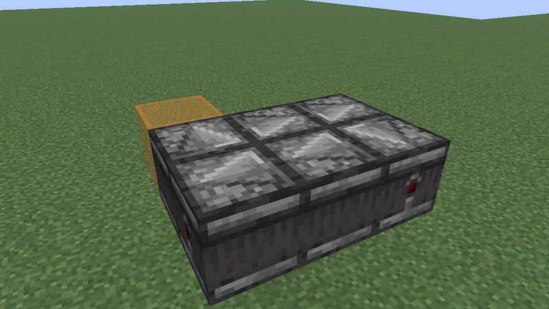 <b>n = 1</b>: 12 gt (0.6 s) · 6 blocks</td></tr></table>

Extend: insert 2 observers: one more column in the 2-wide ring (each observer watches the previous one). 
n = 0..48: P = 8 gt (0.4 s) .. 200 gt (10 s); judged in the game: n = 0, 1, 2, 24, 48.

### P = 10 + 4n gt

**observer ring with a relay block** · 10 cards · P = 0.5 s + 0.2 s·n

<table><tr><td align="center" valign="top"> <b>n = 0</b>: 10 gt (0.5 s) · 6 blocks</td><td align="center" valign="top">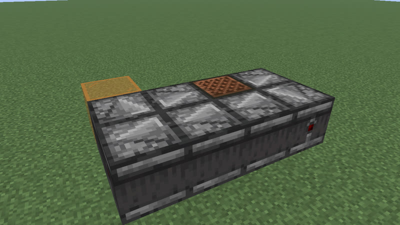 <b>n = 1</b>: 14 gt (0.7 s) · 8 blocks</td></tr></table>

Works with any one of these 10 blocks in place of the note block: note block, iron trapdoor, crafter, powered rail, activator rail, oak fence gate, oak trapdoor, skeleton skull, iron door, oak door.

Pictured: [clk-obs-note-ring](archive/clk-obs-note-ring.txt) (+note_block): P = 10 + 4n gt, 6 + 2n blocks, n = 0..47; judged in the game: n = 0, 1, 2, 23, 47. Extend: insert 2 observers: one more column in the 2-wide ring.

All 10 cards of observer ring with a relay block (formula, size, n range, design)

| card | P | blocks | n (P) | judged in the game: n |
|---|---|---|---|---|
| [clk-misc-activator_rail-ring](archive/clk-misc-activator_rail-ring-n0.txt) (+activator_rail) | 10 + 4n gt | 6 + 2n | 0..47 (10 gt (0.5 s) .. 198 gt (9.9 s)) | 0, 1, 2, 23, 47 |
| [clk-misc-crafter-ring](archive/clk-misc-crafter-ring-n0.txt) (+crafter) | 10 + 4n gt | 6 + 2n | 0..47 (10 gt (0.5 s) .. 198 gt (9.9 s)) | 0, 1, 2, 23, 47 |
| [clk-misc-iron_door-ring](archive/clk-misc-iron_door-ring-n0.txt) (+iron_door) | 10 + 4n gt | 7 + 2n | 0..47 (10 gt (0.5 s) .. 198 gt (9.9 s)) | 0, 1, 2, 23, 47 |
| [clk-misc-oak_door-ring](archive/clk-misc-oak_door-ring-n0.txt) (+oak_door) | 10 + 4n gt | 7 + 2n | 0..47 (10 gt (0.5 s) .. 198 gt (9.9 s)) | 0, 1, 2, 23, 47 |
| [clk-misc-oak_fence_gate-ring](archive/clk-misc-oak_fence_gate-ring-n0.txt) (+oak_fence_gate) | 10 + 4n gt | 6 + 2n | 0..47 (10 gt (0.5 s) .. 198 gt (9.9 s)) | 0, 1, 2, 23, 47 |
| [clk-misc-oak_trapdoor-ring](archive/clk-misc-oak_trapdoor-ring-n0.txt) (+oak_trapdoor) | 10 + 4n gt | 6 + 2n | 0..47 (10 gt (0.5 s) .. 198 gt (9.9 s)) | 0, 1, 2, 23, 47 |
| [clk-misc-powered_rail-ring](archive/clk-misc-powered_rail-ring-n0.txt) (+powered_rail) | 10 + 4n gt | 6 + 2n | 0..47 (10 gt (0.5 s) .. 198 gt (9.9 s)) | 0, 1, 2, 23, 47 |
| [clk-misc-skeleton_skull-ring](archive/clk-misc-skeleton_skull-ring-n0.txt) (+skeleton_skull) | 10 + 4n gt | 6 + 2n | 0..47 (10 gt (0.5 s) .. 198 gt (9.9 s)) | 0, 1, 2, 23, 47 |
| [clk-obs-note-ring](archive/clk-obs-note-ring.txt) (+note_block) | 10 + 4n gt | 6 + 2n | 0..47 (10 gt (0.5 s) .. 198 gt (9.9 s)) | 0, 1, 2, 23, 47 |
| [clk-obs-trap-ring](archive/clk-obs-trap-ring.txt) (+iron_trapdoor) | 10 + 4n gt | 6 + 2n | 0..47 (10 gt (0.5 s) .. 198 gt (9.9 s)) | 0, 1, 2, 23, 47 |

### P = 11 + 2n gt

**clk-item-lockpair** ([base design](archive/clk-item-lockpair.txt)) · P = 0.55 s + 0.1 s·n · 9 blocks · comparator+hopper+redstone_wire+repeater

<table><tr><td align="center" valign="top"> <b>n = 0</b>: 11 gt (0.55 s) · 9 blocks</td><td align="center" valign="top">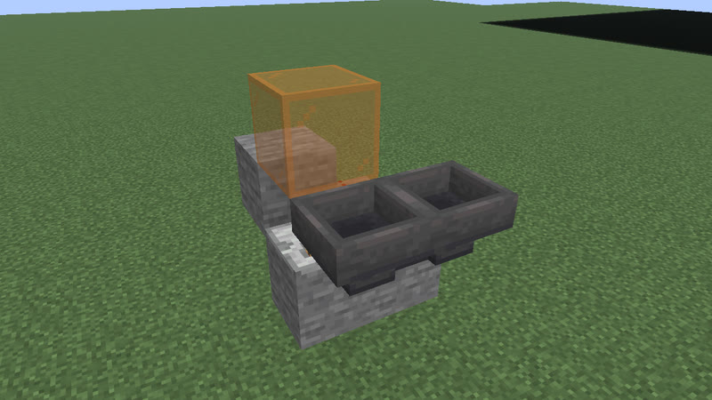 <b>n = 1</b>: 13 gt (0.65 s) · 9 blocks</td></tr></table>

Extend: one more tick of delay on the lock repeater (same blocks). 
n = 0..2: P = 11 gt (0.55 s) .. 15 gt (0.75 s); judged in the game: n = 0, 1, 2.

### P = 11 + 4n gt

**clk-obs-odd-a** ([base design](archive/clk-obs-odd-a.txt)) · P = 0.55 s + 0.2 s·n · 8 + 2n blocks · observer+piston+redstone_block+sticky_piston

<table><tr><td align="center" valign="top"> <b>n = 0</b>: 11 gt (0.55 s) · 8 blocks</td><td align="center" valign="top">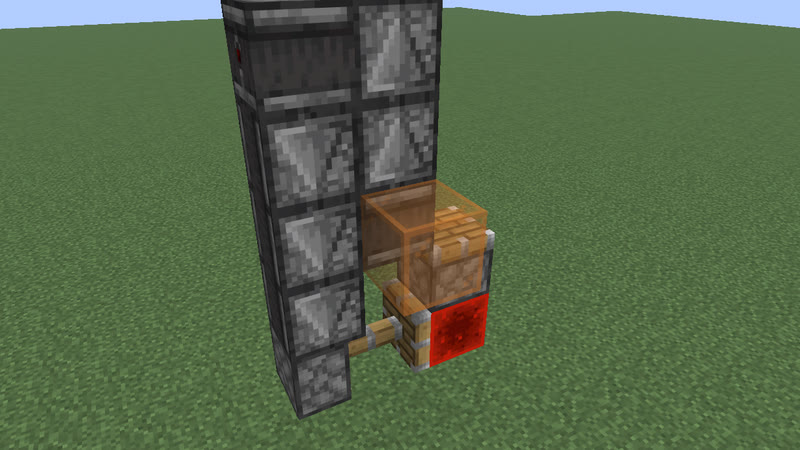 <b>n = 1</b>: 15 gt (0.75 s) · 10 blocks</td></tr></table>

Extend: raise the observer tower by one: one more observer in each column. 
n = 0..47: P = 11 gt (0.55 s) .. 199 gt (9.95 s); judged in the game: n = 0, 1, 2, 23, 47.

### P = 12 · 2^n gt

**clk-obs-divider** ([base design](archive/clk-obs-divider.txt)) · P = 0.6 s · 2^n · 3 + 3n blocks · copper_bulb+observer

<table><tr><td align="center" valign="top"> <b>n = 0</b>: 12 gt (0.6 s) · 3 blocks</td><td align="center" valign="top">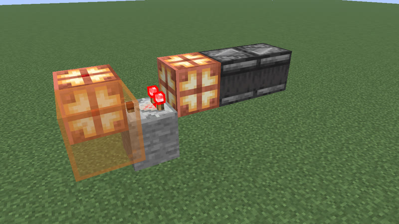 <b>n = 1</b>: 24 gt (1.2 s) · 6 blocks</td></tr></table>

Extend: add a stage behind the last bulb: a comparator (facing the clock, reading the bulb, on a stone floor) and a bulb. 
n = 0..8: P = 12 gt (0.6 s) .. 3072 gt (2 min 33.6 s); judged in the game: n = 0, 1, 2, 4, 8.

### P = 13 + 4n gt

**clk-obs-odd-b** ([base design](archive/clk-obs-odd-b.txt)) · P = 0.65 s + 0.2 s·n · 10 + 2n blocks · observer+piston+redstone_block+sticky_piston

<table><tr><td align="center" valign="top"> <b>n = 0</b>: 13 gt (0.65 s) · 10 blocks</td><td align="center" valign="top">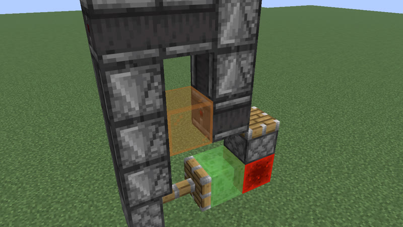 <b>n = 1</b>: 17 gt (0.85 s) · 12 blocks</td></tr></table>

Extend: raise the observer tower by one: one more observer in each column. 
n = 0..46: P = 13 gt (0.65 s) .. 197 gt (9.85 s); judged in the game: n = 0, 1, 2, 23, 46.

### P = 14 + 14n · 7 + 7n gt

**hopper ring** · 2 cards · one item going round (14 + 14n), or two items half a ring apart (7 + 7n)

<table><tr><td align="center" valign="top"> <b>n = 0</b>: 14 gt (0.7 s) · 4 blocks</td><td align="center" valign="top">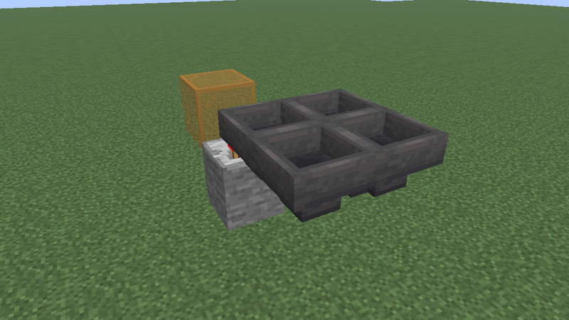 <b>n = 1</b>: 28 gt (1.4 s) · 6 blocks</td></tr></table>

Pictured: [clk-item-hopper-ring](archive/clk-item-hopper-ring.txt): P = 14 + 14n gt, 4 + 2n blocks, n = 0..40; judged in the game: n = 0, 1, 2, 20, 40. Extend: lengthen the 2-wide hopper ring by one column (2 hoppers).

All 2 cards of hopper ring (formula, size, n range, design)

| card | P | blocks | n (P) | judged in the game: n |
|---|---|---|---|---|
| [clk-item-hopper-ring](archive/clk-item-hopper-ring.txt) | 14 + 14n gt | 4 + 2n | 0..40 (14 gt (0.7 s) .. 574 gt (28.7 s)) | 0, 1, 2, 20, 40 |
| [clk-item-hopper-ring-2](archive/clk-item-hopper-ring-2.txt) | 7 + 7n gt | 4 + 2n | 1..40 (14 gt (0.7 s) .. 287 gt (14.35 s)) | 1, 2, 3, 20, 40 |

### P = 16 + 4n gt

**clk-item-snowdisp** ([base design](archive/clk-item-snowdisp.txt)) · P = 0.8 s + 0.2 s·n · 5 blocks · dispenser+observer+redstone_wire+repeater

<table><tr><td align="center" valign="top"> <b>n = 0</b>: 16 gt (0.8 s) · 5 blocks</td><td align="center" valign="top"> <b>n = 1</b>: 20 gt (1 s) · 5 blocks</td></tr></table>

Extend: one more tick of delay on the repeater (same blocks). 
n = 0..2: P = 16 gt (0.8 s) .. 24 gt (1.2 s); judged in the game: n = 0, 1, 2.

### P = 20 + 8n gt

**clk-obs-bulb-ring** ([base design](archive/clk-obs-bulb-ring.txt)) · P = 1 s + 0.4 s·n · 6 + 2n blocks · copper_bulb+observer

<table><tr><td align="center" valign="top"> <b>n = 0</b>: 20 gt (1 s) · 6 blocks</td><td align="center" valign="top">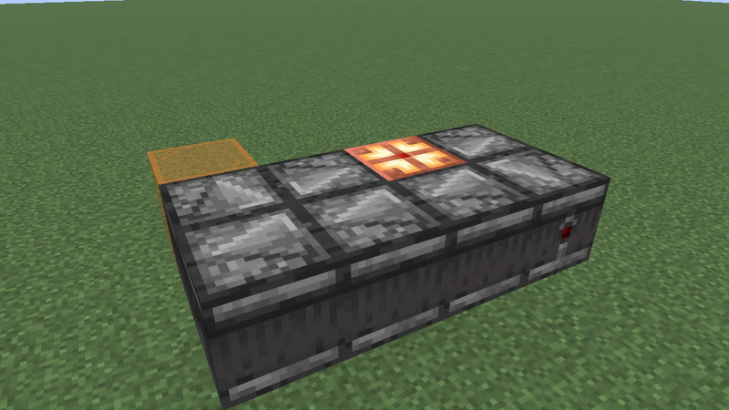 <b>n = 1</b>: 28 gt (1.4 s) · 8 blocks</td></tr></table>

Extend: insert 2 observers: one more column in the 2-wide ring. 
n = 0..22: P = 20 gt (1 s) .. 196 gt (9.8 s); judged in the game: n = 0, 1, 2, 11, 22.

### P = 20 + 16n gt

**clk-rt-uloop2t** ([base design](archive/clk-rt-uloop2t.txt)) · P = 1 s + 0.8 s·n · 8 + 4n blocks · redstone_torch+repeater

<table><tr><td align="center" valign="top"> <b>n = 0</b>: 20 gt (1 s) · 8 blocks</td><td align="center" valign="top">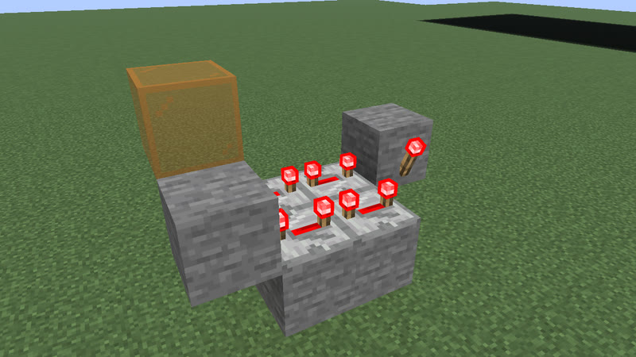 <b>n = 1</b>: 36 gt (1.8 s) · 12 blocks</td></tr></table>

Extend: add one delay-4 repeater (powered at placement) to each row of the 2-torch U-ring (wall torch on block A -> top row -> block F -> wall torch on F -> bottom row -> A). 
n = 0..10: P = 20 gt (1 s) .. 180 gt (9 s); judged in the game: n = 0, 1, 2, 3, 4, 5, 6, 7, 8, 9, 10.

### P = 23 + 8n gt

**clk-rt-odd-rect** ([base design](archive/clk-rt-odd-rect.txt)) · P = 1.15 s + 0.4 s·n · 16 + 4n blocks · repeater

<table><tr><td align="center" valign="top"> <b>n = 0</b>: 23 gt (1.15 s) · 16 blocks</td><td align="center" valign="top">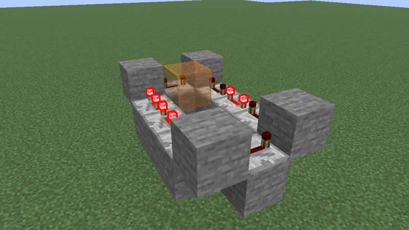 <b>n = 1</b>: 31 gt (1.55 s) · 20 blocks</td></tr></table>

Extend: lengthen the 3 x (4+n) ring (delay-4 repeaters, one delay-3, corner blocks) by one row: one more repeater on each long side; two pulses 23 + 8n gt apart, the second started by a temporary torch at an odd tick. 
n = 0..9: P = 23 gt (1.15 s) .. 95 gt (4.75 s); judged in the game: n = 0, 1, 2, 3, 4, 5, 6, 7, 8, 9.

### P = 26 + 5n gt

**clk-misc-cart-loop** ([base design](archive/clk-misc-cart-loop-n0.txt)) · P = 1.3 s + 0.25 s·n · 29 + 4n blocks · detector_rail+minecart

<table><tr><td align="center" valign="top"> <b>n = 0</b>: 26 gt (1.3 s) · 29 blocks</td><td align="center" valign="top">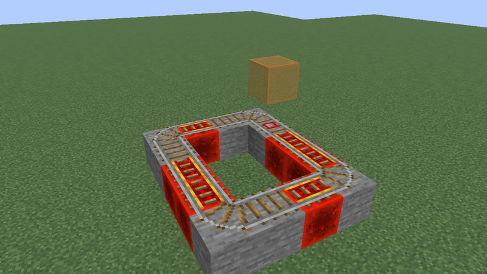 <b>n = 1</b>: 31 gt (1.55 s) · 33 blocks</td></tr></table>

Extend: lengthen both long sides by one powered rail (on a stone support). 
n = 0..16: P = 26 gt (1.3 s) .. 106 gt (5.3 s); judged in the game: n = 0, 1, 2, 8, 16.

### P = 20 + 14 (W - 3) + 7 (depth - 3) + 7 [one dropper] + 2 Σ delays gt

**dropper ring** · 14 cards · W = ring width, depth = 3 + its repeaters, one or two droppers

<table><tr><td align="center" valign="top"> <b>n = 0</b>: 27 gt (1.35 s) · 10 blocks</td><td align="center" valign="top">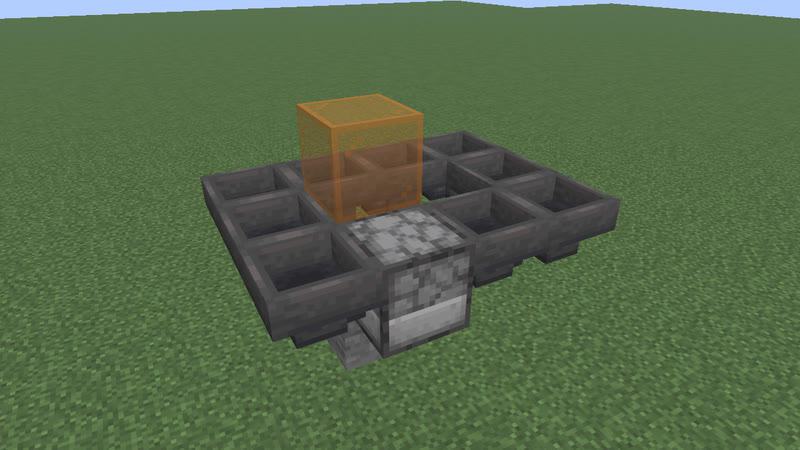 <b>n = 1</b>: 41 gt (2.05 s) · 12 blocks</td></tr></table>

Together they run at every period from 40 gt (2 s) to 460 gt (23 s), and 27, 31, 33-36, 38 gt.

Pictured: [clk-item-dropring-1d](archive/clk-item-dropring-1d.txt): P = 27 + 14n gt, 10 + 2n blocks, n = 0..30; judged in the game: n = 0, 1, 2, 15, 30. Extend: widen the dropper ring by one column (2 hoppers).

All 14 cards of dropper ring (formula, size, n range, design)

| card | P | blocks | n (P) | judged in the game: n |
|---|---|---|---|---|
| [clk-item-dropring-1d](archive/clk-item-dropring-1d.txt) | 27 + 14n gt | 10 + 2n | 0..30 (27 gt (1.35 s) .. 447 gt (22.35 s)) | 0, 1, 2, 15, 30 |
| [clk-item-dropring-2d-r2](archive/clk-item-dropring-2d-r2.txt) (+repeater) | 31 + 14n gt | 14 + 2n | 0..30 (31 gt (1.55 s) .. 451 gt (22.55 s)) | 0, 1, 2, 15, 30 |
| [clk-item-dropring-2d-r3](archive/clk-item-dropring-2d-r3.txt) (+repeater) | 33 + 14n gt | 14 + 2n | 0..30 (33 gt (1.65 s) .. 453 gt (22.65 s)) | 0, 1, 2, 15, 30 |
| [clk-item-dropring-2d](archive/clk-item-dropring-2d.txt) | 34 + 14n gt | 12 + 2n | 0..30 (34 gt (1.7 s) .. 454 gt (22.7 s)) | 0, 1, 2, 15, 30 |
| [clk-item-dropring-2d-r4](archive/clk-item-dropring-2d-r4.txt) (+repeater) | 35 + 14n gt | 14 + 2n | 0..30 (35 gt (1.75 s) .. 455 gt (22.75 s)) | 0, 1, 2, 15, 30 |
| [clk-item-dropring-1d-r1](archive/clk-item-dropring-1d-r1.txt) (+repeater) | 36 + 14n gt | 14 + 2n | 0..30 (36 gt (1.8 s) .. 456 gt (22.8 s)) | 0, 1, 2, 15, 30 |
| [clk-item-dropring-1d-r2](archive/clk-item-dropring-1d-r2.txt) (+repeater) | 38 + 14n gt | 14 + 2n | 0..30 (38 gt (1.9 s) .. 458 gt (22.9 s)) | 0, 1, 2, 15, 30 |
| [clk-item-dropring-1d-r3](archive/clk-item-dropring-1d-r3.txt) (+repeater) | 40 + 14n gt | 14 + 2n | 0..30 (40 gt (2 s) .. 460 gt (23 s)) | 0, 1, 2, 15, 30 |
| [clk-item-dropring-1d-r4](archive/clk-item-dropring-1d-r4.txt) (+repeater) | 42 + 14n gt | 14 + 2n | 0..30 (42 gt (2.1 s) .. 462 gt (23.1 s)) | 0, 1, 2, 15, 30 |
| [clk-item-dropring-2d-r1](archive/clk-item-dropring-2d-r1.txt) (+repeater) | 43 + 14n gt | 16 + 2n | 0..30 (43 gt (2.15 s) .. 463 gt (23.15 s)) | 0, 1, 2, 15, 30 |
| [clk-item-dropring-2d-r14](archive/clk-item-dropring-2d-r14.txt) (+repeater) | 44 + 14n gt | 18 + 2n | 0..30 (44 gt (2.2 s) .. 464 gt (23.2 s)) | 0, 1, 2, 15, 30 |
| [clk-item-dropring-2d-r24](archive/clk-item-dropring-2d-r24.txt) (+repeater) | 46 + 14n gt | 18 + 2n | 0..30 (46 gt (2.3 s) .. 466 gt (23.3 s)) | 0, 1, 2, 15, 30 |
| [clk-item-dropring-1d-r14](archive/clk-item-dropring-1d-r14.txt) (+repeater) | 51 + 14n gt | 18 + 2n | 0..30 (51 gt (2.55 s) .. 471 gt (23.55 s)) | 0, 1, 2, 15, 30 |
| [clk-item-dropring-1d-r24](archive/clk-item-dropring-1d-r24.txt) (+repeater) | 53 + 14n gt | 18 + 2n | 0..30 (53 gt (2.65 s) .. 473 gt (23.65 s)) | 0, 1, 2, 15, 30 |

### P = 30 + 16n gt

**clk-item-latch** ([base design](archive/clk-item-latch.txt)) · P = 1.5 s + 0.8 s·n · 17 blocks · comparator+copper_bulb+hopper+redstone_torch+redstone_wire

<table><tr><td align="center" valign="top"> <b>n = 0</b>: 30 gt (1.5 s) · 17 blocks</td><td align="center" valign="top">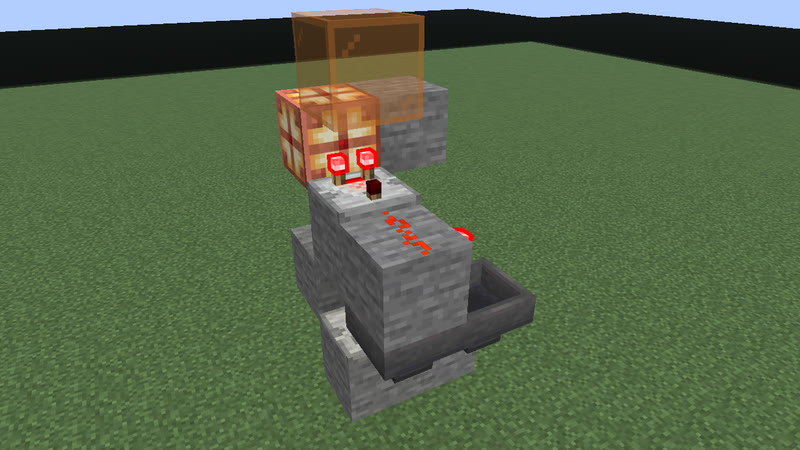 <b>n = 1</b>: 46 gt (2.3 s) · 17 blocks</td></tr></table>

Extend: one more stone in hopper A (same blocks; up to 5 stacks of 64). 
n = 0..318: P = 30 gt (1.5 s) .. 5118 gt (4 min 15.9 s); judged in the game: n = 0, 1, 2, 159, 318.

### P = 4 + 9n gt

**clk-sculk-replin** ([base design](archive/clk-sculk-replin.txt)) · P = 0.2 s + 0.45 s·n · 3 + 2n blocks · calibrated_sculk_sensor+note_block+observer+repeater

<table><tr><td align="center" valign="top"> <b>n = 3</b>: 31 gt (1.55 s) · 9 blocks</td><td align="center" valign="top">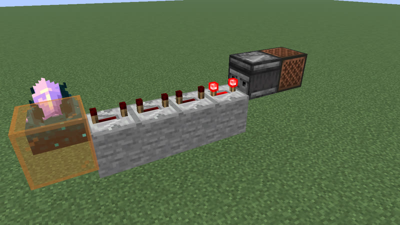 <b>n = 4</b>: 40 gt (2 s) · 11 blocks</td></tr></table>

Extend: one more delay-4 repeater on a stone at the end of the line (the observer and note block move one block out): +8 gt of delay and +1 gt of travel. 
n = 3..14: P = 31 gt (1.55 s) .. 130 gt (6.5 s); judged in the game: n = 3, 4, 5, 8, 14.

### P = 32 + 16n gt

**clk-rt-rect-pulse** ([base design](archive/clk-rt-rect-pulse.txt)) · P = 1.6 s + 0.8 s·n · 12 + 4n blocks · repeater

<table><tr><td align="center" valign="top"> <b>n = 0</b>: 32 gt (1.6 s) · 12 blocks</td><td align="center" valign="top">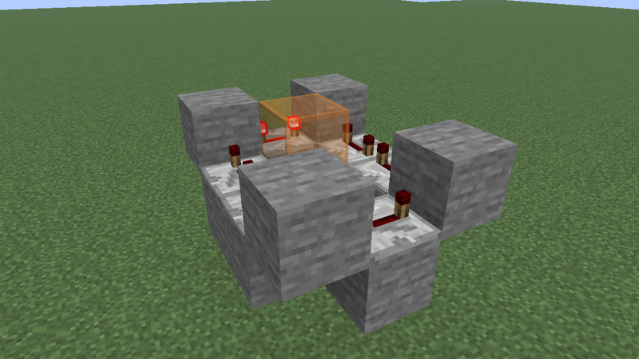 <b>n = 1</b>: 48 gt (2.4 s) · 16 blocks</td></tr></table>

Extend: lengthen the 3 x (3+n) ring of delay-4 repeaters with corner blocks by one row: one more repeater on each long side (one pulse loaded at placement). 
n = 0..10: P = 32 gt (1.6 s) .. 192 gt (9.6 s); judged in the game: n = 0, 1, 2, 3, 4, 5, 6, 7, 8, 9, 10.

### P = a + 2n gt, a in {33, 41}

**lock ring** · 2 cards · a 2x2 hopper ring with 2 or 3 swords, its lock repeater at delay n + 1

<table><tr><td align="center" valign="top"> <b>n = 0</b>: 33 gt (1.65 s) · 11 blocks</td><td align="center" valign="top"> <b>n = 1</b>: 35 gt (1.75 s) · 11 blocks</td></tr></table>

Pictured: [clk-item-lockring-2s](archive/clk-item-lockring-2s.txt): P = 33 + 2n gt, 11 blocks, n = 0..3; judged in the game: n = 0, 1, 2, 3. Extend: one more tick of delay on the lock repeater (same blocks).

All 2 cards of lock ring (formula, size, n range, design)

| card | P | blocks | n (P) | judged in the game: n |
|---|---|---|---|---|
| [clk-item-lockring-2s](archive/clk-item-lockring-2s.txt) | 33 + 2n gt | 11 | 0..3 (33 gt (1.65 s) .. 39 gt (1.95 s)) | 0, 1, 2, 3 |
| [clk-item-lockring-3s](archive/clk-item-lockring-3s.txt) | 41 + 2n gt | 11 | 0..3 (41 gt (2.05 s) .. 47 gt (2.35 s)) | 0, 1, 2, 3 |

### P = 3 + 16n gt

**clk-sculk-hairpin (one block swapped: 2 versions)** · 2 cards · P = 0.15 s + 0.8 s·n

<table><tr><td align="center" valign="top"> <b>n = 2</b>: 35 gt (1.75 s) · 15 blocks</td><td align="center" valign="top">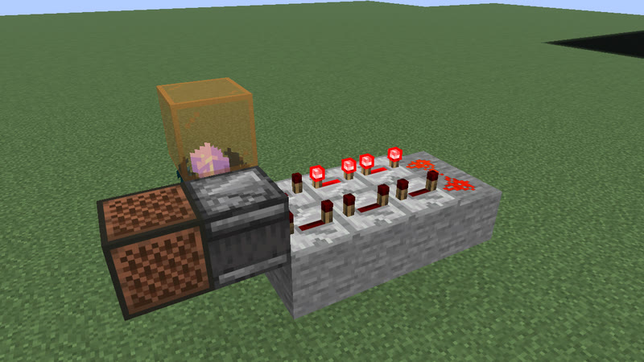 <b>n = 3</b>: 51 gt (2.55 s) · 19 blocks</td></tr></table>

Works with any one of these 2 blocks in place of the calibrated sculk sensor: calibrated sculk sensor, sculk sensor.

Pictured: [clk-sculk-hairpin](archive/clk-sculk-hairpin.txt) (+calibrated_sculk_sensor): P = 3 + 16n gt, 7 + 4n blocks, n = 2..12; judged in the game: n = 2, 3, 4, 7, 12. Extend: one more delay-4 repeater on a stone in each arm of the hairpin (the dust U-turn moves one block out).

All 2 cards of clk-sculk-hairpin (one block swapped: 2 versions) (formula, size, n range, design)

| card | P | blocks | n (P) | judged in the game: n |
|---|---|---|---|---|
| [clk-sculk-hairpin](archive/clk-sculk-hairpin.txt) (+calibrated_sculk_sensor) | 3 + 16n gt | 7 + 4n | 2..12 (35 gt (1.75 s) .. 195 gt (9.75 s)) | 2, 3, 4, 7, 12 |
| [clk-sculk-hairpin-plain](archive/clk-sculk-hairpin-plain.txt) (+sculk_sensor) | 3 + 16n gt | 7 + 4n | 3..12 (51 gt (2.55 s) .. 195 gt (9.75 s)) | 3, 4, 5, 7, 12 |

### P = 36 + 32n gt

**clk-rt-uloop1t** ([base design](archive/clk-rt-uloop1t.txt)) · P = 1.8 s + 1.6 s·n · 9 + 4n blocks · redstone_torch+redstone_wire+repeater

<table><tr><td align="center" valign="top"> <b>n = 0</b>: 36 gt (1.8 s) · 9 blocks</td><td align="center" valign="top">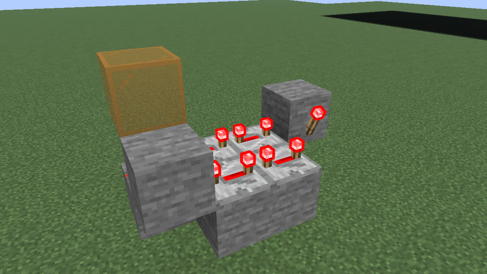 <b>n = 1</b>: 68 gt (3.4 s) · 13 blocks</td></tr></table>

Extend: add one delay-4 repeater (powered at placement) to each row of the 1-torch inverter U-loop (block A + a dust corner -> top row -> block F -> wall torch on F -> bottom row -> A). 
n = 0..8: P = 36 gt (1.8 s) .. 292 gt (14.6 s); judged in the game: n = 0, 1, 2, 3, 4, 5, 6, 7, 8.

### P = 37 + 5n gt

**clk-misc-cart-pingpong** ([base design](archive/clk-misc-cart-pingpong-n0.txt)) · P = 1.85 s + 0.25 s·n · 17 + 2n blocks · detector_rail+minecart

<table><tr><td align="center" valign="top"> <b>n = 0</b>: 37 gt (1.85 s) · 17 blocks</td><td align="center" valign="top">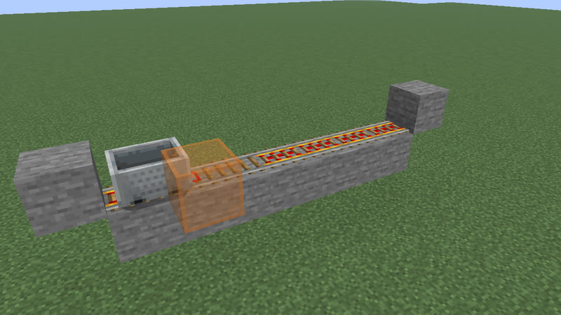 <b>n = 1</b>: 42 gt (2.1 s) · 19 blocks</td></tr></table>

Extend: one more powered rail (on a stone support) in the east stretch. 
n = 0..14: P = 37 gt (1.85 s) .. 107 gt (5.35 s); judged in the game: n = 0, 1, 2, 7, 14.

### P = 52 + 32n gt

**clk-rt-rect-inv** ([base design](archive/clk-rt-rect-inv.txt)) · P = 2.6 s + 1.6 s·n · 12 + 4n blocks · redstone_torch+redstone_wire+repeater

<table><tr><td align="center" valign="top"> <b>n = 0</b>: 52 gt (2.6 s) · 12 blocks</td><td align="center" valign="top">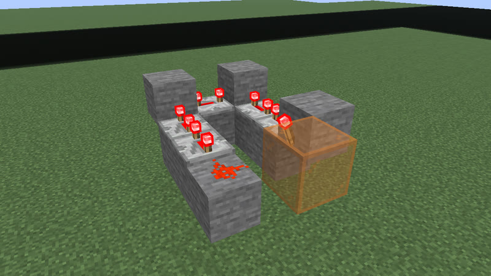 <b>n = 1</b>: 84 gt (4.2 s) · 16 blocks</td></tr></table>

Extend: lengthen the 3 x (3+n) inverter ring (delay-4 repeaters, corner blocks, a wall torch on one corner block, the next corner dust) by one row: one more repeater on each long side. 
n = 0..8: P = 52 gt (2.6 s) .. 308 gt (15.4 s); judged in the game: n = 0, 1, 2, 3, 4, 5, 6, 7, 8.

### P = 28 + 32n gt

**clk-sculk-racetrack** ([base design](archive/clk-sculk-racetrack.txt)) · P = 1.4 s + 1.6 s·n · 4 + 4n blocks · calibrated_sculk_sensor+note_block

<table><tr><td align="center" valign="top"> <b>n = 1</b>: 60 gt (3 s) · 8 blocks</td><td align="center" valign="top">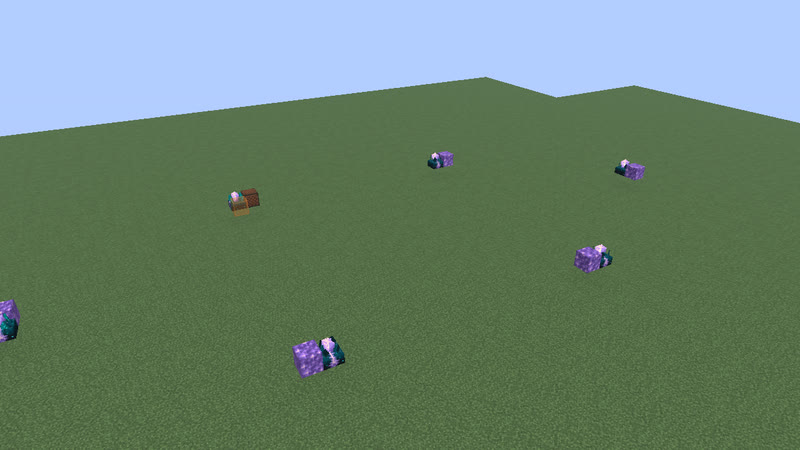 <b>n = 2</b>: 92 gt (4.6 s) · 12 blocks</td></tr></table>

Extend: one more calibrated sensor + amethyst block on each straight side, 17 blocks apart (the far turn sensor moves 17 out). 
n = 1..8: P = 60 gt (3 s) .. 284 gt (14.2 s); judged in the game: n = 1, 2, 3, 4, 8.

### P = 12 + 16n gt

**clk-sculk-racetrack-plain** ([base design](archive/clk-sculk-racetrack-plain.txt)) · P = 0.6 s + 0.8 s·n · 4 + 4n blocks · note_block+sculk_sensor

<table><tr><td align="center" valign="top"> <b>n = 3</b>: 60 gt (3 s) · 16 blocks</td><td align="center" valign="top">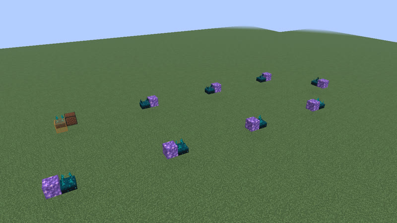 <b>n = 4</b>: 76 gt (3.8 s) · 20 blocks</td></tr></table>

Extend: one more plain sensor + amethyst block on each straight side, 9 blocks apart (the far turn sensor moves 9 out). 
n = 3..10: P = 60 gt (3 s) .. 172 gt (8.6 s); judged in the game: n = 3, 4, 5, 6, 10.

### P = 36 · 2^n gt

**clk-rt-div** ([base design](archive/clk-rt-div.txt)) · P = 1.8 s · 2^n · 9 + 18n blocks · redstone_torch+redstone_wire+repeater

<table><tr><td align="center" valign="top"> <b>n = 1</b>: 72 gt (3.6 s) · 27 blocks</td><td align="center" valign="top">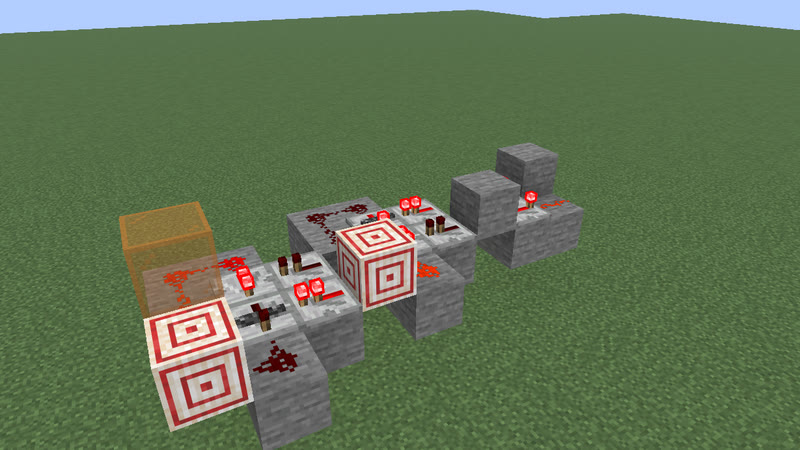 <b>n = 2</b>: 144 gt (7.2 s) · 45 blocks</td></tr></table>

Extend: append one master-slave T flip-flop stage (18 blocks: 2 latch repeaters, 2 lock repeaters, a target block with a wall torch, dust) to the chain on the P36 torch + repeater loop: the period doubles. 
n = 1..7: P = 72 gt (3.6 s) .. 4608 gt (3 min 50.4 s); judged in the game: n = 1, 2, 3, 4, 5, 6, 7.

### P = 7L + 8N - 34 gt

**ring lock** · 3 cards · a 3 x d hopper ring (L = 2d + 2 hoppers) locked by N stones in its corner, 5 <= N <= (7L - 2) / 8 - 3

<table><tr><td align="center" valign="top"> <b>n = 0</b>: 76 gt (3.8 s) · 12 blocks</td><td align="center" valign="top">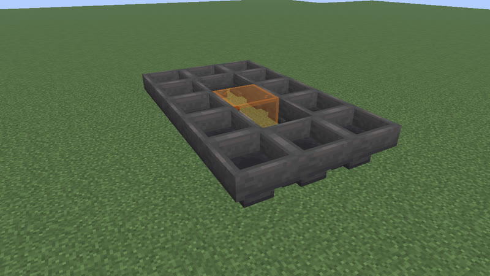 <b>n = 1</b>: 90 gt (4.5 s) · 14 blocks</td></tr></table>

Pictured: [clk-item-ringlock-rows](archive/clk-item-ringlock-rows.txt): P = 76 + 14n gt, 12 + 2n blocks, n = 0..30; judged in the game: n = 0, 1, 2, 15, 30. Extend: lengthen the 3-wide ring by one row (2 hoppers), still 5 stones.

All 3 cards of ring lock (formula, size, n range, design)

| card | P | blocks | n (P) | judged in the game: n |
|---|---|---|---|---|
| [clk-item-ringlock-rows](archive/clk-item-ringlock-rows.txt) | 76 + 14n gt | 12 + 2n | 0..30 (76 gt (3.8 s) .. 496 gt (24.8 s)) | 0, 1, 2, 15, 30 |
| [clk-item-ringlock-stones-3x6](archive/clk-item-ringlock-stones-3x6.txt) | 104 + 8n gt | 16 | 0..4 (104 gt (5.2 s) .. 136 gt (6.8 s)) | 0, 1, 2, 4 |
| [clk-item-ringlock-stones-3x20](archive/clk-item-ringlock-stones-3x20.txt) | 300 + 8n gt | 44 | 0..28 (300 gt (15 s) .. 524 gt (26.2 s)) | 0, 1, 2, 14, 28 |

### P = 91 + 28n gt

**clk-misc-crafter-loop** ([base design](archive/clk-misc-crafter-loop-n0.txt)) · P = 4.55 s + 1.4 s·n · 7 + 2n blocks · comparator+crafter+hopper+observer

<table><tr><td align="center" valign="top"> <b>n = 0</b>: 91 gt (4.55 s) · 7 blocks</td><td align="center" valign="top">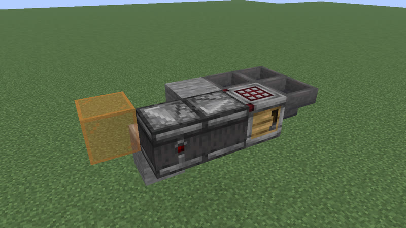 <b>n = 1</b>: 119 gt (5.95 s) · 9 blocks</td></tr></table>

Extend: add 2 hoppers: the hopper loop one column longer. 
n = 0..20: P = 91 gt (4.55 s) .. 651 gt (32.55 s); judged in the game: n = 0, 1, 2, 10, 20.

### P = 114 + 56n gt

**clk-rt-fade** ([base design](archive/clk-rt-fade.txt)) · P = 5.7 s + 2.8 s·n · 18 + 4n blocks · comparator+redstone_torch+redstone_wire

<table><tr><td align="center" valign="top"> <b>n = 0</b>: 114 gt (5.7 s) · 18 blocks</td><td align="center" valign="top">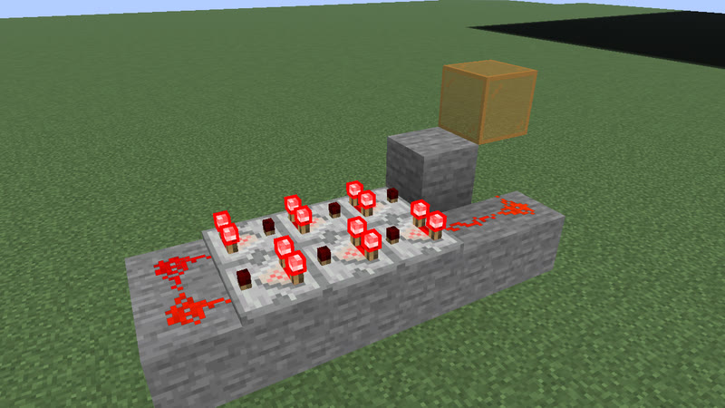 <b>n = 1</b>: 170 gt (8.5 s) · 22 blocks</td></tr></table>

Extend: add one compare-mode comparator to each row of the comparator fading ring (2 + 2 comparators at n = 0, a lossy two-dust turn, a refill torch). 
n = 0..10: P = 114 gt (5.7 s) .. 674 gt (33.7 s); judged in the game: n = 0, 1, 2, 3, 4, 5, 6, 7, 8, 9, 10.

### P = 114 · 2^n gt

**clk-rt-div-fade** ([base design](archive/clk-rt-div-fade.txt)) · P = 5.7 s · 2^n · 18 + 18n blocks · comparator+redstone_torch+redstone_wire+repeater

<table><tr><td align="center" valign="top"> <b>n = 1</b>: 228 gt (11.4 s) · 36 blocks</td><td align="center" valign="top">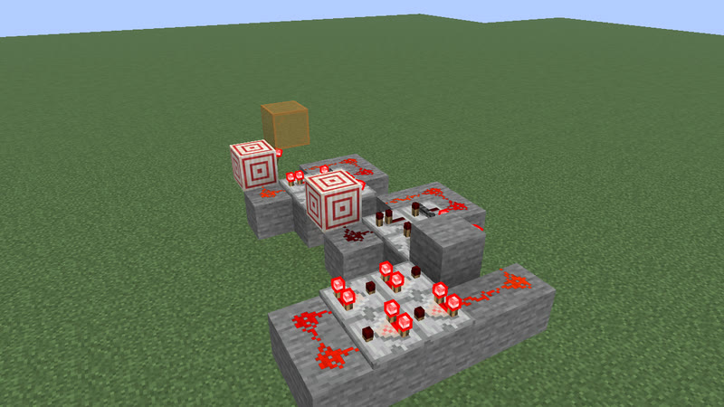 <b>n = 2</b>: 456 gt (22.8 s) · 54 blocks</td></tr></table>

Extend: append one master-slave T flip-flop stage (18 blocks) to the chain on the P114 comparator fading ring: the period doubles. 
n = 1..5: P = 228 gt (11.4 s) .. 3648 gt (3 min 2.4 s); judged in the game: n = 1, 2, 3, 4, 5.

### P = 114 · 14^n gt

**clk-rt-counter** ([base design](archive/clk-rt-counter.txt)) · P = 5.7 s · 14^n · 18 + 26n blocks · comparator+redstone_torch+redstone_wire

<table><tr><td align="center" valign="top"> <b>n = 1</b>: 1596 gt (1 min 19.8 s) · 44 blocks</td><td align="center" valign="top">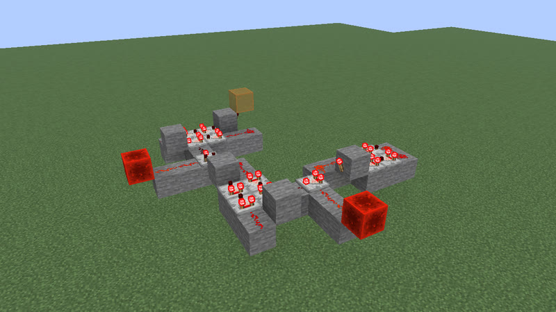 <b>n = 2</b>: 22344 gt (18 min 37.2 s) · 70 blocks</td></tr></table>

Extend: wrap one more counter level around the clock (a lossless 2 + 2 comparator ring with one subtract comparator, its pulse shaper and refill torch: 26 blocks): the period x 14. 
n = 1..3: P = 1596 gt (1 min 19.8 s) .. 312816 gt (4 h 20 min 40.8 s); judged in the game: n = 1, 2, 3.

## Galleries by period

| periods | clock types | page |
|---|---|---|
| 4 gt (0.2 s) to 21 gt (1.05 s) | 297 | [p4-21](gallery/p4-21.md) |
| 22 gt (1.1 s) to 33 gt (1.65 s) | 297 | [p22-33](gallery/p22-33.md) |
| 34 gt (1.7 s) to 47 gt (2.35 s) | 295 | [p34-47](gallery/p34-47.md) |
| 48 gt (2.4 s) to 81 gt (4.05 s) | 296 | [p48-81](gallery/p48-81.md) |
| 82 gt (4.1 s) to 128 gt (6.4 s) | 299 | [p82-128](gallery/p82-128.md) |
| 129 gt (6.45 s) to 494 gt (24.7 s) | 300 | [p129-494](gallery/p129-494.md) |
| 506 gt (25.3 s) to 17978 gt (14 min 58.9 s) | 30 | [p506-17978](gallery/p506-17978.md) |

Variants: larger clocks of the same period that only add block kinds to a smaller one (988): [list](gallery/variants.md).
