# Clocks: 12 gt (0.6 s) to 16 gt (0.8 s) (277 clocks)

[catalog index](../CATALOG.md) · previous: [p4-11](p4-11.md) · next: [p17-23](p17-23.md)

Orange glass = where the output signal is (placed only for the picture); click a picture for its design. Generated by `mctas clock catalog`.

## 12 gt (0.6 s)

Also reachable by: clk-obs-obs-ring (n = 1), clk-obs-divider (n = 0).

<table>
<tr><td align="center"> 12 gt (0.6 s) · copper_bulb+observer · 3 blocks</td><td align="center"><a href="../archive/clk-obs-p12-bulb-note-obs-4b-b-642edf.txt">clk-obs-p12-bulb-note-obs-4b-b-642edf</a> 12 gt (0.6 s) · copper_bulb+note_block+observer · 4 blocks (picture pending)</td><td align="center"> 12 gt (0.6 s) · copper_bulb+note_block+observer · 4 blocks</td></tr>
<tr><td align="center"> 12 gt (0.6 s) · observer+piston · 4 blocks</td><td align="center"> 12 gt (0.6 s) · observer+redstone_block+sticky_piston · 4 blocks</td><td align="center"> 12 gt (0.6 s) · observer+sticky_piston · 4 blocks</td></tr>
<tr><td align="center"><a href="../archive/clk-obs-p12-obs-stk-4b-b-e2722d.txt">clk-obs-p12-obs-stk-4b-b-e2722d</a> 12 gt (0.6 s) · observer+sticky_piston · 4 blocks (picture pending)</td><td align="center"> 12 gt (0.6 s) · copper_bulb+redstone_block+sticky_piston · 4 blocks</td><td align="center"> 12 gt (0.6 s) · observer+redstone_block+redstone_lamp+sticky_piston · 4 blocks</td></tr>
<tr><td align="center"><a href="../archive/clk-obs-p12-obs-pis-4b-b-925a5d.txt">clk-obs-p12-obs-pis-4b-b-925a5d</a> 12 gt (0.6 s) · observer+piston · 4 blocks (picture pending)</td><td align="center"> 12 gt (0.6 s) · observer+redstone_lamp+sticky_piston · 4 blocks</td><td align="center"><a href="../archive/clk-obs-p12-bulb-lamp-obs-rb-stk-5b-6d8b3e.txt">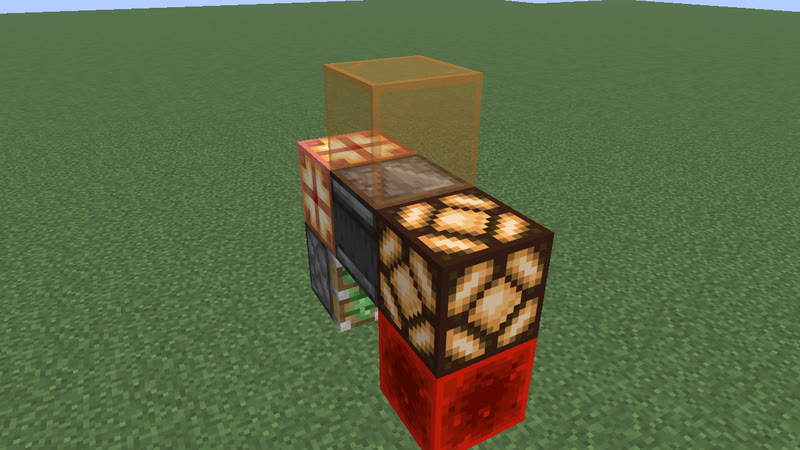</a> 12 gt (0.6 s) · copper_bulb+observer+redstone_block+redstone_lamp+sticky_piston · 5 blocks</td></tr>
<tr><td align="center"><a href="../archive/clk-obs-p12-bulb-obs-pis-5b-6d80de.txt">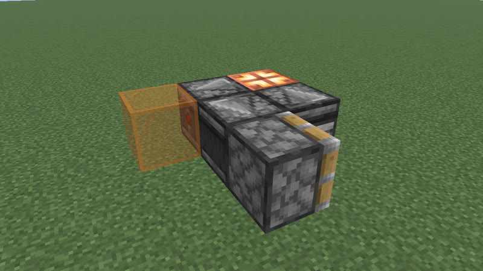</a> 12 gt (0.6 s) · copper_bulb+observer+piston · 5 blocks</td><td align="center"><a href="../archive/clk-obs-p12-bulb-obs-pis-5b-b-2077dd.txt">clk-obs-p12-bulb-obs-pis-5b-b-2077dd</a> 12 gt (0.6 s) · copper_bulb+observer+piston · 5 blocks (picture pending)</td><td align="center"><a href="../archive/clk-obs-p12-bulb-obs-stk-5b-b-c1fa27.txt">clk-obs-p12-bulb-obs-stk-5b-b-c1fa27</a> 12 gt (0.6 s) · copper_bulb+observer+sticky_piston · 5 blocks (picture pending)</td></tr>
<tr><td align="center"><a href="../archive/clk-obs-p12-bulb-obs-stk-5b-da1474.txt">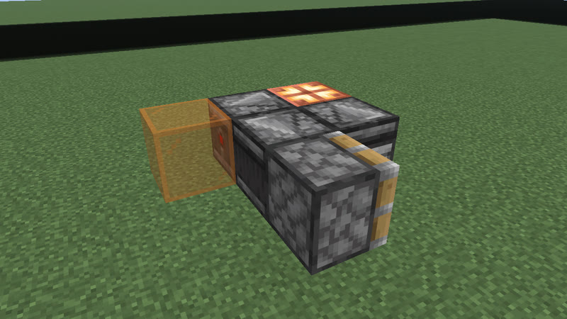</a> 12 gt (0.6 s) · copper_bulb+observer+sticky_piston · 5 blocks</td><td align="center"><a href="../archive/clk-obs-p12-lamp-note-obs-rb-stk-5b-b-27622f.txt">clk-obs-p12-lamp-note-obs-rb-stk-5b-b-27622f</a> 12 gt (0.6 s) · note_block+observer+redstone_block+redstone_lamp+sticky_piston · 5 blocks (picture pending)</td><td align="center"><a href="../archive/clk-obs-p12-lamp-note-obs-rb-stk-5b-e2d286.txt">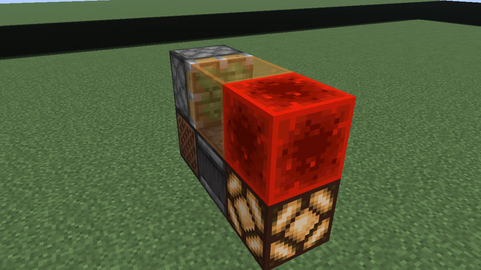</a> 12 gt (0.6 s) · note_block+observer+redstone_block+redstone_lamp+sticky_piston · 5 blocks</td></tr>
<tr><td align="center"><a href="../archive/clk-obs-p12-lamp-obs-rb-stk-5b-b-cba62c.txt">clk-obs-p12-lamp-obs-rb-stk-5b-b-cba62c</a> 12 gt (0.6 s) · observer+redstone_block+redstone_lamp+sticky_piston · 5 blocks (picture pending)</td><td align="center"><a href="../archive/clk-obs-p12-note-obs-rb-stk-5b-35134f.txt">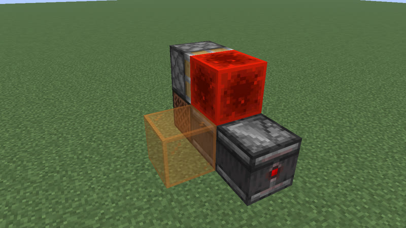</a> 12 gt (0.6 s) · note_block+observer+redstone_block+sticky_piston · 5 blocks</td><td align="center"><a href="../archive/clk-obs-p12-note-obs-rb-stk-5b-b-844e86.txt">clk-obs-p12-note-obs-rb-stk-5b-b-844e86</a> 12 gt (0.6 s) · note_block+observer+redstone_block+sticky_piston · 5 blocks (picture pending)</td></tr>
<tr><td align="center"> 12 gt (0.6 s) · note_block+observer+sticky_piston · 5 blocks</td><td align="center"><a href="../archive/clk-obs-p12-note-obs-stk-5b-b-ec83a3.txt">clk-obs-p12-note-obs-stk-5b-b-ec83a3</a> 12 gt (0.6 s) · note_block+observer+sticky_piston · 5 blocks (picture pending)</td><td align="center"><a href="../archive/clk-obs-p12-lamp-obs-pis-rb-stk-5b-de1aa8.txt">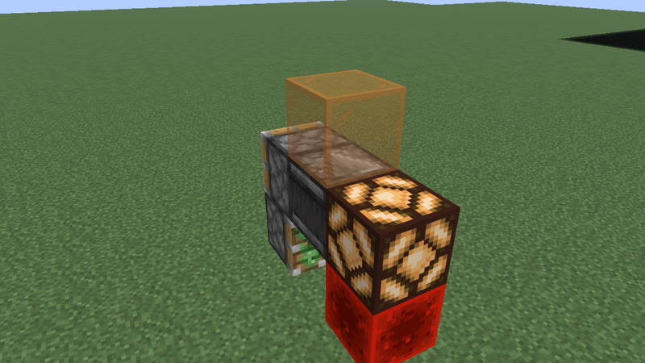</a> 12 gt (0.6 s) · observer+piston+redstone_block+redstone_lamp+sticky_piston · 5 blocks</td></tr>
<tr><td align="center"> 12 gt (0.6 s) · observer+piston+redstone_lamp+sticky_piston · 5 blocks</td><td align="center"><a href="../archive/clk-obs-p12-lamp-obs-stk-5b-b-01b07b.txt">clk-obs-p12-lamp-obs-stk-5b-b-01b07b</a> 12 gt (0.6 s) · observer+redstone_lamp+sticky_piston · 5 blocks (picture pending)</td><td align="center"><a href="../archive/clk-obs-p12-note-obs-pis-5b-7ab3be.txt">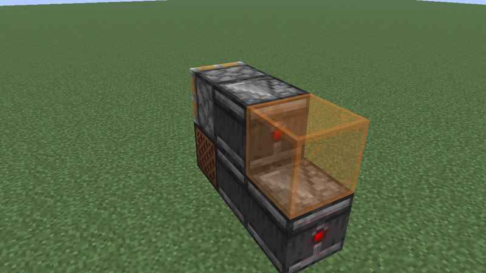</a> 12 gt (0.6 s) · note_block+observer+piston · 5 blocks</td></tr>
<tr><td align="center"><a href="../archive/clk-obs-p12-note-obs-pis-5b-b-17b1cc.txt">clk-obs-p12-note-obs-pis-5b-b-17b1cc</a> 12 gt (0.6 s) · note_block+observer+piston · 5 blocks (picture pending)</td><td align="center"> 12 gt (0.6 s) · note_block+observer+piston+sticky_piston · 5 blocks</td><td align="center"><a href="../archive/clk-obs-p12-obs-pis-stk-5b-51aa87.txt">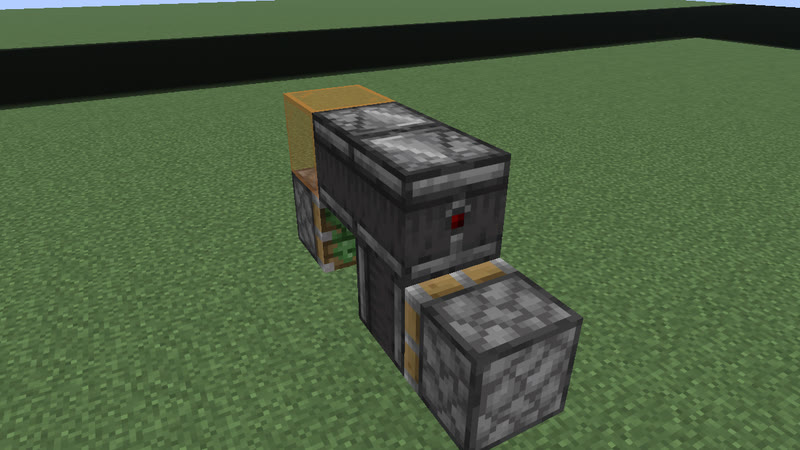</a> 12 gt (0.6 s) · observer+piston+sticky_piston · 5 blocks</td></tr>
<tr><td align="center"><a href="../archive/clk-obs-p12-obs-pis-stk-5b-b-f76458.txt">clk-obs-p12-obs-pis-stk-5b-b-f76458</a> 12 gt (0.6 s) · observer+piston+sticky_piston · 5 blocks (picture pending)</td><td align="center"><a href="../archive/clk-obs-p12-lamp-obs-pis-rb-stk-5b-b-791453.txt">clk-obs-p12-lamp-obs-pis-rb-stk-5b-b-791453</a> 12 gt (0.6 s) · observer+piston+redstone_block+redstone_lamp+sticky_piston · 5 blocks (picture pending)</td><td align="center"><a href="../archive/clk-obs-p12-lamp-obs-pis-stk-5b-b-f3ab23.txt">clk-obs-p12-lamp-obs-pis-stk-5b-b-f3ab23</a> 12 gt (0.6 s) · observer+piston+redstone_lamp+sticky_piston · 5 blocks (picture pending)</td></tr>
<tr><td align="center"> 12 gt (0.6 s) · redstone_block+redstone_lamp+sticky_piston · 5 blocks</td><td align="center"><a href="../archive/clk-obs-p12-lamp-rb-stk-5b-b-7f0cf6.txt">clk-obs-p12-lamp-rb-stk-5b-b-7f0cf6</a> 12 gt (0.6 s) · redstone_block+redstone_lamp+sticky_piston · 5 blocks (picture pending)</td><td align="center"><a href="../archive/clk-obs-p12-note-obs-pis-stk-5b-b-d02ea0.txt">clk-obs-p12-note-obs-pis-stk-5b-b-d02ea0</a> 12 gt (0.6 s) · note_block+observer+piston+sticky_piston · 5 blocks (picture pending)</td></tr>
<tr><td align="center"> 12 gt (0.6 s) · note_block+redstone_block+sticky_piston · 5 blocks</td><td align="center"><a href="../archive/clk-obs-p12-note-rb-stk-5b-b-04da6a.txt">clk-obs-p12-note-rb-stk-5b-b-04da6a</a> 12 gt (0.6 s) · note_block+redstone_block+sticky_piston · 5 blocks (picture pending)</td><td align="center"> 12 gt (0.6 s) · redstone_block+sticky_piston · 5 blocks</td></tr>
<tr><td align="center"><a href="../archive/clk-obs-p12-rb-stk-5b-b-46cdde.txt">clk-obs-p12-rb-stk-5b-b-46cdde</a> 12 gt (0.6 s) · redstone_block+sticky_piston · 5 blocks (picture pending)</td><td align="center"> 12 gt (0.6 s) · dispenser+observer+redstone_wire · 5 blocks</td><td align="center"><a href="../archive/clk-obs-p12-obs-5b-27b061.txt">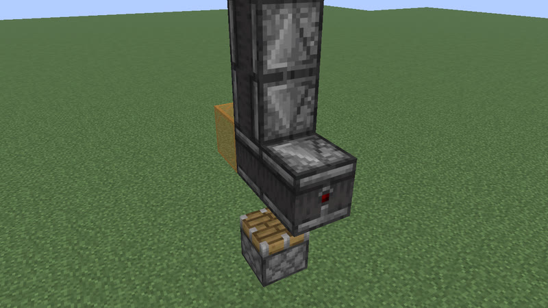</a> 12 gt (0.6 s) · observer · 5 blocks</td></tr>
<tr><td align="center"><a href="../archive/clk-obs-p12-obs-pis-rb-stk-5b-648f0c.txt">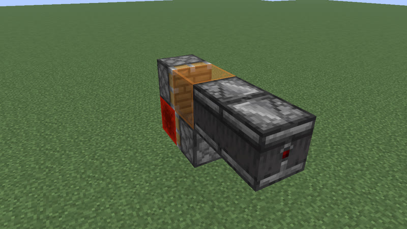</a> 12 gt (0.6 s) · observer+piston+redstone_block+sticky_piston · 5 blocks</td><td align="center"><a href="../archive/clk-obs-p12-bulb-note-obs-pis-6b-7fcbe5.txt">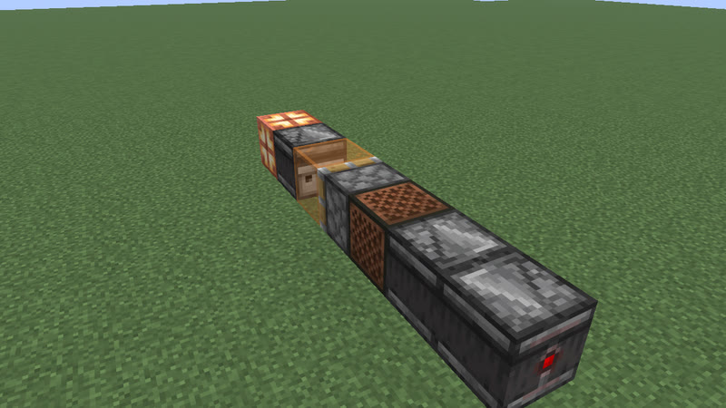</a> 12 gt (0.6 s) · copper_bulb+note_block+observer+piston · 6 blocks</td><td align="center"><a href="../archive/clk-obs-p12-bulb-note-obs-pis-6b-b-947d1e.txt">clk-obs-p12-bulb-note-obs-pis-6b-b-947d1e</a> 12 gt (0.6 s) · copper_bulb+note_block+observer+piston · 6 blocks (picture pending)</td></tr>
<tr><td align="center"><a href="../archive/clk-obs-p12-lamp-obs-pis-6b-bb947c.txt">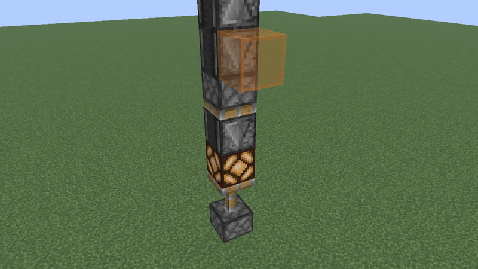</a> 12 gt (0.6 s) · observer+piston+redstone_lamp · 6 blocks</td><td align="center"><a href="../archive/clk-obs-p12-bulb-note-obs-pis-stk-6b-fe0267.txt">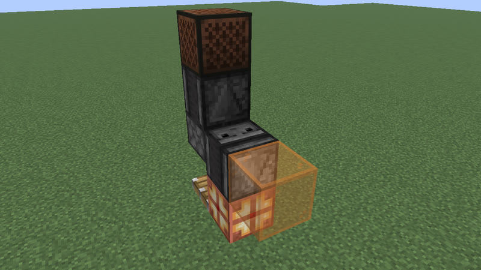</a> 12 gt (0.6 s) · copper_bulb+note_block+observer+piston+sticky_piston · 6 blocks</td><td align="center"><a href="../archive/clk-obs-p12-bulb-note-obs-stk-6b-b-81f1bc.txt">clk-obs-p12-bulb-note-obs-stk-6b-b-81f1bc</a> 12 gt (0.6 s) · copper_bulb+note_block+observer+sticky_piston · 6 blocks (picture pending)</td></tr>
<tr><td align="center"><a href="../archive/clk-obs-p12-bulb-note-obs-stk-6b-bcfe75.txt">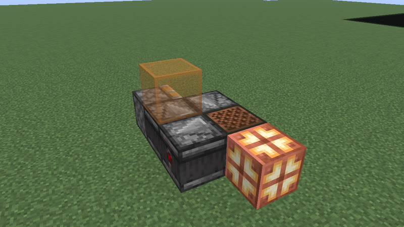</a> 12 gt (0.6 s) · copper_bulb+note_block+observer+sticky_piston · 6 blocks</td><td align="center"><a href="../archive/clk-obs-p12-bulb-obs-pis-stk-6b-a95db5.txt">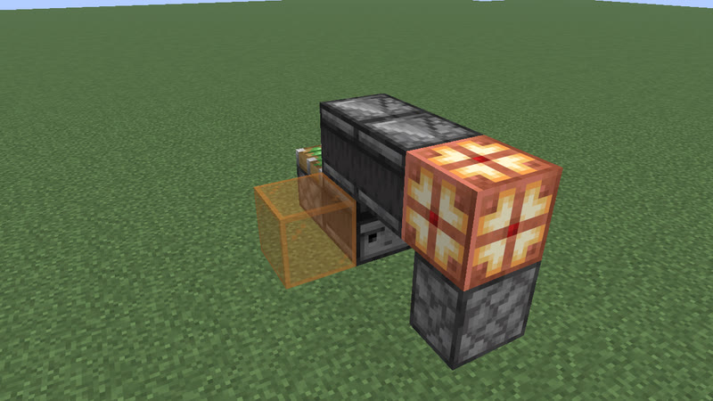</a> 12 gt (0.6 s) · copper_bulb+observer+piston+sticky_piston · 6 blocks</td><td align="center"><a href="../archive/clk-obs-p12-bulb-obs-pis-stk-6b-b-c48cf0.txt">clk-obs-p12-bulb-obs-pis-stk-6b-b-c48cf0</a> 12 gt (0.6 s) · copper_bulb+observer+piston+sticky_piston · 6 blocks (picture pending)</td></tr>
<tr><td align="center"><a href="../archive/clk-obs-p12-bulb-lamp-obs-stk-6b-a9f7df.txt">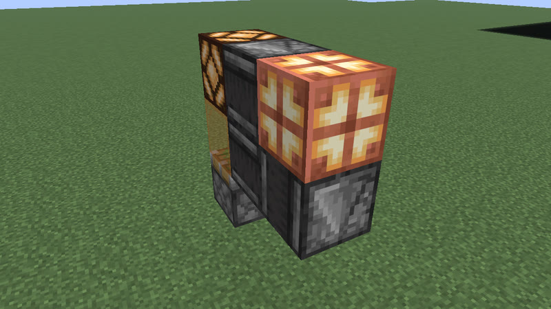</a> 12 gt (0.6 s) · copper_bulb+observer+redstone_lamp+sticky_piston · 6 blocks</td><td align="center"><a href="../archive/clk-obs-p12-obs-pis-rb-stk-6b-b-dbf09c.txt">clk-obs-p12-obs-pis-rb-stk-6b-b-dbf09c</a> 12 gt (0.6 s) · observer+piston+redstone_block+sticky_piston · 6 blocks (picture pending)</td><td align="center"><a href="../archive/clk-obs-p12-bulb-obs-rb-stk-6b-8b40fc.txt">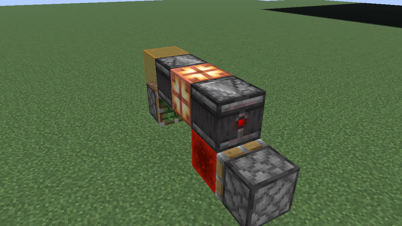</a> 12 gt (0.6 s) · copper_bulb+observer+redstone_block+sticky_piston · 6 blocks</td></tr>
<tr><td align="center"><a href="../archive/clk-obs-p12-lamp-note-obs-pis-rb-stk-6b-6811cc.txt">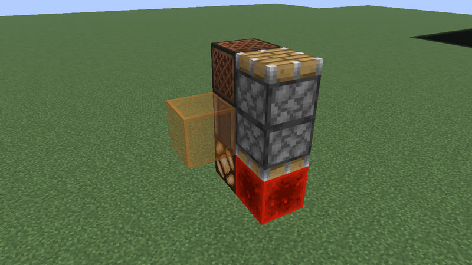</a> 12 gt (0.6 s) · note_block+observer+piston+redstone_block+redstone_lamp+sticky_piston · 6 blocks</td><td align="center"><a href="../archive/clk-obs-p12-note-obs-pis-rb-stk-6b-2a843e.txt">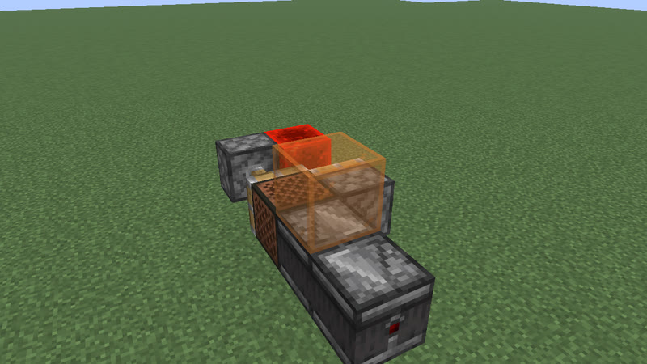</a> 12 gt (0.6 s) · note_block+observer+piston+redstone_block+sticky_piston · 6 blocks</td><td align="center"><a href="../archive/clk-obs-p12-note-obs-pis-rb-stk-6b-b-21aad8.txt">clk-obs-p12-note-obs-pis-rb-stk-6b-b-21aad8</a> 12 gt (0.6 s) · note_block+observer+piston+redstone_block+sticky_piston · 6 blocks (picture pending)</td></tr>
<tr><td align="center"><a href="../archive/clk-obs-p12-bulb-obs-rb-stk-6b-b-ed4598.txt">clk-obs-p12-bulb-obs-rb-stk-6b-b-ed4598</a> 12 gt (0.6 s) · copper_bulb+observer+redstone_block+sticky_piston · 6 blocks (picture pending)</td><td align="center"><a href="../archive/clk-obs-p12-lamp-note-obs-pis-rb-stk-6b-b-57d151.txt">clk-obs-p12-lamp-note-obs-pis-rb-stk-6b-b-57d151</a> 12 gt (0.6 s) · note_block+observer+piston+redstone_block+redstone_lamp+sticky_piston · 6 blocks (picture pending)</td><td align="center"><a href="../archive/clk-obs-p12-lamp-obs-pis-6b-b-82a028.txt">clk-obs-p12-lamp-obs-pis-6b-b-82a028</a> 12 gt (0.6 s) · observer+piston+redstone_lamp · 6 blocks (picture pending)</td></tr>
<tr><td align="center"> 12 gt (0.6 s) · comparator+redstone_torch+repeater · 8 blocks</td><td align="center"> 12 gt (0.6 s) · redstone_torch+repeater · 8 blocks</td><td align="center"><a href="../archive/clk-rt-tr-9-12.txt">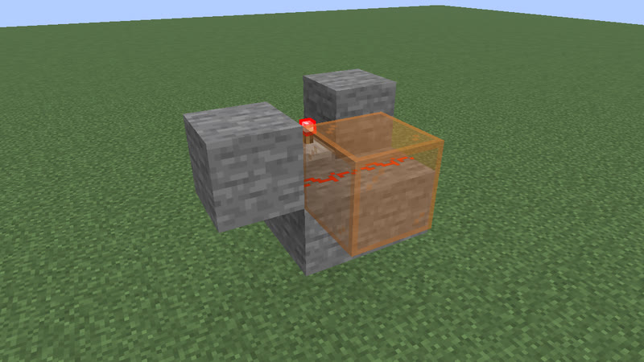</a> 12 gt (0.6 s) · redstone_torch+redstone_wire+repeater · 9 blocks</td></tr>
<tr><td align="center"> 12 gt (0.6 s) · comparator+redstone_torch+redstone_wire · 9 blocks</td><td align="center"><a href="../archive/clk-rt-uloop-p12-c-rt-rw-r-9b.txt">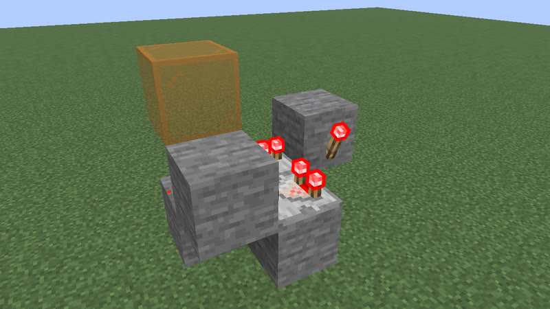</a> 12 gt (0.6 s) · comparator+redstone_torch+redstone_wire+repeater · 9 blocks</td><td align="center"><a href="../archive/clk-rt-uloop-p12-rt-rw-r-9b.txt">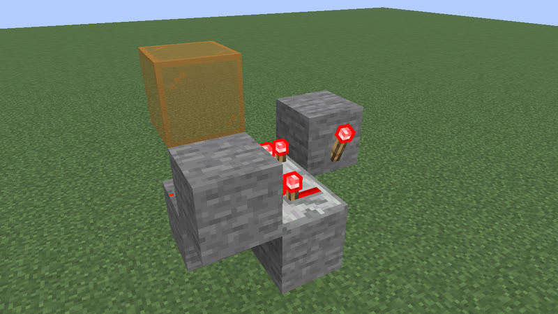</a> 12 gt (0.6 s) · redstone_torch+redstone_wire+repeater · 9 blocks</td></tr>
<tr><td align="center"> 12 gt (0.6 s) · redstone_wire+repeater · 10 blocks</td><td align="center"> 12 gt (0.6 s) · comparator+redstone_torch · 12 blocks</td><td align="center"> 12 gt (0.6 s) · comparator+repeater · 12 blocks</td></tr>
<tr><td align="center"> 12 gt (0.6 s) · repeater · 12 blocks</td><td align="center"><a href="../archive/clk-rt-ring3x3-p12-c-rw-r-13b.txt">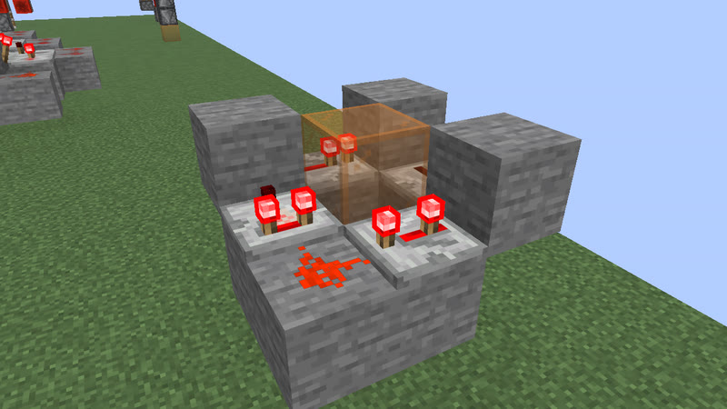</a> 12 gt (0.6 s) · comparator+redstone_wire+repeater · 13 blocks</td><td align="center"> 12 gt (0.6 s) · comparator+redstone_wire+repeater · 14 blocks</td></tr>
<tr><td align="center"> 12 gt (0.6 s) · redstone_torch+redstone_wire · 14 blocks</td><td align="center"> 12 gt (0.6 s) · comparator · 16 blocks</td></tr>
</table>

## 13 gt (0.65 s)

Also reachable by: clk-item-lockpair (n = 1), clk-obs-odd-b (n = 0).

<table>
<tr><td align="center"> 13 gt (0.65 s) · observer+piston · 4 blocks</td><td align="center"><a href="../archive/clk-obs-p13-obs-pis-stk-4b-b-cd9fda.txt">clk-obs-p13-obs-pis-stk-4b-b-cd9fda</a> 13 gt (0.65 s) · observer+piston+sticky_piston · 4 blocks (picture pending)</td><td align="center"><a href="../archive/clk-obs-p13-obs-pis-stk-4b-df95ac.txt">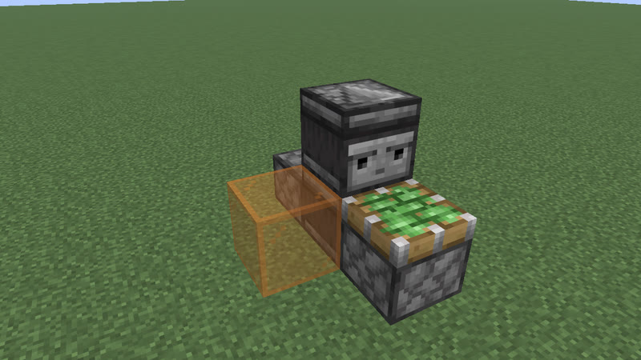</a> 13 gt (0.65 s) · observer+piston+sticky_piston · 4 blocks</td></tr>
<tr><td align="center"> 13 gt (0.65 s) · observer+sticky_piston · 4 blocks</td><td align="center"> 13 gt (0.65 s) · observer+piston · 4 blocks</td><td align="center"><a href="../archive/clk-obs-p13-obs-stk-4b-b-ce4e6f.txt">clk-obs-p13-obs-stk-4b-b-ce4e6f</a> 13 gt (0.65 s) · observer+sticky_piston · 4 blocks (picture pending)</td></tr>
<tr><td align="center"><a href="../archive/clk-obs-p13-note-obs-pis-5b-b-3e1c80.txt">clk-obs-p13-note-obs-pis-5b-b-3e1c80</a> 13 gt (0.65 s) · note_block+observer+piston · 5 blocks (picture pending)</td><td align="center"><a href="../archive/clk-obs-p13-note-obs-pis-5b-cb0e58.txt">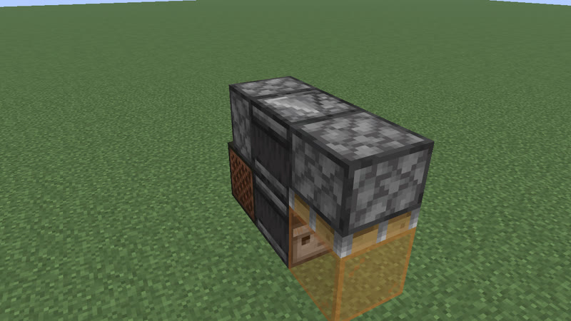</a> 13 gt (0.65 s) · note_block+observer+piston · 5 blocks</td><td align="center"><a href="../archive/clk-obs-p13-note-obs-pis-stk-5b-b-4493f4.txt">clk-obs-p13-note-obs-pis-stk-5b-b-4493f4</a> 13 gt (0.65 s) · note_block+observer+piston+sticky_piston · 5 blocks (picture pending)</td></tr>
<tr><td align="center"><a href="../archive/clk-obs-p13-note-obs-pis-stk-5b-be9c8e.txt">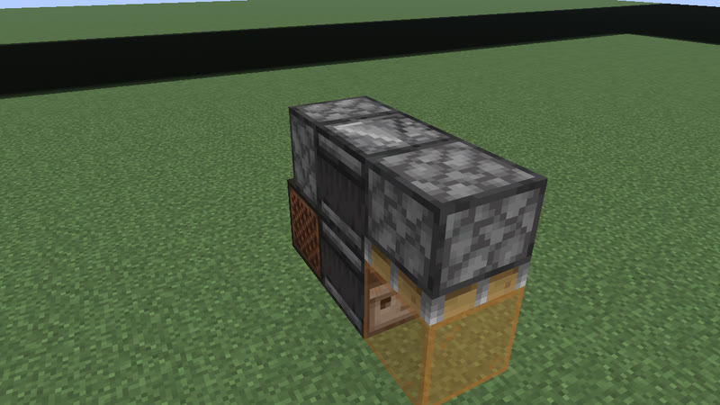</a> 13 gt (0.65 s) · note_block+observer+piston+sticky_piston · 5 blocks</td><td align="center"><a href="../archive/clk-obs-p13-note-obs-stk-5b-214e4f.txt">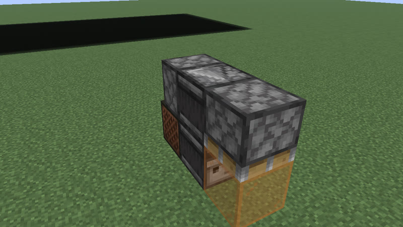</a> 13 gt (0.65 s) · note_block+observer+sticky_piston · 5 blocks</td><td align="center"><a href="../archive/clk-obs-p13-note-obs-stk-5b-b-a62286.txt">clk-obs-p13-note-obs-stk-5b-b-a62286</a> 13 gt (0.65 s) · note_block+observer+sticky_piston · 5 blocks (picture pending)</td></tr>
<tr><td align="center"> 13 gt (0.65 s) · observer+piston+redstone_block+sticky_piston · 5 blocks</td><td align="center"> 13 gt (0.65 s) · observer+redstone_block+sticky_piston · 5 blocks</td><td align="center"> 13 gt (0.65 s) · observer+redstone_lamp+sticky_piston · 6 blocks</td></tr>
<tr><td align="center"><a href="../archive/clk-obs-p13-note-obs-pis-rb-stk-6b-6159cd.txt">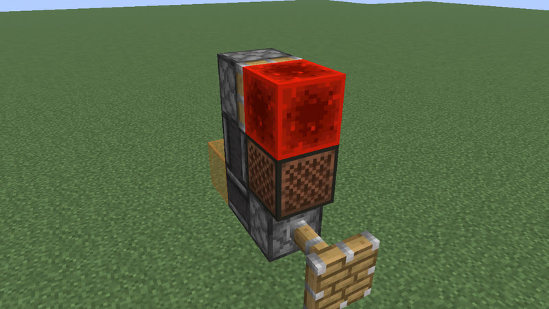</a> 13 gt (0.65 s) · note_block+observer+piston+redstone_block+sticky_piston · 6 blocks</td><td align="center"><a href="../archive/clk-obs-p13-note-obs-rb-stk-6b-ea4296.txt">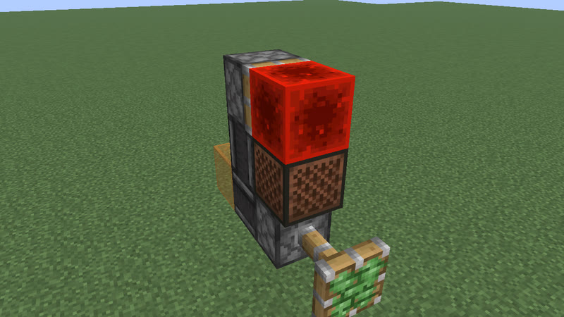</a> 13 gt (0.65 s) · note_block+observer+redstone_block+sticky_piston · 6 blocks</td><td align="center"><a href="../archive/clk-obs-p13-lamp-obs-stk-6b-b-b07de3.txt">clk-obs-p13-lamp-obs-stk-6b-b-b07de3</a> 13 gt (0.65 s) · observer+redstone_lamp+sticky_piston · 6 blocks (picture pending)</td></tr>
<tr><td align="center"> 13 gt (0.65 s) · observer+piston+redstone_lamp+sticky_piston · 6 blocks</td><td align="center"><a href="../archive/clk-obs-p13-lamp-note-obs-pis-stk-7b-28f5b1.txt">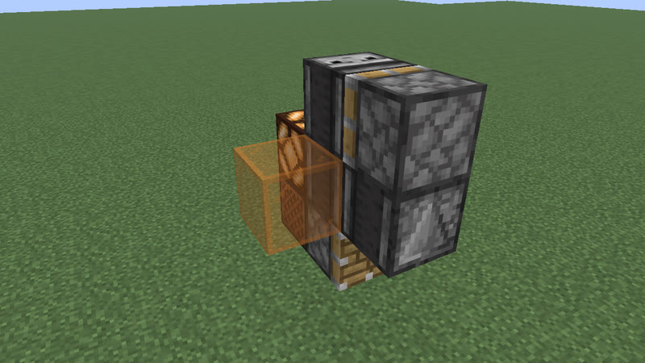</a> 13 gt (0.65 s) · note_block+observer+piston+redstone_lamp+sticky_piston · 7 blocks</td><td align="center"><a href="../archive/clk-obs-p13-lamp-note-obs-pis-stk-7b-b-db92d3.txt">clk-obs-p13-lamp-note-obs-pis-stk-7b-b-db92d3</a> 13 gt (0.65 s) · note_block+observer+piston+redstone_lamp+sticky_piston · 7 blocks (picture pending)</td></tr>
<tr><td align="center"><a href="../archive/clk-obs-p13-lamp-note-obs-stk-7b-b-81c291.txt">clk-obs-p13-lamp-note-obs-stk-7b-b-81c291</a> 13 gt (0.65 s) · note_block+observer+redstone_lamp+sticky_piston · 7 blocks (picture pending)</td><td align="center"><a href="../archive/clk-obs-p13-lamp-note-obs-stk-7b-ec9622.txt">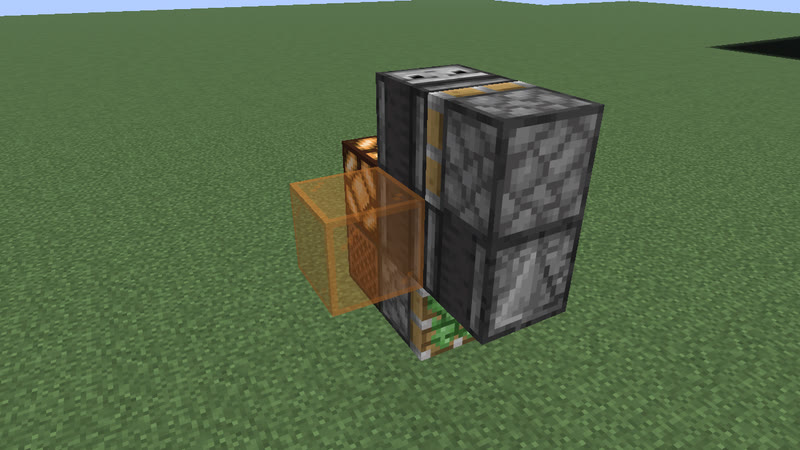</a> 13 gt (0.65 s) · note_block+observer+redstone_lamp+sticky_piston · 7 blocks</td><td align="center"> 13 gt (0.65 s) · comparator+hopper+redstone_torch+redstone_wire · 9 blocks</td></tr>
<tr><td align="center"> 13 gt (0.65 s) · comparator+hopper+redstone_torch+redstone_wire · 9 blocks</td><td align="center"> 13 gt (0.65 s) · redstone_wire+repeater · 16 blocks</td><td align="center"><a href="../archive/clk-rt-uloop0t-C-3--3-3-2-1-1-d-kick-p13.txt">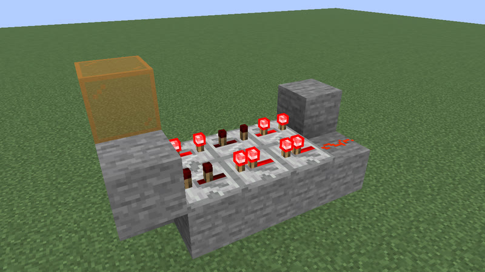</a> 13 gt (0.65 s) · redstone_wire+repeater · 18 blocks</td></tr>
</table>

## 14 gt (0.7 s)

Also reachable by: clk-misc-activator_rail-ring (n = 1), clk-misc-crafter-ring (n = 1), clk-misc-iron_door-ring (n = 1), clk-misc-oak_door-ring (n = 1), clk-misc-oak_fence_gate-ring (n = 1), clk-misc-oak_trapdoor-ring (n = 1), clk-misc-powered_rail-ring (n = 1), clk-misc-skeleton_skull-ring (n = 1), clk-obs-note-ring (n = 1), clk-obs-trap-ring (n = 1), clk-item-hopper-ring (n = 0), clk-item-hopper-ring-2 (n = 1).

<table>
<tr><td align="center"> 14 gt (0.7 s) · comparator+hopper · 4 blocks</td><td align="center"> 14 gt (0.7 s) · copper_bulb+redstone_lamp+sticky_piston · 5 blocks</td><td align="center"> 14 gt (0.7 s) · copper_bulb+sticky_piston · 5 blocks</td></tr>
<tr><td align="center"><a href="../archive/clk-obs-p14-bulb-stk-5b-b-c54746.txt">clk-obs-p14-bulb-stk-5b-b-c54746</a> 14 gt (0.7 s) · copper_bulb+sticky_piston · 5 blocks (picture pending)</td><td align="center"> 14 gt (0.7 s) · copper_bulb+observer+redstone_lamp+sticky_piston · 5 blocks</td><td align="center"><a href="../archive/clk-obs-p14-bulb-lamp-obs-stk-5b-b-43a9ff.txt">clk-obs-p14-bulb-lamp-obs-stk-5b-b-43a9ff</a> 14 gt (0.7 s) · copper_bulb+observer+redstone_lamp+sticky_piston · 5 blocks (picture pending)</td></tr>
<tr><td align="center"><a href="../archive/clk-obs-p14-bulb-lamp-stk-5b-b-778eb3.txt">clk-obs-p14-bulb-lamp-stk-5b-b-778eb3</a> 14 gt (0.7 s) · copper_bulb+redstone_lamp+sticky_piston · 5 blocks (picture pending)</td><td align="center"> 14 gt (0.7 s) · copper_bulb+note_block+observer+sticky_piston · 5 blocks</td><td align="center"> 14 gt (0.7 s) · copper_bulb+note_block+sticky_piston · 5 blocks</td></tr>
<tr><td align="center"> 14 gt (0.7 s) · copper_bulb+observer+sticky_piston · 5 blocks</td><td align="center"><a href="../archive/clk-obs-p14-bulb-obs-stk-5b-b-4b0be1.txt">clk-obs-p14-bulb-obs-stk-5b-b-4b0be1</a> 14 gt (0.7 s) · copper_bulb+observer+sticky_piston · 5 blocks (picture pending)</td><td align="center"> 14 gt (0.7 s) · observer+redstone_lamp+sticky_piston · 5 blocks</td></tr>
<tr><td align="center"><a href="../archive/clk-obs-p14-lamp-obs-stk-5b-b-027311.txt">clk-obs-p14-lamp-obs-stk-5b-b-027311</a> 14 gt (0.7 s) · observer+redstone_lamp+sticky_piston · 5 blocks (picture pending)</td><td align="center"> 14 gt (0.7 s) · note_block+observer+sticky_piston · 5 blocks</td><td align="center"> 14 gt (0.7 s) · observer+piston · 5 blocks</td></tr>
<tr><td align="center"> 14 gt (0.7 s) · observer+piston · 5 blocks</td><td align="center"><a href="../archive/clk-obs-p14-obs-pis-stk-5b-b-f03e8a.txt">clk-obs-p14-obs-pis-stk-5b-b-f03e8a</a> 14 gt (0.7 s) · observer+piston+sticky_piston · 5 blocks (picture pending)</td><td align="center"><a href="../archive/clk-obs-p14-obs-pis-stk-5b-edbcf8.txt">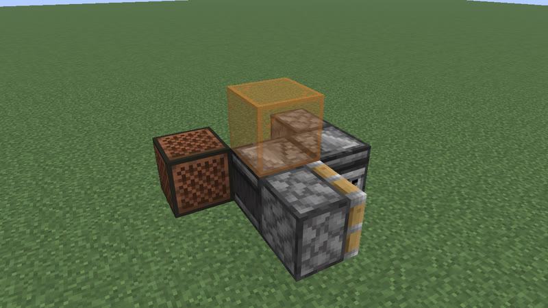</a> 14 gt (0.7 s) · observer+piston+sticky_piston · 5 blocks</td></tr>
<tr><td align="center"> 14 gt (0.7 s) · observer+sticky_piston · 5 blocks</td><td align="center"><a href="../archive/clk-obs-p14-obs-stk-5b-b-c163e9.txt">clk-obs-p14-obs-stk-5b-b-c163e9</a> 14 gt (0.7 s) · observer+sticky_piston · 5 blocks (picture pending)</td><td align="center"><a href="../archive/clk-obs-p14-bulb-lamp-obs-6b-b-852bbb.txt">clk-obs-p14-bulb-lamp-obs-6b-b-852bbb</a> 14 gt (0.7 s) · copper_bulb+observer+redstone_lamp · 6 blocks (picture pending)</td></tr>
<tr><td align="center"> 14 gt (0.7 s) · copper_bulb+observer+redstone_lamp · 6 blocks</td><td align="center"> 14 gt (0.7 s) · note_block+observer+redstone_lamp · 6 blocks</td><td align="center"><a href="../archive/clk-obs-p14-lamp-note-obs-6b-b-93cd4d.txt">clk-obs-p14-lamp-note-obs-6b-b-93cd4d</a> 14 gt (0.7 s) · note_block+observer+redstone_lamp · 6 blocks (picture pending)</td></tr>
<tr><td align="center"> 14 gt (0.7 s) · observer+redstone_lamp · 6 blocks</td><td align="center"><a href="../archive/clk-obs-p14-lamp-obs-6b-b-ba20d3.txt">clk-obs-p14-lamp-obs-6b-b-ba20d3</a> 14 gt (0.7 s) · observer+redstone_lamp · 6 blocks (picture pending)</td><td align="center"><a href="../archive/clk-obs-p14-bulb-note-obs-stk-6b-b-cf304d.txt">clk-obs-p14-bulb-note-obs-stk-6b-b-cf304d</a> 14 gt (0.7 s) · copper_bulb+note_block+observer+sticky_piston · 6 blocks (picture pending)</td></tr>
<tr><td align="center"><a href="../archive/clk-obs-p14-lamp-note-obs-pis-6b-055e14.txt">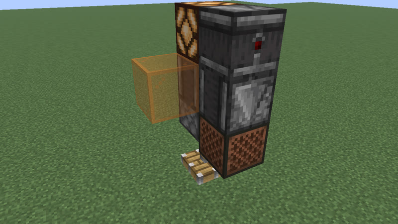</a> 14 gt (0.7 s) · note_block+observer+piston+redstone_lamp · 6 blocks</td><td align="center"> 14 gt (0.7 s) · note_block+observer+redstone_lamp+sticky_piston · 6 blocks</td><td align="center"><a href="../archive/clk-obs-p14-lamp-note-obs-stk-6b-b-185cd2.txt">clk-obs-p14-lamp-note-obs-stk-6b-b-185cd2</a> 14 gt (0.7 s) · note_block+observer+redstone_lamp+sticky_piston · 6 blocks (picture pending)</td></tr>
<tr><td align="center"> 14 gt (0.7 s) · observer+piston+redstone_lamp · 6 blocks</td><td align="center"><a href="../archive/clk-obs-p14-lamp-obs-pis-6b-b-7c993d.txt">clk-obs-p14-lamp-obs-pis-6b-b-7c993d</a> 14 gt (0.7 s) · observer+piston+redstone_lamp · 6 blocks (picture pending)</td><td align="center"><a href="../archive/clk-obs-p14-note-obs-pis-6b-739d19.txt">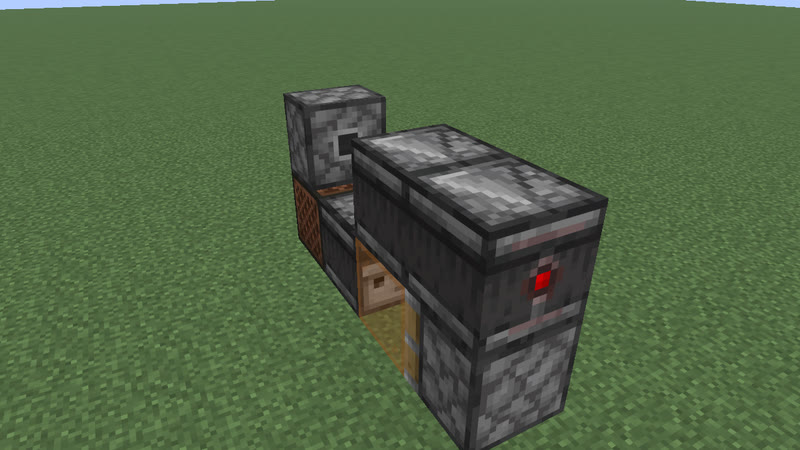</a> 14 gt (0.7 s) · note_block+observer+piston · 6 blocks</td></tr>
<tr><td align="center"><a href="../archive/clk-obs-p14-bulb-note-stk-6b-b-ffca79.txt">clk-obs-p14-bulb-note-stk-6b-b-ffca79</a> 14 gt (0.7 s) · copper_bulb+note_block+sticky_piston · 6 blocks (picture pending)</td><td align="center"><a href="../archive/clk-obs-p14-lamp-note-obs-pis-6b-b-3fbae2.txt">clk-obs-p14-lamp-note-obs-pis-6b-b-3fbae2</a> 14 gt (0.7 s) · note_block+observer+piston+redstone_lamp · 6 blocks (picture pending)</td><td align="center"><a href="../archive/clk-obs-p14-lamp-note-obs-rb-stk-6b-b-f8a0e7.txt">clk-obs-p14-lamp-note-obs-rb-stk-6b-b-f8a0e7</a> 14 gt (0.7 s) · note_block+observer+redstone_block+redstone_lamp+sticky_piston · 6 blocks (picture pending)</td></tr>
<tr><td align="center"><a href="../archive/clk-obs-p14-lamp-note-obs-rb-stk-6b-e4d7df.txt">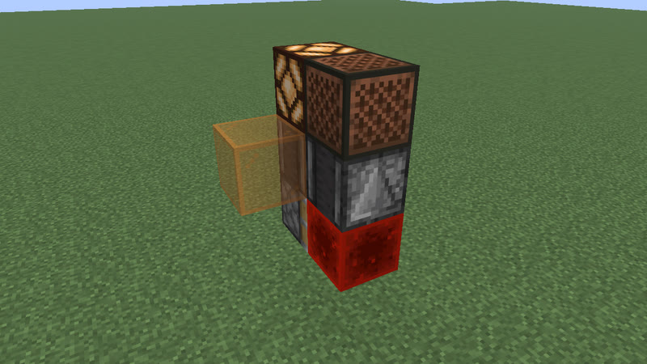</a> 14 gt (0.7 s) · note_block+observer+redstone_block+redstone_lamp+sticky_piston · 6 blocks</td><td align="center"> 14 gt (0.7 s) · observer+piston+redstone_lamp+sticky_piston · 6 blocks</td><td align="center"><a href="../archive/clk-obs-p14-lamp-obs-rb-stk-6b-b-0e0eb7.txt">clk-obs-p14-lamp-obs-rb-stk-6b-b-0e0eb7</a> 14 gt (0.7 s) · observer+redstone_block+redstone_lamp+sticky_piston · 6 blocks (picture pending)</td></tr>
<tr><td align="center"> 14 gt (0.7 s) · observer+redstone_block+redstone_lamp+sticky_piston · 6 blocks</td><td align="center"><a href="../archive/clk-obs-p14-note-obs-pis-6b-b-57f56e.txt">clk-obs-p14-note-obs-pis-6b-b-57f56e</a> 14 gt (0.7 s) · note_block+observer+piston · 6 blocks (picture pending)</td><td align="center"><a href="../archive/clk-obs-p14-note-obs-pis-stk-6b-af32ba.txt">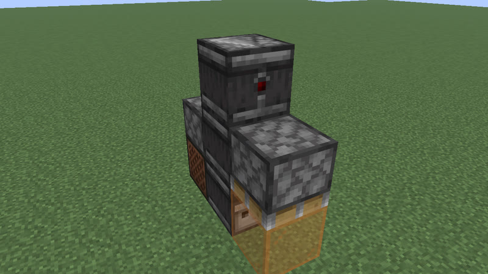</a> 14 gt (0.7 s) · note_block+observer+piston+sticky_piston · 6 blocks</td></tr>
<tr><td align="center"><a href="../archive/clk-obs-p14-note-obs-pis-stk-6b-b-01d0f0.txt">clk-obs-p14-note-obs-pis-stk-6b-b-01d0f0</a> 14 gt (0.7 s) · note_block+observer+piston+sticky_piston · 6 blocks (picture pending)</td><td align="center"><a href="../archive/clk-obs-p14-note-obs-stk-6b-b-f1b258.txt">clk-obs-p14-note-obs-stk-6b-b-f1b258</a> 14 gt (0.7 s) · note_block+observer+sticky_piston · 6 blocks (picture pending)</td><td align="center"> 14 gt (0.7 s) · observer+piston+redstone_block+sticky_piston · 6 blocks</td></tr>
<tr><td align="center"> 14 gt (0.7 s) · observer+redstone_block+sticky_piston · 6 blocks</td><td align="center"><a href="../archive/clk-obs-p14-lamp-note-obs-pis-stk-6b-e500b7.txt">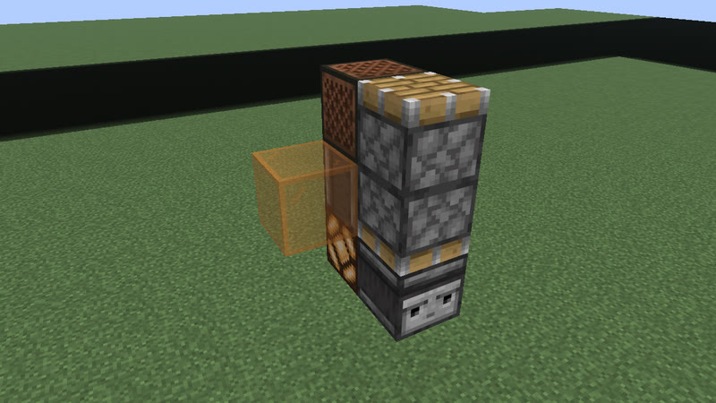</a> 14 gt (0.7 s) · note_block+observer+piston+redstone_lamp+sticky_piston · 6 blocks</td><td align="center"><a href="../archive/clk-obs-p14-lamp-note-obs-pis-stk-6b-b-764714.txt">clk-obs-p14-lamp-note-obs-pis-stk-6b-b-764714</a> 14 gt (0.7 s) · note_block+observer+piston+redstone_lamp+sticky_piston · 6 blocks (picture pending)</td></tr>
<tr><td align="center"><a href="../archive/clk-obs-p14-obs-pis-rb-stk-6b-b-9e23f0.txt">clk-obs-p14-obs-pis-rb-stk-6b-b-9e23f0</a> 14 gt (0.7 s) · observer+piston+redstone_block+sticky_piston · 6 blocks (picture pending)</td><td align="center"><a href="../archive/clk-obs-p14-obs-rb-stk-6b-b-45cebd.txt">clk-obs-p14-obs-rb-stk-6b-b-45cebd</a> 14 gt (0.7 s) · observer+redstone_block+sticky_piston · 6 blocks (picture pending)</td><td align="center"> 14 gt (0.7 s) · copper_bulb+note_block+observer+piston+sticky_piston · 6 blocks</td></tr>
<tr><td align="center"><a href="../archive/clk-obs-p14-note-obs-pis-rb-stk-7b-1c2936.txt">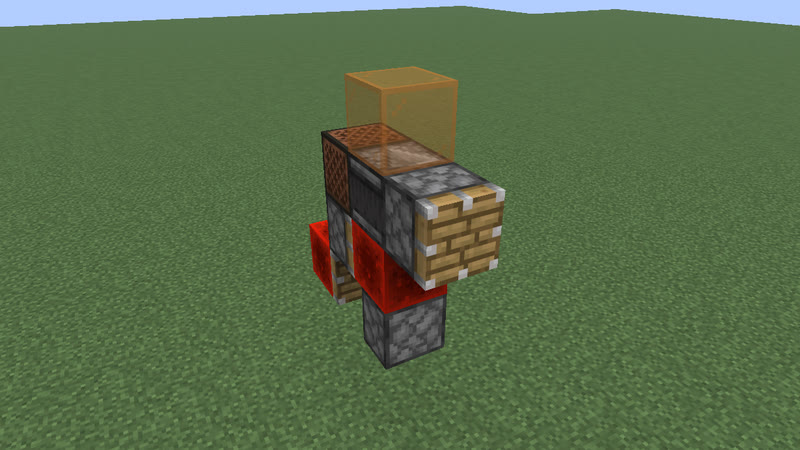</a> 14 gt (0.7 s) · note_block+observer+piston+redstone_block+sticky_piston · 7 blocks</td><td align="center"><a href="../archive/clk-obs-p14-note-obs-rb-stk-7b-965076.txt">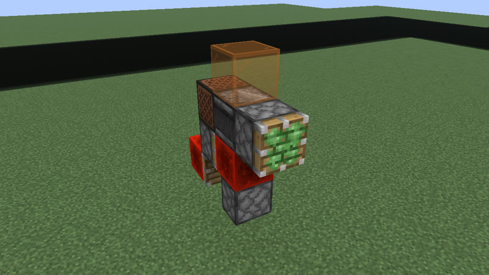</a> 14 gt (0.7 s) · note_block+observer+redstone_block+sticky_piston · 7 blocks</td><td align="center"><a href="../archive/clk-obs-p14-bulb-lamp-obs-pis-stk-7b-25eb07.txt">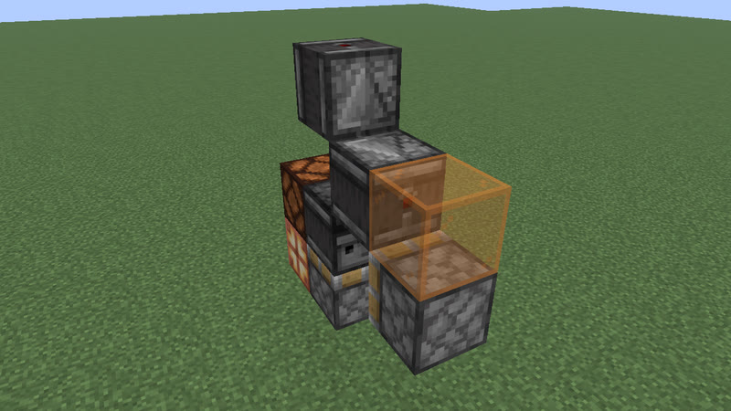</a> 14 gt (0.7 s) · copper_bulb+observer+piston+redstone_lamp+sticky_piston · 7 blocks</td></tr>
<tr><td align="center"> 14 gt (0.7 s) · redstone_torch+repeater · 8 blocks</td><td align="center"><a href="../archive/clk-obs-p14-note-obs-10b-b-ba58a1.txt">clk-obs-p14-note-obs-10b-b-ba58a1</a> 14 gt (0.7 s) · note_block+observer · 10 blocks (picture pending)</td><td align="center"><a href="../archive/clk-obs-p14-obs-trap-10b-b-d04679.txt">clk-obs-p14-obs-trap-10b-b-d04679</a> 14 gt (0.7 s) · iron_trapdoor+observer · 10 blocks (picture pending)</td></tr>
<tr><td align="center"><a href="../archive/clk-rt-uloop-p14-c-rt-r-12b.txt">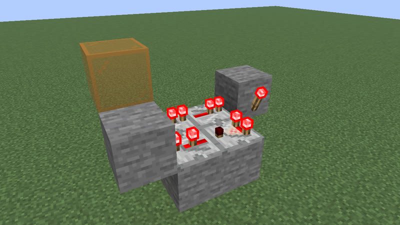</a> 14 gt (0.7 s) · comparator+redstone_torch+repeater · 12 blocks</td><td align="center"><a href="../archive/clk-rt-uloop-p14-c-rt-rw-r-12b.txt">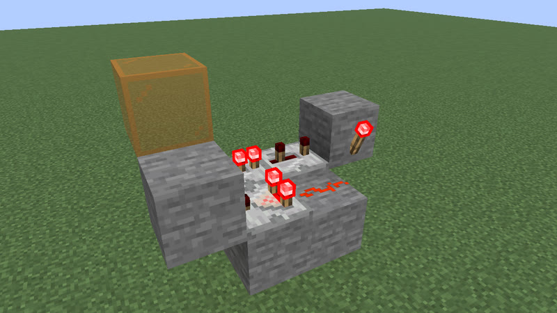</a> 14 gt (0.7 s) · comparator+redstone_torch+redstone_wire+repeater · 12 blocks</td><td align="center"><a href="../archive/clk-rt-uloop-p14-rt-rw-r-12b.txt">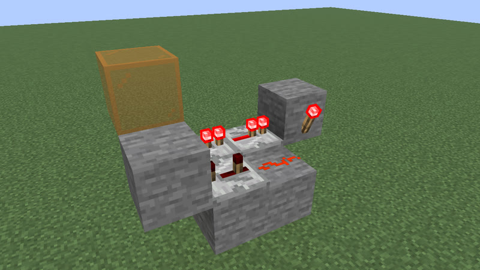</a> 14 gt (0.7 s) · redstone_torch+redstone_wire+repeater · 12 blocks</td></tr>
<tr><td align="center"> 14 gt (0.7 s) · comparator+repeater · 12 blocks</td><td align="center"> 14 gt (0.7 s) · repeater · 12 blocks</td><td align="center"><a href="../archive/clk-rt-ring3x3-p14-rt-rw-r-12b.txt">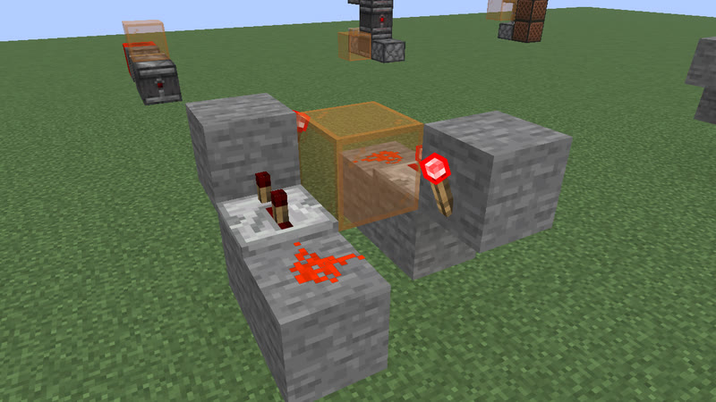</a> 14 gt (0.7 s) · redstone_torch+redstone_wire+repeater · 12 blocks</td></tr>
<tr><td align="center"><a href="../archive/clk-rt-ring3x3-p14-c-rw-r-13b.txt">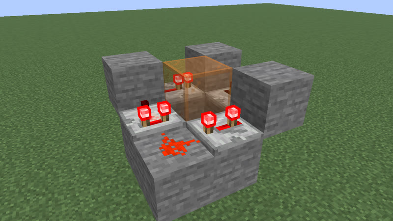</a> 14 gt (0.7 s) · comparator+redstone_wire+repeater · 13 blocks</td><td align="center"><a href="../archive/clk-rt-ring3x3-p14-rw-r-13b.txt">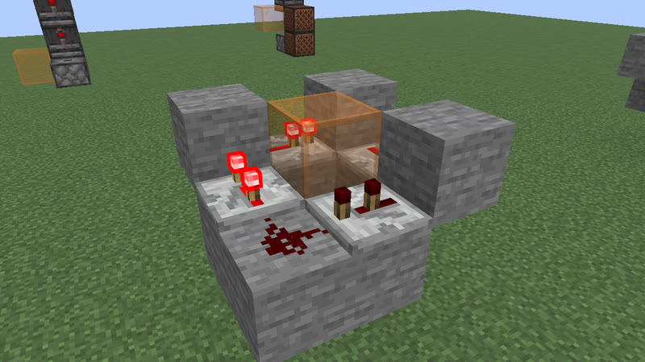</a> 14 gt (0.7 s) · redstone_wire+repeater · 13 blocks</td><td align="center"><a href="../archive/clk-rt-uloop-p14-c-rw-r-14b.txt">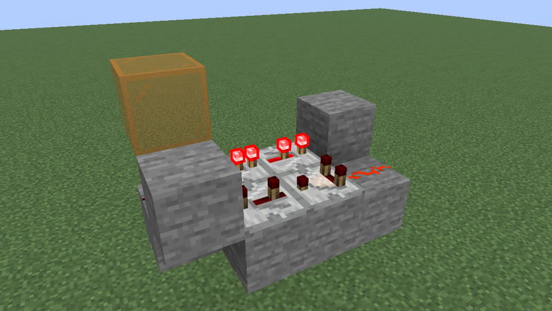</a> 14 gt (0.7 s) · comparator+redstone_wire+repeater · 14 blocks</td></tr>
<tr><td align="center"><a href="../archive/clk-rt-uloop-p14-rw-r-14b.txt">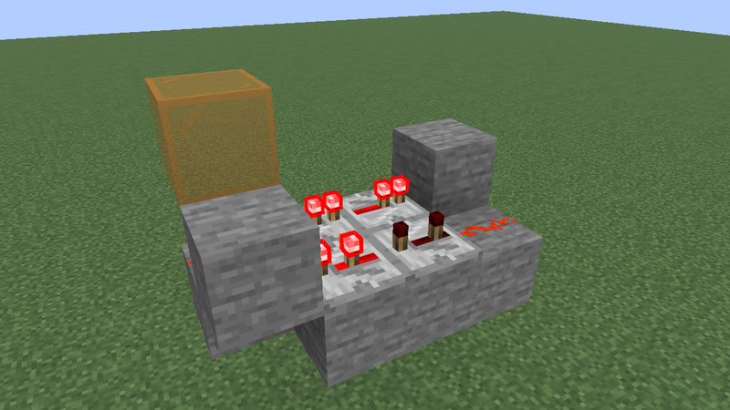</a> 14 gt (0.7 s) · redstone_wire+repeater · 14 blocks</td></tr>
</table>

## 15 gt (0.75 s)

Also reachable by: clk-item-lockpair (n = 2), clk-obs-odd-a (n = 1).

<table>
<tr><td align="center"> 15 gt (0.75 s) · note_block+observer+piston+redstone_lamp · 5 blocks</td><td align="center"><a href="../archive/clk-obs-p15-lamp-note-obs-pis-5b-b-e22665.txt">clk-obs-p15-lamp-note-obs-pis-5b-b-e22665</a> 15 gt (0.75 s) · note_block+observer+piston+redstone_lamp · 5 blocks (picture pending)</td><td align="center"><a href="../archive/clk-obs-p15-lamp-note-obs-stk-5b-b-66d58d.txt">clk-obs-p15-lamp-note-obs-stk-5b-b-66d58d</a> 15 gt (0.75 s) · note_block+observer+redstone_lamp+sticky_piston · 5 blocks (picture pending)</td></tr>
<tr><td align="center"> 15 gt (0.75 s) · note_block+observer+redstone_lamp+sticky_piston · 5 blocks</td><td align="center"> 15 gt (0.75 s) · observer+piston+redstone_lamp · 5 blocks</td><td align="center"> 15 gt (0.75 s) · observer+piston+redstone_lamp · 5 blocks</td></tr>
<tr><td align="center"><a href="../archive/clk-obs-p15-lamp-obs-stk-5b-b-e9847b.txt">clk-obs-p15-lamp-obs-stk-5b-b-e9847b</a> 15 gt (0.75 s) · observer+redstone_lamp+sticky_piston · 5 blocks (picture pending)</td><td align="center"><a href="../archive/clk-obs-p15-lamp-obs-stk-5b-fb17dd.txt">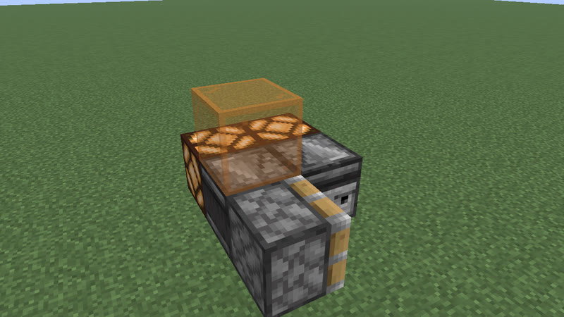</a> 15 gt (0.75 s) · observer+redstone_lamp+sticky_piston · 5 blocks</td><td align="center"> 15 gt (0.75 s) · observer+redstone_block+sticky_piston · 5 blocks</td></tr>
<tr><td align="center"><a href="../archive/clk-obs-p15-obs-rb-stk-6b-b-c0356e.txt">clk-obs-p15-obs-rb-stk-6b-b-c0356e</a> 15 gt (0.75 s) · observer+redstone_block+sticky_piston · 6 blocks (picture pending)</td><td align="center"><a href="../archive/clk-obs-p15-obs-stk-6b-b-2febb0.txt">clk-obs-p15-obs-stk-6b-b-2febb0</a> 15 gt (0.75 s) · observer+sticky_piston · 6 blocks (picture pending)</td><td align="center"> 15 gt (0.75 s) · observer+sticky_piston · 6 blocks</td></tr>
<tr><td align="center"> 15 gt (0.75 s) · observer+piston+sticky_piston · 6 blocks</td><td align="center"> 15 gt (0.75 s) · note_block+observer+piston+sticky_piston · 6 blocks</td><td align="center"> 15 gt (0.75 s) · note_block+observer+sticky_piston · 6 blocks</td></tr>
<tr><td align="center"><a href="../archive/clk-obs-p15-obs-pis-stk-6b-b-311377.txt">clk-obs-p15-obs-pis-stk-6b-b-311377</a> 15 gt (0.75 s) · observer+piston+sticky_piston · 6 blocks (picture pending)</td><td align="center"> 15 gt (0.75 s) · copper_bulb+note_block+observer+redstone_block+sticky_piston · 7 blocks</td><td align="center"> 15 gt (0.75 s) · copper_bulb+observer+redstone_block+sticky_piston · 7 blocks</td></tr>
<tr><td align="center"> 15 gt (0.75 s) · observer+piston+redstone_block+redstone_lamp+sticky_piston · 7 blocks</td><td align="center"> 15 gt (0.75 s) · observer+redstone_block+redstone_lamp+sticky_piston · 7 blocks</td><td align="center"> 15 gt (0.75 s) · note_block+observer+piston+redstone_block+sticky_piston · 7 blocks</td></tr>
<tr><td align="center"> 15 gt (0.75 s) · note_block+observer+redstone_block+sticky_piston · 7 blocks</td><td align="center"> 15 gt (0.75 s) · observer+piston+redstone_block+sticky_piston · 7 blocks</td><td align="center"><a href="../archive/clk-obs-p15-lamp-obs-pis-rb-stk-7b-b-f6d13c.txt">clk-obs-p15-lamp-obs-pis-rb-stk-7b-b-f6d13c</a> 15 gt (0.75 s) · observer+piston+redstone_block+redstone_lamp+sticky_piston · 7 blocks (picture pending)</td></tr>
<tr><td align="center"><a href="../archive/clk-obs-p15-lamp-obs-rb-stk-7b-b-4feb68.txt">clk-obs-p15-lamp-obs-rb-stk-7b-b-4feb68</a> 15 gt (0.75 s) · observer+redstone_block+redstone_lamp+sticky_piston · 7 blocks (picture pending)</td><td align="center"><a href="../archive/clk-obs-p15-note-obs-pis-rb-stk-7b-b-560890.txt">clk-obs-p15-note-obs-pis-rb-stk-7b-b-560890</a> 15 gt (0.75 s) · note_block+observer+piston+redstone_block+sticky_piston · 7 blocks (picture pending)</td><td align="center"><a href="../archive/clk-obs-p15-note-obs-rb-stk-7b-b-af6b31.txt">clk-obs-p15-note-obs-rb-stk-7b-b-af6b31</a> 15 gt (0.75 s) · note_block+observer+redstone_block+sticky_piston · 7 blocks (picture pending)</td></tr>
<tr><td align="center"><a href="../archive/clk-obs-p15-obs-pis-rb-stk-7b-b-c7c311.txt">clk-obs-p15-obs-pis-rb-stk-7b-b-c7c311</a> 15 gt (0.75 s) · observer+piston+redstone_block+sticky_piston · 7 blocks (picture pending)</td><td align="center"> 15 gt (0.75 s) · comparator+hopper+redstone_torch+repeater · 9 blocks</td><td align="center"> 15 gt (0.75 s) · comparator+hopper · 10 blocks</td></tr>
<tr><td align="center"> 15 gt (0.75 s) · redstone_wire+repeater · 16 blocks</td><td align="center"> 15 gt (0.75 s) · redstone_wire+repeater · 18 blocks</td><td align="center"> 15 gt (0.75 s) · observer+sticky_piston+water · 24 blocks</td></tr>
</table>

## 16 gt (0.8 s)

Also reachable by: clk-obs-obs-ring (n = 2), clk-item-snowdisp (n = 0).

<table>
<tr><td align="center"> 16 gt (0.8 s) · copper_bulb+observer+redstone_block+sticky_piston · 4 blocks</td><td align="center"><a href="../archive/clk-obs-p16-bulb-note-obs-rb-stk-5b-b-6113c5.txt">clk-obs-p16-bulb-note-obs-rb-stk-5b-b-6113c5</a> 16 gt (0.8 s) · copper_bulb+note_block+observer+redstone_block+sticky_piston · 5 blocks (picture pending)</td><td align="center"> 16 gt (0.8 s) · copper_bulb+note_block+observer+redstone_block+sticky_piston · 5 blocks</td></tr>
<tr><td align="center"><a href="../archive/clk-obs-p16-bulb-obs-5b-b-65ac50.txt">clk-obs-p16-bulb-obs-5b-b-65ac50</a> 16 gt (0.8 s) · copper_bulb+observer · 5 blocks (picture pending)</td><td align="center"> 16 gt (0.8 s) · copper_bulb+observer · 5 blocks</td><td align="center"> 16 gt (0.8 s) · copper_bulb+observer+redstone_block+sticky_piston · 5 blocks</td></tr>
<tr><td align="center"> 16 gt (0.8 s) · copper_bulb+note_block+observer+sticky_piston · 5 blocks</td><td align="center"><a href="../archive/clk-obs-p16-bulb-note-obs-stk-5b-b-f40082.txt">clk-obs-p16-bulb-note-obs-stk-5b-b-f40082</a> 16 gt (0.8 s) · copper_bulb+note_block+observer+sticky_piston · 5 blocks (picture pending)</td><td align="center"> 16 gt (0.8 s) · copper_bulb+observer+piston+redstone_block+sticky_piston · 5 blocks</td></tr>
<tr><td align="center"><a href="../archive/clk-obs-p16-bulb-obs-pis-rb-stk-5b-b-e39e4a.txt">clk-obs-p16-bulb-obs-pis-rb-stk-5b-b-e39e4a</a> 16 gt (0.8 s) · copper_bulb+observer+piston+redstone_block+sticky_piston · 5 blocks (picture pending)</td><td align="center"> 16 gt (0.8 s) · observer+piston+redstone_block+sticky_piston · 5 blocks</td><td align="center"><a href="../archive/clk-obs-p16-obs-pis-rb-stk-5b-b-5555ea.txt">clk-obs-p16-obs-pis-rb-stk-5b-b-5555ea</a> 16 gt (0.8 s) · observer+piston+redstone_block+sticky_piston · 5 blocks (picture pending)</td></tr>
<tr><td align="center"> 16 gt (0.8 s) · observer+redstone_block+sticky_piston · 5 blocks</td><td align="center"><a href="../archive/clk-obs-p16-obs-rb-stk-5b-b-2a7e2e.txt">clk-obs-p16-obs-rb-stk-5b-b-2a7e2e</a> 16 gt (0.8 s) · observer+redstone_block+sticky_piston · 5 blocks (picture pending)</td><td align="center"> 16 gt (0.8 s) · note_block+observer+piston+redstone_block+sticky_piston · 5 blocks</td></tr>
<tr><td align="center"> 16 gt (0.8 s) · note_block+observer+redstone_block+sticky_piston · 5 blocks</td><td align="center"><a href="../archive/clk-obs-p16-obs-pis-stk-5b-b-3c8f6d.txt">clk-obs-p16-obs-pis-stk-5b-b-3c8f6d</a> 16 gt (0.8 s) · observer+piston+sticky_piston · 5 blocks (picture pending)</td><td align="center"> 16 gt (0.8 s) · observer+piston+sticky_piston · 5 blocks</td></tr>
<tr><td align="center"><a href="../archive/clk-obs-p16-obs-stk-5b-b-0869fe.txt">clk-obs-p16-obs-stk-5b-b-0869fe</a> 16 gt (0.8 s) · observer+sticky_piston · 5 blocks (picture pending)</td><td align="center"> 16 gt (0.8 s) · observer+sticky_piston · 5 blocks</td><td align="center"><a href="../archive/clk-obs-p16-bulb-lamp-obs-6b-b-ea82ed.txt">clk-obs-p16-bulb-lamp-obs-6b-b-ea82ed</a> 16 gt (0.8 s) · copper_bulb+observer+redstone_lamp · 6 blocks (picture pending)</td></tr>
<tr><td align="center"> 16 gt (0.8 s) · copper_bulb+observer+redstone_lamp · 6 blocks</td><td align="center"> 16 gt (0.8 s) · copper_bulb+note_block+observer · 6 blocks</td><td align="center"><a href="../archive/clk-obs-p16-bulb-note-obs-6b-b-7f2a5e.txt">clk-obs-p16-bulb-note-obs-6b-b-7f2a5e</a> 16 gt (0.8 s) · copper_bulb+note_block+observer · 6 blocks (picture pending)</td></tr>
<tr><td align="center"> 16 gt (0.8 s) · copper_bulb+note_block+observer+redstone_lamp+sticky_piston · 6 blocks</td><td align="center"> 16 gt (0.8 s) · copper_bulb+note_block+observer+piston+redstone_block+sticky_piston · 6 blocks</td><td align="center"><a href="../archive/clk-obs-p16-bulb-note-obs-pis-rb-stk-6b-b-b22f33.txt">clk-obs-p16-bulb-note-obs-pis-rb-stk-6b-b-b22f33</a> 16 gt (0.8 s) · copper_bulb+note_block+observer+piston+redstone_block+sticky_piston · 6 blocks (picture pending)</td></tr>
<tr><td align="center"> 16 gt (0.8 s) · copper_bulb+observer+piston · 6 blocks</td><td align="center"><a href="../archive/clk-obs-p16-bulb-obs-pis-6b-b-37dc23.txt">clk-obs-p16-bulb-obs-pis-6b-b-37dc23</a> 16 gt (0.8 s) · copper_bulb+observer+piston · 6 blocks (picture pending)</td><td align="center"> 16 gt (0.8 s) · copper_bulb+observer+sticky_piston · 6 blocks</td></tr>
<tr><td align="center"><a href="../archive/clk-obs-p16-bulb-obs-stk-6b-b-e9234f.txt">clk-obs-p16-bulb-obs-stk-6b-b-e9234f</a> 16 gt (0.8 s) · copper_bulb+observer+sticky_piston · 6 blocks (picture pending)</td><td align="center"> 16 gt (0.8 s) · note_block+observer+piston+sticky_piston · 6 blocks</td><td align="center"> 16 gt (0.8 s) · note_block+observer+sticky_piston · 6 blocks</td></tr>
<tr><td align="center"> 16 gt (0.8 s) · note_block+observer+redstone_lamp+sticky_piston · 6 blocks</td><td align="center"><a href="../archive/clk-obs-p16-lamp-note-obs-stk-6b-b-d79abe.txt">clk-obs-p16-lamp-note-obs-stk-6b-b-d79abe</a> 16 gt (0.8 s) · note_block+observer+redstone_lamp+sticky_piston · 6 blocks (picture pending)</td><td align="center"> 16 gt (0.8 s) · observer+redstone_lamp+sticky_piston · 6 blocks</td></tr>
<tr><td align="center"><a href="../archive/clk-obs-p16-lamp-obs-stk-6b-b-da42ae.txt">clk-obs-p16-lamp-obs-stk-6b-b-da42ae</a> 16 gt (0.8 s) · observer+redstone_lamp+sticky_piston · 6 blocks (picture pending)</td><td align="center"><a href="../archive/clk-obs-p16-note-obs-pis-rb-stk-6b-b-6fcf9a.txt">clk-obs-p16-note-obs-pis-rb-stk-6b-b-6fcf9a</a> 16 gt (0.8 s) · note_block+observer+piston+redstone_block+sticky_piston · 6 blocks (picture pending)</td><td align="center"><a href="../archive/clk-obs-p16-note-obs-pis-stk-6b-b-1f841a.txt">clk-obs-p16-note-obs-pis-stk-6b-b-1f841a</a> 16 gt (0.8 s) · note_block+observer+piston+sticky_piston · 6 blocks (picture pending)</td></tr>
<tr><td align="center"><a href="../archive/clk-obs-p16-note-obs-rb-stk-6b-b-aa28bc.txt">clk-obs-p16-note-obs-rb-stk-6b-b-aa28bc</a> 16 gt (0.8 s) · note_block+observer+redstone_block+sticky_piston · 6 blocks (picture pending)</td><td align="center"><a href="../archive/clk-obs-p16-note-obs-stk-6b-b-2deee2.txt">clk-obs-p16-note-obs-stk-6b-b-2deee2</a> 16 gt (0.8 s) · note_block+observer+sticky_piston · 6 blocks (picture pending)</td><td align="center"><a href="../archive/clk-obs-p16-bulb-lamp-note-obs-stk-6b-b-683459.txt">clk-obs-p16-bulb-lamp-note-obs-stk-6b-b-683459</a> 16 gt (0.8 s) · copper_bulb+note_block+observer+redstone_lamp+sticky_piston · 6 blocks (picture pending)</td></tr>
<tr><td align="center"> 16 gt (0.8 s) · copper_bulb+note_block+observer+piston+sticky_piston · 6 blocks</td><td align="center"> 16 gt (0.8 s) · observer+redstone_block+redstone_lamp+sticky_piston · 6 blocks</td><td align="center"><a href="../archive/clk-obs-p16-bulb-obs-pis-stk-6b-b-bebdf5.txt">clk-obs-p16-bulb-obs-pis-stk-6b-b-bebdf5</a> 16 gt (0.8 s) · copper_bulb+observer+piston+sticky_piston · 6 blocks (picture pending)</td></tr>
<tr><td align="center"> 16 gt (0.8 s) · copper_bulb+observer+piston+sticky_piston · 6 blocks</td><td align="center"><a href="../archive/clk-obs-p16-lamp-obs-rb-stk-6b-b-7a58ec.txt">clk-obs-p16-lamp-obs-rb-stk-6b-b-7a58ec</a> 16 gt (0.8 s) · observer+redstone_block+redstone_lamp+sticky_piston · 6 blocks (picture pending)</td><td align="center"> 16 gt (0.8 s) · copper_bulb+observer+redstone_block+redstone_lamp+sticky_piston · 7 blocks</td></tr>
<tr><td align="center"> 16 gt (0.8 s) · note_block+observer+piston · 7 blocks</td><td align="center"><a href="../archive/clk-obs-p16-note-obs-pis-7b-b-e720c7.txt">clk-obs-p16-note-obs-pis-7b-b-e720c7</a> 16 gt (0.8 s) · note_block+observer+piston · 7 blocks (picture pending)</td><td align="center"> 16 gt (0.8 s) · note_block+observer+redstone_block+redstone_lamp+sticky_piston · 7 blocks</td></tr>
<tr><td align="center"><a href="../archive/clk-obs-p16-lamp-note-obs-rb-stk-7b-b-02754a.txt">clk-obs-p16-lamp-note-obs-rb-stk-7b-b-02754a</a> 16 gt (0.8 s) · note_block+observer+redstone_block+redstone_lamp+sticky_piston · 7 blocks (picture pending)</td><td align="center"> 16 gt (0.8 s) · observer+piston · 7 blocks</td><td align="center"> 16 gt (0.8 s) · copper_bulb+observer+piston+redstone_lamp · 7 blocks</td></tr>
<tr><td align="center"><a href="../archive/clk-obs-p16-bulb-lamp-obs-pis-7b-b-3490f1.txt">clk-obs-p16-bulb-lamp-obs-pis-7b-b-3490f1</a> 16 gt (0.8 s) · copper_bulb+observer+piston+redstone_lamp · 7 blocks (picture pending)</td><td align="center"> 16 gt (0.8 s) · copper_bulb+observer+piston+redstone_lamp+sticky_piston · 7 blocks</td><td align="center"><a href="../archive/clk-obs-p16-bulb-lamp-obs-rb-stk-7b-b-c7c2ec.txt">clk-obs-p16-bulb-lamp-obs-rb-stk-7b-b-c7c2ec</a> 16 gt (0.8 s) · copper_bulb+observer+redstone_block+redstone_lamp+sticky_piston · 7 blocks (picture pending)</td></tr>
<tr><td align="center"> 16 gt (0.8 s) · copper_bulb+observer+redstone_lamp+sticky_piston · 7 blocks</td><td align="center"><a href="../archive/clk-obs-p16-bulb-note-obs-pis-stk-7b-b-bd19a2.txt">clk-obs-p16-bulb-note-obs-pis-stk-7b-b-bd19a2</a> 16 gt (0.8 s) · copper_bulb+note_block+observer+piston+sticky_piston · 7 blocks (picture pending)</td><td align="center"> 16 gt (0.8 s) · note_block+observer+piston+redstone_block+redstone_lamp+sticky_piston · 7 blocks</td></tr>
<tr><td align="center"> 16 gt (0.8 s) · observer+piston+redstone_lamp · 7 blocks</td><td align="center"><a href="../archive/clk-obs-p16-lamp-obs-pis-7b-b-d12fab.txt">clk-obs-p16-lamp-obs-pis-7b-b-d12fab</a> 16 gt (0.8 s) · observer+piston+redstone_lamp · 7 blocks (picture pending)</td><td align="center"> 16 gt (0.8 s) · observer+piston+redstone_block+redstone_lamp+sticky_piston · 7 blocks</td></tr>
<tr><td align="center"><a href="../archive/clk-obs-p16-lamp-note-obs-pis-rb-stk-7b-b-673f64.txt">clk-obs-p16-lamp-note-obs-pis-rb-stk-7b-b-673f64</a> 16 gt (0.8 s) · note_block+observer+piston+redstone_block+redstone_lamp+sticky_piston · 7 blocks (picture pending)</td><td align="center"> 16 gt (0.8 s) · redstone_torch+repeater · 8 blocks</td><td align="center"> 16 gt (0.8 s) · comparator+redstone_torch+redstone_wire+repeater · 9 blocks</td></tr>
<tr><td align="center"> 16 gt (0.8 s) · redstone_torch+redstone_wire+repeater · 9 blocks</td><td align="center"> 16 gt (0.8 s) · comparator+hopper · 9 blocks</td><td align="center"> 16 gt (0.8 s) · redstone_wire+repeater · 10 blocks</td></tr>
<tr><td align="center"> 16 gt (0.8 s) · comparator+redstone_torch+repeater · 12 blocks</td><td align="center"> 16 gt (0.8 s) · comparator+repeater · 12 blocks</td><td align="center"> 16 gt (0.8 s) · comparator+redstone_torch+redstone_wire · 12 blocks</td></tr>
<tr><td align="center"> 16 gt (0.8 s) · repeater · 12 blocks</td><td align="center"> 16 gt (0.8 s) · comparator+redstone_torch+redstone_wire · 13 blocks</td><td align="center"> 16 gt (0.8 s) · comparator+redstone_wire+repeater · 13 blocks</td></tr>
<tr><td align="center"> 16 gt (0.8 s) · comparator+redstone_wire+repeater · 14 blocks</td></tr>
</table>

[catalog index](../CATALOG.md) · previous: [p4-11](p4-11.md) · next: [p17-23](p17-23.md)
