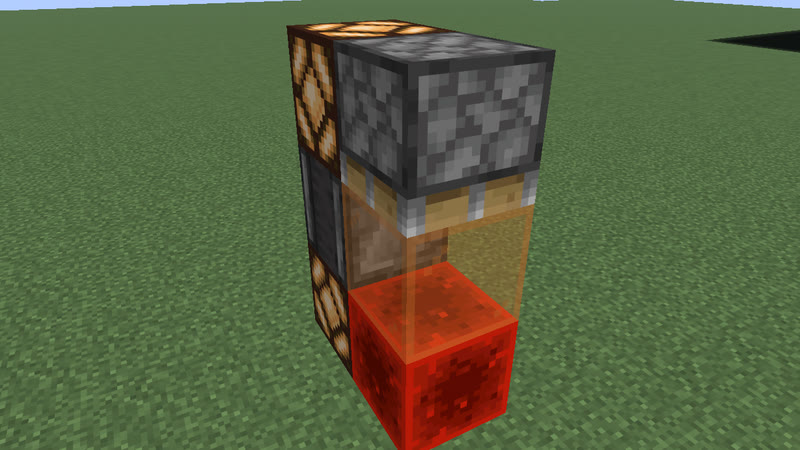
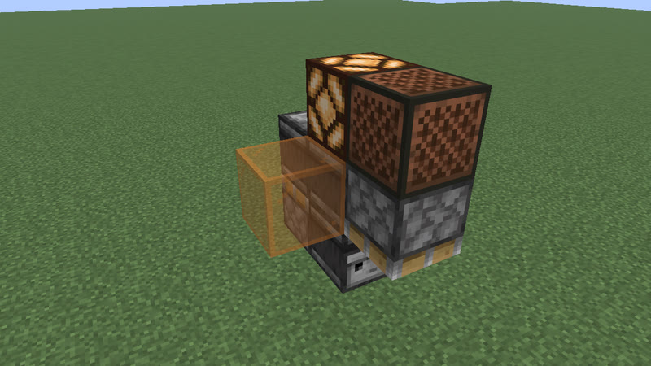
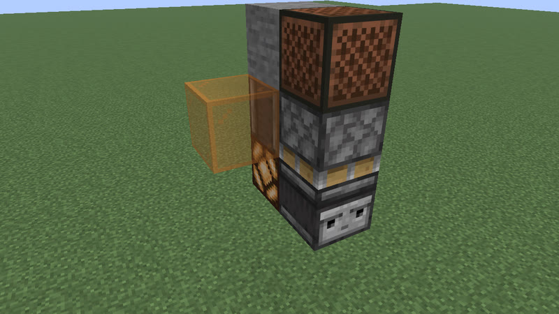
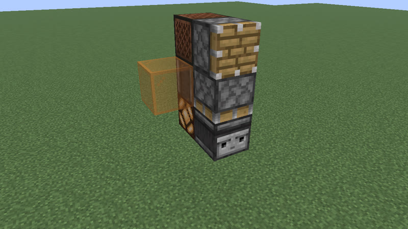

# Clocks: 12 gt (0.6 s) to 30 gt (1.5 s) (236 clock types)

[catalog index](../CATALOG.md) · previous: [p4-11](p4-11.md) · next: [p31-97](p31-97.md)

Orange glass = where the output signal is (placed only for the picture); click a picture for its design. Larger clocks of a period with the same on-time and pulses as a smaller one (whatever their block kinds), and clocks that are not robust, are listed on [variants](variants.md). Generated by `mctas clock catalog`.

## 12 gt (0.6 s)

Also reachable by: clk-obs-obs-ring (n = 1), clk-obs-divider (n = 0).

<table>
<tr><td align="center"> 12 gt (0.6 s) · observer+redstone_block+sticky_piston · 4 blocks also found as clk-obs-p24-bulb-note-obs-rb-stk-6b-b-286bbd (slop: clk-obs-p12-obs-rb-stk-4b-b26a69 with 1,0,3 waxed_copper_bulb[lit=false,powered=false], which changed nothing), clk-obs-p24-bulb-note-obs-rb-stk-6b-eadb26 (slop: clk-obs-p12-obs-rb-stk-4b-b26a69 with 0,0,-1 waxed_copper_bulb[lit=false,powered=false], which changed nothing), clk-obs-p24-bulb-obs-pis-rb-stk-6b-b-1c0aad (slop: clk-obs-p12-obs-rb-stk-4b-b26a69 with 0,1,-1 waxed_copper_bulb[lit=false,powered=false], which changed nothing), clk-obs-p24-bulb-obs-rb-stk-5b-77dbb3 (slop: clk-obs-p12-obs-rb-stk-4b-b26a69 with 0,0,0 waxed_copper_bulb[lit=false,powered=false], which changed nothing), clk-obs-p24-bulb-obs-rb-stk-5b-b-cbd438 (slop: clk-obs-p12-obs-rb-stk-4b-b26a69 with 0,0,0 waxed_copper_bulb[lit=false,powered=false], which changed nothing), clk-obs-p48-obs-rb-stk-6b-b-e216c8 (slop: clk-obs-p12-obs-rb-stk-4b-b26a69 with 0,1,0 sticky_piston[extended=false,facing=south]; 0,1,1 observer[facing=east,powered=false], which changed nothing), clk-obs-p48-obs-rb-stk-6b-ecf06a (slop: clk-obs-p12-obs-rb-stk-4b-b26a69 with 0,1,0 sticky_piston[extended=false,facing=up]; 0,2,0 observer[facing=south,powered=false], which changed nothing)</td><td align="center"> 12 gt (0.6 s) · observer+redstone_block+redstone_lamp+sticky_piston · 4 blocks also found as clk-obs-p24-bulb-lamp-note-obs-rb-stk-6b-da0651 (slop: clk-obs-p12-lamp-obs-rb-stk-4b-2c0df9 with 0,1,2 waxed_copper_bulb[lit=false,powered=false], which changed nothing), clk-obs-p24-bulb-lamp-obs-pis-rb-stk-6b-b-96d0bc (slop: clk-obs-p12-lamp-obs-rb-stk-4b-2c0df9 with 1,0,2 waxed_copper_bulb[lit=false,powered=false], which changed nothing), clk-obs-p24-bulb-lamp-obs-pis-rb-stk-6b-d995a8 (slop: clk-obs-p12-lamp-obs-rb-stk-4b-2c0df9 with 0,0,3 waxed_copper_bulb[lit=false,powered=false], which changed nothing), clk-obs-p24-bulb-lamp-obs-rb-stk-5b-004783 (slop: clk-obs-p12-lamp-obs-rb-stk-4b-2c0df9 with 0,0,0 waxed_copper_bulb[lit=false,powered=false], which changed nothing), clk-obs-p24-bulb-lamp-obs-rb-stk-5b-b-b01d60 (slop: clk-obs-p12-lamp-obs-rb-stk-4b-2c0df9 with 0,0,1 waxed_copper_bulb[lit=false,powered=false], which changed nothing), clk-obs-p24-lamp-obs-rb-stk-6b-b-10ce2d (slop: clk-obs-p12-lamp-obs-rb-stk-4b-2c0df9 with 0,0,0 observer[facing=north,powered=false]; 0,0,1 sticky_piston[extended=false,facing=north], which changed nothing)</td><td align="center"><a href="../archive/clk-obs-p12-rb-slime_block-stk-4b-2ea304.txt">clk-obs-p12-rb-slime_block-stk-4b-2ea304</a> 12 gt (0.6 s) · redstone_block+sticky_piston · 4 blocks (picture pending) also found as clk-obs-p24-rb-stk-6b-0e15ee (slop: the core with 0,1,3 piston[extended=false,facing=down]; 0,1,2 sticky_piston[extended=false,facing=south], which changed nothing)</td></tr>
<tr><td align="center"><a href="../archive/clk-obs-p12-note-obs-rb-lamp-stk-5b-4c46ee.txt">clk-obs-p12-note-obs-rb-lamp-stk-5b-4c46ee</a> 12 gt (0.6 s) · note_block+observer+redstone_block+redstone_lamp+sticky_piston · 5 blocks (picture pending) also found as clk-obs-p24-bulb-lamp-note-obs-rb-stk-6b-b-3ffc3e (slop: the core with 1,0,0 waxed_copper_bulb[lit=false,powered=false], which changed nothing)</td><td align="center"> 12 gt (0.6 s) · note_block+observer+piston+sticky_piston · 5 blocks also found as clk-obs-p24-note-obs-pis-stk-6b-6401c1 (slop: clk-obs-p12-note-obs-pis-stk-5b-1c3951 with 0,0,3 piston[extended=false,facing=south], which changed nothing), clk-obs-p36-note-obs-stk-7b-607d26 (slop: clk-obs-p12-note-obs-pis-stk-5b-1c3951 with 0,-1,0 sticky_piston[extended=false,facing=south]; 0,-1,2 redstone_lamp[lit=false], which changed nothing), clk-obs-p36-note-obs-stk-7b-b-e8ffaf (slop: clk-obs-p12-note-obs-pis-stk-5b-1c3951 with 0,-1,0 sticky_piston[extended=false,facing=south]; 0,-1,2 stone, which changed nothing), clk-obs-p48-bulb-obs-pis-stk-7b-c838a1 (slop: clk-obs-p12-note-obs-pis-stk-5b-1c3951 with 0,0,0 waxed_copper_bulb[lit=false,powered=false], which changed nothing)</td><td align="center"> 12 gt (0.6 s) · note_block+observer+piston+sticky_piston · 5 blocks</td></tr>
<tr><td align="center"> 12 gt (0.6 s) · copper_bulb+observer+piston+redstone_block+sticky_piston · 6 blocks</td><td align="center"> 12 gt (0.6 s) · observer+piston+redstone_block · 6 blocks</td><td align="center"><a href="../archive/clk-obs-p12-obs-pis-rb-lamp-stk-6b-451b23.txt">clk-obs-p12-obs-pis-rb-lamp-stk-6b-451b23</a> 12 gt (0.6 s) · observer+piston+redstone_block+redstone_lamp+sticky_piston · 6 blocks (picture pending) also found as clk-obs-p48-bulb-lamp-obs-pis-rb-stk-8b-f1d23f (slop: the core with 0,1,-2 waxed_copper_bulb[lit=false,powered=false]; 0,1,-1 observer[facing=south,powered=false], which changed nothing), clk-obs-p96-lamp-obs-pis-rb-stk-9b-1b68c0 (slop: clk-obs-p12-obs-pis-rb-lamp-stk-6b-451b23 with 0,0,-2 sticky_piston[extended=false,facing=up]; 0,1,-2 waxed_copper_bulb[lit=false,powered=false]; 0,1,-1 observer[facing=south,powered=false], which changed nothing)</td></tr>
<tr><td align="center"> 12 gt (0.6 s) · observer+redstone_block+redstone_lamp+sticky_piston · 6 blocks also found as clk-obs-p24-bulb-lamp-note-obs-pis-rb-stk-8b-1ecac1 (slop: clk-obs-p12-lamp-obs-rb-stk-5b-b-cba62c with 0,2,1 waxed_copper_bulb[lit=false,powered=false], which changed nothing), clk-obs-p24-lamp-obs-pis-rb-stk-7b-a2dd26 (slop: clk-obs-p12-lamp-obs-rb-stk-5b-b-cba62c with 0,1,-1 observer[facing=south,powered=false], which changed nothing), clk-obs-p24-lamp-obs-pis-rb-stk-7b-b-4dc5fa (slop: clk-obs-p12-lamp-obs-rb-stk-5b-b-cba62c with 0,2,0 observer[facing=down,powered=false], which changed nothing), clk-obs-p24-lamp-obs-pis-stk-6b-6a094f (slop: clk-obs-p12-lamp-obs-rb-stk-5b-b-cba62c with 0,0,3 piston[extended=false,facing=south], which changed nothing), clk-obs-p36-lamp-obs-stk-7b-b-bcb06d (slop: clk-obs-p12-lamp-obs-rb-stk-5b-b-cba62c with 0,-1,0 sticky_piston[extended=false,facing=south]; 0,-1,2 stone, which changed nothing), clk-obs-p36-lamp-obs-stk-7b-eadd68 (slop: clk-obs-p12-lamp-obs-rb-stk-5b-b-cba62c with 0,-1,0 sticky_piston[extended=false,facing=south]; 0,-1,2 note_block[instrument=harp,note=0,powered=false], which changed nothing), clk-obs-p48-bulb-lamp-obs-stk-7b-8ccb79 (slop: clk-obs-p12-lamp-obs-rb-stk-5b-b-cba62c with 0,0,3 observer[facing=down,powered=false]; 0,1,4 waxed_copper_bulb[lit=false,powered=false], which changed nothing)</td><td align="center"> 12 gt (0.6 s) · observer+piston+redstone_lamp+sticky_piston · 6 blocks</td><td align="center"> 12 gt (0.6 s) · observer+redstone_lamp+sticky_piston · 6 blocks</td></tr>
<tr><td align="center"> 12 gt (0.6 s) · observer+piston+redstone_lamp+sticky_piston · 6 blocks</td><td align="center"> 12 gt (0.6 s) · copper_bulb+observer+redstone_block+redstone_lamp+sticky_piston · 7 blocks</td><td align="center"> 12 gt (0.6 s) · comparator+redstone_torch+repeater · 8 blocks</td></tr>
<tr><td align="center"> 12 gt (0.6 s) · redstone_torch+repeater · 8 blocks</td><td align="center"> 12 gt (0.6 s) · copper_bulb+observer+redstone_block+sticky_piston · 8 blocks</td></tr>
</table>

## 13 gt (0.65 s)

Also reachable by: clk-item-lockpair (n = 1), clk-obs-odd-b (n = 0).

<table>
<tr><td align="center"> 13 gt (0.65 s) · observer+piston+redstone_block+sticky_piston · 5 blocks also found as clk-obs-p26-bulb-obs-pis-rb-stk-6b-b-68793e (slop: clk-obs-p13-obs-pis-rb-stk-5b-bfa866 with 2,0,1 waxed_copper_bulb[lit=false,powered=false], which changed nothing), clk-obs-p26-bulb-obs-rb-stk-6b-36ca85 (slop: clk-obs-p13-obs-pis-rb-stk-5b-bfa866 with 2,0,1 waxed_copper_bulb[lit=false,powered=false], which changed nothing), clk-obs-p52-obs-pis-rb-stk-7b-587db7 (slop: clk-obs-p13-obs-pis-rb-stk-5b-bfa866 with 0,1,-1 observer[facing=down,powered=false], which changed nothing), clk-obs-p78-obs-pis-rb-stk-9b-49295c (slop: clk-obs-p13-obs-pis-rb-stk-5b-bfa866 with 0,-2,-1 sticky_piston[extended=false,facing=up]; 0,-1,-1 waxed_copper_bulb[lit=false,powered=false]; 0,1,-1 observer[facing=down,powered=false], which changed nothing)</td><td align="center"> 13 gt (0.65 s) · observer+redstone_block+sticky_piston · 5 blocks</td><td align="center"> 13 gt (0.65 s) · observer+redstone_lamp+sticky_piston · 6 blocks</td></tr>
<tr><td align="center"> 13 gt (0.65 s) · observer+piston+redstone_lamp+sticky_piston · 6 blocks</td><td align="center"> 13 gt (0.65 s) · note_block+observer+piston+redstone_lamp+sticky_piston · 7 blocks also found as clk-obs-p26-bulb-lamp-note-obs-pis-stk-8b-82e005 (slop: clk-obs-p13-lamp-note-obs-pis-stk-7b-28f5b1 with 0,3,1 waxed_copper_bulb[lit=false,powered=false], which changed nothing), clk-obs-p26-bulb-lamp-note-obs-rb-stk-8b-0aeef7 (slop: clk-obs-p13-lamp-note-obs-pis-stk-7b-28f5b1 with -1,0,1 waxed_copper_bulb[lit=false,powered=false], which changed nothing), clk-obs-p26-bulb-lamp-note-obs-stk-8b-04cb48 (slop: clk-obs-p13-lamp-note-obs-pis-stk-7b-28f5b1 with 0,1,-2 waxed_copper_bulb[lit=false,powered=false], which changed nothing), clk-obs-p52-lamp-note-obs-pis-stk-9b-47cdbc (slop: clk-obs-p13-lamp-note-obs-pis-stk-7b-28f5b1 with 0,0,-2 sticky_piston[extended=false,facing=up]; 0,1,-2 waxed_copper_bulb[lit=false,powered=false], which changed nothing), clk-obs-p52-lamp-note-obs-stk-9b-d04d7e (slop: clk-obs-p13-lamp-note-obs-pis-stk-7b-28f5b1 with 0,0,-2 sticky_piston[extended=false,facing=up]; 0,1,-2 waxed_copper_bulb[lit=false,powered=false], which changed nothing)</td><td align="center"> 13 gt (0.65 s) · note_block+observer+piston+redstone_lamp+sticky_piston · 7 blocks</td></tr>
<tr><td align="center"> 13 gt (0.65 s) · note_block+observer+redstone_lamp+sticky_piston · 7 blocks</td><td align="center"> 13 gt (0.65 s) · note_block+observer+redstone_lamp+sticky_piston · 7 blocks</td><td align="center"> 13 gt (0.65 s) · copper_bulb+observer+piston+redstone_lamp+sticky_piston · 7 blocks</td></tr>
<tr><td align="center"> 13 gt (0.65 s) · copper_bulb+observer+piston+redstone_lamp+sticky_piston · 7 blocks</td><td align="center"> 13 gt (0.65 s) · copper_bulb+observer+redstone_lamp+sticky_piston · 7 blocks</td><td align="center"> 13 gt (0.65 s) · copper_bulb+observer+redstone_lamp+sticky_piston · 7 blocks</td></tr>
<tr><td align="center"><a href="../archive/clk-obs-p13-lamp-obs-pis-rb-stk-7b-ede8ea.txt">clk-obs-p13-lamp-obs-pis-rb-stk-7b-ede8ea</a> 13 gt (0.65 s) · observer+piston+redstone_block+redstone_lamp+sticky_piston · 7 blocks (picture pending)</td><td align="center"><a href="../archive/clk-obs-p13-obs-rb-lamp-stk-7b-996961.txt">clk-obs-p13-obs-rb-lamp-stk-7b-996961</a> 13 gt (0.65 s) · observer+redstone_block+redstone_lamp+sticky_piston · 7 blocks (picture pending) also found as clk-obs-p26-lamp-note-obs-rb-stk-8b-40f050 (slop: the core with -1,0,1 note_block[instrument=harp,note=0,powered=false], which changed nothing)</td><td align="center"><a href="../archive/clk-obs-p13-bulb-lamp-obs-rb-stk-8b-0b16bf.txt">clk-obs-p13-bulb-lamp-obs-rb-stk-8b-0b16bf</a> 13 gt (0.65 s) · copper_bulb+observer+redstone_block+redstone_lamp+sticky_piston · 8 blocks (picture pending)</td></tr>
<tr><td align="center"><a href="../archive/clk-obs-p13-bulb-note-obs-rb-stk-8b-7aab2e.txt">clk-obs-p13-bulb-note-obs-rb-stk-8b-7aab2e</a> 13 gt (0.65 s) · copper_bulb+note_block+observer+redstone_block+sticky_piston · 8 blocks (picture pending)</td><td align="center"><a href="../archive/clk-obs-p13-bulb-obs-rb-stk-8b-30fda0.txt">clk-obs-p13-bulb-obs-rb-stk-8b-30fda0</a> 13 gt (0.65 s) · copper_bulb+observer+redstone_block+sticky_piston · 8 blocks (picture pending)</td><td align="center"> 13 gt (0.65 s) · comparator+hopper+redstone_torch+redstone_wire · 9 blocks</td></tr>
<tr><td align="center"> 13 gt (0.65 s) · comparator+hopper+redstone_torch+redstone_wire · 9 blocks</td><td align="center"><a href="../archive/clk-obs-p13-bulb-lamp-obs-pis-rb-stk-7b-b4d4f6.txt">clk-obs-p13-bulb-lamp-obs-pis-rb-stk-7b-b4d4f6</a> 13 gt (0.65 s) · copper_bulb+observer+piston+redstone_block+redstone_lamp+sticky_piston · 9 blocks (picture pending)</td><td align="center"><a href="../archive/clk-obs-p13-bulb-note-obs-pis-rb-stk-7b-d84c04.txt">clk-obs-p13-bulb-note-obs-pis-rb-stk-7b-d84c04</a> 13 gt (0.65 s) · copper_bulb+note_block+observer+piston+redstone_block+sticky_piston · 9 blocks (picture pending)</td></tr>
<tr><td align="center"><a href="../archive/clk-obs-p13-bulb-obs-pis-rb-stk-7b-cb1e64.txt">clk-obs-p13-bulb-obs-pis-rb-stk-7b-cb1e64</a> 13 gt (0.65 s) · copper_bulb+observer+piston+redstone_block+sticky_piston · 9 blocks (picture pending)</td><td align="center"> 13 gt (0.65 s) · redstone_wire+repeater · 16 blocks</td></tr>
</table>

## 14 gt (0.7 s)

Also reachable by: observer ring with a relay block (clk-obs-trap-ring, n = 1), hopper ring (clk-item-hopper-ring, n = 0), hopper ring, sealed (clk-item-hopper-ring-sealed, n = 0).

<table>
<tr><td align="center"> 14 gt (0.7 s) · comparator+hopper · 4 blocks</td><td align="center"> 14 gt (0.7 s) · note_block+observer+redstone_lamp+sticky_piston · 6 blocks also found as clk-obs-p14-note-obs-10b-b-ba58a1 (slop: clk-obs-p14-lamp-note-obs-stk-6b-b-185cd2 with 0,2,2 observer[facing=down,powered=false]; 0,2,3 observer[facing=north,powered=false], which changed nothing), clk-obs-p14-obs-trap-10b-b-d04679 (slop: clk-obs-p14-lamp-note-obs-stk-6b-b-185cd2 with 0,2,2 observer[facing=down,powered=false]; 0,2,3 observer[facing=north,powered=false], which changed nothing), clk-obs-p28-bulb-lamp-obs-pis-rb-stk-8b-b52e8c (slop: clk-obs-p14-lamp-note-obs-stk-6b-b-185cd2 with 0,2,1 waxed_copper_bulb[lit=false,powered=false], which changed nothing), clk-obs-p28-bulb-obs-10b-b-221808 (slop: clk-obs-p14-lamp-note-obs-stk-6b-b-185cd2 with 0,2,2 observer[facing=down,powered=false]; 0,2,3 observer[facing=north,powered=false], which changed nothing)</td><td align="center"> 14 gt (0.7 s) · note_block+observer+redstone_block+redstone_lamp+sticky_piston · 6 blocks also found as clk-obs-p28-bulb-lamp-note-obs-rb-stk-7b-627793 (slop: clk-obs-p14-lamp-note-obs-rb-stk-6b-b-f8a0e7 with 0,1,2 waxed_copper_bulb[lit=false,powered=false], which changed nothing), clk-obs-p28-bulb-lamp-note-obs-rb-stk-7b-b-90d308 (slop: clk-obs-p14-lamp-note-obs-rb-stk-6b-b-f8a0e7 with 2,0,1 waxed_copper_bulb[lit=false,powered=false], which changed nothing), clk-obs-p28-bulb-lamp-obs-rb-stk-7b-b-5bf86a (slop: clk-obs-p14-lamp-note-obs-rb-stk-6b-b-f8a0e7 with 0,1,2 waxed_copper_bulb[lit=false,powered=false], which changed nothing), clk-obs-p28-bulb-lamp-obs-rb-stk-7b-c2fbd2 (slop: clk-obs-p14-lamp-note-obs-rb-stk-6b-b-f8a0e7 with 2,0,1 waxed_copper_bulb[lit=false,powered=false], which changed nothing), clk-obs-p28-lamp-note-obs-rb-stk-8b-6a5efe (slop: clk-obs-p14-lamp-note-obs-rb-stk-6b-b-f8a0e7 with 0,-1,0 waxed_copper_bulb[lit=false,powered=false]; 0,-1,1 sticky_piston[extended=false,facing=north], which changed nothing)</td></tr>
<tr><td align="center"> 14 gt (0.7 s) · observer+piston+redstone_lamp+sticky_piston · 6 blocks</td><td align="center"> 14 gt (0.7 s) · observer+piston+redstone_block+sticky_piston · 6 blocks also found as clk-obs-p28-bulb-obs-pis-rb-stk-7b-b-754ef9 (slop: clk-obs-p14-obs-pis-rb-stk-6b-c91ac7 with 0,-2,1 waxed_copper_bulb[lit=false,powered=false], which changed nothing), clk-obs-p28-bulb-obs-rb-stk-7b-b-d66fd7 (slop: clk-obs-p14-obs-pis-rb-stk-6b-c91ac7 with 0,-2,1 waxed_copper_bulb[lit=false,powered=false], which changed nothing)</td><td align="center"> 14 gt (0.7 s) · observer+redstone_block+sticky_piston · 6 blocks</td></tr>
<tr><td align="center"> 14 gt (0.7 s) · note_block+observer+piston+redstone_lamp+sticky_piston · 6 blocks</td><td align="center"> 14 gt (0.7 s) · note_block+observer+piston+redstone_lamp+sticky_piston · 6 blocks</td><td align="center"><a href="../archive/clk-obs-p14-note-obs-pis-rb-stk-7b-a680e3.txt">clk-obs-p14-note-obs-pis-rb-stk-7b-a680e3</a> 14 gt (0.7 s) · note_block+observer+piston+redstone_block+sticky_piston · 7 blocks (picture pending) also found as clk-obs-p28-bulb-note-obs-pis-rb-stk-8b-1e9eb5 (slop: the core with 0,2,2 waxed_copper_bulb[lit=false,powered=false], which changed nothing)</td></tr>
<tr><td align="center"> 14 gt (0.7 s) · redstone_torch+repeater · 8 blocks</td><td align="center"><a href="../archive/clk-obs-p14-bulb-obs-rb-stk-7b-6df6f1.txt">clk-obs-p14-bulb-obs-rb-stk-7b-6df6f1</a> 14 gt (0.7 s) · copper_bulb+observer+redstone_block+sticky_piston · 9 blocks (picture pending)</td><td align="center"><a href="../archive/clk-obs-p14-bulb-lamp-obs-pis-rb-stk-8b-0b483c.txt">clk-obs-p14-bulb-lamp-obs-pis-rb-stk-8b-0b483c</a> 14 gt (0.7 s) · copper_bulb+observer+piston+redstone_block+redstone_lamp+sticky_piston · 10 blocks (picture pending)</td></tr>
<tr><td align="center"><a href="../archive/clk-obs-p14-bulb-note-obs-pis-rb-stk-8b-74859a.txt">clk-obs-p14-bulb-note-obs-pis-rb-stk-8b-74859a</a> 14 gt (0.7 s) · copper_bulb+note_block+observer+piston+redstone_block+sticky_piston · 10 blocks (picture pending)</td><td align="center"><a href="../archive/clk-obs-p14-bulb-note-obs-rb-stk-8b-7a5d6a.txt">clk-obs-p14-bulb-note-obs-rb-stk-8b-7a5d6a</a> 14 gt (0.7 s) · copper_bulb+note_block+observer+redstone_block+sticky_piston · 10 blocks (picture pending)</td></tr>
</table>

## 15 gt (0.75 s)

Also reachable by: clk-item-lockpair (n = 2), clk-obs-odd-a (n = 1).

<table>
<tr><td align="center"> 15 gt (0.75 s) · observer+redstone_block+sticky_piston · 5 blocks also found as clk-obs-p30-bulb-obs-rb-stk-6b-b-871f7d (slop: clk-obs-p15-obs-rb-stk-5b-033535 with 0,-1,1 waxed_copper_bulb[lit=false,powered=false], which changed nothing)</td><td align="center"><a href="../archive/clk-obs-p15-note-obs-rb-lamp-stk-6b-6f5949.txt">clk-obs-p15-note-obs-rb-lamp-stk-6b-6f5949</a> 15 gt (0.75 s) · note_block+observer+redstone_block+redstone_lamp+sticky_piston · 6 blocks (picture pending) also found as clk-obs-p30-bulb-lamp-note-obs-rb-stk-7b-b70ea1 (slop: the core with 2,0,0 waxed_copper_bulb[lit=false,powered=false], which changed nothing), clk-obs-p30-bulb-lamp-obs-rb-stk-7b-87c3e1 (slop: clk-obs-p15-note-obs-rb-lamp-stk-6b-6f5949 with 0,2,2 waxed_copper_bulb[lit=false,powered=false], which changed nothing), clk-obs-p30-bulb-lamp-obs-rb-stk-7b-b-7ff7b8 (slop: clk-obs-p15-note-obs-rb-lamp-stk-6b-6f5949 with 0,-1,2 waxed_copper_bulb[lit=false,powered=false], which changed nothing)</td><td align="center"> 15 gt (0.75 s) · observer+redstone_block+sticky_piston · 6 blocks</td></tr>
<tr><td align="center"> 15 gt (0.75 s) · observer+piston+redstone_block+redstone_lamp+sticky_piston · 7 blocks</td><td align="center"> 15 gt (0.75 s) · observer+redstone_block+redstone_lamp+sticky_piston · 7 blocks</td><td align="center"> 15 gt (0.75 s) · note_block+observer+piston+redstone_block+sticky_piston · 7 blocks</td></tr>
<tr><td align="center"> 15 gt (0.75 s) · note_block+observer+redstone_block+sticky_piston · 7 blocks</td><td align="center"> 15 gt (0.75 s) · observer+piston+redstone_block+sticky_piston · 7 blocks</td><td align="center"> 15 gt (0.75 s) · observer+piston+redstone_block+redstone_lamp+sticky_piston · 7 blocks</td></tr>
<tr><td align="center"> 15 gt (0.75 s) · observer+piston+redstone_block+sticky_piston · 7 blocks</td><td align="center"><a href="../archive/clk-obs-p15-lamp-note-obs-pis-rb-stk-7b-36ee1f.txt">clk-obs-p15-lamp-note-obs-pis-rb-stk-7b-36ee1f</a> 15 gt (0.75 s) · note_block+observer+piston+redstone_block+redstone_lamp+sticky_piston · 7 blocks (picture pending)</td><td align="center"><a href="../archive/clk-obs-p15-lamp-note-obs-rb-stk-7b-e75451.txt">clk-obs-p15-lamp-note-obs-rb-stk-7b-e75451</a> 15 gt (0.75 s) · note_block+observer+redstone_block+redstone_lamp+sticky_piston · 7 blocks (picture pending)</td></tr>
<tr><td align="center"> 15 gt (0.75 s) · copper_bulb+observer+piston+redstone_block+redstone_lamp+sticky_piston · 7 blocks</td><td align="center"> 15 gt (0.75 s) · copper_bulb+observer+piston+redstone_block+redstone_lamp+sticky_piston · 7 blocks</td><td align="center"> 15 gt (0.75 s) · copper_bulb+note_block+observer+piston+redstone_block+sticky_piston · 7 blocks</td></tr>
<tr><td align="center"> 15 gt (0.75 s) · copper_bulb+note_block+observer+redstone_block+sticky_piston · 7 blocks</td><td align="center"> 15 gt (0.75 s) · copper_bulb+observer+piston+redstone_block+sticky_piston · 7 blocks</td><td align="center"> 15 gt (0.75 s) · copper_bulb+observer+redstone_block+sticky_piston · 7 blocks</td></tr>
<tr><td align="center"> 15 gt (0.75 s) · comparator+hopper+redstone_torch+repeater · 9 blocks</td><td align="center"><a href="../archive/clk-obs-p15-bulb-lamp-note-obs-stk-8b-4a0708.txt">clk-obs-p15-bulb-lamp-note-obs-stk-8b-4a0708</a> 15 gt (0.75 s) · copper_bulb+note_block+observer+redstone_lamp+sticky_piston · 10 blocks (picture pending)</td><td align="center"> 15 gt (0.75 s) · redstone_wire+repeater · 16 blocks</td></tr>
</table>

## 16 gt (0.8 s)

Also reachable by: clk-obs-obs-ring (n = 2), clk-item-snowdisp (n = 0).

<table>
<tr><td align="center"> 16 gt (0.8 s) · observer+piston+redstone_block+sticky_piston · 5 blocks also found as clk-obs-p128-obs-pis-rb-stk-8b-c36479 (slop: clk-obs-p16-obs-pis-rb-stk-5b-2f99b6 with 0,-1,5 sticky_piston[extended=false,facing=up]; 0,0,4 observer[facing=north,powered=false]; 0,0,5 waxed_copper_bulb[lit=false,powered=false], which changed nothing), clk-obs-p128-obs-rb-stk-8b-4869e1 (slop: clk-obs-p16-obs-pis-rb-stk-5b-2f99b6 with 0,-1,5 sticky_piston[extended=false,facing=up]; 0,0,4 observer[facing=north,powered=false]; 0,0,5 waxed_copper_bulb[lit=false,powered=false], which changed nothing), clk-obs-p192-bulb-obs-pis-rb-stk-9b-5194b5 (slop: clk-obs-p16-obs-pis-rb-stk-5b-2f99b6 with 0,2,1 observer[facing=down,powered=false]; 0,3,1 waxed_copper_bulb[lit=false,powered=false], which changed nothing), clk-obs-p32-bulb-obs-pis-rb-stk-6b-8e67e6 (slop: clk-obs-p16-obs-pis-rb-stk-5b-2f99b6 with 1,1,1 waxed_copper_bulb[lit=false,powered=false], which changed nothing), clk-obs-p32-bulb-obs-pis-rb-stk-6b-b-294529 (slop: clk-obs-p16-obs-pis-rb-stk-5b-2f99b6 with 0,2,2 waxed_copper_bulb[lit=false,powered=false], which changed nothing), clk-obs-p32-bulb-obs-rb-stk-6b-b-8feae3 (slop: clk-obs-p16-obs-pis-rb-stk-5b-2f99b6 with 0,1,2 waxed_copper_bulb[lit=false,powered=false], which changed nothing), clk-obs-p32-obs-pis-rb-stk-6b-687486 (slop: clk-obs-p16-obs-pis-rb-stk-5b-2f99b6 with 0,0,2 observer[facing=up,powered=false], which changed nothing), clk-obs-p32-obs-pis-rb-stk-7b-b-9e05fe (slop: clk-obs-p16-obs-pis-rb-stk-5b-2f99b6 with 0,0,0 observer[facing=up,powered=false], which changed nothing), clk-obs-p32-obs-rb-stk-6b-0fb501 (slop: clk-obs-p16-obs-pis-rb-stk-5b-2f99b6 with 0,0,2 observer[facing=north,powered=false], which changed nothing), clk-obs-p32-obs-rb-stk-6b-b-f013fc (slop: clk-obs-p16-obs-pis-rb-stk-5b-2f99b6 with 0,0,3 observer[facing=north,powered=false], which changed nothing), clk-obs-p48-obs-pis-rb-stk-7b-c0d2dc (slop: clk-obs-p16-obs-pis-rb-stk-5b-2f99b6 with 0,0,1 observer[facing=north,powered=false], which changed nothing), clk-obs-p64-bulb-obs-pis-rb-stk-7b-391cf0 (slop: clk-obs-p16-obs-pis-rb-stk-5b-2f99b6 with 0,3,1 observer[facing=down,powered=false]; 0,4,1 waxed_copper_bulb[lit=false,powered=false], which changed nothing), clk-obs-p64-bulb-obs-pis-rb-stk-7b-b-73669b (slop: clk-obs-p16-obs-pis-rb-stk-5b-2f99b6 with 0,0,4 observer[facing=north,powered=false]; 0,0,5 waxed_copper_bulb[lit=false,powered=false], which changed nothing), clk-obs-p64-bulb-obs-rb-stk-7b-b-477a12 (slop: clk-obs-p16-obs-pis-rb-stk-5b-2f99b6 with 0,-1,2 waxed_copper_bulb[lit=false,powered=false]; 0,0,2 observer[facing=up,powered=false], which changed nothing), clk-obs-p64-bulb-obs-rb-stk-7b-fb0a42 (slop: clk-obs-p16-obs-pis-rb-stk-5b-2f99b6 with 0,3,0 observer[facing=down,powered=false]; 0,4,0 waxed_copper_bulb[lit=false,powered=false], which changed nothing), clk-obs-p64-lamp-obs-pis-rb-stk-8b-8e03cf (slop: clk-obs-p16-obs-pis-rb-stk-5b-2f99b6 with 0,-1,5 sticky_piston[extended=false,facing=up]; 0,0,4 observer[facing=north,powered=false]; 0,0,5 redstone_lamp[lit=false], which changed nothing), clk-obs-p64-obs-pis-rb-stk-8b-3e297b (slop: clk-obs-p16-obs-pis-rb-stk-5b-2f99b6 with 0,-1,5 sticky_piston[extended=false,facing=up]; 0,0,4 observer[facing=north,powered=false]; 0,0,5 note_block[instrument=harp,note=0,powered=false], which changed nothing), clk-obs-p96-obs-rb-stk-8b-099bad (slop: clk-obs-p16-obs-pis-rb-stk-5b-2f99b6 with 0,-1,0 observer[facing=down,powered=false]; 0,2,0 observer[facing=down,powered=false], which changed nothing)</td><td align="center"> 16 gt (0.8 s) · observer+piston+redstone_block+sticky_piston · 5 blocks</td><td align="center"> 16 gt (0.8 s) · observer+redstone_block+sticky_piston · 5 blocks</td></tr>
<tr><td align="center"> 16 gt (0.8 s) · observer+redstone_block+sticky_piston · 5 blocks</td><td align="center"> 16 gt (0.8 s) · copper_bulb+observer+redstone_block+sticky_piston · 6 blocks</td><td align="center"> 16 gt (0.8 s) · note_block+observer+redstone_lamp+sticky_piston · 6 blocks also found as clk-obs-p32-bulb-lamp-obs-pis-stk-8b-6d442b (slop: clk-obs-p16-lamp-note-obs-stk-6b-8776ae with 0,2,0 waxed_copper_bulb[lit=false,powered=false], which changed nothing), clk-obs-p32-bulb-note-obs-pis-stk-8b-1a4eed (slop: clk-obs-p16-lamp-note-obs-stk-6b-8776ae with 0,2,0 waxed_copper_bulb[lit=false,powered=false], which changed nothing), clockinfra-p64-wireable-9b (slop: clk-obs-p16-lamp-note-obs-stk-6b-8776ae with 0,1,0 observer[facing=down,powered=false]; 0,2,0 waxed_copper_bulb[lit=false,powered=false], which changed nothing)</td></tr>
<tr><td align="center"> 16 gt (0.8 s) · observer+redstone_lamp+sticky_piston · 6 blocks</td><td align="center"> 16 gt (0.8 s) · note_block+observer+redstone_block+sticky_piston · 6 blocks</td><td align="center"> 16 gt (0.8 s) · observer+redstone_block+redstone_lamp+sticky_piston · 6 blocks</td></tr>
<tr><td align="center"><a href="../archive/clk-obs-p32-bulb-lamp-obs-rb-stk-7b-7fe871.txt">clk-obs-p32-bulb-lamp-obs-rb-stk-7b-7fe871</a> 16 gt (0.8 s) · copper_bulb+observer+redstone_block+redstone_lamp+sticky_piston · 7 blocks (picture pending) also found as clk-obs-p32-bulb-lamp-obs-pis-rb-stk-8b-a0911c (slop: clk-obs-p32-bulb-lamp-obs-rb-stk-7b-7fe871 with 0,1,-1 waxed_copper_bulb[lit=false,powered=false], which changed nothing), clk-obs-p32-lamp-note-obs-rb-stk-8b-2cea3d (slop: clk-obs-p32-bulb-lamp-obs-rb-stk-7b-7fe871 with 0,-2,1 observer[facing=up,powered=false], which changed nothing)</td><td align="center"><a href="../archive/clk-obs-p16-obs-rb-stk-stone-7b-6a7e0f.txt">clk-obs-p16-obs-rb-stk-stone-7b-6a7e0f</a> 16 gt (0.8 s) · observer+redstone_block+sticky_piston · 7 blocks (picture pending) also found as clk-obs-p64-bulb-lamp-obs-rb-stk-9b-6e88ef (slop: the core with 0,1,2 redstone_lamp[lit=false]; 0,1,3 waxed_copper_bulb[lit=false,powered=false], which changed nothing), clk-obs-p64-note-obs-rb-stk-8b-38ffd8 (slop: clk-obs-p16-obs-rb-stk-stone-7b-6a7e0f with 0,1,2 waxed_copper_bulb[lit=false,powered=false], which changed nothing), clk-obs-p64-obs-rb-stk-8b-60639a (slop: clk-obs-p16-obs-rb-stk-stone-7b-6a7e0f with 0,1,2 waxed_copper_bulb[lit=false,powered=false], which changed nothing)</td><td align="center"> 16 gt (0.8 s) · redstone_torch+repeater · 8 blocks</td></tr>
<tr><td align="center"> 16 gt (0.8 s) · comparator+redstone_torch+repeater · 12 blocks</td></tr>
</table>

## 17 gt (0.85 s)

Also reachable by: clk-obs-odd-b (n = 1).

<table>
<tr><td align="center"> 17 gt (0.85 s) · observer+redstone_block+redstone_lamp+sticky_piston · 6 blocks also found as clk-obs-p102-lamp-obs-rb-stk-8b-2e06ab (slop: clk-obs-p17-lamp-obs-rb-stk-6b-231c89 with 0,-1,1 observer[facing=up,powered=false]; 0,0,1 observer[facing=down,powered=false], which changed nothing), clk-obs-p34-bulb-lamp-obs-rb-stk-7b-b-cc19e8 (slop: clk-obs-p17-lamp-obs-rb-stk-6b-231c89 with 0,1,-1 waxed_copper_bulb[lit=false,powered=false], which changed nothing), clk-obs-p34-bulb-lamp-obs-rb-stk-7b-c65d30 (slop: clk-obs-p17-lamp-obs-rb-stk-6b-231c89 with 0,0,2 waxed_copper_bulb[lit=false,powered=false], which changed nothing), clk-obs-p68-bulb-lamp-obs-rb-stk-8b-9ec250 (slop: clk-obs-p17-lamp-obs-rb-stk-6b-231c89 with 0,0,2 waxed_copper_bulb[lit=false,powered=false]; 0,1,2 sticky_piston[extended=false,facing=down], which changed nothing)</td><td align="center"> 17 gt (0.85 s) · observer+redstone_block+redstone_lamp+sticky_piston · 6 blocks</td><td align="center"> 17 gt (0.85 s) · note_block+observer+redstone_block+sticky_piston · 6 blocks</td></tr>
<tr><td align="center"><a href="../archive/clk-obs-p17-obs-pis-stk-stone-6b-de24b4.txt">clk-obs-p17-obs-pis-stk-stone-6b-de24b4</a> 17 gt (0.85 s) · observer+piston+sticky_piston · 6 blocks (picture pending) also found as clk-obs-p136-obs-pis-stk-9b-dbf867 (slop: the core with 0,0,-2 sticky_piston[extended=false,facing=up]; 0,1,-2 waxed_copper_bulb[lit=false,powered=false]; 0,1,-1 observer[facing=south,powered=false], which changed nothing), clk-obs-p136-obs-stk-9b-c911bd (slop: clk-obs-p17-obs-pis-stk-stone-6b-de24b4 with 0,0,-2 sticky_piston[extended=false,facing=up]; 0,1,-2 waxed_copper_bulb[lit=false,powered=false]; 0,1,-1 observer[facing=south,powered=false], which changed nothing), clk-obs-p136-obs-stk-9b-e1d103 (slop: clk-obs-p17-obs-pis-stk-stone-6b-de24b4 with 0,0,-2 sticky_piston[extended=false,facing=up]; 0,1,-2 waxed_copper_bulb[lit=false,powered=false]; 0,1,-1 observer[facing=south,powered=false], which changed nothing), clk-obs-p34-bulb-obs-pis-stk-7b-5ee547 (slop: clk-obs-p17-obs-pis-stk-stone-6b-de24b4 with 0,2,2 waxed_copper_bulb[lit=false,powered=false], which changed nothing), clk-obs-p34-bulb-obs-pis-stk-7b-b-e9a742 (slop: clk-obs-p17-obs-pis-stk-stone-6b-de24b4 with 0,2,2 waxed_copper_bulb[lit=false,powered=false], which changed nothing), clk-obs-p34-obs-pis-stk-7b-b-da1ac4 (slop: clk-obs-p17-obs-pis-stk-stone-6b-de24b4 with 0,1,-1 observer[facing=south,powered=false], which changed nothing), clk-obs-p34-obs-stk-7b-474fa7 (slop: clk-obs-p17-obs-pis-stk-stone-6b-de24b4 with 0,1,-1 observer[facing=south,powered=false], which changed nothing)</td><td align="center"> 17 gt (0.85 s) · observer+redstone_block+sticky_piston · 6 blocks</td><td align="center"><a href="../archive/clk-obs-p17-obs-rb-stk-6b-c2b222.txt">clk-obs-p17-obs-rb-stk-6b-c2b222</a> 17 gt (0.85 s) · observer+redstone_block+sticky_piston · 6 blocks (picture pending) also found as clk-obs-p68-obs-rb-stk-8b-800f78 (slop: the core with 0,-1,1 observer[facing=south,powered=false]; 0,0,2 observer[facing=north,powered=false], which changed nothing)</td></tr>
<tr><td align="center"><a href="../archive/clk-obs-p17-note-obs-pis-rb-stk-8b-d09bc6.txt">clk-obs-p17-note-obs-pis-rb-stk-8b-d09bc6</a> 17 gt (0.85 s) · note_block+observer+piston+redstone_block+sticky_piston · 8 blocks (picture pending) also found as clk-obs-p34-bulb-note-obs-pis-rb-stk-9b-0a5346 (slop: the core with 0,2,3 waxed_copper_bulb[lit=false,powered=false], which changed nothing)</td><td align="center"> 17 gt (0.85 s) · note_block+observer+redstone_block+redstone_lamp+sticky_piston · 8 blocks also found as clk-obs-p68-bulb-lamp-note-obs-rb-stk-9b-832939-tap (slop: clk-obs-p17-lamp-note-obs-rb-stk-7b-dd0ec4 with 0,1,2 observer[facing=north,powered=false]; 0,1,3 waxed_copper_bulb[lit=false,powered=false], which changed nothing)</td><td align="center"><a href="../archive/clk-obs-p17-lamp-obs-pis-rb-stk-8b-783844.txt">clk-obs-p17-lamp-obs-pis-rb-stk-8b-783844</a> 17 gt (0.85 s) · observer+piston+redstone_block+redstone_lamp+sticky_piston · 8 blocks (picture pending)</td></tr>
<tr><td align="center"> 17 gt (0.85 s) · comparator+hopper+redstone_torch+repeater · 9 blocks</td><td align="center"> 17 gt (0.85 s) · redstone_wire+repeater · 16 blocks</td></tr>
</table>

## 18 gt (0.9 s)

Also reachable by: observer ring with a relay block (clk-obs-trap-ring, n = 2).

<table>
<tr><td align="center"><a href="../archive/census-p18-observer-piston-repeater-4b.txt">census-p18-observer-piston-repeater-4b</a> 18 gt (0.9 s) · observer+piston+repeater · 4 blocks (picture pending) also found as clk-obs-p36-bulb-note-obs-rb-stk-7b-b-5fdacf (slop: census-p18-observer-piston-repeater-4b with 0,0,4 waxed_copper_bulb[lit=false,powered=false], which changed nothing), clk-obs-p72-obs-rb-stk-8b-8b4c33 (slop: census-p18-observer-piston-repeater-4b with 0,-1,5 sticky_piston[extended=false,facing=up]; 0,0,4 waxed_copper_bulb[lit=false,powered=false], which changed nothing)</td><td align="center"> 18 gt (0.9 s) · observer+piston+sticky_piston · 5 blocks also found as clk-obs-p36-bulb-lamp-note-obs-pis-rb-stk-9b-2afb28 (slop: clk-obs-p18-obs-pis-stk-5b-b-960813 with 0,1,-1 waxed_copper_bulb[lit=false,powered=false], which changed nothing), clk-obs-p36-bulb-lamp-note-obs-pis-stk-8b-7d7e64 (slop: clk-obs-p18-obs-pis-stk-5b-b-960813 with 0,2,0 waxed_copper_bulb[lit=false,powered=false], which changed nothing)</td><td align="center"> 18 gt (0.9 s) · observer+redstone_block+sticky_piston · 6 blocks also found as clk-obs-p36-bulb-lamp-obs-pis-rb-stk-8b-0ce997 (slop: clk-obs-p18-obs-rb-stk-6b-b-d3e68a with -1,1,1 waxed_copper_bulb[lit=false,powered=false], which changed nothing)</td></tr>
<tr><td align="center"><a href="../archive/clk-obs-p18-note-obs-rb-lamp-stk-6b-285242.txt">clk-obs-p18-note-obs-rb-lamp-stk-6b-285242</a> 18 gt (0.9 s) · note_block+observer+redstone_block+redstone_lamp+sticky_piston · 6 blocks (picture pending) also found as clk-obs-p36-bulb-lamp-note-obs-rb-stk-7b-36ba93 (slop: the core with 0,1,4 waxed_copper_bulb[lit=false,powered=false], which changed nothing), clk-obs-p36-bulb-lamp-obs-rb-stk-7b-d70aaf (slop: clk-obs-p18-note-obs-rb-lamp-stk-6b-285242 with 0,1,4 waxed_copper_bulb[lit=false,powered=false], which changed nothing)</td><td align="center"> 18 gt (0.9 s) · observer+redstone_block+redstone_lamp+sticky_piston · 7 blocks</td><td align="center"><a href="../archive/clk-obs-p72-bulb-note-obs-rb-stk-8b-f7f0af.txt">clk-obs-p72-bulb-note-obs-rb-stk-8b-f7f0af</a> 18 gt (0.9 s) · copper_bulb+note_block+observer+redstone_block+sticky_piston · 8 blocks (picture pending)</td></tr>
<tr><td align="center"><a href="../archive/clk-obs-p72-bulb-obs-rb-stk-8b-931917.txt">clk-obs-p72-bulb-obs-rb-stk-8b-931917</a> 18 gt (0.9 s) · copper_bulb+observer+redstone_block+sticky_piston · 8 blocks (picture pending)</td><td align="center"> 18 gt (0.9 s) · comparator+hopper+redstone_wire+repeater · 9 blocks</td><td align="center"> 18 gt (0.9 s) · comparator+redstone_torch+repeater · 12 blocks</td></tr>
<tr><td align="center"> 18 gt (0.9 s) · comparator+redstone_torch+redstone_wire+repeater · 12 blocks</td></tr>
</table>

## 19 gt (0.95 s)

Also reachable by: clk-obs-odd-a (n = 2).

<table>
<tr><td align="center"> 19 gt (0.95 s) · observer+piston+redstone_block+sticky_piston · 7 blocks</td><td align="center"><a href="../archive/clockinfra-p19-wireable-7b.txt">clockinfra-p19-wireable-7b</a> 19 gt (0.95 s) · observer+piston+sticky_piston · 7 blocks (picture pending)</td><td align="center"><a href="../archive/clk-obs-p19-bulb-lamp-obs-rb-stk-9b-1efec1.txt">clk-obs-p19-bulb-lamp-obs-rb-stk-9b-1efec1</a> 19 gt (0.95 s) · copper_bulb+observer+redstone_block+redstone_lamp+sticky_piston · 11 blocks (picture pending)</td></tr>
<tr><td align="center"><a href="../archive/clk-obs-p19-bulb-note-obs-rb-stk-9b-6eec29.txt">clk-obs-p19-bulb-note-obs-rb-stk-9b-6eec29</a> 19 gt (0.95 s) · copper_bulb+note_block+observer+redstone_block+sticky_piston · 11 blocks (picture pending)</td><td align="center"><a href="../archive/clk-obs-p19-bulb-obs-rb-stk-9b-a784e9.txt">clk-obs-p19-bulb-obs-rb-stk-9b-a784e9</a> 19 gt (0.95 s) · copper_bulb+observer+redstone_block+sticky_piston · 11 blocks (picture pending)</td><td align="center"> 19 gt (0.95 s) · redstone_wire+repeater · 16 blocks</td></tr>
<tr><td align="center"> 19 gt (0.95 s) · comparator+dropper+hopper+repeater · 16 blocks</td></tr>
</table>

## 20 gt (1 s)

Also reachable by: clk-obs-obs-ring (n = 3), clk-item-snowdisp (n = 1), clk-obs-bulb-ring (n = 0), clk-obs-hopclk (one block swapped: 2 versions) (clk-obs-hopclk, n = 2), clk-rt-uloop2t (n = 0).

<table>
<tr><td align="center"><a href="../archive/clk-obs-p20-obs-rb-stk-5b-1ae21e.txt">clk-obs-p20-obs-rb-stk-5b-1ae21e</a> 20 gt (1 s) · observer+redstone_block+sticky_piston · 5 blocks (picture pending) also found as clk-obs-p40-bulb-obs-rb-stk-6b-b-92f1be (slop: the core with 0,0,3 waxed_copper_bulb[lit=false,powered=false], which changed nothing)</td><td align="center"><a href="../archive/clk-obs-p20-note-obs-lamp-stk-6b-14a045.txt">clk-obs-p20-note-obs-lamp-stk-6b-14a045</a> 20 gt (1 s) · note_block+observer+redstone_lamp+sticky_piston · 6 blocks (picture pending) also found as clk-obs-p40-lamp-note-obs-rb-stk-8b-de18a8 (slop: the core with -1,1,1 redstone_block; -1,2,1 sticky_piston[extended=false,facing=down], which changed nothing)</td><td align="center"><a href="../archive/clk-obs-p20-obs-rb-lamp-stk-6b-baf89c.txt">clk-obs-p20-obs-rb-lamp-stk-6b-baf89c</a> 20 gt (1 s) · observer+redstone_block+redstone_lamp+sticky_piston · 6 blocks (picture pending) also found as clk-obs-p40-bulb-lamp-obs-rb-stk-7b-3f3fff (slop: the core with 2,0,1 waxed_copper_bulb[lit=false,powered=false], which changed nothing), clk-obs-p40-bulb-lamp-obs-rb-stk-7b-b-f5a632 (slop: clk-obs-p20-obs-rb-lamp-stk-6b-baf89c with 0,-1,1 waxed_copper_bulb[lit=false,powered=false], which changed nothing)</td></tr>
<tr><td align="center"><a href="../archive/clk-obs-p20-note-obs-rb-stk-6b-1b5778.txt">clk-obs-p20-note-obs-rb-stk-6b-1b5778</a> 20 gt (1 s) · note_block+observer+redstone_block+sticky_piston · 6 blocks (picture pending) also found as clk-obs-p40-bulb-note-obs-rb-stk-7b-a93749 (slop: the core with 1,0,3 waxed_copper_bulb[lit=false,powered=false], which changed nothing), clk-obs-p40-bulb-note-obs-rb-stk-7b-b-339c62 (slop: clk-obs-p20-note-obs-rb-stk-6b-1b5778 with 1,0,4 waxed_copper_bulb[lit=false,powered=false], which changed nothing)</td><td align="center"><a href="../archive/clk-obs-p20-lamp-note-obs-rb-stk-7b-6210cc.txt">clk-obs-p20-lamp-note-obs-rb-stk-7b-6210cc</a> 20 gt (1 s) · note_block+observer+redstone_block+redstone_lamp+sticky_piston · 7 blocks (picture pending) also found as clk-obs-p40-bulb-lamp-note-obs-rb-stk-8b-6b132a (slop: clk-obs-p20-lamp-note-obs-rb-stk-7b-6210cc with -1,1,1 waxed_copper_bulb[lit=false,powered=false], which changed nothing)</td><td align="center"> 20 gt (1 s) · observer+piston+redstone_lamp+sticky_piston · 7 blocks</td></tr>
<tr><td align="center"> 20 gt (1 s) · note_block+observer+piston+sticky_piston · 7 blocks</td><td align="center"> 20 gt (1 s) · comparator+redstone_torch+redstone_wire+repeater · 9 blocks</td><td align="center"> 20 gt (1 s) · redstone_torch+redstone_wire+repeater · 9 blocks</td></tr>
<tr><td align="center"> 20 gt (1 s) · comparator+hopper+redstone_torch+repeater · 9 blocks</td><td align="center"> 20 gt (1 s) · comparator+dropper+hopper · 10 blocks</td><td align="center"> 20 gt (1 s) · comparator+redstone_torch+repeater · 12 blocks</td></tr>
<tr><td align="center"> 20 gt (1 s) · repeater · 12 blocks</td></tr>
</table>

## 21 gt (1.05 s)

Also reachable by: clk-obs-odd-b (n = 2), hopper ring (clk-item-hopper-ring-2, n = 2), hopper ring, sealed (clk-item-hopper-ring-2-sealed, n = 2).

<table>
<tr><td align="center"> 21 gt (1.05 s) · calibrated_sculk_sensor+dispenser+observer · 5 blocks also found as census-p42-calibrated_sculk_sensor-note_block-observer-sticky_piston-6b (slop: clk-sculk-c21-obs3-disp with 0,0,1 note_block[instrument=harp,note=0,powered=false], which changed nothing), census-p42-calibrated_sculk_sensor-oak_trapdoor-observer-sticky_piston-6b (slop: clk-sculk-c21-obs3-disp with 0,0,1 oak_trapdoor[facing=east,half=bottom,open=false,powered=false,waterlogged=false], which changed nothing), census-p42-calibrated_sculk_sensor-observer-piston-sticky_piston-6b (slop: clk-sculk-c21-obs3-disp with 0,0,1 piston[extended=false,facing=south], which changed nothing), census-p63-calibrated_sculk_sensor-note_block-observer-sticky_piston-6b (slop: clk-sculk-c21-obs3-disp with 0,0,0 calibrated_sculk_sensor[facing=north,power=0,sculk_sensor_phase=inactive,waterlogged=false], which changed nothing), clk-sculk-two-p105-1 (slop: clk-sculk-c21-obs3-disp with 2,0,1 sculk_sensor[power=0,sculk_sensor_phase=inactive,waterlogged=false], which changed nothing), clk-sculk-two-p63-1 (slop: clk-sculk-c21-obs3-disp with 2,-1,0 calibrated_sculk_sensor[facing=south,power=0,sculk_sensor_phase=inactive,waterlogged=false], which changed nothing)</td><td align="center"> 21 gt (1.05 s) · calibrated_sculk_sensor+oak_trapdoor+observer+sticky_piston · 5 blocks</td><td align="center"> 21 gt (1.05 s) · calibrated_sculk_sensor+observer+piston+sticky_piston · 5 blocks</td></tr>
<tr><td align="center"> 21 gt (1.05 s) · calibrated_sculk_sensor+observer+sticky_piston · 5 blocks</td><td align="center"><a href="../archive/census-p21-calibrated_sculk_sensor-dispenser-note_block-observer-sticky_piston-6b.txt">census-p21-calibrated_sculk_sensor-dispenser-note_block-observer-sticky_piston-6b</a> 21 gt (1.05 s) · calibrated_sculk_sensor+dispenser+note_block+observer+sticky_piston · 6 blocks (picture pending) also found as clk-obs-p42-bulb-lamp-note-obs-stk-9b-58d4fb (slop: census-p21-calibrated_sculk_sensor-dispenser-note_block-observer-sticky_piston-6b with 0,3,1 waxed_copper_bulb[lit=false,powered=false], which changed nothing), clk-obs-p42-bulb-lamp-obs-pis-rb-stk-8b-d62583 (slop: census-p21-calibrated_sculk_sensor-dispenser-note_block-observer-sticky_piston-6b with 0,1,3 waxed_copper_bulb[lit=false,powered=false], which changed nothing)</td><td align="center"> 21 gt (1.05 s) · note_block+observer+piston+redstone_block+sticky_piston · 7 blocks also found as clk-obs-p42-bulb-note-obs-pis-rb-stk-8b-533652 (slop: clk-obs-p21-note-obs-pis-rb-stk-7b-ea8aeb with 0,1,3 waxed_copper_bulb[lit=false,powered=false], which changed nothing), clk-obs-p42-bulb-obs-pis-rb-stk-8b-36b127 (slop: clk-obs-p21-note-obs-pis-rb-stk-7b-ea8aeb with 0,1,3 waxed_copper_bulb[lit=false,powered=false], which changed nothing)</td></tr>
<tr><td align="center"> 21 gt (1.05 s) · observer+piston+redstone_block+sticky_piston · 7 blocks</td><td align="center"><a href="../archive/clk-obs-p21-bulb-lamp-obs-stk-8b-931a60.txt">clk-obs-p21-bulb-lamp-obs-stk-8b-931a60</a> 21 gt (1.05 s) · copper_bulb+observer+redstone_lamp+sticky_piston · 10 blocks (picture pending)</td><td align="center"> 21 gt (1.05 s) · repeater · 16 blocks</td></tr>
<tr><td align="center"> 21 gt (1.05 s) · comparator+dropper+hopper+repeater · 16 blocks</td></tr>
</table>

## 22 gt (1.1 s)

Also reachable by: observer ring with a relay block (clk-obs-trap-ring, n = 3).

<table>
<tr><td align="center"> 22 gt (1.1 s) · calibrated_sculk_sensor+dispenser+oak_trapdoor+observer · 5 blocks also found as census-p22-calibrated_sculk_sensor-dispenser-oak_trapdoor-observer-sticky_piston-6b (slop: census-p66-calibrated_sculk_sensor-dispenser-oak_trapdoor-observer-5b with 1,0,0 sticky_piston[extended=false,facing=south], which changed nothing), clk-sculk-two-p66-1 (slop: census-p66-calibrated_sculk_sensor-dispenser-oak_trapdoor-observer-5b with 1,0,0 calibrated_sculk_sensor[facing=south,power=0,sculk_sensor_phase=inactive,waterlogged=false], which changed nothing)</td><td align="center"> 22 gt (1.1 s) · calibrated_sculk_sensor+dispenser+observer+piston · 5 blocks also found as census-p66-calibrated_sculk_sensor-dispenser-observer-sticky_piston-5b (built with sticky_piston, without piston)</td><td align="center"> 22 gt (1.1 s) · calibrated_sculk_sensor+oak_trapdoor+observer+sticky_piston · 5 blocks</td></tr>
<tr><td align="center"> 22 gt (1.1 s) · calibrated_sculk_sensor+observer+piston+sticky_piston · 5 blocks</td><td align="center"> 22 gt (1.1 s) · calibrated_sculk_sensor+observer+sticky_piston · 5 blocks</td><td align="center"> 22 gt (1.1 s) · calibrated_sculk_sensor+dispenser+redstone_torch+repeater · 6 blocks</td></tr>
<tr><td align="center"><a href="../archive/clk-obs-p22-bulb-lamp-obs-stk-7b-8c8146.txt">clk-obs-p22-bulb-lamp-obs-stk-7b-8c8146</a> 22 gt (1.1 s) · copper_bulb+observer+redstone_lamp+sticky_piston · 7 blocks (picture pending) also found as clk-obs-p44-bulb-lamp-note-obs-pis-stk-9b-22a588 (slop: clk-obs-p22-bulb-lamp-obs-stk-7b-8c8146 with 0,0,-1 waxed_copper_bulb[lit=false,powered=false], which changed nothing)</td><td align="center"><a href="../archive/clk-obs-p22-bulb-note-obs-stk-7b-4b8fd9.txt">clk-obs-p22-bulb-note-obs-stk-7b-4b8fd9</a> 22 gt (1.1 s) · copper_bulb+note_block+observer+sticky_piston · 7 blocks (picture pending)</td><td align="center"> 22 gt (1.1 s) · comparator+redstone_torch+repeater · 12 blocks</td></tr>
<tr><td align="center"> 22 gt (1.1 s) · redstone_torch+repeater · 12 blocks</td><td align="center"> 22 gt (1.1 s) · comparator+repeater · 12 blocks</td><td align="center"> 22 gt (1.1 s) · repeater · 12 blocks</td></tr>
<tr><td align="center"> 22 gt (1.1 s) · comparator+dropper+hopper+repeater · 20 blocks</td></tr>
</table>

## 23 gt (1.15 s)

Also reachable by: clk-obs-odd-a (n = 3), clk-rt-odd-rect (n = 0), clk-sculk-hairpin-dispenser (n = 1).

<table>
<tr><td align="center"> 23 gt (1.15 s) · calibrated_sculk_sensor+dispenser+observer+piston · 4 blocks also found as census-p23-calibrated_sculk_sensor-dispenser-observer-sticky_piston-4b (built with sticky_piston, without piston), clk-sculk-two-p115-1 (slop: census-p23-calibrated_sculk_sensor-dispenser-observer-piston-4b with 0,1,0 calibrated_sculk_sensor[facing=south,power=0,sculk_sensor_phase=inactive,waterlogged=false], which changed nothing), clk-sculk-two-p69-1 (slop: census-p23-calibrated_sculk_sensor-dispenser-observer-piston-4b with 0,-1,0 calibrated_sculk_sensor[facing=south,power=0,sculk_sensor_phase=inactive,waterlogged=false], which changed nothing)</td><td align="center"> 23 gt (1.15 s) · calibrated_sculk_sensor+note_block+observer+piston · 4 blocks also found as census-p23-calibrated_sculk_sensor-note_block-observer-sticky_piston-4b (built with sticky_piston, without piston)</td><td align="center"> 23 gt (1.15 s) · calibrated_sculk_sensor+dispenser+observer · 5 blocks</td></tr>
<tr><td align="center"> 23 gt (1.15 s) · calibrated_sculk_sensor+observer+piston+sticky_piston · 5 blocks</td><td align="center"> 23 gt (1.15 s) · calibrated_sculk_sensor+observer+sticky_piston · 5 blocks</td><td align="center"><a href="../archive/clk-obs-p23-obs-pis-rb-stk-6b-1f2404.txt">clk-obs-p23-obs-pis-rb-stk-6b-1f2404</a> 23 gt (1.15 s) · observer+piston+redstone_block+sticky_piston · 6 blocks (picture pending) also found as clk-obs-p46-bulb-obs-pis-rb-stk-7b-6750a7 (slop: the core with 0,0,1 waxed_copper_bulb[lit=false,powered=false], which changed nothing), clk-obs-p46-bulb-obs-pis-rb-stk-7b-b-f40231 (slop: clk-obs-p23-obs-pis-rb-stk-6b-1f2404 with 0,-1,1 waxed_copper_bulb[lit=false,powered=false], which changed nothing), clk-obs-p46-bulb-obs-rb-stk-7b-430fd3 (slop: clk-obs-p23-obs-pis-rb-stk-6b-1f2404 with 0,0,1 waxed_copper_bulb[lit=false,powered=false], which changed nothing), clk-obs-p46-bulb-obs-rb-stk-7b-b-c5658b (slop: clk-obs-p23-obs-pis-rb-stk-6b-1f2404 with 0,-1,1 waxed_copper_bulb[lit=false,powered=false], which changed nothing), clk-obs-p46-lamp-obs-pis-rb-stk-8b-32f48b (slop: clk-obs-p23-obs-pis-rb-stk-6b-1f2404 with 0,-1,1 redstone_lamp[lit=false]; 0,0,1 sticky_piston[extended=false,facing=down], which changed nothing), clk-obs-p46-lamp-obs-rb-stk-8b-915908 (slop: clk-obs-p23-obs-pis-rb-stk-6b-1f2404 with 0,-1,1 redstone_lamp[lit=false]; 0,0,1 sticky_piston[extended=false,facing=down], which changed nothing), clk-obs-p46-note-obs-pis-rb-stk-8b-8b6358 (slop: clk-obs-p23-obs-pis-rb-stk-6b-1f2404 with 0,-1,1 note_block[instrument=harp,note=0,powered=false]; 0,0,1 sticky_piston[extended=false,facing=down], which changed nothing), clk-obs-p46-note-obs-rb-stk-8b-8172a0 (slop: clk-obs-p23-obs-pis-rb-stk-6b-1f2404 with 0,-1,1 note_block[instrument=harp,note=0,powered=false]; 0,0,1 sticky_piston[extended=false,facing=down], which changed nothing)</td></tr>
<tr><td align="center"> 23 gt (1.15 s) · calibrated_sculk_sensor+oak_trapdoor+observer+sticky_piston · 6 blocks</td><td align="center"><a href="../archive/clk-obs-p23-lamp-obs-pis-rb-stk-8b-f32415.txt">clk-obs-p23-lamp-obs-pis-rb-stk-8b-f32415</a> 23 gt (1.15 s) · observer+piston+redstone_block+redstone_lamp+sticky_piston · 8 blocks (picture pending)</td><td align="center"><a href="../archive/clk-obs-p23-obs-pis-rb-lamp-stk-8b-4f440d.txt">clk-obs-p23-obs-pis-rb-lamp-stk-8b-4f440d</a> 23 gt (1.15 s) · observer+piston+redstone_block+redstone_lamp+sticky_piston · 8 blocks (picture pending) also found as clk-obs-p46-bulb-lamp-obs-pis-rb-stk-9b-fceb53 (slop: the core with 0,-1,2 waxed_copper_bulb[lit=false,powered=false], which changed nothing)</td></tr>
<tr><td align="center"> 23 gt (1.15 s) · redstone_wire+repeater · 18 blocks</td></tr>
</table>

## 24 gt (1.2 s)

Also reachable by: clk-obs-obs-ring (n = 4), clk-obs-divider (n = 1), clk-item-snowdisp (n = 2).

<table>
<tr><td align="center"> 24 gt (1.2 s) · calibrated_sculk_sensor+note_block+observer · 3 blocks also found as census-p216-calibrated_sculk_sensor-dispenser-note_block-observer-sculk_sensor-5b (slop: census-p24-calibrated_sculk_sensor-note_block-observer-3b with 0,0,1 sculk_sensor[power=0,sculk_sensor_phase=inactive,waterlogged=false], which changed nothing), census-p216-calibrated_sculk_sensor-dispenser-oak_trapdoor-observer-sculk_sensor-5b (slop: census-p24-calibrated_sculk_sensor-note_block-observer-3b with 0,0,1 sculk_sensor[power=0,sculk_sensor_phase=inactive,waterlogged=false], which changed nothing), census-p216-calibrated_sculk_sensor-dispenser-observer-piston-sculk_sensor-5b (slop: census-p24-calibrated_sculk_sensor-note_block-observer-3b with 0,0,1 sculk_sensor[power=0,sculk_sensor_phase=inactive,waterlogged=false], which changed nothing), census-p216-calibrated_sculk_sensor-note_block-observer-sculk_sensor-6b (slop: census-p24-calibrated_sculk_sensor-note_block-observer-3b with 0,0,1 sculk_sensor[power=0,sculk_sensor_phase=inactive,waterlogged=false]; 1,0,1 observer[facing=west,powered=false]; 2,0,1 note_block[instrument=harp,note=0,powered=false], which changed nothing), census-p48-calibrated_sculk_sensor-dispenser-note_block-observer-sticky_piston-5b (slop: census-p24-calibrated_sculk_sensor-note_block-observer-3b with 0,0,1 note_block[instrument=harp,note=0,powered=false], which changed nothing), census-p48-calibrated_sculk_sensor-dispenser-oak_trapdoor-observer-sticky_piston-5b (slop: census-p24-calibrated_sculk_sensor-note_block-observer-3b with 0,0,1 oak_trapdoor[facing=east,half=bottom,open=false,powered=false,waterlogged=false], which changed nothing), census-p48-calibrated_sculk_sensor-dispenser-observer-piston-sticky_piston-6b (slop: census-p24-calibrated_sculk_sensor-note_block-observer-3b with 0,0,1 piston[extended=false,facing=east]; 1,0,1 sticky_piston[extended=false,facing=east], which changed nothing), census-p48-calibrated_sculk_sensor-dispenser-observer-sticky_piston-5b (slop: census-p24-calibrated_sculk_sensor-note_block-observer-3b with 0,0,1 observer[facing=down,powered=false], which changed nothing), census-p48-calibrated_sculk_sensor-note_block-oak_trapdoor-observer-sticky_piston-5b (slop: census-p24-calibrated_sculk_sensor-note_block-observer-3b with 0,0,1 oak_trapdoor[facing=east,half=bottom,open=false,powered=false,waterlogged=false]; 2,0,1 sticky_piston[extended=false,facing=west], which changed nothing), census-p48-calibrated_sculk_sensor-note_block-observer-sticky_piston-4b (slop: census-p24-calibrated_sculk_sensor-note_block-observer-3b with 0,0,0 note_block[instrument=harp,note=0,powered=false], which changed nothing), census-p48-calibrated_sculk_sensor-oak_trapdoor-observer-sticky_piston-4b (slop: census-p24-calibrated_sculk_sensor-note_block-observer-3b with 0,0,0 oak_trapdoor[facing=east,half=bottom,open=false,powered=false,waterlogged=false], which changed nothing), census-p48-calibrated_sculk_sensor-observer-piston-sticky_piston-5b (slop: census-p24-calibrated_sculk_sensor-note_block-observer-3b with 0,0,1 piston[extended=false,facing=east]; 1,0,1 note_block[instrument=harp,note=0,powered=false], which changed nothing), clk-sculk-climb3-p1512-1 (slop: census-p24-calibrated_sculk_sensor-note_block-observer-3b with 0,-1,1 piston[extended=false,facing=up]; 1,0,1 sculk_sensor[power=0,sculk_sensor_phase=inactive,waterlogged=false]; 2,0,0 dispenser[facing=east,triggered=false]; 3,0,-1 sculk_sensor[power=0,sculk_sensor_phase=inactive,waterlogged=false], which changed nothing), clk-sculk-two-p72-1 (slop: census-p24-calibrated_sculk_sensor-note_block-observer-3b with 1,0,0 calibrated_sculk_sensor[facing=east,power=0,sculk_sensor_phase=inactive,waterlogged=false], which changed nothing), clk-sculk-two-p96-1 (slop: census-p24-calibrated_sculk_sensor-note_block-observer-3b with -1,0,0 calibrated_sculk_sensor[facing=west,power=0,sculk_sensor_phase=inactive,waterlogged=false], which changed nothing)</td><td align="center"> 24 gt (1.2 s) · calibrated_sculk_sensor+oak_trapdoor+observer · 3 blocks</td><td align="center"> 24 gt (1.2 s) · calibrated_sculk_sensor+oak_fence_gate+observer · 3 blocks</td></tr>
<tr><td align="center"> 24 gt (1.2 s) · calibrated_sculk_sensor+iron_trapdoor+observer · 3 blocks</td><td align="center"> 24 gt (1.2 s) · calibrated_sculk_sensor+oak_trapdoor+observer · 3 blocks</td><td align="center"> 24 gt (1.2 s) · calibrated_sculk_sensor+oak_trapdoor+observer · 3 blocks</td></tr>
<tr><td align="center"> 24 gt (1.2 s) · calibrated_sculk_sensor+observer+piston · 3 blocks also found as census-p24-calibrated_sculk_sensor-observer-sticky_piston-3b (built with sticky_piston, without piston)</td><td align="center"> 24 gt (1.2 s) · observer+redstone_block+redstone_lamp+sticky_piston · 6 blocks also found as clk-obs-p48-bulb-lamp-obs-rb-stk-7b-6b7e25 (slop: clk-obs-p24-lamp-obs-rb-stk-6b-0cfb3c with 0,1,4 waxed_copper_bulb[lit=false,powered=false], which changed nothing)</td><td align="center"> 24 gt (1.2 s) · calibrated_sculk_sensor+dispenser+redstone_torch+repeater · 6 blocks</td></tr>
<tr><td align="center"> 24 gt (1.2 s) · comparator+redstone_torch+redstone_wire+repeater · 9 blocks</td><td align="center"> 24 gt (1.2 s) · redstone_torch+redstone_wire+repeater · 9 blocks</td><td align="center"> 24 gt (1.2 s) · comparator+hopper · 9 blocks</td></tr>
<tr><td align="center"> 24 gt (1.2 s) · comparator+redstone_torch+repeater · 12 blocks</td><td align="center"> 24 gt (1.2 s) · redstone_torch+repeater · 12 blocks</td><td align="center"> 24 gt (1.2 s) · comparator+repeater · 12 blocks</td></tr>
<tr><td align="center"> 24 gt (1.2 s) · repeater · 12 blocks</td></tr>
</table>

## 25 gt (1.25 s)

Also reachable by: clk-obs-odd-b (n = 3).

<table>
<tr><td align="center"><a href="../archive/clk-sculk-climb2-p25-calibrated_sculk_sensor-obs-pis-3b-629dd7.txt">clk-sculk-climb2-p25-calibrated_sculk_sensor-obs-pis-3b-629dd7</a> 25 gt (1.25 s) · calibrated_sculk_sensor+observer+piston · 3 blocks (picture pending) also found as clk-sculk-climb2-p300-1 (slop: the core with -1,-1,0 sculk_sensor[power=0,sculk_sensor_phase=inactive,waterlogged=false]; 1,-3,0 stone; 1,-2,0 observer[facing=up,powered=false]; 1,-1,0 observer[facing=west,powered=false], which changed nothing), clk-sculk-climb2-p425-1 (slop: clk-sculk-climb2-p25-calibrated_sculk_sensor-obs-pis-3b-629dd7 with -1,-1,0 sculk_sensor[power=0,sculk_sensor_phase=inactive,waterlogged=false]; 1,-3,0 oak_trapdoor[facing=north,half=bottom,open=false,powered=false,waterlogged=false]; 1,-2,0 observer[facing=up,powered=false]; 1,-1,0 observer[facing=west,powered=false], which changed nothing), clk-sculk-climb2-p425-2 (slop: clk-sculk-climb2-p25-calibrated_sculk_sensor-obs-pis-3b-629dd7 with -1,-1,0 sculk_sensor[power=0,sculk_sensor_phase=inactive,waterlogged=false]; 1,-3,0 piston[extended=false,facing=east]; 1,-2,0 observer[facing=up,powered=false]; 1,-1,0 observer[facing=west,powered=false], which changed nothing), clk-sculk-climb2-p425-3 (slop: clk-sculk-climb2-p25-calibrated_sculk_sensor-obs-pis-3b-629dd7 with -1,-1,0 sculk_sensor[power=0,sculk_sensor_phase=inactive,waterlogged=false]; 1,-3,0 sticky_piston[extended=false,facing=down]; 1,-2,0 observer[facing=up,powered=false]; 1,-1,0 observer[facing=west,powered=false], which changed nothing), clk-sculk-two-p125-1 (slop: clk-sculk-climb2-p25-calibrated_sculk_sensor-obs-pis-3b-629dd7 with 1,-4,0 sculk_sensor[power=0,sculk_sensor_phase=inactive,waterlogged=false]; 1,-3,0 stone; 1,-2,0 observer[facing=up,powered=false]; 1,-1,0 observer[facing=west,powered=false], which changed nothing), clk-sculk-two-p225-1 (slop: clk-sculk-climb2-p25-calibrated_sculk_sensor-obs-pis-3b-629dd7 with 0,-2,0 observer[facing=up,powered=false]; 1,0,0 sculk_sensor[power=0,sculk_sensor_phase=inactive,waterlogged=false], which changed nothing)</td><td align="center"> 25 gt (1.25 s) · calibrated_sculk_sensor+dispenser+note_block+observer · 4 blocks also found as census-p125-calibrated_sculk_sensor-dispenser-oak_trapdoor-observer-sculk_sensor-5b (slop: census-p25-calibrated_sculk_sensor-dispenser-note_block-observer-4b with 1,0,1 sculk_sensor[power=0,sculk_sensor_phase=inactive,waterlogged=false], which changed nothing), census-p125-calibrated_sculk_sensor-dispenser-observer-piston-sculk_sensor-5b (slop: census-p25-calibrated_sculk_sensor-dispenser-note_block-observer-4b with 1,0,1 sculk_sensor[power=0,sculk_sensor_phase=inactive,waterlogged=false], which changed nothing), census-p175-calibrated_sculk_sensor-dispenser-note_block-observer-sculk_sensor-5b (slop: census-p25-calibrated_sculk_sensor-dispenser-note_block-observer-4b with 1,0,1 sculk_sensor[power=0,sculk_sensor_phase=inactive,waterlogged=false], which changed nothing), census-p175-calibrated_sculk_sensor-oak_trapdoor-observer-sculk_sensor-5b (slop: census-p25-calibrated_sculk_sensor-dispenser-note_block-observer-4b with 1,0,1 sculk_sensor[power=0,sculk_sensor_phase=inactive,waterlogged=false], which changed nothing), census-p175-calibrated_sculk_sensor-observer-piston-sculk_sensor-5b (slop: census-p25-calibrated_sculk_sensor-dispenser-note_block-observer-4b with 1,0,1 sculk_sensor[power=0,sculk_sensor_phase=inactive,waterlogged=false], which changed nothing), census-p225-calibrated_sculk_sensor-dispenser-note_block-observer-sculk_sensor-5b (slop: census-p25-calibrated_sculk_sensor-dispenser-note_block-observer-4b with 0,0,1 sculk_sensor[power=0,sculk_sensor_phase=inactive,waterlogged=false], which changed nothing), census-p225-calibrated_sculk_sensor-dispenser-oak_trapdoor-observer-sculk_sensor-5b (slop: census-p25-calibrated_sculk_sensor-dispenser-note_block-observer-4b with 0,0,1 sculk_sensor[power=0,sculk_sensor_phase=inactive,waterlogged=false], which changed nothing), census-p225-calibrated_sculk_sensor-dispenser-observer-piston-sculk_sensor-5b (slop: census-p25-calibrated_sculk_sensor-dispenser-note_block-observer-4b with 0,0,1 sculk_sensor[power=0,sculk_sensor_phase=inactive,waterlogged=false], which changed nothing), census-p50-calibrated_sculk_sensor-dispenser-observer-sticky_piston-5b (slop: census-p25-calibrated_sculk_sensor-dispenser-note_block-observer-4b with 3,0,1 note_block[instrument=harp,note=0,powered=false], which changed nothing), census-p50-calibrated_sculk_sensor-observer-sticky_piston-5b (slop: census-p25-calibrated_sculk_sensor-dispenser-note_block-observer-4b with 3,0,1 note_block[instrument=harp,note=0,powered=false], which changed nothing), clk-sculk-two-p100-1 (slop: census-p25-calibrated_sculk_sensor-dispenser-note_block-observer-4b with -1,0,0 calibrated_sculk_sensor[facing=north,power=0,sculk_sensor_phase=inactive,waterlogged=false], which changed nothing)</td><td align="center"> 25 gt (1.25 s) · calibrated_sculk_sensor+dispenser+oak_trapdoor+observer · 4 blocks</td></tr>
<tr><td align="center"> 25 gt (1.25 s) · calibrated_sculk_sensor+note_block+observer · 4 blocks</td><td align="center"> 25 gt (1.25 s) · calibrated_sculk_sensor+oak_trapdoor+observer · 4 blocks</td><td align="center"> 25 gt (1.25 s) · calibrated_sculk_sensor+oak_trapdoor+observer · 4 blocks</td></tr>
<tr><td align="center"> 25 gt (1.25 s) · calibrated_sculk_sensor+dispenser+observer+piston · 4 blocks also found as census-p25-calibrated_sculk_sensor-dispenser-observer-sticky_piston-4b (built with sticky_piston, without piston)</td><td align="center"> 25 gt (1.25 s) · calibrated_sculk_sensor+observer+piston · 4 blocks also found as census-p25-calibrated_sculk_sensor-observer-sticky_piston-4b (built with sticky_piston, without piston)</td><td align="center"> 25 gt (1.25 s) · note_block+observer+redstone_lamp+sticky_piston · 7 blocks also found as clk-obs-p100-lamp-note-obs-stk-9b-75a9fa (slop: clk-obs-p25-lamp-note-obs-stk-7b-0ff53a with 1,-1,2 waxed_copper_bulb[lit=false,powered=false]; 2,-1,2 sticky_piston[extended=false,facing=west], which changed nothing), clk-obs-p50-bulb-lamp-note-obs-stk-8b-b2cb34 (slop: clk-obs-p25-lamp-note-obs-stk-7b-0ff53a with 0,3,1 waxed_copper_bulb[lit=false,powered=false], which changed nothing)</td></tr>
<tr><td align="center"> 25 gt (1.25 s) · observer+redstone_lamp+sticky_piston · 7 blocks</td><td align="center"> 25 gt (1.25 s) · comparator+hopper+redstone_wire+repeater · 9 blocks</td><td align="center"><a href="../archive/clk-obs-p25-note-obs-pis-lamp-stk-9b-6fd4a5.txt">clk-obs-p25-note-obs-pis-lamp-stk-9b-6fd4a5</a> 25 gt (1.25 s) · observer+piston+redstone_lamp+sticky_piston · 9 blocks (picture pending) also found as clk-obs-p50-lamp-note-obs-pis-stk-9b-1a1e41 (slop: the core with 0,-1,1 observer[facing=north,powered=false], which changed nothing), clk-obs-p50-lamp-obs-pis-rb-stk-9b-772f16 (slop: clk-obs-p25-note-obs-pis-lamp-stk-9b-6fd4a5 with 0,-1,1 observer[facing=north,powered=false], which changed nothing), clk-obs-p50-lamp-obs-pis-stk-9b-3a800b (slop: clk-obs-p25-note-obs-pis-lamp-stk-9b-6fd4a5 with 0,-1,1 observer[facing=north,powered=false], which changed nothing)</td></tr>
<tr><td align="center"><a href="../archive/kit-shuttle-minecart-p25-11b.txt">kit-shuttle-minecart-p25-11b</a> 25 gt (1.25 s) · detector_rail+minecart · 11 blocks (picture pending)</td><td align="center"> 25 gt (1.25 s) · comparator+dropper+hopper+repeater · 16 blocks</td><td align="center"> 25 gt (1.25 s) · repeater · 19 blocks</td></tr>
</table>

## 26 gt (1.3 s)

Also reachable by: observer ring with a relay block (clk-obs-trap-ring, n = 4), clk-sculk-replin-dispenser (n = 2).

<table>
<tr><td align="center"> 26 gt (1.3 s) · calibrated_sculk_sensor+note_block+observer · 4 blocks also found as census-p130-calibrated_sculk_sensor-note_block-observer-sculk_sensor-5b (slop: census-p26-calibrated_sculk_sensor-note_block-observer-4b with 1,0,0 sculk_sensor[power=0,sculk_sensor_phase=inactive,waterlogged=false], which changed nothing), census-p130-calibrated_sculk_sensor-oak_trapdoor-observer-sculk_sensor-5b (slop: census-p26-calibrated_sculk_sensor-note_block-observer-4b with 1,0,0 sculk_sensor[power=0,sculk_sensor_phase=inactive,waterlogged=false], which changed nothing), census-p130-calibrated_sculk_sensor-observer-piston-sculk_sensor-5b (slop: census-p26-calibrated_sculk_sensor-note_block-observer-4b with 1,0,0 sculk_sensor[power=0,sculk_sensor_phase=inactive,waterlogged=false], which changed nothing), census-p182-calibrated_sculk_sensor-oak_trapdoor-observer-sculk_sensor-5b (slop: census-p26-calibrated_sculk_sensor-note_block-observer-4b with 3,0,0 sculk_sensor[power=0,sculk_sensor_phase=inactive,waterlogged=false], which changed nothing), census-p182-calibrated_sculk_sensor-observer-piston-sculk_sensor-5b (slop: census-p26-calibrated_sculk_sensor-note_block-observer-4b with 3,0,0 sculk_sensor[power=0,sculk_sensor_phase=inactive,waterlogged=false], which changed nothing), census-p182-calibrated_sculk_sensor-observer-sculk_sensor-sticky_piston-5b (slop: census-p26-calibrated_sculk_sensor-note_block-observer-4b with 0,0,0 sculk_sensor[power=0,sculk_sensor_phase=inactive,waterlogged=false], which changed nothing), census-p260-calibrated_sculk_sensor-note_block-observer-sculk_sensor-sticky_piston-6b (slop: census-p26-calibrated_sculk_sensor-note_block-observer-4b with 1,0,0 sculk_sensor[power=0,sculk_sensor_phase=inactive,waterlogged=false]; 2,0,0 note_block[instrument=harp,note=0,powered=false], which changed nothing), census-p260-calibrated_sculk_sensor-oak_trapdoor-observer-sculk_sensor-sticky_piston-6b (slop: census-p26-calibrated_sculk_sensor-note_block-observer-4b with 1,0,0 sculk_sensor[power=0,sculk_sensor_phase=inactive,waterlogged=false]; 2,0,0 oak_trapdoor[facing=east,half=bottom,open=false,powered=false,waterlogged=false], which changed nothing)</td><td align="center"> 26 gt (1.3 s) · calibrated_sculk_sensor+oak_trapdoor+observer · 4 blocks also found as census-p52-calibrated_sculk_sensor-observer-sticky_piston-5b (slop: census-p26-calibrated_sculk_sensor-oak_trapdoor-observer-4b with 2,0,0 note_block[instrument=harp,note=0,powered=false], which changed nothing)</td><td align="center"> 26 gt (1.3 s) · calibrated_sculk_sensor+observer+piston · 4 blocks also found as census-p26-calibrated_sculk_sensor-observer-sticky_piston-4b (built with sticky_piston, without piston)</td></tr>
<tr><td align="center"> 26 gt (1.3 s) · calibrated_sculk_sensor+note_block+observer · 4 blocks</td><td align="center"><a href="../archive/clk-obs-p26-obs-rb-lamp-stk-7b-8a331b.txt">clk-obs-p26-obs-rb-lamp-stk-7b-8a331b</a> 26 gt (1.3 s) · observer+redstone_block+redstone_lamp+sticky_piston · 7 blocks (picture pending) also found as clk-obs-p52-bulb-lamp-obs-rb-stk-8b-0220ce (slop: the core with 0,0,4 waxed_copper_bulb[lit=false,powered=false], which changed nothing)</td><td align="center"> 26 gt (1.3 s) · comparator+redstone_torch+repeater · 12 blocks</td></tr>
<tr><td align="center"> 26 gt (1.3 s) · comparator+repeater · 12 blocks</td><td align="center"> 26 gt (1.3 s) · comparator+dropper+hopper+repeater · 16 blocks</td></tr>
</table>

## 27 gt (1.35 s)

Also reachable by: clk-obs-odd-a (n = 4), dropper ring (clk-item-dropring-1d, n = 0), dropper ring, sealed (clk-item-dropring-1d-sealed, n = 0).

<table>
<tr><td align="center"> 27 gt (1.35 s) · calibrated_sculk_sensor+note_block+observer · 4 blocks also found as census-p135-calibrated_sculk_sensor-note_block-observer-sculk_sensor-5b (slop: census-p27-calibrated_sculk_sensor-note_block-observer-4b with 0,0,1 sculk_sensor[power=0,sculk_sensor_phase=inactive,waterlogged=false], which changed nothing), census-p135-calibrated_sculk_sensor-observer-piston-sculk_sensor-5b (slop: census-p27-calibrated_sculk_sensor-note_block-observer-4b with 0,0,1 sculk_sensor[power=0,sculk_sensor_phase=inactive,waterlogged=false], which changed nothing), census-p54-calibrated_sculk_sensor-observer-sticky_piston-5b (slop: census-p27-calibrated_sculk_sensor-note_block-observer-4b with 3,0,1 note_block[instrument=harp,note=0,powered=false], which changed nothing), clk-sculk-two-p135-3 (slop: census-p27-calibrated_sculk_sensor-note_block-observer-4b with 0,1,0 sculk_sensor[power=0,sculk_sensor_phase=inactive,waterlogged=false], which changed nothing), clk-sculk-two-p135-7 (slop: census-p27-calibrated_sculk_sensor-note_block-observer-4b with 0,-2,0 calibrated_sculk_sensor[facing=west,power=0,sculk_sensor_phase=inactive,waterlogged=false]; 1,-2,0 observer[facing=up,powered=false], which changed nothing)</td><td align="center"> 27 gt (1.35 s) · calibrated_sculk_sensor+oak_trapdoor+observer · 4 blocks</td><td align="center"> 27 gt (1.35 s) · calibrated_sculk_sensor+observer+piston · 4 blocks also found as census-p27-calibrated_sculk_sensor-observer-sticky_piston-4b (built with sticky_piston, without piston)</td></tr>
<tr><td align="center"><a href="../archive/clk-obs-p27-lamp-obs-stk-7b-94fb6f.txt">clk-obs-p27-lamp-obs-stk-7b-94fb6f</a> 27 gt (1.35 s) · observer+redstone_lamp+sticky_piston · 7 blocks (picture pending)</td><td align="center"> 27 gt (1.35 s) · comparator+dropper+hopper · 10 blocks</td><td align="center"> 27 gt (1.35 s) · comparator+dropper+hopper · 10 blocks</td></tr>
<tr><td align="center"> 27 gt (1.35 s) · repeater · 19 blocks</td></tr>
</table>

## 28 gt (1.4 s)

Also reachable by: clk-obs-obs-ring (n = 5), hopper ring (clk-item-hopper-ring, n = 1), hopper ring, sealed (clk-item-hopper-ring-sealed, n = 1), clk-obs-bulb-ring (n = 1).

<table>
<tr><td align="center"> 28 gt (1.4 s) · calibrated_sculk_sensor+dispenser+observer · 3 blocks also found as census-p140-calibrated_sculk_sensor-dispenser-observer-sculk_sensor-4b (slop: census-p28-calibrated_sculk_sensor-dispenser-observer-3b with 0,0,0 sculk_sensor[power=0,sculk_sensor_phase=inactive,waterlogged=false], which changed nothing), census-p84-calibrated_sculk_sensor-dispenser-observer-piston-sculk_sensor-5b (slop: census-p28-calibrated_sculk_sensor-dispenser-observer-3b with 0,0,1 piston[extended=false,facing=west]; 1,0,1 sculk_sensor[power=0,sculk_sensor_phase=inactive,waterlogged=false], which changed nothing), census-p84-calibrated_sculk_sensor-dispenser-observer-sculk_sensor-5b (slop: census-p28-calibrated_sculk_sensor-dispenser-observer-3b with 0,0,0 calibrated_sculk_sensor[facing=east,power=0,sculk_sensor_phase=inactive,waterlogged=false]; 1,0,0 sculk_sensor[power=0,sculk_sensor_phase=inactive,waterlogged=false], which changed nothing), clk-sculk-hyb3-p56-2 (slop: census-p28-calibrated_sculk_sensor-dispenser-observer-3b with -2,1,0 sticky_piston[extended=false,facing=up], which changed nothing), clk-sculk-two-p140-10 (slop: census-p28-calibrated_sculk_sensor-dispenser-observer-3b with 0,-3,0 observer[facing=up,powered=false]; 1,-2,0 calibrated_sculk_sensor[facing=north,power=0,sculk_sensor_phase=inactive,waterlogged=false], which changed nothing), clk-sculk-two-p140-3 (slop: census-p28-calibrated_sculk_sensor-dispenser-observer-3b with 1,0,0 sculk_sensor[power=0,sculk_sensor_phase=inactive,waterlogged=false], which changed nothing), clk-sculk-two-p140-5 (slop: census-p28-calibrated_sculk_sensor-dispenser-observer-3b with 0,1,0 sculk_sensor[power=0,sculk_sensor_phase=inactive,waterlogged=false], which changed nothing), clk-sculk-two-p140-7 (slop: census-p28-calibrated_sculk_sensor-dispenser-observer-3b with -1,0,0 sculk_sensor[power=0,sculk_sensor_phase=inactive,waterlogged=false], which changed nothing)</td><td align="center"> 28 gt (1.4 s) · calibrated_sculk_sensor+dispenser+observer · 3 blocks</td><td align="center"><a href="../archive/clk-obs-p28-note-obs-stk-7b-254f21.txt">clk-obs-p28-note-obs-stk-7b-254f21</a> 28 gt (1.4 s) · note_block+observer+sticky_piston · 7 blocks (picture pending) also found as clk-obs-p56-bulb-note-obs-stk-8b-22fba6 (slop: the core with 0,2,-1 waxed_copper_bulb[lit=false,powered=false], which changed nothing), clk-obs-p56-note-obs-stk-8b-8d7d69 (slop: clk-obs-p28-note-obs-stk-7b-254f21 with 0,0,-1 observer[facing=south,powered=false], which changed nothing)</td></tr>
<tr><td align="center"><a href="../archive/clk-obs-p28-obs-rb-lamp-stk-7b-f9004f.txt">clk-obs-p28-obs-rb-lamp-stk-7b-f9004f</a> 28 gt (1.4 s) · observer+redstone_block+redstone_lamp+sticky_piston · 7 blocks (picture pending) also found as clk-obs-p56-bulb-lamp-obs-rb-stk-8b-266d44 (slop: the core with 0,1,-2 waxed_copper_bulb[lit=false,powered=false], which changed nothing), clk-obs-p56-bulb-note-obs-rb-stk-8b-0fd806 (slop: clk-obs-p28-obs-rb-lamp-stk-7b-f9004f with 0,1,-2 waxed_copper_bulb[lit=false,powered=false], which changed nothing)</td><td align="center"> 28 gt (1.4 s) · redstone_torch+redstone_wire+repeater · 9 blocks</td><td align="center"> 28 gt (1.4 s) · comparator+redstone_torch+repeater · 12 blocks</td></tr>
<tr><td align="center"> 28 gt (1.4 s) · repeater · 12 blocks</td><td align="center"><a href="../archive/kit-shuttle-minecart-p28-13b.txt">kit-shuttle-minecart-p28-13b</a> 28 gt (1.4 s) · detector_rail+minecart · 13 blocks (picture pending)</td><td align="center"> 28 gt (1.4 s) · comparator+repeater · 16 blocks</td></tr>
<tr><td align="center"> 28 gt (1.4 s) · comparator+dropper+hopper+repeater · 16 blocks</td></tr>
</table>

## 29 gt (1.45 s)

Also reachable by: clk-obs-odd-b (n = 4).

<table>
<tr><td align="center"> 29 gt (1.45 s) · calibrated_sculk_sensor+dispenser+observer · 4 blocks also found as census-p145-calibrated_sculk_sensor-dispenser-observer-sculk_sensor-5b (slop: census-p29-calibrated_sculk_sensor-dispenser-observer-4b with 0,0,1 sculk_sensor[power=0,sculk_sensor_phase=inactive,waterlogged=false], which changed nothing), clk-obs-p58-bulb-lamp-note-obs-rb-stk-8b-76e5d7 (slop: census-p29-calibrated_sculk_sensor-dispenser-observer-4b with 0,-1,1 waxed_copper_bulb[lit=false,powered=false], which changed nothing), clk-obs-p58-bulb-lamp-obs-rb-stk-8b-f147c6 (slop: census-p29-calibrated_sculk_sensor-dispenser-observer-4b with 0,-1,1 waxed_copper_bulb[lit=false,powered=false], which changed nothing), clk-sculk-hyb3-p58-2 (slop: census-p29-calibrated_sculk_sensor-dispenser-observer-4b with -3,0,0 sticky_piston[extended=false,facing=up], which changed nothing), clk-sculk-two-p145-10 (slop: census-p29-calibrated_sculk_sensor-dispenser-observer-4b with -1,0,0 sculk_sensor[power=0,sculk_sensor_phase=inactive,waterlogged=false], which changed nothing), clk-sculk-two-p145-11 (slop: census-p29-calibrated_sculk_sensor-dispenser-observer-4b with -2,0,0 calibrated_sculk_sensor[facing=south,power=0,sculk_sensor_phase=inactive,waterlogged=false], which changed nothing), clk-sculk-two-p145-3 (slop: census-p29-calibrated_sculk_sensor-dispenser-observer-4b with -1,0,0 sculk_sensor[power=0,sculk_sensor_phase=inactive,waterlogged=false], which changed nothing), clk-sculk-two-p145-5 (slop: census-p29-calibrated_sculk_sensor-dispenser-observer-4b with -2,0,0 calibrated_sculk_sensor[facing=south,power=0,sculk_sensor_phase=inactive,waterlogged=false], which changed nothing), clk-sculk-two-p145-7 (slop: census-p29-calibrated_sculk_sensor-dispenser-observer-4b with -1,0,0 sculk_sensor[power=0,sculk_sensor_phase=inactive,waterlogged=false], which changed nothing), clk-sculk-two-p87-1 (slop: census-p29-calibrated_sculk_sensor-dispenser-observer-4b with -2,0,0 sculk_sensor[power=0,sculk_sensor_phase=inactive,waterlogged=false], which changed nothing), clk-sculk-two-p87-3 (slop: census-p29-calibrated_sculk_sensor-dispenser-observer-4b with -2,0,0 sculk_sensor[power=0,sculk_sensor_phase=inactive,waterlogged=false], which changed nothing)</td><td align="center"> 29 gt (1.45 s) · calibrated_sculk_sensor+dispenser+observer · 4 blocks</td><td align="center"><a href="../archive/clk-obs-p29-note-obs-stk-7b-2a5aed.txt">clk-obs-p29-note-obs-stk-7b-2a5aed</a> 29 gt (1.45 s) · note_block+observer+sticky_piston · 7 blocks (picture pending) also found as clk-obs-p58-bulb-note-obs-stk-8b-b421ea (slop: the core with 0,2,2 waxed_copper_bulb[lit=false,powered=false], which changed nothing), clk-obs-p58-bulb-obs-stk-8b-f306e1 (slop: clk-obs-p29-note-obs-stk-7b-2a5aed with 0,2,2 waxed_copper_bulb[lit=false,powered=false], which changed nothing)</td></tr>
<tr><td align="center"> 29 gt (1.45 s) · note_block+observer+sticky_piston · 7 blocks</td><td align="center"> 29 gt (1.45 s) · observer+sticky_piston · 7 blocks</td><td align="center"> 29 gt (1.45 s) · copper_bulb+observer+sticky_piston · 7 blocks</td></tr>
<tr><td align="center"><a href="../archive/kit-shuttle-minecart-p29-13b.txt">kit-shuttle-minecart-p29-13b</a> 29 gt (1.45 s) · detector_rail+minecart · 13 blocks (picture pending)</td><td align="center"> 29 gt (1.45 s) · comparator+dropper+hopper+repeater · 16 blocks</td><td align="center"> 29 gt (1.45 s) · repeater · 20 blocks</td></tr>
</table>

## 30 gt (1.5 s)

Also reachable by: observer ring with a relay block (clk-obs-trap-ring, n = 5), clk-item-latch (n = 0), clk-item-latch-sealed (n = 0).

<table>
<tr><td align="center"> 30 gt (1.5 s) · calibrated_sculk_sensor+dispenser+observer · 4 blocks also found as clk-sculk-two-p90-3 (slop: census-p30-calibrated_sculk_sensor-dispenser-observer-4b with -1,2,0 sculk_sensor[power=0,sculk_sensor_phase=inactive,waterlogged=false], which changed nothing), clk-sculk-two-p90-5 (slop: census-p30-calibrated_sculk_sensor-dispenser-observer-4b with 2,0,1 sculk_sensor[power=0,sculk_sensor_phase=inactive,waterlogged=false], which changed nothing)</td><td align="center"> 30 gt (1.5 s) · calibrated_sculk_sensor+dispenser+observer · 4 blocks</td><td align="center"> 30 gt (1.5 s) · note_block+observer+sticky_piston · 6 blocks also found as clk-obs-p120-bulb-lamp-obs-rb-stk-9b-d0aee7 (slop: clk-obs-p30-note-obs-stk-6b-a603b1 with 0,1,2 observer[facing=down,powered=false]; 0,2,2 waxed_copper_bulb[lit=false,powered=false], which changed nothing), clk-obs-p120-bulb-note-obs-rb-stk-9b-96666f (slop: clk-obs-p30-note-obs-stk-6b-a603b1 with 0,3,1 observer[facing=down,powered=false]; 0,4,1 waxed_copper_bulb[lit=false,powered=false], which changed nothing), clk-obs-p120-bulb-obs-rb-stk-8b-daecc7 (slop: clk-obs-p30-note-obs-stk-6b-a603b1 with 0,2,0 observer[facing=down,powered=false]; 0,3,0 waxed_copper_bulb[lit=false,powered=false], which changed nothing), clk-obs-p60-bulb-obs-rb-stk-7b-061b64 (slop: clk-obs-p30-note-obs-stk-6b-a603b1 with 0,1,2 waxed_copper_bulb[lit=false,powered=false], which changed nothing), clk-obs-p60-lamp-obs-rb-stk-8b-b7eeb8 (slop: clk-obs-p30-note-obs-stk-6b-a603b1 with 0,1,2 observer[facing=down,powered=false], which changed nothing), clk-obs-p60-note-obs-rb-stk-8b-721a22 (slop: clk-obs-p30-note-obs-stk-6b-a603b1 with 0,3,1 observer[facing=down,powered=false], which changed nothing), clk-obs-p60-obs-rb-stk-7b-b-dca323 (slop: clk-obs-p30-note-obs-stk-6b-a603b1 with 0,2,0 observer[facing=down,powered=false], which changed nothing)</td></tr>
<tr><td align="center"> 30 gt (1.5 s) · observer+redstone_block+sticky_piston · 6 blocks</td><td align="center"> 30 gt (1.5 s) · observer+piston+redstone_block+sticky_piston · 7 blocks</td><td align="center"><a href="../archive/kit-shuttle-minecart-p30-11b.txt">kit-shuttle-minecart-p30-11b</a> 30 gt (1.5 s) · detector_rail+minecart · 11 blocks (picture pending)</td></tr>
<tr><td align="center"> 30 gt (1.5 s) · redstone_torch+repeater · 12 blocks</td><td align="center"> 30 gt (1.5 s) · repeater · 12 blocks</td><td align="center"> 30 gt (1.5 s) · comparator+repeater · 16 blocks</td></tr>
</table>

[catalog index](../CATALOG.md) · previous: [p4-11](p4-11.md) · next: [p31-97](p31-97.md)
