# Clocks: 128 gt (6.4 s) to 17978 gt (14 min 58.9 s) (194 clocks)

[catalog index](../CATALOG.md) · previous: [p66-126](p66-126.md)

Orange glass = where the output signal is (placed only for the picture); click a picture for its design. Generated by `mctas clock catalog`.

## 128 gt (6.4 s)

Also reachable by: clk-obs-obs-ring (n = 30), clk-rt-rect-pulse (n = 6), clk-misc-cart-pingpong (n = 18), clk-item-dropring-2d-r14 (n = 6), clk-item-ringlock-stones-3x6 (n = 3).

<table>
<tr><td align="center"> 128 gt (6.4 s) · calibrated_sculk_sensor+dispenser+observer+sculk_sensor · 6 blocks</td><td align="center"> 128 gt (6.4 s) · oak_trapdoor+observer+sculk_sensor+sticky_piston · 8 blocks</td></tr>
</table>

## 129 gt (6.45 s)

Also reachable by: clk-obs-odd-b (n = 29), clk-item-dropring-2d-r2 (n = 7).

<table>
<tr><td align="center"> 129 gt (6.45 s) · dispenser+observer+sculk_sensor · 6 blocks</td><td align="center"> 129 gt (6.45 s) · observer+sculk_sensor+sticky_piston · 7 blocks</td><td align="center"> 129 gt (6.45 s) · comparator+hopper+redstone_torch+redstone_wire · 8 blocks</td></tr>
</table>

## 130 gt (6.5 s)

Also reachable by: clk-misc-activator_rail-ring (n = 30), clk-misc-crafter-ring (n = 30), clk-misc-iron_door-ring (n = 30), clk-misc-oak_door-ring (n = 30), clk-misc-oak_fence_gate-ring (n = 30), clk-misc-oak_trapdoor-ring (n = 30), clk-misc-powered_rail-ring (n = 30), clk-misc-skeleton_skull-ring (n = 30), clk-obs-note-ring (n = 30), clk-obs-trap-ring (n = 30), clk-sculk-replin (n = 14), clk-item-dropring-2d-r24 (n = 6).

<table>
<tr><td align="center"> 130 gt (6.5 s) · calibrated_sculk_sensor+note_block+observer+sculk_sensor · 5 blocks</td><td align="center"> 130 gt (6.5 s) · calibrated_sculk_sensor+oak_trapdoor+observer+sculk_sensor · 5 blocks</td><td align="center"> 130 gt (6.5 s) · calibrated_sculk_sensor+observer+piston+sculk_sensor · 5 blocks</td></tr>
<tr><td align="center"><a href="../archive/census-p130-calibrated_sculk_sensor-observer-sculk_sensor-sticky_piston-5b.txt">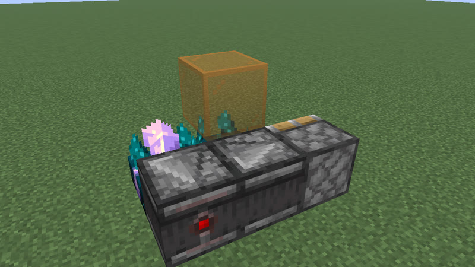</a> 130 gt (6.5 s) · calibrated_sculk_sensor+observer+sculk_sensor+sticky_piston · 5 blocks</td><td align="center"> 130 gt (6.5 s) · dispenser+observer+sculk_sensor+sticky_piston · 6 blocks</td></tr>
</table>

## 131 gt (6.55 s)

Also reachable by: clk-obs-odd-a (n = 30), clk-item-dropring-2d-r3 (n = 7), clk-sculk-hairpin (n = 8), clk-sculk-hairpin-plain (n = 8).

<table>
<tr><td align="center"> 131 gt (6.55 s) · observer+sculk_sensor+sticky_piston · 7 blocks</td></tr>
</table>

## 132 gt (6.6 s)

Also reachable by: clk-obs-obs-ring (n = 31), clk-obs-bulb-ring (n = 14), clk-rt-uloop2t (n = 7), clk-item-dropring-2d (n = 7), clk-rt-uloop1t (n = 3), clk-item-ringlock-rows (n = 4).

<table>
<tr><td align="center"> 132 gt (6.6 s) · observer+sculk_sensor+sticky_piston · 7 blocks</td></tr>
</table>

## 133 gt (6.65 s)

Also reachable by: clk-obs-odd-b (n = 30), clk-item-hopper-ring-2 (n = 18), clk-item-dropring-2d-r4 (n = 7), clk-misc-cart-pingpong (n = 19).

<table>
<tr><td align="center"> 133 gt (6.65 s) · calibrated_sculk_sensor+dispenser+observer+piston+sculk_sensor · 5 blocks</td><td align="center"><a href="../archive/census-p133-calibrated_sculk_sensor-dispenser-observer-sculk_sensor-sticky_piston-5b.txt">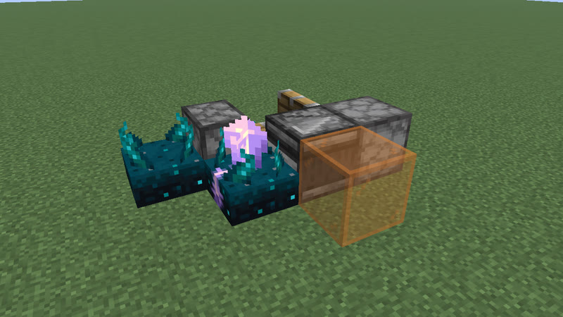</a> 133 gt (6.65 s) · calibrated_sculk_sensor+dispenser+observer+sculk_sensor+sticky_piston · 5 blocks</td></tr>
</table>

## 134 gt (6.7 s)

Also reachable by: clk-misc-activator_rail-ring (n = 31), clk-misc-crafter-ring (n = 31), clk-misc-iron_door-ring (n = 31), clk-misc-oak_door-ring (n = 31), clk-misc-oak_fence_gate-ring (n = 31), clk-misc-oak_trapdoor-ring (n = 31), clk-misc-powered_rail-ring (n = 31), clk-misc-skeleton_skull-ring (n = 31), clk-obs-note-ring (n = 31), clk-obs-trap-ring (n = 31), clk-item-dropring-1d-r1 (n = 7).

<table>
<tr><td align="center"> 134 gt (6.7 s) · calibrated_sculk_sensor+dispenser+oak_trapdoor+observer+sculk_sensor · 5 blocks</td></tr>
</table>

## 135 gt (6.75 s)

Also reachable by: clk-obs-odd-a (n = 31), clk-item-dropring-1d-r14 (n = 6).

<table>
<tr><td align="center"> 135 gt (6.75 s) · calibrated_sculk_sensor+oak_trapdoor+observer+sculk_sensor · 5 blocks</td><td align="center"> 135 gt (6.75 s) · calibrated_sculk_sensor+dispenser+observer+sculk_sensor · 5 blocks</td><td align="center"> 135 gt (6.75 s) · calibrated_sculk_sensor+note_block+observer+sculk_sensor · 5 blocks</td></tr>
<tr><td align="center"> 135 gt (6.75 s) · calibrated_sculk_sensor+observer+piston+sculk_sensor · 5 blocks</td><td align="center"><a href="../archive/census-p135-calibrated_sculk_sensor-observer-sculk_sensor-sticky_piston-5b.txt">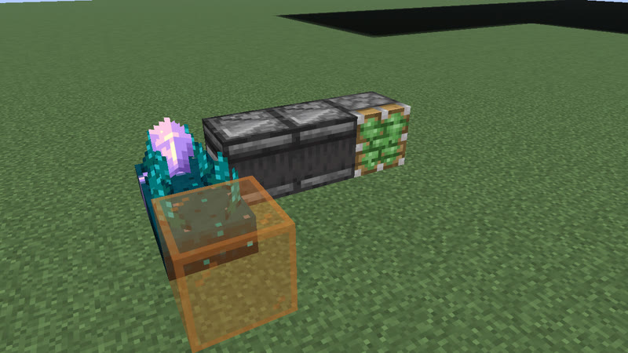</a> 135 gt (6.75 s) · calibrated_sculk_sensor+observer+sculk_sensor+sticky_piston · 5 blocks</td><td align="center"> 135 gt (6.75 s) · calibrated_sculk_sensor+observer+sticky_piston · 6 blocks</td></tr>
</table>

## 136 gt (6.8 s)

Also reachable by: clk-obs-obs-ring (n = 32), clk-item-dropring-1d-r2 (n = 7), clk-item-ringlock-stones-3x6 (n = 4).

<table>
<tr><td align="center"> 136 gt (6.8 s) · calibrated_sculk_sensor+dispenser+observer+sculk_sensor · 5 blocks</td><td align="center"> 136 gt (6.8 s) · calibrated_sculk_sensor+oak_trapdoor+observer+sculk_sensor · 6 blocks</td><td align="center"> 136 gt (6.8 s) · calibrated_sculk_sensor+observer+sculk_sensor+sticky_piston · 6 blocks</td></tr>
<tr><td align="center"> 136 gt (6.8 s) · calibrated_sculk_sensor+note_block · 21 blocks</td></tr>
</table>

## 138 gt (6.9 s)

Also reachable by: clk-misc-activator_rail-ring (n = 32), clk-misc-crafter-ring (n = 32), clk-misc-iron_door-ring (n = 32), clk-misc-oak_door-ring (n = 32), clk-misc-oak_fence_gate-ring (n = 32), clk-misc-oak_trapdoor-ring (n = 32), clk-misc-powered_rail-ring (n = 32), clk-misc-skeleton_skull-ring (n = 32), clk-obs-note-ring (n = 32), clk-obs-trap-ring (n = 32), clk-misc-cart-pingpong (n = 20), clk-item-dropring-1d-r3 (n = 7).

<table>
<tr><td align="center"> 138 gt (6.9 s) · calibrated_sculk_sensor+dispenser+observer+sculk_sensor · 5 blocks</td><td align="center"> 138 gt (6.9 s) · calibrated_sculk_sensor+note_block · 20 blocks</td></tr>
</table>

## 140 gt (7 s)

Also reachable by: clk-obs-obs-ring (n = 33), clk-item-hopper-ring (n = 9), clk-item-hopper-ring-2 (n = 19), clk-obs-bulb-ring (n = 15), clk-item-dropring-1d-r4 (n = 7), clk-sculk-racetrack-plain (n = 8).

<table>
<tr><td align="center"> 140 gt (7 s) · calibrated_sculk_sensor+dispenser+observer+sculk_sensor · 4 blocks</td><td align="center"> 140 gt (7 s) · calibrated_sculk_sensor+oak_trapdoor+observer+sculk_sensor · 6 blocks</td><td align="center"> 140 gt (7 s) · calibrated_sculk_sensor+note_block+observer+sculk_sensor · 6 blocks</td></tr>
<tr><td align="center"> 140 gt (7 s) · calibrated_sculk_sensor+observer+sticky_piston · 6 blocks</td><td align="center"> 140 gt (7 s) · calibrated_sculk_sensor+observer+sculk_sensor+sticky_piston · 6 blocks</td><td align="center"> 140 gt (7 s) · comparator+hopper+redstone_torch+redstone_wire · 10 blocks</td></tr>
<tr><td align="center"> 140 gt (7 s) · calibrated_sculk_sensor+note_block · 20 blocks</td></tr>
</table>

## 141 gt (7.05 s)

Also reachable by: clk-obs-odd-b (n = 32), clk-item-dropring-2d-r1 (n = 7).

<table>
<tr><td align="center"> 141 gt (7.05 s) · calibrated_sculk_sensor+oak_trapdoor+observer+sculk_sensor · 6 blocks</td><td align="center"> 141 gt (7.05 s) · calibrated_sculk_sensor+observer+sculk_sensor+sticky_piston · 6 blocks</td></tr>
</table>

## 142 gt (7.1 s)

Also reachable by: clk-misc-activator_rail-ring (n = 33), clk-misc-crafter-ring (n = 33), clk-misc-iron_door-ring (n = 33), clk-misc-oak_door-ring (n = 33), clk-misc-oak_fence_gate-ring (n = 33), clk-misc-oak_trapdoor-ring (n = 33), clk-misc-powered_rail-ring (n = 33), clk-misc-skeleton_skull-ring (n = 33), clk-obs-note-ring (n = 33), clk-obs-trap-ring (n = 33), clk-item-latch (n = 7), clk-item-dropring-2d-r14 (n = 7).

<table>
<tr><td align="center"> 142 gt (7.1 s) · calibrated_sculk_sensor+note_block · 20 blocks</td><td align="center"> 142 gt (7.1 s) · comparator+redstone_torch+redstone_wire · 21 blocks</td></tr>
</table>

## 144 gt (7.2 s)

Also reachable by: clk-obs-obs-ring (n = 34), clk-rt-rect-pulse (n = 7), clk-item-dropring-2d-r24 (n = 7), clk-rt-div (n = 2).

<table>
<tr><td align="center"> 144 gt (7.2 s) · calibrated_sculk_sensor+note_block · 20 blocks</td><td align="center"> 144 gt (7.2 s) · comparator+redstone_torch+redstone_wire · 21 blocks</td></tr>
</table>

## 145 gt (7.25 s)

Also reachable by: clk-obs-odd-b (n = 33), clk-item-dropring-2d-r3 (n = 8).

<table>
<tr><td align="center"> 145 gt (7.25 s) · calibrated_sculk_sensor+dispenser+observer+sculk_sensor · 5 blocks</td><td align="center"> 145 gt (7.25 s) · calibrated_sculk_sensor+note_block+observer+sculk_sensor · 6 blocks</td><td align="center"> 145 gt (7.25 s) · calibrated_sculk_sensor+oak_trapdoor+observer · 6 blocks</td></tr>
<tr><td align="center"> 145 gt (7.25 s) · calibrated_sculk_sensor+oak_trapdoor+observer+sculk_sensor · 6 blocks</td><td align="center"> 145 gt (7.25 s) · calibrated_sculk_sensor+observer+sculk_sensor+sticky_piston · 6 blocks</td><td align="center"> 145 gt (7.25 s) · calibrated_sculk_sensor+observer+sticky_piston · 6 blocks</td></tr>
</table>

## 146 gt (7.3 s)

Also reachable by: clk-misc-activator_rail-ring (n = 34), clk-misc-crafter-ring (n = 34), clk-misc-iron_door-ring (n = 34), clk-misc-oak_door-ring (n = 34), clk-misc-oak_fence_gate-ring (n = 34), clk-misc-oak_trapdoor-ring (n = 34), clk-misc-powered_rail-ring (n = 34), clk-misc-skeleton_skull-ring (n = 34), clk-obs-note-ring (n = 34), clk-obs-trap-ring (n = 34), clk-item-dropring-2d (n = 8), clk-item-ringlock-rows (n = 5).

<table>
<tr><td align="center"> 146 gt (7.3 s) · calibrated_sculk_sensor+oak_trapdoor+observer+sculk_sensor · 6 blocks</td><td align="center"> 146 gt (7.3 s) · calibrated_sculk_sensor+observer+sculk_sensor+sticky_piston · 6 blocks</td><td align="center"> 146 gt (7.3 s) · calibrated_sculk_sensor+note_block · 20 blocks</td></tr>
</table>

## 148 gt (7.4 s)

Also reachable by: clk-obs-obs-ring (n = 35), clk-obs-bulb-ring (n = 16), clk-rt-uloop2t (n = 8), clk-item-dropring-1d-r1 (n = 8), clk-rt-rect-inv (n = 3).

<table>
<tr><td align="center"> 148 gt (7.4 s) · comparator+hopper · 12 blocks</td><td align="center"> 148 gt (7.4 s) · calibrated_sculk_sensor+note_block · 20 blocks</td></tr>
</table>

## 150 gt (7.5 s)

Also reachable by: clk-misc-activator_rail-ring (n = 35), clk-misc-crafter-ring (n = 35), clk-misc-iron_door-ring (n = 35), clk-misc-oak_door-ring (n = 35), clk-misc-oak_fence_gate-ring (n = 35), clk-misc-oak_trapdoor-ring (n = 35), clk-misc-powered_rail-ring (n = 35), clk-misc-skeleton_skull-ring (n = 35), clk-obs-note-ring (n = 35), clk-obs-trap-ring (n = 35), clk-item-dropring-1d-r2 (n = 8).

<table>
<tr><td align="center"> 150 gt (7.5 s) · calibrated_sculk_sensor+note_block · 20 blocks</td></tr>
</table>

## 155 gt (7.75 s)

Also reachable by: clk-obs-odd-a (n = 36), clk-item-dropring-2d-r1 (n = 8).

<table>
<tr><td align="center"> 155 gt (7.75 s) · calibrated_sculk_sensor+dispenser+observer+sculk_sensor · 5 blocks</td><td align="center"> 155 gt (7.75 s) · calibrated_sculk_sensor+oak_trapdoor+observer+sculk_sensor · 7 blocks</td><td align="center"> 155 gt (7.75 s) · calibrated_sculk_sensor+note_block+observer+sculk_sensor · 7 blocks</td></tr>
<tr><td align="center"> 155 gt (7.75 s) · calibrated_sculk_sensor+oak_trapdoor+observer · 7 blocks</td><td align="center"> 155 gt (7.75 s) · calibrated_sculk_sensor+observer+sculk_sensor+sticky_piston · 7 blocks</td><td align="center"> 155 gt (7.75 s) · calibrated_sculk_sensor+observer+sticky_piston · 7 blocks</td></tr>
</table>

## 156 gt (7.8 s)

Also reachable by: clk-obs-obs-ring (n = 37), clk-obs-bulb-ring (n = 17), clk-item-dropring-2d-r14 (n = 8), clk-sculk-racetrack (n = 4), clk-sculk-racetrack-plain (n = 9).

<table>
<tr><td align="center"> 156 gt (7.8 s) · copper_bulb+observer+piston · 7 blocks</td><td align="center"> 156 gt (7.8 s) · copper_bulb+observer+piston+sticky_piston · 7 blocks</td><td align="center"> 156 gt (7.8 s) · copper_bulb+observer+piston+sticky_piston · 7 blocks</td></tr>
<tr><td align="center"> 156 gt (7.8 s) · comparator+hopper · 12 blocks</td></tr>
</table>

## 158 gt (7.9 s)

Also reachable by: clk-misc-activator_rail-ring (n = 37), clk-misc-crafter-ring (n = 37), clk-misc-iron_door-ring (n = 37), clk-misc-oak_door-ring (n = 37), clk-misc-oak_fence_gate-ring (n = 37), clk-misc-oak_trapdoor-ring (n = 37), clk-misc-powered_rail-ring (n = 37), clk-misc-skeleton_skull-ring (n = 37), clk-obs-note-ring (n = 37), clk-obs-trap-ring (n = 37), clk-item-latch (n = 8), clk-item-dropring-2d-r24 (n = 8).

<table>
<tr><td align="center"> 158 gt (7.9 s) · comparator+hopper · 10 blocks</td></tr>
</table>

## 161 gt (8.05 s)

Also reachable by: clk-obs-odd-b (n = 37), clk-item-hopper-ring-2 (n = 22), clk-item-dropring-2d-r4 (n = 9).

<table>
<tr><td align="center"> 161 gt (8.05 s) · comparator+redstone_torch+redstone_wire+repeater · 44 blocks</td></tr>
</table>

## 162 gt (8.1 s)

Also reachable by: clk-misc-activator_rail-ring (n = 38), clk-misc-crafter-ring (n = 38), clk-misc-iron_door-ring (n = 38), clk-misc-oak_door-ring (n = 38), clk-misc-oak_fence_gate-ring (n = 38), clk-misc-oak_trapdoor-ring (n = 38), clk-misc-powered_rail-ring (n = 38), clk-misc-skeleton_skull-ring (n = 38), clk-obs-note-ring (n = 38), clk-obs-trap-ring (n = 38), clk-item-dropring-1d-r1 (n = 9).

<table>
<tr><td align="center"> 162 gt (8.1 s) · calibrated_sculk_sensor+oak_trapdoor+observer+sticky_piston · 6 blocks</td><td align="center"> 162 gt (8.1 s) · calibrated_sculk_sensor+iron_trapdoor+observer+sticky_piston · 6 blocks</td><td align="center"> 162 gt (8.1 s) · calibrated_sculk_sensor+oak_fence_gate+observer+sticky_piston · 6 blocks</td></tr>
<tr><td align="center"> 162 gt (8.1 s) · calibrated_sculk_sensor+note_block+observer+sticky_piston · 6 blocks</td><td align="center"> 162 gt (8.1 s) · calibrated_sculk_sensor+dispenser+observer+sticky_piston · 6 blocks</td></tr>
</table>

## 168 gt (8.4 s)

Also reachable by: clk-obs-obs-ring (n = 40), clk-item-hopper-ring (n = 11), clk-item-hopper-ring-2 (n = 23), clk-item-dropring-1d-r4 (n = 9).

<table>
<tr><td align="center"> 168 gt (8.4 s) · dispenser+observer+sculk_sensor · 5 blocks</td></tr>
</table>

## 169 gt (8.45 s)

Also reachable by: clk-obs-odd-b (n = 39), clk-item-dropring-2d-r1 (n = 9).

<table>
<tr><td align="center"> 169 gt (8.45 s) · observer+sculk_sensor+sticky_piston · 7 blocks</td></tr>
</table>

## 170 gt (8.5 s)

Also reachable by: clk-misc-activator_rail-ring (n = 40), clk-misc-crafter-ring (n = 40), clk-misc-iron_door-ring (n = 40), clk-misc-oak_door-ring (n = 40), clk-misc-oak_fence_gate-ring (n = 40), clk-misc-oak_trapdoor-ring (n = 40), clk-misc-powered_rail-ring (n = 40), clk-misc-skeleton_skull-ring (n = 40), clk-obs-note-ring (n = 40), clk-obs-trap-ring (n = 40), clk-item-dropring-2d-r14 (n = 9), clk-rt-fade (n = 1).

<table>
<tr><td align="center"> 170 gt (8.5 s) · note_block+observer+sculk_sensor+sticky_piston · 7 blocks</td></tr>
</table>

## 172 gt (8.6 s)

Also reachable by: clk-obs-obs-ring (n = 41), clk-obs-bulb-ring (n = 19), clk-item-dropring-2d-r24 (n = 9), clk-sculk-racetrack-plain (n = 10).

<table>
<tr><td align="center"> 172 gt (8.6 s) · calibrated_sculk_sensor+note_block+oak_trapdoor+observer+sculk_sensor · 5 blocks</td><td align="center"> 172 gt (8.6 s) · calibrated_sculk_sensor+note_block+observer+piston+sculk_sensor · 5 blocks</td><td align="center"><a href="../archive/census-p172-calibrated_sculk_sensor-note_block-observer-sculk_sensor-sticky_piston-5b.txt">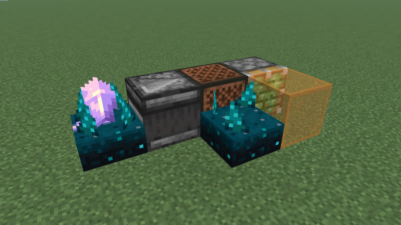</a> 172 gt (8.6 s) · calibrated_sculk_sensor+note_block+observer+sculk_sensor+sticky_piston · 5 blocks</td></tr>
</table>

## 173 gt (8.65 s)

Also reachable by: clk-obs-odd-b (n = 40), clk-item-dropring-2d-r3 (n = 10).

<table>
<tr><td align="center"> 173 gt (8.65 s) · calibrated_sculk_sensor+dispenser+note_block+observer+sculk_sensor · 5 blocks</td><td align="center"> 173 gt (8.65 s) · oak_trapdoor+observer+sculk_sensor · 6 blocks</td></tr>
</table>

## 175 gt (8.75 s)

Also reachable by: clk-obs-odd-a (n = 41), clk-item-hopper-ring-2 (n = 24), clk-item-dropring-2d-r4 (n = 10), clk-misc-crafter-loop (n = 3).

<table>
<tr><td align="center"> 175 gt (8.75 s) · calibrated_sculk_sensor+dispenser+note_block+observer+sculk_sensor · 5 blocks</td><td align="center"> 175 gt (8.75 s) · calibrated_sculk_sensor+oak_trapdoor+observer+sculk_sensor · 5 blocks</td><td align="center"> 175 gt (8.75 s) · calibrated_sculk_sensor+observer+piston+sculk_sensor · 5 blocks</td></tr>
<tr><td align="center"><a href="../archive/census-p175-calibrated_sculk_sensor-observer-sculk_sensor-sticky_piston-5b.txt">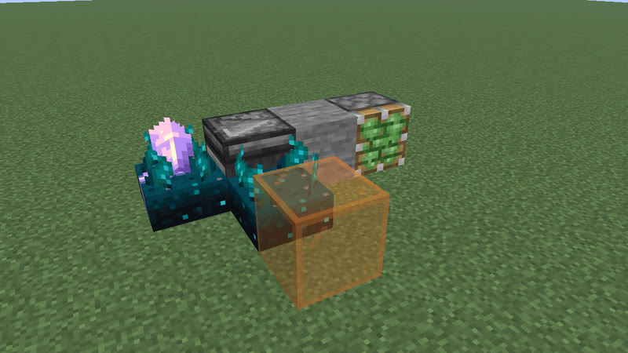</a> 175 gt (8.75 s) · calibrated_sculk_sensor+observer+sculk_sensor+sticky_piston · 5 blocks</td><td align="center"> 175 gt (8.75 s) · calibrated_sculk_sensor+observer+sticky_piston · 7 blocks</td></tr>
</table>

## 176 gt (8.8 s)

Also reachable by: clk-obs-obs-ring (n = 42), clk-rt-rect-pulse (n = 9), clk-item-dropring-1d-r1 (n = 10).

<table>
<tr><td align="center"> 176 gt (8.8 s) · dispenser+observer+sculk_sensor · 6 blocks</td><td align="center"> 176 gt (8.8 s) · calibrated_sculk_sensor+observer+sticky_piston · 7 blocks</td></tr>
</table>

## 180 gt (9 s)

Also reachable by: clk-obs-obs-ring (n = 43), clk-obs-bulb-ring (n = 20), clk-rt-uloop2t (n = 10), clk-item-dropring-1d-r3 (n = 10), clk-rt-rect-inv (n = 4).

<table>
<tr><td align="center"> 180 gt (9 s) · dispenser+observer+sculk_sensor · 7 blocks</td><td align="center"> 180 gt (9 s) · calibrated_sculk_sensor+observer+sculk_sensor+sticky_piston · 7 blocks</td></tr>
</table>

## 182 gt (9.1 s)

Also reachable by: clk-misc-activator_rail-ring (n = 43), clk-misc-crafter-ring (n = 43), clk-misc-iron_door-ring (n = 43), clk-misc-oak_door-ring (n = 43), clk-misc-oak_fence_gate-ring (n = 43), clk-misc-oak_trapdoor-ring (n = 43), clk-misc-powered_rail-ring (n = 43), clk-misc-skeleton_skull-ring (n = 43), clk-obs-note-ring (n = 43), clk-obs-trap-ring (n = 43), clk-item-hopper-ring (n = 12), clk-item-hopper-ring-2 (n = 25), clk-item-dropring-1d-r4 (n = 10).

<table>
<tr><td align="center"> 182 gt (9.1 s) · calibrated_sculk_sensor+oak_trapdoor+observer+sculk_sensor · 5 blocks</td><td align="center"> 182 gt (9.1 s) · calibrated_sculk_sensor+observer+piston+sculk_sensor · 5 blocks</td><td align="center"> 182 gt (9.1 s) · calibrated_sculk_sensor+observer+sculk_sensor+sticky_piston · 5 blocks</td></tr>
</table>

## 192 gt (9.6 s)

Also reachable by: clk-obs-obs-ring (n = 46), clk-obs-divider (n = 4), clk-rt-rect-pulse (n = 10), clk-item-dropring-1d-r2 (n = 11).

<table>
<tr><td align="center"> 192 gt (9.6 s) · hopper+redstone_torch+redstone_wire · 9 blocks</td></tr>
</table>

## 195 gt (9.75 s)

Also reachable by: clk-obs-odd-a (n = 46), clk-item-dropring-1d (n = 12), clk-sculk-hairpin (n = 12), clk-sculk-hairpin-plain (n = 12).

<table>
<tr><td align="center"> 195 gt (9.75 s) · comparator+hopper+redstone_torch+redstone_wire · 9 blocks</td></tr>
</table>

## 200 gt (10 s)

Also reachable by: clk-obs-obs-ring (n = 48), clk-item-dropring-2d-r24 (n = 11).

<table>
<tr><td align="center"> 200 gt (10 s) · comparator+redstone_torch+redstone_wire · 14 blocks</td></tr>
</table>

## 205 gt (10.25 s)

Also reachable by: clk-item-dropring-1d-r14 (n = 11).

<table>
<tr><td align="center"> 205 gt (10.25 s) · redstone_torch+redstone_wire+repeater · 8 blocks</td></tr>
</table>

## 206 gt (10.3 s)

Also reachable by: clk-item-latch (n = 11), clk-item-dropring-1d-r2 (n = 12).

<table>
<tr><td align="center"> 206 gt (10.3 s) · comparator+hopper · 14 blocks</td></tr>
</table>

## 210 gt (10.5 s)

Also reachable by: clk-item-hopper-ring (n = 14), clk-item-hopper-ring-2 (n = 29), clk-item-dropring-1d-r4 (n = 12).

<table>
<tr><td align="center"> 210 gt (10.5 s) · oak_trapdoor+observer+sculk_sensor · 5 blocks</td><td align="center"> 210 gt (10.5 s) · observer+piston+sculk_sensor · 5 blocks</td><td align="center"> 210 gt (10.5 s) · observer+sculk_sensor+sticky_piston · 5 blocks</td></tr>
<tr><td align="center"> 210 gt (10.5 s) · comparator+hopper+redstone_torch+redstone_wire · 8 blocks</td><td align="center"> 210 gt (10.5 s) · comparator+redstone_torch+redstone_wire · 14 blocks</td></tr>
</table>

## 211 gt (10.55 s)

Also reachable by: clk-item-dropring-2d-r1 (n = 12).

<table>
<tr><td align="center"> 211 gt (10.55 s) · comparator+hopper · 14 blocks</td></tr>
</table>

## 212 gt (10.6 s)

Also reachable by: clk-item-dropring-2d-r14 (n = 12), clk-rt-rect-inv (n = 5).

<table>
<tr><td align="center"> 212 gt (10.6 s) · calibrated_sculk_sensor+dispenser+note_block+observer+sculk_sensor · 5 blocks</td><td align="center"> 212 gt (10.6 s) · calibrated_sculk_sensor+dispenser+oak_trapdoor+observer+sculk_sensor · 5 blocks</td><td align="center"> 212 gt (10.6 s) · calibrated_sculk_sensor+dispenser+observer+piston+sculk_sensor · 5 blocks</td></tr>
<tr><td align="center"><a href="../archive/census-p212-calibrated_sculk_sensor-dispenser-observer-sculk_sensor-sticky_piston-5b.txt">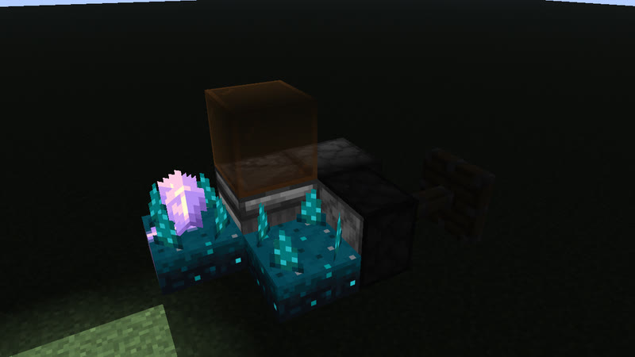</a> 212 gt (10.6 s) · calibrated_sculk_sensor+dispenser+observer+sculk_sensor+sticky_piston · 5 blocks</td></tr>
</table>

## 214 gt (10.7 s)

Also reachable by: clk-item-dropring-2d-r24 (n = 12).

<table>
<tr><td align="center"> 214 gt (10.7 s) · comparator+hopper · 14 blocks</td></tr>
</table>

## 215 gt (10.75 s)

Also reachable by: clk-item-dropring-2d-r3 (n = 13).

<table>
<tr><td align="center"> 215 gt (10.75 s) · calibrated_sculk_sensor+dispenser+note_block+observer+sculk_sensor · 5 blocks</td><td align="center"> 215 gt (10.75 s) · calibrated_sculk_sensor+dispenser+oak_trapdoor+observer+sculk_sensor · 5 blocks</td><td align="center"> 215 gt (10.75 s) · calibrated_sculk_sensor+dispenser+observer+piston+sculk_sensor · 5 blocks</td></tr>
<tr><td align="center"><a href="../archive/census-p215-calibrated_sculk_sensor-dispenser-observer-sculk_sensor-sticky_piston-5b.txt">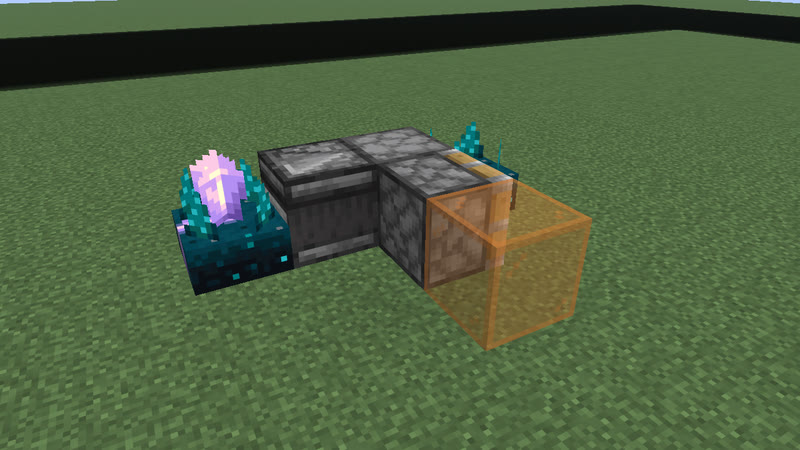</a> 215 gt (10.75 s) · calibrated_sculk_sensor+dispenser+observer+sculk_sensor+sticky_piston · 5 blocks</td><td align="center"> 215 gt (10.75 s) · dispenser+observer+sculk_sensor · 7 blocks</td></tr>
</table>

## 216 gt (10.8 s)

Also reachable by: clk-item-dropring-2d (n = 13), clk-item-ringlock-rows (n = 10).

<table>
<tr><td align="center"> 216 gt (10.8 s) · calibrated_sculk_sensor+dispenser+note_block+observer+sculk_sensor · 5 blocks</td><td align="center"> 216 gt (10.8 s) · calibrated_sculk_sensor+dispenser+oak_trapdoor+observer+sculk_sensor · 5 blocks</td><td align="center"> 216 gt (10.8 s) · calibrated_sculk_sensor+dispenser+observer+piston+sculk_sensor · 5 blocks</td></tr>
<tr><td align="center"><a href="../archive/census-p216-calibrated_sculk_sensor-dispenser-observer-sculk_sensor-sticky_piston-5b.txt">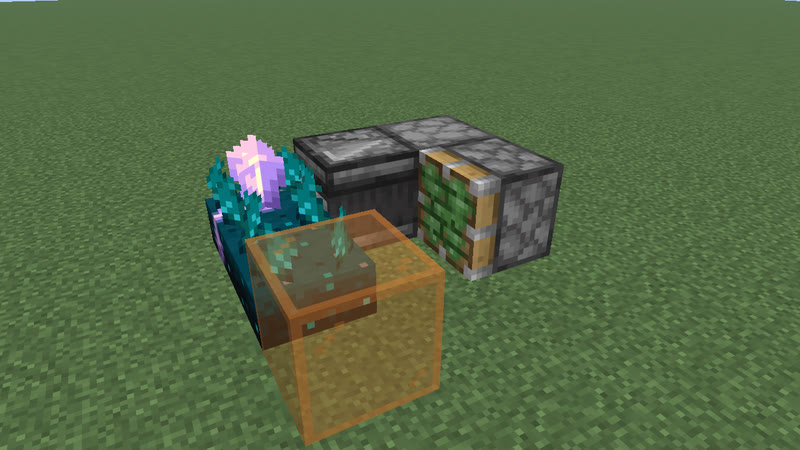</a> 216 gt (10.8 s) · calibrated_sculk_sensor+dispenser+observer+sculk_sensor+sticky_piston · 5 blocks</td><td align="center"> 216 gt (10.8 s) · observer+sculk_sensor+sticky_piston · 6 blocks</td><td align="center"> 216 gt (10.8 s) · dispenser+observer+sculk_sensor+sticky_piston · 6 blocks</td></tr>
<tr><td align="center"> 216 gt (10.8 s) · observer+piston+sculk_sensor+sticky_piston · 6 blocks</td><td align="center"><a href="../archive/clk-sculk-hyb3-p216-3.txt">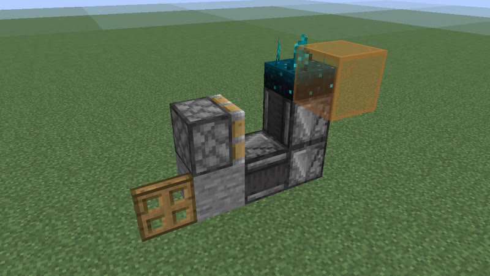</a> 216 gt (10.8 s) · oak_trapdoor+observer+sculk_sensor+sticky_piston · 7 blocks</td><td align="center"> 216 gt (10.8 s) · iron_trapdoor+observer+sculk_sensor+sticky_piston · 7 blocks</td></tr>
<tr><td align="center"> 216 gt (10.8 s) · oak_fence_gate+observer+sculk_sensor+sticky_piston · 7 blocks</td><td align="center"><a href="../archive/clk-sculk-hyb3-p216-1.txt">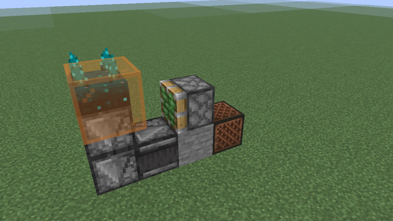</a> 216 gt (10.8 s) · note_block+observer+sculk_sensor+sticky_piston · 7 blocks</td><td align="center"> 216 gt (10.8 s) · oak_trapdoor+observer+sculk_sensor · 7 blocks</td></tr>
</table>

## 217 gt (10.85 s)

Also reachable by: clk-item-hopper-ring-2 (n = 30), clk-item-dropring-2d-r4 (n = 13).

<table>
<tr><td align="center"> 217 gt (10.85 s) · calibrated_sculk_sensor+dispenser+note_block+observer+sculk_sensor · 5 blocks</td></tr>
</table>

## 218 gt (10.9 s)

Also reachable by: clk-item-dropring-1d-r1 (n = 13).

<table>
<tr><td align="center"> 218 gt (10.9 s) · comparator+hopper · 10 blocks</td></tr>
</table>

## 219 gt (10.95 s)

Also reachable by: clk-item-dropring-1d-r14 (n = 12).

<table>
<tr><td align="center"> 219 gt (10.95 s) · oak_trapdoor+observer+sculk_sensor · 6 blocks</td></tr>
</table>

## 220 gt (11 s)

Also reachable by: clk-item-dropring-1d-r2 (n = 13), clk-sculk-racetrack (n = 6).

<table>
<tr><td align="center"> 220 gt (11 s) · comparator+redstone_torch · 8 blocks</td><td align="center"> 220 gt (11 s) · comparator+redstone_torch+repeater · 8 blocks</td><td align="center"> 220 gt (11 s) · redstone_torch+repeater · 8 blocks</td></tr>
<tr><td align="center"> 220 gt (11 s) · redstone_torch+redstone_wire+repeater · 8 blocks</td><td align="center"> 220 gt (11 s) · redstone_torch+redstone_wire+repeater · 9 blocks</td><td align="center"> 220 gt (11 s) · redstone_torch+redstone_wire+repeater · 10 blocks</td></tr>
<tr><td align="center"> 220 gt (11 s) · comparator+redstone_torch+redstone_wire · 12 blocks</td><td align="center"> 220 gt (11 s) · comparator+redstone_torch+redstone_wire+repeater · 12 blocks</td></tr>
</table>

## 225 gt (11.25 s)

Also reachable by: clk-item-dropring-2d-r1 (n = 13).

<table>
<tr><td align="center"> 225 gt (11.25 s) · calibrated_sculk_sensor+dispenser+note_block+observer+sculk_sensor · 5 blocks</td><td align="center"> 225 gt (11.25 s) · calibrated_sculk_sensor+dispenser+oak_trapdoor+observer+sculk_sensor · 5 blocks</td><td align="center"> 225 gt (11.25 s) · calibrated_sculk_sensor+dispenser+observer+piston+sculk_sensor · 5 blocks</td></tr>
<tr><td align="center"><a href="../archive/census-p225-calibrated_sculk_sensor-dispenser-observer-sculk_sensor-sticky_piston-5b.txt">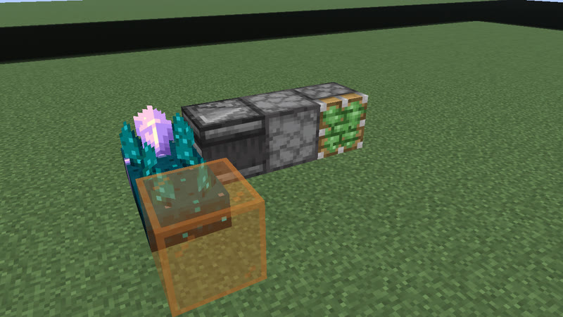</a> 225 gt (11.25 s) · calibrated_sculk_sensor+dispenser+observer+sculk_sensor+sticky_piston · 5 blocks</td><td align="center"> 225 gt (11.25 s) · calibrated_sculk_sensor+observer+sculk_sensor+sticky_piston · 5 blocks</td></tr>
</table>

## 228 gt (11.4 s)

Also reachable by: clk-rt-uloop1t (n = 6), clk-item-dropring-2d-r24 (n = 13), clk-rt-div-fade (n = 1).

<table>
<tr><td align="center"> 228 gt (11.4 s) · comparator+hopper · 12 blocks</td></tr>
</table>

## 236 gt (11.8 s)

Also reachable by: clk-item-dropring-1d-r3 (n = 14).

<table>
<tr><td align="center"> 236 gt (11.8 s) · comparator+hopper · 12 blocks</td></tr>
</table>

## 242 gt (12.1 s)

Also reachable by: clk-item-dropring-2d-r24 (n = 14).

<table>
<tr><td align="center"> 242 gt (12.1 s) · calibrated_sculk_sensor+dispenser+observer+sculk_sensor · 5 blocks</td></tr>
</table>

## 258 gt (12.9 s)

Also reachable by: clk-item-dropring-2d (n = 16), clk-item-ringlock-rows (n = 13).

<table>
<tr><td align="center"> 258 gt (12.9 s) · observer+sculk_sensor+sticky_piston · 6 blocks</td></tr>
</table>

## 261 gt (13.05 s)

Also reachable by: clk-item-dropring-1d-r14 (n = 15).

<table>
<tr><td align="center"> 261 gt (13.05 s) · observer+sculk_sensor+sticky_piston · 6 blocks</td></tr>
</table>

## 270 gt (13.5 s)

Also reachable by: clk-item-latch (n = 15), clk-item-dropring-2d-r24 (n = 16).

<table>
<tr><td align="center"> 270 gt (13.5 s) · calibrated_sculk_sensor+observer+sticky_piston · 7 blocks</td></tr>
</table>

## 275 gt (13.75 s)

Also reachable by: clk-item-dropring-1d-r14 (n = 16).

<table>
<tr><td align="center"> 275 gt (13.75 s) · comparator+hopper · 14 blocks</td></tr>
</table>

## 291 gt (14.55 s)

Also reachable by: clk-item-dropring-1d-r24 (n = 17).

<table>
<tr><td align="center"> 291 gt (14.55 s) · observer+sculk_sensor+sticky_piston · 7 blocks</td></tr>
</table>

## 296 gt (14.8 s)

Also reachable by: clk-item-dropring-2d-r14 (n = 18).

<table>
<tr><td align="center"> 296 gt (14.8 s) · calibrated_sculk_sensor+dispenser+oak_trapdoor+observer+sculk_sensor · 5 blocks</td><td align="center"> 296 gt (14.8 s) · calibrated_sculk_sensor+dispenser+observer+piston+sculk_sensor · 5 blocks</td><td align="center"><a href="../archive/census-p296-calibrated_sculk_sensor-dispenser-observer-sculk_sensor-sticky_piston-5b.txt">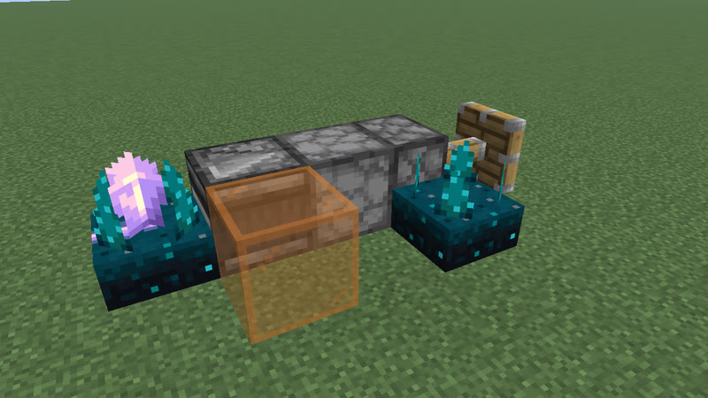</a> 296 gt (14.8 s) · calibrated_sculk_sensor+dispenser+observer+sculk_sensor+sticky_piston · 5 blocks</td></tr>
</table>

## 300 gt (15 s)

Also reachable by: clk-item-dropring-2d (n = 19), clk-item-ringlock-rows (n = 16), clk-item-ringlock-stones-3x20 (n = 0).

<table>
<tr><td align="center"> 300 gt (15 s) · calibrated_sculk_sensor+observer+sculk_sensor+sticky_piston · 7 blocks</td></tr>
</table>

## 306 gt (15.3 s)

Also reachable by: clk-item-dropring-1d-r3 (n = 19).

<table>
<tr><td align="center"> 306 gt (15.3 s) · oak_trapdoor+observer+sculk_sensor+sticky_piston · 6 blocks</td><td align="center"> 306 gt (15.3 s) · iron_trapdoor+observer+sculk_sensor+sticky_piston · 6 blocks</td><td align="center"> 306 gt (15.3 s) · oak_fence_gate+observer+sculk_sensor+sticky_piston · 6 blocks</td></tr>
<tr><td align="center"> 306 gt (15.3 s) · note_block+observer+sculk_sensor+sticky_piston · 6 blocks</td><td align="center"> 306 gt (15.3 s) · comparator+hopper · 14 blocks</td></tr>
</table>

## 314 gt (15.7 s)

Also reachable by: clk-item-dropring-2d (n = 20), clk-item-ringlock-rows (n = 17).

<table>
<tr><td align="center"> 314 gt (15.7 s) · comparator+hopper · 14 blocks</td></tr>
</table>

## 322 gt (16.1 s)

Also reachable by: clk-item-hopper-ring (n = 22), clk-item-dropring-1d-r4 (n = 20).

<table>
<tr><td align="center"> 322 gt (16.1 s) · comparator+redstone_torch+redstone_wire+repeater · 42 blocks</td></tr>
</table>

## 336 gt (16.8 s)

Also reachable by: clk-item-hopper-ring (n = 23), clk-item-dropring-1d-r4 (n = 21).

<table>
<tr><td align="center"> 336 gt (16.8 s) · observer+sculk_sensor+sticky_piston · 7 blocks</td></tr>
</table>

## 342 gt (17.1 s)

Also reachable by: clk-item-dropring-2d (n = 22), clk-item-ringlock-rows (n = 19).

<table>
<tr><td align="center"> 342 gt (17.1 s) · oak_trapdoor+observer+sculk_sensor+sticky_piston · 6 blocks</td><td align="center"> 342 gt (17.1 s) · iron_trapdoor+observer+sculk_sensor+sticky_piston · 6 blocks</td><td align="center"> 342 gt (17.1 s) · oak_fence_gate+observer+sculk_sensor+sticky_piston · 6 blocks</td></tr>
<tr><td align="center"> 342 gt (17.1 s) · note_block+observer+sculk_sensor+sticky_piston · 6 blocks</td><td align="center"> 342 gt (17.1 s) · observer+piston+sculk_sensor+sticky_piston · 7 blocks</td><td align="center"> 342 gt (17.1 s) · observer+sculk_sensor+sticky_piston · 7 blocks</td></tr>
</table>

## 384 gt (19.2 s)

Also reachable by: clk-obs-divider (n = 5), clk-item-dropring-2d (n = 25), clk-item-ringlock-rows (n = 22).

<table>
<tr><td align="center"> 384 gt (19.2 s) · comparator+hopper+redstone_torch+redstone_wire · 9 blocks</td></tr>
</table>

## 389 gt (19.45 s)

Also reachable by: clk-item-dropring-1d-r24 (n = 24).

<table>
<tr><td align="center"> 389 gt (19.45 s) · comparator+hopper+redstone_torch+redstone_wire · 9 blocks</td></tr>
</table>

## 410 gt (20.5 s)

Also reachable by: clk-item-dropring-2d-r24 (n = 26).

<table>
<tr><td align="center"> 410 gt (20.5 s) · comparator+redstone_torch+redstone_wire · 12 blocks</td></tr>
</table>

## 414 gt (20.7 s)

Also reachable by: clk-item-latch (n = 24), clk-item-dropring-1d-r1 (n = 27).

<table>
<tr><td align="center"> 414 gt (20.7 s) · comparator+hopper · 14 blocks</td></tr>
</table>

## 422 gt (21.1 s)

Also reachable by: clk-item-dropring-2d-r14 (n = 27).

<table>
<tr><td align="center"> 422 gt (21.1 s) · comparator+hopper · 14 blocks</td></tr>
</table>

## 440 gt (22 s)

Also reachable by: clk-item-dropring-2d (n = 29), clk-item-ringlock-rows (n = 26).

<table>
<tr><td align="center"> 440 gt (22 s) · redstone_torch+repeater · 8 blocks</td><td align="center"> 440 gt (22 s) · comparator+redstone_torch · 8 blocks</td><td align="center"> 440 gt (22 s) · comparator+redstone_torch+redstone_wire · 12 blocks</td></tr>
</table>

## 468 gt (23.4 s)

Also reachable by: clk-item-ringlock-rows (n = 28), clk-item-ringlock-stones-3x20 (n = 21).

<table>
<tr><td align="center"> 468 gt (23.4 s) · observer+piston+sculk_sensor+sticky_piston · 7 blocks</td><td align="center"> 468 gt (23.4 s) · observer+sculk_sensor+sticky_piston · 7 blocks</td></tr>
</table>

## 476 gt (23.8 s)

Also reachable by: clk-item-hopper-ring (n = 33), clk-item-ringlock-stones-3x20 (n = 22).

<table>
<tr><td align="center"> 476 gt (23.8 s) · detector_rail+minecart · 17 blocks</td></tr>
</table>

## 570 gt (28.5 s)

<table>
<tr><td align="center"> 570 gt (28.5 s) · comparator+redstone_torch+redstone_wire · 48 blocks</td></tr>
</table>

## 654 gt (32.7 s)

Also reachable by: clk-item-latch (n = 39).

<table>
<tr><td align="center"> 654 gt (32.7 s) · comparator+hopper · 10 blocks</td></tr>
</table>

## 798 gt (39.9 s)

Also reachable by: clk-item-latch (n = 48).

<table>
<tr><td align="center"> 798 gt (39.9 s) · comparator+redstone_torch+redstone_wire · 46 blocks</td></tr>
</table>

## 872 gt (43.6 s)

<table>
<tr><td align="center"> 872 gt (43.6 s) · redstone_torch+redstone_wire · 16 blocks</td></tr>
</table>

## 882 gt (44.1 s)

<table>
<tr><td align="center"> 882 gt (44.1 s) · comparator+hopper+redstone_torch+redstone_wire · 9 blocks</td></tr>
</table>

## 1012 gt (50.6 s)

<table>
<tr><td align="center"> 1012 gt (50.6 s) · comparator+redstone_torch+redstone_wire+repeater · 64 blocks</td></tr>
</table>

## 1127 gt (56.35 s)

<table>
<tr><td align="center"> 1127 gt (56.35 s) · comparator+redstone_torch+redstone_wire+repeater · 72 blocks</td></tr>
</table>

## 1230 gt (1 min 1.5 s)

Also reachable by: clk-item-latch (n = 75).

<table>
<tr><td align="center"> 1230 gt (1 min 1.5 s) · comparator+hopper · 14 blocks</td></tr>
</table>

## 1344 gt (1 min 7.2 s)

<table>
<tr><td align="center"> 1344 gt (1 min 7.2 s) · comparator+hopper+redstone_torch+redstone_wire · 9 blocks</td></tr>
</table>

## 1360 gt (1 min 8 s)

<table>
<tr><td align="center"> 1360 gt (1 min 8 s) · comparator+redstone_torch+redstone_wire+repeater · 76 blocks</td></tr>
</table>

## 1446 gt (1 min 12.3 s)

<table>
<tr><td align="center"> 1446 gt (1 min 12.3 s) · dropper+hopper+jukebox+note_block+redstone_torch+redstone_wire · 9 blocks</td></tr>
</table>

## 1596 gt (1 min 19.8 s)

Also reachable by: clk-rt-counter (n = 1).

## 2380 gt (1 min 59 s)

<table>
<tr><td align="center"> 2380 gt (1 min 59 s) · comparator+redstone_torch+redstone_wire · 52 blocks</td></tr>
</table>

## 2704 gt (2 min 15.2 s)

<table>
<tr><td align="center"> 2704 gt (2 min 15.2 s) · comparator+redstone_torch+redstone_wire+repeater · 88 blocks</td></tr>
</table>

## 3164 gt (2 min 38.2 s)

<table>
<tr><td align="center"> 3164 gt (2 min 38.2 s) · comparator+redstone_torch+redstone_wire · 60 blocks</td></tr>
</table>

## 4732 gt (3 min 56.6 s)

<table>
<tr><td align="center"> 4732 gt (3 min 56.6 s) · comparator+redstone_torch+redstone_wire · 76 blocks</td></tr>
</table>

## 5408 gt (4 min 30.4 s)

<table>
<tr><td align="center"> 5408 gt (4 min 30.4 s) · comparator+redstone_torch+redstone_wire+repeater · 106 blocks</td></tr>
</table>

## 6926 gt (5 min 46.3 s)

<table>
<tr><td align="center"> 6926 gt (5 min 46.3 s) · dropper+hopper+jukebox+note_block+redstone_torch+redstone_wire · 9 blocks</td></tr>
</table>

## 10816 gt (9 min 0.8 s)

<table>
<tr><td align="center"> 10816 gt (9 min 0.8 s) · comparator+redstone_torch+redstone_wire+repeater · 124 blocks</td></tr>
</table>

## 17978 gt (14 min 58.9 s)

<table>
<tr><td align="center"> 17978 gt (14 min 58.9 s) · dropper+hopper+jukebox+note_block+redstone_torch+redstone_wire · 9 blocks</td></tr>
</table>

[catalog index](../CATALOG.md) · previous: [p66-126](p66-126.md)
