# Clocks: 130 gt (6.5 s) to 17978 gt (14 min 58.9 s) (257 clock types)

[catalog index](../CATALOG.md) · previous: [p83-129](p83-129.md)

Orange glass = where the output signal is (placed only for the picture); click a picture for its design. Larger clocks of a period that only add block kinds to a smaller one are listed on [variants](variants.md). Generated by `mctas clock catalog`.

## 130 gt (6.5 s)

Also reachable by: observer ring with a relay block (clk-obs-note-ring, n = 30), dropper ring (clk-item-dropring-2d-r24, n = 6), clk-sculk-replin (n = 14).

<table>
<tr><td align="center"><a href="../archive/census-p130-calibrated_sculk_sensor-note_block-observer-sculk_sensor-5b.txt">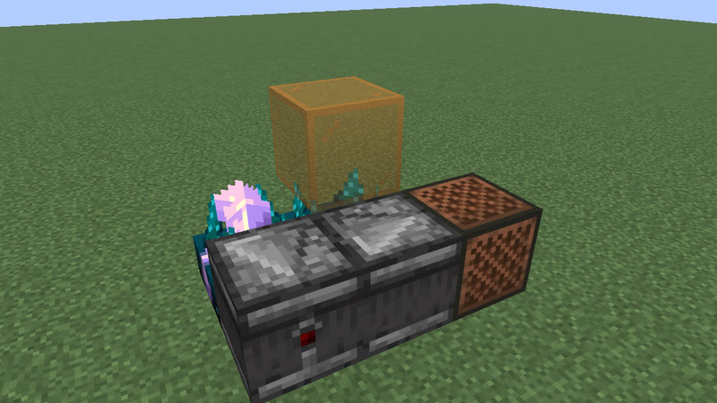</a> 130 gt (6.5 s) · calibrated_sculk_sensor+note_block+observer+sculk_sensor · 5 blocks</td><td align="center"><a href="../archive/census-p130-calibrated_sculk_sensor-oak_trapdoor-observer-sculk_sensor-5b.txt">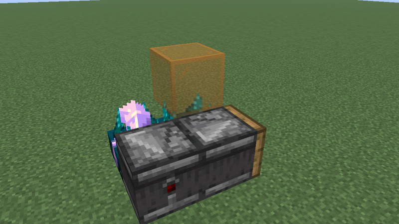</a> 130 gt (6.5 s) · calibrated_sculk_sensor+oak_trapdoor+observer+sculk_sensor · 5 blocks</td><td align="center"><a href="../archive/census-p130-calibrated_sculk_sensor-observer-piston-sculk_sensor-5b.txt">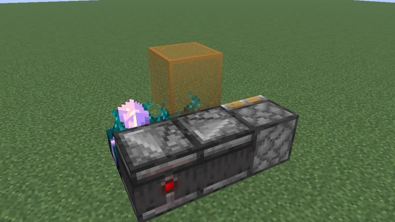</a> 130 gt (6.5 s) · calibrated_sculk_sensor+observer+piston+sculk_sensor · 5 blocks also found as census-p130-calibrated_sculk_sensor-observer-sculk_sensor-sticky_piston-5b (built with sticky_piston, without piston)</td></tr>
<tr><td align="center"><a href="../archive/clk-sculk-hyb3b-p130-1.txt">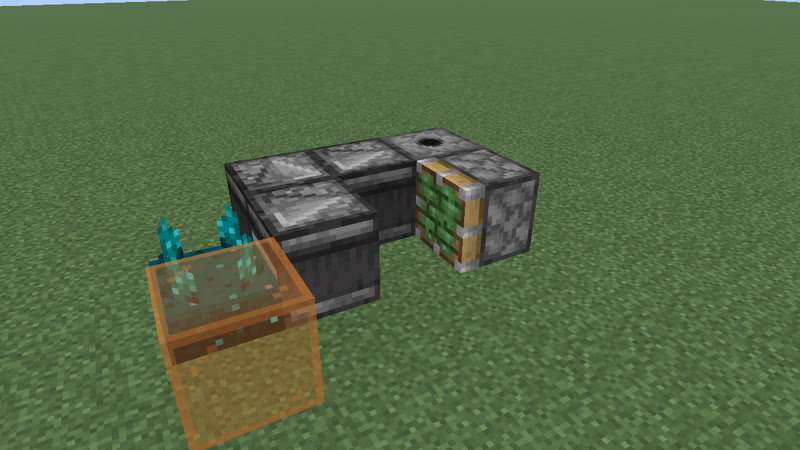</a> 130 gt (6.5 s) · dispenser+observer+sculk_sensor+sticky_piston · 6 blocks</td><td align="center"><a href="../archive/clk-obs-p130-obs-stk-8b-162f3c.txt">clk-obs-p130-obs-stk-8b-162f3c</a> 130 gt (6.5 s) · observer+sticky_piston · 8 blocks (picture pending)</td></tr>
</table>

## 131 gt (6.55 s)

Also reachable by: clk-obs-odd-a (n = 30), dropper ring (clk-item-dropring-2d-r3, n = 7), clk-sculk-hairpin (one block swapped: 2 versions) (clk-sculk-hairpin, n = 8).

<table>
<tr><td align="center"><a href="../archive/clk-sculk-hyb3-p131-1.txt">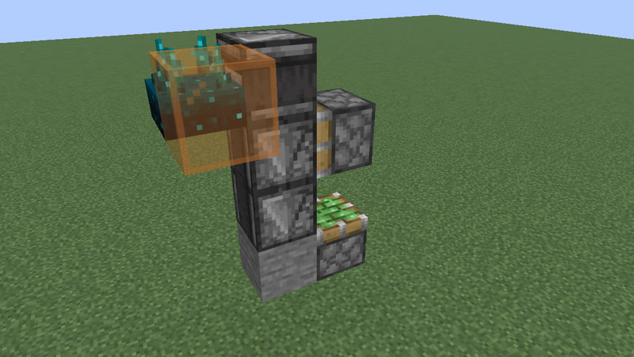</a> 131 gt (6.55 s) · observer+sculk_sensor+sticky_piston · 7 blocks</td></tr>
</table>

## 132 gt (6.6 s)

Also reachable by: clk-obs-obs-ring (n = 31), clk-obs-bulb-ring (n = 14), clk-rt-uloop2t (n = 7), dropper ring (clk-item-dropring-2d, n = 7), clk-rt-uloop1t (n = 3), ring lock (clk-item-ringlock-rows, n = 4).

<table>
<tr><td align="center"><a href="../archive/clk-sculk-hyb3-p132-1.txt">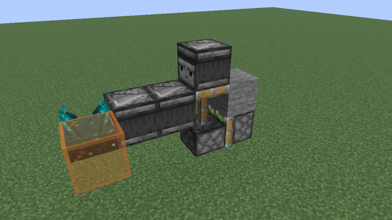</a> 132 gt (6.6 s) · observer+sculk_sensor+sticky_piston · 7 blocks</td><td align="center"><a href="../archive/clk-obs-p132-lamp-obs-stk-8b-dd9fde.txt">clk-obs-p132-lamp-obs-stk-8b-dd9fde</a> 132 gt (6.6 s) · observer+redstone_lamp+sticky_piston · 8 blocks (picture pending)</td><td align="center"><a href="../archive/clk-obs-p132-note-obs-stk-8b-c3bff8.txt">clk-obs-p132-note-obs-stk-8b-c3bff8</a> 132 gt (6.6 s) · note_block+observer+sticky_piston · 8 blocks (picture pending)</td></tr>
<tr><td align="center"><a href="../archive/clk-obs-p132-obs-stk-8b-22769c.txt">clk-obs-p132-obs-stk-8b-22769c</a> 132 gt (6.6 s) · observer+sticky_piston · 8 blocks (picture pending)</td><td align="center"><a href="../archive/clk-obs-p132-bulb-obs-pis-stk-9b-37e971.txt">clk-obs-p132-bulb-obs-pis-stk-9b-37e971</a> 132 gt (6.6 s) · copper_bulb+observer+piston+sticky_piston · 9 blocks (picture pending)</td><td align="center"><a href="../archive/clk-obs-p132-bulb-lamp-obs-rb-stk-9b-3133bc.txt">clk-obs-p132-bulb-lamp-obs-rb-stk-9b-3133bc</a> 132 gt (6.6 s) · copper_bulb+observer+redstone_block+redstone_lamp+sticky_piston · 9 blocks (picture pending)</td></tr>
<tr><td align="center"><a href="../archive/clk-obs-p132-bulb-obs-rb-stk-9b-57f2a4.txt">clk-obs-p132-bulb-obs-rb-stk-9b-57f2a4</a> 132 gt (6.6 s) · copper_bulb+observer+redstone_block+sticky_piston · 9 blocks (picture pending)</td></tr>
</table>

## 133 gt (6.65 s)

Also reachable by: clk-obs-odd-b (n = 30), hopper ring (clk-item-hopper-ring-2, n = 18), dropper ring (clk-item-dropring-2d-r4, n = 7).

<table>
<tr><td align="center"><a href="../archive/census-p133-calibrated_sculk_sensor-dispenser-observer-piston-sculk_sensor-5b.txt">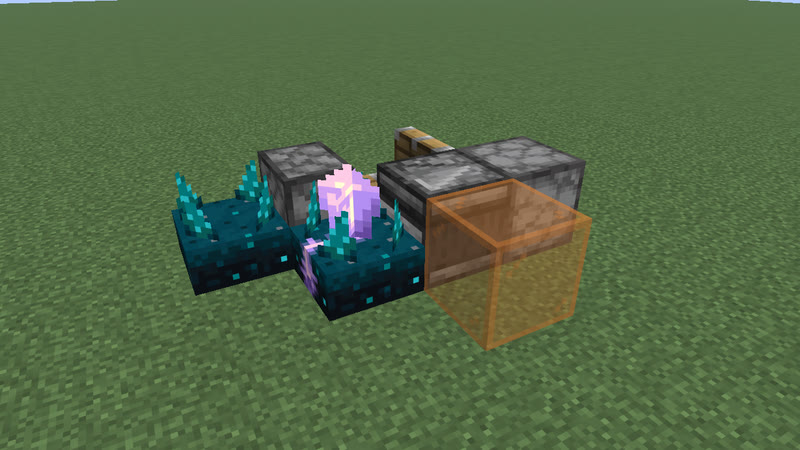</a> 133 gt (6.65 s) · calibrated_sculk_sensor+dispenser+observer+piston+sculk_sensor · 5 blocks also found as census-p133-calibrated_sculk_sensor-dispenser-observer-sculk_sensor-sticky_piston-5b (built with sticky_piston, without piston)</td></tr>
</table>

## 134 gt (6.7 s)

Also reachable by: observer ring with a relay block (clk-obs-note-ring, n = 31), dropper ring (clk-item-dropring-1d-r1, n = 7).

<table>
<tr><td align="center"><a href="../archive/census-p134-calibrated_sculk_sensor-dispenser-oak_trapdoor-observer-sculk_sensor-5b.txt">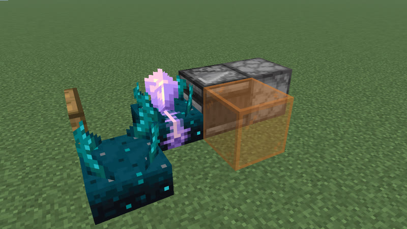</a> 134 gt (6.7 s) · calibrated_sculk_sensor+dispenser+oak_trapdoor+observer+sculk_sensor · 5 blocks</td></tr>
</table>

## 135 gt (6.75 s)

Also reachable by: clk-obs-odd-a (n = 31), dropper ring (clk-item-dropring-1d-r14, n = 6).

<table>
<tr><td align="center"><a href="../archive/clk-sculk-two-p135-3.txt">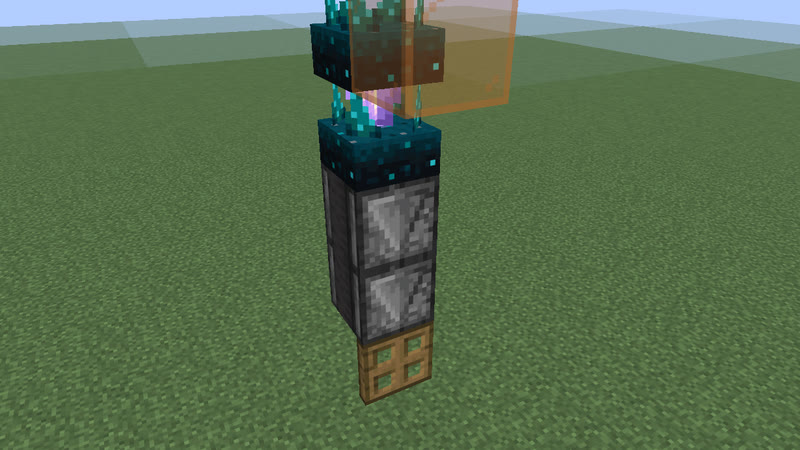</a> 135 gt (6.75 s) · calibrated_sculk_sensor+oak_trapdoor+observer+sculk_sensor · 5 blocks</td><td align="center"><a href="../archive/census-p135-calibrated_sculk_sensor-dispenser-observer-sculk_sensor-5b.txt">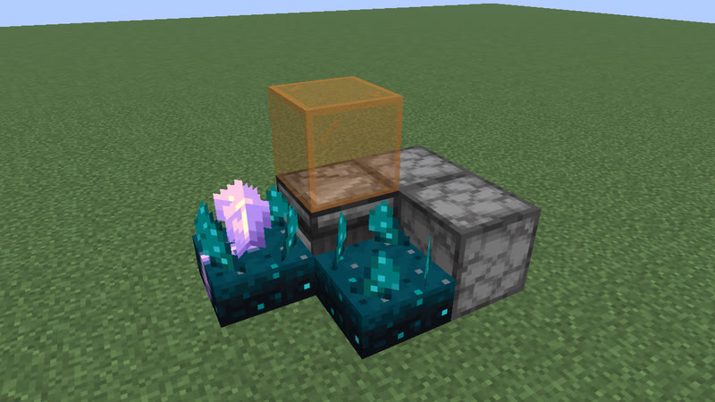</a> 135 gt (6.75 s) · calibrated_sculk_sensor+dispenser+observer+sculk_sensor · 5 blocks</td><td align="center"><a href="../archive/census-p135-calibrated_sculk_sensor-note_block-observer-sculk_sensor-5b.txt">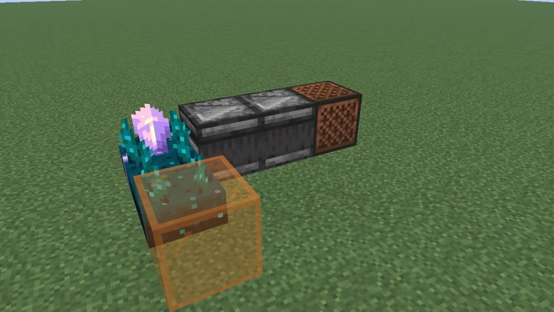</a> 135 gt (6.75 s) · calibrated_sculk_sensor+note_block+observer+sculk_sensor · 5 blocks</td></tr>
<tr><td align="center"><a href="../archive/census-p135-calibrated_sculk_sensor-observer-piston-sculk_sensor-5b.txt">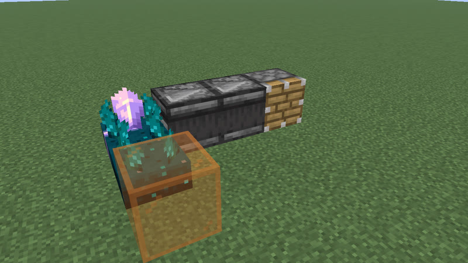</a> 135 gt (6.75 s) · calibrated_sculk_sensor+observer+piston+sculk_sensor · 5 blocks also found as census-p135-calibrated_sculk_sensor-observer-sculk_sensor-sticky_piston-5b (built with sticky_piston, without piston)</td><td align="center"><a href="../archive/clk-sculk-two-p135-7.txt">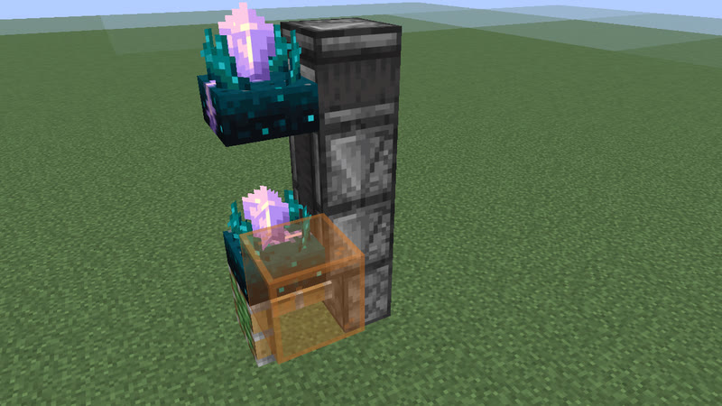</a> 135 gt (6.75 s) · calibrated_sculk_sensor+observer+sticky_piston · 6 blocks</td></tr>
</table>

## 136 gt (6.8 s)

Also reachable by: clk-obs-obs-ring (n = 32), dropper ring (clk-item-dropring-1d-r2, n = 7), ring lock (clk-item-ringlock-stones-3x6, n = 4).

<table>
<tr><td align="center"> 136 gt (6.8 s) · calibrated_sculk_sensor+dispenser+observer+sculk_sensor · 5 blocks</td><td align="center"><a href="../archive/clk-sculk-two-p136-1.txt">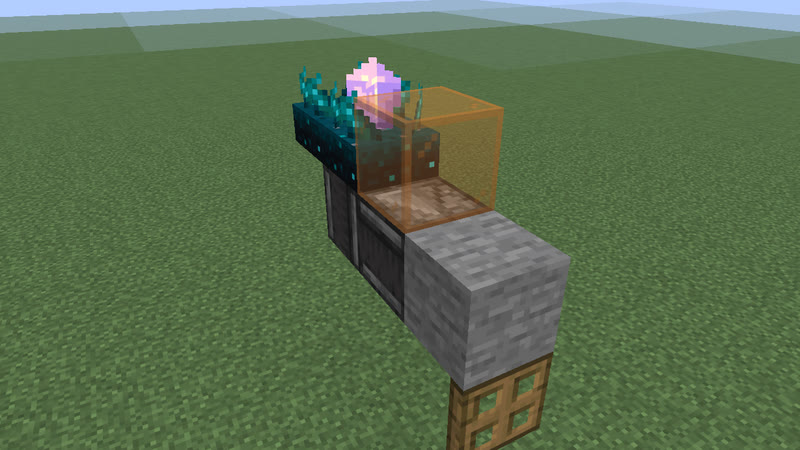</a> 136 gt (6.8 s) · calibrated_sculk_sensor+oak_trapdoor+observer+sculk_sensor · 6 blocks</td><td align="center"><a href="../archive/clk-sculk-two-p136-3.txt">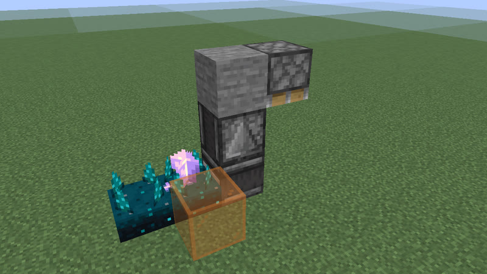</a> 136 gt (6.8 s) · calibrated_sculk_sensor+observer+sculk_sensor+sticky_piston · 6 blocks</td></tr>
<tr><td align="center"><a href="../archive/clk-obs-p136-bulb-note-obs-stk-9b-fe6d9f.txt">clk-obs-p136-bulb-note-obs-stk-9b-fe6d9f</a> 136 gt (6.8 s) · copper_bulb+note_block+observer+sticky_piston · 9 blocks (picture pending)</td><td align="center"><a href="../archive/clk-obs-p136-obs-pis-stk-9b-dbf867.txt">clk-obs-p136-obs-pis-stk-9b-dbf867</a> 136 gt (6.8 s) · observer+piston+sticky_piston · 9 blocks (picture pending)</td><td align="center"><a href="../archive/clk-obs-p136-obs-stk-9b-c911bd.txt">clk-obs-p136-obs-stk-9b-c911bd</a> 136 gt (6.8 s) · observer+sticky_piston · 9 blocks (picture pending)</td></tr>
<tr><td align="center"><a href="../archive/clk-obs-p136-obs-stk-9b-e1d103.txt">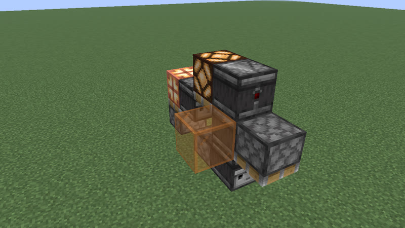</a> 136 gt (6.8 s) · observer+sticky_piston · 9 blocks</td><td align="center"><a href="../archive/clk-obs-p136-note-obs-stk-9b-74fdea.txt">clk-obs-p136-note-obs-stk-9b-74fdea</a> 136 gt (6.8 s) · note_block+observer+sticky_piston · 9 blocks (picture pending)</td><td align="center"><a href="../archive/clk-sculk-ringbig10-p136-1.txt">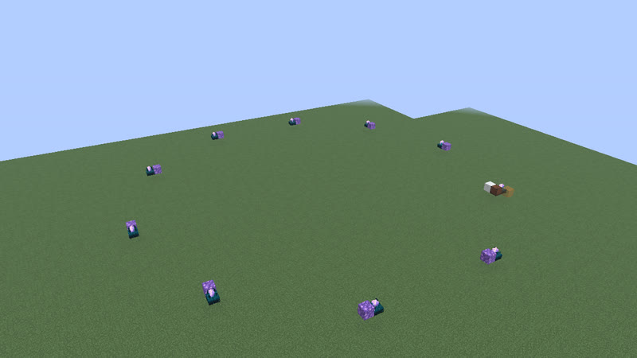</a> 136 gt (6.8 s) · calibrated_sculk_sensor+note_block · 21 blocks</td></tr>
</table>

## 138 gt (6.9 s)

Also reachable by: observer ring with a relay block (clk-obs-note-ring, n = 32), dropper ring (clk-item-dropring-1d-r3, n = 7).

<table>
<tr><td align="center"><a href="../archive/census-p138-calibrated_sculk_sensor-dispenser-observer-sculk_sensor-5b.txt">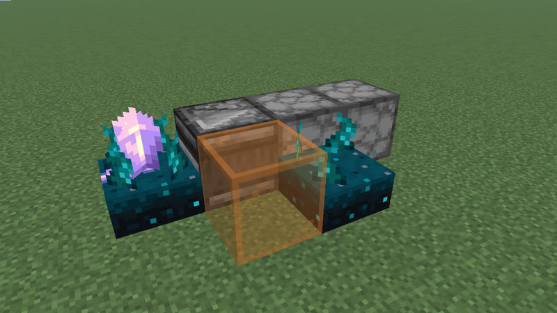</a> 138 gt (6.9 s) · calibrated_sculk_sensor+dispenser+observer+sculk_sensor · 5 blocks</td><td align="center"><a href="../archive/clk-obs-p138-bulb-lamp-obs-stk-8b-63e77b.txt">clk-obs-p138-bulb-lamp-obs-stk-8b-63e77b</a> 138 gt (6.9 s) · copper_bulb+observer+redstone_lamp+sticky_piston · 8 blocks (picture pending)</td><td align="center"><a href="../archive/clk-obs-p138-bulb-obs-stk-8b-95f92d.txt">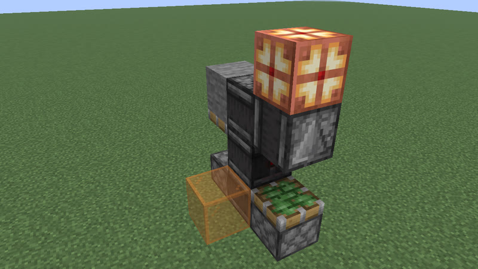</a> 138 gt (6.9 s) · copper_bulb+observer+sticky_piston · 8 blocks</td></tr>
<tr><td align="center"><a href="../archive/clk-sculk-ringbig10-p138-1.txt">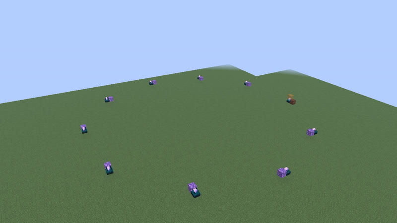</a> 138 gt (6.9 s) · calibrated_sculk_sensor+note_block · 20 blocks</td></tr>
</table>

## 140 gt (7 s)

Also reachable by: clk-obs-obs-ring (n = 33), hopper ring (clk-item-hopper-ring, n = 9), clk-obs-bulb-ring (n = 15), dropper ring (clk-item-dropring-1d-r4, n = 7), clk-sculk-racetrack-plain (n = 8).

<table>
<tr><td align="center"><a href="../archive/census-p140-calibrated_sculk_sensor-dispenser-observer-sculk_sensor-4b.txt">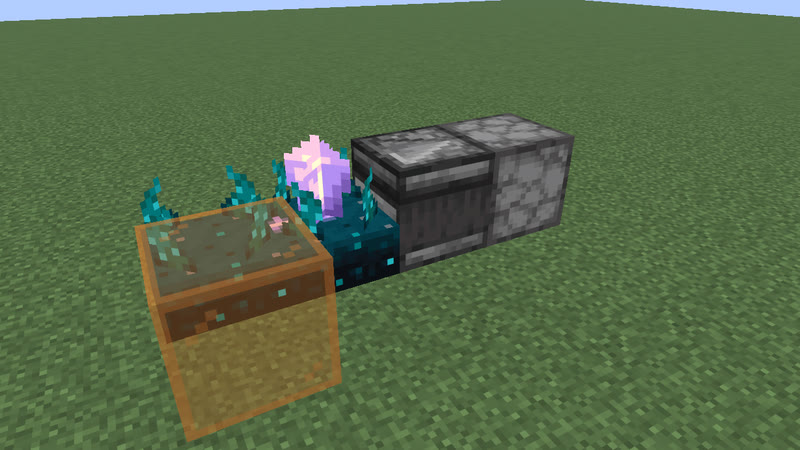</a> 140 gt (7 s) · calibrated_sculk_sensor+dispenser+observer+sculk_sensor · 4 blocks</td><td align="center"><a href="../archive/clk-sculk-two-p140-5.txt">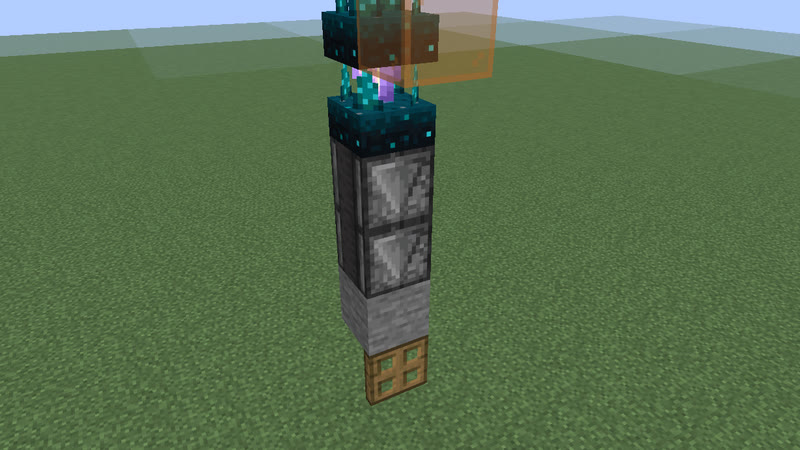</a> 140 gt (7 s) · calibrated_sculk_sensor+oak_trapdoor+observer+sculk_sensor · 6 blocks</td><td align="center"><a href="../archive/clk-sculk-two-p140-3.txt">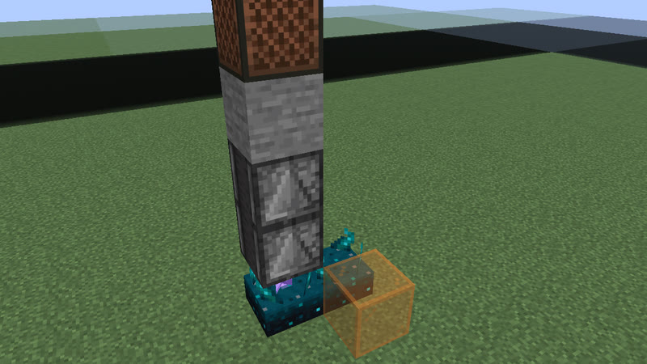</a> 140 gt (7 s) · calibrated_sculk_sensor+note_block+observer+sculk_sensor · 6 blocks</td></tr>
<tr><td align="center"><a href="../archive/clk-sculk-two-p140-10.txt">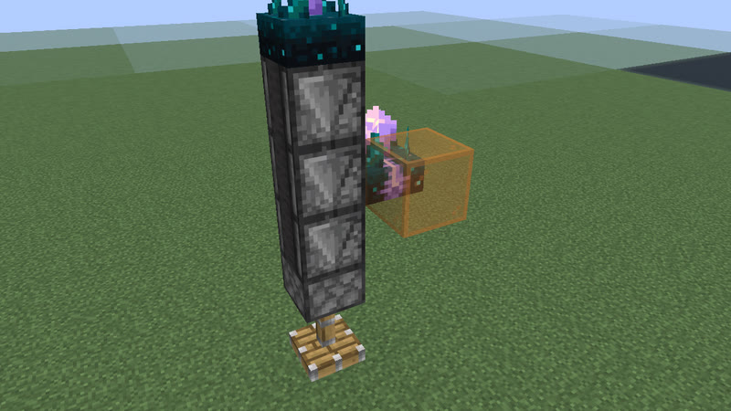</a> 140 gt (7 s) · calibrated_sculk_sensor+observer+sticky_piston · 6 blocks</td><td align="center"><a href="../archive/clk-sculk-two-p140-7.txt">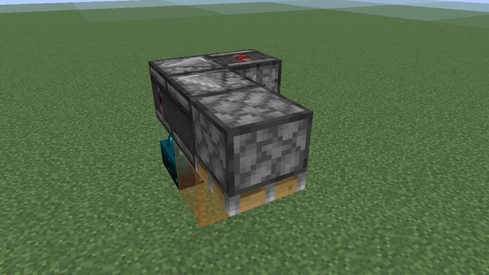</a> 140 gt (7 s) · calibrated_sculk_sensor+observer+sculk_sensor+sticky_piston · 6 blocks</td><td align="center"><a href="../archive/loop4burn-p140.txt">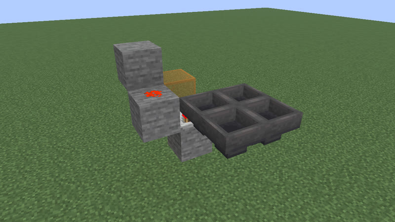</a> 140 gt (7 s) · comparator+hopper+redstone_torch+redstone_wire · 10 blocks</td></tr>
<tr><td align="center"><a href="../archive/clk-sculk-ringbig10-p140-1.txt">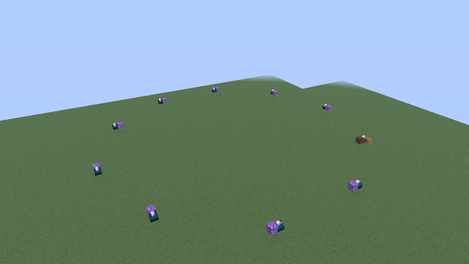</a> 140 gt (7 s) · calibrated_sculk_sensor+note_block · 20 blocks</td></tr>
</table>

## 141 gt (7.05 s)

Also reachable by: clk-obs-odd-b (n = 32), dropper ring (clk-item-dropring-2d-r1, n = 7).

<table>
<tr><td align="center"><a href="../archive/clk-sculk-two-p141-1.txt">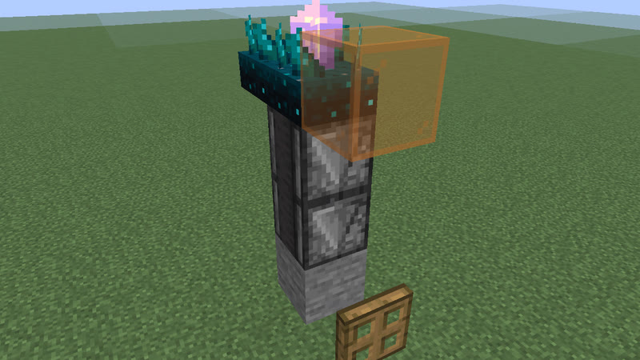</a> 141 gt (7.05 s) · calibrated_sculk_sensor+oak_trapdoor+observer+sculk_sensor · 6 blocks</td><td align="center"><a href="../archive/clk-sculk-two-p141-3.txt">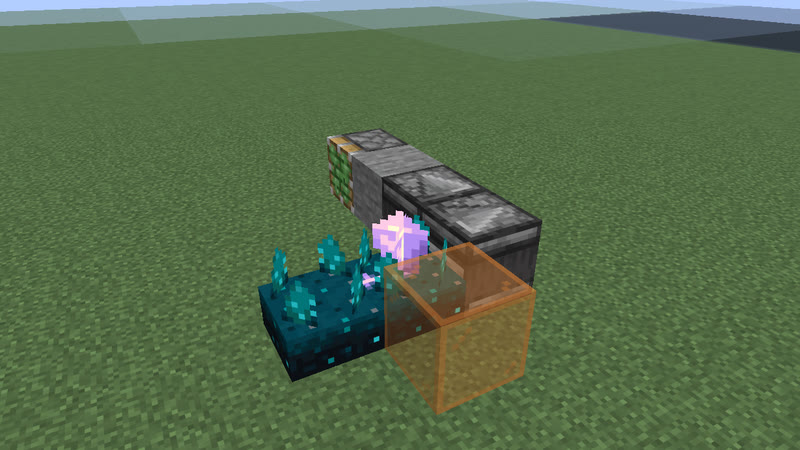</a> 141 gt (7.05 s) · calibrated_sculk_sensor+observer+sculk_sensor+sticky_piston · 6 blocks</td></tr>
</table>

## 142 gt (7.1 s)

Also reachable by: observer ring with a relay block (clk-obs-note-ring, n = 33), dropper ring (clk-item-dropring-2d-r14, n = 7), clk-item-latch (n = 7).

<table>
<tr><td align="center"> 142 gt (7.1 s) · calibrated_sculk_sensor+note_block · 20 blocks</td><td align="center"><a href="../archive/clk-rt-uloop-p142-21b.txt">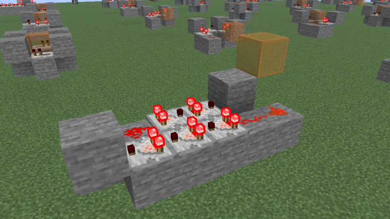</a> 142 gt (7.1 s) · comparator+redstone_torch+redstone_wire · 21 blocks</td></tr>
</table>

## 144 gt (7.2 s)

Also reachable by: clk-obs-obs-ring (n = 34), dropper ring (clk-item-dropring-2d-r24, n = 7), clk-rt-rect-pulse (n = 7), clk-rt-div (n = 2).

<table>
<tr><td align="center"><a href="../archive/clk-obs-p144-bulb-obs-stk-8b-ea719c.txt">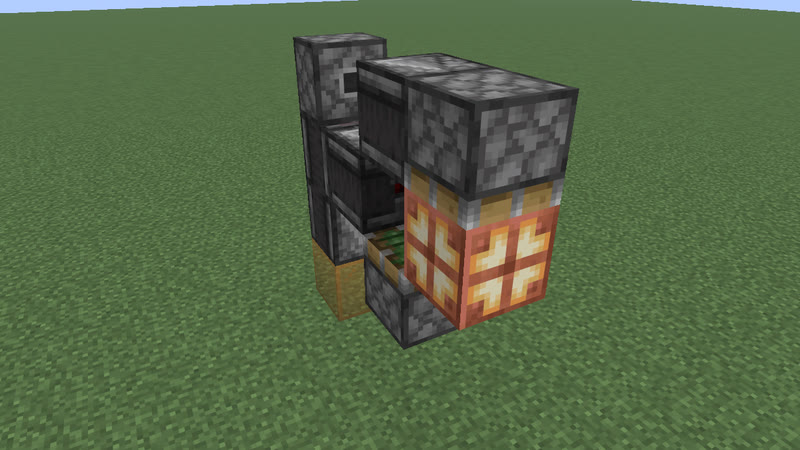</a> 144 gt (7.2 s) · copper_bulb+observer+sticky_piston · 8 blocks</td><td align="center"><a href="../archive/clk-sculk-ringbig10-p144-1.txt">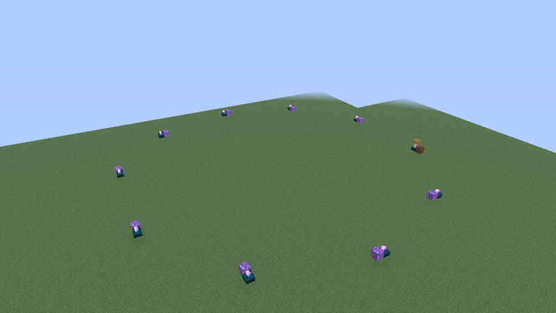</a> 144 gt (7.2 s) · calibrated_sculk_sensor+note_block · 20 blocks</td><td align="center"><a href="../archive/clk-rt-uloop-p144-21b.txt">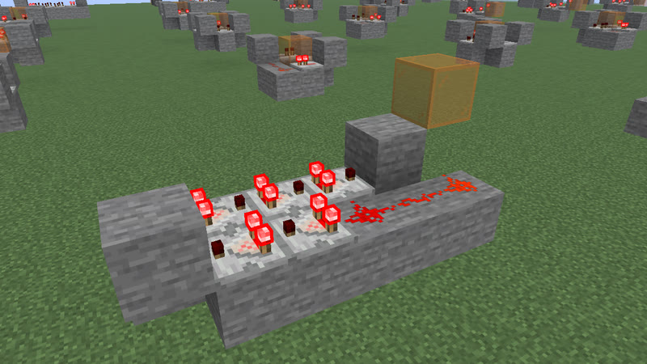</a> 144 gt (7.2 s) · comparator+redstone_torch+redstone_wire · 21 blocks</td></tr>
</table>

## 145 gt (7.25 s)

Also reachable by: clk-obs-odd-b (n = 33), dropper ring (clk-item-dropring-2d-r3, n = 8).

<table>
<tr><td align="center"><a href="../archive/census-p145-calibrated_sculk_sensor-dispenser-observer-sculk_sensor-5b.txt">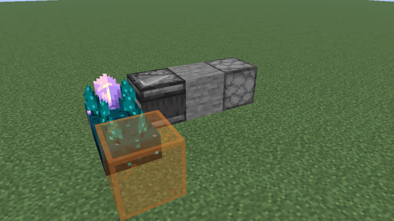</a> 145 gt (7.25 s) · calibrated_sculk_sensor+dispenser+observer+sculk_sensor · 5 blocks</td><td align="center"><a href="../archive/clk-sculk-two-p145-3.txt">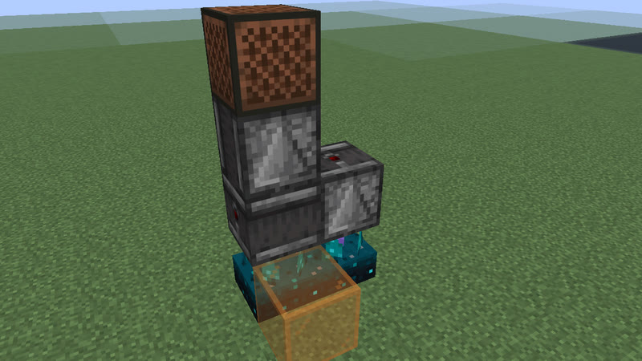</a> 145 gt (7.25 s) · calibrated_sculk_sensor+note_block+observer+sculk_sensor · 6 blocks</td><td align="center"><a href="../archive/clk-sculk-two-p145-5.txt">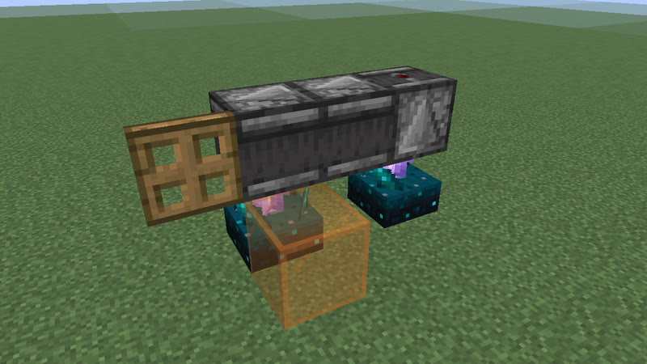</a> 145 gt (7.25 s) · calibrated_sculk_sensor+oak_trapdoor+observer · 6 blocks</td></tr>
<tr><td align="center"><a href="../archive/clk-sculk-two-p145-7.txt">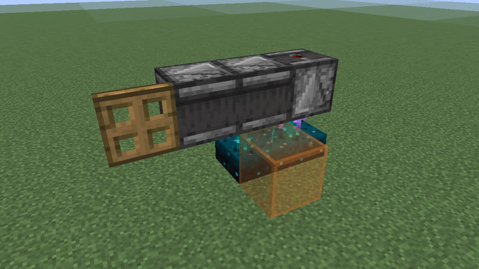</a> 145 gt (7.25 s) · calibrated_sculk_sensor+oak_trapdoor+observer+sculk_sensor · 6 blocks</td><td align="center"><a href="../archive/clk-sculk-two-p145-10.txt">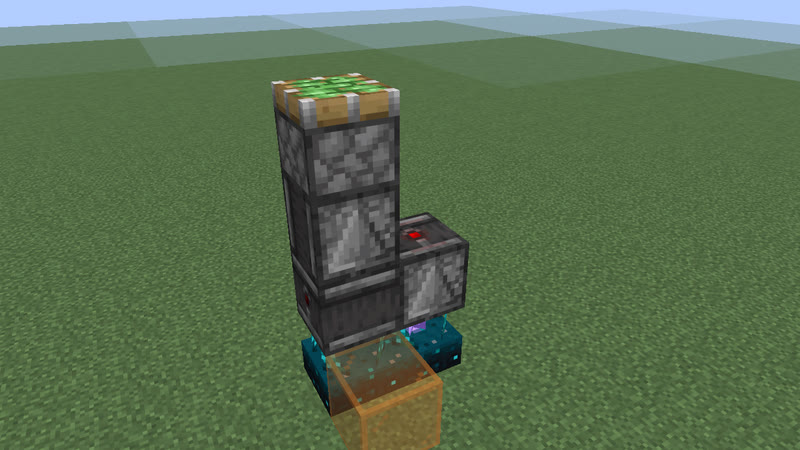</a> 145 gt (7.25 s) · calibrated_sculk_sensor+observer+sculk_sensor+sticky_piston · 6 blocks</td><td align="center"><a href="../archive/clk-sculk-two-p145-11.txt">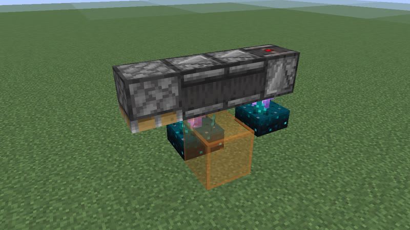</a> 145 gt (7.25 s) · calibrated_sculk_sensor+observer+sticky_piston · 6 blocks</td></tr>
</table>

## 146 gt (7.3 s)

Also reachable by: observer ring with a relay block (clk-obs-note-ring, n = 34), dropper ring (clk-item-dropring-2d, n = 8), ring lock (clk-item-ringlock-rows, n = 5).

<table>
<tr><td align="center"><a href="../archive/clk-sculk-two-p146-1.txt">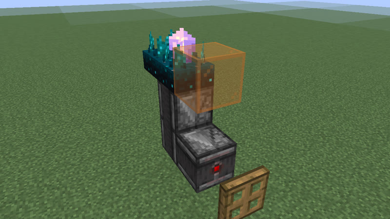</a> 146 gt (7.3 s) · calibrated_sculk_sensor+oak_trapdoor+observer+sculk_sensor · 6 blocks</td><td align="center"><a href="../archive/clk-sculk-two-p146-3.txt">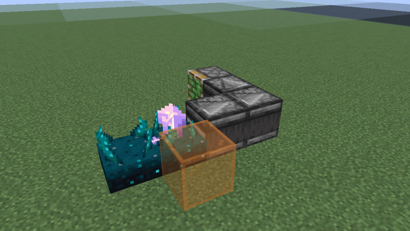</a> 146 gt (7.3 s) · calibrated_sculk_sensor+observer+sculk_sensor+sticky_piston · 6 blocks</td><td align="center"><a href="../archive/clk-obs-p146-bulb-obs-pis-stk-9b-f24ba6.txt">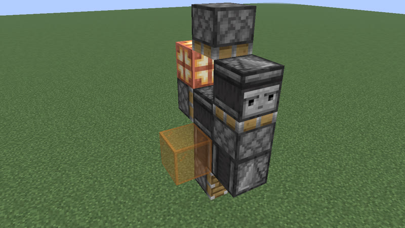</a> 146 gt (7.3 s) · copper_bulb+observer+piston+sticky_piston · 9 blocks</td></tr>
<tr><td align="center"><a href="../archive/clk-sculk-ringbig10-p146-1.txt">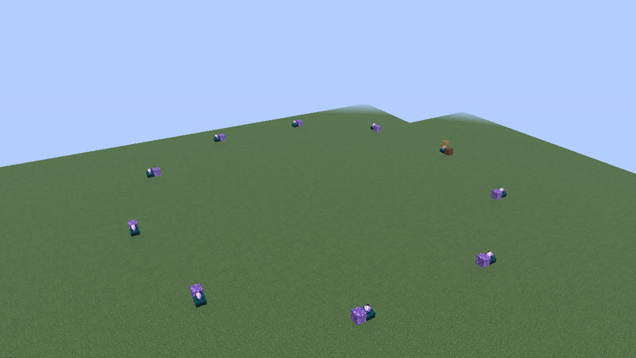</a> 146 gt (7.3 s) · calibrated_sculk_sensor+note_block · 20 blocks</td></tr>
</table>

## 148 gt (7.4 s)

Also reachable by: clk-obs-obs-ring (n = 35), clk-obs-bulb-ring (n = 16), clk-rt-uloop2t (n = 8), dropper ring (clk-item-dropring-1d-r1, n = 8), clk-rt-rect-inv (n = 3).

<table>
<tr><td align="center"><a href="../archive/clk-obs-p148-obs-stk-8b-91e3bc.txt">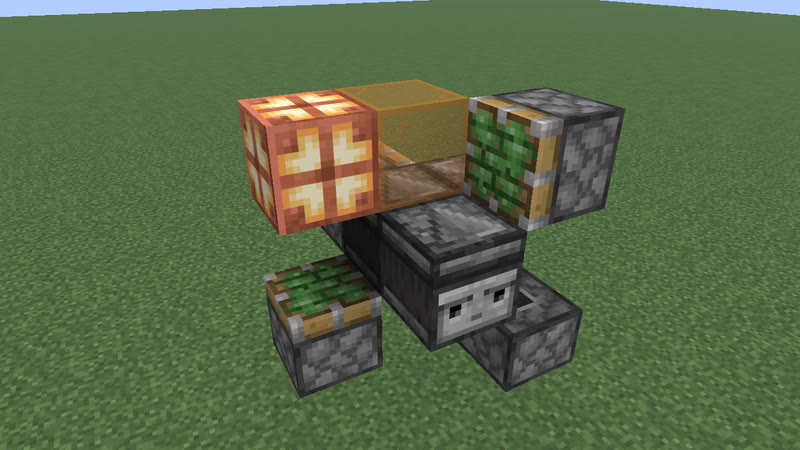</a> 148 gt (7.4 s) · observer+sticky_piston · 8 blocks</td><td align="center"> 148 gt (7.4 s) · comparator+hopper · 12 blocks</td><td align="center"><a href="../archive/clk-sculk-ringbig10-p148-1.txt">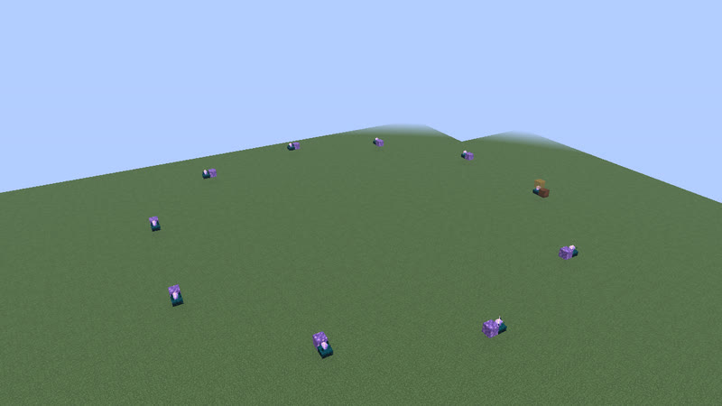</a> 148 gt (7.4 s) · calibrated_sculk_sensor+note_block · 20 blocks</td></tr>
</table>

## 150 gt (7.5 s)

Also reachable by: observer ring with a relay block (clk-obs-note-ring, n = 35), dropper ring (clk-item-dropring-1d-r2, n = 8).

<table>
<tr><td align="center"><a href="../archive/clk-obs-p150-lamp-obs-stk-9b-493d88.txt">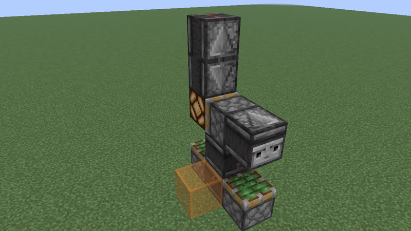</a> 150 gt (7.5 s) · observer+redstone_lamp+sticky_piston · 9 blocks</td><td align="center"><a href="../archive/clk-sculk-ringbig10-p150-1.txt">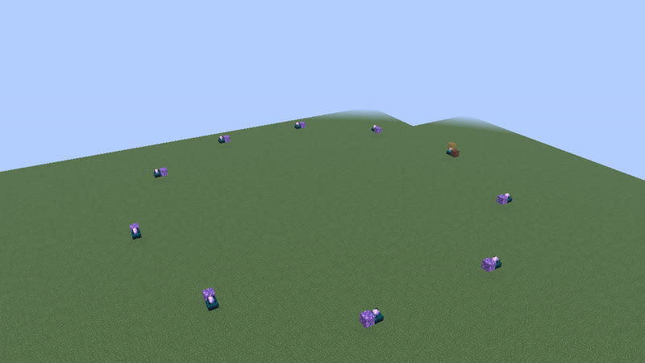</a> 150 gt (7.5 s) · calibrated_sculk_sensor+note_block · 20 blocks</td></tr>
</table>

## 152 gt (7.6 s)

Also reachable by: clk-obs-obs-ring (n = 36), dropper ring (clk-item-dropring-1d-r3, n = 8).

<table>
<tr><td align="center"><a href="../archive/clk-obs-p152-lamp-obs-stk-9b-10655d.txt">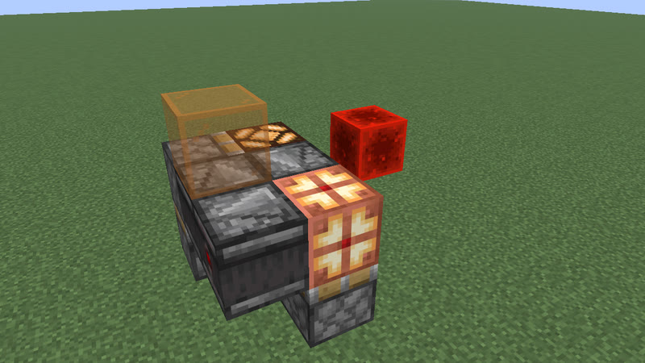</a> 152 gt (7.6 s) · observer+redstone_lamp+sticky_piston · 9 blocks</td></tr>
</table>

## 154 gt (7.7 s)

Also reachable by: observer ring with a relay block (clk-obs-note-ring, n = 36), hopper ring (clk-item-hopper-ring, n = 10), dropper ring (clk-item-dropring-1d-r4, n = 8).

<table>
<tr><td align="center"><a href="../archive/clk-obs-p154-bulb-obs-pis-stk-9b-4301b4.txt">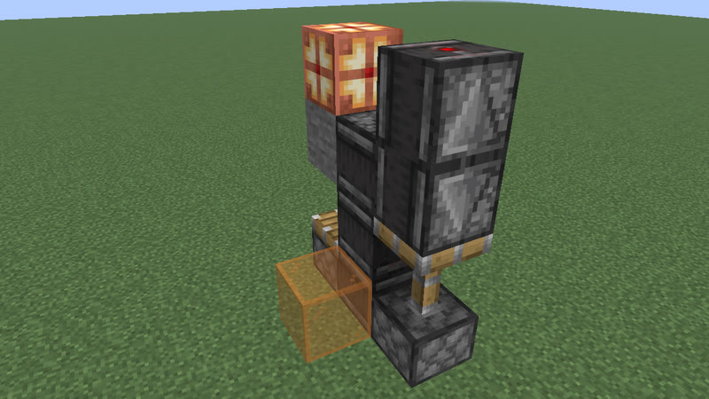</a> 154 gt (7.7 s) · copper_bulb+observer+piston+sticky_piston · 9 blocks</td></tr>
</table>

## 155 gt (7.75 s)

Also reachable by: clk-obs-odd-a (n = 36), dropper ring (clk-item-dropring-2d-r1, n = 8).

<table>
<tr><td align="center"><a href="../archive/census-p155-calibrated_sculk_sensor-dispenser-observer-sculk_sensor-5b.txt">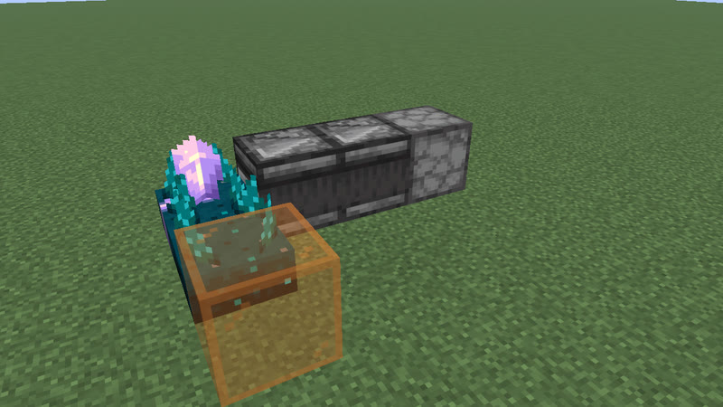</a> 155 gt (7.75 s) · calibrated_sculk_sensor+dispenser+observer+sculk_sensor · 5 blocks</td><td align="center"> 155 gt (7.75 s) · calibrated_sculk_sensor+oak_trapdoor+observer+sculk_sensor · 7 blocks</td><td align="center"> 155 gt (7.75 s) · calibrated_sculk_sensor+note_block+observer+sculk_sensor · 7 blocks</td></tr>
<tr><td align="center"> 155 gt (7.75 s) · calibrated_sculk_sensor+oak_trapdoor+observer · 7 blocks</td><td align="center"> 155 gt (7.75 s) · calibrated_sculk_sensor+observer+sculk_sensor+sticky_piston · 7 blocks</td><td align="center"> 155 gt (7.75 s) · calibrated_sculk_sensor+observer+sticky_piston · 7 blocks</td></tr>
</table>

## 156 gt (7.8 s)

Also reachable by: clk-obs-obs-ring (n = 37), clk-obs-bulb-ring (n = 17), dropper ring (clk-item-dropring-2d-r14, n = 8), clk-sculk-racetrack (n = 4), clk-sculk-racetrack-plain (n = 9).

<table>
<tr><td align="center"> 156 gt (7.8 s) · copper_bulb+observer+piston · 7 blocks</td><td align="center"> 156 gt (7.8 s) · copper_bulb+observer+piston+sticky_piston · 7 blocks</td><td align="center"> 156 gt (7.8 s) · copper_bulb+observer+piston+sticky_piston · 7 blocks</td></tr>
<tr><td align="center"> 156 gt (7.8 s) · comparator+hopper · 12 blocks</td></tr>
</table>

## 158 gt (7.9 s)

Also reachable by: observer ring with a relay block (clk-obs-note-ring, n = 37), dropper ring (clk-item-dropring-2d-r24, n = 8), clk-item-latch (n = 8).

<table>
<tr><td align="center"> 158 gt (7.9 s) · comparator+hopper · 10 blocks</td></tr>
</table>

## 160 gt (8 s)

Also reachable by: clk-obs-obs-ring (n = 38), dropper ring (clk-item-dropring-2d, n = 9), clk-rt-rect-pulse (n = 8), ring lock (clk-item-ringlock-rows, n = 6).

<table>
<tr><td align="center"> 160 gt (8 s) · copper_bulb+observer+sticky_piston · 9 blocks</td></tr>
</table>

## 161 gt (8.05 s)

Also reachable by: clk-obs-odd-b (n = 37), hopper ring (clk-item-hopper-ring-2, n = 22), dropper ring (clk-item-dropring-2d-r4, n = 9).

<table>
<tr><td align="center"> 161 gt (8.05 s) · comparator+redstone_torch+redstone_wire+repeater · 44 blocks</td><td align="center"><a href="../archive/clk-misc-boat-lift-l3h5.txt">clk-misc-boat-lift-l3h5</a> 161 gt (8.05 s) · oak_boat+oak_pressure_plate · 145 blocks (picture pending)</td></tr>
</table>

## 162 gt (8.1 s)

Also reachable by: observer ring with a relay block (clk-obs-note-ring, n = 38), dropper ring (clk-item-dropring-1d-r1, n = 9).

<table>
<tr><td align="center"> 162 gt (8.1 s) · calibrated_sculk_sensor+oak_trapdoor+observer+sticky_piston · 6 blocks</td><td align="center"> 162 gt (8.1 s) · calibrated_sculk_sensor+iron_trapdoor+observer+sticky_piston · 6 blocks</td><td align="center"> 162 gt (8.1 s) · calibrated_sculk_sensor+oak_fence_gate+observer+sticky_piston · 6 blocks</td></tr>
<tr><td align="center"> 162 gt (8.1 s) · calibrated_sculk_sensor+note_block+observer+sticky_piston · 6 blocks</td><td align="center"> 162 gt (8.1 s) · calibrated_sculk_sensor+dispenser+observer+sticky_piston · 6 blocks</td></tr>
</table>

## 164 gt (8.2 s)

Also reachable by: clk-obs-obs-ring (n = 39), clk-obs-bulb-ring (n = 18), clk-rt-uloop2t (n = 9), dropper ring (clk-item-dropring-1d-r2, n = 9), clk-rt-uloop1t (n = 4).

<table>
<tr><td align="center"> 164 gt (8.2 s) · observer+sticky_piston · 8 blocks</td><td align="center"> 164 gt (8.2 s) · calibrated_sculk_sensor+note_block · 24 blocks</td></tr>
</table>

## 165 gt (8.25 s)

Also reachable by: clk-obs-odd-b (n = 38), dropper ring (clk-item-dropring-1d-r24, n = 8).

<table>
<tr><td align="center"><a href="../archive/clk-misc-boat-lift-l3h4.txt">clk-misc-boat-lift-l3h4</a> 165 gt (8.25 s) · oak_boat+oak_pressure_plate · 129 blocks (picture pending)</td></tr>
</table>

## 167 gt (8.35 s)

Also reachable by: clk-obs-odd-a (n = 39), dropper ring (clk-item-dropring-1d, n = 10).

<table>
<tr><td align="center"><a href="../archive/clk-misc-boat-lift-l3h6.txt">clk-misc-boat-lift-l3h6</a> 167 gt (8.35 s) · oak_boat+oak_pressure_plate · 161 blocks (picture pending)</td></tr>
</table>

## 168 gt (8.4 s)

Also reachable by: clk-obs-obs-ring (n = 40), hopper ring (clk-item-hopper-ring, n = 11), dropper ring (clk-item-dropring-1d-r4, n = 9).

<table>
<tr><td align="center"> 168 gt (8.4 s) · dispenser+observer+sculk_sensor · 5 blocks</td><td align="center"> 168 gt (8.4 s) · observer+sticky_piston · 8 blocks</td><td align="center"> 168 gt (8.4 s) · calibrated_sculk_sensor+note_block · 24 blocks</td></tr>
</table>

## 169 gt (8.45 s)

Also reachable by: clk-obs-odd-b (n = 39), dropper ring (clk-item-dropring-2d-r1, n = 9).

<table>
<tr><td align="center"> 169 gt (8.45 s) · observer+sculk_sensor+sticky_piston · 7 blocks</td></tr>
</table>

## 170 gt (8.5 s)

Also reachable by: observer ring with a relay block (clk-obs-note-ring, n = 40), dropper ring (clk-item-dropring-2d-r14, n = 9), clk-rt-fade (n = 1).

<table>
<tr><td align="center"> 170 gt (8.5 s) · note_block+observer+sculk_sensor+sticky_piston · 7 blocks</td></tr>
</table>

## 172 gt (8.6 s)

Also reachable by: clk-obs-obs-ring (n = 41), clk-obs-bulb-ring (n = 19), dropper ring (clk-item-dropring-2d-r24, n = 9), clk-sculk-racetrack-plain (n = 10).

<table>
<tr><td align="center"> 172 gt (8.6 s) · calibrated_sculk_sensor+note_block+oak_trapdoor+observer+sculk_sensor · 5 blocks</td><td align="center"> 172 gt (8.6 s) · calibrated_sculk_sensor+note_block+observer+piston+sculk_sensor · 5 blocks also found as census-p172-calibrated_sculk_sensor-note_block-observer-sculk_sensor-sticky_piston-5b (built with sticky_piston, without piston)</td><td align="center"> 172 gt (8.6 s) · copper_bulb+observer+sticky_piston · 8 blocks</td></tr>
<tr><td align="center"> 172 gt (8.6 s) · calibrated_sculk_sensor+note_block · 24 blocks</td></tr>
</table>

## 173 gt (8.65 s)

Also reachable by: clk-obs-odd-b (n = 40), dropper ring (clk-item-dropring-2d-r3, n = 10).

<table>
<tr><td align="center"> 173 gt (8.65 s) · calibrated_sculk_sensor+dispenser+note_block+observer+sculk_sensor · 5 blocks</td><td align="center"> 173 gt (8.65 s) · oak_trapdoor+observer+sculk_sensor · 6 blocks</td><td align="center"><a href="../archive/clk-misc-boat-lift-l3h2.txt">clk-misc-boat-lift-l3h2</a> 173 gt (8.65 s) · oak_boat+oak_pressure_plate · 97 blocks (picture pending)</td></tr>
</table>

## 174 gt (8.7 s)

Also reachable by: observer ring with a relay block (clk-obs-note-ring, n = 41), dropper ring (clk-item-dropring-2d, n = 10), clk-item-latch (n = 9), ring lock (clk-item-ringlock-rows, n = 7).

<table>
<tr><td align="center"> 174 gt (8.7 s) · observer+sticky_piston · 8 blocks</td></tr>
</table>

## 175 gt (8.75 s)

Also reachable by: clk-obs-odd-a (n = 41), hopper ring (clk-item-hopper-ring-2, n = 24), dropper ring (clk-item-dropring-2d-r4, n = 10), clk-misc-crafter-loop (n = 3).

<table>
<tr><td align="center"> 175 gt (8.75 s) · calibrated_sculk_sensor+dispenser+note_block+observer+sculk_sensor · 5 blocks</td><td align="center"> 175 gt (8.75 s) · calibrated_sculk_sensor+oak_trapdoor+observer+sculk_sensor · 5 blocks</td><td align="center"> 175 gt (8.75 s) · calibrated_sculk_sensor+observer+piston+sculk_sensor · 5 blocks also found as census-p175-calibrated_sculk_sensor-observer-sculk_sensor-sticky_piston-5b (built with sticky_piston, without piston)</td></tr>
<tr><td align="center"> 175 gt (8.75 s) · calibrated_sculk_sensor+observer+sticky_piston · 7 blocks</td><td align="center"> 175 gt (8.75 s) · observer+piston+sticky_piston · 9 blocks</td><td align="center"><a href="../archive/clk-misc-boat-lift-l3h3.txt">clk-misc-boat-lift-l3h3</a> 175 gt (8.75 s) · oak_boat+oak_pressure_plate · 113 blocks (picture pending)</td></tr>
</table>

## 176 gt (8.8 s)

Also reachable by: clk-obs-obs-ring (n = 42), dropper ring (clk-item-dropring-1d-r1, n = 10), clk-rt-rect-pulse (n = 9).

<table>
<tr><td align="center"> 176 gt (8.8 s) · dispenser+observer+sculk_sensor · 6 blocks</td><td align="center"> 176 gt (8.8 s) · calibrated_sculk_sensor+observer+sticky_piston · 7 blocks</td><td align="center"> 176 gt (8.8 s) · calibrated_sculk_sensor+note_block · 24 blocks</td></tr>
</table>

## 178 gt (8.9 s)

Also reachable by: observer ring with a relay block (clk-obs-note-ring, n = 42), dropper ring (clk-item-dropring-1d-r2, n = 10).

<table>
<tr><td align="center"><a href="../archive/clk-misc-boat-lift-l4h4.txt">clk-misc-boat-lift-l4h4</a> 178 gt (8.9 s) · oak_boat+oak_pressure_plate · 137 blocks (picture pending)</td></tr>
</table>

## 180 gt (9 s)

Also reachable by: clk-obs-obs-ring (n = 43), clk-obs-bulb-ring (n = 20), clk-rt-uloop2t (n = 10), dropper ring (clk-item-dropring-1d-r3, n = 10), clk-rt-rect-inv (n = 4).

<table>
<tr><td align="center"> 180 gt (9 s) · dispenser+observer+sculk_sensor · 7 blocks</td><td align="center"> 180 gt (9 s) · calibrated_sculk_sensor+observer+sculk_sensor+sticky_piston · 7 blocks</td><td align="center"> 180 gt (9 s) · copper_bulb+observer+sticky_piston · 9 blocks</td></tr>
<tr><td align="center"> 180 gt (9 s) · calibrated_sculk_sensor+note_block · 24 blocks</td></tr>
</table>

## 181 gt (9.05 s)

Also reachable by: clk-obs-odd-b (n = 42), dropper ring (clk-item-dropring-1d, n = 11).

<table>
<tr><td align="center"><a href="../archive/clk-misc-boat-lift-l4h5.txt">clk-misc-boat-lift-l4h5</a> 181 gt (9.05 s) · oak_boat+oak_pressure_plate · 153 blocks (picture pending)</td></tr>
</table>

## 182 gt (9.1 s)

Also reachable by: observer ring with a relay block (clk-obs-note-ring, n = 43), hopper ring (clk-item-hopper-ring, n = 12), dropper ring (clk-item-dropring-1d-r4, n = 10).

<table>
<tr><td align="center"> 182 gt (9.1 s) · calibrated_sculk_sensor+oak_trapdoor+observer+sculk_sensor · 5 blocks</td><td align="center"> 182 gt (9.1 s) · calibrated_sculk_sensor+observer+piston+sculk_sensor · 5 blocks</td><td align="center"> 182 gt (9.1 s) · calibrated_sculk_sensor+observer+sculk_sensor+sticky_piston · 5 blocks</td></tr>
<tr><td align="center"> 182 gt (9.1 s) · observer+redstone_lamp+sticky_piston · 9 blocks</td></tr>
</table>

## 184 gt (9.2 s)

Also reachable by: clk-obs-obs-ring (n = 44), dropper ring (clk-item-dropring-2d-r14, n = 10).

<table>
<tr><td align="center"> 184 gt (9.2 s) · observer+sticky_piston · 8 blocks</td><td align="center"> 184 gt (9.2 s) · calibrated_sculk_sensor+note_block · 24 blocks</td></tr>
</table>

## 186 gt (9.3 s)

Also reachable by: observer ring with a relay block (clk-obs-note-ring, n = 44), dropper ring (clk-item-dropring-2d-r24, n = 10).

<table>
<tr><td align="center"><a href="../archive/clk-misc-boat-lift-l4h6.txt">clk-misc-boat-lift-l4h6</a> 186 gt (9.3 s) · oak_boat+oak_pressure_plate · 169 blocks (picture pending)</td></tr>
</table>

## 187 gt (9.35 s)

Also reachable by: clk-obs-odd-a (n = 44), dropper ring (clk-item-dropring-2d-r3, n = 11).

<table>
<tr><td align="center"><a href="../archive/clk-misc-boat-lift-l3h2-dripleaf.txt">clk-misc-boat-lift-l3h2-dripleaf</a> 187 gt (9.35 s) · big_dripleaf+oak_boat+oak_pressure_plate · 99 blocks (picture pending)</td></tr>
</table>

## 188 gt (9.4 s)

Also reachable by: clk-obs-obs-ring (n = 45), clk-obs-bulb-ring (n = 21), dropper ring (clk-item-dropring-2d, n = 11), clk-sculk-racetrack (n = 5), ring lock (clk-item-ringlock-rows, n = 8).

<table>
<tr><td align="center"> 188 gt (9.4 s) · observer+sticky_piston · 9 blocks</td><td align="center"><a href="../archive/clk-misc-boat-lift-l4h2.txt">clk-misc-boat-lift-l4h2</a> 188 gt (9.4 s) · oak_boat+oak_pressure_plate · 105 blocks (picture pending)</td></tr>
</table>

## 190 gt (9.5 s)

Also reachable by: observer ring with a relay block (clk-obs-note-ring, n = 45), dropper ring (clk-item-dropring-1d-r1, n = 11), clk-item-latch (n = 10).

<table>
<tr><td align="center"><a href="../archive/clk-misc-boat-lift-l4h3.txt">clk-misc-boat-lift-l4h3</a> 190 gt (9.5 s) · oak_boat+oak_pressure_plate · 121 blocks (picture pending)</td></tr>
</table>

## 192 gt (9.6 s)

Also reachable by: clk-obs-obs-ring (n = 46), clk-obs-divider (n = 4), dropper ring (clk-item-dropring-1d-r2, n = 11), clk-rt-rect-pulse (n = 10).

<table>
<tr><td align="center"> 192 gt (9.6 s) · hopper+redstone_torch+redstone_wire · 9 blocks</td></tr>
</table>

## 195 gt (9.75 s)

Also reachable by: clk-obs-odd-a (n = 46), dropper ring (clk-item-dropring-1d, n = 12), clk-sculk-hairpin (one block swapped: 2 versions) (clk-sculk-hairpin, n = 12).

<table>
<tr><td align="center"> 195 gt (9.75 s) · comparator+hopper+redstone_torch+redstone_wire · 9 blocks</td></tr>
</table>

## 200 gt (10 s)

Also reachable by: clk-obs-obs-ring (n = 48), dropper ring (clk-item-dropring-2d-r24, n = 11).

<table>
<tr><td align="center"> 200 gt (10 s) · comparator+redstone_torch+redstone_wire · 14 blocks</td></tr>
</table>

## 201 gt (10.05 s)

Also reachable by: dropper ring (clk-item-dropring-2d-r3, n = 12).

<table>
<tr><td align="center"><a href="../archive/clk-misc-boat-lift-l4h2-dripleaf.txt">clk-misc-boat-lift-l4h2-dripleaf</a> 201 gt (10.05 s) · big_dripleaf+oak_boat+oak_pressure_plate · 107 blocks (picture pending)</td></tr>
</table>

## 204 gt (10.2 s)

Also reachable by: dropper ring (clk-item-dropring-1d-r1, n = 12).

<table>
<tr><td align="center"> 204 gt (10.2 s) · copper_bulb+observer+sticky_piston · 7 blocks</td></tr>
</table>

## 205 gt (10.25 s)

Also reachable by: dropper ring (clk-item-dropring-1d-r14, n = 11).

<table>
<tr><td align="center"> 205 gt (10.25 s) · redstone_torch+redstone_wire+repeater · 8 blocks</td></tr>
</table>

## 206 gt (10.3 s)

Also reachable by: dropper ring (clk-item-dropring-1d-r2, n = 12), clk-item-latch (n = 11).

<table>
<tr><td align="center"> 206 gt (10.3 s) · comparator+hopper · 14 blocks</td></tr>
</table>

## 208 gt (10.4 s)

Also reachable by: dropper ring (clk-item-dropring-1d-r3, n = 12).

<table>
<tr><td align="center"> 208 gt (10.4 s) · observer+piston+sticky_piston · 8 blocks</td></tr>
</table>

## 210 gt (10.5 s)

Also reachable by: hopper ring (clk-item-hopper-ring, n = 14), dropper ring (clk-item-dropring-1d-r4, n = 12).

<table>
<tr><td align="center"> 210 gt (10.5 s) · oak_trapdoor+observer+sculk_sensor · 5 blocks</td><td align="center"> 210 gt (10.5 s) · observer+piston+sculk_sensor · 5 blocks</td><td align="center"> 210 gt (10.5 s) · observer+sculk_sensor+sticky_piston · 5 blocks</td></tr>
<tr><td align="center"> 210 gt (10.5 s) · comparator+hopper+redstone_torch+redstone_wire · 8 blocks</td><td align="center"> 210 gt (10.5 s) · comparator+redstone_torch+redstone_wire · 14 blocks</td></tr>
</table>

## 211 gt (10.55 s)

Also reachable by: dropper ring (clk-item-dropring-2d-r1, n = 12).

<table>
<tr><td align="center"> 211 gt (10.55 s) · comparator+hopper · 14 blocks</td></tr>
</table>

## 212 gt (10.6 s)

Also reachable by: dropper ring (clk-item-dropring-2d-r14, n = 12), clk-rt-rect-inv (n = 5).

<table>
<tr><td align="center"> 212 gt (10.6 s) · calibrated_sculk_sensor+dispenser+note_block+observer+sculk_sensor · 5 blocks</td><td align="center"> 212 gt (10.6 s) · calibrated_sculk_sensor+dispenser+oak_trapdoor+observer+sculk_sensor · 5 blocks</td><td align="center"> 212 gt (10.6 s) · calibrated_sculk_sensor+dispenser+observer+piston+sculk_sensor · 5 blocks also found as census-p212-calibrated_sculk_sensor-dispenser-observer-sculk_sensor-sticky_piston-5b (built with sticky_piston, without piston)</td></tr>
</table>

## 214 gt (10.7 s)

Also reachable by: dropper ring (clk-item-dropring-2d-r24, n = 12).

<table>
<tr><td align="center"> 214 gt (10.7 s) · comparator+hopper · 14 blocks</td></tr>
</table>

## 215 gt (10.75 s)

Also reachable by: dropper ring (clk-item-dropring-2d-r3, n = 13).

<table>
<tr><td align="center"> 215 gt (10.75 s) · calibrated_sculk_sensor+dispenser+note_block+observer+sculk_sensor · 5 blocks</td><td align="center"> 215 gt (10.75 s) · calibrated_sculk_sensor+dispenser+oak_trapdoor+observer+sculk_sensor · 5 blocks</td><td align="center"> 215 gt (10.75 s) · calibrated_sculk_sensor+dispenser+observer+piston+sculk_sensor · 5 blocks also found as census-p215-calibrated_sculk_sensor-dispenser-observer-sculk_sensor-sticky_piston-5b (built with sticky_piston, without piston)</td></tr>
<tr><td align="center"> 215 gt (10.75 s) · dispenser+observer+sculk_sensor · 7 blocks</td></tr>
</table>

## 216 gt (10.8 s)

Also reachable by: dropper ring (clk-item-dropring-2d, n = 13), ring lock (clk-item-ringlock-rows, n = 10).

<table>
<tr><td align="center"> 216 gt (10.8 s) · calibrated_sculk_sensor+dispenser+note_block+observer+sculk_sensor · 5 blocks</td><td align="center"> 216 gt (10.8 s) · calibrated_sculk_sensor+dispenser+oak_trapdoor+observer+sculk_sensor · 5 blocks</td><td align="center"> 216 gt (10.8 s) · calibrated_sculk_sensor+dispenser+observer+piston+sculk_sensor · 5 blocks also found as census-p216-calibrated_sculk_sensor-dispenser-observer-sculk_sensor-sticky_piston-5b (built with sticky_piston, without piston)</td></tr>
<tr><td align="center"> 216 gt (10.8 s) · observer+sculk_sensor+sticky_piston · 6 blocks</td><td align="center"> 216 gt (10.8 s) · dispenser+observer+sculk_sensor+sticky_piston · 6 blocks</td><td align="center"> 216 gt (10.8 s) · observer+piston+sculk_sensor+sticky_piston · 6 blocks</td></tr>
<tr><td align="center"> 216 gt (10.8 s) · oak_trapdoor+observer+sculk_sensor · 7 blocks</td></tr>
</table>

## 217 gt (10.85 s)

Also reachable by: hopper ring (clk-item-hopper-ring-2, n = 30), dropper ring (clk-item-dropring-2d-r4, n = 13).

<table>
<tr><td align="center"> 217 gt (10.85 s) · calibrated_sculk_sensor+dispenser+note_block+observer+sculk_sensor · 5 blocks</td></tr>
</table>

## 218 gt (10.9 s)

Also reachable by: dropper ring (clk-item-dropring-1d-r1, n = 13).

<table>
<tr><td align="center"> 218 gt (10.9 s) · comparator+hopper · 10 blocks</td></tr>
</table>

## 219 gt (10.95 s)

Also reachable by: dropper ring (clk-item-dropring-1d-r14, n = 12).

<table>
<tr><td align="center"> 219 gt (10.95 s) · oak_trapdoor+observer+sculk_sensor · 6 blocks</td></tr>
</table>

## 220 gt (11 s)

Also reachable by: dropper ring (clk-item-dropring-1d-r2, n = 13), clk-sculk-racetrack (n = 6).

<table>
<tr><td align="center"> 220 gt (11 s) · comparator+redstone_torch · 8 blocks</td><td align="center"> 220 gt (11 s) · comparator+redstone_torch+repeater · 8 blocks</td><td align="center"> 220 gt (11 s) · redstone_torch+repeater · 8 blocks</td></tr>
<tr><td align="center"> 220 gt (11 s) · redstone_torch+redstone_wire+repeater · 8 blocks</td></tr>
</table>

## 222 gt (11.1 s)

Also reachable by: dropper ring (clk-item-dropring-1d-r3, n = 13), clk-item-latch (n = 12).

<table>
<tr><td align="center"> 222 gt (11.1 s) · observer+piston+sticky_piston · 8 blocks</td></tr>
</table>

## 224 gt (11.2 s)

Also reachable by: hopper ring (clk-item-hopper-ring, n = 15), dropper ring (clk-item-dropring-1d-r4, n = 13).

<table>
<tr><td align="center"> 224 gt (11.2 s) · calibrated_sculk_sensor+note_block · 32 blocks</td></tr>
</table>

## 225 gt (11.25 s)

Also reachable by: dropper ring (clk-item-dropring-2d-r1, n = 13).

<table>
<tr><td align="center"> 225 gt (11.25 s) · calibrated_sculk_sensor+dispenser+note_block+observer+sculk_sensor · 5 blocks</td><td align="center"> 225 gt (11.25 s) · calibrated_sculk_sensor+dispenser+oak_trapdoor+observer+sculk_sensor · 5 blocks</td><td align="center"> 225 gt (11.25 s) · calibrated_sculk_sensor+dispenser+observer+piston+sculk_sensor · 5 blocks also found as census-p225-calibrated_sculk_sensor-dispenser-observer-sculk_sensor-sticky_piston-5b (built with sticky_piston, without piston)</td></tr>
<tr><td align="center"> 225 gt (11.25 s) · calibrated_sculk_sensor+observer+sculk_sensor+sticky_piston · 5 blocks</td></tr>
</table>

## 228 gt (11.4 s)

Also reachable by: dropper ring (clk-item-dropring-2d-r24, n = 13), clk-rt-uloop1t (n = 6), clk-rt-div-fade (n = 1).

<table>
<tr><td align="center"> 228 gt (11.4 s) · copper_bulb+observer+piston+sticky_piston · 9 blocks</td><td align="center"> 228 gt (11.4 s) · comparator+hopper · 12 blocks</td><td align="center"> 228 gt (11.4 s) · calibrated_sculk_sensor+note_block · 32 blocks</td></tr>
</table>

## 232 gt (11.6 s)

Also reachable by: dropper ring (clk-item-dropring-1d-r1, n = 14).

<table>
<tr><td align="center"> 232 gt (11.6 s) · calibrated_sculk_sensor+note_block · 32 blocks</td></tr>
</table>

## 236 gt (11.8 s)

Also reachable by: dropper ring (clk-item-dropring-1d-r3, n = 14).

<table>
<tr><td align="center"> 236 gt (11.8 s) · comparator+hopper · 12 blocks</td><td align="center"> 236 gt (11.8 s) · calibrated_sculk_sensor+note_block · 32 blocks</td></tr>
</table>

## 240 gt (12 s)

Also reachable by: dropper ring (clk-item-dropring-2d-r14, n = 14).

<table>
<tr><td align="center"> 240 gt (12 s) · observer+sticky_piston · 9 blocks</td><td align="center"> 240 gt (12 s) · calibrated_sculk_sensor+note_block · 32 blocks</td></tr>
</table>

## 242 gt (12.1 s)

Also reachable by: dropper ring (clk-item-dropring-2d-r24, n = 14).

<table>
<tr><td align="center"> 242 gt (12.1 s) · calibrated_sculk_sensor+dispenser+observer+sculk_sensor · 5 blocks</td></tr>
</table>

## 244 gt (12.2 s)

Also reachable by: dropper ring (clk-item-dropring-2d, n = 15), clk-rt-rect-inv (n = 6), ring lock (clk-item-ringlock-rows, n = 12).

<table>
<tr><td align="center"> 244 gt (12.2 s) · calibrated_sculk_sensor+note_block · 32 blocks</td></tr>
</table>

## 248 gt (12.4 s)

Also reachable by: dropper ring (clk-item-dropring-1d-r2, n = 15).

<table>
<tr><td align="center"> 248 gt (12.4 s) · observer+redstone_lamp+sticky_piston · 9 blocks</td></tr>
</table>

## 258 gt (12.9 s)

Also reachable by: dropper ring (clk-item-dropring-2d, n = 16), ring lock (clk-item-ringlock-rows, n = 13).

<table>
<tr><td align="center"> 258 gt (12.9 s) · observer+sculk_sensor+sticky_piston · 6 blocks</td></tr>
</table>

## 260 gt (13 s)

Also reachable by: dropper ring (clk-item-dropring-1d-r1, n = 16), clk-rt-uloop1t (n = 7).

<table>
<tr><td align="center"> 260 gt (13 s) · copper_bulb+observer+sticky_piston · 9 blocks</td></tr>
</table>

## 261 gt (13.05 s)

Also reachable by: dropper ring (clk-item-dropring-1d-r14, n = 15).

<table>
<tr><td align="center"> 261 gt (13.05 s) · observer+sculk_sensor+sticky_piston · 6 blocks</td></tr>
</table>

## 264 gt (13.2 s)

Also reachable by: dropper ring (clk-item-dropring-1d-r3, n = 16).

<table>
<tr><td align="center"> 264 gt (13.2 s) · observer+sticky_piston · 9 blocks</td></tr>
</table>

## 270 gt (13.5 s)

Also reachable by: dropper ring (clk-item-dropring-2d-r24, n = 16), clk-item-latch (n = 15).

<table>
<tr><td align="center"> 270 gt (13.5 s) · calibrated_sculk_sensor+observer+sticky_piston · 7 blocks</td></tr>
</table>

## 275 gt (13.75 s)

Also reachable by: dropper ring (clk-item-dropring-1d-r14, n = 16).

<table>
<tr><td align="center"> 275 gt (13.75 s) · comparator+hopper · 14 blocks</td></tr>
</table>

## 276 gt (13.8 s)

Also reachable by: dropper ring (clk-item-dropring-1d-r2, n = 17), clk-rt-rect-inv (n = 7).

<table>
<tr><td align="center"> 276 gt (13.8 s) · copper_bulb+observer+piston+sticky_piston · 8 blocks</td></tr>
</table>

## 280 gt (14 s)

Also reachable by: hopper ring (clk-item-hopper-ring, n = 19), dropper ring (clk-item-dropring-1d-r4, n = 17).

<table>
<tr><td align="center"> 280 gt (14 s) · observer+sticky_piston · 9 blocks</td></tr>
</table>

## 291 gt (14.55 s)

Also reachable by: dropper ring (clk-item-dropring-1d-r24, n = 17).

<table>
<tr><td align="center"> 291 gt (14.55 s) · observer+sculk_sensor+sticky_piston · 7 blocks</td></tr>
</table>

## 296 gt (14.8 s)

Also reachable by: dropper ring (clk-item-dropring-2d-r14, n = 18).

<table>
<tr><td align="center"> 296 gt (14.8 s) · calibrated_sculk_sensor+dispenser+oak_trapdoor+observer+sculk_sensor · 5 blocks</td><td align="center"> 296 gt (14.8 s) · calibrated_sculk_sensor+dispenser+observer+piston+sculk_sensor · 5 blocks also found as census-p296-calibrated_sculk_sensor-dispenser-observer-sculk_sensor-sticky_piston-5b (built with sticky_piston, without piston)</td><td align="center"> 296 gt (14.8 s) · copper_bulb+observer+piston+sticky_piston · 9 blocks</td></tr>
</table>

## 300 gt (15 s)

Also reachable by: dropper ring (clk-item-dropring-2d, n = 19), ring lock (clk-item-ringlock-rows, n = 16).

<table>
<tr><td align="center"> 300 gt (15 s) · calibrated_sculk_sensor+observer+sculk_sensor+sticky_piston · 7 blocks</td></tr>
</table>

## 306 gt (15.3 s)

Also reachable by: dropper ring (clk-item-dropring-1d-r3, n = 19).

<table>
<tr><td align="center"> 306 gt (15.3 s) · oak_trapdoor+observer+sculk_sensor+sticky_piston · 6 blocks</td><td align="center"> 306 gt (15.3 s) · iron_trapdoor+observer+sculk_sensor+sticky_piston · 6 blocks</td><td align="center"> 306 gt (15.3 s) · oak_fence_gate+observer+sculk_sensor+sticky_piston · 6 blocks</td></tr>
<tr><td align="center"> 306 gt (15.3 s) · note_block+observer+sculk_sensor+sticky_piston · 6 blocks</td><td align="center"> 306 gt (15.3 s) · comparator+hopper · 14 blocks</td></tr>
</table>

## 312 gt (15.6 s)

Also reachable by: dropper ring (clk-item-dropring-2d-r24, n = 19).

<table>
<tr><td align="center"> 312 gt (15.6 s) · observer+piston+sticky_piston · 9 blocks</td></tr>
</table>

## 314 gt (15.7 s)

Also reachable by: dropper ring (clk-item-dropring-2d, n = 20), ring lock (clk-item-ringlock-rows, n = 17).

<table>
<tr><td align="center"> 314 gt (15.7 s) · comparator+hopper · 14 blocks</td></tr>
</table>

## 322 gt (16.1 s)

Also reachable by: hopper ring (clk-item-hopper-ring, n = 22), dropper ring (clk-item-dropring-1d-r4, n = 20).

<table>
<tr><td align="center"> 322 gt (16.1 s) · comparator+redstone_torch+redstone_wire+repeater · 42 blocks</td></tr>
</table>

## 336 gt (16.8 s)

Also reachable by: hopper ring (clk-item-hopper-ring, n = 23), dropper ring (clk-item-dropring-1d-r4, n = 21).

<table>
<tr><td align="center"> 336 gt (16.8 s) · observer+sculk_sensor+sticky_piston · 7 blocks</td><td align="center"> 336 gt (16.8 s) · copper_bulb+observer+piston+sticky_piston · 9 blocks</td></tr>
</table>

## 342 gt (17.1 s)

Also reachable by: dropper ring (clk-item-dropring-2d, n = 22), ring lock (clk-item-ringlock-rows, n = 19).

<table>
<tr><td align="center"> 342 gt (17.1 s) · oak_trapdoor+observer+sculk_sensor+sticky_piston · 6 blocks</td><td align="center"> 342 gt (17.1 s) · iron_trapdoor+observer+sculk_sensor+sticky_piston · 6 blocks</td><td align="center"> 342 gt (17.1 s) · oak_fence_gate+observer+sculk_sensor+sticky_piston · 6 blocks</td></tr>
<tr><td align="center"> 342 gt (17.1 s) · note_block+observer+sculk_sensor+sticky_piston · 6 blocks</td><td align="center"> 342 gt (17.1 s) · observer+piston+sculk_sensor+sticky_piston · 7 blocks</td><td align="center"> 342 gt (17.1 s) · observer+sculk_sensor+sticky_piston · 7 blocks</td></tr>
</table>

## 348 gt (17.4 s)

Also reachable by: dropper ring (clk-item-dropring-1d-r3, n = 22), ring lock (clk-item-ringlock-stones-3x20, n = 6).

<table>
<tr><td align="center"> 348 gt (17.4 s) · copper_bulb+observer+sticky_piston · 9 blocks</td></tr>
</table>

## 380 gt (19 s)

Also reachable by: dropper ring (clk-item-dropring-2d-r14, n = 24), ring lock (clk-item-ringlock-stones-3x20, n = 10).

<table>
<tr><td align="center"><a href="../archive/clk-misc-boat-ring4c.txt">clk-misc-boat-ring4c</a> 380 gt (19 s) · oak_boat+oak_pressure_plate · 77 blocks (picture pending)</td></tr>
</table>

## 384 gt (19.2 s)

Also reachable by: clk-obs-divider (n = 5), dropper ring (clk-item-dropring-2d, n = 25), ring lock (clk-item-ringlock-rows, n = 22).

<table>
<tr><td align="center"> 384 gt (19.2 s) · comparator+hopper+redstone_torch+redstone_wire · 9 blocks</td></tr>
</table>

## 389 gt (19.45 s)

Also reachable by: dropper ring (clk-item-dropring-1d-r24, n = 24).

<table>
<tr><td align="center"> 389 gt (19.45 s) · comparator+hopper+redstone_torch+redstone_wire · 9 blocks</td></tr>
</table>

## 410 gt (20.5 s)

Also reachable by: dropper ring (clk-item-dropring-2d-r24, n = 26).

<table>
<tr><td align="center"> 410 gt (20.5 s) · comparator+redstone_torch+redstone_wire · 12 blocks</td></tr>
</table>

## 412 gt (20.6 s)

Also reachable by: dropper ring (clk-item-dropring-2d, n = 27), ring lock (clk-item-ringlock-rows, n = 24).

<table>
<tr><td align="center"><a href="../archive/clk-misc-boat-ring-3x3.txt">clk-misc-boat-ring-3x3</a> 412 gt (20.6 s) · oak_boat+oak_pressure_plate · 94 blocks (picture pending)</td></tr>
</table>

## 414 gt (20.7 s)

Also reachable by: dropper ring (clk-item-dropring-1d-r1, n = 27), clk-item-latch (n = 24).

<table>
<tr><td align="center"> 414 gt (20.7 s) · comparator+hopper · 14 blocks</td></tr>
</table>

## 420 gt (21 s)

Also reachable by: hopper ring (clk-item-hopper-ring, n = 29), dropper ring (clk-item-dropring-1d-r4, n = 27), ring lock (clk-item-ringlock-stones-3x20, n = 15).

<table>
<tr><td align="center"> 420 gt (21 s) · copper_bulb+observer+sticky_piston · 9 blocks</td></tr>
</table>

## 422 gt (21.1 s)

Also reachable by: dropper ring (clk-item-dropring-2d-r14, n = 27).

<table>
<tr><td align="center"> 422 gt (21.1 s) · comparator+hopper · 14 blocks</td></tr>
</table>

## 432 gt (21.6 s)

Also reachable by: dropper ring (clk-item-dropring-1d-r3, n = 28).

<table>
<tr><td align="center"> 432 gt (21.6 s) · observer+piston+sticky_piston · 9 blocks</td></tr>
</table>

## 440 gt (22 s)

Also reachable by: dropper ring (clk-item-dropring-2d, n = 29), ring lock (clk-item-ringlock-rows, n = 26).

<table>
<tr><td align="center"> 440 gt (22 s) · redstone_torch+repeater · 8 blocks</td><td align="center"> 440 gt (22 s) · comparator+redstone_torch · 8 blocks</td></tr>
</table>

## 444 gt (22.2 s)

Also reachable by: dropper ring (clk-item-dropring-1d-r2, n = 29), ring lock (clk-item-ringlock-stones-3x20, n = 18).

<table>
<tr><td align="center"> 444 gt (22.2 s) · copper_bulb+observer+piston+sticky_piston · 9 blocks</td></tr>
</table>

## 468 gt (23.4 s)

Also reachable by: ring lock (clk-item-ringlock-rows, n = 28).

<table>
<tr><td align="center"> 468 gt (23.4 s) · observer+piston+sculk_sensor+sticky_piston · 7 blocks</td><td align="center"> 468 gt (23.4 s) · observer+sculk_sensor+sticky_piston · 7 blocks</td></tr>
</table>

## 476 gt (23.8 s)

Also reachable by: hopper ring (clk-item-hopper-ring, n = 33), ring lock (clk-item-ringlock-stones-3x20, n = 22).

<table>
<tr><td align="center"> 476 gt (23.8 s) · detector_rail+minecart · 19 blocks</td><td align="center"><a href="../archive/clk-misc-boat-ring4.txt">clk-misc-boat-ring4</a> 476 gt (23.8 s) · oak_boat+oak_pressure_plate · 94 blocks (picture pending)</td></tr>
</table>

## 488 gt (24.4 s)

<table>
<tr><td align="center"><a href="../archive/clk-misc-boat-ring-2x4.txt">clk-misc-boat-ring-2x4</a> 488 gt (24.4 s) · oak_boat+oak_pressure_plate · 93 blocks (picture pending)</td></tr>
</table>

## 494 gt (24.7 s)

Also reachable by: clk-item-latch (n = 29).

<table>
<tr><td align="center"><a href="../archive/clk-misc-boat-ring-3x4.txt">clk-misc-boat-ring-3x4</a> 494 gt (24.7 s) · oak_boat+oak_pressure_plate · 103 blocks (picture pending)</td></tr>
</table>

## 506 gt (25.3 s)

Also reachable by: clk-rt-fade (n = 7).

<table>
<tr><td align="center"><a href="../archive/clk-misc-boat-ring-3x5.txt">clk-misc-boat-ring-3x5</a> 506 gt (25.3 s) · oak_boat+oak_pressure_plate · 112 blocks (picture pending)</td></tr>
</table>

## 509 gt (25.45 s)

<table>
<tr><td align="center"><a href="../archive/clk-misc-boat-ring-2x5.txt">clk-misc-boat-ring-2x5</a> 509 gt (25.45 s) · oak_boat+oak_pressure_plate · 101 blocks (picture pending)</td></tr>
</table>

## 516 gt (25.8 s)

Also reachable by: ring lock (clk-item-ringlock-stones-3x20, n = 27).

<table>
<tr><td align="center"><a href="../archive/clk-misc-boat-ring-2x6.txt">clk-misc-boat-ring-2x6</a> 516 gt (25.8 s) · oak_boat+oak_pressure_plate · 109 blocks (picture pending)</td></tr>
</table>

## 522 gt (26.1 s)

<table>
<tr><td align="center"><a href="../archive/clk-misc-boat-ring-3x6.txt">clk-misc-boat-ring-3x6</a> 522 gt (26.1 s) · oak_boat+oak_pressure_plate · 121 blocks (picture pending)</td></tr>
</table>

## 570 gt (28.5 s)

<table>
<tr><td align="center"> 570 gt (28.5 s) · comparator+redstone_torch+redstone_wire · 48 blocks</td></tr>
</table>

## 572 gt (28.6 s)

<table>
<tr><td align="center"><a href="../archive/clk-misc-boat-ring-4x4.txt">clk-misc-boat-ring-4x4</a> 572 gt (28.6 s) · oak_boat+oak_pressure_plate · 113 blocks (picture pending)</td></tr>
</table>

## 586 gt (29.3 s)

<table>
<tr><td align="center"><a href="../archive/clk-misc-boat-ring-4x5.txt">clk-misc-boat-ring-4x5</a> 586 gt (29.3 s) · oak_boat+oak_pressure_plate · 123 blocks (picture pending)</td></tr>
</table>

## 600 gt (30 s)

<table>
<tr><td align="center"><a href="../archive/clk-misc-boat-ring-5x5.txt">clk-misc-boat-ring-5x5</a> 600 gt (30 s) · oak_boat+oak_pressure_plate · 134 blocks (picture pending)</td></tr>
</table>

## 608 gt (30.4 s)

<table>
<tr><td align="center"><a href="../archive/clk-misc-boat-ring-4x6.txt">clk-misc-boat-ring-4x6</a> 608 gt (30.4 s) · oak_boat+oak_pressure_plate · 133 blocks (picture pending)</td></tr>
</table>

## 622 gt (31.1 s)

Also reachable by: clk-item-latch (n = 37).

<table>
<tr><td align="center"><a href="../archive/clk-misc-boat-ring-5x6.txt">clk-misc-boat-ring-5x6</a> 622 gt (31.1 s) · oak_boat+oak_pressure_plate · 145 blocks (picture pending)</td></tr>
</table>

## 646 gt (32.3 s)

<table>
<tr><td align="center"><a href="../archive/clk-misc-boat-ring-6x6.txt">clk-misc-boat-ring-6x6</a> 646 gt (32.3 s) · oak_boat+oak_pressure_plate · 157 blocks (picture pending)</td></tr>
</table>

## 654 gt (32.7 s)

Also reachable by: clk-item-latch (n = 39).

<table>
<tr><td align="center"> 654 gt (32.7 s) · comparator+hopper · 10 blocks</td></tr>
</table>

## 798 gt (39.9 s)

Also reachable by: clk-item-latch (n = 48).

<table>
<tr><td align="center"> 798 gt (39.9 s) · comparator+redstone_torch+redstone_wire · 46 blocks</td></tr>
</table>

## 872 gt (43.6 s)

<table>
<tr><td align="center"> 872 gt (43.6 s) · redstone_torch+redstone_wire · 16 blocks</td></tr>
</table>

## 882 gt (44.1 s)

<table>
<tr><td align="center"> 882 gt (44.1 s) · comparator+hopper+redstone_torch+redstone_wire · 9 blocks</td></tr>
</table>

## 1012 gt (50.6 s)

<table>
<tr><td align="center"> 1012 gt (50.6 s) · comparator+redstone_torch+redstone_wire+repeater · 64 blocks</td></tr>
</table>

## 1127 gt (56.35 s)

<table>
<tr><td align="center"> 1127 gt (56.35 s) · comparator+redstone_torch+redstone_wire+repeater · 72 blocks</td></tr>
</table>

## 1216 gt (1 min 0.8 s)

<table>
<tr><td align="center"><a href="../archive/clk-misc-boat-ring-2x3.txt">clk-misc-boat-ring-2x3</a> 1216 gt (1 min 0.8 s) · oak_boat+oak_pressure_plate · 85 blocks (picture pending)</td></tr>
</table>

## 1230 gt (1 min 1.5 s)

Also reachable by: clk-item-latch (n = 75).

<table>
<tr><td align="center"> 1230 gt (1 min 1.5 s) · comparator+hopper · 14 blocks</td></tr>
</table>

## 1344 gt (1 min 7.2 s)

<table>
<tr><td align="center"> 1344 gt (1 min 7.2 s) · comparator+hopper+redstone_torch+redstone_wire · 9 blocks</td></tr>
</table>

## 1360 gt (1 min 8 s)

<table>
<tr><td align="center"> 1360 gt (1 min 8 s) · comparator+redstone_torch+redstone_wire+repeater · 76 blocks</td></tr>
</table>

## 1446 gt (1 min 12.3 s)

<table>
<tr><td align="center"> 1446 gt (1 min 12.3 s) · dropper+hopper+jukebox+note_block+redstone_torch+redstone_wire · 9 blocks</td></tr>
</table>

## 1596 gt (1 min 19.8 s)

Also reachable by: clk-rt-counter (n = 1).

## 2380 gt (1 min 59 s)

<table>
<tr><td align="center"> 2380 gt (1 min 59 s) · comparator+redstone_torch+redstone_wire · 52 blocks</td></tr>
</table>

## 2704 gt (2 min 15.2 s)

<table>
<tr><td align="center"> 2704 gt (2 min 15.2 s) · comparator+redstone_torch+redstone_wire+repeater · 88 blocks</td></tr>
</table>

## 3164 gt (2 min 38.2 s)

<table>
<tr><td align="center"> 3164 gt (2 min 38.2 s) · comparator+redstone_torch+redstone_wire · 60 blocks</td></tr>
</table>

## 4732 gt (3 min 56.6 s)

<table>
<tr><td align="center"> 4732 gt (3 min 56.6 s) · comparator+redstone_torch+redstone_wire · 76 blocks</td></tr>
</table>

## 5408 gt (4 min 30.4 s)

<table>
<tr><td align="center"> 5408 gt (4 min 30.4 s) · comparator+redstone_torch+redstone_wire+repeater · 106 blocks</td></tr>
</table>

## 6926 gt (5 min 46.3 s)

<table>
<tr><td align="center"> 6926 gt (5 min 46.3 s) · dropper+hopper+jukebox+note_block+redstone_torch+redstone_wire · 9 blocks</td></tr>
</table>

## 10816 gt (9 min 0.8 s)

<table>
<tr><td align="center"> 10816 gt (9 min 0.8 s) · comparator+redstone_torch+redstone_wire+repeater · 124 blocks</td></tr>
</table>

## 17978 gt (14 min 58.9 s)

<table>
<tr><td align="center"> 17978 gt (14 min 58.9 s) · dropper+hopper+jukebox+note_block+redstone_torch+redstone_wire · 9 blocks</td></tr>
</table>

[catalog index](../CATALOG.md) · previous: [p83-129](p83-129.md)
