# Clocks: 17 gt (0.85 s) to 23 gt (1.15 s) (291 clocks)

[catalog index](../CATALOG.md) · previous: [p12-16](p12-16.md) · next: [p24-28](p24-28.md)

Orange glass = where the output signal is (placed only for the picture); click a picture for its design. Generated by `mctas clock catalog`.

## 17 gt (0.85 s)

Also reachable by: clk-obs-odd-b (n = 1).

<table>
<tr><td align="center"> 17 gt (0.85 s) · observer+piston+sticky_piston · 5 blocks</td><td align="center"> 17 gt (0.85 s) · observer+piston+sticky_piston · 5 blocks</td><td align="center"> 17 gt (0.85 s) · observer+sticky_piston · 5 blocks</td></tr>
<tr><td align="center"> 17 gt (0.85 s) · observer+sticky_piston · 5 blocks</td><td align="center"> 17 gt (0.85 s) · observer+sticky_piston · 5 blocks</td><td align="center"> 17 gt (0.85 s) · observer+piston · 6 blocks</td></tr>
<tr><td align="center"> 17 gt (0.85 s) · observer+piston · 6 blocks</td><td align="center"> 17 gt (0.85 s) · observer+redstone_block+redstone_lamp+sticky_piston · 6 blocks</td><td align="center"> 17 gt (0.85 s) · observer+redstone_block+redstone_lamp+sticky_piston · 6 blocks</td></tr>
<tr><td align="center"><a href="../archive/clk-obs-p17-lamp-obs-stk-6b-b-e43ace.txt">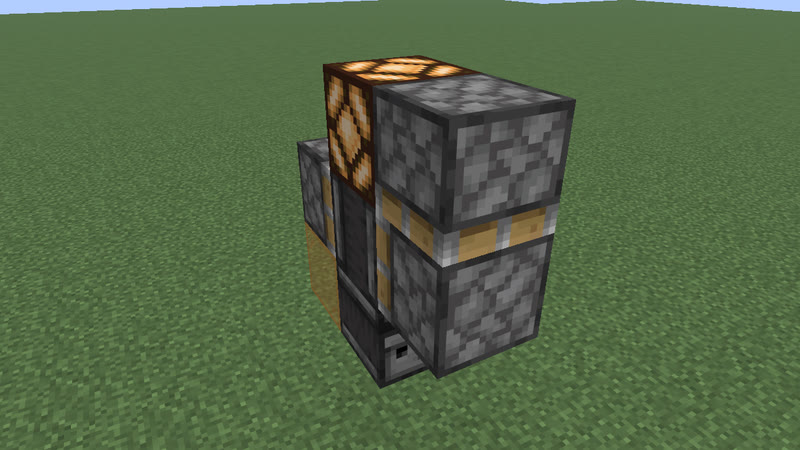</a> 17 gt (0.85 s) · observer+redstone_lamp+sticky_piston · 6 blocks</td><td align="center"> 17 gt (0.85 s) · observer+redstone_lamp+sticky_piston · 6 blocks</td><td align="center"> 17 gt (0.85 s) · note_block+observer+redstone_block+sticky_piston · 6 blocks</td></tr>
<tr><td align="center"> 17 gt (0.85 s) · note_block+observer+redstone_block+sticky_piston · 6 blocks</td><td align="center"> 17 gt (0.85 s) · note_block+observer+sticky_piston · 6 blocks</td><td align="center"><a href="../archive/clk-obs-p17-note-obs-stk-6b-b-592dfe.txt">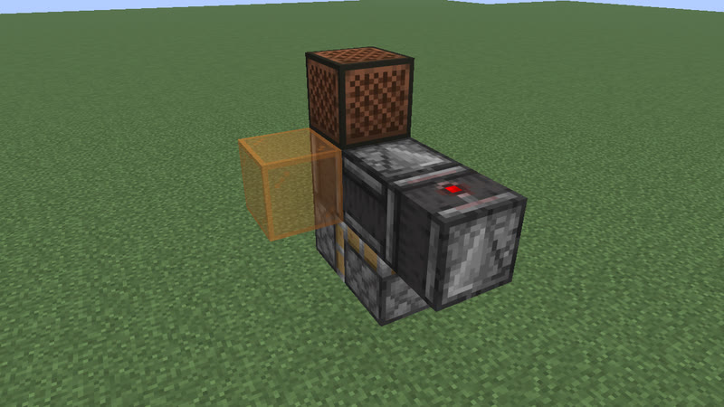</a> 17 gt (0.85 s) · note_block+observer+sticky_piston · 6 blocks</td></tr>
<tr><td align="center"> 17 gt (0.85 s) · observer+piston+redstone_block+sticky_piston · 6 blocks</td><td align="center"> 17 gt (0.85 s) · observer+redstone_block+sticky_piston · 6 blocks</td><td align="center"><a href="../archive/clk-obs-p17-obs-rb-stk-6b-b-7ad860.txt">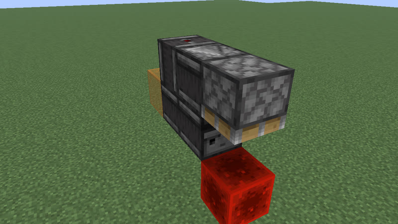</a> 17 gt (0.85 s) · observer+redstone_block+sticky_piston · 6 blocks</td></tr>
<tr><td align="center"> 17 gt (0.85 s) · note_block+observer+piston+redstone_block+sticky_piston · 6 blocks</td><td align="center"><a href="../archive/clk-obs-p17-note-obs-pis-rb-stk-6b-b-b4f5b6.txt">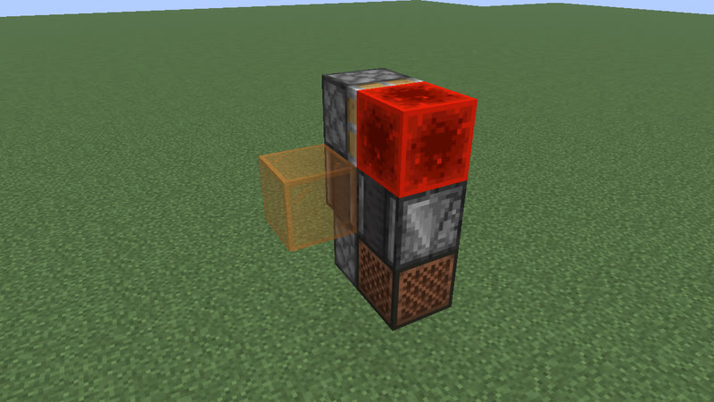</a> 17 gt (0.85 s) · note_block+observer+piston+redstone_block+sticky_piston · 6 blocks</td><td align="center"> 17 gt (0.85 s) · note_block+observer+piston+sticky_piston · 6 blocks</td></tr>
<tr><td align="center"> 17 gt (0.85 s) · observer+piston+redstone_lamp+sticky_piston · 7 blocks</td><td align="center"> 17 gt (0.85 s) · note_block+observer+redstone_block+redstone_lamp+sticky_piston · 7 blocks</td><td align="center"> 17 gt (0.85 s) · note_block+observer+redstone_lamp+sticky_piston · 7 blocks</td></tr>
<tr><td align="center"><a href="../archive/clk-obs-p17-lamp-note-obs-stk-7b-b-d45f3b.txt">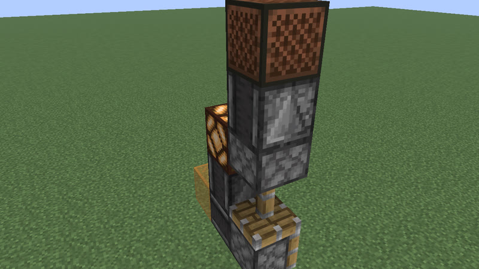</a> 17 gt (0.85 s) · note_block+observer+redstone_lamp+sticky_piston · 7 blocks</td><td align="center"> 17 gt (0.85 s) · note_block+observer+piston · 7 blocks</td><td align="center"><a href="../archive/clk-obs-p17-lamp-note-obs-rb-stk-7b-b-d7892b.txt">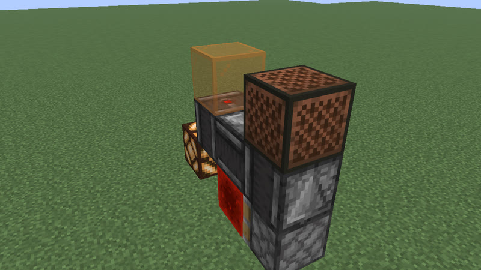</a> 17 gt (0.85 s) · note_block+observer+redstone_block+redstone_lamp+sticky_piston · 7 blocks</td></tr>
<tr><td align="center"><a href="../archive/clk-obs-p17-note-obs-pis-7b-b-8c6835.txt">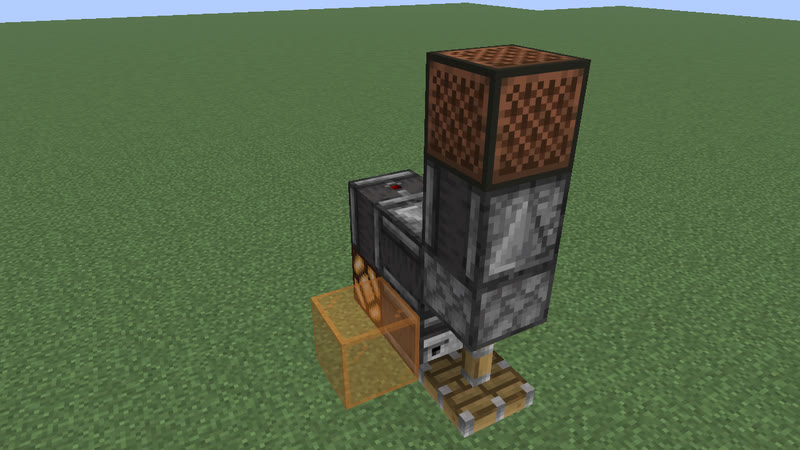</a> 17 gt (0.85 s) · note_block+observer+piston · 7 blocks</td><td align="center"> 17 gt (0.85 s) · comparator+hopper+redstone_torch+repeater · 9 blocks</td><td align="center"> 17 gt (0.85 s) · redstone_wire+repeater · 16 blocks</td></tr>
<tr><td align="center"> 17 gt (0.85 s) · redstone_wire+repeater · 18 blocks</td></tr>
</table>

## 18 gt (0.9 s)

Also reachable by: clk-misc-activator_rail-ring (n = 2), clk-misc-crafter-ring (n = 2), clk-misc-iron_door-ring (n = 2), clk-misc-oak_door-ring (n = 2), clk-misc-oak_fence_gate-ring (n = 2), clk-misc-oak_trapdoor-ring (n = 2), clk-misc-powered_rail-ring (n = 2), clk-misc-skeleton_skull-ring (n = 2), clk-obs-note-ring (n = 2), clk-obs-trap-ring (n = 2).

<table>
<tr><td align="center"> 18 gt (0.9 s) · observer+sticky_piston · 4 blocks</td><td align="center"> 18 gt (0.9 s) · observer+sticky_piston · 4 blocks</td><td align="center"> 18 gt (0.9 s) · note_block+observer+piston+redstone_lamp · 5 blocks</td></tr>
<tr><td align="center"> 18 gt (0.9 s) · note_block+observer+redstone_lamp+sticky_piston · 5 blocks</td><td align="center"> 18 gt (0.9 s) · observer+piston+redstone_lamp · 5 blocks</td><td align="center"> 18 gt (0.9 s) · observer+piston+redstone_lamp · 5 blocks</td></tr>
<tr><td align="center"> 18 gt (0.9 s) · observer+redstone_lamp+sticky_piston · 5 blocks</td><td align="center"><a href="../archive/clk-obs-p18-lamp-obs-stk-5b-b-62783f.txt">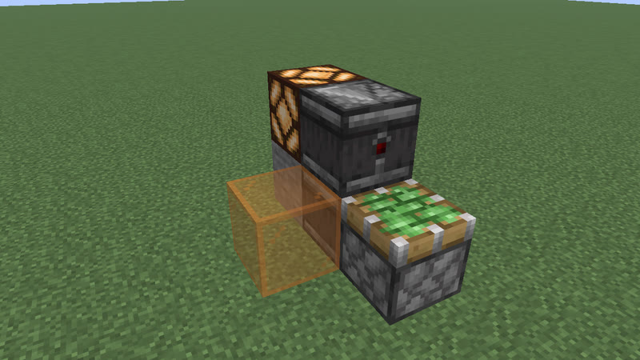</a> 18 gt (0.9 s) · observer+redstone_lamp+sticky_piston · 5 blocks</td><td align="center"><a href="../archive/clk-obs-p18-note-obs-stk-5b-b-f3fa61.txt">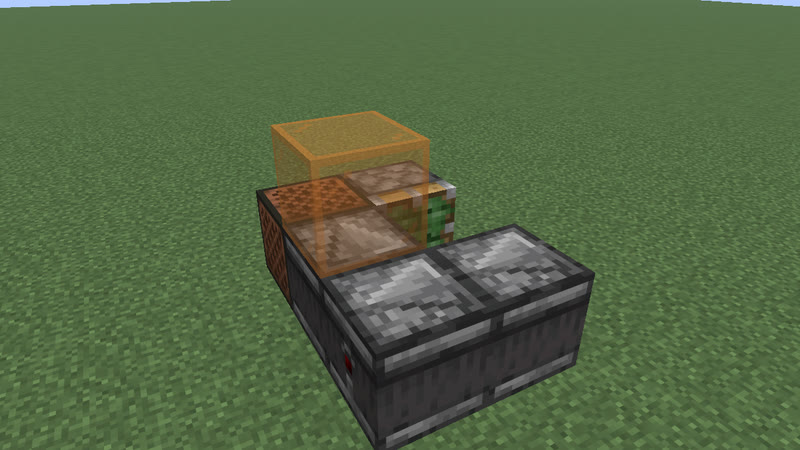</a> 18 gt (0.9 s) · note_block+observer+sticky_piston · 5 blocks</td></tr>
<tr><td align="center"> 18 gt (0.9 s) · note_block+observer+sticky_piston · 5 blocks</td><td align="center"> 18 gt (0.9 s) · copper_bulb+observer+sticky_piston · 5 blocks</td><td align="center"> 18 gt (0.9 s) · note_block+observer+piston+redstone_lamp · 5 blocks</td></tr>
<tr><td align="center"><a href="../archive/clk-obs-p18-lamp-note-obs-stk-5b-b-b9dcbb.txt">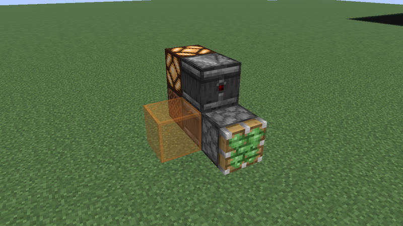</a> 18 gt (0.9 s) · note_block+observer+redstone_lamp+sticky_piston · 5 blocks</td><td align="center"> 18 gt (0.9 s) · observer+piston+sticky_piston · 5 blocks</td><td align="center"> 18 gt (0.9 s) · observer+piston+sticky_piston · 5 blocks</td></tr>
<tr><td align="center"> 18 gt (0.9 s) · copper_bulb+note_block+observer+sticky_piston · 6 blocks</td><td align="center"><a href="../archive/clk-obs-p18-bulb-note-obs-stk-6b-b-b39aa1.txt">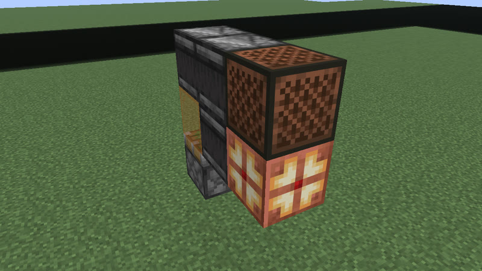</a> 18 gt (0.9 s) · copper_bulb+note_block+observer+sticky_piston · 6 blocks</td><td align="center"> 18 gt (0.9 s) · copper_bulb+observer+piston+redstone_block+sticky_piston · 6 blocks</td></tr>
<tr><td align="center"> 18 gt (0.9 s) · copper_bulb+observer+piston+redstone_block+sticky_piston · 6 blocks</td><td align="center"> 18 gt (0.9 s) · copper_bulb+observer+piston+sticky_piston · 6 blocks</td><td align="center"><a href="../archive/clk-obs-p18-bulb-obs-pis-stk-6b-b-c14dcb.txt">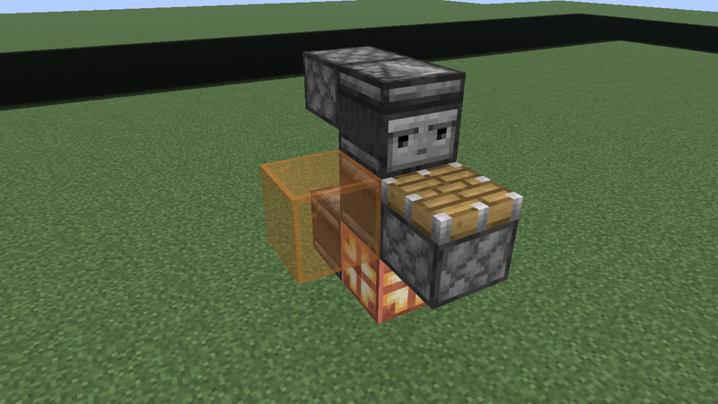</a> 18 gt (0.9 s) · copper_bulb+observer+piston+sticky_piston · 6 blocks</td></tr>
<tr><td align="center"> 18 gt (0.9 s) · copper_bulb+observer+redstone_block+sticky_piston · 6 blocks</td><td align="center"> 18 gt (0.9 s) · copper_bulb+observer+redstone_block+sticky_piston · 6 blocks</td><td align="center"><a href="../archive/clk-obs-p18-bulb-obs-stk-6b-b-13ce83.txt">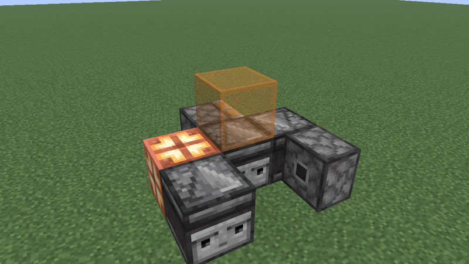</a> 18 gt (0.9 s) · copper_bulb+observer+sticky_piston · 6 blocks</td></tr>
<tr><td align="center"> 18 gt (0.9 s) · observer+redstone_block+redstone_lamp+sticky_piston · 6 blocks</td><td align="center"> 18 gt (0.9 s) · note_block+observer+redstone_block+sticky_piston · 6 blocks</td><td align="center"> 18 gt (0.9 s) · observer+redstone_block+sticky_piston · 6 blocks</td></tr>
<tr><td align="center"> 18 gt (0.9 s) · observer+redstone_block+sticky_piston · 6 blocks</td><td align="center"> 18 gt (0.9 s) · note_block+observer+piston+redstone_lamp+sticky_piston · 6 blocks</td><td align="center"><a href="../archive/clk-obs-p18-lamp-note-obs-pis-stk-6b-b-28621d.txt">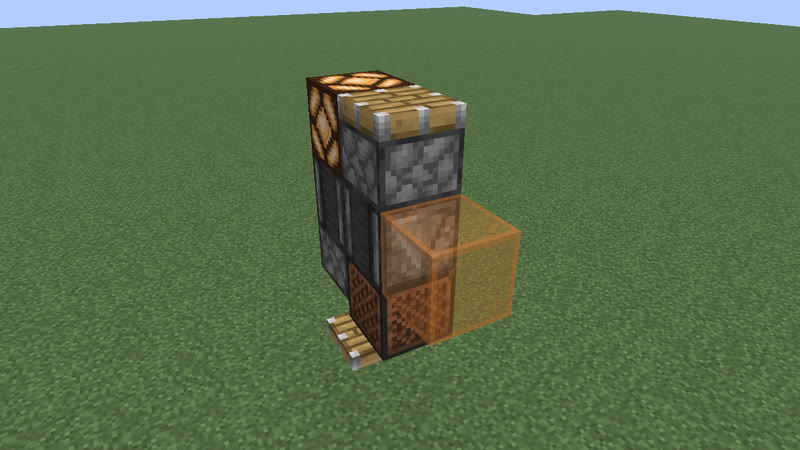</a> 18 gt (0.9 s) · note_block+observer+piston+redstone_lamp+sticky_piston · 6 blocks</td></tr>
<tr><td align="center"> 18 gt (0.9 s) · observer+piston+redstone_lamp+sticky_piston · 6 blocks</td><td align="center"><a href="../archive/clk-obs-p18-lamp-obs-pis-stk-6b-b-09831e.txt">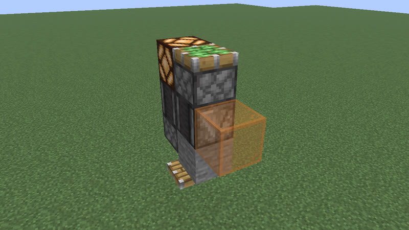</a> 18 gt (0.9 s) · observer+piston+redstone_lamp+sticky_piston · 6 blocks</td><td align="center"> 18 gt (0.9 s) · note_block+observer+piston · 6 blocks</td></tr>
<tr><td align="center"> 18 gt (0.9 s) · note_block+observer+piston · 6 blocks</td><td align="center"> 18 gt (0.9 s) · note_block+observer+piston+sticky_piston · 6 blocks</td><td align="center"> 18 gt (0.9 s) · note_block+observer+piston+sticky_piston · 6 blocks</td></tr>
<tr><td align="center"> 18 gt (0.9 s) · note_block+observer+redstone_block+sticky_piston · 6 blocks</td><td align="center"> 18 gt (0.9 s) · observer+piston · 6 blocks</td><td align="center"> 18 gt (0.9 s) · observer+piston · 6 blocks</td></tr>
<tr><td align="center"> 18 gt (0.9 s) · observer+piston+redstone_block+sticky_piston · 6 blocks</td><td align="center"> 18 gt (0.9 s) · copper_bulb+note_block+observer+piston · 7 blocks</td><td align="center"> 18 gt (0.9 s) · copper_bulb+observer+piston · 7 blocks</td></tr>
<tr><td align="center"><a href="../archive/clk-obs-p18-bulb-obs-pis-7b-b-4173ce.txt">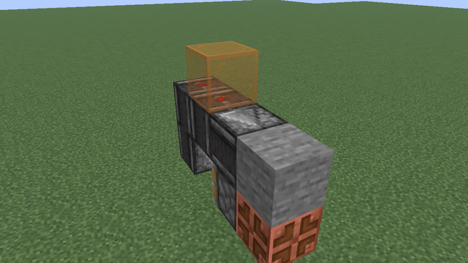</a> 18 gt (0.9 s) · copper_bulb+observer+piston · 7 blocks</td><td align="center"><a href="../archive/clk-obs-p18-bulb-note-obs-rb-stk-7b-b-90ac96.txt">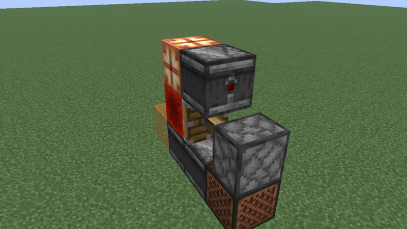</a> 18 gt (0.9 s) · copper_bulb+note_block+observer+redstone_block+sticky_piston · 7 blocks</td><td align="center"> 18 gt (0.9 s) · copper_bulb+note_block+observer+redstone_block+sticky_piston · 7 blocks</td></tr>
<tr><td align="center"> 18 gt (0.9 s) · observer+redstone_block+redstone_lamp+sticky_piston · 7 blocks</td><td align="center"><a href="../archive/clk-obs-p18-note-obs-pis-rb-stk-7b-b-33e743.txt">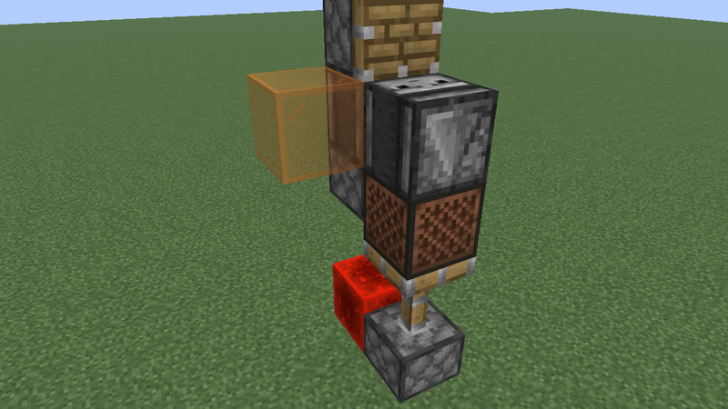</a> 18 gt (0.9 s) · note_block+observer+piston+redstone_block+sticky_piston · 7 blocks</td><td align="center"> 18 gt (0.9 s) · copper_bulb+observer+redstone_block+redstone_lamp+sticky_piston · 7 blocks</td></tr>
<tr><td align="center"> 18 gt (0.9 s) · copper_bulb+observer+redstone_block+redstone_lamp+sticky_piston · 7 blocks</td><td align="center"> 18 gt (0.9 s) · observer+piston+redstone_block+redstone_lamp+sticky_piston · 7 blocks</td><td align="center"> 18 gt (0.9 s) · note_block+observer+piston+redstone_block+sticky_piston · 7 blocks</td></tr>
<tr><td align="center"><a href="../archive/clk-obs-p18-obs-pis-rb-stk-7b-b-b4e48f.txt">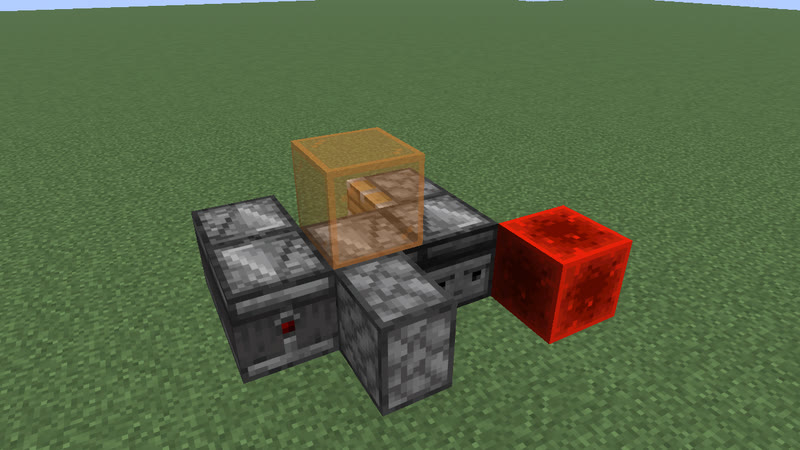</a> 18 gt (0.9 s) · observer+piston+redstone_block+sticky_piston · 7 blocks</td><td align="center"> 18 gt (0.9 s) · redstone_torch+repeater · 8 blocks</td><td align="center"> 18 gt (0.9 s) · comparator+hopper+redstone_wire+repeater · 9 blocks</td></tr>
<tr><td align="center"> 18 gt (0.9 s) · comparator+redstone_torch+repeater · 12 blocks</td><td align="center"> 18 gt (0.9 s) · comparator+redstone_torch+redstone_wire+repeater · 12 blocks</td><td align="center"> 18 gt (0.9 s) · redstone_torch+redstone_wire+repeater · 12 blocks</td></tr>
<tr><td align="center"> 18 gt (0.9 s) · comparator+repeater · 12 blocks</td><td align="center"> 18 gt (0.9 s) · repeater · 12 blocks</td><td align="center"> 18 gt (0.9 s) · redstone_torch+redstone_wire+repeater · 12 blocks</td></tr>
<tr><td align="center"> 18 gt (0.9 s) · comparator+redstone_wire+repeater · 13 blocks</td><td align="center"> 18 gt (0.9 s) · redstone_wire+repeater · 13 blocks</td><td align="center"> 18 gt (0.9 s) · comparator+redstone_wire+repeater · 14 blocks</td></tr>
<tr><td align="center"> 18 gt (0.9 s) · redstone_wire+repeater · 14 blocks</td><td align="center"> 18 gt (0.9 s) · comparator+dropper+hopper+repeater · 14 blocks</td></tr>
</table>

## 19 gt (0.95 s)

Also reachable by: clk-obs-odd-a (n = 2).

<table>
<tr><td align="center"> 19 gt (0.95 s) · observer+piston+sticky_piston · 6 blocks</td><td align="center"> 19 gt (0.95 s) · observer+piston+sticky_piston · 6 blocks</td><td align="center"> 19 gt (0.95 s) · observer+sticky_piston · 6 blocks</td></tr>
<tr><td align="center"> 19 gt (0.95 s) · observer+sticky_piston · 6 blocks</td><td align="center"> 19 gt (0.95 s) · observer+sticky_piston · 6 blocks</td><td align="center"> 19 gt (0.95 s) · copper_bulb+observer+piston+sticky_piston · 6 blocks</td></tr>
<tr><td align="center"> 19 gt (0.95 s) · copper_bulb+observer+sticky_piston · 6 blocks</td><td align="center"> 19 gt (0.95 s) · observer+piston+redstone_lamp+sticky_piston · 6 blocks</td><td align="center"> 19 gt (0.95 s) · observer+redstone_lamp+sticky_piston · 6 blocks</td></tr>
<tr><td align="center"> 19 gt (0.95 s) · note_block+observer+piston+sticky_piston · 6 blocks</td><td align="center"> 19 gt (0.95 s) · note_block+observer+piston+sticky_piston · 6 blocks</td><td align="center"> 19 gt (0.95 s) · note_block+observer+sticky_piston · 6 blocks</td></tr>
<tr><td align="center"> 19 gt (0.95 s) · note_block+observer+sticky_piston · 6 blocks</td><td align="center"> 19 gt (0.95 s) · copper_bulb+observer+piston+redstone_block+sticky_piston · 7 blocks</td><td align="center"><a href="../archive/clk-obs-p19-bulb-obs-pis-rb-stk-7b-b-2bdae5.txt">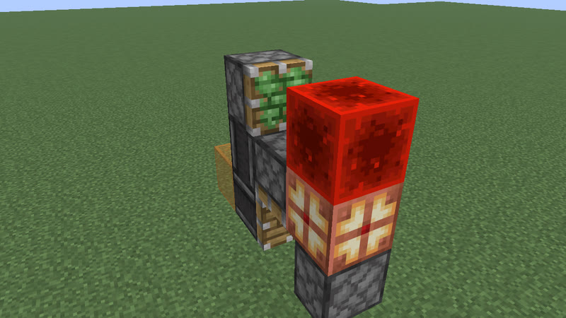</a> 19 gt (0.95 s) · copper_bulb+observer+piston+redstone_block+sticky_piston · 7 blocks</td></tr>
<tr><td align="center"> 19 gt (0.95 s) · observer+redstone_block+redstone_lamp+sticky_piston · 7 blocks</td><td align="center"><a href="../archive/clk-obs-p19-lamp-obs-rb-stk-7b-b-e09d9c.txt">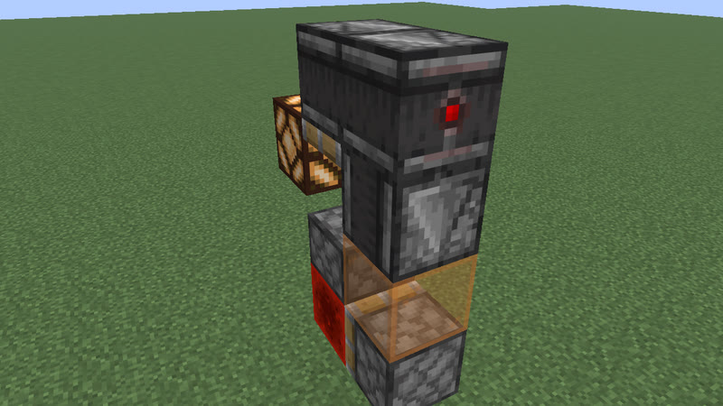</a> 19 gt (0.95 s) · observer+redstone_block+redstone_lamp+sticky_piston · 7 blocks</td><td align="center"><a href="../archive/clk-obs-p19-lamp-obs-stk-7b-b-512d64.txt">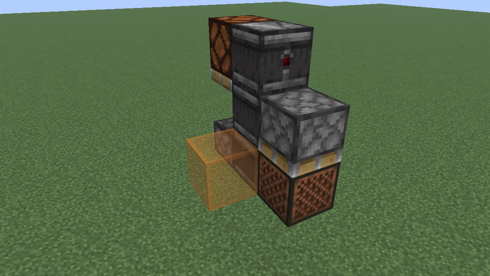</a> 19 gt (0.95 s) · observer+redstone_lamp+sticky_piston · 7 blocks</td></tr>
<tr><td align="center"> 19 gt (0.95 s) · note_block+observer+redstone_block+sticky_piston · 7 blocks</td><td align="center"><a href="../archive/clk-obs-p19-obs-pis-rb-stk-7b-b-19082f.txt">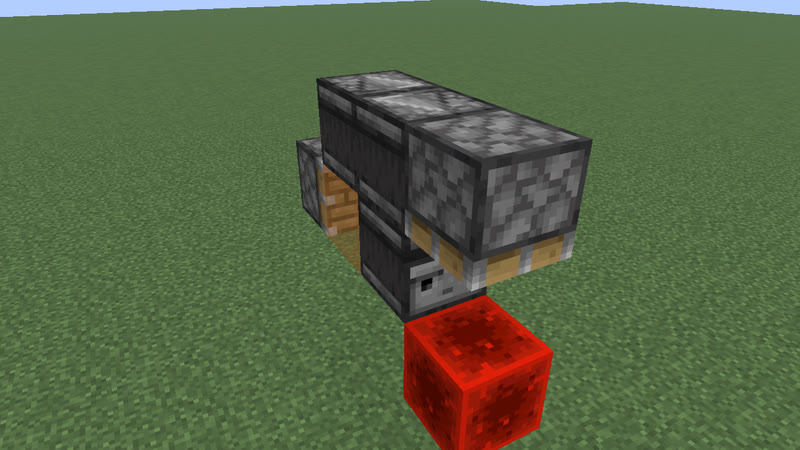</a> 19 gt (0.95 s) · observer+piston+redstone_block+sticky_piston · 7 blocks</td><td align="center"> 19 gt (0.95 s) · observer+piston+redstone_block+sticky_piston · 7 blocks</td></tr>
<tr><td align="center"> 19 gt (0.95 s) · observer+redstone_block+sticky_piston · 7 blocks</td><td align="center"><a href="../archive/clk-obs-p19-obs-rb-stk-7b-b-35b1e2.txt">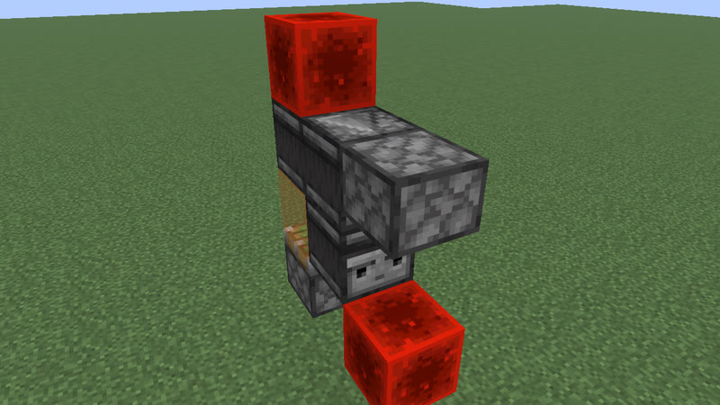</a> 19 gt (0.95 s) · observer+redstone_block+sticky_piston · 7 blocks</td><td align="center"> 19 gt (0.95 s) · comparator+dropper+hopper+repeater · 14 blocks</td></tr>
<tr><td align="center"> 19 gt (0.95 s) · redstone_wire+repeater · 16 blocks</td><td align="center"> 19 gt (0.95 s) · redstone_wire+repeater · 18 blocks</td></tr>
</table>

## 20 gt (1 s)

Also reachable by: clk-obs-obs-ring (n = 3), clk-item-snowdisp (n = 1), clk-obs-bulb-ring (n = 0), clk-rt-uloop2t (n = 0).

<table>
<tr><td align="center"> 20 gt (1 s) · observer+piston+redstone_lamp · 5 blocks</td><td align="center"> 20 gt (1 s) · observer+redstone_lamp+sticky_piston · 5 blocks</td><td align="center"> 20 gt (1 s) · observer+redstone_block+sticky_piston · 5 blocks</td></tr>
<tr><td align="center"> 20 gt (1 s) · observer+sticky_piston · 5 blocks</td><td align="center"> 20 gt (1 s) · observer+sticky_piston · 5 blocks</td><td align="center"> 20 gt (1 s) · copper_bulb+observer+redstone_block+sticky_piston · 5 blocks</td></tr>
<tr><td align="center"> 20 gt (1 s) · observer+piston+redstone_lamp · 5 blocks</td><td align="center"><a href="../archive/clk-obs-p20-lamp-obs-stk-5b-b-b200e9.txt">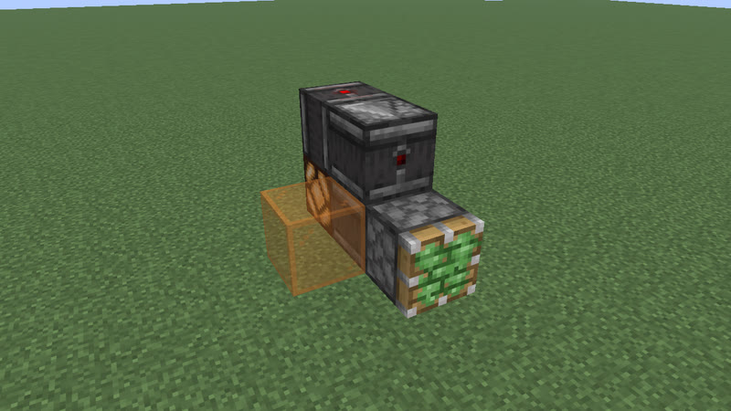</a> 20 gt (1 s) · observer+redstone_lamp+sticky_piston · 5 blocks</td><td align="center"> 20 gt (1 s) · observer+piston+sticky_piston · 5 blocks</td></tr>
<tr><td align="center"> 20 gt (1 s) · observer+redstone_block+sticky_piston · 5 blocks</td><td align="center"> 20 gt (1 s) · copper_bulb+observer+redstone_block+sticky_piston · 5 blocks</td><td align="center"> 20 gt (1 s) · observer+piston+sticky_piston · 5 blocks</td></tr>
<tr><td align="center"> 20 gt (1 s) · observer+redstone_lamp · 6 blocks</td><td align="center"> 20 gt (1 s) · observer+redstone_lamp · 6 blocks</td><td align="center"> 20 gt (1 s) · copper_bulb+note_block+observer+redstone_block+sticky_piston · 6 blocks</td></tr>
<tr><td align="center"><a href="../archive/clk-obs-p20-bulb-note-obs-rb-stk-6b-b-652e09.txt">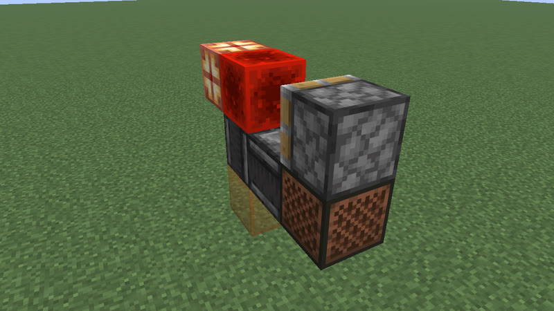</a> 20 gt (1 s) · copper_bulb+note_block+observer+redstone_block+sticky_piston · 6 blocks</td><td align="center"> 20 gt (1 s) · note_block+observer+piston+redstone_lamp · 6 blocks</td><td align="center"><a href="../archive/clk-obs-p20-lamp-note-obs-pis-6b-b-479e4c.txt">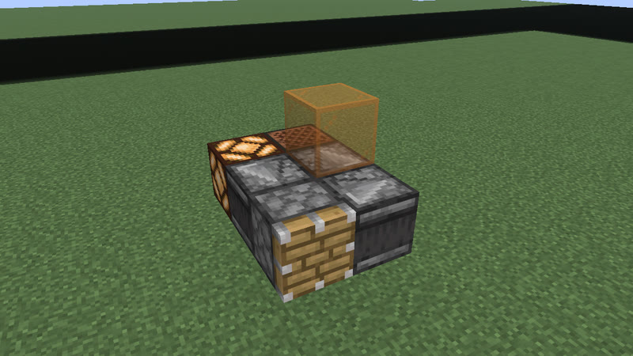</a> 20 gt (1 s) · note_block+observer+piston+redstone_lamp · 6 blocks</td></tr>
<tr><td align="center"> 20 gt (1 s) · note_block+observer+redstone_lamp+sticky_piston · 6 blocks</td><td align="center"><a href="../archive/clk-obs-p20-lamp-note-obs-stk-6b-b-373e1b.txt">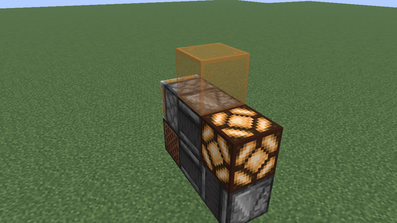</a> 20 gt (1 s) · note_block+observer+redstone_lamp+sticky_piston · 6 blocks</td><td align="center"> 20 gt (1 s) · observer+redstone_block+redstone_lamp+sticky_piston · 6 blocks</td></tr>
<tr><td align="center"> 20 gt (1 s) · note_block+observer+piston+sticky_piston · 6 blocks</td><td align="center"> 20 gt (1 s) · note_block+observer+redstone_block+sticky_piston · 6 blocks</td><td align="center"><a href="../archive/clk-obs-p20-note-obs-rb-stk-6b-b-782593.txt">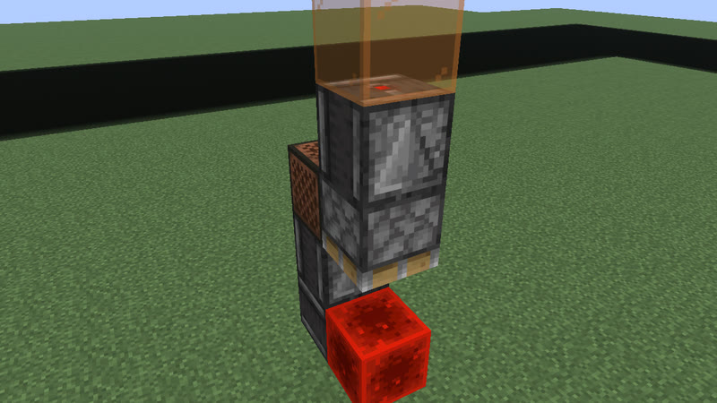</a> 20 gt (1 s) · note_block+observer+redstone_block+sticky_piston · 6 blocks</td></tr>
<tr><td align="center"> 20 gt (1 s) · note_block+observer+sticky_piston · 6 blocks</td><td align="center"> 20 gt (1 s) · note_block+observer+sticky_piston · 6 blocks</td><td align="center"> 20 gt (1 s) · copper_bulb+observer+sticky_piston · 6 blocks</td></tr>
<tr><td align="center"> 20 gt (1 s) · observer+redstone_block+redstone_lamp+sticky_piston · 6 blocks</td><td align="center"> 20 gt (1 s) · observer+piston+redstone_block+sticky_piston · 6 blocks</td><td align="center"> 20 gt (1 s) · copper_bulb+observer+redstone_block+redstone_lamp+sticky_piston · 6 blocks</td></tr>
<tr><td align="center"><a href="../archive/clk-obs-p20-bulb-lamp-obs-rb-stk-6b-b-318bf2.txt">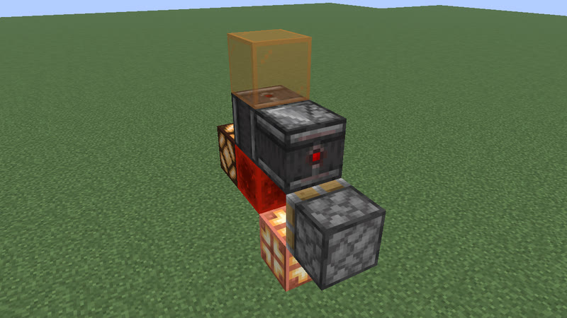</a> 20 gt (1 s) · copper_bulb+observer+redstone_block+redstone_lamp+sticky_piston · 6 blocks</td><td align="center"> 20 gt (1 s) · note_block+observer+piston+redstone_block+sticky_piston · 6 blocks</td><td align="center"><a href="../archive/clk-obs-p20-obs-pis-rb-stk-6b-b-3f3f2e.txt">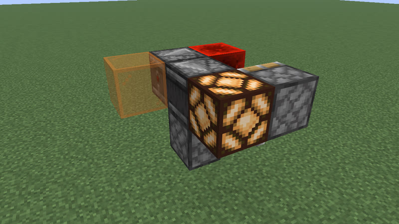</a> 20 gt (1 s) · observer+piston+redstone_block+sticky_piston · 6 blocks</td></tr>
<tr><td align="center"> 20 gt (1 s) · observer+piston+redstone_lamp+sticky_piston · 7 blocks</td><td align="center"> 20 gt (1 s) · note_block+observer+piston+sticky_piston · 7 blocks</td><td align="center"> 20 gt (1 s) · copper_bulb+observer+piston+redstone_lamp+sticky_piston · 7 blocks</td></tr>
<tr><td align="center"> 20 gt (1 s) · copper_bulb+note_block+observer+piston+redstone_block+sticky_piston · 7 blocks</td><td align="center"> 20 gt (1 s) · copper_bulb+note_block+observer+piston+redstone_block+sticky_piston · 7 blocks</td><td align="center"> 20 gt (1 s) · copper_bulb+observer+piston+redstone_block+sticky_piston · 7 blocks</td></tr>
<tr><td align="center"> 20 gt (1 s) · copper_bulb+observer+piston+redstone_block+sticky_piston · 7 blocks</td><td align="center"> 20 gt (1 s) · comparator+redstone_torch+redstone_wire+repeater · 9 blocks</td><td align="center"> 20 gt (1 s) · redstone_torch+redstone_wire+repeater · 9 blocks</td></tr>
<tr><td align="center"> 20 gt (1 s) · comparator+hopper+redstone_torch+repeater · 9 blocks</td><td align="center"> 20 gt (1 s) · comparator+dropper+hopper · 10 blocks</td><td align="center"> 20 gt (1 s) · comparator+redstone_torch+repeater · 12 blocks</td></tr>
<tr><td align="center"> 20 gt (1 s) · comparator+repeater · 12 blocks</td><td align="center"> 20 gt (1 s) · repeater · 12 blocks</td><td align="center"> 20 gt (1 s) · comparator+redstone_torch+redstone_wire · 13 blocks</td></tr>
<tr><td align="center"> 20 gt (1 s) · comparator+redstone_wire+repeater · 13 blocks</td><td align="center"> 20 gt (1 s) · redstone_wire+repeater · 13 blocks</td><td align="center"> 20 gt (1 s) · comparator+redstone_wire+repeater · 14 blocks</td></tr>
<tr><td align="center"> 20 gt (1 s) · redstone_wire+repeater · 14 blocks</td></tr>
</table>

## 21 gt (1.05 s)

Also reachable by: clk-obs-odd-b (n = 2), clk-item-hopper-ring-2 (n = 2).

<table>
<tr><td align="center"><a href="../archive/census-p21-calibrated_sculk_sensor-dispenser-observer-5b.txt">census-p21-calibrated_sculk_sensor-dispenser-observer-5b</a> 21 gt (1.05 s) · calibrated_sculk_sensor+dispenser+observer · 5 blocks (picture pending)</td><td align="center"> 21 gt (1.05 s) · calibrated_sculk_sensor+dispenser+observer · 5 blocks</td><td align="center"><a href="../archive/census-p21-calibrated_sculk_sensor-dispenser-observer-sticky_piston-5b.txt">census-p21-calibrated_sculk_sensor-dispenser-observer-sticky_piston-5b</a> 21 gt (1.05 s) · calibrated_sculk_sensor+dispenser+observer+sticky_piston · 5 blocks (picture pending)</td></tr>
<tr><td align="center"><a href="../archive/census-p21-calibrated_sculk_sensor-note_block-observer-sticky_piston-5b.txt">census-p21-calibrated_sculk_sensor-note_block-observer-sticky_piston-5b</a> 21 gt (1.05 s) · calibrated_sculk_sensor+note_block+observer+sticky_piston · 5 blocks (picture pending)</td><td align="center"><a href="../archive/census-p21-calibrated_sculk_sensor-oak_trapdoor-observer-sticky_piston-5b.txt">census-p21-calibrated_sculk_sensor-oak_trapdoor-observer-sticky_piston-5b</a> 21 gt (1.05 s) · calibrated_sculk_sensor+oak_trapdoor+observer+sticky_piston · 5 blocks (picture pending)</td><td align="center"><a href="../archive/census-p21-calibrated_sculk_sensor-observer-piston-sticky_piston-5b.txt">census-p21-calibrated_sculk_sensor-observer-piston-sticky_piston-5b</a> 21 gt (1.05 s) · calibrated_sculk_sensor+observer+piston+sticky_piston · 5 blocks (picture pending)</td></tr>
<tr><td align="center"><a href="../archive/census-p21-calibrated_sculk_sensor-observer-sticky_piston-5b.txt">census-p21-calibrated_sculk_sensor-observer-sticky_piston-5b</a> 21 gt (1.05 s) · calibrated_sculk_sensor+observer+sticky_piston · 5 blocks (picture pending)</td><td align="center"><a href="../archive/clk-sculk-obs-p21-1.txt">clk-sculk-obs-p21-1</a> 21 gt (1.05 s) · calibrated_sculk_sensor+iron_trapdoor+observer · 6 blocks (picture pending)</td><td align="center"><a href="../archive/clk-sculk-obs-p21-3.txt">clk-sculk-obs-p21-3</a> 21 gt (1.05 s) · calibrated_sculk_sensor+oak_fence_gate+observer · 6 blocks (picture pending)</td></tr>
<tr><td align="center"><a href="../archive/clk-sculk-obs-p21-5.txt">clk-sculk-obs-p21-5</a> 21 gt (1.05 s) · calibrated_sculk_sensor+oak_trapdoor+observer · 6 blocks (picture pending)</td><td align="center"> 21 gt (1.05 s) · calibrated_sculk_sensor+note_block+observer+repeater · 6 blocks</td><td align="center"> 21 gt (1.05 s) · observer+redstone_block+sticky_piston · 6 blocks</td></tr>
<tr><td align="center"> 21 gt (1.05 s) · observer+redstone_block+sticky_piston · 6 blocks</td><td align="center"> 21 gt (1.05 s) · calibrated_sculk_sensor+note_block+redstone_torch+repeater · 6 blocks</td><td align="center"> 21 gt (1.05 s) · calibrated_sculk_sensor+dispenser+observer+repeater · 6 blocks</td></tr>
<tr><td align="center"> 21 gt (1.05 s) · calibrated_sculk_sensor+dispenser+redstone_torch+repeater · 6 blocks</td><td align="center"> 21 gt (1.05 s) · calibrated_sculk_sensor+oak_fence_gate+observer+sticky_piston · 6 blocks</td><td align="center"> 21 gt (1.05 s) · calibrated_sculk_sensor+iron_trapdoor+observer+sticky_piston · 6 blocks</td></tr>
<tr><td align="center"> 21 gt (1.05 s) · observer+piston+redstone_block+redstone_lamp+sticky_piston · 7 blocks</td><td align="center"> 21 gt (1.05 s) · note_block+observer+piston+redstone_block+sticky_piston · 7 blocks</td><td align="center"> 21 gt (1.05 s) · observer+piston+redstone_block+sticky_piston · 7 blocks</td></tr>
<tr><td align="center"> 21 gt (1.05 s) · observer+piston+sticky_piston · 7 blocks</td><td align="center"> 21 gt (1.05 s) · observer+piston+sticky_piston · 7 blocks</td><td align="center"> 21 gt (1.05 s) · observer+sticky_piston · 7 blocks</td></tr>
<tr><td align="center"> 21 gt (1.05 s) · observer+sticky_piston · 7 blocks</td><td align="center"> 21 gt (1.05 s) · note_block+observer+sticky_piston · 7 blocks</td><td align="center"> 21 gt (1.05 s) · note_block+observer+sticky_piston · 7 blocks</td></tr>
<tr><td align="center"><a href="../archive/clk-obs-p21-obs-rb-stk-7b-b-e834e3.txt">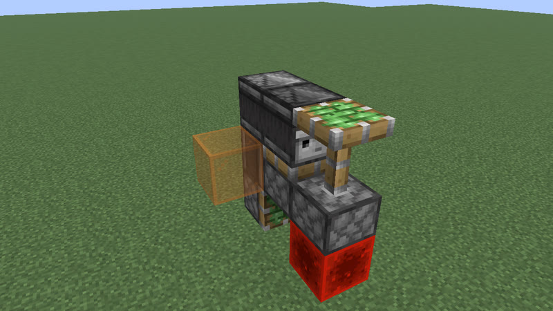</a> 21 gt (1.05 s) · observer+redstone_block+sticky_piston · 7 blocks</td><td align="center"> 21 gt (1.05 s) · observer+redstone_lamp+sticky_piston · 7 blocks</td><td align="center"> 21 gt (1.05 s) · calibrated_sculk_sensor+piston+redstone_wire+repeater · 10 blocks</td></tr>
<tr><td align="center"> 21 gt (1.05 s) · comparator+dropper+hopper+repeater · 14 blocks</td><td align="center"> 21 gt (1.05 s) · repeater · 16 blocks</td><td align="center"> 21 gt (1.05 s) · redstone_wire+repeater · 18 blocks</td></tr>
</table>

## 22 gt (1.1 s)

Also reachable by: clk-misc-activator_rail-ring (n = 3), clk-misc-crafter-ring (n = 3), clk-misc-iron_door-ring (n = 3), clk-misc-oak_door-ring (n = 3), clk-misc-oak_fence_gate-ring (n = 3), clk-misc-oak_trapdoor-ring (n = 3), clk-misc-powered_rail-ring (n = 3), clk-misc-skeleton_skull-ring (n = 3), clk-obs-note-ring (n = 3), clk-obs-trap-ring (n = 3).

<table>
<tr><td align="center"> 22 gt (1.1 s) · calibrated_sculk_sensor+oak_trapdoor+observer+repeater · 5 blocks</td><td align="center"><a href="../archive/census-p22-calibrated_sculk_sensor-oak_trapdoor-observer-sticky_piston-5b.txt">census-p22-calibrated_sculk_sensor-oak_trapdoor-observer-sticky_piston-5b</a> 22 gt (1.1 s) · calibrated_sculk_sensor+oak_trapdoor+observer+sticky_piston · 5 blocks (picture pending)</td><td align="center"><a href="../archive/census-p22-calibrated_sculk_sensor-observer-piston-sticky_piston-5b.txt">census-p22-calibrated_sculk_sensor-observer-piston-sticky_piston-5b</a> 22 gt (1.1 s) · calibrated_sculk_sensor+observer+piston+sticky_piston · 5 blocks (picture pending)</td></tr>
<tr><td align="center"><a href="../archive/census-p22-calibrated_sculk_sensor-observer-sticky_piston-5b.txt">census-p22-calibrated_sculk_sensor-observer-sticky_piston-5b</a> 22 gt (1.1 s) · calibrated_sculk_sensor+observer+sticky_piston · 5 blocks (picture pending)</td><td align="center"> 22 gt (1.1 s) · calibrated_sculk_sensor+oak_fence_gate+observer+sticky_piston · 5 blocks</td><td align="center"> 22 gt (1.1 s) · calibrated_sculk_sensor+iron_trapdoor+observer+sticky_piston · 5 blocks</td></tr>
<tr><td align="center"> 22 gt (1.1 s) · calibrated_sculk_sensor+note_block+observer+repeater · 5 blocks</td><td align="center"> 22 gt (1.1 s) · calibrated_sculk_sensor+dispenser+observer+repeater · 5 blocks</td><td align="center"> 22 gt (1.1 s) · calibrated_sculk_sensor+dispenser+observer · 5 blocks</td></tr>
<tr><td align="center"> 22 gt (1.1 s) · calibrated_sculk_sensor+dispenser+observer+sticky_piston · 5 blocks</td><td align="center"><a href="../archive/clk-sculk-hyb3-p22-1.txt">clk-sculk-hyb3-p22-1</a> 22 gt (1.1 s) · calibrated_sculk_sensor+note_block+observer+piston · 6 blocks (picture pending)</td><td align="center"><a href="../archive/clk-sculk-hyb3-p22-3.txt">clk-sculk-hyb3-p22-3</a> 22 gt (1.1 s) · calibrated_sculk_sensor+note_block+observer+sticky_piston · 6 blocks (picture pending)</td></tr>
<tr><td align="center"> 22 gt (1.1 s) · calibrated_sculk_sensor+dispenser+observer+piston · 6 blocks</td><td align="center"><a href="../archive/clk-sculk-obs-p22-1.txt">clk-sculk-obs-p22-1</a> 22 gt (1.1 s) · calibrated_sculk_sensor+iron_trapdoor+observer · 6 blocks (picture pending)</td><td align="center"><a href="../archive/clk-sculk-obs-p22-3.txt">clk-sculk-obs-p22-3</a> 22 gt (1.1 s) · calibrated_sculk_sensor+oak_fence_gate+observer · 6 blocks (picture pending)</td></tr>
<tr><td align="center"><a href="../archive/clk-sculk-obs-p22-5.txt">clk-sculk-obs-p22-5</a> 22 gt (1.1 s) · calibrated_sculk_sensor+oak_trapdoor+observer · 6 blocks (picture pending)</td><td align="center"> 22 gt (1.1 s) · observer+piston+redstone_lamp+sticky_piston · 6 blocks</td><td align="center"> 22 gt (1.1 s) · note_block+observer+piston+sticky_piston · 6 blocks</td></tr>
<tr><td align="center"> 22 gt (1.1 s) · note_block+observer+piston+sticky_piston · 6 blocks</td><td align="center"> 22 gt (1.1 s) · observer+piston+sticky_piston · 6 blocks</td><td align="center"> 22 gt (1.1 s) · observer+piston+sticky_piston · 6 blocks</td></tr>
<tr><td align="center"> 22 gt (1.1 s) · observer+redstone_block+redstone_lamp+sticky_piston · 6 blocks</td><td align="center"> 22 gt (1.1 s) · observer+redstone_lamp+sticky_piston · 6 blocks</td><td align="center"> 22 gt (1.1 s) · note_block+observer+sticky_piston · 6 blocks</td></tr>
<tr><td align="center"> 22 gt (1.1 s) · observer+redstone_block+sticky_piston · 6 blocks</td><td align="center"> 22 gt (1.1 s) · observer+redstone_block+sticky_piston · 6 blocks</td><td align="center"> 22 gt (1.1 s) · observer+sticky_piston · 6 blocks</td></tr>
<tr><td align="center"> 22 gt (1.1 s) · observer+sticky_piston · 6 blocks</td><td align="center"> 22 gt (1.1 s) · observer+sticky_piston · 6 blocks</td><td align="center"> 22 gt (1.1 s) · calibrated_sculk_sensor+dispenser+redstone_torch+repeater · 6 blocks</td></tr>
<tr><td align="center"><a href="../archive/clk-sculk-hyb3-p22-5.txt">clk-sculk-hyb3-p22-5</a> 22 gt (1.1 s) · calibrated_sculk_sensor+oak_trapdoor+observer+piston · 7 blocks (picture pending)</td><td align="center"> 22 gt (1.1 s) · calibrated_sculk_sensor+oak_fence_gate+observer+piston · 7 blocks</td><td align="center"> 22 gt (1.1 s) · calibrated_sculk_sensor+iron_trapdoor+observer+piston · 7 blocks</td></tr>
<tr><td align="center"><a href="../archive/clk-obs-p22-note-obs-stk-7b-b-de4b99.txt">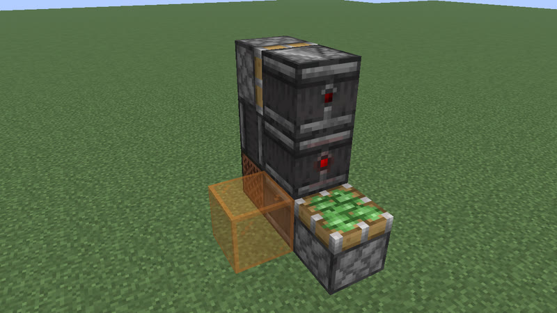</a> 22 gt (1.1 s) · note_block+observer+sticky_piston · 7 blocks</td><td align="center"><a href="../archive/clk-sculk-hyb3-p22-10.txt">clk-sculk-hyb3-p22-10</a> 22 gt (1.1 s) · calibrated_sculk_sensor+observer+piston · 7 blocks (picture pending)</td><td align="center"><a href="../archive/clk-obs-p22-bulb-obs-pis-stk-7b-b-1adc2d.txt">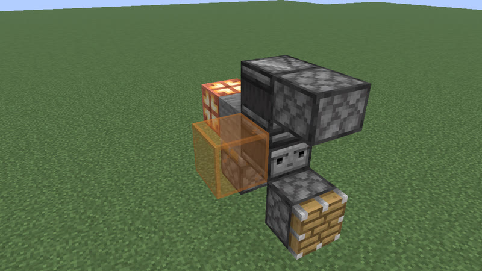</a> 22 gt (1.1 s) · copper_bulb+observer+piston+sticky_piston · 7 blocks</td></tr>
<tr><td align="center"> 22 gt (1.1 s) · copper_bulb+observer+piston+sticky_piston · 7 blocks</td><td align="center"> 22 gt (1.1 s) · observer+piston+redstone_lamp+sticky_piston · 7 blocks</td><td align="center"> 22 gt (1.1 s) · observer+redstone_lamp+sticky_piston · 7 blocks</td></tr>
<tr><td align="center"> 22 gt (1.1 s) · copper_bulb+observer+sticky_piston · 7 blocks</td><td align="center"> 22 gt (1.1 s) · observer+piston+redstone_block+sticky_piston · 7 blocks</td><td align="center"> 22 gt (1.1 s) · comparator+redstone_torch+repeater · 12 blocks</td></tr>
<tr><td align="center"> 22 gt (1.1 s) · comparator+redstone_torch+redstone_wire+repeater · 12 blocks</td><td align="center"> 22 gt (1.1 s) · redstone_torch+repeater · 12 blocks</td><td align="center"> 22 gt (1.1 s) · redstone_torch+redstone_wire+repeater · 12 blocks</td></tr>
<tr><td align="center"> 22 gt (1.1 s) · comparator+repeater · 12 blocks</td><td align="center"> 22 gt (1.1 s) · repeater · 12 blocks</td><td align="center"> 22 gt (1.1 s) · comparator+redstone_wire+repeater · 13 blocks</td></tr>
<tr><td align="center"> 22 gt (1.1 s) · redstone_wire+repeater · 13 blocks</td><td align="center"> 22 gt (1.1 s) · comparator+redstone_wire+repeater · 14 blocks</td><td align="center"> 22 gt (1.1 s) · redstone_wire+repeater · 14 blocks</td></tr>
<tr><td align="center"> 22 gt (1.1 s) · comparator+dropper+hopper+repeater · 18 blocks</td></tr>
</table>

## 23 gt (1.15 s)

Also reachable by: clk-obs-odd-a (n = 3), clk-rt-odd-rect (n = 0).

<table>
<tr><td align="center"> 23 gt (1.15 s) · calibrated_sculk_sensor+dispenser+observer+piston · 4 blocks</td><td align="center"><a href="../archive/census-p23-calibrated_sculk_sensor-dispenser-observer-sticky_piston-4b.txt">census-p23-calibrated_sculk_sensor-dispenser-observer-sticky_piston-4b</a> 23 gt (1.15 s) · calibrated_sculk_sensor+dispenser+observer+sticky_piston · 4 blocks (picture pending)</td><td align="center"><a href="../archive/census-p23-calibrated_sculk_sensor-note_block-observer-piston-4b.txt">census-p23-calibrated_sculk_sensor-note_block-observer-piston-4b</a> 23 gt (1.15 s) · calibrated_sculk_sensor+note_block+observer+piston · 4 blocks (picture pending)</td></tr>
<tr><td align="center"><a href="../archive/census-p23-calibrated_sculk_sensor-note_block-observer-sticky_piston-4b.txt">census-p23-calibrated_sculk_sensor-note_block-observer-sticky_piston-4b</a> 23 gt (1.15 s) · calibrated_sculk_sensor+note_block+observer+sticky_piston · 4 blocks (picture pending)</td><td align="center"><a href="../archive/census-p23-calibrated_sculk_sensor-dispenser-observer-5b.txt">census-p23-calibrated_sculk_sensor-dispenser-observer-5b</a> 23 gt (1.15 s) · calibrated_sculk_sensor+dispenser+observer · 5 blocks (picture pending)</td><td align="center"> 23 gt (1.15 s) · calibrated_sculk_sensor+note_block+observer+repeater · 5 blocks</td></tr>
<tr><td align="center"> 23 gt (1.15 s) · observer+piston+sticky_piston · 5 blocks</td><td align="center"> 23 gt (1.15 s) · observer+piston+sticky_piston · 5 blocks</td><td align="center"> 23 gt (1.15 s) · observer+sticky_piston · 5 blocks</td></tr>
<tr><td align="center"><a href="../archive/census-p23-calibrated_sculk_sensor-oak_trapdoor-observer-sticky_piston-5b.txt">census-p23-calibrated_sculk_sensor-oak_trapdoor-observer-sticky_piston-5b</a> 23 gt (1.15 s) · calibrated_sculk_sensor+oak_trapdoor+observer+sticky_piston · 5 blocks (picture pending)</td><td align="center"><a href="../archive/census-p23-calibrated_sculk_sensor-observer-piston-sticky_piston-5b.txt">census-p23-calibrated_sculk_sensor-observer-piston-sticky_piston-5b</a> 23 gt (1.15 s) · calibrated_sculk_sensor+observer+piston+sticky_piston · 5 blocks (picture pending)</td><td align="center"><a href="../archive/census-p23-calibrated_sculk_sensor-observer-sticky_piston-5b.txt">census-p23-calibrated_sculk_sensor-observer-sticky_piston-5b</a> 23 gt (1.15 s) · calibrated_sculk_sensor+observer+sticky_piston · 5 blocks (picture pending)</td></tr>
<tr><td align="center"> 23 gt (1.15 s) · calibrated_sculk_sensor+dispenser+observer+repeater · 5 blocks</td><td align="center"> 23 gt (1.15 s) · observer+sticky_piston · 5 blocks</td><td align="center"> 23 gt (1.15 s) · calibrated_sculk_sensor+observer+piston · 5 blocks</td></tr>
<tr><td align="center"> 23 gt (1.15 s) · calibrated_sculk_sensor+iron_trapdoor+observer+sticky_piston · 5 blocks</td><td align="center"> 23 gt (1.15 s) · calibrated_sculk_sensor+oak_fence_gate+observer+sticky_piston · 5 blocks</td><td align="center"> 23 gt (1.15 s) · observer+redstone_lamp+sticky_piston · 6 blocks</td></tr>
<tr><td align="center"><a href="../archive/clk-obs-p23-lamp-obs-stk-6b-b-a354e8.txt">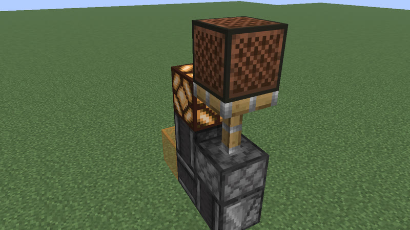</a> 23 gt (1.15 s) · observer+redstone_lamp+sticky_piston · 6 blocks</td><td align="center"> 23 gt (1.15 s) · note_block+observer+sticky_piston · 6 blocks</td><td align="center"><a href="../archive/clk-obs-p23-note-obs-stk-6b-b-449499.txt">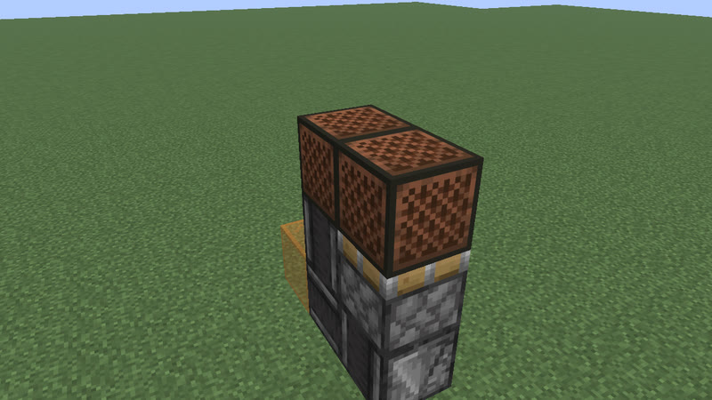</a> 23 gt (1.15 s) · note_block+observer+sticky_piston · 6 blocks</td></tr>
<tr><td align="center"><a href="../archive/clk-sculk-obs-p23-1.txt">clk-sculk-obs-p23-1</a> 23 gt (1.15 s) · calibrated_sculk_sensor+iron_trapdoor+observer · 6 blocks (picture pending)</td><td align="center"><a href="../archive/clk-sculk-obs-p23-3.txt">clk-sculk-obs-p23-3</a> 23 gt (1.15 s) · calibrated_sculk_sensor+oak_fence_gate+observer · 6 blocks (picture pending)</td><td align="center"><a href="../archive/clk-sculk-obs-p23-5.txt">clk-sculk-obs-p23-5</a> 23 gt (1.15 s) · calibrated_sculk_sensor+oak_trapdoor+observer · 6 blocks (picture pending)</td></tr>
<tr><td align="center"> 23 gt (1.15 s) · calibrated_sculk_sensor+dispenser+repeater · 6 blocks</td><td align="center"> 23 gt (1.15 s) · calibrated_sculk_sensor+dispenser+redstone_torch+repeater · 6 blocks</td><td align="center"> 23 gt (1.15 s) · observer+piston+redstone_lamp+sticky_piston · 7 blocks</td></tr>
<tr><td align="center"> 23 gt (1.15 s) · observer+piston+redstone_lamp+sticky_piston · 7 blocks</td><td align="center"> 23 gt (1.15 s) · note_block+observer+piston+sticky_piston · 7 blocks</td><td align="center"> 23 gt (1.15 s) · note_block+observer+piston+sticky_piston · 7 blocks</td></tr>
<tr><td align="center"> 23 gt (1.15 s) · comparator+dropper+hopper · 10 blocks</td><td align="center"> 23 gt (1.15 s) · redstone_wire+repeater · 18 blocks</td></tr>
</table>

[catalog index](../CATALOG.md) · previous: [p12-16](p12-16.md) · next: [p24-28](p24-28.md)
