# Clocks: 21 gt (1.05 s) to 29 gt (1.45 s) (267 clock types)

[catalog index](../CATALOG.md) · previous: [p4-20](p4-20.md) · next: [p30-42](p30-42.md)

Orange glass = where the output signal is (placed only for the picture); click a picture for its design. Larger clocks of a period no better than a smaller one on any variation (whatever their block kinds) are listed on [variants](variants.md). Generated by `mctas clock catalog`.

## 21 gt (1.05 s)

Also reachable by: clk-obs-odd-b (n = 2), hopper ring (clk-item-hopper-ring-2, n = 2).

<table>
<tr><td align="center"> 21 gt (1.05 s) · calibrated_sculk_sensor+dispenser+observer · 5 blocks</td><td align="center"> 21 gt (1.05 s) · calibrated_sculk_sensor+dispenser+observer · 5 blocks</td><td align="center"> 21 gt (1.05 s) · calibrated_sculk_sensor+dispenser+observer+sticky_piston · 5 blocks</td></tr>
<tr><td align="center"> 21 gt (1.05 s) · calibrated_sculk_sensor+note_block+observer+sticky_piston · 5 blocks</td><td align="center"> 21 gt (1.05 s) · calibrated_sculk_sensor+oak_trapdoor+observer+sticky_piston · 5 blocks</td><td align="center"> 21 gt (1.05 s) · calibrated_sculk_sensor+observer+piston+sticky_piston · 5 blocks</td></tr>
<tr><td align="center"> 21 gt (1.05 s) · calibrated_sculk_sensor+observer+sticky_piston · 5 blocks</td><td align="center"><a href="../archive/census-p21-calibrated_sculk_sensor-dispenser-note_block-observer-6b.txt">census-p21-calibrated_sculk_sensor-dispenser-note_block-observer-6b</a> 21 gt (1.05 s) · calibrated_sculk_sensor+dispenser+note_block+observer · 6 blocks (picture pending)</td><td align="center"><a href="../archive/census-p21-calibrated_sculk_sensor-dispenser-oak_trapdoor-observer-6b.txt">census-p21-calibrated_sculk_sensor-dispenser-oak_trapdoor-observer-6b</a> 21 gt (1.05 s) · calibrated_sculk_sensor+dispenser+oak_trapdoor+observer · 6 blocks (picture pending)</td></tr>
<tr><td align="center"><a href="../archive/clk-sculk-obs-p21-1.txt">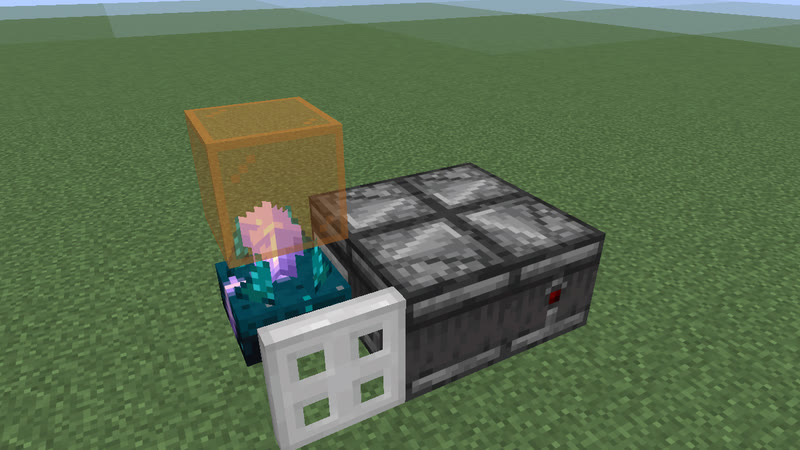</a> 21 gt (1.05 s) · calibrated_sculk_sensor+iron_trapdoor+observer · 6 blocks</td><td align="center"><a href="../archive/clk-sculk-obs-p21-3.txt">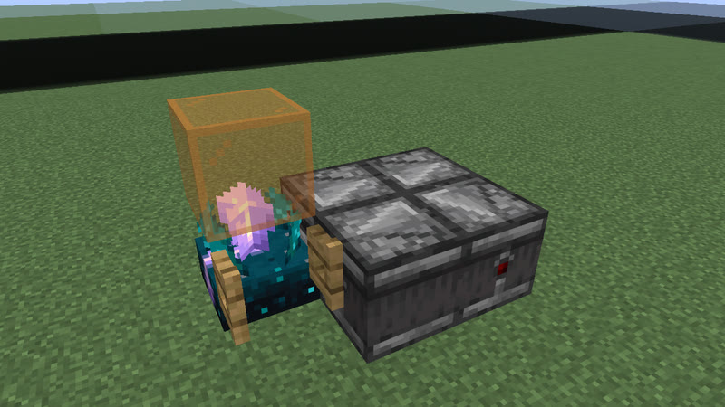</a> 21 gt (1.05 s) · calibrated_sculk_sensor+oak_fence_gate+observer · 6 blocks</td><td align="center"><a href="../archive/clk-sculk-obs-p21-5.txt">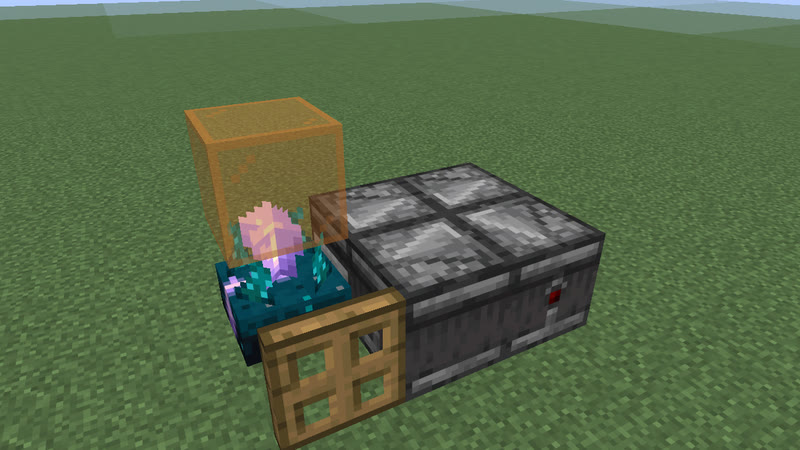</a> 21 gt (1.05 s) · calibrated_sculk_sensor+oak_trapdoor+observer · 6 blocks</td></tr>
<tr><td align="center"><a href="../archive/census-p21-calibrated_sculk_sensor-dispenser-note_block-observer-sticky_piston-6b.txt">census-p21-calibrated_sculk_sensor-dispenser-note_block-observer-sticky_piston-6b</a> 21 gt (1.05 s) · calibrated_sculk_sensor+dispenser+note_block+observer+sticky_piston · 6 blocks (picture pending)</td><td align="center"><a href="../archive/census-p21-calibrated_sculk_sensor-dispenser-oak_trapdoor-observer-sticky_piston-6b.txt">census-p21-calibrated_sculk_sensor-dispenser-oak_trapdoor-observer-sticky_piston-6b</a> 21 gt (1.05 s) · calibrated_sculk_sensor+dispenser+oak_trapdoor+observer+sticky_piston · 6 blocks (picture pending)</td><td align="center"><a href="../archive/census-p21-calibrated_sculk_sensor-dispenser-observer-piston-sticky_piston-6b.txt">census-p21-calibrated_sculk_sensor-dispenser-observer-piston-sticky_piston-6b</a> 21 gt (1.05 s) · calibrated_sculk_sensor+dispenser+observer+piston+sticky_piston · 6 blocks (picture pending)</td></tr>
<tr><td align="center"><a href="../archive/census-p21-calibrated_sculk_sensor-note_block-observer-piston-sticky_piston-6b.txt">census-p21-calibrated_sculk_sensor-note_block-observer-piston-sticky_piston-6b</a> 21 gt (1.05 s) · calibrated_sculk_sensor+note_block+observer+piston+sticky_piston · 6 blocks (picture pending)</td><td align="center"><a href="../archive/census-p21-calibrated_sculk_sensor-oak_trapdoor-observer-piston-sticky_piston-6b.txt">census-p21-calibrated_sculk_sensor-oak_trapdoor-observer-piston-sticky_piston-6b</a> 21 gt (1.05 s) · calibrated_sculk_sensor+oak_trapdoor+observer+piston+sticky_piston · 6 blocks (picture pending)</td><td align="center"><a href="../archive/census-p21-calibrated_sculk_sensor-observer-piston-6b.txt">census-p21-calibrated_sculk_sensor-observer-piston-6b</a> 21 gt (1.05 s) · calibrated_sculk_sensor+observer+piston · 6 blocks (picture pending)</td></tr>
<tr><td align="center"><a href="../archive/clk-obs-p21-obs-rb-stk-6b-41eb86.txt">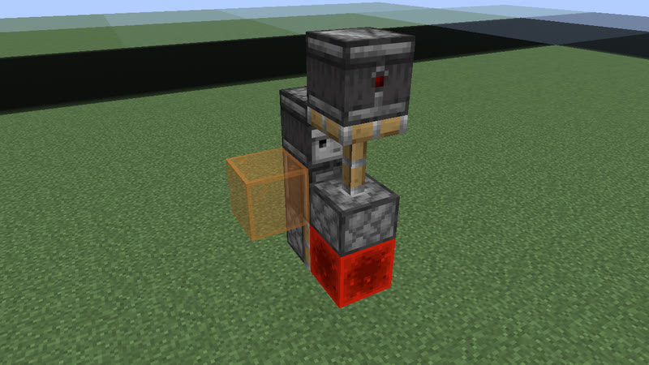</a> 21 gt (1.05 s) · observer+redstone_block+sticky_piston · 6 blocks</td><td align="center"><a href="../archive/clk-obs-p21-obs-rb-stk-6b.txt">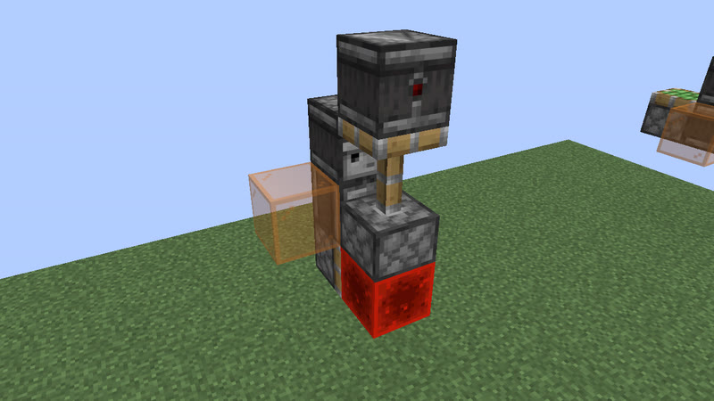</a> 21 gt (1.05 s) · observer+redstone_block+sticky_piston · 6 blocks</td><td align="center"> 21 gt (1.05 s) · calibrated_sculk_sensor+note_block+redstone_torch+repeater · 6 blocks</td></tr>
<tr><td align="center"><a href="../archive/clk-sculk-chaind-p21-1.txt">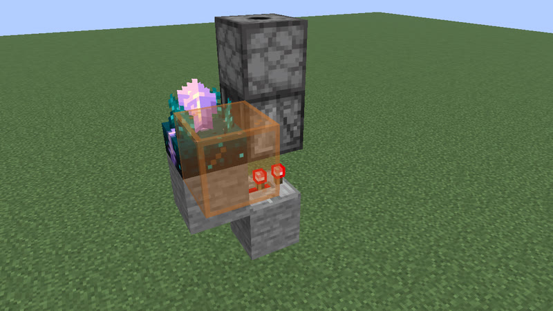</a> 21 gt (1.05 s) · calibrated_sculk_sensor+dispenser+observer+repeater · 6 blocks</td><td align="center"> 21 gt (1.05 s) · calibrated_sculk_sensor+dispenser+redstone_torch+repeater · 6 blocks</td><td align="center"><a href="../archive/clk-obs-p21-lamp-note-obs-pis-7b-f20367.txt">clk-obs-p21-lamp-note-obs-pis-7b-f20367</a> 21 gt (1.05 s) · note_block+observer+piston+redstone_lamp · 7 blocks (picture pending)</td></tr>
<tr><td align="center"><a href="../archive/clk-obs-p21-lamp-obs-pis-7b-dd426e.txt">clk-obs-p21-lamp-obs-pis-7b-dd426e</a> 21 gt (1.05 s) · observer+piston+redstone_lamp · 7 blocks (picture pending)</td><td align="center"><a href="../archive/clk-obs-p21-note-obs-pis-7b-ba527d.txt">clk-obs-p21-note-obs-pis-7b-ba527d</a> 21 gt (1.05 s) · note_block+observer+piston · 7 blocks (picture pending)</td><td align="center"><a href="../archive/clk-obs-p21-obs-pis-7b-064bf3.txt">clk-obs-p21-obs-pis-7b-064bf3</a> 21 gt (1.05 s) · observer+piston · 7 blocks (picture pending)</td></tr>
<tr><td align="center"> 21 gt (1.05 s) · observer+piston+redstone_block+sticky_piston · 7 blocks</td><td align="center"><a href="../archive/clk-obs-p21-bulb-obs-stk-7b-7c5c11.txt">clk-obs-p21-bulb-obs-stk-7b-7c5c11</a> 21 gt (1.05 s) · copper_bulb+observer+sticky_piston · 7 blocks (picture pending)</td><td align="center"><a href="../archive/clk-obs-p21-note-obs-stk-7b-23c367.txt">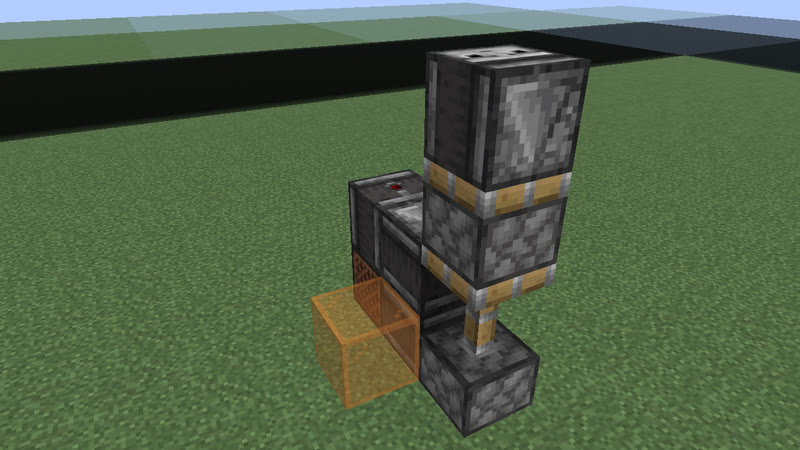</a> 21 gt (1.05 s) · note_block+observer+sticky_piston · 7 blocks</td></tr>
<tr><td align="center"><a href="../archive/clk-obs-p21-note-obs-stk-7b-b-27eb07.txt">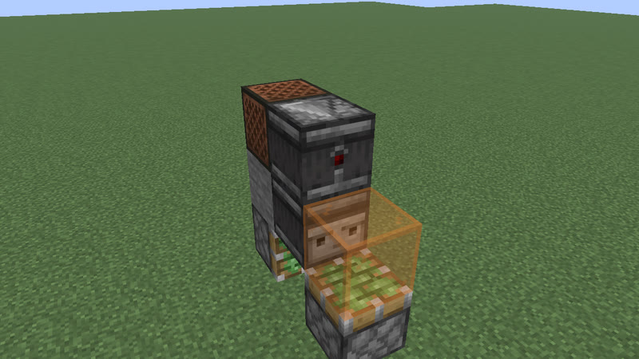</a> 21 gt (1.05 s) · note_block+observer+sticky_piston · 7 blocks</td><td align="center"><a href="../archive/clk-obs-p21-lamp-note-obs-stk-7b-729d4c.txt">clk-obs-p21-lamp-note-obs-stk-7b-729d4c</a> 21 gt (1.05 s) · note_block+observer+redstone_lamp+sticky_piston · 7 blocks (picture pending)</td><td align="center"><a href="../archive/clk-sculk-c21s-rep-dust-piston.txt">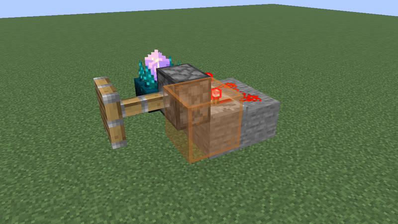</a> 21 gt (1.05 s) · calibrated_sculk_sensor+piston+redstone_wire+repeater · 10 blocks</td></tr>
<tr><td align="center"> 21 gt (1.05 s) · comparator+dropper+hopper+repeater · 14 blocks</td><td align="center"><a href="../archive/clk-rt-odd-rect-p21-16b.txt">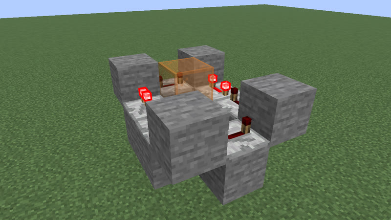</a> 21 gt (1.05 s) · repeater · 16 blocks</td></tr>
</table>

## 22 gt (1.1 s)

Also reachable by: observer ring with a relay block (clk-obs-note-ring, n = 3).

<table>
<tr><td align="center"> 22 gt (1.1 s) · calibrated_sculk_sensor+oak_trapdoor+observer+sticky_piston · 5 blocks</td><td align="center"> 22 gt (1.1 s) · calibrated_sculk_sensor+observer+piston+sticky_piston · 5 blocks</td><td align="center"> 22 gt (1.1 s) · calibrated_sculk_sensor+observer+sticky_piston · 5 blocks</td></tr>
<tr><td align="center"><a href="../archive/clk-sculk-c22s-rep-obs-note.txt">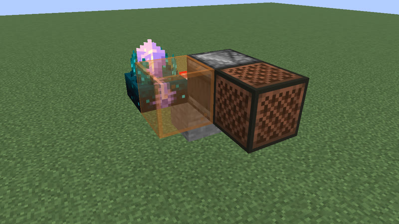</a> 22 gt (1.1 s) · calibrated_sculk_sensor+note_block+observer+repeater · 5 blocks</td><td align="center"><a href="../archive/clk-sculk-chaind-p22-1.txt">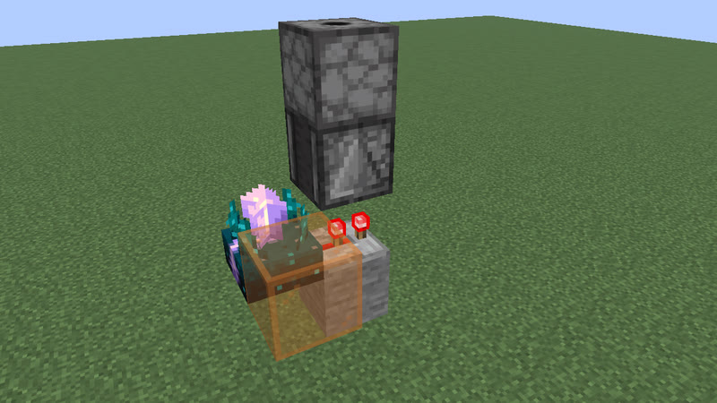</a> 22 gt (1.1 s) · calibrated_sculk_sensor+dispenser+observer+repeater · 5 blocks</td><td align="center"><a href="../archive/clk-sculk-hyb3b-p22-5.txt">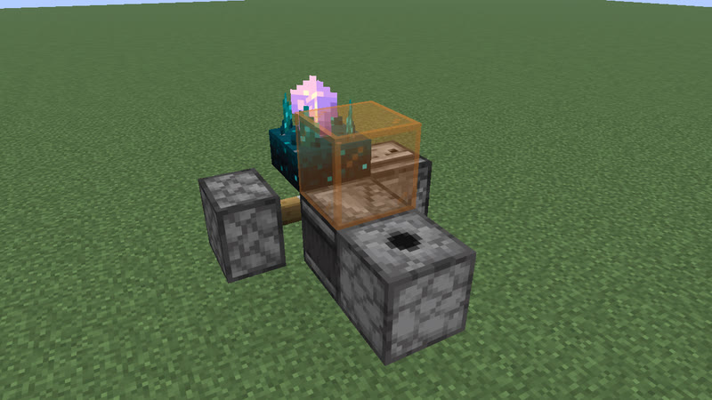</a> 22 gt (1.1 s) · calibrated_sculk_sensor+dispenser+observer+sticky_piston · 5 blocks</td></tr>
<tr><td align="center"><a href="../archive/clk-sculk-obs-p22-1.txt">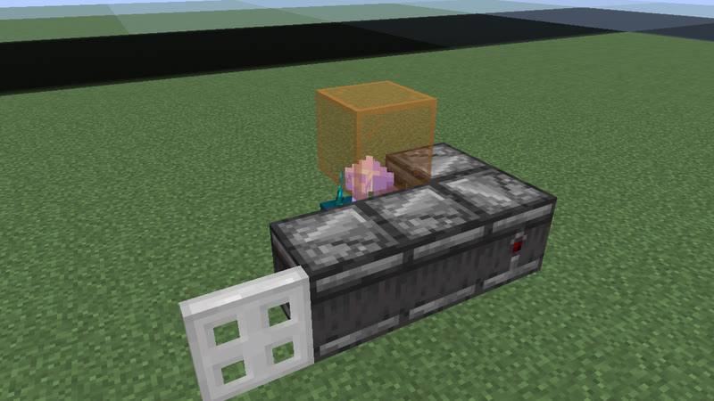</a> 22 gt (1.1 s) · calibrated_sculk_sensor+iron_trapdoor+observer · 6 blocks</td><td align="center"><a href="../archive/clk-sculk-obs-p22-3.txt">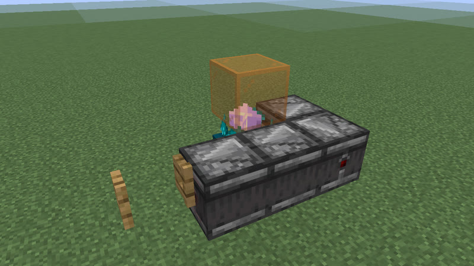</a> 22 gt (1.1 s) · calibrated_sculk_sensor+oak_fence_gate+observer · 6 blocks</td><td align="center"><a href="../archive/clk-sculk-obs-p22-5.txt">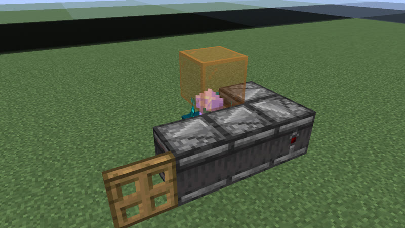</a> 22 gt (1.1 s) · calibrated_sculk_sensor+oak_trapdoor+observer · 6 blocks</td></tr>
<tr><td align="center"><a href="../archive/clk-obs-p22-note-obs-pis-stk-6b-b-01e309.txt">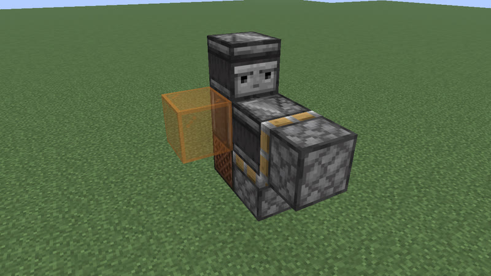</a> 22 gt (1.1 s) · note_block+observer+piston+sticky_piston · 6 blocks</td><td align="center"><a href="../archive/clk-obs-p22-obs-pis-stk-6b-64024b.txt">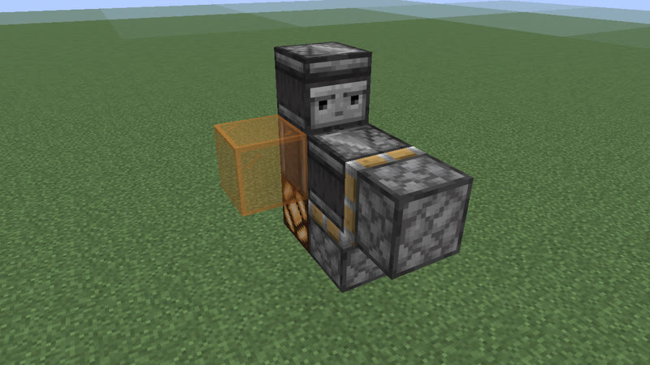</a> 22 gt (1.1 s) · observer+piston+sticky_piston · 6 blocks</td><td align="center"><a href="../archive/clk-obs-p22-obs-pis-stk-6b-b-b31983.txt">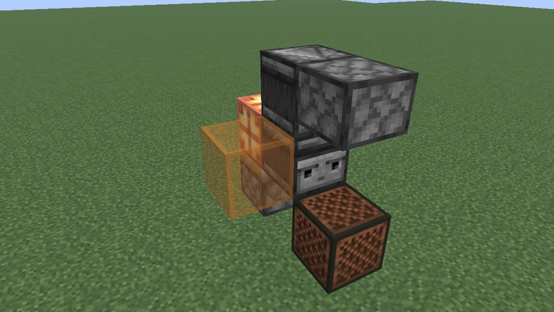</a> 22 gt (1.1 s) · observer+piston+sticky_piston · 6 blocks</td></tr>
<tr><td align="center"><a href="../archive/clk-obs-p22-lamp-obs-rb-stk-6b-9c49e6.txt">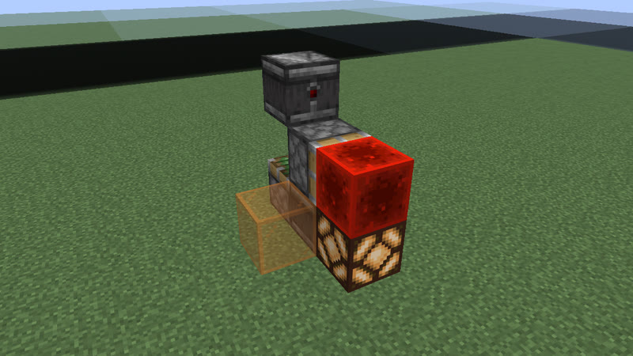</a> 22 gt (1.1 s) · observer+redstone_block+redstone_lamp+sticky_piston · 6 blocks</td><td align="center"> 22 gt (1.1 s) · observer+redstone_lamp+sticky_piston · 6 blocks</td><td align="center"> 22 gt (1.1 s) · note_block+observer+sticky_piston · 6 blocks</td></tr>
<tr><td align="center"><a href="../archive/clk-obs-p22-obs-rb-stk-6b-320ee4.txt">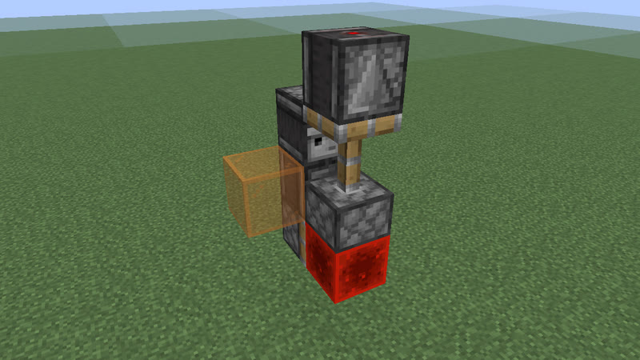</a> 22 gt (1.1 s) · observer+redstone_block+sticky_piston · 6 blocks</td><td align="center"><a href="../archive/clk-obs-p22-obs-rb-stk-6b-b-d4005c.txt">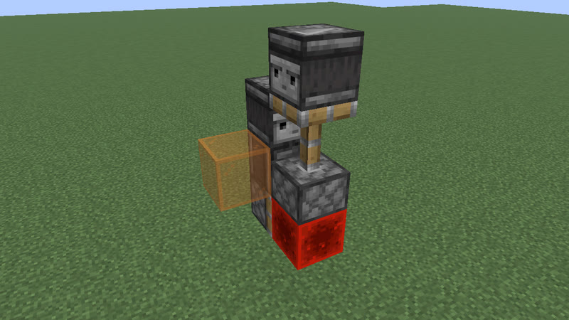</a> 22 gt (1.1 s) · observer+redstone_block+sticky_piston · 6 blocks</td><td align="center"> 22 gt (1.1 s) · calibrated_sculk_sensor+dispenser+redstone_torch+repeater · 6 blocks</td></tr>
<tr><td align="center"><a href="../archive/clk-obs-p22-bulb-obs-pis-rb-stk-7b-21967f.txt">clk-obs-p22-bulb-obs-pis-rb-stk-7b-21967f</a> 22 gt (1.1 s) · copper_bulb+observer+piston+redstone_block+sticky_piston · 7 blocks (picture pending)</td><td align="center"><a href="../archive/clk-obs-p22-bulb-lamp-obs-rb-stk-8b-c7fd5f.txt">clk-obs-p22-bulb-lamp-obs-rb-stk-8b-c7fd5f</a> 22 gt (1.1 s) · copper_bulb+observer+redstone_block+redstone_lamp+sticky_piston · 8 blocks (picture pending)</td><td align="center"><a href="../archive/clk-obs-p22-bulb-note-obs-rb-stk-8b-220e3b.txt">clk-obs-p22-bulb-note-obs-rb-stk-8b-220e3b</a> 22 gt (1.1 s) · copper_bulb+note_block+observer+redstone_block+sticky_piston · 8 blocks (picture pending)</td></tr>
<tr><td align="center"><a href="../archive/clk-obs-p22-lamp-note-obs-rb-stk-8b-c72166.txt">clk-obs-p22-lamp-note-obs-rb-stk-8b-c72166</a> 22 gt (1.1 s) · note_block+observer+redstone_block+redstone_lamp+sticky_piston · 8 blocks (picture pending)</td><td align="center"> 22 gt (1.1 s) · comparator+redstone_torch+repeater · 12 blocks</td><td align="center"> 22 gt (1.1 s) · comparator+redstone_torch+redstone_wire+repeater · 12 blocks</td></tr>
<tr><td align="center"> 22 gt (1.1 s) · redstone_torch+repeater · 12 blocks</td><td align="center"> 22 gt (1.1 s) · redstone_torch+redstone_wire+repeater · 12 blocks</td><td align="center"> 22 gt (1.1 s) · comparator+repeater · 12 blocks</td></tr>
<tr><td align="center"><a href="../archive/droprep3-p22.txt">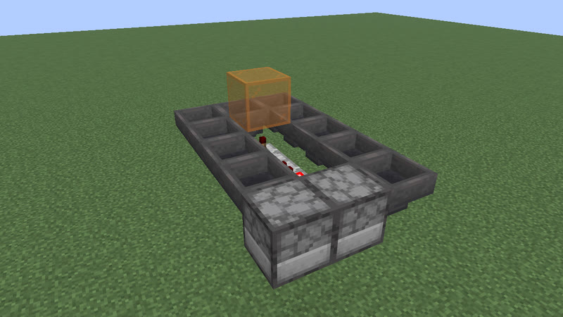</a> 22 gt (1.1 s) · comparator+dropper+hopper+repeater · 18 blocks</td></tr>
</table>

## 23 gt (1.15 s)

Also reachable by: clk-obs-odd-a (n = 3), clk-rt-odd-rect (n = 0), clk-sculk-hairpin-dispenser (n = 1).

<table>
<tr><td align="center"> 23 gt (1.15 s) · calibrated_sculk_sensor+note_block+observer+piston · 4 blocks also found as census-p23-calibrated_sculk_sensor-note_block-observer-sticky_piston-4b (built with sticky_piston, without piston)</td><td align="center"> 23 gt (1.15 s) · calibrated_sculk_sensor+dispenser+observer · 5 blocks</td><td align="center"><a href="../archive/clk-sculk-c23s-rep-obs-note.txt">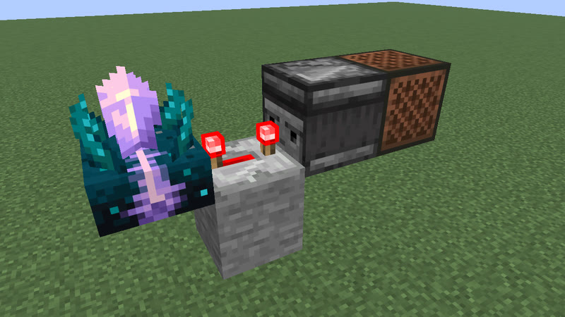</a> 23 gt (1.15 s) · calibrated_sculk_sensor+note_block+observer+repeater · 5 blocks</td></tr>
<tr><td align="center"><a href="../archive/clk-obs-p23-obs-pis-stk-5b-b-e1e568.txt">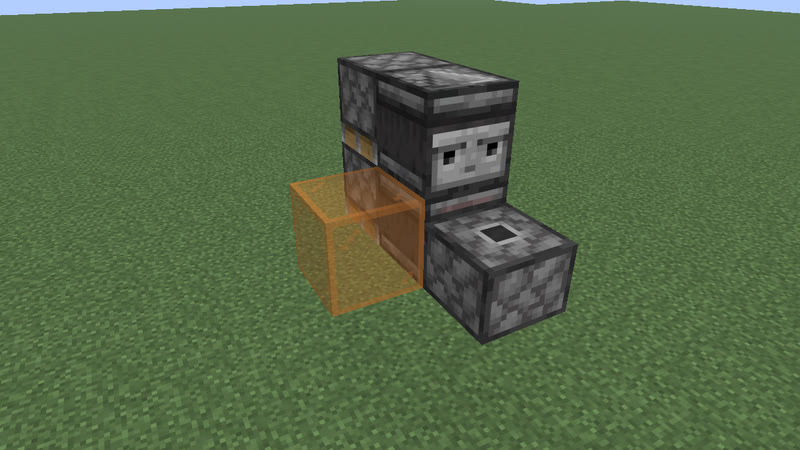</a> 23 gt (1.15 s) · observer+piston+sticky_piston · 5 blocks</td><td align="center"><a href="../archive/clk-obs-p23-obs-pis-stk-5b-bab238.txt">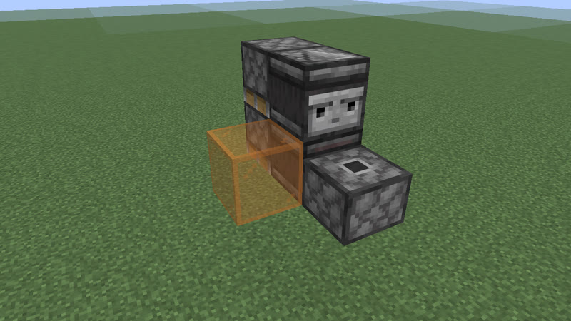</a> 23 gt (1.15 s) · observer+piston+sticky_piston · 5 blocks</td><td align="center"><a href="../archive/clk-obs-p23-obs-stk-5b.txt">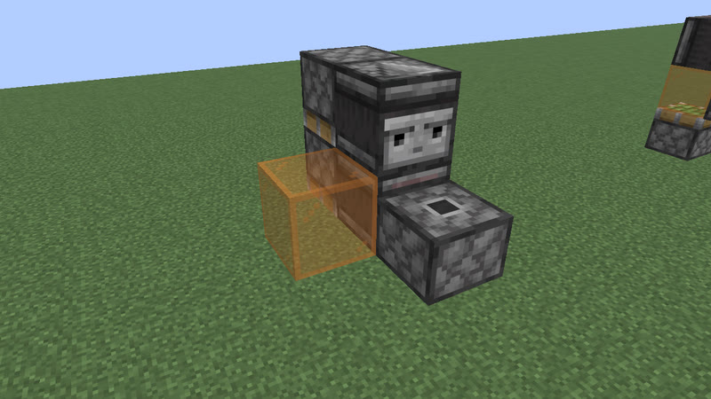</a> 23 gt (1.15 s) · observer+sticky_piston · 5 blocks</td></tr>
<tr><td align="center"> 23 gt (1.15 s) · calibrated_sculk_sensor+oak_trapdoor+observer+sticky_piston · 5 blocks</td><td align="center"> 23 gt (1.15 s) · calibrated_sculk_sensor+observer+piston+sticky_piston · 5 blocks</td><td align="center"> 23 gt (1.15 s) · calibrated_sculk_sensor+observer+sticky_piston · 5 blocks</td></tr>
<tr><td align="center"><a href="../archive/clk-sculk-chaind-p23-1.txt">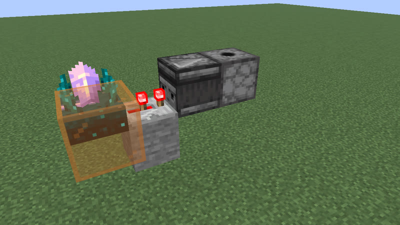</a> 23 gt (1.15 s) · calibrated_sculk_sensor+dispenser+observer+repeater · 5 blocks</td><td align="center"><a href="../archive/clk-obs-p23-obs-stk-5b-f9593e.txt">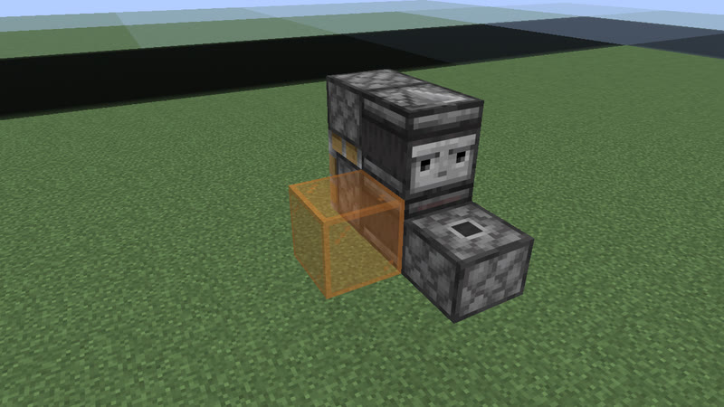</a> 23 gt (1.15 s) · observer+sticky_piston · 5 blocks</td><td align="center"><a href="../archive/census-p23-calibrated_sculk_sensor-dispenser-note_block-observer-piston-6b.txt">census-p23-calibrated_sculk_sensor-dispenser-note_block-observer-piston-6b</a> 23 gt (1.15 s) · calibrated_sculk_sensor+dispenser+note_block+observer+piston · 6 blocks (picture pending) also found as census-p23-calibrated_sculk_sensor-dispenser-note_block-observer-sticky_piston-6b (built with sticky_piston, without piston)</td></tr>
<tr><td align="center"><a href="../archive/clk-obs-p23-lamp-obs-stk-6b-81339f.txt">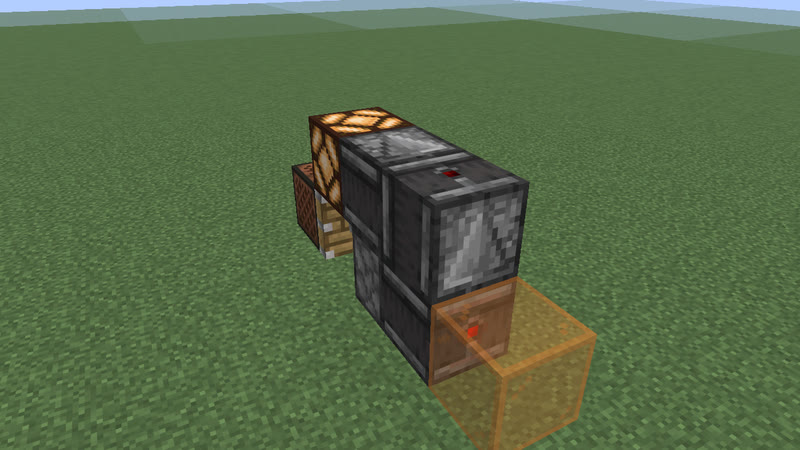</a> 23 gt (1.15 s) · observer+redstone_lamp+sticky_piston · 6 blocks</td><td align="center"><a href="../archive/clk-obs-p23-note-obs-stk-6b-446c69.txt">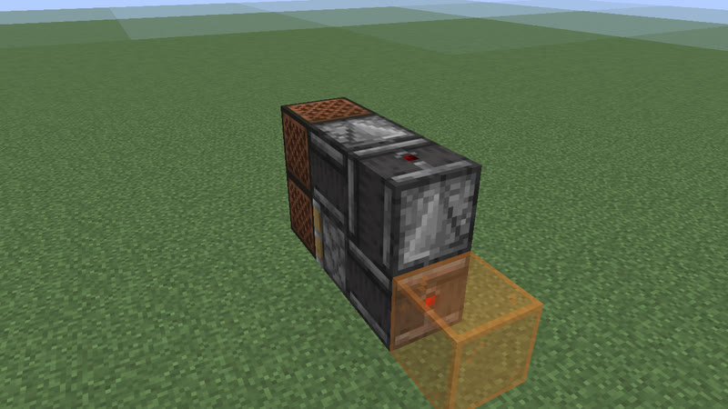</a> 23 gt (1.15 s) · note_block+observer+sticky_piston · 6 blocks</td><td align="center"><a href="../archive/clk-sculk-obs-p23-1.txt">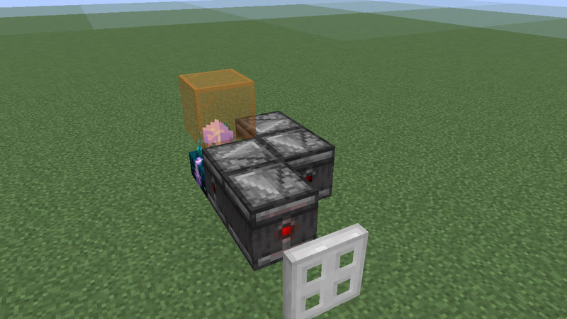</a> 23 gt (1.15 s) · calibrated_sculk_sensor+iron_trapdoor+observer · 6 blocks</td></tr>
<tr><td align="center"><a href="../archive/clk-sculk-obs-p23-3.txt">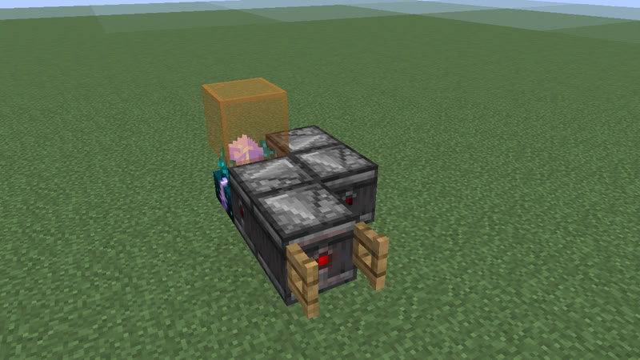</a> 23 gt (1.15 s) · calibrated_sculk_sensor+oak_fence_gate+observer · 6 blocks</td><td align="center"><a href="../archive/clk-sculk-obs-p23-5.txt">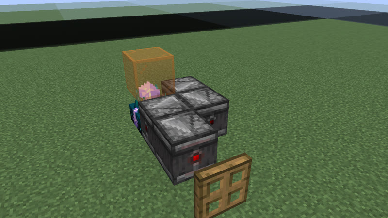</a> 23 gt (1.15 s) · calibrated_sculk_sensor+oak_trapdoor+observer · 6 blocks</td><td align="center"> 23 gt (1.15 s) · calibrated_sculk_sensor+dispenser+redstone_torch+repeater · 6 blocks</td></tr>
<tr><td align="center"> 23 gt (1.15 s) · observer+piston+redstone_lamp+sticky_piston · 7 blocks</td><td align="center"><a href="../archive/clk-obs-p23-lamp-obs-pis-stk-7b-e12a54.txt">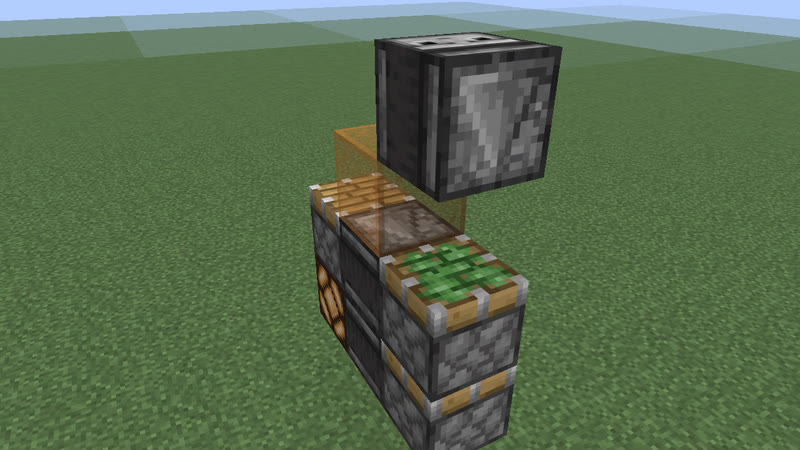</a> 23 gt (1.15 s) · observer+piston+redstone_lamp+sticky_piston · 7 blocks</td><td align="center"><a href="../archive/clk-obs-p23-note-obs-pis-stk-7b-b-67690d.txt">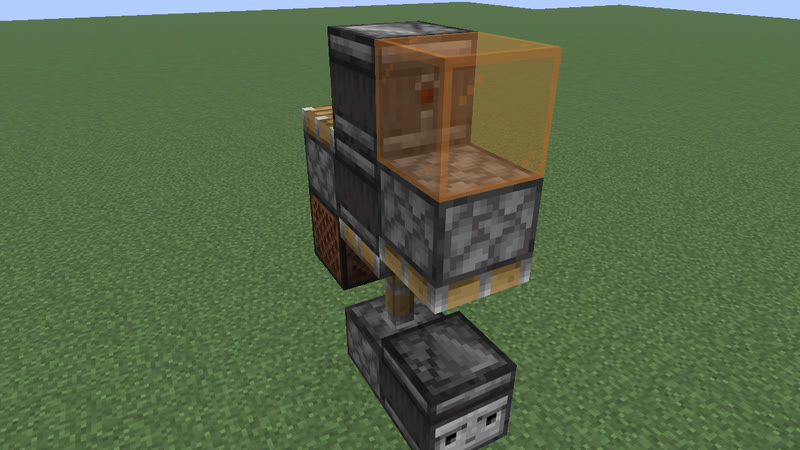</a> 23 gt (1.15 s) · note_block+observer+piston+sticky_piston · 7 blocks</td></tr>
<tr><td align="center"><a href="../archive/clk-obs-p23-lamp-note-obs-stk-8b-790f75.txt">clk-obs-p23-lamp-note-obs-stk-8b-790f75</a> 23 gt (1.15 s) · note_block+observer+redstone_lamp+sticky_piston · 8 blocks (picture pending)</td><td align="center"><a href="../archive/clk-obs-p23-lamp-obs-rb-stk-8b-5c379f.txt">clk-obs-p23-lamp-obs-rb-stk-8b-5c379f</a> 23 gt (1.15 s) · observer+redstone_block+redstone_lamp+sticky_piston · 8 blocks (picture pending)</td><td align="center"><a href="../archive/clk-obs-p23-bulb-lamp-obs-pis-rb-stk-9b-860fc1.txt">clk-obs-p23-bulb-lamp-obs-pis-rb-stk-9b-860fc1</a> 23 gt (1.15 s) · copper_bulb+observer+piston+redstone_block+redstone_lamp+sticky_piston · 9 blocks (picture pending)</td></tr>
<tr><td align="center"><a href="../archive/clk-obs-p23-bulb-note-obs-pis-rb-stk-9b-692c30.txt">clk-obs-p23-bulb-note-obs-pis-rb-stk-9b-692c30</a> 23 gt (1.15 s) · copper_bulb+note_block+observer+piston+redstone_block+sticky_piston · 9 blocks (picture pending)</td><td align="center"><a href="../archive/clk-obs-p23-bulb-note-obs-rb-stk-9b-aac16d.txt">clk-obs-p23-bulb-note-obs-rb-stk-9b-aac16d</a> 23 gt (1.15 s) · copper_bulb+note_block+observer+redstone_block+sticky_piston · 9 blocks (picture pending)</td><td align="center"><a href="../archive/clk-obs-p23-bulb-obs-pis-rb-stk-9b-e6f161.txt">clk-obs-p23-bulb-obs-pis-rb-stk-9b-e6f161</a> 23 gt (1.15 s) · copper_bulb+observer+piston+redstone_block+sticky_piston · 9 blocks (picture pending)</td></tr>
<tr><td align="center"><a href="../archive/dropring3-p23.txt">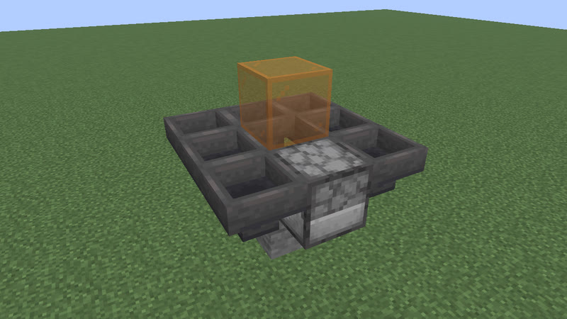</a> 23 gt (1.15 s) · comparator+dropper+hopper · 10 blocks</td><td align="center"> 23 gt (1.15 s) · redstone_wire+repeater · 18 blocks</td></tr>
</table>

## 24 gt (1.2 s)

Also reachable by: clk-obs-obs-ring (n = 4), clk-obs-divider (n = 1), clk-item-snowdisp (n = 2).

<table>
<tr><td align="center"> 24 gt (1.2 s) · calibrated_sculk_sensor+note_block+observer · 3 blocks</td><td align="center"> 24 gt (1.2 s) · calibrated_sculk_sensor+oak_trapdoor+observer · 3 blocks</td><td align="center"> 24 gt (1.2 s) · calibrated_sculk_sensor+oak_fence_gate+observer · 3 blocks</td></tr>
<tr><td align="center"> 24 gt (1.2 s) · calibrated_sculk_sensor+iron_trapdoor+observer · 3 blocks</td><td align="center"> 24 gt (1.2 s) · calibrated_sculk_sensor+oak_trapdoor+observer · 3 blocks</td><td align="center"> 24 gt (1.2 s) · calibrated_sculk_sensor+oak_trapdoor+observer · 3 blocks</td></tr>
<tr><td align="center"> 24 gt (1.2 s) · calibrated_sculk_sensor+observer+piston · 3 blocks also found as census-p24-calibrated_sculk_sensor-observer-sticky_piston-3b (built with sticky_piston, without piston)</td><td align="center"> 24 gt (1.2 s) · calibrated_sculk_sensor+note_block+observer · 3 blocks</td><td align="center"><a href="../archive/census-p24-calibrated_sculk_sensor-dispenser-observer-4b.txt">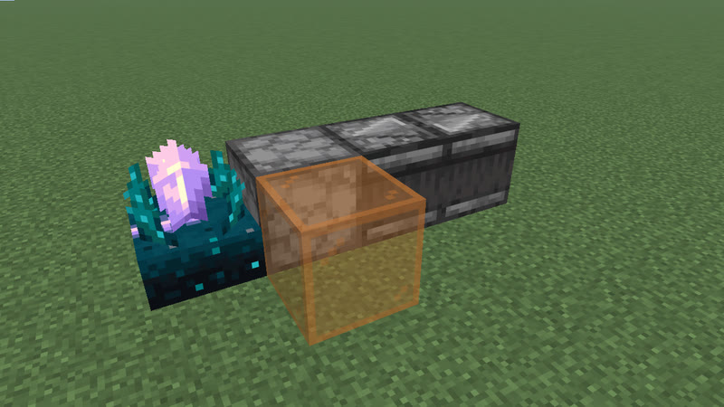</a> 24 gt (1.2 s) · calibrated_sculk_sensor+dispenser+observer · 4 blocks</td></tr>
<tr><td align="center"> 24 gt (1.2 s) · observer+sticky_piston · 4 blocks</td><td align="center"><a href="../archive/census-p24-calibrated_sculk_sensor-dispenser-observer-piston-sticky_piston-5b.txt">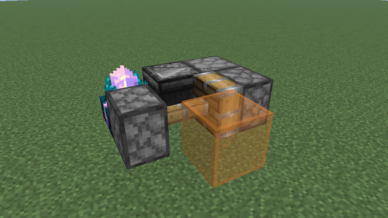</a> 24 gt (1.2 s) · calibrated_sculk_sensor+dispenser+observer+piston+sticky_piston · 5 blocks</td><td align="center"><a href="../archive/clk-obs-p24-bulb-obs-pis-5b-1bd1ff.txt">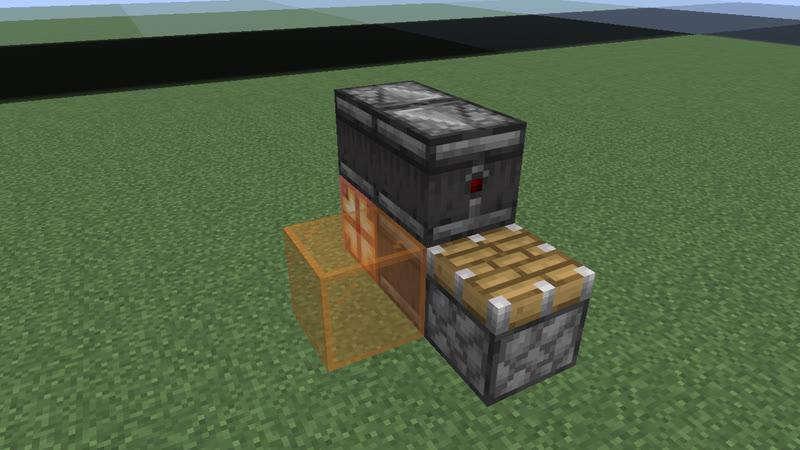</a> 24 gt (1.2 s) · copper_bulb+observer+piston · 5 blocks also found as clk-obs-p24-bulb-obs-stk-5b-fe7000 (built with sticky_piston, without piston)</td></tr>
<tr><td align="center"> 24 gt (1.2 s) · copper_bulb+observer+redstone_block+sticky_piston · 5 blocks</td><td align="center"> 24 gt (1.2 s) · observer+sticky_piston · 5 blocks</td><td align="center"> 24 gt (1.2 s) · copper_bulb+observer+redstone_block+redstone_lamp+sticky_piston · 5 blocks</td></tr>
<tr><td align="center"><a href="../archive/clk-obs-p24-bulb-obs-pis-5b-b-5b746a.txt">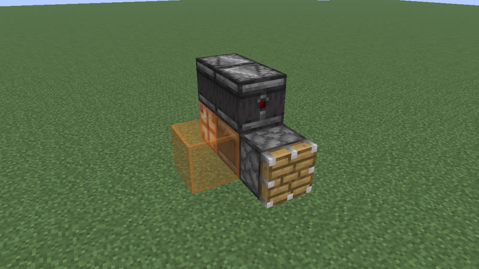</a> 24 gt (1.2 s) · copper_bulb+observer+piston · 5 blocks also found as clk-obs-p24-bulb-obs-stk-5b-b-b9ef2e (built with sticky_piston, without piston)</td><td align="center"> 24 gt (1.2 s) · copper_bulb+observer+redstone_block+redstone_lamp+sticky_piston · 5 blocks</td><td align="center"><a href="../archive/clk-obs-p24-bulb-note-obs-rb-stk-6b-b-286bbd.txt">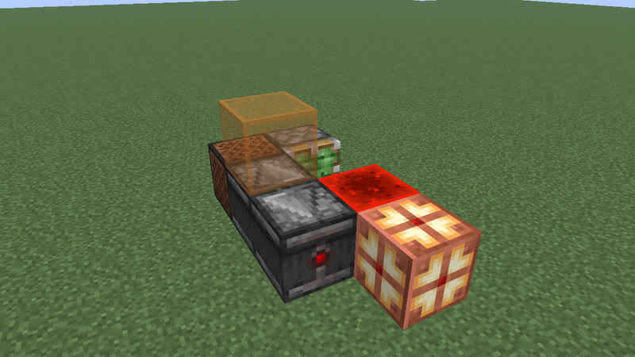</a> 24 gt (1.2 s) · copper_bulb+note_block+observer+redstone_block+sticky_piston · 6 blocks</td></tr>
<tr><td align="center"><a href="../archive/clk-obs-p24-bulb-note-obs-stk-6b-913b9f.txt">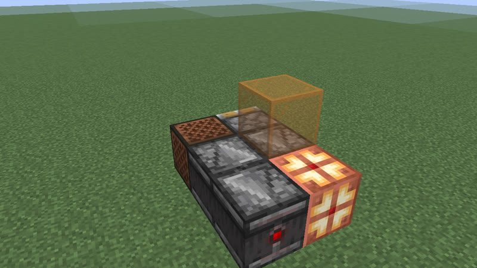</a> 24 gt (1.2 s) · copper_bulb+note_block+observer+sticky_piston · 6 blocks</td><td align="center"><a href="../archive/clk-obs-p24-bulb-obs-pis-rb-stk-6b-b-1c0aad.txt">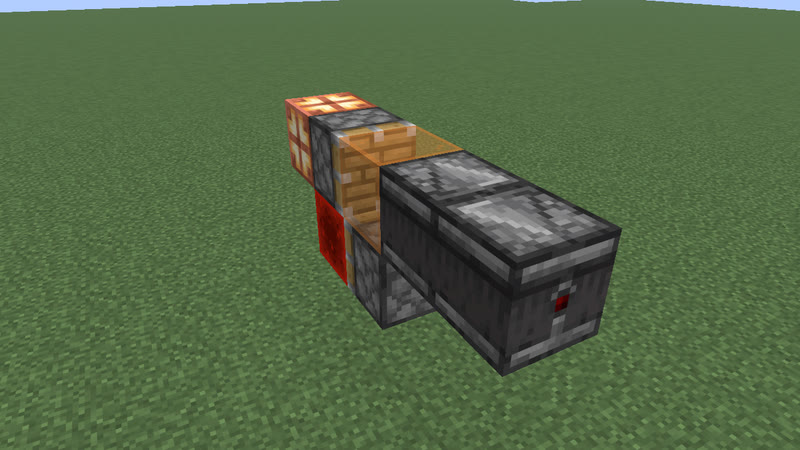</a> 24 gt (1.2 s) · copper_bulb+observer+piston+redstone_block+sticky_piston · 6 blocks</td><td align="center"> 24 gt (1.2 s) · note_block+observer+piston+sticky_piston · 6 blocks</td></tr>
<tr><td align="center"><a href="../archive/clk-obs-p24-note-obs-pis-stk-6b-b-2b5237.txt">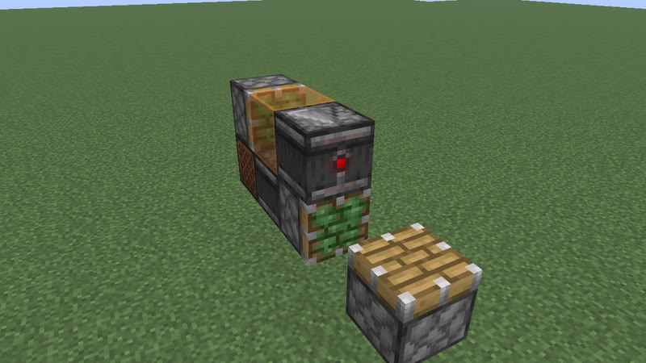</a> 24 gt (1.2 s) · note_block+observer+piston+sticky_piston · 6 blocks</td><td align="center"><a href="../archive/clk-obs-p24-rb-stk-6b-0e15ee.txt">clk-obs-p24-rb-stk-6b-0e15ee</a> 24 gt (1.2 s) · redstone_block+sticky_piston · 6 blocks (picture pending)</td><td align="center"> 24 gt (1.2 s) · observer+piston+redstone_block+redstone_lamp+sticky_piston · 7 blocks</td></tr>
<tr><td align="center"><a href="../archive/clk-obs-p24-obs-pis-7b-b-fbdaa2.txt">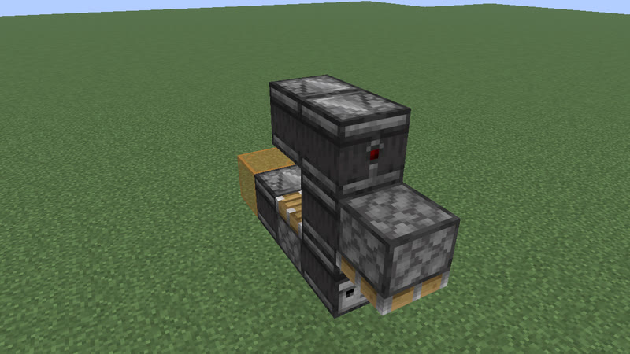</a> 24 gt (1.2 s) · observer+piston · 7 blocks</td><td align="center"><a href="../archive/clk-obs-p24-bulb-lamp-note-obs-pis-rb-stk-8b-1ecac1.txt">clk-obs-p24-bulb-lamp-note-obs-pis-rb-stk-8b-1ecac1</a> 24 gt (1.2 s) · copper_bulb+note_block+observer+piston+redstone_block+redstone_lamp+sticky_piston · 8 blocks (picture pending)</td><td align="center"><a href="../archive/clk-obs-p24-bulb-lamp-obs-pis-9b-2676bc.txt">clk-obs-p24-bulb-lamp-obs-pis-9b-2676bc</a> 24 gt (1.2 s) · copper_bulb+observer+piston+redstone_lamp · 9 blocks (picture pending)</td></tr>
<tr><td align="center"><a href="../archive/clk-rt-uloop-p24-rt-rw-r-9b.txt">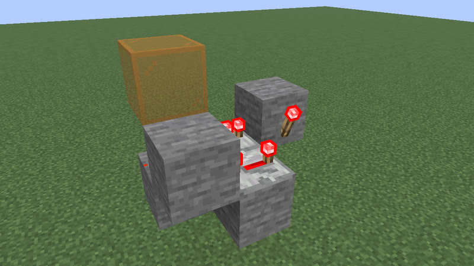</a> 24 gt (1.2 s) · redstone_torch+redstone_wire+repeater · 9 blocks</td><td align="center"> 24 gt (1.2 s) · comparator+hopper · 9 blocks</td><td align="center"> 24 gt (1.2 s) · comparator+redstone_torch+repeater · 12 blocks</td></tr>
<tr><td align="center"> 24 gt (1.2 s) · redstone_torch+repeater · 12 blocks</td><td align="center"> 24 gt (1.2 s) · comparator+repeater · 12 blocks</td><td align="center"> 24 gt (1.2 s) · repeater · 12 blocks</td></tr>
</table>

## 25 gt (1.25 s)

Also reachable by: clk-obs-odd-b (n = 3).

<table>
<tr><td align="center"> 25 gt (1.25 s) · calibrated_sculk_sensor+dispenser+note_block+observer · 4 blocks</td><td align="center"> 25 gt (1.25 s) · calibrated_sculk_sensor+dispenser+oak_trapdoor+observer · 4 blocks</td><td align="center"> 25 gt (1.25 s) · calibrated_sculk_sensor+note_block+observer · 4 blocks</td></tr>
<tr><td align="center"> 25 gt (1.25 s) · calibrated_sculk_sensor+oak_trapdoor+observer · 4 blocks</td><td align="center"> 25 gt (1.25 s) · calibrated_sculk_sensor+oak_trapdoor+observer · 4 blocks</td><td align="center"> 25 gt (1.25 s) · calibrated_sculk_sensor+dispenser+observer+piston · 4 blocks also found as census-p25-calibrated_sculk_sensor-dispenser-observer-sticky_piston-4b (built with sticky_piston, without piston)</td></tr>
<tr><td align="center"> 25 gt (1.25 s) · calibrated_sculk_sensor+observer+piston · 4 blocks also found as census-p25-calibrated_sculk_sensor-observer-sticky_piston-4b (built with sticky_piston, without piston)</td><td align="center"> 25 gt (1.25 s) · calibrated_sculk_sensor+note_block+observer · 4 blocks</td><td align="center"><a href="../archive/census-p25-calibrated_sculk_sensor-note_block-observer-sticky_piston-6b.txt">census-p25-calibrated_sculk_sensor-note_block-observer-sticky_piston-6b</a> 25 gt (1.25 s) · calibrated_sculk_sensor+note_block+observer+sticky_piston · 6 blocks (picture pending)</td></tr>
<tr><td align="center"><a href="../archive/clk-obs-p25-obs-rb-stk-6b-c5d39b.txt">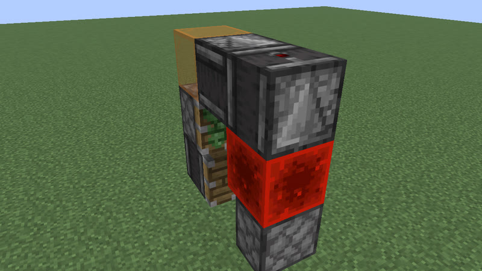</a> 25 gt (1.25 s) · observer+redstone_block+sticky_piston · 6 blocks</td><td align="center"> 25 gt (1.25 s) · calibrated_sculk_sensor+dispenser+redstone_torch+repeater · 6 blocks</td><td align="center"><a href="../archive/clk-obs-p25-lamp-note-obs-pis-stk-7b-bfd422.txt">clk-obs-p25-lamp-note-obs-pis-stk-7b-bfd422</a> 25 gt (1.25 s) · note_block+observer+piston+redstone_lamp+sticky_piston · 7 blocks (picture pending)</td></tr>
<tr><td align="center"> 25 gt (1.25 s) · note_block+observer+redstone_lamp+sticky_piston · 7 blocks</td><td align="center"><a href="../archive/clk-obs-p25-lamp-obs-pis-stk-7b-d0ad3f.txt">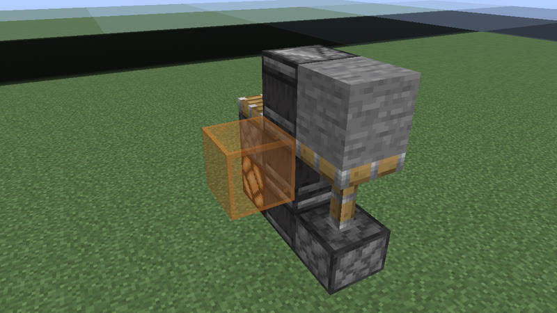</a> 25 gt (1.25 s) · observer+piston+redstone_lamp+sticky_piston · 7 blocks</td><td align="center"><a href="../archive/clk-obs-p25-note-obs-pis-stk-7b-b-7feaa3.txt">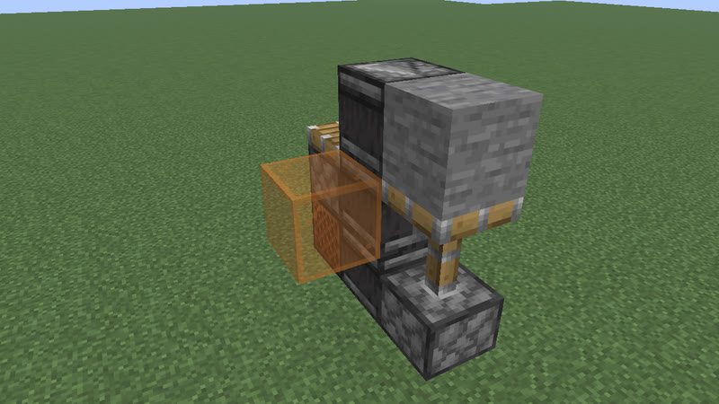</a> 25 gt (1.25 s) · note_block+observer+piston+sticky_piston · 7 blocks</td></tr>
<tr><td align="center"> 25 gt (1.25 s) · note_block+observer+piston+sticky_piston · 7 blocks</td><td align="center"> 25 gt (1.25 s) · note_block+observer+sticky_piston · 7 blocks</td><td align="center"> 25 gt (1.25 s) · note_block+observer+sticky_piston · 7 blocks</td></tr>
<tr><td align="center"> 25 gt (1.25 s) · observer+piston+sticky_piston · 7 blocks</td><td align="center"> 25 gt (1.25 s) · observer+piston+sticky_piston · 7 blocks</td><td align="center"> 25 gt (1.25 s) · observer+sticky_piston · 7 blocks</td></tr>
<tr><td align="center"><a href="../archive/clk-obs-p25-obs-pis-rb-stk-7b-6c7ccb.txt">clk-obs-p25-obs-pis-rb-stk-7b-6c7ccb</a> 25 gt (1.25 s) · observer+piston+redstone_block+sticky_piston · 7 blocks (picture pending)</td><td align="center"><a href="../archive/clk-obs-p25-note-obs-pis-rb-stk-8b-6a2628.txt">clk-obs-p25-note-obs-pis-rb-stk-8b-6a2628</a> 25 gt (1.25 s) · note_block+observer+piston+redstone_block+sticky_piston · 8 blocks (picture pending)</td><td align="center"> 25 gt (1.25 s) · comparator+hopper+redstone_wire+repeater · 9 blocks</td></tr>
<tr><td align="center"><a href="../archive/clk-obs-p25-bulb-obs-pis-stk-9b-5391b4.txt">clk-obs-p25-bulb-obs-pis-stk-9b-5391b4</a> 25 gt (1.25 s) · copper_bulb+observer+piston+sticky_piston · 9 blocks (picture pending)</td><td align="center"><a href="../archive/clk-obs-p25-bulb-obs-stk-9b-916865.txt">clk-obs-p25-bulb-obs-stk-9b-916865</a> 25 gt (1.25 s) · copper_bulb+observer+sticky_piston · 9 blocks (picture pending)</td><td align="center"><a href="../archive/kit-shuttle-minecart-p25-11b.txt">kit-shuttle-minecart-p25-11b</a> 25 gt (1.25 s) · detector_rail+minecart · 11 blocks (picture pending)</td></tr>
<tr><td align="center"> 25 gt (1.25 s) · comparator+dropper+hopper+repeater · 16 blocks</td><td align="center"> 25 gt (1.25 s) · repeater · 19 blocks</td></tr>
</table>

## 26 gt (1.3 s)

Also reachable by: observer ring with a relay block (clk-obs-note-ring, n = 4), clk-misc-cart-loop (n = 0), clk-sculk-replin-dispenser (n = 2).

<table>
<tr><td align="center"> 26 gt (1.3 s) · calibrated_sculk_sensor+note_block+observer · 4 blocks</td><td align="center"> 26 gt (1.3 s) · calibrated_sculk_sensor+oak_trapdoor+observer · 4 blocks</td><td align="center"> 26 gt (1.3 s) · calibrated_sculk_sensor+observer+piston · 4 blocks also found as census-p26-calibrated_sculk_sensor-observer-sticky_piston-4b (built with sticky_piston, without piston)</td></tr>
<tr><td align="center"> 26 gt (1.3 s) · calibrated_sculk_sensor+oak_trapdoor+observer · 4 blocks</td><td align="center"> 26 gt (1.3 s) · calibrated_sculk_sensor+oak_fence_gate+observer · 4 blocks</td><td align="center"> 26 gt (1.3 s) · calibrated_sculk_sensor+iron_trapdoor+observer · 4 blocks</td></tr>
<tr><td align="center"> 26 gt (1.3 s) · calibrated_sculk_sensor+dispenser+observer · 5 blocks</td><td align="center"> 26 gt (1.3 s) · copper_bulb+observer+piston+sticky_piston · 5 blocks also found as clk-obs-p26-bulb-obs-pis-5b-288217 (built without sticky_piston), clk-obs-p26-bulb-obs-stk-5b-91a60a (built without piston), clk-obs-p26-bulb-obs-pis-stk-5b-b-1f3b6f</td><td align="center"> 26 gt (1.3 s) · calibrated_sculk_sensor+dispenser+observer+piston · 5 blocks also found as clk-sculk-hyb3b-p26-3 (built with sticky_piston, without piston)</td></tr>
<tr><td align="center"> 26 gt (1.3 s) · observer+piston+redstone_block+sticky_piston · 5 blocks</td><td align="center"> 26 gt (1.3 s) · observer+redstone_block+sticky_piston · 5 blocks</td><td align="center"> 26 gt (1.3 s) · observer+redstone_lamp · 6 blocks</td></tr>
<tr><td align="center"> 26 gt (1.3 s) · observer+redstone_lamp · 6 blocks</td><td align="center"> 26 gt (1.3 s) · copper_bulb+note_block+observer+piston+sticky_piston · 6 blocks also found as clk-obs-p26-bulb-note-obs-stk-6b-c1cd29 (built without piston), clk-obs-p26-bulb-note-obs-pis-6b-a675d2 (built without sticky_piston)</td><td align="center"> 26 gt (1.3 s) · copper_bulb+observer+piston+redstone_block+sticky_piston · 6 blocks</td></tr>
<tr><td align="center"> 26 gt (1.3 s) · copper_bulb+observer+redstone_block+sticky_piston · 6 blocks</td><td align="center"> 26 gt (1.3 s) · note_block+observer+piston+redstone_block+sticky_piston · 6 blocks</td><td align="center"> 26 gt (1.3 s) · note_block+observer+piston+sticky_piston · 6 blocks</td></tr>
<tr><td align="center"> 26 gt (1.3 s) · note_block+observer+piston+sticky_piston · 6 blocks</td><td align="center"> 26 gt (1.3 s) · note_block+observer+redstone_block+sticky_piston · 6 blocks</td><td align="center"> 26 gt (1.3 s) · note_block+observer+sticky_piston · 6 blocks</td></tr>
<tr><td align="center"> 26 gt (1.3 s) · copper_bulb+observer+piston+redstone_lamp+sticky_piston · 7 blocks</td><td align="center"> 26 gt (1.3 s) · copper_bulb+observer+piston+redstone_lamp+sticky_piston · 7 blocks</td><td align="center"> 26 gt (1.3 s) · copper_bulb+observer+redstone_lamp+sticky_piston · 7 blocks</td></tr>
<tr><td align="center"> 26 gt (1.3 s) · copper_bulb+observer+redstone_lamp+sticky_piston · 7 blocks</td><td align="center"><a href="../archive/clk-obs-p26-bulb-lamp-obs-pis-rb-stk-7b-d0320d.txt">clk-obs-p26-bulb-lamp-obs-pis-rb-stk-7b-d0320d</a> 26 gt (1.3 s) · copper_bulb+observer+piston+redstone_block+redstone_lamp+sticky_piston · 7 blocks (picture pending)</td><td align="center"><a href="../archive/clk-obs-p26-bulb-note-obs-pis-rb-stk-7b-1eb23b.txt">clk-obs-p26-bulb-note-obs-pis-rb-stk-7b-1eb23b</a> 26 gt (1.3 s) · copper_bulb+note_block+observer+piston+redstone_block+sticky_piston · 7 blocks (picture pending)</td></tr>
<tr><td align="center"> 26 gt (1.3 s) · observer+piston+redstone_block+redstone_lamp+sticky_piston · 7 blocks</td><td align="center"> 26 gt (1.3 s) · observer+redstone_block+redstone_lamp+sticky_piston · 7 blocks</td><td align="center"><a href="../archive/clk-obs-p26-lamp-note-obs-pis-8b-b51f08.txt">clk-obs-p26-lamp-note-obs-pis-8b-b51f08</a> 26 gt (1.3 s) · note_block+observer+piston+redstone_lamp · 8 blocks (picture pending)</td></tr>
<tr><td align="center"><a href="../archive/clk-obs-p26-note-obs-pis-8b-5bce83.txt">clk-obs-p26-note-obs-pis-8b-5bce83</a> 26 gt (1.3 s) · note_block+observer+piston · 8 blocks (picture pending)</td><td align="center"><a href="../archive/clk-obs-p26-obs-pis-8b-55d694.txt">clk-obs-p26-obs-pis-8b-55d694</a> 26 gt (1.3 s) · observer+piston · 8 blocks (picture pending)</td><td align="center"> 26 gt (1.3 s) · comparator+redstone_torch+repeater · 12 blocks</td></tr>
<tr><td align="center"> 26 gt (1.3 s) · redstone_torch+repeater · 12 blocks</td><td align="center"> 26 gt (1.3 s) · redstone_torch+redstone_wire+repeater · 12 blocks</td><td align="center"> 26 gt (1.3 s) · comparator+repeater · 12 blocks</td></tr>
<tr><td align="center"> 26 gt (1.3 s) · repeater · 12 blocks</td><td align="center"> 26 gt (1.3 s) · comparator+dropper+hopper+repeater · 16 blocks</td></tr>
</table>

## 27 gt (1.35 s)

Also reachable by: clk-obs-odd-a (n = 4), dropper ring (clk-item-dropring-1d, n = 0).

<table>
<tr><td align="center"> 27 gt (1.35 s) · calibrated_sculk_sensor+note_block+observer · 4 blocks</td><td align="center"> 27 gt (1.35 s) · calibrated_sculk_sensor+oak_trapdoor+observer · 4 blocks</td><td align="center"> 27 gt (1.35 s) · calibrated_sculk_sensor+oak_trapdoor+observer · 4 blocks</td></tr>
<tr><td align="center"> 27 gt (1.35 s) · calibrated_sculk_sensor+oak_fence_gate+observer · 4 blocks</td><td align="center"> 27 gt (1.35 s) · calibrated_sculk_sensor+iron_trapdoor+observer · 4 blocks</td><td align="center"> 27 gt (1.35 s) · calibrated_sculk_sensor+observer+piston · 4 blocks also found as census-p27-calibrated_sculk_sensor-observer-sticky_piston-4b (built with sticky_piston, without piston)</td></tr>
<tr><td align="center"> 27 gt (1.35 s) · observer+piston+sticky_piston · 5 blocks</td><td align="center"> 27 gt (1.35 s) · observer+piston+sticky_piston · 5 blocks</td><td align="center"> 27 gt (1.35 s) · observer+sticky_piston · 5 blocks</td></tr>
<tr><td align="center"> 27 gt (1.35 s) · observer+sticky_piston · 5 blocks</td><td align="center"> 27 gt (1.35 s) · calibrated_sculk_sensor+dispenser+observer+piston · 5 blocks also found as clk-sculk-hyb3b-p27-3 (built with sticky_piston, without piston)</td><td align="center"><a href="../archive/clk-obs-p27-lamp-obs-stk-7b-94fb6f.txt">clk-obs-p27-lamp-obs-stk-7b-94fb6f</a> 27 gt (1.35 s) · observer+redstone_lamp+sticky_piston · 7 blocks (picture pending)</td></tr>
<tr><td align="center"> 27 gt (1.35 s) · copper_bulb+note_block+observer+piston+sticky_piston · 7 blocks</td><td align="center"><a href="../archive/clk-obs-p27-bulb-note-obs-stk-7b-3392e2.txt">clk-obs-p27-bulb-note-obs-stk-7b-3392e2</a> 27 gt (1.35 s) · copper_bulb+note_block+observer+sticky_piston · 7 blocks (picture pending)</td><td align="center"><a href="../archive/clk-obs-p27-note-obs-stk-7b-d69c7f.txt">clk-obs-p27-note-obs-stk-7b-d69c7f</a> 27 gt (1.35 s) · note_block+observer+sticky_piston · 7 blocks (picture pending)</td></tr>
<tr><td align="center"><a href="../archive/clk-obs-p27-lamp-obs-pis-rb-stk-8b-d682cd.txt">clk-obs-p27-lamp-obs-pis-rb-stk-8b-d682cd</a> 27 gt (1.35 s) · observer+piston+redstone_block+redstone_lamp+sticky_piston · 8 blocks (picture pending)</td><td align="center"><a href="../archive/clk-obs-p27-lamp-obs-pis-stk-8b-578f85.txt">clk-obs-p27-lamp-obs-pis-stk-8b-578f85</a> 27 gt (1.35 s) · observer+piston+redstone_lamp+sticky_piston · 8 blocks (picture pending)</td><td align="center"><a href="../archive/clk-obs-p27-note-obs-pis-rb-stk-8b-4606ec.txt">clk-obs-p27-note-obs-pis-rb-stk-8b-4606ec</a> 27 gt (1.35 s) · note_block+observer+piston+redstone_block+sticky_piston · 8 blocks (picture pending)</td></tr>
<tr><td align="center"><a href="../archive/clk-obs-p27-note-obs-pis-stk-8b-e086c0.txt">clk-obs-p27-note-obs-pis-stk-8b-e086c0</a> 27 gt (1.35 s) · note_block+observer+piston+sticky_piston · 8 blocks (picture pending)</td><td align="center"><a href="../archive/clk-obs-p27-bulb-note-obs-rb-stk-8b-3fe1de.txt">clk-obs-p27-bulb-note-obs-rb-stk-8b-3fe1de</a> 27 gt (1.35 s) · copper_bulb+note_block+observer+redstone_block+sticky_piston · 8 blocks (picture pending)</td><td align="center"><a href="../archive/clk-obs-p27-lamp-note-obs-pis-rb-stk-8b-a5497a.txt">clk-obs-p27-lamp-note-obs-pis-rb-stk-8b-a5497a</a> 27 gt (1.35 s) · note_block+observer+piston+redstone_block+redstone_lamp+sticky_piston · 8 blocks (picture pending)</td></tr>
<tr><td align="center"> 27 gt (1.35 s) · repeater · 19 blocks</td></tr>
</table>

## 28 gt (1.4 s)

Also reachable by: clk-obs-obs-ring (n = 5), hopper ring (clk-item-hopper-ring, n = 1), clk-obs-bulb-ring (n = 1).

<table>
<tr><td align="center"> 28 gt (1.4 s) · calibrated_sculk_sensor+dispenser+observer · 3 blocks</td><td align="center"> 28 gt (1.4 s) · calibrated_sculk_sensor+dispenser+observer · 3 blocks</td><td align="center"> 28 gt (1.4 s) · calibrated_sculk_sensor+dispenser+observer · 3 blocks</td></tr>
<tr><td align="center"> 28 gt (1.4 s) · calibrated_sculk_sensor+oak_trapdoor+observer · 5 blocks</td><td align="center"> 28 gt (1.4 s) · calibrated_sculk_sensor+oak_fence_gate+observer · 5 blocks</td><td align="center"> 28 gt (1.4 s) · calibrated_sculk_sensor+iron_trapdoor+observer · 5 blocks</td></tr>
<tr><td align="center"> 28 gt (1.4 s) · observer+sticky_piston · 5 blocks</td><td align="center"> 28 gt (1.4 s) · copper_bulb+observer+sticky_piston · 6 blocks</td><td align="center"> 28 gt (1.4 s) · note_block+observer+sticky_piston · 6 blocks</td></tr>
<tr><td align="center"> 28 gt (1.4 s) · observer+piston · 6 blocks</td><td align="center"> 28 gt (1.4 s) · copper_bulb+note_block+observer+sticky_piston · 6 blocks</td><td align="center"> 28 gt (1.4 s) · copper_bulb+note_block+observer+sticky_piston · 6 blocks</td></tr>
<tr><td align="center"> 28 gt (1.4 s) · copper_bulb+observer+piston · 6 blocks</td><td align="center"> 28 gt (1.4 s) · copper_bulb+note_block+observer+redstone_block+redstone_lamp+sticky_piston · 7 blocks</td><td align="center"> 28 gt (1.4 s) · copper_bulb+note_block+observer+redstone_lamp+sticky_piston · 7 blocks</td></tr>
<tr><td align="center"> 28 gt (1.4 s) · copper_bulb+observer+redstone_block+redstone_lamp+sticky_piston · 7 blocks</td><td align="center"> 28 gt (1.4 s) · note_block+observer+piston+redstone_lamp+sticky_piston · 7 blocks</td><td align="center"> 28 gt (1.4 s) · note_block+observer+piston+redstone_lamp+sticky_piston · 7 blocks</td></tr>
<tr><td align="center"> 28 gt (1.4 s) · note_block+observer+redstone_lamp+sticky_piston · 7 blocks</td><td align="center"> 28 gt (1.4 s) · note_block+observer+redstone_lamp+sticky_piston · 7 blocks</td><td align="center"> 28 gt (1.4 s) · observer+piston+redstone_lamp+sticky_piston · 7 blocks</td></tr>
<tr><td align="center"> 28 gt (1.4 s) · observer+piston+redstone_lamp+sticky_piston · 7 blocks</td><td align="center"> 28 gt (1.4 s) · observer+redstone_lamp+sticky_piston · 7 blocks</td><td align="center"> 28 gt (1.4 s) · observer+redstone_lamp+sticky_piston · 7 blocks</td></tr>
<tr><td align="center"> 28 gt (1.4 s) · note_block+observer+piston+sticky_piston · 7 blocks</td><td align="center"><a href="../archive/clk-obs-p28-note-obs-pis-8b-ac8f06.txt">clk-obs-p28-note-obs-pis-8b-ac8f06</a> 28 gt (1.4 s) · note_block+observer+piston · 8 blocks (picture pending)</td><td align="center"><a href="../archive/clk-obs-p28-bulb-lamp-obs-pis-rb-stk-8b-b52e8c.txt">clk-obs-p28-bulb-lamp-obs-pis-rb-stk-8b-b52e8c</a> 28 gt (1.4 s) · copper_bulb+observer+piston+redstone_block+redstone_lamp+sticky_piston · 8 blocks (picture pending)</td></tr>
<tr><td align="center"><a href="../archive/clk-obs-p28-bulb-note-obs-pis-rb-stk-8b-1e9eb5.txt">clk-obs-p28-bulb-note-obs-pis-rb-stk-8b-1e9eb5</a> 28 gt (1.4 s) · copper_bulb+note_block+observer+piston+redstone_block+sticky_piston · 8 blocks (picture pending)</td><td align="center"> 28 gt (1.4 s) · redstone_torch+redstone_wire+repeater · 9 blocks</td><td align="center"> 28 gt (1.4 s) · copper_bulb+observer · 10 blocks</td></tr>
<tr><td align="center"> 28 gt (1.4 s) · comparator+redstone_torch+repeater · 12 blocks</td><td align="center"> 28 gt (1.4 s) · redstone_torch+repeater · 12 blocks</td><td align="center"> 28 gt (1.4 s) · repeater · 12 blocks</td></tr>
<tr><td align="center"><a href="../archive/kit-shuttle-minecart-p28-13b.txt">kit-shuttle-minecart-p28-13b</a> 28 gt (1.4 s) · detector_rail+minecart · 13 blocks (picture pending)</td><td align="center"> 28 gt (1.4 s) · comparator+repeater · 16 blocks</td><td align="center"> 28 gt (1.4 s) · comparator+dropper+hopper+repeater · 16 blocks</td></tr>
<tr><td align="center"><a href="../archive/clk-misc-bookshelf-cart-b2.txt">clk-misc-bookshelf-cart-b2</a> 28 gt (1.4 s) · chiseled_bookshelf+hopper+hopper_minecart · 20 blocks (picture pending)</td></tr>
</table>

## 29 gt (1.45 s)

Also reachable by: clk-obs-odd-b (n = 4).

<table>
<tr><td align="center"> 29 gt (1.45 s) · calibrated_sculk_sensor+dispenser+observer · 4 blocks</td><td align="center"> 29 gt (1.45 s) · calibrated_sculk_sensor+dispenser+observer · 4 blocks</td><td align="center"> 29 gt (1.45 s) · calibrated_sculk_sensor+dispenser+observer · 4 blocks</td></tr>
<tr><td align="center"> 29 gt (1.45 s) · calibrated_sculk_sensor+oak_fence_gate+observer · 5 blocks</td><td align="center"> 29 gt (1.45 s) · calibrated_sculk_sensor+iron_trapdoor+observer · 5 blocks</td><td align="center"><a href="../archive/clk-obs-p29-obs-pis-7b-a4b644.txt">clk-obs-p29-obs-pis-7b-a4b644</a> 29 gt (1.45 s) · observer+piston · 7 blocks (picture pending)</td></tr>
<tr><td align="center"><a href="../archive/clk-obs-p29-obs-pis-rb-stk-7b-bcb56d.txt">clk-obs-p29-obs-pis-rb-stk-7b-bcb56d</a> 29 gt (1.45 s) · observer+piston+redstone_block+sticky_piston · 7 blocks (picture pending)</td><td align="center"><a href="../archive/clk-obs-p29-obs-rb-stk-7b-e44e24.txt">clk-obs-p29-obs-rb-stk-7b-e44e24</a> 29 gt (1.45 s) · observer+redstone_block+sticky_piston · 7 blocks (picture pending)</td><td align="center"> 29 gt (1.45 s) · note_block+observer+redstone_lamp+sticky_piston · 7 blocks</td></tr>
<tr><td align="center"> 29 gt (1.45 s) · note_block+observer+sticky_piston · 7 blocks</td><td align="center"><a href="../archive/clk-obs-p29-note-obs-rb-stk-8b-ff455c.txt">clk-obs-p29-note-obs-rb-stk-8b-ff455c</a> 29 gt (1.45 s) · note_block+observer+redstone_block+sticky_piston · 8 blocks (picture pending)</td><td align="center"><a href="../archive/clk-obs-p29-note-obs-pis-8b-ababe6.txt">clk-obs-p29-note-obs-pis-8b-ababe6</a> 29 gt (1.45 s) · note_block+observer+piston · 8 blocks (picture pending)</td></tr>
<tr><td align="center"><a href="../archive/clk-obs-p29-lamp-note-obs-pis-stk-9b-63d191.txt">clk-obs-p29-lamp-note-obs-pis-stk-9b-63d191</a> 29 gt (1.45 s) · note_block+observer+piston+redstone_lamp+sticky_piston · 9 blocks (picture pending)</td><td align="center"><a href="../archive/kit-shuttle-minecart-p29-13b.txt">kit-shuttle-minecart-p29-13b</a> 29 gt (1.45 s) · detector_rail+minecart · 13 blocks (picture pending)</td><td align="center"> 29 gt (1.45 s) · comparator+dropper+hopper+repeater · 14 blocks</td></tr>
<tr><td align="center"> 29 gt (1.45 s) · repeater · 20 blocks</td></tr>
</table>

[catalog index](../CATALOG.md) · previous: [p4-20](p4-20.md) · next: [p30-42](p30-42.md)
