# Clocks: 21 gt (1.05 s) to 30 gt (1.5 s) (300 clock types)

[catalog index](../CATALOG.md) · previous: [p4-20](p4-20.md) · next: [p31-42](p31-42.md)

Orange glass = where the output signal is (placed only for the picture); click a picture for its design. Larger clocks of a period that only add block kinds to a smaller one are listed on [variants](variants.md). Generated by `mctas clock catalog`.

## 21 gt (1.05 s)

Also reachable by: clk-obs-odd-b (n = 2), hopper ring (clk-item-hopper-ring-2, n = 2).

<table>
<tr><td align="center"> 21 gt (1.05 s) · calibrated_sculk_sensor+dispenser+observer · 5 blocks</td><td align="center"> 21 gt (1.05 s) · calibrated_sculk_sensor+dispenser+observer · 5 blocks</td><td align="center"> 21 gt (1.05 s) · calibrated_sculk_sensor+dispenser+observer+sticky_piston · 5 blocks</td></tr>
<tr><td align="center"> 21 gt (1.05 s) · calibrated_sculk_sensor+note_block+observer+sticky_piston · 5 blocks</td><td align="center"> 21 gt (1.05 s) · calibrated_sculk_sensor+oak_trapdoor+observer+sticky_piston · 5 blocks</td><td align="center"> 21 gt (1.05 s) · calibrated_sculk_sensor+observer+piston+sticky_piston · 5 blocks</td></tr>
<tr><td align="center"> 21 gt (1.05 s) · calibrated_sculk_sensor+observer+sticky_piston · 5 blocks</td><td align="center"> 21 gt (1.05 s) · calibrated_sculk_sensor+iron_trapdoor+observer · 6 blocks</td><td align="center"> 21 gt (1.05 s) · calibrated_sculk_sensor+oak_fence_gate+observer · 6 blocks</td></tr>
<tr><td align="center"> 21 gt (1.05 s) · calibrated_sculk_sensor+oak_trapdoor+observer · 6 blocks</td><td align="center"><a href="../archive/census-p21-calibrated_sculk_sensor-note_block-oak_trapdoor-observer-piston-6b.txt">census-p21-calibrated_sculk_sensor-note_block-oak_trapdoor-observer-piston-6b</a> 21 gt (1.05 s) · calibrated_sculk_sensor+note_block+oak_trapdoor+observer+piston · 6 blocks (picture pending) also found as census-p21-calibrated_sculk_sensor-note_block-oak_trapdoor-observer-sticky_piston-6b (built with sticky_piston, without piston)</td><td align="center"><a href="../archive/census-p21-calibrated_sculk_sensor-note_block-observer-piston-6b.txt">census-p21-calibrated_sculk_sensor-note_block-observer-piston-6b</a> 21 gt (1.05 s) · calibrated_sculk_sensor+note_block+observer+piston · 6 blocks (picture pending)</td></tr>
<tr><td align="center"><a href="../archive/census-p21-calibrated_sculk_sensor-oak_trapdoor-observer-piston-6b.txt">census-p21-calibrated_sculk_sensor-oak_trapdoor-observer-piston-6b</a> 21 gt (1.05 s) · calibrated_sculk_sensor+oak_trapdoor+observer+piston · 6 blocks (picture pending)</td><td align="center"><a href="../archive/census-p21-calibrated_sculk_sensor-observer-piston-6b.txt">census-p21-calibrated_sculk_sensor-observer-piston-6b</a> 21 gt (1.05 s) · calibrated_sculk_sensor+observer+piston · 6 blocks (picture pending)</td><td align="center"> 21 gt (1.05 s) · calibrated_sculk_sensor+note_block+observer+repeater · 6 blocks</td></tr>
<tr><td align="center"> 21 gt (1.05 s) · observer+redstone_block+sticky_piston · 6 blocks</td><td align="center"> 21 gt (1.05 s) · observer+redstone_block+sticky_piston · 6 blocks</td><td align="center"> 21 gt (1.05 s) · calibrated_sculk_sensor+note_block+redstone_torch+repeater · 6 blocks</td></tr>
<tr><td align="center"> 21 gt (1.05 s) · calibrated_sculk_sensor+dispenser+redstone_torch+repeater · 6 blocks</td><td align="center"><a href="../archive/clk-obs-p21-lamp-note-obs-pis-7b-f20367.txt">clk-obs-p21-lamp-note-obs-pis-7b-f20367</a> 21 gt (1.05 s) · note_block+observer+piston+redstone_lamp · 7 blocks (picture pending)</td><td align="center"><a href="../archive/clk-obs-p21-lamp-obs-pis-7b-dd426e.txt">clk-obs-p21-lamp-obs-pis-7b-dd426e</a> 21 gt (1.05 s) · observer+piston+redstone_lamp · 7 blocks (picture pending)</td></tr>
<tr><td align="center"><a href="../archive/clk-obs-p21-note-obs-pis-7b-ba527d.txt">clk-obs-p21-note-obs-pis-7b-ba527d</a> 21 gt (1.05 s) · note_block+observer+piston · 7 blocks (picture pending)</td><td align="center"><a href="../archive/clk-obs-p21-obs-pis-7b-064bf3.txt">clk-obs-p21-obs-pis-7b-064bf3</a> 21 gt (1.05 s) · observer+piston · 7 blocks (picture pending)</td><td align="center"> 21 gt (1.05 s) · observer+piston+sticky_piston · 7 blocks</td></tr>
<tr><td align="center"> 21 gt (1.05 s) · observer+piston+sticky_piston · 7 blocks</td><td align="center"><a href="../archive/clk-obs-p21-obs-stk-7b-b-069aa4.txt">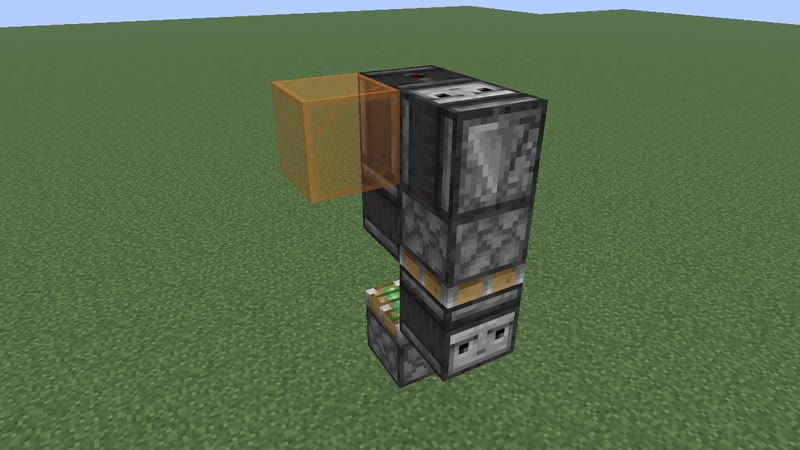</a> 21 gt (1.05 s) · observer+sticky_piston · 7 blocks</td><td align="center"> 21 gt (1.05 s) · observer+sticky_piston · 7 blocks</td></tr>
<tr><td align="center"><a href="../archive/clk-obs-p21-bulb-obs-stk-7b-7c5c11.txt">clk-obs-p21-bulb-obs-stk-7b-7c5c11</a> 21 gt (1.05 s) · copper_bulb+observer+sticky_piston · 7 blocks (picture pending)</td><td align="center"> 21 gt (1.05 s) · note_block+observer+sticky_piston · 7 blocks</td><td align="center"> 21 gt (1.05 s) · note_block+observer+sticky_piston · 7 blocks</td></tr>
<tr><td align="center"><a href="../archive/clk-obs-p21-bulb-note-obs-pis-stk-7b-f889f0.txt">clk-obs-p21-bulb-note-obs-pis-stk-7b-f889f0</a> 21 gt (1.05 s) · copper_bulb+note_block+observer+piston+sticky_piston · 7 blocks (picture pending)</td><td align="center"><a href="../archive/clk-obs-p21-lamp-note-obs-stk-7b-729d4c.txt">clk-obs-p21-lamp-note-obs-stk-7b-729d4c</a> 21 gt (1.05 s) · note_block+observer+redstone_lamp+sticky_piston · 7 blocks (picture pending)</td><td align="center"> 21 gt (1.05 s) · observer+redstone_lamp+sticky_piston · 7 blocks</td></tr>
<tr><td align="center"> 21 gt (1.05 s) · calibrated_sculk_sensor+piston+redstone_wire+repeater · 10 blocks</td><td align="center"> 21 gt (1.05 s) · comparator+dropper+hopper+repeater · 14 blocks</td><td align="center"> 21 gt (1.05 s) · repeater · 16 blocks</td></tr>
</table>

## 22 gt (1.1 s)

Also reachable by: observer ring with a relay block (clk-obs-note-ring, n = 3).

<table>
<tr><td align="center"> 22 gt (1.1 s) · calibrated_sculk_sensor+oak_trapdoor+observer+repeater · 5 blocks</td><td align="center"> 22 gt (1.1 s) · calibrated_sculk_sensor+oak_trapdoor+observer+sticky_piston · 5 blocks</td><td align="center"> 22 gt (1.1 s) · calibrated_sculk_sensor+observer+piston+sticky_piston · 5 blocks</td></tr>
<tr><td align="center"> 22 gt (1.1 s) · calibrated_sculk_sensor+observer+sticky_piston · 5 blocks</td><td align="center"> 22 gt (1.1 s) · calibrated_sculk_sensor+oak_fence_gate+observer+sticky_piston · 5 blocks</td><td align="center"> 22 gt (1.1 s) · calibrated_sculk_sensor+iron_trapdoor+observer+sticky_piston · 5 blocks</td></tr>
<tr><td align="center"> 22 gt (1.1 s) · calibrated_sculk_sensor+note_block+observer+repeater · 5 blocks</td><td align="center"> 22 gt (1.1 s) · calibrated_sculk_sensor+dispenser+observer+repeater · 5 blocks</td><td align="center"> 22 gt (1.1 s) · calibrated_sculk_sensor+dispenser+observer · 5 blocks</td></tr>
<tr><td align="center"> 22 gt (1.1 s) · calibrated_sculk_sensor+dispenser+observer+sticky_piston · 5 blocks</td><td align="center"><a href="../archive/clk-sculk-hyb3-p22-1.txt">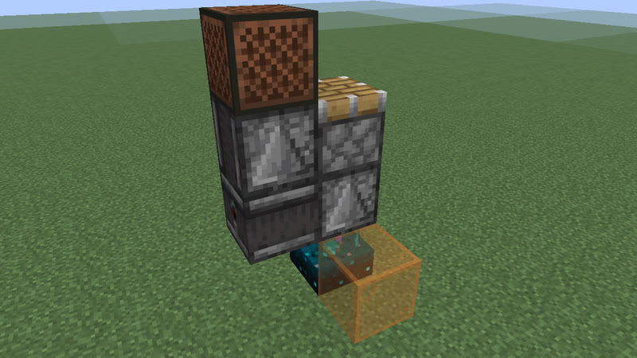</a> 22 gt (1.1 s) · calibrated_sculk_sensor+note_block+observer+piston · 6 blocks also found as clk-sculk-hyb3-p22-3 (built with sticky_piston, without piston)</td><td align="center"> 22 gt (1.1 s) · calibrated_sculk_sensor+iron_trapdoor+observer · 6 blocks</td></tr>
<tr><td align="center"> 22 gt (1.1 s) · calibrated_sculk_sensor+oak_fence_gate+observer · 6 blocks</td><td align="center"> 22 gt (1.1 s) · calibrated_sculk_sensor+oak_trapdoor+observer · 6 blocks</td><td align="center"> 22 gt (1.1 s) · observer+piston+redstone_lamp+sticky_piston · 6 blocks</td></tr>
<tr><td align="center"> 22 gt (1.1 s) · note_block+observer+piston+sticky_piston · 6 blocks</td><td align="center"> 22 gt (1.1 s) · note_block+observer+piston+sticky_piston · 6 blocks</td><td align="center"> 22 gt (1.1 s) · observer+piston+sticky_piston · 6 blocks</td></tr>
<tr><td align="center"> 22 gt (1.1 s) · observer+piston+sticky_piston · 6 blocks</td><td align="center"><a href="../archive/census-p22-calibrated_sculk_sensor-observer-piston-6b.txt">census-p22-calibrated_sculk_sensor-observer-piston-6b</a> 22 gt (1.1 s) · calibrated_sculk_sensor+observer+piston · 6 blocks (picture pending)</td><td align="center"> 22 gt (1.1 s) · observer+redstone_block+redstone_lamp+sticky_piston · 6 blocks</td></tr>
<tr><td align="center"> 22 gt (1.1 s) · observer+redstone_lamp+sticky_piston · 6 blocks</td><td align="center"> 22 gt (1.1 s) · note_block+observer+sticky_piston · 6 blocks</td><td align="center"> 22 gt (1.1 s) · observer+redstone_block+sticky_piston · 6 blocks</td></tr>
<tr><td align="center"> 22 gt (1.1 s) · observer+redstone_block+sticky_piston · 6 blocks</td><td align="center"><a href="../archive/clk-obs-p22-obs-stk-6b-b-4bfc89.txt">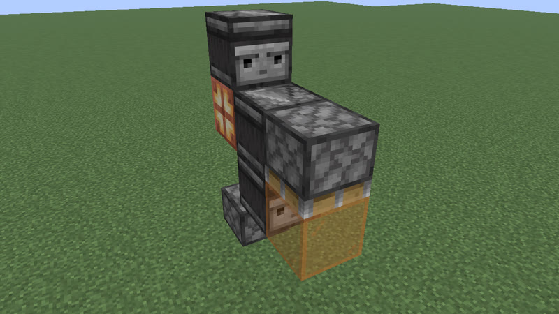</a> 22 gt (1.1 s) · observer+sticky_piston · 6 blocks</td><td align="center"> 22 gt (1.1 s) · observer+sticky_piston · 6 blocks</td></tr>
<tr><td align="center"> 22 gt (1.1 s) · observer+sticky_piston · 6 blocks</td><td align="center"> 22 gt (1.1 s) · calibrated_sculk_sensor+dispenser+redstone_torch+repeater · 6 blocks</td><td align="center"><a href="../archive/clk-obs-p22-note-obs-pis-7b-8e1432.txt">clk-obs-p22-note-obs-pis-7b-8e1432</a> 22 gt (1.1 s) · note_block+observer+piston · 7 blocks (picture pending)</td></tr>
<tr><td align="center"><a href="../archive/clk-obs-p22-obs-pis-7b-eb5e03.txt">clk-obs-p22-obs-pis-7b-eb5e03</a> 22 gt (1.1 s) · observer+piston · 7 blocks (picture pending)</td><td align="center"> 22 gt (1.1 s) · comparator+redstone_torch+repeater · 12 blocks</td><td align="center"> 22 gt (1.1 s) · comparator+redstone_torch+redstone_wire+repeater · 12 blocks</td></tr>
<tr><td align="center"> 22 gt (1.1 s) · redstone_torch+repeater · 12 blocks</td><td align="center"> 22 gt (1.1 s) · redstone_torch+redstone_wire+repeater · 12 blocks</td><td align="center"> 22 gt (1.1 s) · comparator+repeater · 12 blocks</td></tr>
<tr><td align="center"> 22 gt (1.1 s) · repeater · 12 blocks</td></tr>
</table>

## 23 gt (1.15 s)

Also reachable by: clk-obs-odd-a (n = 3), clk-rt-odd-rect (n = 0), clk-sculk-hairpin-dispenser (n = 1).

<table>
<tr><td align="center"> 23 gt (1.15 s) · calibrated_sculk_sensor+dispenser+observer+piston · 4 blocks also found as census-p23-calibrated_sculk_sensor-dispenser-observer-sticky_piston-4b (built with sticky_piston, without piston)</td><td align="center"> 23 gt (1.15 s) · calibrated_sculk_sensor+note_block+observer+piston · 4 blocks also found as census-p23-calibrated_sculk_sensor-note_block-observer-sticky_piston-4b (built with sticky_piston, without piston)</td><td align="center"> 23 gt (1.15 s) · calibrated_sculk_sensor+dispenser+observer · 5 blocks</td></tr>
<tr><td align="center"> 23 gt (1.15 s) · calibrated_sculk_sensor+note_block+observer+repeater · 5 blocks</td><td align="center"> 23 gt (1.15 s) · observer+piston+sticky_piston · 5 blocks</td><td align="center"> 23 gt (1.15 s) · observer+piston+sticky_piston · 5 blocks</td></tr>
<tr><td align="center"> 23 gt (1.15 s) · observer+sticky_piston · 5 blocks</td><td align="center"> 23 gt (1.15 s) · calibrated_sculk_sensor+oak_trapdoor+observer+sticky_piston · 5 blocks</td><td align="center"> 23 gt (1.15 s) · calibrated_sculk_sensor+observer+piston+sticky_piston · 5 blocks</td></tr>
<tr><td align="center"> 23 gt (1.15 s) · calibrated_sculk_sensor+observer+sticky_piston · 5 blocks</td><td align="center"> 23 gt (1.15 s) · calibrated_sculk_sensor+dispenser+observer+repeater · 5 blocks</td><td align="center"> 23 gt (1.15 s) · observer+sticky_piston · 5 blocks</td></tr>
<tr><td align="center"> 23 gt (1.15 s) · calibrated_sculk_sensor+observer+piston · 5 blocks</td><td align="center"> 23 gt (1.15 s) · calibrated_sculk_sensor+iron_trapdoor+observer+sticky_piston · 5 blocks</td><td align="center"> 23 gt (1.15 s) · calibrated_sculk_sensor+oak_fence_gate+observer+sticky_piston · 5 blocks</td></tr>
<tr><td align="center"> 23 gt (1.15 s) · calibrated_sculk_sensor+iron_trapdoor+observer · 6 blocks</td><td align="center"> 23 gt (1.15 s) · calibrated_sculk_sensor+oak_fence_gate+observer · 6 blocks</td><td align="center"> 23 gt (1.15 s) · calibrated_sculk_sensor+oak_trapdoor+observer · 6 blocks</td></tr>
<tr><td align="center"> 23 gt (1.15 s) · calibrated_sculk_sensor+dispenser+repeater · 6 blocks</td><td align="center"> 23 gt (1.15 s) · calibrated_sculk_sensor+dispenser+redstone_torch+repeater · 6 blocks</td><td align="center"><a href="../archive/clk-obs-p23-lamp-note-obs-pis-8b-4adcad.txt">clk-obs-p23-lamp-note-obs-pis-8b-4adcad</a> 23 gt (1.15 s) · note_block+observer+piston+redstone_lamp · 8 blocks (picture pending)</td></tr>
<tr><td align="center"><a href="../archive/clk-obs-p23-lamp-obs-pis-8b-201ec1.txt">clk-obs-p23-lamp-obs-pis-8b-201ec1</a> 23 gt (1.15 s) · observer+piston+redstone_lamp · 8 blocks (picture pending)</td><td align="center"><a href="../archive/clk-obs-p23-note-obs-pis-8b-f5a6d8.txt">clk-obs-p23-note-obs-pis-8b-f5a6d8</a> 23 gt (1.15 s) · note_block+observer+piston · 8 blocks (picture pending)</td><td align="center"><a href="../archive/clk-obs-p23-obs-pis-8b-6ebdc2.txt">clk-obs-p23-obs-pis-8b-6ebdc2</a> 23 gt (1.15 s) · observer+piston · 8 blocks (picture pending)</td></tr>
<tr><td align="center"> 23 gt (1.15 s) · comparator+dropper+hopper · 10 blocks</td><td align="center"> 23 gt (1.15 s) · redstone_wire+repeater · 18 blocks</td></tr>
</table>

## 24 gt (1.2 s)

Also reachable by: clk-obs-obs-ring (n = 4), clk-obs-divider (n = 1), clk-item-snowdisp (n = 2).

<table>
<tr><td align="center"> 24 gt (1.2 s) · calibrated_sculk_sensor+note_block+observer · 3 blocks</td><td align="center"> 24 gt (1.2 s) · calibrated_sculk_sensor+oak_trapdoor+observer · 3 blocks</td><td align="center"> 24 gt (1.2 s) · calibrated_sculk_sensor+oak_fence_gate+observer · 3 blocks</td></tr>
<tr><td align="center"> 24 gt (1.2 s) · calibrated_sculk_sensor+iron_trapdoor+observer · 3 blocks</td><td align="center"> 24 gt (1.2 s) · calibrated_sculk_sensor+oak_trapdoor+observer · 3 blocks</td><td align="center"> 24 gt (1.2 s) · calibrated_sculk_sensor+oak_trapdoor+observer · 3 blocks</td></tr>
<tr><td align="center"><a href="../archive/clk-sculk-hyb3b-p24-13.txt">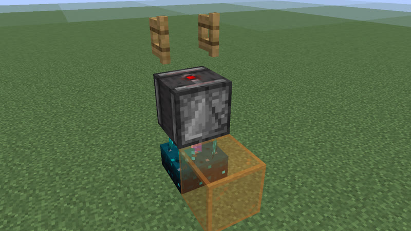</a> 24 gt (1.2 s) · calibrated_sculk_sensor+oak_fence_gate+observer · 3 blocks</td><td align="center"><a href="../archive/clk-sculk-hyb3b-p24-7.txt">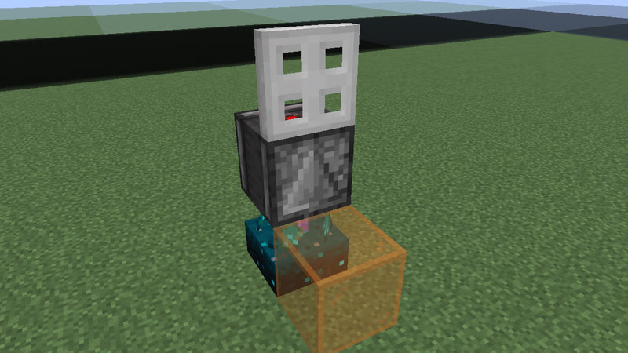</a> 24 gt (1.2 s) · calibrated_sculk_sensor+iron_trapdoor+observer · 3 blocks</td><td align="center"> 24 gt (1.2 s) · calibrated_sculk_sensor+observer+piston · 3 blocks also found as census-p24-calibrated_sculk_sensor-observer-sticky_piston-3b (built with sticky_piston, without piston)</td></tr>
<tr><td align="center"> 24 gt (1.2 s) · calibrated_sculk_sensor+note_block+observer · 3 blocks</td><td align="center"> 24 gt (1.2 s) · calibrated_sculk_sensor+observer+piston · 3 blocks</td><td align="center"> 24 gt (1.2 s) · calibrated_sculk_sensor+observer+sticky_piston · 3 blocks</td></tr>
<tr><td align="center"> 24 gt (1.2 s) · calibrated_sculk_sensor+observer+piston · 3 blocks</td><td align="center"> 24 gt (1.2 s) · calibrated_sculk_sensor+dispenser+observer · 4 blocks</td><td align="center"> 24 gt (1.2 s) · observer+sticky_piston · 4 blocks</td></tr>
<tr><td align="center"> 24 gt (1.2 s) · copper_bulb+observer+piston · 5 blocks also found as clk-obs-p24-bulb-obs-stk-5b-fe7000 (built with sticky_piston, without piston)</td><td align="center"> 24 gt (1.2 s) · copper_bulb+observer+piston · 5 blocks also found as clk-obs-p24-bulb-obs-stk-5b-b-b9ef2e (built with sticky_piston, without piston)</td><td align="center"> 24 gt (1.2 s) · note_block+observer+piston+redstone_block+sticky_piston · 5 blocks</td></tr>
<tr><td align="center"> 24 gt (1.2 s) · note_block+observer+redstone_block+sticky_piston · 5 blocks</td><td align="center"> 24 gt (1.2 s) · note_block+observer+piston+redstone_block+sticky_piston · 5 blocks</td><td align="center"> 24 gt (1.2 s) · note_block+observer+redstone_block+sticky_piston · 5 blocks</td></tr>
<tr><td align="center"> 24 gt (1.2 s) · observer+piston+redstone_block+sticky_piston · 5 blocks</td><td align="center"> 24 gt (1.2 s) · observer+piston+redstone_block+sticky_piston · 5 blocks</td><td align="center"> 24 gt (1.2 s) · observer+redstone_block+sticky_piston · 5 blocks</td></tr>
<tr><td align="center"> 24 gt (1.2 s) · observer+redstone_block+sticky_piston · 5 blocks</td><td align="center"> 24 gt (1.2 s) · observer+redstone_lamp+sticky_piston · 6 blocks</td><td align="center"><a href="../archive/clk-obs-p24-lamp-obs-stk-6b-b-df98b6.txt">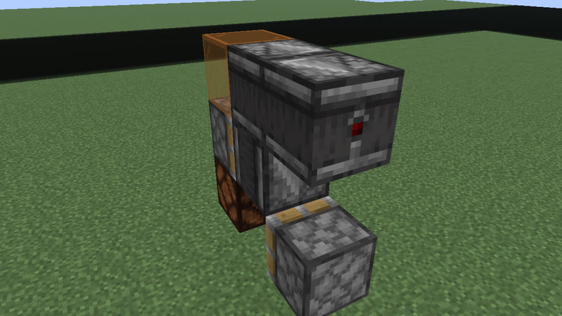</a> 24 gt (1.2 s) · observer+redstone_lamp+sticky_piston · 6 blocks</td></tr>
<tr><td align="center"> 24 gt (1.2 s) · observer+piston+redstone_lamp+sticky_piston · 6 blocks</td><td align="center"><a href="../archive/clk-obs-p24-lamp-obs-pis-stk-6b-b-4cc272.txt">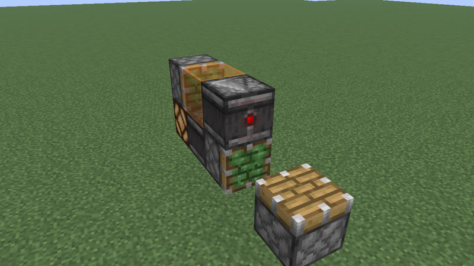</a> 24 gt (1.2 s) · observer+piston+redstone_lamp+sticky_piston · 6 blocks</td><td align="center"> 24 gt (1.2 s) · note_block+observer+piston+sticky_piston · 6 blocks</td></tr>
<tr><td align="center"> 24 gt (1.2 s) · note_block+observer+piston+sticky_piston · 6 blocks</td><td align="center"><a href="../archive/clk-obs-p24-rb-stk-6b-0e15ee.txt">clk-obs-p24-rb-stk-6b-0e15ee</a> 24 gt (1.2 s) · redstone_block+sticky_piston · 6 blocks (picture pending)</td><td align="center"> 24 gt (1.2 s) · calibrated_sculk_sensor+dispenser+redstone_torch+repeater · 6 blocks</td></tr>
<tr><td align="center"> 24 gt (1.2 s) · observer+piston+redstone_lamp · 7 blocks</td><td align="center"><a href="../archive/clk-obs-p24-lamp-obs-pis-7b-b-e22fe6.txt">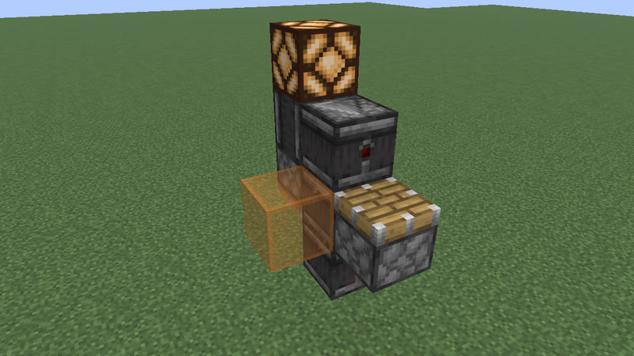</a> 24 gt (1.2 s) · observer+piston+redstone_lamp · 7 blocks</td><td align="center"> 24 gt (1.2 s) · note_block+observer+piston · 7 blocks</td></tr>
<tr><td align="center"><a href="../archive/clk-obs-p24-note-obs-pis-7b-b-884ee9.txt">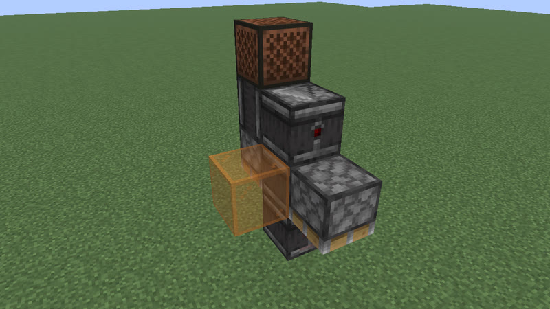</a> 24 gt (1.2 s) · note_block+observer+piston · 7 blocks</td><td align="center"> 24 gt (1.2 s) · observer+piston · 7 blocks</td><td align="center"> 24 gt (1.2 s) · calibrated_sculk_sensor+dispenser+repeater · 8 blocks</td></tr>
<tr><td align="center"> 24 gt (1.2 s) · comparator+redstone_torch+redstone_wire+repeater · 9 blocks</td><td align="center"> 24 gt (1.2 s) · redstone_torch+redstone_wire+repeater · 9 blocks</td><td align="center"> 24 gt (1.2 s) · comparator+hopper · 9 blocks</td></tr>
<tr><td align="center"> 24 gt (1.2 s) · comparator+redstone_torch+repeater · 12 blocks</td><td align="center"> 24 gt (1.2 s) · redstone_torch+repeater · 12 blocks</td><td align="center"> 24 gt (1.2 s) · comparator+repeater · 12 blocks</td></tr>
<tr><td align="center"> 24 gt (1.2 s) · repeater · 12 blocks</td></tr>
</table>

## 25 gt (1.25 s)

Also reachable by: clk-obs-odd-b (n = 3).

<table>
<tr><td align="center"> 25 gt (1.25 s) · calibrated_sculk_sensor+dispenser+note_block+observer · 4 blocks</td><td align="center"> 25 gt (1.25 s) · calibrated_sculk_sensor+dispenser+oak_trapdoor+observer · 4 blocks</td><td align="center"> 25 gt (1.25 s) · calibrated_sculk_sensor+note_block+observer · 4 blocks</td></tr>
<tr><td align="center"> 25 gt (1.25 s) · calibrated_sculk_sensor+oak_trapdoor+observer · 4 blocks</td><td align="center"> 25 gt (1.25 s) · calibrated_sculk_sensor+oak_trapdoor+observer · 4 blocks</td><td align="center"><a href="../archive/clk-sculk-hyb3b-p25-13.txt">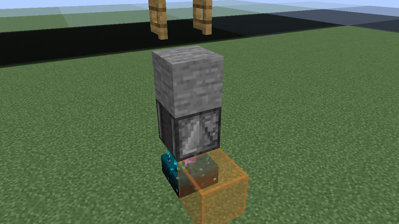</a> 25 gt (1.25 s) · calibrated_sculk_sensor+oak_fence_gate+observer · 4 blocks</td></tr>
<tr><td align="center"><a href="../archive/clk-sculk-hyb3b-p25-7.txt">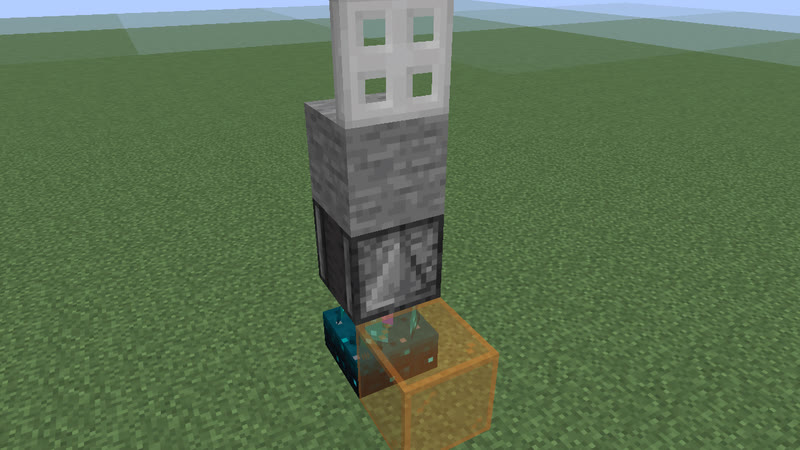</a> 25 gt (1.25 s) · calibrated_sculk_sensor+iron_trapdoor+observer · 4 blocks</td><td align="center"> 25 gt (1.25 s) · calibrated_sculk_sensor+dispenser+observer+piston · 4 blocks also found as census-p25-calibrated_sculk_sensor-dispenser-observer-sticky_piston-4b (built with sticky_piston, without piston)</td><td align="center"> 25 gt (1.25 s) · calibrated_sculk_sensor+observer+piston · 4 blocks also found as census-p25-calibrated_sculk_sensor-observer-sticky_piston-4b (built with sticky_piston, without piston)</td></tr>
<tr><td align="center"> 25 gt (1.25 s) · calibrated_sculk_sensor+note_block+observer · 4 blocks</td><td align="center"> 25 gt (1.25 s) · calibrated_sculk_sensor+dispenser+observer+repeater · 5 blocks</td><td align="center"><a href="../archive/clk-sculk-hyb3b-p25-1.txt">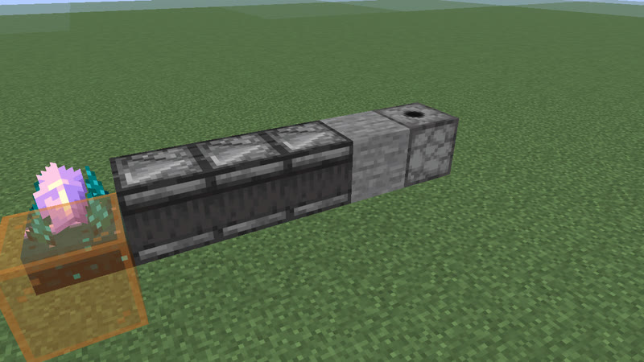</a> 25 gt (1.25 s) · calibrated_sculk_sensor+dispenser+observer · 6 blocks</td></tr>
<tr><td align="center"><a href="../archive/census-p25-calibrated_sculk_sensor-note_block-observer-sticky_piston-6b.txt">census-p25-calibrated_sculk_sensor-note_block-observer-sticky_piston-6b</a> 25 gt (1.25 s) · calibrated_sculk_sensor+note_block+observer+sticky_piston · 6 blocks (picture pending)</td><td align="center"> 25 gt (1.25 s) · observer+redstone_block+sticky_piston · 6 blocks</td><td align="center"> 25 gt (1.25 s) · calibrated_sculk_sensor+dispenser+redstone_torch+repeater · 6 blocks</td></tr>
<tr><td align="center"><a href="../archive/clk-obs-p25-lamp-note-obs-pis-stk-7b-bfd422.txt">clk-obs-p25-lamp-note-obs-pis-stk-7b-bfd422</a> 25 gt (1.25 s) · note_block+observer+piston+redstone_lamp+sticky_piston · 7 blocks (picture pending)</td><td align="center"> 25 gt (1.25 s) · note_block+observer+redstone_lamp+sticky_piston · 7 blocks</td><td align="center"> 25 gt (1.25 s) · observer+piston+redstone_lamp+sticky_piston · 7 blocks</td></tr>
<tr><td align="center"> 25 gt (1.25 s) · observer+redstone_lamp+sticky_piston · 7 blocks</td><td align="center"> 25 gt (1.25 s) · observer+redstone_lamp+sticky_piston · 7 blocks</td><td align="center"> 25 gt (1.25 s) · note_block+observer+piston+sticky_piston · 7 blocks</td></tr>
<tr><td align="center"> 25 gt (1.25 s) · note_block+observer+piston+sticky_piston · 7 blocks</td><td align="center"> 25 gt (1.25 s) · note_block+observer+sticky_piston · 7 blocks</td><td align="center"> 25 gt (1.25 s) · note_block+observer+sticky_piston · 7 blocks</td></tr>
<tr><td align="center"> 25 gt (1.25 s) · observer+piston+sticky_piston · 7 blocks</td><td align="center"> 25 gt (1.25 s) · observer+piston+sticky_piston · 7 blocks</td><td align="center"> 25 gt (1.25 s) · observer+sticky_piston · 7 blocks</td></tr>
<tr><td align="center"><a href="../archive/clk-obs-p25-obs-stk-7b-b-fea40b.txt">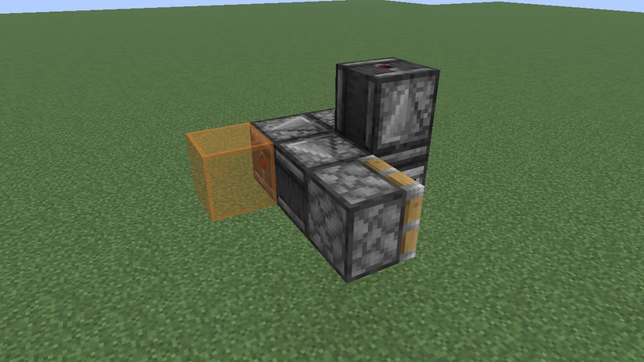</a> 25 gt (1.25 s) · observer+sticky_piston · 7 blocks</td><td align="center"> 25 gt (1.25 s) · comparator+hopper+redstone_wire+repeater · 9 blocks</td><td align="center"><a href="../archive/kit-shuttle-minecart-p25-11b.txt">kit-shuttle-minecart-p25-11b</a> 25 gt (1.25 s) · detector_rail+minecart · 11 blocks (picture pending)</td></tr>
<tr><td align="center"> 25 gt (1.25 s) · comparator+dropper+hopper+repeater · 16 blocks</td><td align="center"> 25 gt (1.25 s) · repeater · 19 blocks</td></tr>
</table>

## 26 gt (1.3 s)

Also reachable by: observer ring with a relay block (clk-obs-note-ring, n = 4), clk-misc-cart-loop (n = 0), clk-sculk-replin-dispenser (n = 2).

<table>
<tr><td align="center"> 26 gt (1.3 s) · calibrated_sculk_sensor+note_block+observer · 4 blocks</td><td align="center"> 26 gt (1.3 s) · calibrated_sculk_sensor+oak_trapdoor+observer · 4 blocks</td><td align="center"> 26 gt (1.3 s) · calibrated_sculk_sensor+observer+piston · 4 blocks also found as census-p26-calibrated_sculk_sensor-observer-sticky_piston-4b (built with sticky_piston, without piston)</td></tr>
<tr><td align="center"> 26 gt (1.3 s) · calibrated_sculk_sensor+oak_trapdoor+observer · 4 blocks</td><td align="center"> 26 gt (1.3 s) · calibrated_sculk_sensor+oak_fence_gate+observer · 4 blocks</td><td align="center"> 26 gt (1.3 s) · calibrated_sculk_sensor+iron_trapdoor+observer · 4 blocks</td></tr>
<tr><td align="center"> 26 gt (1.3 s) · calibrated_sculk_sensor+note_block+observer · 4 blocks</td><td align="center"> 26 gt (1.3 s) · calibrated_sculk_sensor+dispenser+observer · 5 blocks</td><td align="center"> 26 gt (1.3 s) · copper_bulb+observer+piston+sticky_piston · 5 blocks also found as clk-obs-p26-bulb-obs-pis-5b-288217 (built without sticky_piston), clk-obs-p26-bulb-obs-stk-5b-91a60a (built without piston), clk-obs-p26-bulb-obs-pis-stk-5b-b-1f3b6f</td></tr>
<tr><td align="center"><a href="../archive/clk-obs-p26-bulb-obs-pis-5b-b-cb6e67.txt">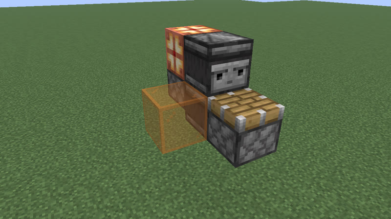</a> 26 gt (1.3 s) · copper_bulb+observer+piston · 5 blocks also found as clk-obs-p26-bulb-obs-stk-5b-b-dd2613 (built with sticky_piston, without piston)</td><td align="center"> 26 gt (1.3 s) · observer+piston+redstone_lamp+sticky_piston · 5 blocks</td><td align="center"> 26 gt (1.3 s) · observer+redstone_lamp+sticky_piston · 5 blocks</td></tr>
<tr><td align="center"> 26 gt (1.3 s) · observer+piston+sticky_piston · 5 blocks</td><td align="center"><a href="../archive/clk-obs-p26-obs-pis-stk-5b-b-124115.txt">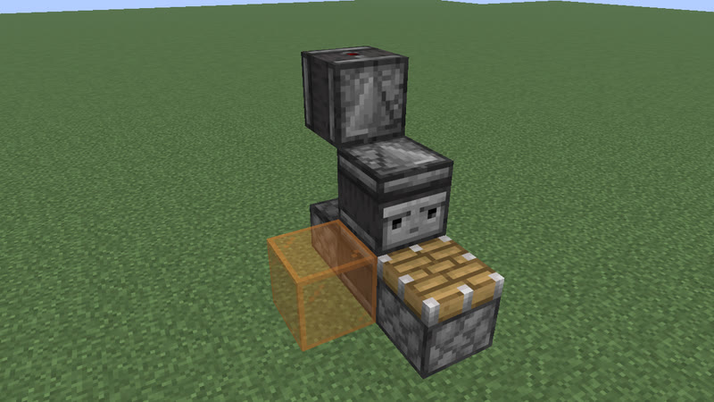</a> 26 gt (1.3 s) · observer+piston+sticky_piston · 5 blocks</td><td align="center"> 26 gt (1.3 s) · observer+sticky_piston · 5 blocks</td></tr>
<tr><td align="center"> 26 gt (1.3 s) · observer+sticky_piston · 5 blocks</td><td align="center"> 26 gt (1.3 s) · observer+piston+redstone_block+sticky_piston · 5 blocks</td><td align="center"> 26 gt (1.3 s) · observer+redstone_block+sticky_piston · 5 blocks</td></tr>
<tr><td align="center"><a href="../archive/clk-obs-p26-obs-pis-rb-stk-5b-b-dd9d27.txt">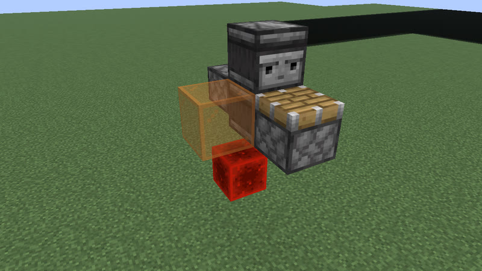</a> 26 gt (1.3 s) · observer+piston+redstone_block+sticky_piston · 5 blocks</td><td align="center"><a href="../archive/clk-obs-p26-obs-rb-stk-5b-b-b65ec0.txt">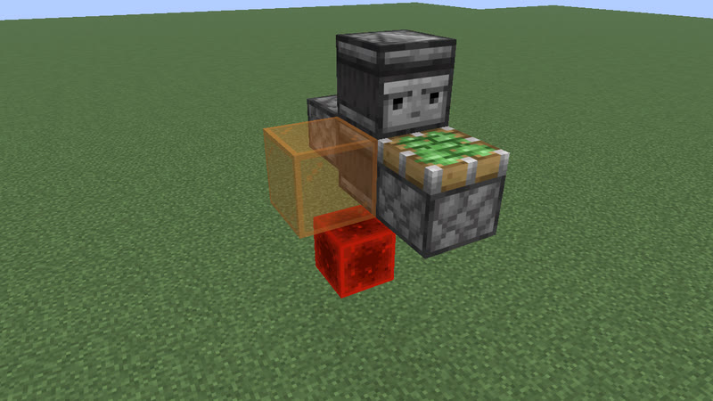</a> 26 gt (1.3 s) · observer+redstone_block+sticky_piston · 5 blocks</td><td align="center"> 26 gt (1.3 s) · observer+redstone_lamp · 6 blocks</td></tr>
<tr><td align="center"> 26 gt (1.3 s) · observer+redstone_lamp · 6 blocks</td><td align="center"> 26 gt (1.3 s) · observer+piston+redstone_lamp · 6 blocks</td><td align="center"><a href="../archive/clk-obs-p26-lamp-obs-pis-6b-b-e6829b.txt">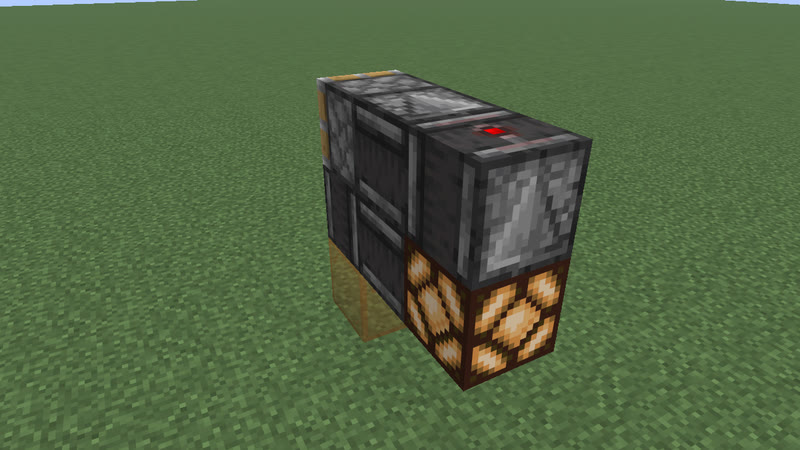</a> 26 gt (1.3 s) · observer+piston+redstone_lamp · 6 blocks</td></tr>
<tr><td align="center"><a href="../archive/clk-obs-p26-note-obs-pis-8b-5bce83.txt">clk-obs-p26-note-obs-pis-8b-5bce83</a> 26 gt (1.3 s) · note_block+observer+piston · 8 blocks (picture pending)</td><td align="center"><a href="../archive/clk-obs-p26-obs-pis-8b-55d694.txt">clk-obs-p26-obs-pis-8b-55d694</a> 26 gt (1.3 s) · observer+piston · 8 blocks (picture pending)</td><td align="center"><a href="../archive/kit-bouncer-item-p26-11b.txt">kit-bouncer-item-p26-11b</a> 26 gt (1.3 s) · item+tripwire+tripwire_hook · 11 blocks (picture pending)</td></tr>
<tr><td align="center"> 26 gt (1.3 s) · comparator+redstone_torch+repeater · 12 blocks</td><td align="center"> 26 gt (1.3 s) · redstone_torch+repeater · 12 blocks</td><td align="center"> 26 gt (1.3 s) · redstone_torch+redstone_wire+repeater · 12 blocks</td></tr>
<tr><td align="center"> 26 gt (1.3 s) · comparator+repeater · 12 blocks</td><td align="center"> 26 gt (1.3 s) · repeater · 12 blocks</td></tr>
</table>

## 27 gt (1.35 s)

Also reachable by: clk-obs-odd-a (n = 4), dropper ring (clk-item-dropring-1d, n = 0).

<table>
<tr><td align="center"> 27 gt (1.35 s) · calibrated_sculk_sensor+note_block+observer · 4 blocks</td><td align="center"> 27 gt (1.35 s) · calibrated_sculk_sensor+oak_trapdoor+observer · 4 blocks</td><td align="center"> 27 gt (1.35 s) · calibrated_sculk_sensor+oak_trapdoor+observer · 4 blocks</td></tr>
<tr><td align="center"> 27 gt (1.35 s) · calibrated_sculk_sensor+oak_fence_gate+observer · 4 blocks</td><td align="center"> 27 gt (1.35 s) · calibrated_sculk_sensor+iron_trapdoor+observer · 4 blocks</td><td align="center"> 27 gt (1.35 s) · calibrated_sculk_sensor+observer+piston · 4 blocks also found as census-p27-calibrated_sculk_sensor-observer-sticky_piston-4b (built with sticky_piston, without piston)</td></tr>
<tr><td align="center"> 27 gt (1.35 s) · calibrated_sculk_sensor+note_block+observer · 4 blocks</td><td align="center"> 27 gt (1.35 s) · observer+piston+sticky_piston · 5 blocks</td><td align="center"> 27 gt (1.35 s) · observer+piston+sticky_piston · 5 blocks</td></tr>
<tr><td align="center"> 27 gt (1.35 s) · observer+sticky_piston · 5 blocks</td><td align="center"> 27 gt (1.35 s) · observer+sticky_piston · 5 blocks</td><td align="center"><a href="../archive/clk-sculk-obsd-p27-1.txt">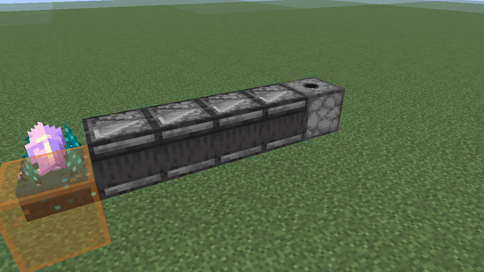</a> 27 gt (1.35 s) · calibrated_sculk_sensor+dispenser+observer · 6 blocks</td></tr>
<tr><td align="center"> 27 gt (1.35 s) · repeater · 19 blocks</td></tr>
</table>

## 28 gt (1.4 s)

Also reachable by: clk-obs-obs-ring (n = 5), hopper ring (clk-item-hopper-ring, n = 1), clk-obs-bulb-ring (n = 1).

<table>
<tr><td align="center"> 28 gt (1.4 s) · calibrated_sculk_sensor+dispenser+observer · 3 blocks</td><td align="center"> 28 gt (1.4 s) · calibrated_sculk_sensor+dispenser+observer · 3 blocks</td><td align="center"> 28 gt (1.4 s) · calibrated_sculk_sensor+dispenser+observer · 3 blocks</td></tr>
<tr><td align="center"> 28 gt (1.4 s) · calibrated_sculk_sensor+oak_trapdoor+observer · 5 blocks</td><td align="center"> 28 gt (1.4 s) · calibrated_sculk_sensor+oak_fence_gate+observer · 5 blocks</td><td align="center"> 28 gt (1.4 s) · calibrated_sculk_sensor+iron_trapdoor+observer · 5 blocks</td></tr>
<tr><td align="center"><a href="../archive/clk-sculk-hyb-p28-1.txt">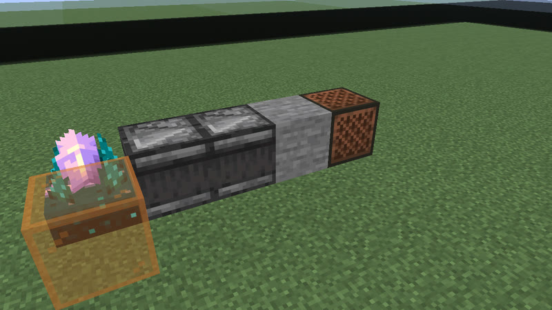</a> 28 gt (1.4 s) · calibrated_sculk_sensor+note_block+observer · 5 blocks</td><td align="center"> 28 gt (1.4 s) · observer+sticky_piston · 5 blocks</td><td align="center"><a href="../archive/clk-sculk-hyb-p28-17.txt">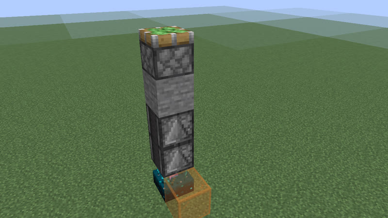</a> 28 gt (1.4 s) · calibrated_sculk_sensor+observer+sticky_piston · 5 blocks</td></tr>
<tr><td align="center"><a href="../archive/clk-sculk-hyb3b-p28-19.txt">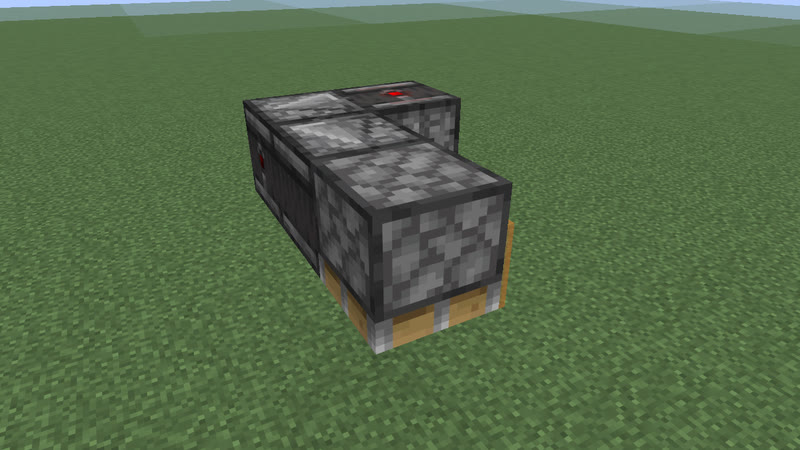</a> 28 gt (1.4 s) · calibrated_sculk_sensor+observer+piston · 5 blocks</td><td align="center"> 28 gt (1.4 s) · observer+piston · 6 blocks</td><td align="center"><a href="../archive/clk-obs-p28-obs-pis-6b-b-ebc612.txt">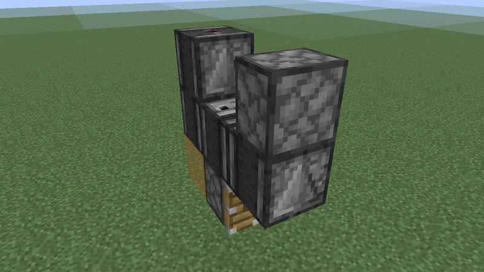</a> 28 gt (1.4 s) · observer+piston · 6 blocks</td></tr>
<tr><td align="center"> 28 gt (1.4 s) · copper_bulb+observer+piston · 6 blocks</td><td align="center"><a href="../archive/clk-obs-p28-bulb-obs-pis-6b-b-bfac7e.txt">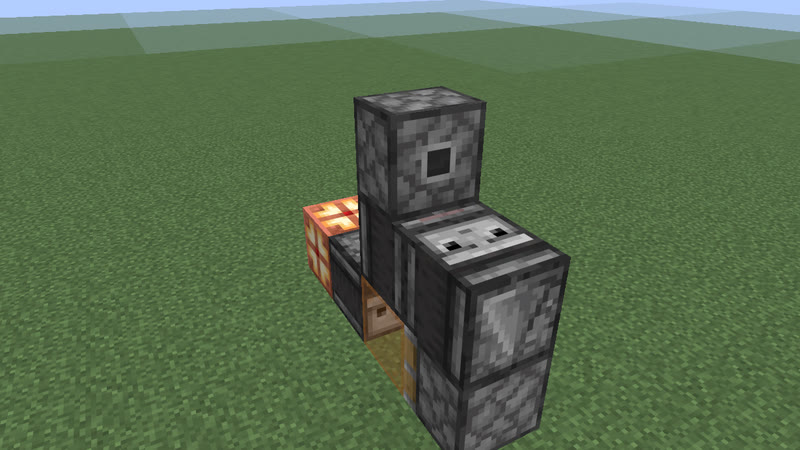</a> 28 gt (1.4 s) · copper_bulb+observer+piston · 6 blocks</td><td align="center"> 28 gt (1.4 s) · redstone_torch+redstone_wire+repeater · 9 blocks</td></tr>
<tr><td align="center"> 28 gt (1.4 s) · copper_bulb+observer · 10 blocks</td><td align="center"> 28 gt (1.4 s) · comparator+redstone_torch+repeater · 12 blocks</td><td align="center"> 28 gt (1.4 s) · redstone_torch+repeater · 12 blocks</td></tr>
<tr><td align="center"> 28 gt (1.4 s) · repeater · 12 blocks</td><td align="center"><a href="../archive/kit-shuttle-minecart-p28-13b.txt">kit-shuttle-minecart-p28-13b</a> 28 gt (1.4 s) · detector_rail+minecart · 13 blocks (picture pending)</td><td align="center"><a href="../archive/clk-misc-bookshelf-cart-b2.txt">clk-misc-bookshelf-cart-b2</a> 28 gt (1.4 s) · chiseled_bookshelf+hopper+hopper_minecart · 20 blocks (picture pending)</td></tr>
</table>

## 29 gt (1.45 s)

Also reachable by: clk-obs-odd-b (n = 4).

<table>
<tr><td align="center"> 29 gt (1.45 s) · calibrated_sculk_sensor+dispenser+observer · 4 blocks</td><td align="center"> 29 gt (1.45 s) · calibrated_sculk_sensor+dispenser+observer · 4 blocks</td><td align="center"> 29 gt (1.45 s) · calibrated_sculk_sensor+dispenser+observer · 4 blocks</td></tr>
<tr><td align="center"><a href="../archive/census-p29-calibrated_sculk_sensor-note_block-observer-5b.txt">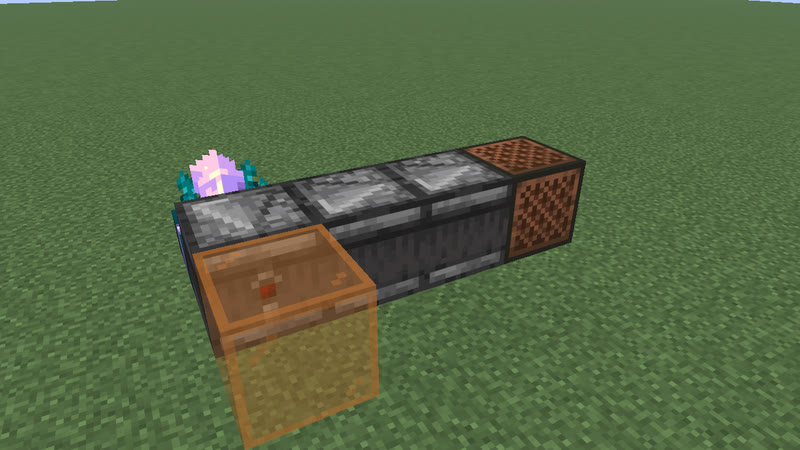</a> 29 gt (1.45 s) · calibrated_sculk_sensor+note_block+observer · 5 blocks</td><td align="center"><a href="../archive/census-p29-calibrated_sculk_sensor-oak_trapdoor-observer-5b.txt">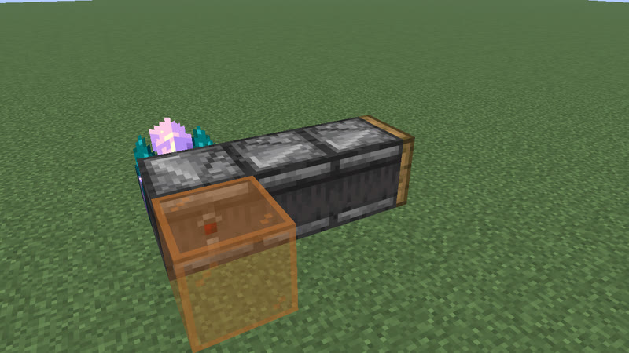</a> 29 gt (1.45 s) · calibrated_sculk_sensor+oak_trapdoor+observer · 5 blocks</td><td align="center"><a href="../archive/census-p29-calibrated_sculk_sensor-observer-piston-5b.txt">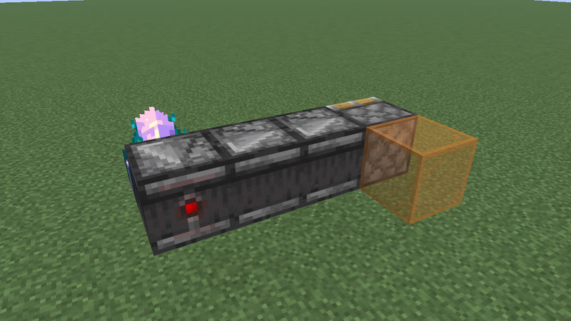</a> 29 gt (1.45 s) · calibrated_sculk_sensor+observer+piston · 5 blocks also found as census-p29-calibrated_sculk_sensor-observer-sticky_piston-5b (built with sticky_piston, without piston)</td></tr>
<tr><td align="center"> 29 gt (1.45 s) · calibrated_sculk_sensor+oak_fence_gate+observer · 5 blocks</td><td align="center"> 29 gt (1.45 s) · calibrated_sculk_sensor+iron_trapdoor+observer · 5 blocks</td><td align="center"><a href="../archive/clk-obs-p29-obs-pis-7b-a4b644.txt">clk-obs-p29-obs-pis-7b-a4b644</a> 29 gt (1.45 s) · observer+piston · 7 blocks (picture pending)</td></tr>
<tr><td align="center"><a href="../archive/clk-obs-p29-obs-pis-rb-stk-7b-bcb56d.txt">clk-obs-p29-obs-pis-rb-stk-7b-bcb56d</a> 29 gt (1.45 s) · observer+piston+redstone_block+sticky_piston · 7 blocks (picture pending)</td><td align="center"><a href="../archive/clk-obs-p29-obs-rb-stk-7b-e44e24.txt">clk-obs-p29-obs-rb-stk-7b-e44e24</a> 29 gt (1.45 s) · observer+redstone_block+sticky_piston · 7 blocks (picture pending)</td><td align="center"> 29 gt (1.45 s) · note_block+observer+redstone_block+redstone_lamp+sticky_piston · 7 blocks</td></tr>
<tr><td align="center"><a href="../archive/clk-obs-p29-lamp-note-obs-stk-7b-b-05ff21.txt">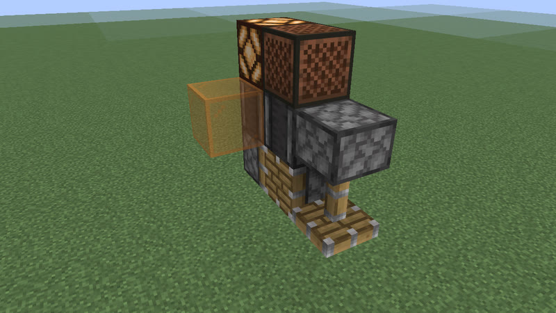</a> 29 gt (1.45 s) · note_block+observer+redstone_lamp+sticky_piston · 7 blocks</td><td align="center"> 29 gt (1.45 s) · note_block+observer+redstone_lamp+sticky_piston · 7 blocks</td><td align="center"><a href="../archive/clk-obs-p29-lamp-obs-rb-stk-7b-b-d189a1.txt">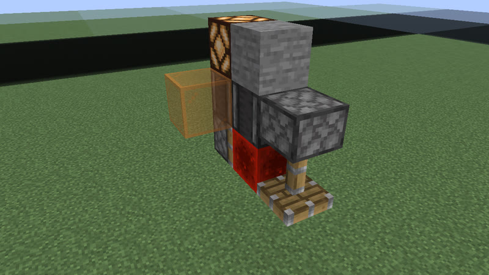</a> 29 gt (1.45 s) · observer+redstone_block+redstone_lamp+sticky_piston · 7 blocks</td></tr>
<tr><td align="center"> 29 gt (1.45 s) · observer+redstone_block+redstone_lamp+sticky_piston · 7 blocks</td><td align="center"> 29 gt (1.45 s) · observer+redstone_lamp+sticky_piston · 7 blocks</td><td align="center"><a href="../archive/clk-obs-p29-lamp-obs-stk-7b-b-33801c.txt">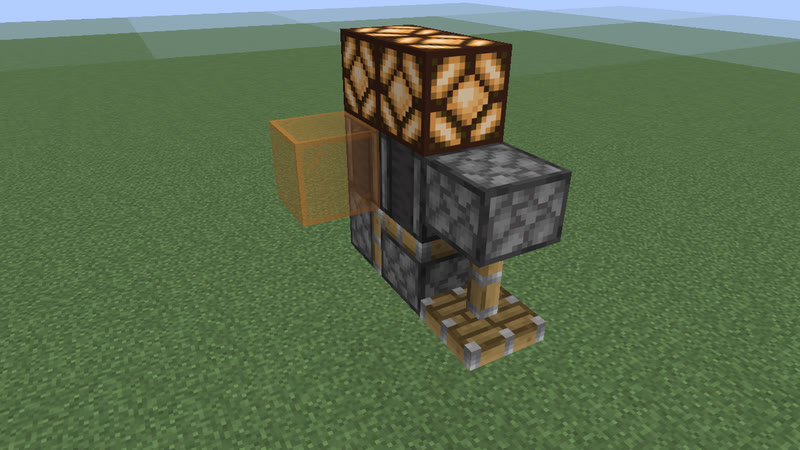</a> 29 gt (1.45 s) · observer+redstone_lamp+sticky_piston · 7 blocks</td></tr>
<tr><td align="center"> 29 gt (1.45 s) · note_block+observer+sticky_piston · 7 blocks</td><td align="center"> 29 gt (1.45 s) · note_block+observer+sticky_piston · 7 blocks</td><td align="center"><a href="../archive/clk-obs-p29-obs-stk-7b-b-1dfb17.txt">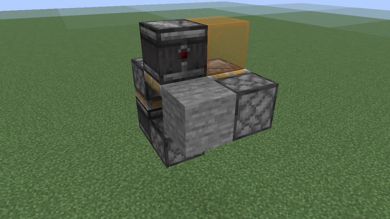</a> 29 gt (1.45 s) · observer+sticky_piston · 7 blocks</td></tr>
<tr><td align="center"> 29 gt (1.45 s) · observer+sticky_piston · 7 blocks</td><td align="center"> 29 gt (1.45 s) · copper_bulb+observer+sticky_piston · 7 blocks</td><td align="center"><a href="../archive/clk-obs-p29-bulb-obs-stk-7b-b-d82d99.txt">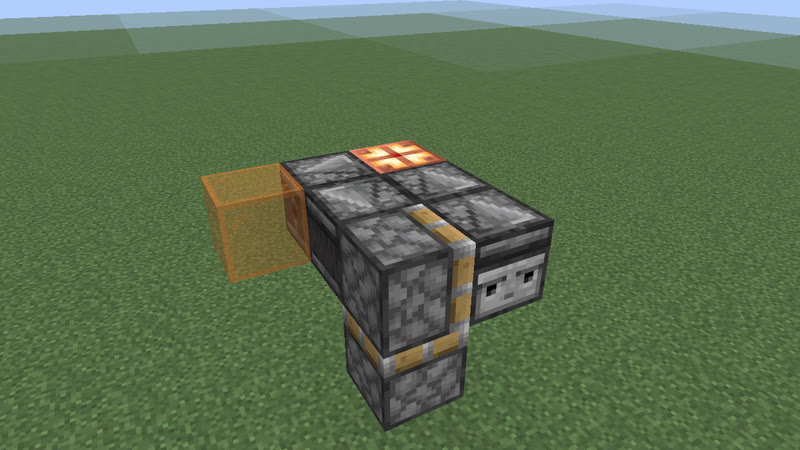</a> 29 gt (1.45 s) · copper_bulb+observer+sticky_piston · 7 blocks</td></tr>
<tr><td align="center"><a href="../archive/kit-shuttle-minecart-p29-13b.txt">kit-shuttle-minecart-p29-13b</a> 29 gt (1.45 s) · detector_rail+minecart · 13 blocks (picture pending)</td><td align="center"> 29 gt (1.45 s) · comparator+dropper+hopper+repeater · 14 blocks</td><td align="center"> 29 gt (1.45 s) · repeater · 20 blocks</td></tr>
</table>

## 30 gt (1.5 s)

Also reachable by: observer ring with a relay block (clk-obs-note-ring, n = 5), clk-item-latch (n = 0).

<table>
<tr><td align="center"><a href="../archive/census-p30-calibrated_sculk_sensor-dispenser-observer-4b.txt">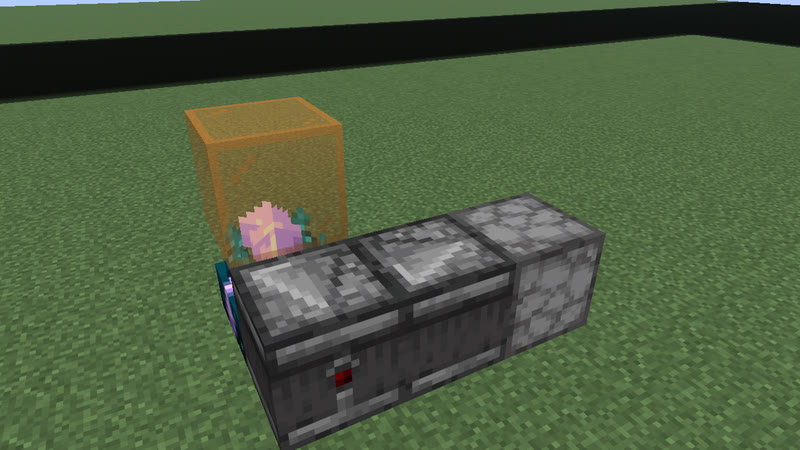</a> 30 gt (1.5 s) · calibrated_sculk_sensor+dispenser+observer · 4 blocks</td><td align="center"> 30 gt (1.5 s) · calibrated_sculk_sensor+dispenser+observer · 4 blocks</td><td align="center"> 30 gt (1.5 s) · calibrated_sculk_sensor+dispenser+observer · 4 blocks</td></tr>
<tr><td align="center"><a href="../archive/clk-sculk-hyb3-p30-7.txt">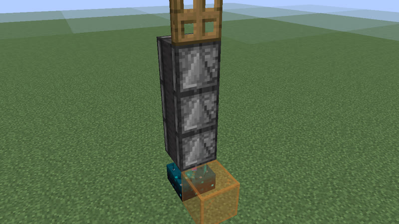</a> 30 gt (1.5 s) · calibrated_sculk_sensor+oak_trapdoor+observer · 5 blocks</td><td align="center"><a href="../archive/clk-sculk-hyb3b-p30-13.txt">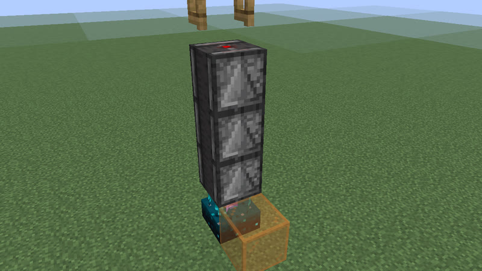</a> 30 gt (1.5 s) · calibrated_sculk_sensor+oak_fence_gate+observer · 5 blocks</td><td align="center"><a href="../archive/clk-sculk-hyb3b-p30-7.txt">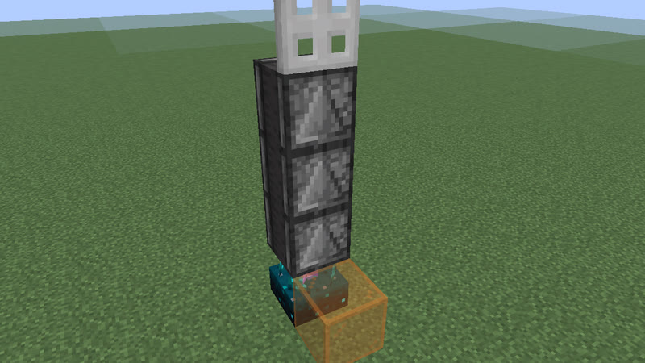</a> 30 gt (1.5 s) · calibrated_sculk_sensor+iron_trapdoor+observer · 5 blocks</td></tr>
<tr><td align="center"><a href="../archive/clk-sculk-hyb3-p30-1.txt">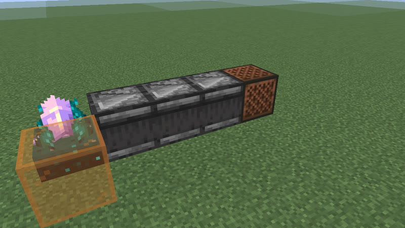</a> 30 gt (1.5 s) · calibrated_sculk_sensor+note_block+observer · 5 blocks</td><td align="center"><a href="../archive/clk-sculk-hyb3b-p30-19.txt">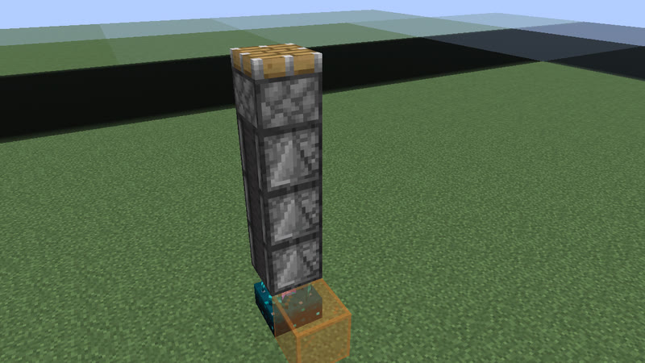</a> 30 gt (1.5 s) · calibrated_sculk_sensor+observer+piston · 5 blocks also found as clk-sculk-hyb3-p30-17 (built with sticky_piston, without piston)</td><td align="center"> 30 gt (1.5 s) · observer+redstone_block+sticky_piston · 6 blocks</td></tr>
<tr><td align="center"><a href="../archive/clk-obs-p30-obs-stk-6b-b-f8aeef.txt">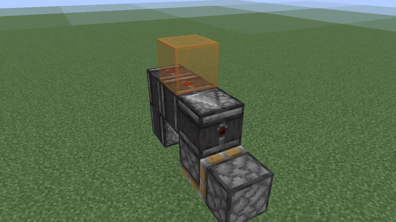</a> 30 gt (1.5 s) · observer+sticky_piston · 6 blocks</td><td align="center"> 30 gt (1.5 s) · observer+sticky_piston · 6 blocks</td><td align="center"> 30 gt (1.5 s) · observer+sticky_piston · 6 blocks</td></tr>
<tr><td align="center"> 30 gt (1.5 s) · note_block+observer+sticky_piston · 6 blocks</td><td align="center"><a href="../archive/clk-obs-p30-obs-rb-stk-6b-b-fca2c0.txt">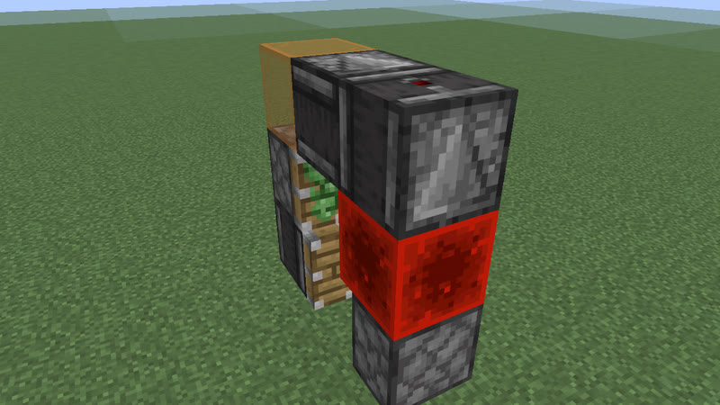</a> 30 gt (1.5 s) · observer+redstone_block+sticky_piston · 6 blocks</td><td align="center"><a href="../archive/clk-obs-p30-bulb-obs-rb-stk-6b-b-871f7d.txt">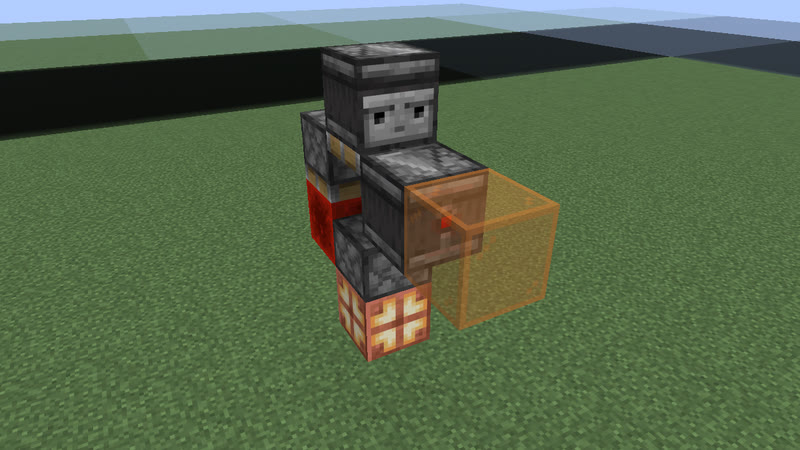</a> 30 gt (1.5 s) · copper_bulb+observer+redstone_block+sticky_piston · 6 blocks</td></tr>
<tr><td align="center"> 30 gt (1.5 s) · copper_bulb+observer+redstone_block+sticky_piston · 6 blocks</td><td align="center"> 30 gt (1.5 s) · observer+redstone_lamp+sticky_piston · 6 blocks</td><td align="center"><a href="../archive/clk-obs-p30-note-obs-stk-6b-b-4d2b48.txt">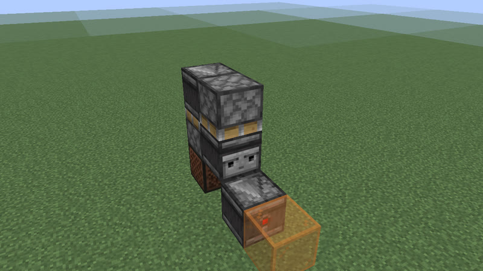</a> 30 gt (1.5 s) · note_block+observer+sticky_piston · 6 blocks</td></tr>
<tr><td align="center"><a href="../archive/clk-obs-p30-lamp-note-obs-pis-7b-0fde1d.txt">clk-obs-p30-lamp-note-obs-pis-7b-0fde1d</a> 30 gt (1.5 s) · note_block+observer+piston+redstone_lamp · 7 blocks (picture pending)</td><td align="center"><a href="../archive/clk-obs-p30-lamp-obs-pis-7b-5c5b87.txt">clk-obs-p30-lamp-obs-pis-7b-5c5b87</a> 30 gt (1.5 s) · observer+piston+redstone_lamp · 7 blocks (picture pending)</td><td align="center"><a href="../archive/clk-obs-p30-bulb-lamp-note-obs-pis-7b-f8ce3d.txt">clk-obs-p30-bulb-lamp-note-obs-pis-7b-f8ce3d</a> 30 gt (1.5 s) · copper_bulb+note_block+observer+piston+redstone_lamp · 7 blocks (picture pending)</td></tr>
<tr><td align="center"><a href="../archive/clk-obs-p30-bulb-lamp-obs-pis-7b-b7f86f.txt">clk-obs-p30-bulb-lamp-obs-pis-7b-b7f86f</a> 30 gt (1.5 s) · copper_bulb+observer+piston+redstone_lamp · 7 blocks (picture pending)</td><td align="center"> 30 gt (1.5 s) · observer+piston · 7 blocks</td><td align="center"><a href="../archive/clk-obs-p30-obs-pis-7b-b-e75d0f.txt">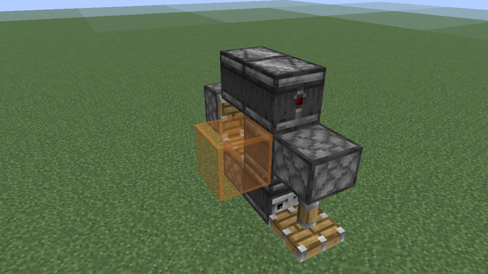</a> 30 gt (1.5 s) · observer+piston · 7 blocks</td></tr>
<tr><td align="center"><a href="../archive/clk-sculk-ring3p-p30-1.txt">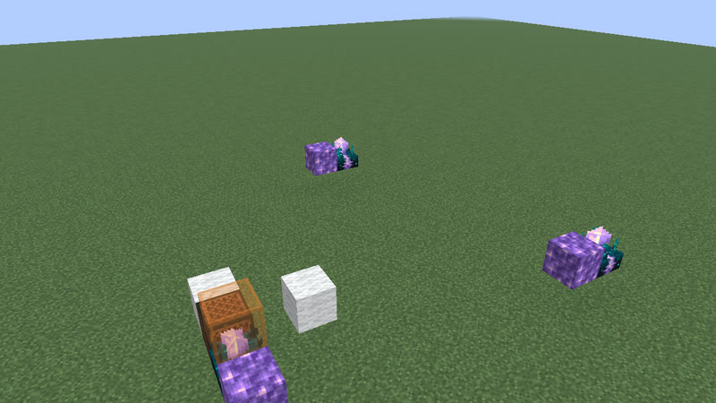</a> 30 gt (1.5 s) · calibrated_sculk_sensor · 9 blocks</td><td align="center"> 30 gt (1.5 s) · comparator+hopper · 10 blocks</td><td align="center"><a href="../archive/kit-shuttle-minecart-p30-11b.txt">kit-shuttle-minecart-p30-11b</a> 30 gt (1.5 s) · detector_rail+minecart · 11 blocks (picture pending)</td></tr>
<tr><td align="center"> 30 gt (1.5 s) · comparator+redstone_torch+repeater · 12 blocks</td><td align="center"> 30 gt (1.5 s) · redstone_torch+repeater · 12 blocks</td><td align="center"> 30 gt (1.5 s) · repeater · 12 blocks</td></tr>
</table>

[catalog index](../CATALOG.md) · previous: [p4-20](p4-20.md) · next: [p31-42](p31-42.md)
