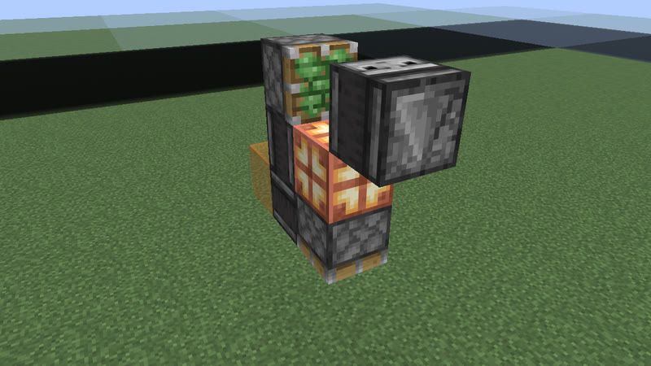

# Clocks: 24 gt (1.2 s) to 35 gt (1.75 s) (289 clock types)

[catalog index](../CATALOG.md) · previous: [p4-23](p4-23.md) · next: [p36-46](p36-46.md)

Orange glass = where the output signal is (placed only for the picture); click a picture for its design. Larger clocks of a period with the same on-time and pulses as a smaller one (whatever their block kinds), and clocks that are not robust, are listed on [variants](variants.md). Generated by `mctas clock catalog`.

## 24 gt (1.2 s)

Also reachable by: clk-obs-obs-ring (n = 4), clk-obs-divider (n = 1), clk-item-snowdisp (n = 2).

<table>
<tr><td align="center"> 24 gt (1.2 s) · calibrated_sculk_sensor+note_block+observer · 3 blocks</td><td align="center"> 24 gt (1.2 s) · calibrated_sculk_sensor+oak_trapdoor+observer · 3 blocks</td><td align="center"> 24 gt (1.2 s) · calibrated_sculk_sensor+oak_fence_gate+observer · 3 blocks</td></tr>
<tr><td align="center"> 24 gt (1.2 s) · calibrated_sculk_sensor+iron_trapdoor+observer · 3 blocks</td><td align="center"> 24 gt (1.2 s) · calibrated_sculk_sensor+oak_trapdoor+observer · 3 blocks</td><td align="center"> 24 gt (1.2 s) · calibrated_sculk_sensor+oak_trapdoor+observer · 3 blocks</td></tr>
<tr><td align="center"> 24 gt (1.2 s) · calibrated_sculk_sensor+observer+piston · 3 blocks also found as census-p24-calibrated_sculk_sensor-observer-sticky_piston-3b (built with sticky_piston, without piston)</td><td align="center"> 24 gt (1.2 s) · calibrated_sculk_sensor+note_block+observer · 3 blocks</td><td align="center"> 24 gt (1.2 s) · calibrated_sculk_sensor+observer+sticky_piston · 3 blocks</td></tr>
<tr><td align="center"> 24 gt (1.2 s) · calibrated_sculk_sensor+dispenser+observer · 4 blocks</td><td align="center"> 24 gt (1.2 s) · observer+sticky_piston · 4 blocks</td><td align="center"> 24 gt (1.2 s) · calibrated_sculk_sensor+dispenser+observer+piston+sticky_piston · 5 blocks</td></tr>
<tr><td align="center"> 24 gt (1.2 s) · copper_bulb+observer+piston · 5 blocks also found as clk-obs-p24-bulb-obs-stk-5b-fe7000 (built with sticky_piston, without piston)</td><td align="center"> 24 gt (1.2 s) · copper_bulb+observer+redstone_block+sticky_piston · 5 blocks</td><td align="center"> 24 gt (1.2 s) · observer+sticky_piston · 5 blocks</td></tr>
<tr><td align="center"> 24 gt (1.2 s) · copper_bulb+observer+piston · 5 blocks also found as clk-obs-p24-bulb-obs-stk-5b-b-b9ef2e (built with sticky_piston, without piston)</td><td align="center"> 24 gt (1.2 s) · note_block+observer+piston+redstone_block+sticky_piston · 5 blocks</td><td align="center"> 24 gt (1.2 s) · note_block+observer+redstone_block+sticky_piston · 5 blocks</td></tr>
<tr><td align="center"> 24 gt (1.2 s) · note_block+observer+piston+redstone_block+sticky_piston · 5 blocks</td><td align="center"> 24 gt (1.2 s) · note_block+observer+redstone_block+sticky_piston · 5 blocks</td><td align="center"> 24 gt (1.2 s) · observer+piston+redstone_block+sticky_piston · 5 blocks</td></tr>
<tr><td align="center"> 24 gt (1.2 s) · observer+piston+redstone_block+sticky_piston · 5 blocks</td><td align="center"> 24 gt (1.2 s) · observer+redstone_block+sticky_piston · 5 blocks</td><td align="center"> 24 gt (1.2 s) · observer+redstone_block+sticky_piston · 5 blocks</td></tr>
<tr><td align="center"> 24 gt (1.2 s) · copper_bulb+note_block+observer+sticky_piston · 6 blocks</td><td align="center"> 24 gt (1.2 s) · observer+piston+redstone_block+redstone_lamp+sticky_piston · 7 blocks</td><td align="center"> 24 gt (1.2 s) · observer+piston · 7 blocks</td></tr>
<tr><td align="center"> 24 gt (1.2 s) · observer+piston+redstone_block+redstone_lamp+sticky_piston · 7 blocks</td><td align="center"> 24 gt (1.2 s) · comparator+redstone_torch+redstone_wire+repeater · 9 blocks</td><td align="center"> 24 gt (1.2 s) · redstone_torch+redstone_wire+repeater · 9 blocks</td></tr>
<tr><td align="center"> 24 gt (1.2 s) · comparator+redstone_torch+repeater · 12 blocks</td><td align="center"> 24 gt (1.2 s) · redstone_torch+repeater · 12 blocks</td><td align="center"> 24 gt (1.2 s) · comparator+repeater · 12 blocks</td></tr>
<tr><td align="center"> 24 gt (1.2 s) · repeater · 12 blocks</td></tr>
</table>

## 25 gt (1.25 s)

Also reachable by: clk-obs-odd-b (n = 3).

<table>
<tr><td align="center"> 25 gt (1.25 s) · calibrated_sculk_sensor+dispenser+note_block+observer · 4 blocks</td><td align="center"> 25 gt (1.25 s) · calibrated_sculk_sensor+dispenser+oak_trapdoor+observer · 4 blocks</td><td align="center"> 25 gt (1.25 s) · calibrated_sculk_sensor+note_block+observer · 4 blocks</td></tr>
<tr><td align="center"> 25 gt (1.25 s) · calibrated_sculk_sensor+oak_trapdoor+observer · 4 blocks</td><td align="center"> 25 gt (1.25 s) · calibrated_sculk_sensor+oak_trapdoor+observer · 4 blocks</td><td align="center"> 25 gt (1.25 s) · calibrated_sculk_sensor+dispenser+observer+piston · 4 blocks also found as census-p25-calibrated_sculk_sensor-dispenser-observer-sticky_piston-4b (built with sticky_piston, without piston)</td></tr>
<tr><td align="center"> 25 gt (1.25 s) · calibrated_sculk_sensor+observer+piston · 4 blocks also found as census-p25-calibrated_sculk_sensor-observer-sticky_piston-4b (built with sticky_piston, without piston)</td><td align="center"> 25 gt (1.25 s) · calibrated_sculk_sensor+note_block+observer · 4 blocks</td><td align="center"><a href="../archive/census-p25-calibrated_sculk_sensor-note_block-observer-sticky_piston-6b.txt">census-p25-calibrated_sculk_sensor-note_block-observer-sticky_piston-6b</a> 25 gt (1.25 s) · calibrated_sculk_sensor+note_block+observer+sticky_piston · 6 blocks (picture pending)</td></tr>
<tr><td align="center"><a href="../archive/clk-obs-p25-lamp-note-obs-pis-stk-7b-bfd422.txt">clk-obs-p25-lamp-note-obs-pis-stk-7b-bfd422</a> 25 gt (1.25 s) · note_block+observer+piston+redstone_lamp+sticky_piston · 7 blocks (picture pending)</td><td align="center"> 25 gt (1.25 s) · note_block+observer+redstone_lamp+sticky_piston · 7 blocks</td><td align="center"> 25 gt (1.25 s) · observer+piston+redstone_lamp+sticky_piston · 7 blocks</td></tr>
<tr><td align="center"> 25 gt (1.25 s) · observer+redstone_lamp+sticky_piston · 7 blocks</td><td align="center"> 25 gt (1.25 s) · note_block+observer+piston+sticky_piston · 7 blocks</td><td align="center"> 25 gt (1.25 s) · note_block+observer+piston+sticky_piston · 7 blocks</td></tr>
<tr><td align="center"> 25 gt (1.25 s) · note_block+observer+sticky_piston · 7 blocks</td><td align="center"> 25 gt (1.25 s) · note_block+observer+sticky_piston · 7 blocks</td><td align="center"> 25 gt (1.25 s) · observer+piston+sticky_piston · 7 blocks</td></tr>
<tr><td align="center"> 25 gt (1.25 s) · observer+piston+sticky_piston · 7 blocks</td><td align="center"> 25 gt (1.25 s) · observer+sticky_piston · 7 blocks</td><td align="center"> 25 gt (1.25 s) · comparator+hopper+redstone_wire+repeater · 9 blocks</td></tr>
<tr><td align="center"><a href="../archive/kit-shuttle-minecart-p25-11b.txt">kit-shuttle-minecart-p25-11b</a> 25 gt (1.25 s) · detector_rail+minecart · 11 blocks (picture pending)</td><td align="center"> 25 gt (1.25 s) · comparator+dropper+hopper+repeater · 16 blocks</td><td align="center"> 25 gt (1.25 s) · repeater · 19 blocks</td></tr>
</table>

## 26 gt (1.3 s)

Also reachable by: observer ring with a relay block (clk-obs-note-ring, n = 4), clk-misc-cart-loop (n = 0), clk-sculk-replin-dispenser (n = 2).

<table>
<tr><td align="center"> 26 gt (1.3 s) · calibrated_sculk_sensor+note_block+observer · 4 blocks</td><td align="center"> 26 gt (1.3 s) · calibrated_sculk_sensor+oak_trapdoor+observer · 4 blocks</td><td align="center"> 26 gt (1.3 s) · calibrated_sculk_sensor+observer+piston · 4 blocks also found as census-p26-calibrated_sculk_sensor-observer-sticky_piston-4b (built with sticky_piston, without piston)</td></tr>
<tr><td align="center"> 26 gt (1.3 s) · calibrated_sculk_sensor+oak_trapdoor+observer · 4 blocks</td><td align="center"> 26 gt (1.3 s) · calibrated_sculk_sensor+oak_fence_gate+observer · 4 blocks</td><td align="center"> 26 gt (1.3 s) · calibrated_sculk_sensor+iron_trapdoor+observer · 4 blocks</td></tr>
<tr><td align="center"> 26 gt (1.3 s) · calibrated_sculk_sensor+note_block+observer · 4 blocks</td><td align="center"> 26 gt (1.3 s) · calibrated_sculk_sensor+dispenser+observer · 5 blocks</td><td align="center"> 26 gt (1.3 s) · copper_bulb+observer+piston+sticky_piston · 5 blocks also found as clk-obs-p26-bulb-obs-pis-5b-288217 (built without sticky_piston), clk-obs-p26-bulb-obs-stk-5b-91a60a (built without piston), clk-obs-p26-bulb-obs-pis-stk-5b-b-1f3b6f</td></tr>
<tr><td align="center"> 26 gt (1.3 s) · copper_bulb+observer+piston · 5 blocks also found as clk-obs-p26-bulb-obs-stk-5b-b-dd2613 (built with sticky_piston, without piston)</td><td align="center"> 26 gt (1.3 s) · observer+piston+redstone_lamp+sticky_piston · 5 blocks</td><td align="center"> 26 gt (1.3 s) · observer+redstone_lamp+sticky_piston · 5 blocks</td></tr>
<tr><td align="center"> 26 gt (1.3 s) · observer+piston+sticky_piston · 5 blocks</td><td align="center"> 26 gt (1.3 s) · observer+piston+sticky_piston · 5 blocks</td><td align="center"> 26 gt (1.3 s) · observer+sticky_piston · 5 blocks</td></tr>
<tr><td align="center"> 26 gt (1.3 s) · observer+sticky_piston · 5 blocks</td><td align="center"> 26 gt (1.3 s) · observer+piston+redstone_block+sticky_piston · 5 blocks</td><td align="center"> 26 gt (1.3 s) · observer+redstone_block+sticky_piston · 5 blocks</td></tr>
<tr><td align="center"> 26 gt (1.3 s) · observer+piston+redstone_block+sticky_piston · 5 blocks</td><td align="center"> 26 gt (1.3 s) · observer+redstone_block+sticky_piston · 5 blocks</td><td align="center"> 26 gt (1.3 s) · observer+redstone_lamp · 6 blocks</td></tr>
<tr><td align="center"> 26 gt (1.3 s) · copper_bulb+note_block+observer+piston+sticky_piston · 6 blocks also found as clk-obs-p26-bulb-note-obs-stk-6b-c1cd29 (built without piston), clk-obs-p26-bulb-note-obs-pis-6b-a675d2 (built without sticky_piston)</td><td align="center"> 26 gt (1.3 s) · copper_bulb+observer+piston+redstone_block+sticky_piston · 6 blocks</td><td align="center"> 26 gt (1.3 s) · copper_bulb+observer+redstone_block+sticky_piston · 6 blocks</td></tr>
<tr><td align="center"> 26 gt (1.3 s) · note_block+observer+piston+redstone_block+sticky_piston · 6 blocks</td><td align="center"> 26 gt (1.3 s) · note_block+observer+piston+sticky_piston · 6 blocks</td><td align="center"> 26 gt (1.3 s) · note_block+observer+piston+sticky_piston · 6 blocks</td></tr>
<tr><td align="center"> 26 gt (1.3 s) · note_block+observer+redstone_block+sticky_piston · 6 blocks</td><td align="center"> 26 gt (1.3 s) · note_block+observer+sticky_piston · 6 blocks</td><td align="center"> 26 gt (1.3 s) · observer+piston+redstone_block+redstone_lamp+sticky_piston · 7 blocks</td></tr>
<tr><td align="center"> 26 gt (1.3 s) · observer+redstone_block+redstone_lamp+sticky_piston · 7 blocks</td><td align="center"> 26 gt (1.3 s) · comparator+redstone_torch+repeater · 12 blocks</td><td align="center"> 26 gt (1.3 s) · redstone_torch+redstone_wire+repeater · 12 blocks</td></tr>
<tr><td align="center"> 26 gt (1.3 s) · comparator+repeater · 12 blocks</td><td align="center"> 26 gt (1.3 s) · comparator+dropper+hopper+repeater · 16 blocks</td></tr>
</table>

## 27 gt (1.35 s)

Also reachable by: clk-obs-odd-a (n = 4), dropper ring (clk-item-dropring-1d, n = 0).

<table>
<tr><td align="center"> 27 gt (1.35 s) · calibrated_sculk_sensor+note_block+observer · 4 blocks</td><td align="center"> 27 gt (1.35 s) · calibrated_sculk_sensor+oak_trapdoor+observer · 4 blocks</td><td align="center"> 27 gt (1.35 s) · calibrated_sculk_sensor+oak_trapdoor+observer · 4 blocks</td></tr>
<tr><td align="center"> 27 gt (1.35 s) · calibrated_sculk_sensor+oak_fence_gate+observer · 4 blocks</td><td align="center"> 27 gt (1.35 s) · calibrated_sculk_sensor+iron_trapdoor+observer · 4 blocks</td><td align="center"> 27 gt (1.35 s) · calibrated_sculk_sensor+observer+piston · 4 blocks also found as census-p27-calibrated_sculk_sensor-observer-sticky_piston-4b (built with sticky_piston, without piston)</td></tr>
<tr><td align="center"> 27 gt (1.35 s) · calibrated_sculk_sensor+note_block+observer · 4 blocks</td><td align="center"> 27 gt (1.35 s) · observer+piston+sticky_piston · 5 blocks</td><td align="center"> 27 gt (1.35 s) · observer+piston+sticky_piston · 5 blocks</td></tr>
<tr><td align="center"> 27 gt (1.35 s) · observer+sticky_piston · 5 blocks</td><td align="center"> 27 gt (1.35 s) · observer+sticky_piston · 5 blocks</td><td align="center"> 27 gt (1.35 s) · calibrated_sculk_sensor+dispenser+observer+piston · 5 blocks also found as clk-sculk-hyb3b-p27-3 (built with sticky_piston, without piston)</td></tr>
<tr><td align="center"><a href="../archive/clk-obs-p27-lamp-obs-stk-7b-94fb6f.txt">clk-obs-p27-lamp-obs-stk-7b-94fb6f</a> 27 gt (1.35 s) · observer+redstone_lamp+sticky_piston · 7 blocks (picture pending)</td><td align="center"> 27 gt (1.35 s) · repeater · 19 blocks</td></tr>
</table>

## 28 gt (1.4 s)

Also reachable by: clk-obs-obs-ring (n = 5), hopper ring (clk-item-hopper-ring, n = 1), clk-obs-bulb-ring (n = 1).

<table>
<tr><td align="center"> 28 gt (1.4 s) · calibrated_sculk_sensor+dispenser+observer · 3 blocks</td><td align="center"> 28 gt (1.4 s) · calibrated_sculk_sensor+dispenser+observer · 3 blocks</td><td align="center"> 28 gt (1.4 s) · calibrated_sculk_sensor+dispenser+observer · 3 blocks</td></tr>
<tr><td align="center"> 28 gt (1.4 s) · observer+sticky_piston · 5 blocks</td><td align="center"> 28 gt (1.4 s) · copper_bulb+observer+piston+sticky_piston · 6 blocks</td><td align="center"> 28 gt (1.4 s) · copper_bulb+observer+sticky_piston · 6 blocks</td></tr>
<tr><td align="center"> 28 gt (1.4 s) · note_block+observer+sticky_piston · 6 blocks</td><td align="center"> 28 gt (1.4 s) · observer+piston · 6 blocks</td><td align="center"> 28 gt (1.4 s) · copper_bulb+observer+piston · 6 blocks</td></tr>
<tr><td align="center"> 28 gt (1.4 s) · copper_bulb+observer+piston+sticky_piston · 6 blocks</td><td align="center"> 28 gt (1.4 s) · copper_bulb+note_block+observer+redstone_block+redstone_lamp+sticky_piston · 7 blocks</td><td align="center"> 28 gt (1.4 s) · copper_bulb+note_block+observer+redstone_lamp+sticky_piston · 7 blocks</td></tr>
<tr><td align="center"> 28 gt (1.4 s) · copper_bulb+observer+redstone_block+redstone_lamp+sticky_piston · 7 blocks</td><td align="center"> 28 gt (1.4 s) · note_block+observer+piston+redstone_lamp+sticky_piston · 7 blocks</td><td align="center"> 28 gt (1.4 s) · note_block+observer+piston+redstone_lamp+sticky_piston · 7 blocks</td></tr>
<tr><td align="center"> 28 gt (1.4 s) · note_block+observer+redstone_lamp+sticky_piston · 7 blocks</td><td align="center"> 28 gt (1.4 s) · note_block+observer+redstone_lamp+sticky_piston · 7 blocks</td><td align="center"> 28 gt (1.4 s) · observer+piston+redstone_lamp+sticky_piston · 7 blocks</td></tr>
<tr><td align="center"> 28 gt (1.4 s) · observer+piston+redstone_lamp+sticky_piston · 7 blocks</td><td align="center"> 28 gt (1.4 s) · observer+redstone_lamp+sticky_piston · 7 blocks</td><td align="center"> 28 gt (1.4 s) · observer+redstone_lamp+sticky_piston · 7 blocks</td></tr>
<tr><td align="center"> 28 gt (1.4 s) · redstone_torch+redstone_wire+repeater · 9 blocks</td><td align="center"> 28 gt (1.4 s) · copper_bulb+observer · 10 blocks</td><td align="center"> 28 gt (1.4 s) · comparator+redstone_torch+repeater · 12 blocks</td></tr>
<tr><td align="center"> 28 gt (1.4 s) · repeater · 12 blocks</td><td align="center"><a href="../archive/kit-shuttle-minecart-p28-13b.txt">kit-shuttle-minecart-p28-13b</a> 28 gt (1.4 s) · detector_rail+minecart · 13 blocks (picture pending)</td><td align="center"> 28 gt (1.4 s) · comparator+repeater · 16 blocks</td></tr>
<tr><td align="center"> 28 gt (1.4 s) · comparator+dropper+hopper+repeater · 16 blocks</td><td align="center"><a href="../archive/clk-misc-bookshelf-cart-b2.txt">clk-misc-bookshelf-cart-b2</a> 28 gt (1.4 s) · chiseled_bookshelf+hopper+hopper_minecart · 20 blocks (picture pending)</td></tr>
</table>

## 29 gt (1.45 s)

Also reachable by: clk-obs-odd-b (n = 4).

<table>
<tr><td align="center"> 29 gt (1.45 s) · calibrated_sculk_sensor+dispenser+observer · 4 blocks</td><td align="center"> 29 gt (1.45 s) · calibrated_sculk_sensor+dispenser+observer · 4 blocks</td><td align="center"> 29 gt (1.45 s) · calibrated_sculk_sensor+dispenser+observer · 4 blocks</td></tr>
<tr><td align="center"><a href="../archive/clk-obs-p29-obs-pis-7b-a4b644.txt">clk-obs-p29-obs-pis-7b-a4b644</a> 29 gt (1.45 s) · observer+piston · 7 blocks (picture pending)</td><td align="center"><a href="../archive/clk-obs-p29-obs-pis-rb-stk-7b-bcb56d.txt">clk-obs-p29-obs-pis-rb-stk-7b-bcb56d</a> 29 gt (1.45 s) · observer+piston+redstone_block+sticky_piston · 7 blocks (picture pending)</td><td align="center"><a href="../archive/clk-obs-p29-obs-rb-stk-7b-e44e24.txt">clk-obs-p29-obs-rb-stk-7b-e44e24</a> 29 gt (1.45 s) · observer+redstone_block+sticky_piston · 7 blocks (picture pending)</td></tr>
<tr><td align="center"> 29 gt (1.45 s) · note_block+observer+redstone_block+redstone_lamp+sticky_piston · 7 blocks</td><td align="center"> 29 gt (1.45 s) · note_block+observer+redstone_lamp+sticky_piston · 7 blocks</td><td align="center"> 29 gt (1.45 s) · note_block+observer+redstone_lamp+sticky_piston · 7 blocks</td></tr>
<tr><td align="center"> 29 gt (1.45 s) · observer+redstone_block+redstone_lamp+sticky_piston · 7 blocks</td><td align="center"> 29 gt (1.45 s) · observer+redstone_block+redstone_lamp+sticky_piston · 7 blocks</td><td align="center"> 29 gt (1.45 s) · observer+redstone_lamp+sticky_piston · 7 blocks</td></tr>
<tr><td align="center"> 29 gt (1.45 s) · observer+redstone_lamp+sticky_piston · 7 blocks</td><td align="center"> 29 gt (1.45 s) · note_block+observer+sticky_piston · 7 blocks</td><td align="center"> 29 gt (1.45 s) · note_block+observer+sticky_piston · 7 blocks</td></tr>
<tr><td align="center"> 29 gt (1.45 s) · observer+sticky_piston · 7 blocks</td><td align="center"> 29 gt (1.45 s) · observer+sticky_piston · 7 blocks</td><td align="center"> 29 gt (1.45 s) · copper_bulb+observer+sticky_piston · 7 blocks</td></tr>
<tr><td align="center"> 29 gt (1.45 s) · copper_bulb+observer+sticky_piston · 7 blocks</td><td align="center"><a href="../archive/clk-obs-p29-note-obs-rb-stk-8b-ff455c.txt">clk-obs-p29-note-obs-rb-stk-8b-ff455c</a> 29 gt (1.45 s) · note_block+observer+redstone_block+sticky_piston · 8 blocks (picture pending)</td><td align="center"><a href="../archive/kit-shuttle-minecart-p29-13b.txt">kit-shuttle-minecart-p29-13b</a> 29 gt (1.45 s) · detector_rail+minecart · 13 blocks (picture pending)</td></tr>
<tr><td align="center"> 29 gt (1.45 s) · comparator+dropper+hopper+repeater · 14 blocks</td><td align="center"> 29 gt (1.45 s) · repeater · 20 blocks</td></tr>
</table>

## 30 gt (1.5 s)

Also reachable by: observer ring with a relay block (clk-obs-note-ring, n = 5), clk-item-latch (n = 0).

<table>
<tr><td align="center"> 30 gt (1.5 s) · calibrated_sculk_sensor+dispenser+observer · 4 blocks</td><td align="center"> 30 gt (1.5 s) · calibrated_sculk_sensor+dispenser+observer · 4 blocks</td><td align="center"> 30 gt (1.5 s) · observer+redstone_block+sticky_piston · 6 blocks</td></tr>
<tr><td align="center"> 30 gt (1.5 s) · observer+sticky_piston · 6 blocks</td><td align="center"> 30 gt (1.5 s) · observer+sticky_piston · 6 blocks</td><td align="center"> 30 gt (1.5 s) · observer+sticky_piston · 6 blocks</td></tr>
<tr><td align="center"> 30 gt (1.5 s) · note_block+observer+sticky_piston · 6 blocks</td><td align="center"> 30 gt (1.5 s) · observer+redstone_block+sticky_piston · 6 blocks</td><td align="center"> 30 gt (1.5 s) · copper_bulb+observer+redstone_block+sticky_piston · 6 blocks</td></tr>
<tr><td align="center"> 30 gt (1.5 s) · copper_bulb+observer+redstone_block+sticky_piston · 6 blocks</td><td align="center"> 30 gt (1.5 s) · observer+redstone_lamp+sticky_piston · 6 blocks</td><td align="center"> 30 gt (1.5 s) · note_block+observer+sticky_piston · 6 blocks</td></tr>
<tr><td align="center"> 30 gt (1.5 s) · note_block+observer+piston+redstone_lamp+sticky_piston · 7 blocks</td><td align="center"> 30 gt (1.5 s) · note_block+observer+redstone_lamp+sticky_piston · 7 blocks</td><td align="center"><a href="../archive/clk-obs-p30-lamp-obs-pis-7b-5c5b87.txt">clk-obs-p30-lamp-obs-pis-7b-5c5b87</a> 30 gt (1.5 s) · observer+piston+redstone_lamp · 7 blocks (picture pending)</td></tr>
<tr><td align="center"> 30 gt (1.5 s) · observer+piston+redstone_lamp+sticky_piston · 7 blocks</td><td align="center"> 30 gt (1.5 s) · observer+redstone_lamp+sticky_piston · 7 blocks</td><td align="center"> 30 gt (1.5 s) · note_block+observer+piston+sticky_piston · 7 blocks</td></tr>
<tr><td align="center"> 30 gt (1.5 s) · note_block+observer+piston+sticky_piston · 7 blocks</td><td align="center"> 30 gt (1.5 s) · observer+piston+sticky_piston · 7 blocks</td><td align="center"> 30 gt (1.5 s) · observer+piston+sticky_piston · 7 blocks</td></tr>
<tr><td align="center"><a href="../archive/clk-obs-p30-bulb-lamp-note-obs-pis-7b-f8ce3d.txt">clk-obs-p30-bulb-lamp-note-obs-pis-7b-f8ce3d</a> 30 gt (1.5 s) · copper_bulb+note_block+observer+piston+redstone_lamp · 7 blocks (picture pending)</td><td align="center"><a href="../archive/clk-obs-p30-bulb-lamp-obs-pis-7b-b7f86f.txt">clk-obs-p30-bulb-lamp-obs-pis-7b-b7f86f</a> 30 gt (1.5 s) · copper_bulb+observer+piston+redstone_lamp · 7 blocks (picture pending)</td><td align="center"> 30 gt (1.5 s) · copper_bulb+note_block+observer+redstone_block+redstone_lamp+sticky_piston · 7 blocks</td></tr>
<tr><td align="center"><a href="../archive/clk-obs-p30-note-obs-pis-rb-stk-7b-173fa7.txt">clk-obs-p30-note-obs-pis-rb-stk-7b-173fa7</a> 30 gt (1.5 s) · note_block+observer+piston+redstone_block+sticky_piston · 7 blocks (picture pending)</td><td align="center"> 30 gt (1.5 s) · observer+piston · 7 blocks</td><td align="center"> 30 gt (1.5 s) · comparator+hopper · 10 blocks</td></tr>
<tr><td align="center"><a href="../archive/kit-shuttle-minecart-p30-11b.txt">kit-shuttle-minecart-p30-11b</a> 30 gt (1.5 s) · detector_rail+minecart · 11 blocks (picture pending)</td><td align="center"> 30 gt (1.5 s) · redstone_torch+repeater · 12 blocks</td><td align="center"> 30 gt (1.5 s) · repeater · 12 blocks</td></tr>
<tr><td align="center"> 30 gt (1.5 s) · comparator+repeater · 16 blocks</td></tr>
</table>

## 31 gt (1.55 s)

Also reachable by: clk-obs-odd-a (n = 5), clk-rt-odd-rect (n = 1), clk-misc-cart-loop (n = 1), dropper ring (clk-item-dropring-2d-r2, n = 0), clk-sculk-replin (one block swapped: 2 versions) (clk-sculk-replin, n = 3).

<table>
<tr><td align="center"> 31 gt (1.55 s) · calibrated_sculk_sensor+dispenser+observer · 4 blocks</td><td align="center"> 31 gt (1.55 s) · calibrated_sculk_sensor+dispenser+observer · 4 blocks</td><td align="center"> 31 gt (1.55 s) · calibrated_sculk_sensor+dispenser+observer · 4 blocks</td></tr>
<tr><td align="center"> 31 gt (1.55 s) · observer+piston+sticky_piston · 7 blocks</td><td align="center"> 31 gt (1.55 s) · observer+sticky_piston · 7 blocks</td><td align="center"> 31 gt (1.55 s) · observer+sticky_piston · 7 blocks</td></tr>
<tr><td align="center"><a href="../archive/clk-obs-p31-lamp-obs-rb-stk-8b-998f1e.txt">clk-obs-p31-lamp-obs-rb-stk-8b-998f1e</a> 31 gt (1.55 s) · observer+redstone_block+redstone_lamp+sticky_piston · 8 blocks (picture pending)</td><td align="center"><a href="../archive/clk-obs-p31-lamp-note-obs-stk-8b-e4aa1e.txt">clk-obs-p31-lamp-note-obs-stk-8b-e4aa1e</a> 31 gt (1.55 s) · note_block+observer+redstone_lamp+sticky_piston · 8 blocks (picture pending)</td></tr>
</table>

## 32 gt (1.6 s)

Also reachable by: clk-obs-obs-ring (n = 6), clk-rt-rect-pulse (n = 0).

<table>
<tr><td align="center"> 32 gt (1.6 s) · calibrated_sculk_sensor+dispenser+observer · 5 blocks</td><td align="center"> 32 gt (1.6 s) · copper_bulb+observer+redstone_block+sticky_piston · 6 blocks</td><td align="center"> 32 gt (1.6 s) · copper_bulb+observer+sticky_piston · 6 blocks</td></tr>
<tr><td align="center"> 32 gt (1.6 s) · observer+sticky_piston · 6 blocks</td><td align="center"> 32 gt (1.6 s) · note_block+observer+redstone_lamp+sticky_piston · 6 blocks</td><td align="center"> 32 gt (1.6 s) · observer+redstone_lamp+sticky_piston · 6 blocks</td></tr>
<tr><td align="center"> 32 gt (1.6 s) · observer+redstone_lamp+sticky_piston · 6 blocks</td><td align="center"> 32 gt (1.6 s) · observer+piston+redstone_block+sticky_piston · 6 blocks</td><td align="center"> 32 gt (1.6 s) · observer+sticky_piston · 6 blocks</td></tr>
<tr><td align="center"> 32 gt (1.6 s) · observer+sticky_piston · 6 blocks</td><td align="center"> 32 gt (1.6 s) · observer+redstone_block+sticky_piston · 6 blocks</td><td align="center"> 32 gt (1.6 s) · observer+redstone_block+sticky_piston · 6 blocks</td></tr>
<tr><td align="center"> 32 gt (1.6 s) · copper_bulb+observer+piston+redstone_block+sticky_piston · 6 blocks</td><td align="center"> 32 gt (1.6 s) · copper_bulb+observer+piston+redstone_block+sticky_piston · 6 blocks</td><td align="center"> 32 gt (1.6 s) · copper_bulb+observer+redstone_block+sticky_piston · 6 blocks</td></tr>
<tr><td align="center"> 32 gt (1.6 s) · note_block+observer+redstone_lamp+sticky_piston · 6 blocks</td><td align="center"> 32 gt (1.6 s) · note_block+observer+sticky_piston · 6 blocks</td><td align="center"><a href="../archive/clk-obs-p32-bulb-lamp-obs-pis-8b-dd8b1d.txt">clk-obs-p32-bulb-lamp-obs-pis-8b-dd8b1d</a> 32 gt (1.6 s) · copper_bulb+observer+piston+redstone_lamp · 8 blocks (picture pending)</td></tr>
<tr><td align="center"><a href="../archive/clk-obs-p32-bulb-lamp-obs-pis-stk-8b-6d442b.txt">clk-obs-p32-bulb-lamp-obs-pis-stk-8b-6d442b</a> 32 gt (1.6 s) · copper_bulb+observer+piston+redstone_lamp+sticky_piston · 8 blocks (picture pending)</td><td align="center"><a href="../archive/clk-obs-p32-bulb-note-obs-pis-stk-8b-1a4eed.txt">clk-obs-p32-bulb-note-obs-pis-stk-8b-1a4eed</a> 32 gt (1.6 s) · copper_bulb+note_block+observer+piston+sticky_piston · 8 blocks (picture pending)</td><td align="center"> 32 gt (1.6 s) · redstone_torch+repeater · 12 blocks</td></tr>
<tr><td align="center"> 32 gt (1.6 s) · comparator+repeater · 16 blocks</td><td align="center"> 32 gt (1.6 s) · comparator+dropper+hopper+repeater · 18 blocks</td></tr>
</table>

## 33 gt (1.65 s)

Also reachable by: clk-obs-odd-b (n = 5), dropper ring (clk-item-dropring-2d-r3, n = 0), lock ring (clk-item-lockring-2s, n = 0).

<table>
<tr><td align="center"> 33 gt (1.65 s) · calibrated_sculk_sensor+note_block+observer · 6 blocks</td><td align="center"><a href="../archive/clk-obs-p33-lamp-note-obs-pis-stk-7b-1526c7.txt">clk-obs-p33-lamp-note-obs-pis-stk-7b-1526c7</a> 33 gt (1.65 s) · note_block+observer+piston+redstone_lamp+sticky_piston · 7 blocks (picture pending)</td><td align="center"><a href="../archive/clk-obs-p33-lamp-obs-pis-stk-7b-0cb9b7.txt">clk-obs-p33-lamp-obs-pis-stk-7b-0cb9b7</a> 33 gt (1.65 s) · observer+piston+redstone_lamp+sticky_piston · 7 blocks (picture pending)</td></tr>
<tr><td align="center"> 33 gt (1.65 s) · note_block+observer+redstone_lamp+sticky_piston · 7 blocks</td><td align="center"> 33 gt (1.65 s) · note_block+observer+redstone_lamp+sticky_piston · 7 blocks</td><td align="center"> 33 gt (1.65 s) · observer+redstone_lamp+sticky_piston · 7 blocks</td></tr>
<tr><td align="center"> 33 gt (1.65 s) · observer+redstone_lamp+sticky_piston · 7 blocks</td><td align="center"><a href="../archive/clk-obs-p33-obs-pis-stk-7b-350f07.txt">clk-obs-p33-obs-pis-stk-7b-350f07</a> 33 gt (1.65 s) · observer+piston+sticky_piston · 7 blocks (picture pending)</td><td align="center"><a href="../archive/clk-obs-p33-note-obs-pis-stk-7b-16134f.txt">clk-obs-p33-note-obs-pis-stk-7b-16134f</a> 33 gt (1.65 s) · note_block+observer+piston+sticky_piston · 7 blocks (picture pending)</td></tr>
<tr><td align="center"> 33 gt (1.65 s) · note_block+observer+sticky_piston · 7 blocks</td><td align="center"> 33 gt (1.65 s) · note_block+observer+sticky_piston · 7 blocks</td><td align="center"> 33 gt (1.65 s) · observer+sticky_piston · 7 blocks</td></tr>
<tr><td align="center"><a href="../archive/clk-obs-p33-obs-pis-rb-stk-8b-d06edf.txt">clk-obs-p33-obs-pis-rb-stk-8b-d06edf</a> 33 gt (1.65 s) · observer+piston+redstone_block+sticky_piston · 8 blocks (picture pending)</td><td align="center"><a href="../archive/clk-obs-p33-obs-rb-stk-8b-75eb12.txt">clk-obs-p33-obs-rb-stk-8b-75eb12</a> 33 gt (1.65 s) · observer+redstone_block+sticky_piston · 8 blocks (picture pending)</td><td align="center"><a href="../archive/clk-obs-p33-lamp-obs-rb-stk-8b-f9cde9.txt">clk-obs-p33-lamp-obs-rb-stk-8b-f9cde9</a> 33 gt (1.65 s) · observer+redstone_block+redstone_lamp+sticky_piston · 8 blocks (picture pending)</td></tr>
<tr><td align="center"><a href="../archive/clk-obs-p33-note-obs-rb-stk-8b-15d807.txt">clk-obs-p33-note-obs-rb-stk-8b-15d807</a> 33 gt (1.65 s) · note_block+observer+redstone_block+sticky_piston · 8 blocks (picture pending)</td><td align="center"><a href="../archive/kit-shuttle-minecart-p33-13b.txt">kit-shuttle-minecart-p33-13b</a> 33 gt (1.65 s) · detector_rail+minecart · 13 blocks (picture pending)</td><td align="center"> 33 gt (1.65 s) · repeater · 23 blocks</td></tr>
</table>

## 34 gt (1.7 s)

Also reachable by: observer ring with a relay block (clk-obs-note-ring, n = 6), dropper ring (clk-item-dropring-2d, n = 0).

<table>
<tr><td align="center"> 34 gt (1.7 s) · calibrated_sculk_sensor+dispenser+observer · 6 blocks</td><td align="center"> 34 gt (1.7 s) · copper_bulb+note_block+observer+redstone_block+sticky_piston · 7 blocks</td><td align="center"> 34 gt (1.7 s) · copper_bulb+note_block+observer+redstone_block+sticky_piston · 7 blocks</td></tr>
<tr><td align="center"> 34 gt (1.7 s) · copper_bulb+note_block+observer+sticky_piston · 7 blocks</td><td align="center"> 34 gt (1.7 s) · copper_bulb+note_block+observer+sticky_piston · 7 blocks</td><td align="center"> 34 gt (1.7 s) · copper_bulb+observer+piston+sticky_piston · 7 blocks</td></tr>
<tr><td align="center"> 34 gt (1.7 s) · copper_bulb+observer+piston+sticky_piston · 7 blocks</td><td align="center"> 34 gt (1.7 s) · copper_bulb+observer+redstone_block+sticky_piston · 7 blocks</td><td align="center"> 34 gt (1.7 s) · copper_bulb+observer+redstone_block+sticky_piston · 7 blocks</td></tr>
<tr><td align="center"> 34 gt (1.7 s) · copper_bulb+observer+sticky_piston · 7 blocks</td><td align="center"> 34 gt (1.7 s) · copper_bulb+observer+sticky_piston · 7 blocks</td><td align="center"><a href="../archive/clk-obs-p34-bulb-obs-pis-rb-stk-7b-45aeda.txt">clk-obs-p34-bulb-obs-pis-rb-stk-7b-45aeda</a> 34 gt (1.7 s) · copper_bulb+observer+piston+redstone_block+sticky_piston · 7 blocks (picture pending)</td></tr>
<tr><td align="center"><a href="../archive/clk-obs-p34-bulb-lamp-obs-pis-stk-7b-940e32.txt">clk-obs-p34-bulb-lamp-obs-pis-stk-7b-940e32</a> 34 gt (1.7 s) · copper_bulb+observer+piston+redstone_lamp+sticky_piston · 7 blocks (picture pending)</td><td align="center"> 34 gt (1.7 s) · copper_bulb+observer+redstone_block+redstone_lamp+sticky_piston · 7 blocks</td><td align="center"> 34 gt (1.7 s) · copper_bulb+observer+redstone_block+redstone_lamp+sticky_piston · 7 blocks</td></tr>
<tr><td align="center"> 34 gt (1.7 s) · copper_bulb+observer+redstone_lamp+sticky_piston · 7 blocks</td><td align="center"> 34 gt (1.7 s) · copper_bulb+observer+redstone_lamp+sticky_piston · 7 blocks</td><td align="center"> 34 gt (1.7 s) · observer+piston+redstone_lamp+sticky_piston · 7 blocks</td></tr>
<tr><td align="center"> 34 gt (1.7 s) · observer+piston+redstone_lamp+sticky_piston · 7 blocks</td><td align="center"> 34 gt (1.7 s) · observer+redstone_lamp+sticky_piston · 7 blocks</td><td align="center"> 34 gt (1.7 s) · note_block+observer+piston+sticky_piston · 7 blocks</td></tr>
<tr><td align="center"> 34 gt (1.7 s) · note_block+observer+piston+sticky_piston · 7 blocks</td><td align="center"> 34 gt (1.7 s) · note_block+observer+redstone_block+sticky_piston · 7 blocks</td><td align="center"> 34 gt (1.7 s) · note_block+observer+sticky_piston · 7 blocks</td></tr>
<tr><td align="center"> 34 gt (1.7 s) · note_block+observer+sticky_piston · 7 blocks</td><td align="center"> 34 gt (1.7 s) · observer+piston+sticky_piston · 7 blocks</td><td align="center"> 34 gt (1.7 s) · observer+piston+sticky_piston · 7 blocks</td></tr>
<tr><td align="center"> 34 gt (1.7 s) · observer+redstone_block+sticky_piston · 7 blocks</td><td align="center"> 34 gt (1.7 s) · observer+redstone_block+sticky_piston · 7 blocks</td><td align="center"> 34 gt (1.7 s) · observer+sticky_piston · 7 blocks</td></tr>
<tr><td align="center"> 34 gt (1.7 s) · observer+sticky_piston · 7 blocks</td><td align="center"> 34 gt (1.7 s) · observer+piston+redstone_block+sticky_piston · 7 blocks</td><td align="center"> 34 gt (1.7 s) · observer+piston+redstone_block+sticky_piston · 7 blocks</td></tr>
<tr><td align="center"> 34 gt (1.7 s) · note_block+observer+piston+redstone_block+sticky_piston · 7 blocks</td><td align="center"> 34 gt (1.7 s) · note_block+observer+piston+redstone_block+sticky_piston · 7 blocks</td><td align="center"> 34 gt (1.7 s) · note_block+observer+redstone_block+sticky_piston · 7 blocks</td></tr>
<tr><td align="center"><a href="../archive/clk-obs-p34-lamp-note-obs-stk-7b-46b823.txt">clk-obs-p34-lamp-note-obs-stk-7b-46b823</a> 34 gt (1.7 s) · note_block+observer+redstone_lamp+sticky_piston · 7 blocks (picture pending)</td><td align="center"> 34 gt (1.7 s) · redstone_torch+repeater · 12 blocks</td><td align="center"><a href="../archive/kit-shuttle-minecart-p34-15b.txt">kit-shuttle-minecart-p34-15b</a> 34 gt (1.7 s) · detector_rail+minecart · 15 blocks (picture pending)</td></tr>
<tr><td align="center"> 34 gt (1.7 s) · redstone_wire+repeater · 16 blocks</td><td align="center"> 34 gt (1.7 s) · comparator+repeater · 16 blocks</td></tr>
</table>

## 35 gt (1.75 s)

Also reachable by: clk-obs-odd-a (n = 6), hopper ring (clk-item-hopper-ring-2, n = 4), clk-sculk-replin-dispenser (n = 3), dropper ring (clk-item-dropring-2d-r4, n = 0), lock ring (clk-item-lockring-2s, n = 1), clk-sculk-hairpin (one block swapped: 2 versions) (clk-sculk-hairpin, n = 2).

<table>
<tr><td align="center"> 35 gt (1.75 s) · observer+piston+redstone_block+sticky_piston · 6 blocks</td><td align="center"> 35 gt (1.75 s) · observer+redstone_block+sticky_piston · 6 blocks</td><td align="center"> 35 gt (1.75 s) · observer+piston+redstone_block+sticky_piston · 6 blocks</td></tr>
<tr><td align="center"> 35 gt (1.75 s) · observer+redstone_block+sticky_piston · 6 blocks</td><td align="center"> 35 gt (1.75 s) · calibrated_sculk_sensor+note_block · 6 blocks</td><td align="center"> 35 gt (1.75 s) · observer+sticky_piston · 7 blocks</td></tr>
<tr><td align="center"> 35 gt (1.75 s) · observer+piston+sticky_piston · 7 blocks</td><td align="center"><a href="../archive/kit-shuttle-minecart-p35-15b.txt">kit-shuttle-minecart-p35-15b</a> 35 gt (1.75 s) · detector_rail+minecart · 15 blocks (picture pending)</td><td align="center"> 35 gt (1.75 s) · repeater · 23 blocks</td></tr>
</table>

[catalog index](../CATALOG.md) · previous: [p4-23](p4-23.md) · next: [p36-46](p36-46.md)
