# Clocks: 28 gt (1.4 s) to 51 gt (2.55 s) (293 clock types)

[catalog index](../CATALOG.md) · previous: [p4-27](p4-27.md) · next: [p52-107](p52-107.md)

Orange glass = where the output signal is (placed only for the picture); click a picture for its design. Larger clocks of a period with the same on-time and pulses as a smaller one (whatever their block kinds), and clocks that are not robust, are listed on [variants](variants.md). Generated by `mctas clock catalog`.

## 28 gt (1.4 s)

Also reachable by: clk-obs-obs-ring (n = 5), hopper ring (clk-item-hopper-ring, n = 1), clk-obs-bulb-ring (n = 1).

<table>
<tr><td align="center"> 28 gt (1.4 s) · calibrated_sculk_sensor+dispenser+observer · 3 blocks</td><td align="center"> 28 gt (1.4 s) · calibrated_sculk_sensor+dispenser+observer · 3 blocks</td><td align="center"> 28 gt (1.4 s) · copper_bulb+observer+sticky_piston · 6 blocks</td></tr>
<tr><td align="center"> 28 gt (1.4 s) · copper_bulb+note_block+observer+redstone_block+redstone_lamp+sticky_piston · 7 blocks</td><td align="center"> 28 gt (1.4 s) · copper_bulb+observer+redstone_block+redstone_lamp+sticky_piston · 7 blocks</td><td align="center"><a href="../archive/clk-obs-p28-bulb-obs-pis-rb-stk-7b-b-754ef9.txt">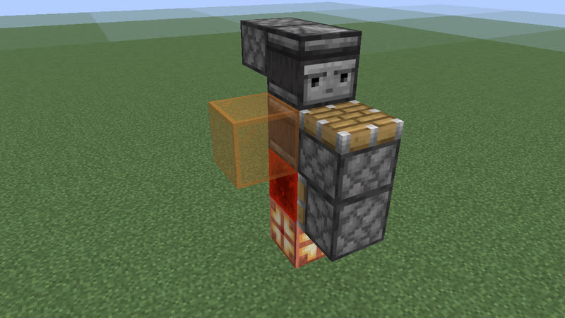</a> 28 gt (1.4 s) · copper_bulb+observer+piston+redstone_block+sticky_piston · 7 blocks</td></tr>
<tr><td align="center"><a href="../archive/clk-obs-p28-bulb-obs-rb-stk-7b-b-d66fd7.txt">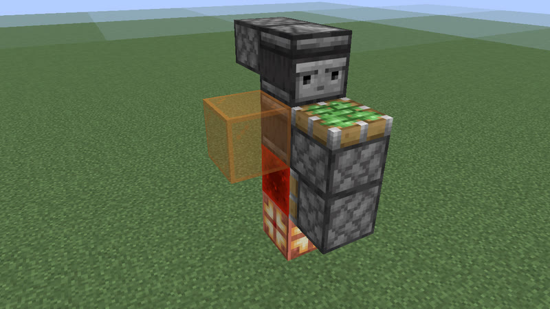</a> 28 gt (1.4 s) · copper_bulb+observer+redstone_block+sticky_piston · 7 blocks</td><td align="center"> 28 gt (1.4 s) · observer+piston · 7 blocks</td><td align="center"><a href="../archive/clk-obs-p28-bulb-note-obs-pis-rb-stk-8b-1e9eb5.txt">clk-obs-p28-bulb-note-obs-pis-rb-stk-8b-1e9eb5</a> 28 gt (1.4 s) · copper_bulb+note_block+observer+piston+redstone_block+sticky_piston · 8 blocks (picture pending)</td></tr>
<tr><td align="center"> 28 gt (1.4 s) · redstone_torch+redstone_wire+repeater · 9 blocks</td><td align="center"> 28 gt (1.4 s) · comparator+redstone_torch+repeater · 12 blocks</td><td align="center"> 28 gt (1.4 s) · repeater · 12 blocks</td></tr>
<tr><td align="center"><a href="../archive/kit-shuttle-minecart-p28-13b.txt">kit-shuttle-minecart-p28-13b</a> 28 gt (1.4 s) · detector_rail+minecart · 13 blocks (picture pending)</td><td align="center"> 28 gt (1.4 s) · comparator+repeater · 16 blocks</td><td align="center"> 28 gt (1.4 s) · comparator+dropper+hopper+repeater · 16 blocks</td></tr>
</table>

## 29 gt (1.45 s)

Also reachable by: clk-obs-odd-b (n = 4).

<table>
<tr><td align="center"> 29 gt (1.45 s) · calibrated_sculk_sensor+dispenser+observer · 4 blocks</td><td align="center"> 29 gt (1.45 s) · calibrated_sculk_sensor+dispenser+observer · 4 blocks</td><td align="center"> 29 gt (1.45 s) · note_block+observer+sticky_piston · 7 blocks</td></tr>
<tr><td align="center"> 29 gt (1.45 s) · observer+sticky_piston · 7 blocks</td><td align="center"> 29 gt (1.45 s) · copper_bulb+observer+sticky_piston · 7 blocks</td><td align="center"><a href="../archive/kit-shuttle-minecart-p29-13b.txt">kit-shuttle-minecart-p29-13b</a> 29 gt (1.45 s) · detector_rail+minecart · 13 blocks (picture pending)</td></tr>
<tr><td align="center"> 29 gt (1.45 s) · comparator+dropper+hopper+repeater · 16 blocks</td><td align="center"> 29 gt (1.45 s) · repeater · 20 blocks</td></tr>
</table>

## 30 gt (1.5 s)

Also reachable by: observer ring with a relay block (clk-obs-trap-ring, n = 5), clk-item-latch (n = 0).

<table>
<tr><td align="center"> 30 gt (1.5 s) · calibrated_sculk_sensor+dispenser+observer · 4 blocks</td><td align="center"> 30 gt (1.5 s) · calibrated_sculk_sensor+dispenser+observer · 4 blocks</td><td align="center"> 30 gt (1.5 s) · observer+redstone_block+sticky_piston · 6 blocks</td></tr>
<tr><td align="center"> 30 gt (1.5 s) · note_block+observer+sticky_piston · 6 blocks</td><td align="center"> 30 gt (1.5 s) · observer+redstone_block+sticky_piston · 6 blocks</td><td align="center"> 30 gt (1.5 s) · copper_bulb+observer+redstone_block+sticky_piston · 6 blocks</td></tr>
<tr><td align="center"> 30 gt (1.5 s) · copper_bulb+note_block+observer+redstone_block+redstone_lamp+sticky_piston · 7 blocks</td><td align="center"> 30 gt (1.5 s) · observer+piston · 7 blocks</td><td align="center"> 30 gt (1.5 s) · observer+piston+redstone_block+sticky_piston · 7 blocks</td></tr>
<tr><td align="center"><a href="../archive/clk-obs-p30-lamp-obs-rb-stk-7b-b-9b8b50.txt">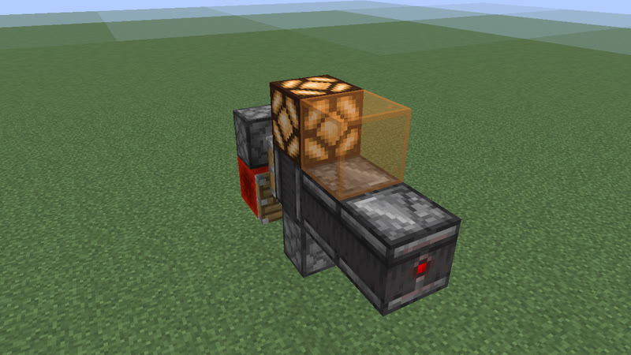</a> 30 gt (1.5 s) · observer+redstone_block+redstone_lamp+sticky_piston · 7 blocks</td><td align="center"> 30 gt (1.5 s) · observer+sticky_piston · 7 blocks</td><td align="center"> 30 gt (1.5 s) · observer+sticky_piston · 7 blocks</td></tr>
<tr><td align="center"> 30 gt (1.5 s) · observer+sticky_piston · 7 blocks</td><td align="center"> 30 gt (1.5 s) · copper_bulb+observer+piston+redstone_block+redstone_lamp+sticky_piston · 7 blocks</td><td align="center"><a href="../archive/clk-obs-p30-bulb-lamp-obs-pis-rb-stk-7b-b-0b97b2.txt">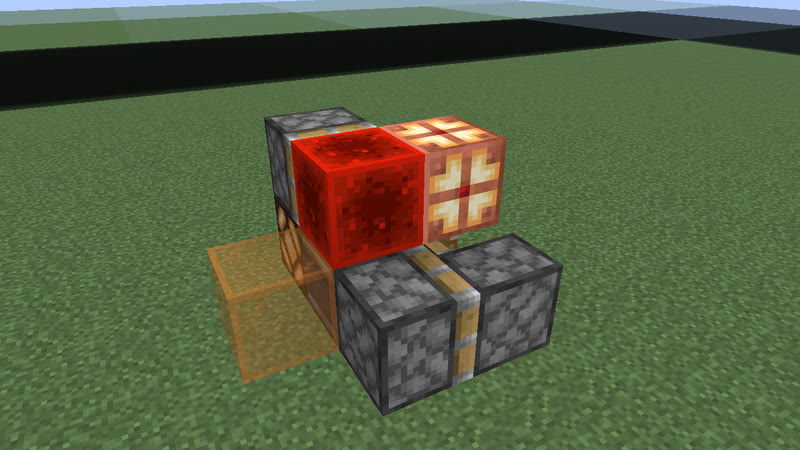</a> 30 gt (1.5 s) · copper_bulb+observer+piston+redstone_block+redstone_lamp+sticky_piston · 7 blocks</td></tr>
<tr><td align="center"> 30 gt (1.5 s) · copper_bulb+note_block+observer+piston+redstone_block+sticky_piston · 7 blocks</td><td align="center"> 30 gt (1.5 s) · copper_bulb+note_block+observer+redstone_block+sticky_piston · 7 blocks</td><td align="center"> 30 gt (1.5 s) · copper_bulb+observer+piston+redstone_block+sticky_piston · 7 blocks</td></tr>
<tr><td align="center"> 30 gt (1.5 s) · copper_bulb+observer+redstone_block+sticky_piston · 7 blocks</td><td align="center"><a href="../archive/clk-obs-p30-lamp-obs-pis-7b-5c5b87.txt">clk-obs-p30-lamp-obs-pis-7b-5c5b87</a> 30 gt (1.5 s) · observer+piston+redstone_lamp · 8 blocks (picture pending)</td><td align="center"><a href="../archive/kit-shuttle-minecart-p30-11b.txt">kit-shuttle-minecart-p30-11b</a> 30 gt (1.5 s) · detector_rail+minecart · 11 blocks (picture pending)</td></tr>
<tr><td align="center"> 30 gt (1.5 s) · redstone_torch+repeater · 12 blocks</td><td align="center"> 30 gt (1.5 s) · repeater · 12 blocks</td><td align="center"> 30 gt (1.5 s) · comparator+repeater · 16 blocks</td></tr>
</table>

## 31 gt (1.55 s)

Also reachable by: clk-obs-odd-a (n = 5), clk-rt-odd-rect (n = 1), dropper ring (clk-item-dropring-2d-r2, n = 0), clk-sculk-replin (one block swapped: 2 versions) (clk-sculk-replin, n = 3).

<table>
<tr><td align="center"><a href="../archive/census-p31-calibrated_sculk_sensor-dispenser-observer-4b.txt">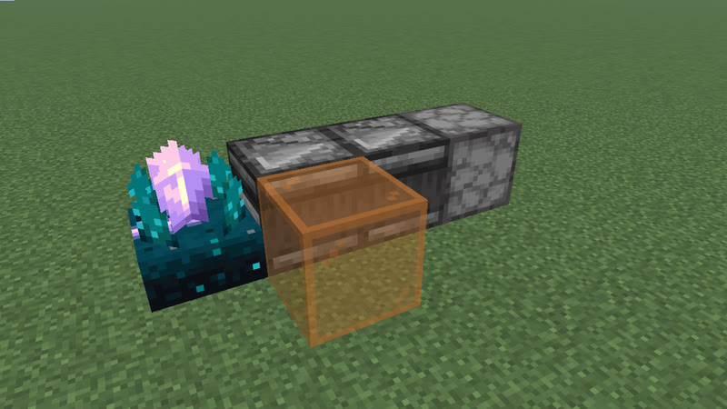</a> 31 gt (1.55 s) · calibrated_sculk_sensor+dispenser+observer · 4 blocks</td><td align="center"> 31 gt (1.55 s) · calibrated_sculk_sensor+dispenser+observer · 4 blocks</td><td align="center"> 31 gt (1.55 s) · observer+piston+sticky_piston · 7 blocks</td></tr>
</table>

## 32 gt (1.6 s)

Also reachable by: clk-obs-obs-ring (n = 6), clk-rt-rect-pulse (n = 0).

<table>
<tr><td align="center"> 32 gt (1.6 s) · calibrated_sculk_sensor+dispenser+observer · 5 blocks</td><td align="center"> 32 gt (1.6 s) · copper_bulb+observer+redstone_block+sticky_piston · 6 blocks</td><td align="center"> 32 gt (1.6 s) · observer+piston+redstone_block+sticky_piston · 6 blocks</td></tr>
<tr><td align="center"> 32 gt (1.6 s) · observer+redstone_block+sticky_piston · 6 blocks</td><td align="center"><a href="../archive/clk-obs-p32-obs-rb-stk-6b-b-f013fc.txt">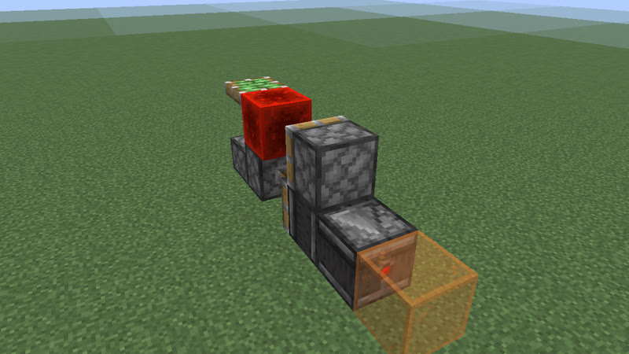</a> 32 gt (1.6 s) · observer+redstone_block+sticky_piston · 6 blocks</td><td align="center"> 32 gt (1.6 s) · copper_bulb+observer+piston+redstone_block+sticky_piston · 6 blocks</td></tr>
<tr><td align="center"> 32 gt (1.6 s) · copper_bulb+observer+piston+redstone_block+sticky_piston · 6 blocks</td><td align="center"> 32 gt (1.6 s) · copper_bulb+observer+redstone_block+sticky_piston · 6 blocks</td><td align="center"><a href="../archive/clk-obs-p32-bulb-lamp-obs-rb-stk-7b-7fe871.txt">clk-obs-p32-bulb-lamp-obs-rb-stk-7b-7fe871</a> 32 gt (1.6 s) · copper_bulb+observer+redstone_block+redstone_lamp+sticky_piston · 7 blocks (picture pending)</td></tr>
<tr><td align="center"> 32 gt (1.6 s) · copper_bulb+observer+piston+sticky_piston · 7 blocks</td><td align="center"><a href="../archive/clk-obs-p32-bulb-obs-stk-7b-b-e3c989.txt">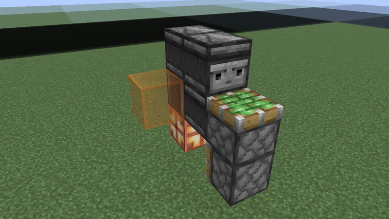</a> 32 gt (1.6 s) · copper_bulb+observer+sticky_piston · 7 blocks</td><td align="center"> 32 gt (1.6 s) · note_block+observer+piston+redstone_block+sticky_piston · 7 blocks</td></tr>
<tr><td align="center"><a href="../archive/clk-obs-p32-note-obs-pis-rb-stk-7b-b-a4ebc5.txt">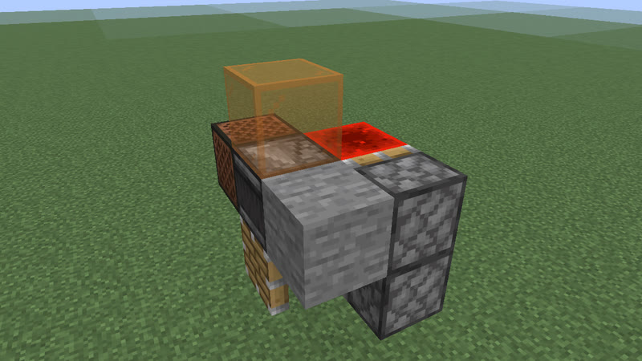</a> 32 gt (1.6 s) · note_block+observer+piston+redstone_block+sticky_piston · 7 blocks</td><td align="center"> 32 gt (1.6 s) · note_block+observer+redstone_block+sticky_piston · 7 blocks</td><td align="center"><a href="../archive/clk-obs-p32-note-obs-rb-stk-7b-b-604487.txt">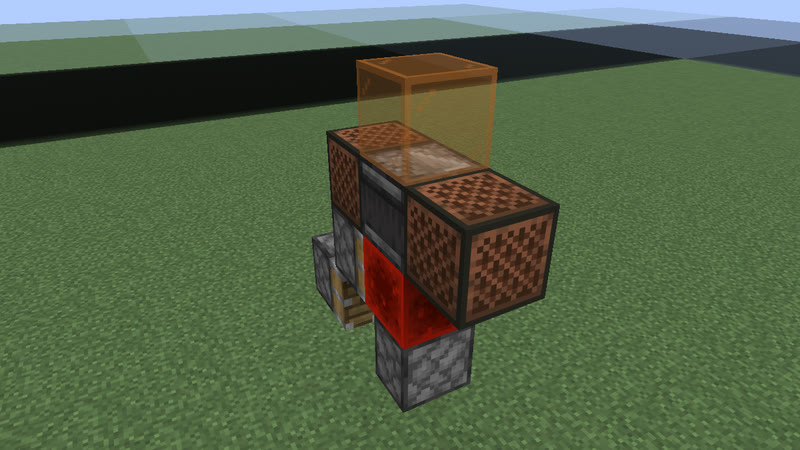</a> 32 gt (1.6 s) · note_block+observer+redstone_block+sticky_piston · 7 blocks</td></tr>
<tr><td align="center"> 32 gt (1.6 s) · copper_bulb+observer+sticky_piston · 7 blocks</td><td align="center"> 32 gt (1.6 s) · observer+sticky_piston · 7 blocks</td><td align="center"> 32 gt (1.6 s) · observer+sticky_piston · 7 blocks</td></tr>
<tr><td align="center"> 32 gt (1.6 s) · observer+sticky_piston · 7 blocks</td><td align="center"> 32 gt (1.6 s) · note_block+observer+sticky_piston · 7 blocks</td><td align="center"><a href="../archive/clk-obs-p32-bulb-lamp-obs-pis-stk-8b-6d442b.txt">clk-obs-p32-bulb-lamp-obs-pis-stk-8b-6d442b</a> 32 gt (1.6 s) · copper_bulb+observer+piston+redstone_lamp+sticky_piston · 8 blocks (picture pending)</td></tr>
<tr><td align="center"><a href="../archive/clk-obs-p32-bulb-note-obs-pis-stk-8b-1a4eed.txt">clk-obs-p32-bulb-note-obs-pis-stk-8b-1a4eed</a> 32 gt (1.6 s) · copper_bulb+note_block+observer+piston+sticky_piston · 8 blocks (picture pending)</td><td align="center"> 32 gt (1.6 s) · redstone_torch+redstone_wire+repeater · 9 blocks</td><td align="center"> 32 gt (1.6 s) · redstone_torch+repeater · 12 blocks</td></tr>
<tr><td align="center"> 32 gt (1.6 s) · comparator+repeater · 16 blocks</td><td align="center"> 32 gt (1.6 s) · comparator+dropper+hopper+repeater · 20 blocks</td></tr>
</table>

## 33 gt (1.65 s)

Also reachable by: clk-obs-odd-b (n = 5), dropper ring (clk-item-dropring-2d-r3, n = 0), lock ring (clk-item-lockring-2s, n = 0).

<table>
<tr><td align="center"> 33 gt (1.65 s) · calibrated_sculk_sensor+note_block+observer · 6 blocks</td><td align="center"> 33 gt (1.65 s) · note_block+observer+redstone_lamp+sticky_piston · 7 blocks</td><td align="center"><a href="../archive/clk-obs-p33-lamp-note-obs-stk-7b-b-31195a.txt">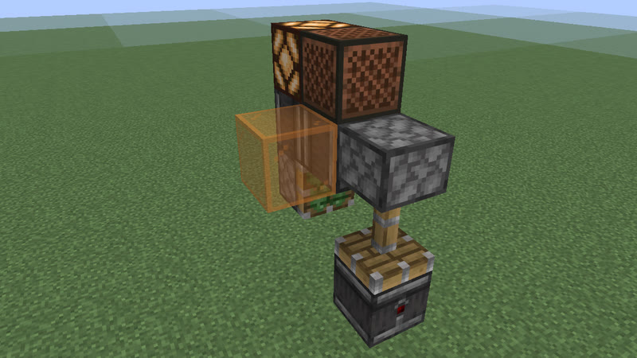</a> 33 gt (1.65 s) · note_block+observer+redstone_lamp+sticky_piston · 7 blocks</td></tr>
<tr><td align="center"><a href="../archive/clk-obs-p33-lamp-obs-stk-7b-b-9e1f7d.txt">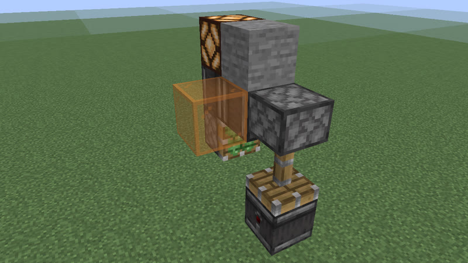</a> 33 gt (1.65 s) · observer+redstone_lamp+sticky_piston · 7 blocks</td><td align="center"><a href="../archive/kit-shuttle-minecart-p33-13b.txt">kit-shuttle-minecart-p33-13b</a> 33 gt (1.65 s) · detector_rail+minecart · 13 blocks (picture pending)</td><td align="center"> 33 gt (1.65 s) · repeater · 23 blocks</td></tr>
</table>

## 34 gt (1.7 s)

Also reachable by: observer ring with a relay block (clk-obs-trap-ring, n = 6), dropper ring (clk-item-dropring-2d, n = 0).

<table>
<tr><td align="center"> 34 gt (1.7 s) · calibrated_sculk_sensor+dispenser+observer · 6 blocks</td><td align="center"> 34 gt (1.7 s) · copper_bulb+observer+piston+sticky_piston · 7 blocks</td><td align="center"><a href="../archive/clk-obs-p34-bulb-obs-pis-stk-7b-b-e9a742.txt">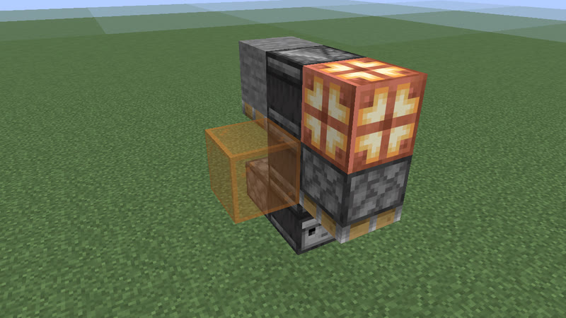</a> 34 gt (1.7 s) · copper_bulb+observer+piston+sticky_piston · 7 blocks</td></tr>
<tr><td align="center"><a href="../archive/clk-obs-p34-bulb-obs-pis-rb-stk-7b-45aeda.txt">clk-obs-p34-bulb-obs-pis-rb-stk-7b-45aeda</a> 34 gt (1.7 s) · copper_bulb+observer+piston+redstone_block+sticky_piston · 7 blocks (picture pending)</td><td align="center"><a href="../archive/clk-obs-p34-bulb-lamp-obs-rb-stk-7b-b-cc19e8.txt">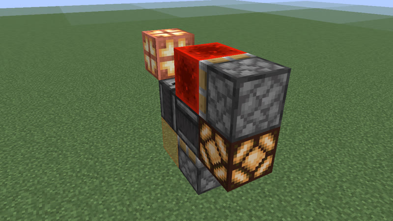</a> 34 gt (1.7 s) · copper_bulb+observer+redstone_block+redstone_lamp+sticky_piston · 7 blocks</td><td align="center"> 34 gt (1.7 s) · copper_bulb+observer+redstone_block+redstone_lamp+sticky_piston · 7 blocks</td></tr>
<tr><td align="center"><a href="../archive/clk-obs-p34-obs-pis-stk-7b-b-da1ac4.txt">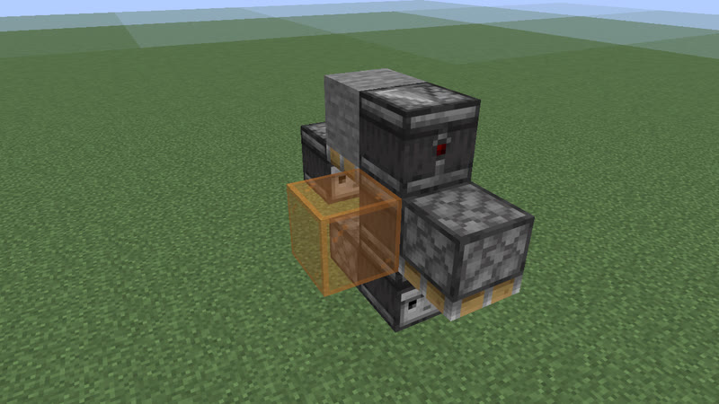</a> 34 gt (1.7 s) · observer+piston+sticky_piston · 7 blocks</td><td align="center"> 34 gt (1.7 s) · observer+sticky_piston · 7 blocks</td><td align="center"><a href="../archive/clk-obs-p34-lamp-obs-rb-stk-8b-ea9b74.txt">clk-obs-p34-lamp-obs-rb-stk-8b-ea9b74</a> 34 gt (1.7 s) · observer+redstone_block+redstone_lamp+sticky_piston · 8 blocks (picture pending)</td></tr>
<tr><td align="center"><a href="../archive/clk-obs-p34-bulb-note-obs-pis-rb-stk-9b-0a5346.txt">clk-obs-p34-bulb-note-obs-pis-rb-stk-9b-0a5346</a> 34 gt (1.7 s) · copper_bulb+note_block+observer+piston+redstone_block+sticky_piston · 9 blocks (picture pending)</td><td align="center"> 34 gt (1.7 s) · redstone_torch+repeater · 12 blocks</td><td align="center"><a href="../archive/kit-shuttle-minecart-p34-15b.txt">kit-shuttle-minecart-p34-15b</a> 34 gt (1.7 s) · detector_rail+minecart · 15 blocks (picture pending)</td></tr>
<tr><td align="center"> 34 gt (1.7 s) · redstone_wire+repeater · 16 blocks</td><td align="center"> 34 gt (1.7 s) · comparator+repeater · 16 blocks</td></tr>
</table>

## 35 gt (1.75 s)

Also reachable by: clk-obs-odd-a (n = 6), hopper ring (clk-item-hopper-ring-2, n = 4), clk-sculk-replin-dispenser (n = 3), dropper ring (clk-item-dropring-2d-r4, n = 0), lock ring (clk-item-lockring-2s, n = 1), clk-sculk-hairpin (one block swapped: 2 versions) (clk-sculk-hairpin, n = 2).

<table>
<tr><td align="center"> 35 gt (1.75 s) · calibrated_sculk_sensor+note_block · 6 blocks</td><td align="center"> 35 gt (1.75 s) · observer+sticky_piston · 7 blocks</td><td align="center"><a href="../archive/clk-obs-p35-lamp-note-obs-stk-8b-fa6368.txt">clk-obs-p35-lamp-note-obs-stk-8b-fa6368</a> 35 gt (1.75 s) · note_block+observer+redstone_lamp+sticky_piston · 8 blocks (picture pending)</td></tr>
<tr><td align="center"><a href="../archive/clk-obs-p35-lamp-obs-stk-8b-72d58c.txt">clk-obs-p35-lamp-obs-stk-8b-72d58c</a> 35 gt (1.75 s) · observer+redstone_lamp+sticky_piston · 8 blocks (picture pending)</td><td align="center"><a href="../archive/clk-obs-p35-note-obs-stk-8b-d3443f.txt">clk-obs-p35-note-obs-stk-8b-d3443f</a> 35 gt (1.75 s) · note_block+observer+sticky_piston · 8 blocks (picture pending)</td><td align="center"><a href="../archive/kit-shuttle-minecart-p35-15b.txt">kit-shuttle-minecart-p35-15b</a> 35 gt (1.75 s) · detector_rail+minecart · 15 blocks (picture pending)</td></tr>
<tr><td align="center"> 35 gt (1.75 s) · repeater · 23 blocks</td></tr>
</table>

## 36 gt (1.8 s)

Also reachable by: clk-obs-obs-ring (n = 7), clk-obs-bulb-ring (n = 2), clk-obs-hopclk (n = 3), clk-rt-uloop2t (n = 1), dropper ring (clk-item-dropring-1d-r1, n = 0), clk-rt-uloop1t (n = 0).

<table>
<tr><td align="center"> 36 gt (1.8 s) · observer+sticky_piston · 6 blocks</td><td align="center"> 36 gt (1.8 s) · observer+sticky_piston · 6 blocks</td><td align="center"> 36 gt (1.8 s) · copper_bulb+observer+redstone_block+sticky_piston · 6 blocks</td></tr>
<tr><td align="center"><a href="../archive/clk-obs-p36-bulb-obs-rb-stk-6b-b-eb7716.txt">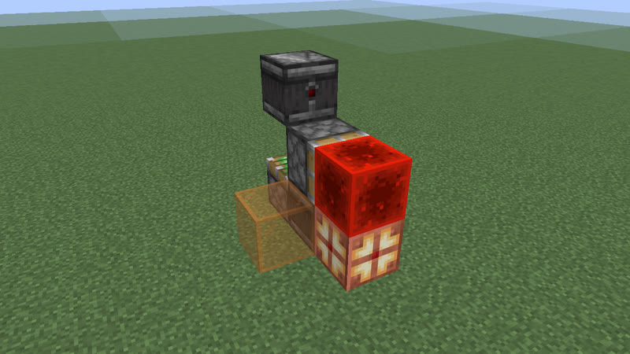</a> 36 gt (1.8 s) · copper_bulb+observer+redstone_block+sticky_piston · 6 blocks</td><td align="center"> 36 gt (1.8 s) · calibrated_sculk_sensor+note_block · 6 blocks</td><td align="center"> 36 gt (1.8 s) · copper_bulb+observer+piston+redstone_lamp+sticky_piston · 7 blocks</td></tr>
<tr><td align="center"> 36 gt (1.8 s) · copper_bulb+note_block+observer+piston+sticky_piston · 7 blocks</td><td align="center"> 36 gt (1.8 s) · copper_bulb+note_block+observer+sticky_piston · 7 blocks</td><td align="center"><a href="../archive/clk-obs-p36-bulb-obs-pis-stk-7b-b-256753.txt">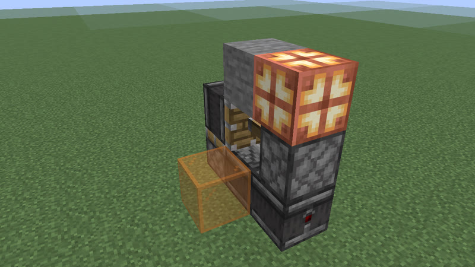</a> 36 gt (1.8 s) · copper_bulb+observer+piston+sticky_piston · 7 blocks</td></tr>
<tr><td align="center"><a href="../archive/clk-obs-p36-bulb-obs-stk-7b-b-ecf67e.txt">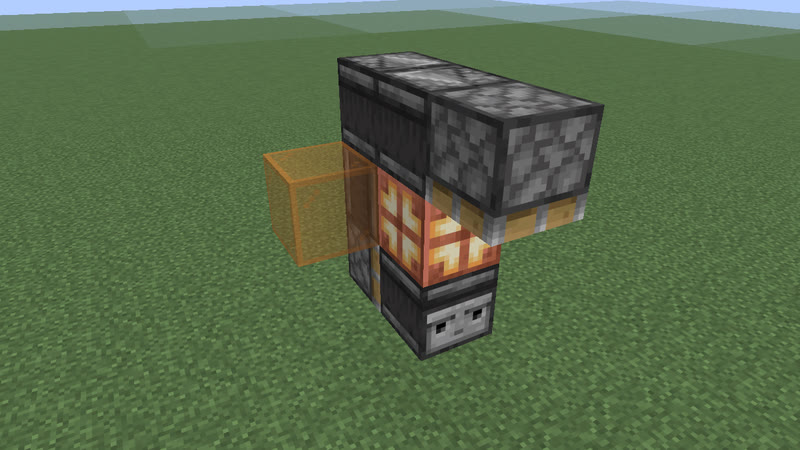</a> 36 gt (1.8 s) · copper_bulb+observer+sticky_piston · 7 blocks</td><td align="center"> 36 gt (1.8 s) · note_block+observer+redstone_block+sticky_piston · 7 blocks</td><td align="center"> 36 gt (1.8 s) · observer+redstone_block+sticky_piston · 7 blocks</td></tr>
<tr><td align="center"><a href="../archive/clk-obs-p36-obs-rb-stk-7b-b-2ed455.txt">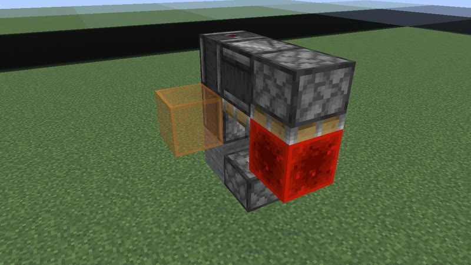</a> 36 gt (1.8 s) · observer+redstone_block+sticky_piston · 7 blocks</td><td align="center"><a href="../archive/clk-obs-p36-bulb-lamp-note-obs-rb-stk-7b-36ba93.txt">clk-obs-p36-bulb-lamp-note-obs-rb-stk-7b-36ba93</a> 36 gt (1.8 s) · copper_bulb+note_block+observer+redstone_block+redstone_lamp+sticky_piston · 7 blocks (picture pending)</td><td align="center"><a href="../archive/clk-obs-p36-bulb-lamp-obs-rb-stk-7b-d70aaf.txt">clk-obs-p36-bulb-lamp-obs-rb-stk-7b-d70aaf</a> 36 gt (1.8 s) · copper_bulb+observer+redstone_block+redstone_lamp+sticky_piston · 7 blocks (picture pending)</td></tr>
<tr><td align="center"> 36 gt (1.8 s) · copper_bulb+observer+piston+redstone_block+sticky_piston · 7 blocks</td><td align="center"><a href="../archive/clk-obs-p36-lamp-note-obs-rb-stk-7b-4460be.txt">clk-obs-p36-lamp-note-obs-rb-stk-7b-4460be</a> 36 gt (1.8 s) · note_block+observer+redstone_block+redstone_lamp+sticky_piston · 7 blocks (picture pending)</td><td align="center"> 36 gt (1.8 s) · observer+redstone_block+redstone_lamp+sticky_piston · 7 blocks</td></tr>
<tr><td align="center"><a href="../archive/clk-obs-p36-note-obs-rb-stk-7b-b-8e067d.txt">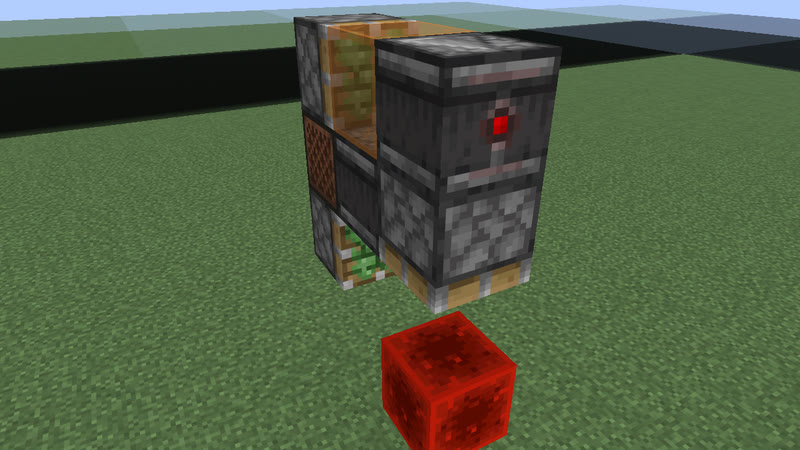</a> 36 gt (1.8 s) · note_block+observer+redstone_block+sticky_piston · 7 blocks</td><td align="center"> 36 gt (1.8 s) · note_block+observer+sticky_piston · 7 blocks</td><td align="center"><a href="../archive/clk-obs-p36-note-obs-stk-7b-b-e8ffaf.txt">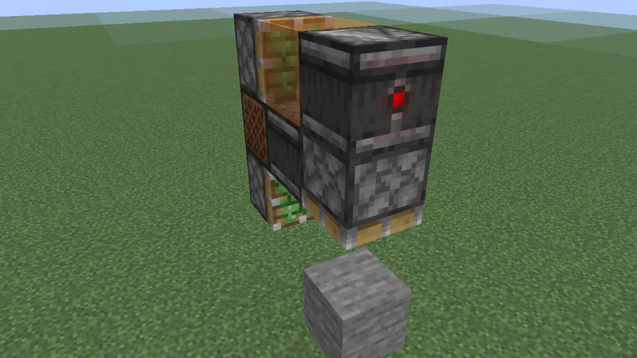</a> 36 gt (1.8 s) · note_block+observer+sticky_piston · 7 blocks</td></tr>
<tr><td align="center"> 36 gt (1.8 s) · observer+piston+redstone_block+sticky_piston · 7 blocks</td><td align="center"><a href="../archive/clk-obs-p36-lamp-obs-rb-stk-7b-b-2ff2e3.txt">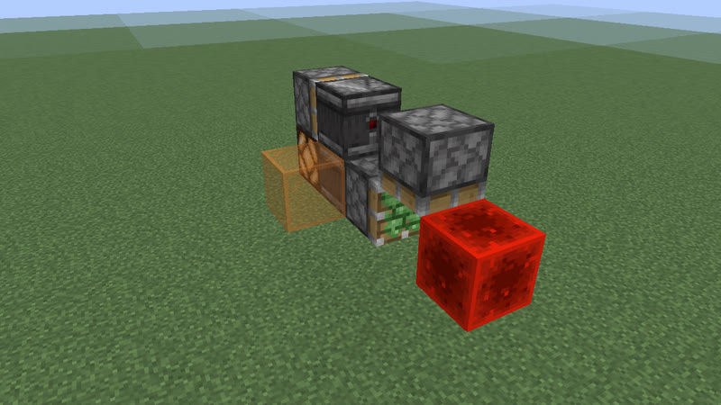</a> 36 gt (1.8 s) · observer+redstone_block+redstone_lamp+sticky_piston · 7 blocks</td><td align="center"><a href="../archive/clk-obs-p36-bulb-obs-pis-rb-stk-7b-b-60bbd9.txt">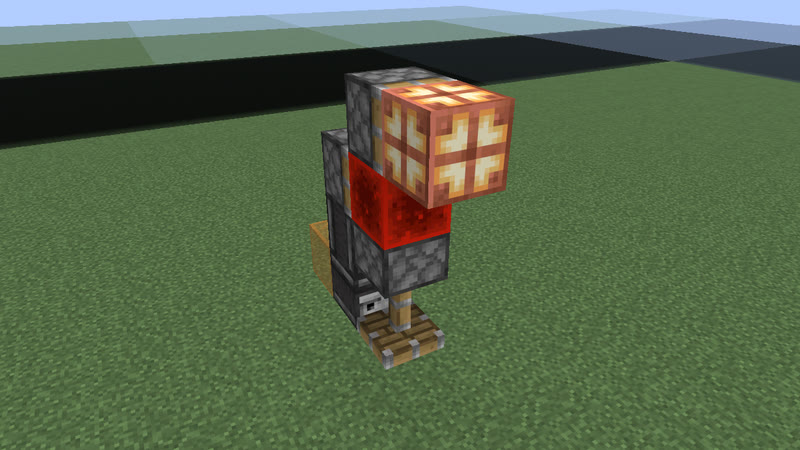</a> 36 gt (1.8 s) · copper_bulb+observer+piston+redstone_block+sticky_piston · 7 blocks</td></tr>
<tr><td align="center"><a href="../archive/clk-obs-p36-bulb-note-obs-pis-7b-9c92c8.txt">clk-obs-p36-bulb-note-obs-pis-7b-9c92c8</a> 36 gt (1.8 s) · copper_bulb+note_block+observer+piston · 8 blocks (picture pending)</td><td align="center"><a href="../archive/clk-obs-p36-bulb-obs-pis-7b-3615d3.txt">clk-obs-p36-bulb-obs-pis-7b-3615d3</a> 36 gt (1.8 s) · copper_bulb+observer+piston · 8 blocks (picture pending)</td><td align="center"><a href="../archive/clk-obs-p36-note-obs-pis-7b-0265ec.txt">clk-obs-p36-note-obs-pis-7b-0265ec</a> 36 gt (1.8 s) · note_block+observer+piston · 8 blocks (picture pending)</td></tr>
<tr><td align="center"> 36 gt (1.8 s) · observer+piston+sticky_piston · 8 blocks</td><td align="center"> 36 gt (1.8 s) · comparator+redstone_torch+redstone_wire+repeater · 12 blocks</td><td align="center"><a href="../archive/kit-shuttle-minecart-p36-15b.txt">kit-shuttle-minecart-p36-15b</a> 36 gt (1.8 s) · detector_rail+minecart · 15 blocks (picture pending)</td></tr>
<tr><td align="center"> 36 gt (1.8 s) · redstone_wire+repeater · 16 blocks</td><td align="center"> 36 gt (1.8 s) · comparator+repeater · 16 blocks</td></tr>
</table>

## 37 gt (1.85 s)

Also reachable by: clk-obs-odd-b (n = 6), lock ring (clk-item-lockring-2s, n = 2), clk-misc-cart-pingpong (n = 0).

<table>
<tr><td align="center"><a href="../archive/clk-obs-p37-obs-pis-stk-6b-b-9ba5e6.txt">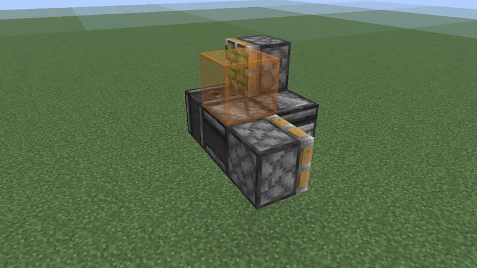</a> 37 gt (1.85 s) · observer+piston+sticky_piston · 6 blocks</td><td align="center"> 37 gt (1.85 s) · observer+sticky_piston · 6 blocks</td><td align="center"> 37 gt (1.85 s) · calibrated_sculk_sensor+note_block · 6 blocks</td></tr>
<tr><td align="center"><a href="../archive/kit-shuttle-minecart-p37-15b.txt">kit-shuttle-minecart-p37-15b</a> 37 gt (1.85 s) · detector_rail+minecart · 15 blocks (picture pending)</td><td align="center"> 37 gt (1.85 s) · repeater · 24 blocks</td></tr>
</table>

## 38 gt (1.9 s)

Also reachable by: observer ring with a relay block (clk-obs-trap-ring, n = 7), dropper ring (clk-item-dropring-1d-r2, n = 0).

<table>
<tr><td align="center"> 38 gt (1.9 s) · calibrated_sculk_sensor+note_block · 6 blocks</td><td align="center"><a href="../archive/clk-obs-p38-lamp-note-obs-rb-stk-9b-5284f4.txt">clk-obs-p38-lamp-note-obs-rb-stk-9b-5284f4</a> 38 gt (1.9 s) · note_block+observer+redstone_block+redstone_lamp+sticky_piston · 9 blocks (picture pending)</td><td align="center"><a href="../archive/kit-shuttle-minecart-p38-15b.txt">kit-shuttle-minecart-p38-15b</a> 38 gt (1.9 s) · detector_rail+minecart · 15 blocks (picture pending)</td></tr>
<tr><td align="center"> 38 gt (1.9 s) · redstone_torch+repeater · 16 blocks</td><td align="center"> 38 gt (1.9 s) · redstone_wire+repeater · 16 blocks</td><td align="center"> 38 gt (1.9 s) · comparator+repeater · 16 blocks</td></tr>
</table>

## 39 gt (1.95 s)

Also reachable by: clk-obs-odd-a (n = 7), clk-rt-odd-rect (n = 2), clk-sculk-hairpin-dispenser (n = 2), lock ring (clk-item-lockring-2s, n = 3).

<table>
<tr><td align="center"> 39 gt (1.95 s) · calibrated_sculk_sensor+note_block · 6 blocks</td><td align="center"><a href="../archive/kit-shuttle-minecart-p39-17b.txt">kit-shuttle-minecart-p39-17b</a> 39 gt (1.95 s) · detector_rail+minecart · 17 blocks (picture pending)</td></tr>
</table>

## 40 gt (2 s)

Also reachable by: clk-obs-obs-ring (n = 8), dropper ring (clk-item-dropring-1d-r3, n = 0), clk-sculk-replin (one block swapped: 2 versions) (clk-sculk-replin, n = 4).

<table>
<tr><td align="center"> 40 gt (2 s) · copper_bulb+observer+redstone_block+sticky_piston · 6 blocks</td><td align="center"><a href="../archive/clk-obs-p40-bulb-obs-rb-stk-6b-b-92f1be.txt">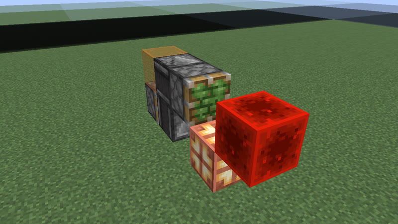</a> 40 gt (2 s) · copper_bulb+observer+redstone_block+sticky_piston · 6 blocks</td><td align="center"> 40 gt (2 s) · copper_bulb+observer+redstone_block+redstone_lamp+sticky_piston · 7 blocks</td></tr>
<tr><td align="center"> 40 gt (2 s) · copper_bulb+note_block+observer+redstone_block+sticky_piston · 7 blocks</td><td align="center"><a href="../archive/clk-obs-p40-bulb-note-obs-rb-stk-7b-b-339c62.txt">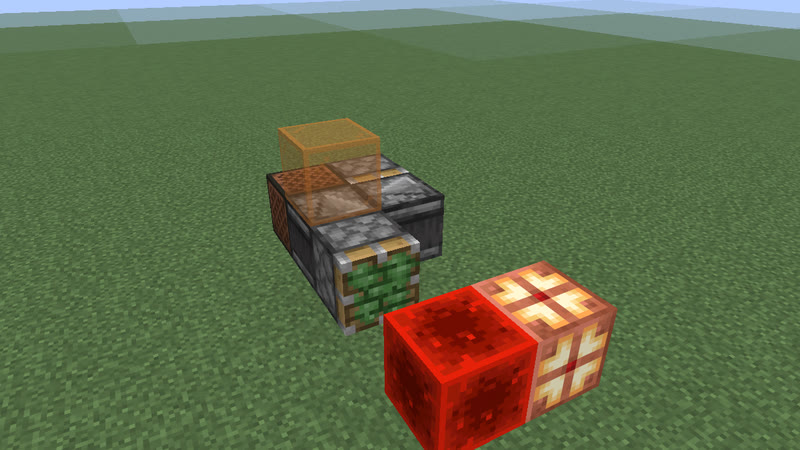</a> 40 gt (2 s) · copper_bulb+note_block+observer+redstone_block+sticky_piston · 7 blocks</td><td align="center"><a href="../archive/clk-obs-p40-lamp-obs-rb-stk-7b-30b78d.txt">clk-obs-p40-lamp-obs-rb-stk-7b-30b78d</a> 40 gt (2 s) · observer+redstone_block+redstone_lamp+sticky_piston · 7 blocks (picture pending)</td></tr>
<tr><td align="center"> 40 gt (2 s) · observer+redstone_block+sticky_piston · 7 blocks</td><td align="center"><a href="../archive/clk-obs-p40-obs-rb-stk-7b-b-2aa574.txt">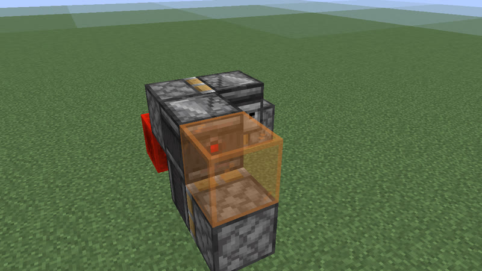</a> 40 gt (2 s) · observer+redstone_block+sticky_piston · 7 blocks</td><td align="center"><a href="../archive/clk-sculk-ring3p-p40-1.txt">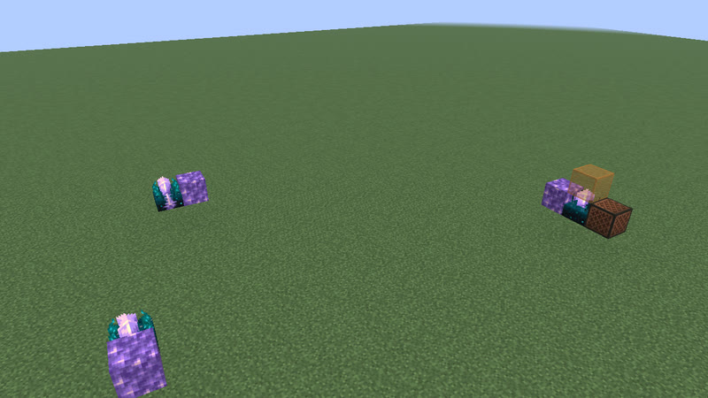</a> 40 gt (2 s) · calibrated_sculk_sensor · 7 blocks</td></tr>
<tr><td align="center"><a href="../archive/clk-obs-p40-lamp-note-obs-rb-stk-8b-de18a8.txt">clk-obs-p40-lamp-note-obs-rb-stk-8b-de18a8</a> 40 gt (2 s) · note_block+observer+redstone_block+redstone_lamp+sticky_piston · 8 blocks (picture pending)</td><td align="center"><a href="../archive/clk-obs-p40-note-obs-pis-rb-stk-8b-e695e1.txt">clk-obs-p40-note-obs-pis-rb-stk-8b-e695e1</a> 40 gt (2 s) · note_block+observer+piston+redstone_block+sticky_piston · 8 blocks (picture pending)</td><td align="center"><a href="../archive/clk-obs-p40-bulb-note-obs-pis-rb-stk-9b-da60a1.txt">clk-obs-p40-bulb-note-obs-pis-rb-stk-9b-da60a1</a> 40 gt (2 s) · copper_bulb+note_block+observer+piston+redstone_block+sticky_piston · 9 blocks (picture pending)</td></tr>
<tr><td align="center"><a href="../archive/clk-obs-p40-note-obs-pis-8b-66d11c.txt">clk-obs-p40-note-obs-pis-8b-66d11c</a> 40 gt (2 s) · note_block+observer+piston · 9 blocks (picture pending)</td><td align="center"> 40 gt (2 s) · redstone_wire+repeater · 16 blocks</td><td align="center"> 40 gt (2 s) · comparator+repeater · 16 blocks</td></tr>
</table>

## 41 gt (2.05 s)

Also reachable by: clk-obs-odd-b (n = 7), dropper ring (clk-item-dropring-1d, n = 1), lock ring (clk-item-lockring-3s, n = 0).

<table>
<tr><td align="center"><a href="../archive/census-p41-calibrated_sculk_sensor-dispenser-observer-piston-sculk_sensor-5b.txt">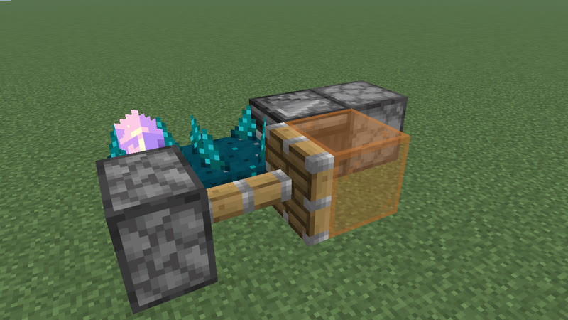</a> 41 gt (2.05 s) · calibrated_sculk_sensor+dispenser+observer+piston+sculk_sensor · 5 blocks also found as census-p41-calibrated_sculk_sensor-dispenser-observer-sculk_sensor-sticky_piston-5b (built with sticky_piston, without piston)</td><td align="center"><a href="../archive/census-p41-calibrated_sculk_sensor-oak_trapdoor-observer-sculk_sensor-sticky_piston-5b.txt">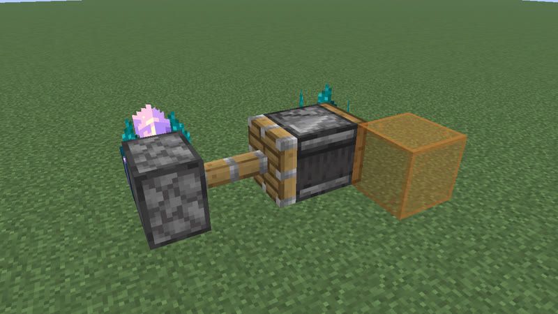</a> 41 gt (2.05 s) · calibrated_sculk_sensor+oak_trapdoor+observer+sculk_sensor+sticky_piston · 5 blocks</td><td align="center"> 41 gt (2.05 s) · dispenser+observer+sculk_sensor · 5 blocks</td></tr>
<tr><td align="center"><a href="../archive/census-p41-oak_trapdoor-observer-sculk_sensor-sticky_piston-5b.txt">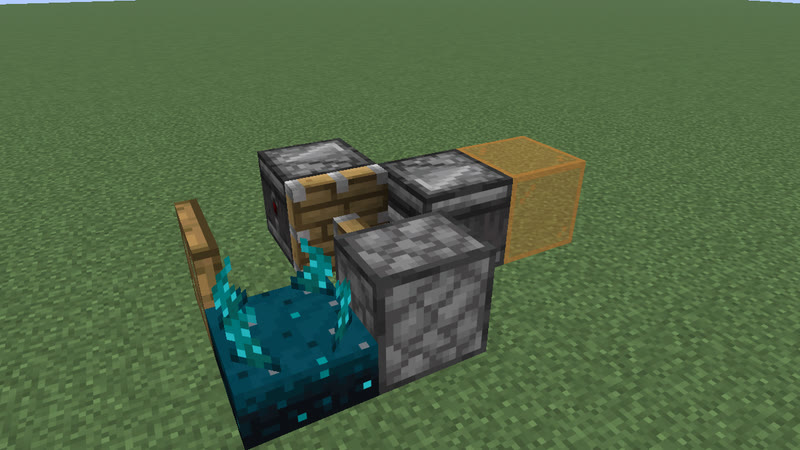</a> 41 gt (2.05 s) · oak_trapdoor+observer+sculk_sensor+sticky_piston · 5 blocks</td><td align="center"><a href="../archive/census-p41-observer-piston-sculk_sensor-sticky_piston-5b.txt">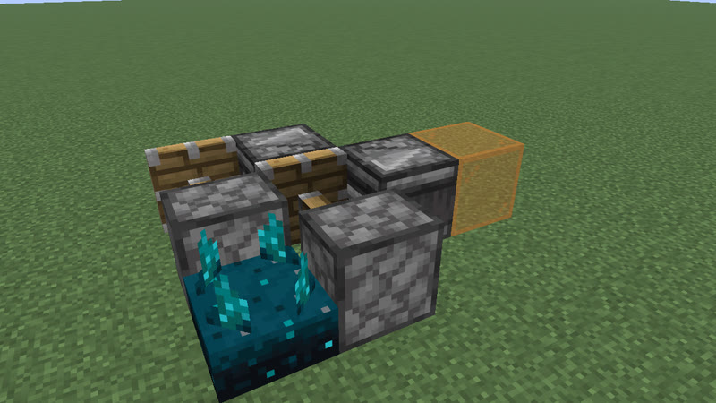</a> 41 gt (2.05 s) · observer+piston+sculk_sensor+sticky_piston · 5 blocks</td><td align="center"><a href="../archive/census-p41-observer-sculk_sensor-sticky_piston-5b.txt">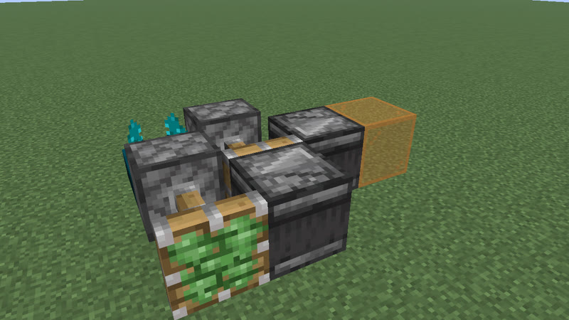</a> 41 gt (2.05 s) · observer+sculk_sensor+sticky_piston · 5 blocks</td></tr>
<tr><td align="center"><a href="../archive/census-p41-dispenser-note_block-observer-sculk_sensor-sticky_piston-6b.txt">census-p41-dispenser-note_block-observer-sculk_sensor-sticky_piston-6b</a> 41 gt (2.05 s) · dispenser+note_block+observer+sculk_sensor+sticky_piston · 6 blocks (picture pending)</td><td align="center"><a href="../archive/clk-sculk-ring3-p41-1.txt">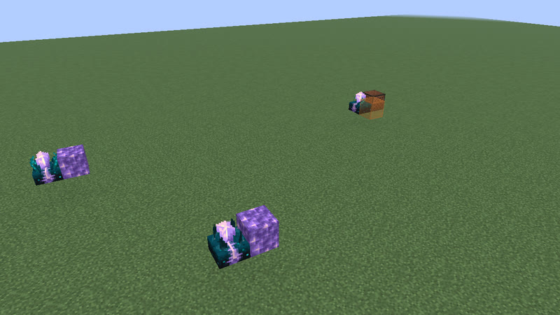</a> 41 gt (2.05 s) · calibrated_sculk_sensor+note_block · 8 blocks</td><td align="center"><a href="../archive/kit-shuttle-minecart-p41-15b.txt">kit-shuttle-minecart-p41-15b</a> 41 gt (2.05 s) · detector_rail+minecart · 15 blocks (picture pending)</td></tr>
<tr><td align="center"> 41 gt (2.05 s) · repeater · 27 blocks</td></tr>
</table>

## 42 gt (2.1 s)

Also reachable by: observer ring with a relay block (clk-obs-trap-ring, n = 8), hopper ring (clk-item-hopper-ring, n = 2), dropper ring (clk-item-dropring-1d-r4, n = 0), clk-misc-cart-pingpong (n = 1).

<table>
<tr><td align="center"> 42 gt (2.1 s) · dispenser+observer+sculk_sensor · 4 blocks</td><td align="center"><a href="../archive/census-p42-note_block-observer-sculk_sensor-4b.txt">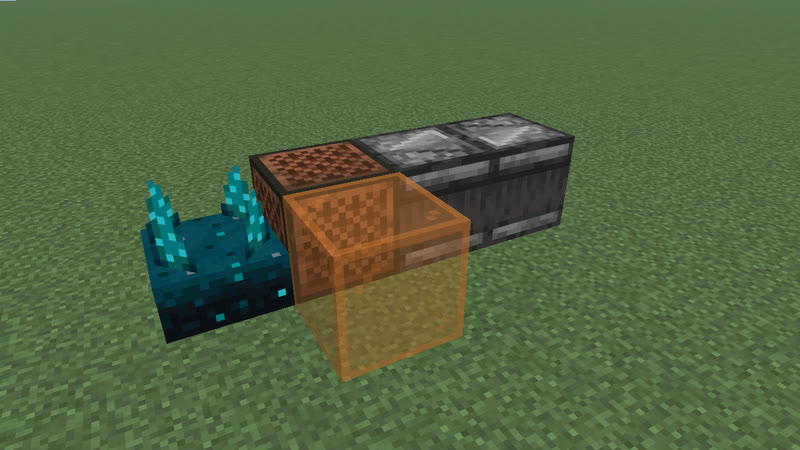</a> 42 gt (2.1 s) · note_block+observer+sculk_sensor · 4 blocks</td><td align="center"><a href="../archive/census-p42-oak_trapdoor-observer-sculk_sensor-4b.txt">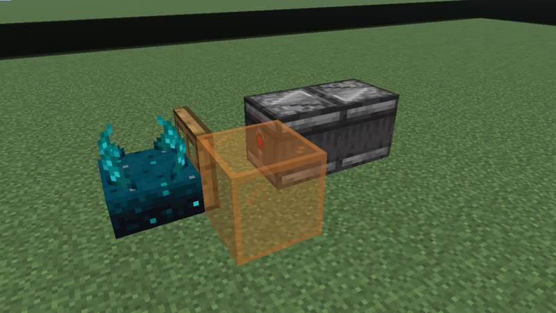</a> 42 gt (2.1 s) · oak_trapdoor+observer+sculk_sensor · 4 blocks</td></tr>
<tr><td align="center"><a href="../archive/census-p42-observer-piston-sculk_sensor-4b.txt">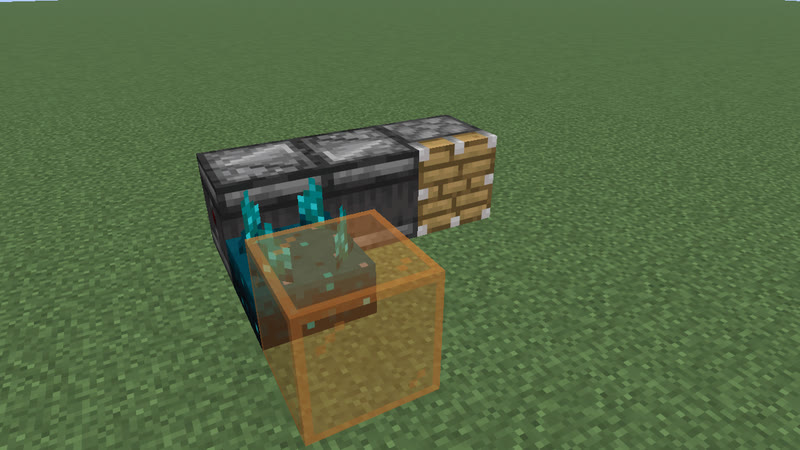</a> 42 gt (2.1 s) · observer+piston+sculk_sensor · 4 blocks also found as census-p42-observer-sculk_sensor-sticky_piston-4b (built with sticky_piston, without piston)</td><td align="center"><a href="../archive/census-p42-calibrated_sculk_sensor-oak_trapdoor-observer-piston-sculk_sensor-5b.txt">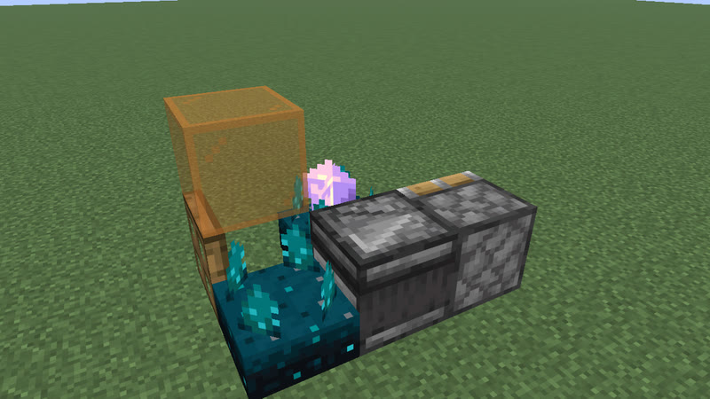</a> 42 gt (2.1 s) · calibrated_sculk_sensor+oak_trapdoor+observer+piston+sculk_sensor · 5 blocks also found as census-p42-calibrated_sculk_sensor-oak_trapdoor-observer-sculk_sensor-sticky_piston-5b (built with sticky_piston, without piston)</td><td align="center"> 42 gt (2.1 s) · copper_bulb+observer+redstone_lamp+sticky_piston · 6 blocks</td></tr>
<tr><td align="center"> 42 gt (2.1 s) · copper_bulb+note_block+observer+sticky_piston · 6 blocks</td><td align="center"> 42 gt (2.1 s) · copper_bulb+observer+sticky_piston · 6 blocks</td><td align="center"><a href="../archive/clk-obs-p42-lamp-obs-stk-6b-b-8acd63.txt">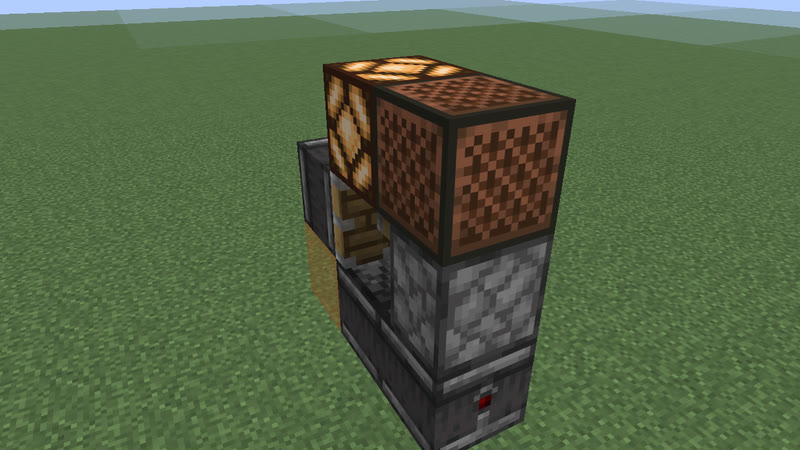</a> 42 gt (2.1 s) · observer+redstone_lamp+sticky_piston · 6 blocks</td></tr>
<tr><td align="center"> 42 gt (2.1 s) · note_block+observer+sticky_piston · 6 blocks</td><td align="center"><a href="../archive/clk-obs-p42-obs-rb-stk-6b-b-f8a16d.txt">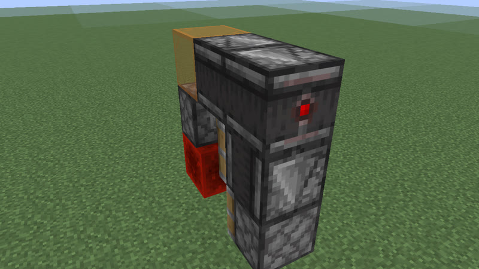</a> 42 gt (2.1 s) · observer+redstone_block+sticky_piston · 6 blocks</td><td align="center"> 42 gt (2.1 s) · observer+redstone_block+sticky_piston · 6 blocks</td></tr>
<tr><td align="center"><a href="../archive/clk-obs-p42-obs-stk-6b-b-ebda21.txt">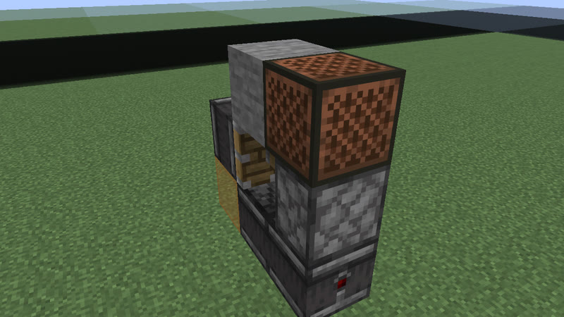</a> 42 gt (2.1 s) · observer+sticky_piston · 6 blocks</td><td align="center"><a href="../archive/census-p42-calibrated_sculk_sensor-note_block-observer-sticky_piston-6b.txt">census-p42-calibrated_sculk_sensor-note_block-observer-sticky_piston-6b</a> 42 gt (2.1 s) · calibrated_sculk_sensor+note_block+observer+sticky_piston · 6 blocks (picture pending)</td><td align="center"><a href="../archive/census-p42-calibrated_sculk_sensor-oak_trapdoor-observer-sticky_piston-6b.txt">census-p42-calibrated_sculk_sensor-oak_trapdoor-observer-sticky_piston-6b</a> 42 gt (2.1 s) · calibrated_sculk_sensor+oak_trapdoor+observer+sticky_piston · 6 blocks (picture pending)</td></tr>
<tr><td align="center"><a href="../archive/census-p42-calibrated_sculk_sensor-observer-piston-sticky_piston-6b.txt">census-p42-calibrated_sculk_sensor-observer-piston-sticky_piston-6b</a> 42 gt (2.1 s) · calibrated_sculk_sensor+observer+piston+sticky_piston · 6 blocks (picture pending)</td><td align="center"><a href="../archive/census-p42-calibrated_sculk_sensor-observer-sticky_piston-6b.txt">census-p42-calibrated_sculk_sensor-observer-sticky_piston-6b</a> 42 gt (2.1 s) · calibrated_sculk_sensor+observer+sticky_piston · 6 blocks (picture pending)</td><td align="center"><a href="../archive/clk-obs-p42-bulb-note-obs-stk-6b-b-35672d.txt">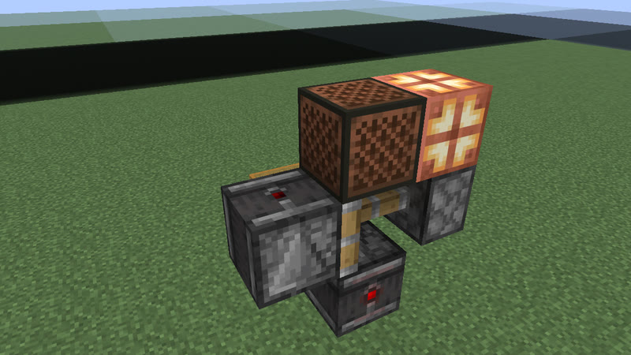</a> 42 gt (2.1 s) · copper_bulb+note_block+observer+sticky_piston · 6 blocks</td></tr>
<tr><td align="center"> 42 gt (2.1 s) · observer+piston · 7 blocks also found as clk-obs-p42-obs-pis-stk-6b-b-ab8e35 (built with sticky_piston)</td><td align="center"><a href="../archive/clk-obs-p42-bulb-note-obs-pis-rb-stk-8b-533652.txt">clk-obs-p42-bulb-note-obs-pis-rb-stk-8b-533652</a> 42 gt (2.1 s) · copper_bulb+note_block+observer+piston+redstone_block+sticky_piston · 8 blocks (picture pending)</td><td align="center"><a href="../archive/clk-obs-p42-bulb-obs-pis-rb-stk-8b-36b127.txt">clk-obs-p42-bulb-obs-pis-rb-stk-8b-36b127</a> 42 gt (2.1 s) · copper_bulb+observer+piston+redstone_block+sticky_piston · 8 blocks (picture pending)</td></tr>
<tr><td align="center"><a href="../archive/clk-obs-p42-bulb-lamp-note-obs-stk-9b-58d4fb.txt">clk-obs-p42-bulb-lamp-note-obs-stk-9b-58d4fb</a> 42 gt (2.1 s) · copper_bulb+note_block+observer+redstone_lamp+sticky_piston · 9 blocks (picture pending)</td><td align="center"><a href="../archive/clk-obs-p42-bulb-lamp-obs-pis-rb-stk-8b-d62583.txt">clk-obs-p42-bulb-lamp-obs-pis-rb-stk-8b-d62583</a> 42 gt (2.1 s) · copper_bulb+observer+piston+redstone_block+redstone_lamp+sticky_piston · 9 blocks (picture pending)</td><td align="center"> 42 gt (2.1 s) · redstone_torch+repeater · 16 blocks</td></tr>
<tr><td align="center"> 42 gt (2.1 s) · repeater · 16 blocks</td><td align="center"> 42 gt (2.1 s) · comparator+repeater · 16 blocks</td><td align="center"><a href="../archive/kit-shuttle-minecart-p42-17b.txt">kit-shuttle-minecart-p42-17b</a> 42 gt (2.1 s) · detector_rail+minecart · 17 blocks (picture pending)</td></tr>
</table>

## 43 gt (2.15 s)

Also reachable by: clk-obs-odd-a (n = 8), dropper ring (clk-item-dropring-2d-r1, n = 0), lock ring (clk-item-lockring-3s, n = 1).

<table>
<tr><td align="center"> 43 gt (2.15 s) · calibrated_sculk_sensor+dispenser+observer+sculk_sensor · 4 blocks</td><td align="center"><a href="../archive/census-p43-oak_trapdoor-observer-sculk_sensor-sticky_piston-5b.txt">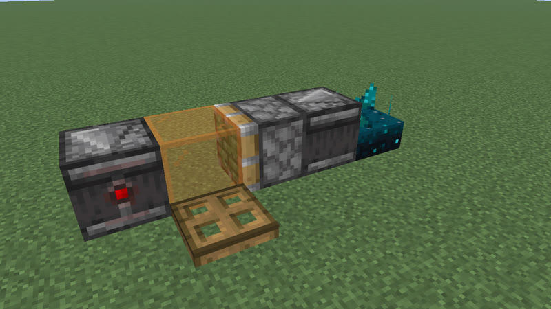</a> 43 gt (2.15 s) · oak_trapdoor+observer+sculk_sensor+sticky_piston · 6 blocks</td><td align="center"><a href="../archive/clk-sculk-ring3-p43-1.txt">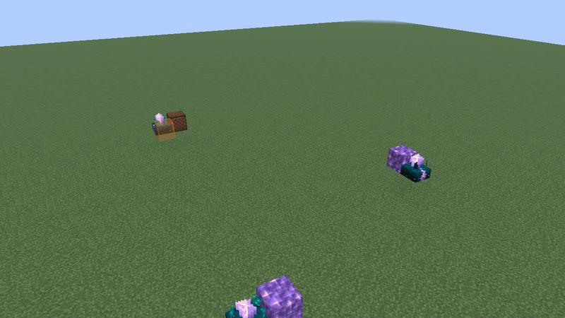</a> 43 gt (2.15 s) · calibrated_sculk_sensor+note_block · 6 blocks</td></tr>
<tr><td align="center"><a href="../archive/kit-shuttle-minecart-p43-15b.txt">kit-shuttle-minecart-p43-15b</a> 43 gt (2.15 s) · detector_rail+minecart+powered_rail · 15 blocks (picture pending)</td><td align="center"> 43 gt (2.15 s) · repeater · 27 blocks</td></tr>
</table>

## 44 gt (2.2 s)

Also reachable by: clk-obs-obs-ring (n = 9), clk-obs-bulb-ring (n = 3), clk-sculk-replin-dispenser (n = 4), dropper ring (clk-item-dropring-2d-r14, n = 0).

<table>
<tr><td align="center"> 44 gt (2.2 s) · oak_trapdoor+observer+sculk_sensor · 3 blocks</td><td align="center"> 44 gt (2.2 s) · oak_fence_gate+observer+sculk_sensor · 3 blocks</td><td align="center"> 44 gt (2.2 s) · observer+piston+sculk_sensor · 3 blocks also found as census-p44-observer-sculk_sensor-sticky_piston-3b (built with sticky_piston, without piston)</td></tr>
<tr><td align="center"> 44 gt (2.2 s) · note_block+observer+sculk_sensor · 3 blocks</td><td align="center"><a href="../archive/census-p44-calibrated_sculk_sensor-oak_trapdoor-observer-piston-sculk_sensor-sticky_piston-6b.txt">census-p44-calibrated_sculk_sensor-oak_trapdoor-observer-piston-sculk_sensor-sticky_piston-6b</a> 44 gt (2.2 s) · calibrated_sculk_sensor+oak_trapdoor+observer+piston+sculk_sensor+sticky_piston · 6 blocks (picture pending)</td><td align="center"> 44 gt (2.2 s) · calibrated_sculk_sensor+observer+sticky_piston · 7 blocks</td></tr>
<tr><td align="center"><a href="../archive/clk-obs-p44-note-obs-stk-8b-40d87f.txt">clk-obs-p44-note-obs-stk-8b-40d87f</a> 44 gt (2.2 s) · note_block+observer+sticky_piston · 8 blocks (picture pending)</td><td align="center"><a href="../archive/clk-obs-p44-bulb-lamp-obs-rb-stk-7b-8e8128.txt">clk-obs-p44-bulb-lamp-obs-rb-stk-7b-8e8128</a> 44 gt (2.2 s) · copper_bulb+observer+redstone_block+redstone_lamp+sticky_piston · 8 blocks (picture pending)</td><td align="center"><a href="../archive/clk-obs-p44-bulb-note-obs-pis-rb-stk-9b-c08b36.txt">clk-obs-p44-bulb-note-obs-pis-rb-stk-9b-c08b36</a> 44 gt (2.2 s) · copper_bulb+note_block+observer+piston+redstone_block+sticky_piston · 9 blocks (picture pending)</td></tr>
<tr><td align="center"><a href="../archive/clk-obs-p44-lamp-obs-pis-9b-861514.txt">clk-obs-p44-lamp-obs-pis-9b-861514</a> 44 gt (2.2 s) · observer+piston+redstone_lamp · 9 blocks (picture pending)</td><td align="center"> 44 gt (2.2 s) · redstone_torch+redstone_wire+repeater · 12 blocks</td><td align="center"> 44 gt (2.2 s) · repeater · 16 blocks</td></tr>
</table>

## 45 gt (2.25 s)

Also reachable by: clk-obs-odd-b (n = 8), dropper ring (clk-item-dropring-2d-r2, n = 1), lock ring (clk-item-lockring-3s, n = 2).

<table>
<tr><td align="center"> 45 gt (2.25 s) · calibrated_sculk_sensor+oak_trapdoor+observer+sculk_sensor · 4 blocks</td><td align="center"> 45 gt (2.25 s) · dispenser+note_block+observer+sculk_sensor · 4 blocks</td><td align="center"> 45 gt (2.25 s) · dispenser+oak_trapdoor+observer+sculk_sensor · 4 blocks</td></tr>
<tr><td align="center"> 45 gt (2.25 s) · note_block+observer+sculk_sensor · 4 blocks</td><td align="center"> 45 gt (2.25 s) · oak_trapdoor+observer+sculk_sensor · 4 blocks</td><td align="center"> 45 gt (2.25 s) · oak_fence_gate+observer+sculk_sensor · 4 blocks</td></tr>
<tr><td align="center"> 45 gt (2.25 s) · dispenser+observer+piston+sculk_sensor · 4 blocks also found as census-p45-dispenser-observer-sculk_sensor-sticky_piston-4b (built with sticky_piston, without piston)</td><td align="center"> 45 gt (2.25 s) · observer+piston+sculk_sensor · 4 blocks also found as census-p45-observer-sculk_sensor-sticky_piston-4b (built with sticky_piston, without piston)</td><td align="center"> 45 gt (2.25 s) · calibrated_sculk_sensor · 7 blocks</td></tr>
<tr><td align="center"><a href="../archive/kit-shuttle-minecart-p45-17b.txt">kit-shuttle-minecart-p45-17b</a> 45 gt (2.25 s) · detector_rail+minecart · 17 blocks (picture pending)</td><td align="center"> 45 gt (2.25 s) · repeater · 28 blocks</td></tr>
</table>

## 46 gt (2.3 s)

Also reachable by: observer ring with a relay block (clk-obs-trap-ring, n = 9), dropper ring (clk-item-dropring-2d-r24, n = 0), clk-item-latch (n = 1).

<table>
<tr><td align="center"> 46 gt (2.3 s) · calibrated_sculk_sensor+oak_trapdoor+observer+sculk_sensor · 4 blocks</td><td align="center"> 46 gt (2.3 s) · note_block+observer+sculk_sensor · 4 blocks</td><td align="center"> 46 gt (2.3 s) · oak_trapdoor+observer+sculk_sensor · 4 blocks</td></tr>
<tr><td align="center"> 46 gt (2.3 s) · observer+piston+sculk_sensor · 4 blocks also found as census-p46-observer-sculk_sensor-sticky_piston-4b (built with sticky_piston, without piston)</td><td align="center"> 46 gt (2.3 s) · calibrated_sculk_sensor+dispenser+observer · 6 blocks</td><td align="center"> 46 gt (2.3 s) · copper_bulb+observer+piston+redstone_block+sticky_piston · 7 blocks</td></tr>
<tr><td align="center"><a href="../archive/clk-obs-p46-bulb-obs-pis-rb-stk-7b-b-f40231.txt">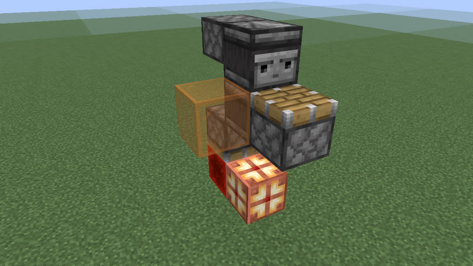</a> 46 gt (2.3 s) · copper_bulb+observer+piston+redstone_block+sticky_piston · 7 blocks</td><td align="center"> 46 gt (2.3 s) · copper_bulb+observer+redstone_block+sticky_piston · 7 blocks</td><td align="center"><a href="../archive/clk-obs-p46-bulb-obs-rb-stk-7b-b-c5658b.txt">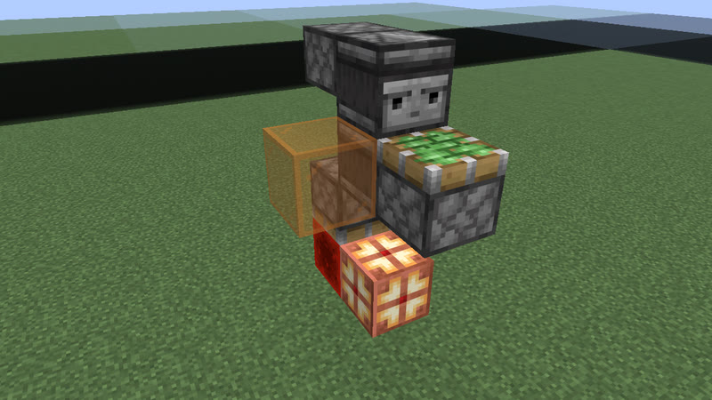</a> 46 gt (2.3 s) · copper_bulb+observer+redstone_block+sticky_piston · 7 blocks</td></tr>
<tr><td align="center"> 46 gt (2.3 s) · observer+piston+redstone_block+sticky_piston · 7 blocks</td><td align="center"> 46 gt (2.3 s) · observer+piston+redstone_block+sticky_piston · 7 blocks</td><td align="center"> 46 gt (2.3 s) · observer+redstone_block+sticky_piston · 7 blocks</td></tr>
<tr><td align="center"><a href="../archive/clk-obs-p46-obs-rb-stk-7b-b-504248.txt">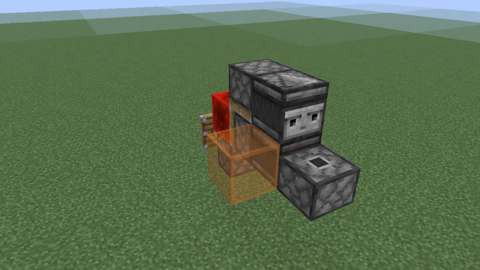</a> 46 gt (2.3 s) · observer+redstone_block+sticky_piston · 7 blocks</td><td align="center"><a href="../archive/clk-sculk-ring3p-p46-1.txt">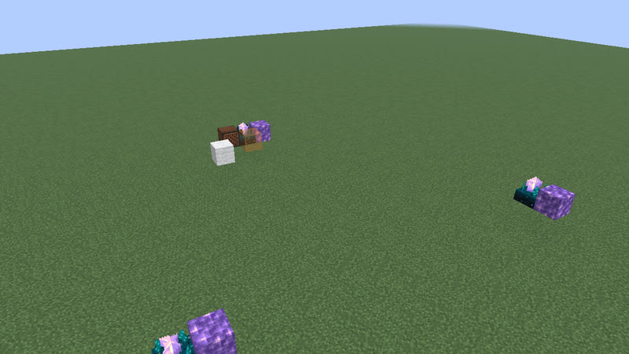</a> 46 gt (2.3 s) · calibrated_sculk_sensor · 8 blocks</td><td align="center"><a href="../archive/clk-obs-p46-bulb-lamp-obs-pis-rb-stk-9b-fceb53.txt">clk-obs-p46-bulb-lamp-obs-pis-rb-stk-9b-fceb53</a> 46 gt (2.3 s) · copper_bulb+observer+piston+redstone_block+redstone_lamp+sticky_piston · 9 blocks (picture pending)</td></tr>
<tr><td align="center"> 46 gt (2.3 s) · redstone_torch+repeater · 16 blocks</td><td align="center"> 46 gt (2.3 s) · repeater · 16 blocks</td><td align="center"><a href="../archive/kit-shuttle-minecart-p46-17b.txt">kit-shuttle-minecart-p46-17b</a> 46 gt (2.3 s) · detector_rail+minecart · 17 blocks (picture pending)</td></tr>
</table>

## 47 gt (2.35 s)

Also reachable by: clk-obs-odd-a (n = 9), clk-rt-odd-rect (n = 3), dropper ring (clk-item-dropring-2d-r3, n = 1), lock ring (clk-item-lockring-3s, n = 3), clk-misc-cart-pingpong (n = 2).

<table>
<tr><td align="center"> 47 gt (2.35 s) · note_block+observer+sculk_sensor · 4 blocks</td><td align="center"> 47 gt (2.35 s) · oak_trapdoor+observer+sculk_sensor · 4 blocks</td><td align="center"> 47 gt (2.35 s) · observer+piston+sculk_sensor · 4 blocks also found as census-p47-observer-sculk_sensor-sticky_piston-4b (built with sticky_piston, without piston)</td></tr>
<tr><td align="center"><a href="../archive/census-p47-calibrated_sculk_sensor-dispenser-note_block-observer-sculk_sensor-5b.txt">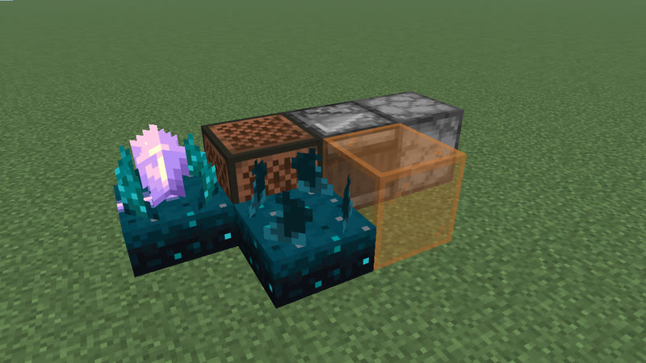</a> 47 gt (2.35 s) · calibrated_sculk_sensor+dispenser+note_block+observer+sculk_sensor · 5 blocks</td><td align="center"><a href="../archive/clk-obs-p47-lamp-note-obs-stk-8b-dae05d.txt">clk-obs-p47-lamp-note-obs-stk-8b-dae05d</a> 47 gt (2.35 s) · note_block+observer+redstone_lamp+sticky_piston · 8 blocks (picture pending)</td><td align="center"><a href="../archive/clk-obs-p47-lamp-obs-stk-8b-a789bd.txt">clk-obs-p47-lamp-obs-stk-8b-a789bd</a> 47 gt (2.35 s) · observer+redstone_lamp+sticky_piston · 8 blocks (picture pending)</td></tr>
<tr><td align="center"><a href="../archive/clk-obs-p47-note-obs-stk-8b-fe4660.txt">clk-obs-p47-note-obs-stk-8b-fe4660</a> 47 gt (2.35 s) · note_block+observer+sticky_piston · 8 blocks (picture pending)</td><td align="center"><a href="../archive/kit-shuttle-minecart-p47-17b.txt">kit-shuttle-minecart-p47-17b</a> 47 gt (2.35 s) · detector_rail+minecart+powered_rail · 17 blocks (picture pending)</td></tr>
</table>

## 48 gt (2.4 s)

Also reachable by: clk-obs-obs-ring (n = 10), clk-obs-divider (n = 2), dropper ring (clk-item-dropring-2d, n = 1), clk-rt-rect-pulse (n = 1).

<table>
<tr><td align="center"> 48 gt (2.4 s) · dispenser+observer+sculk_sensor · 3 blocks</td><td align="center"> 48 gt (2.4 s) · dispenser+observer+sculk_sensor · 3 blocks</td><td align="center"> 48 gt (2.4 s) · dispenser+observer+sculk_sensor · 3 blocks</td></tr>
<tr><td align="center"> 48 gt (2.4 s) · calibrated_sculk_sensor+observer+sticky_piston · 4 blocks</td><td align="center"> 48 gt (2.4 s) · copper_bulb+observer+piston+redstone_block+sticky_piston · 5 blocks</td><td align="center"> 48 gt (2.4 s) · copper_bulb+observer+redstone_block+sticky_piston · 5 blocks</td></tr>
<tr><td align="center"> 48 gt (2.4 s) · copper_bulb+observer+piston+redstone_block+sticky_piston · 5 blocks</td><td align="center"> 48 gt (2.4 s) · copper_bulb+observer+redstone_block+sticky_piston · 5 blocks</td><td align="center"> 48 gt (2.4 s) · calibrated_sculk_sensor+iron_trapdoor+observer+sticky_piston · 5 blocks</td></tr>
<tr><td align="center"> 48 gt (2.4 s) · calibrated_sculk_sensor+oak_fence_gate+observer+sticky_piston · 5 blocks</td><td align="center"><a href="../archive/census-p48-calibrated_sculk_sensor-note_block-observer-6b.txt">census-p48-calibrated_sculk_sensor-note_block-observer-6b</a> 48 gt (2.4 s) · calibrated_sculk_sensor+note_block+observer · 6 blocks (picture pending)</td><td align="center"> 48 gt (2.4 s) · copper_bulb+observer+sticky_piston · 6 blocks</td></tr>
<tr><td align="center"> 48 gt (2.4 s) · observer+redstone_block+sticky_piston · 6 blocks</td><td align="center"> 48 gt (2.4 s) · observer+redstone_block+sticky_piston · 6 blocks</td><td align="center"> 48 gt (2.4 s) · copper_bulb+observer+piston+sticky_piston · 7 blocks</td></tr>
<tr><td align="center"> 48 gt (2.4 s) · copper_bulb+observer+redstone_block+redstone_lamp+sticky_piston · 7 blocks</td><td align="center"> 48 gt (2.4 s) · observer+piston+redstone_block+sticky_piston · 7 blocks</td><td align="center"> 48 gt (2.4 s) · note_block+observer+redstone_lamp+sticky_piston · 7 blocks</td></tr>
<tr><td align="center"> 48 gt (2.4 s) · observer+redstone_block+redstone_lamp+sticky_piston · 7 blocks</td><td align="center"><a href="../archive/clk-obs-p48-lamp-obs-rb-stk-7b-b-18a2eb.txt">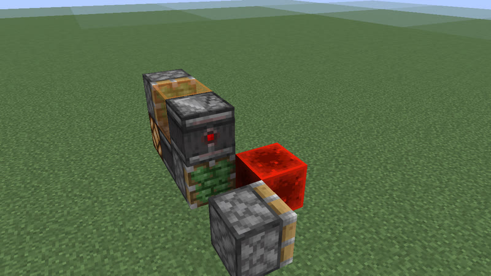</a> 48 gt (2.4 s) · observer+redstone_block+redstone_lamp+sticky_piston · 7 blocks</td><td align="center"><a href="../archive/clk-obs-p48-bulb-lamp-obs-pis-rb-stk-8b-f1d23f.txt">clk-obs-p48-bulb-lamp-obs-pis-rb-stk-8b-f1d23f</a> 48 gt (2.4 s) · copper_bulb+observer+piston+redstone_block+redstone_lamp+sticky_piston · 8 blocks (picture pending)</td></tr>
<tr><td align="center"><a href="../archive/clk-obs-p48-note-obs-pis-7b-6f313e.txt">clk-obs-p48-note-obs-pis-7b-6f313e</a> 48 gt (2.4 s) · note_block+observer+piston · 8 blocks (picture pending)</td><td align="center"><a href="../archive/clk-obs-p48-bulb-obs-pis-8b-461db1.txt">clk-obs-p48-bulb-obs-pis-8b-461db1</a> 48 gt (2.4 s) · copper_bulb+observer+piston · 9 blocks (picture pending)</td></tr>
</table>

## 49 gt (2.45 s)

Also reachable by: clk-obs-odd-b (n = 9), hopper ring (clk-item-hopper-ring-2, n = 6), dropper ring (clk-item-dropring-2d-r4, n = 1), clk-sculk-replin (one block swapped: 2 versions) (clk-sculk-replin, n = 5).

<table>
<tr><td align="center"> 49 gt (2.45 s) · dispenser+observer+sculk_sensor · 4 blocks</td><td align="center"> 49 gt (2.45 s) · dispenser+observer+sculk_sensor · 4 blocks</td><td align="center"><a href="../archive/census-p49-calibrated_sculk_sensor-oak_trapdoor-observer-sculk_sensor-sticky_piston-6b.txt">census-p49-calibrated_sculk_sensor-oak_trapdoor-observer-sculk_sensor-sticky_piston-6b</a> 49 gt (2.45 s) · calibrated_sculk_sensor+oak_trapdoor+observer+sculk_sensor+sticky_piston · 6 blocks (picture pending)</td></tr>
<tr><td align="center"> 49 gt (2.45 s) · repeater · 31 blocks</td></tr>
</table>

## 50 gt (2.5 s)

Also reachable by: observer ring with a relay block (clk-obs-trap-ring, n = 10), dropper ring (clk-item-dropring-1d-r1, n = 1).

<table>
<tr><td align="center"> 50 gt (2.5 s) · dispenser+observer+sculk_sensor · 4 blocks</td><td align="center"> 50 gt (2.5 s) · calibrated_sculk_sensor+observer+piston+sculk_sensor · 5 blocks also found as census-p50-calibrated_sculk_sensor-observer-sculk_sensor-sticky_piston-5b (built with sticky_piston, without piston)</td><td align="center"> 50 gt (2.5 s) · calibrated_sculk_sensor+dispenser+observer+sticky_piston · 5 blocks</td></tr>
<tr><td align="center"> 50 gt (2.5 s) · calibrated_sculk_sensor+observer+sticky_piston · 5 blocks</td><td align="center"><a href="../archive/clk-obs-p50-bulb-lamp-note-obs-stk-8b-b2cb34.txt">clk-obs-p50-bulb-lamp-note-obs-stk-8b-b2cb34</a> 50 gt (2.5 s) · copper_bulb+note_block+observer+redstone_lamp+sticky_piston · 8 blocks (picture pending)</td><td align="center"> 50 gt (2.5 s) · redstone_torch+repeater · 16 blocks</td></tr>
<tr><td align="center"> 50 gt (2.5 s) · repeater · 19 blocks</td></tr>
</table>

## 51 gt (2.55 s)

Also reachable by: clk-obs-odd-a (n = 10), dropper ring (clk-item-dropring-1d-r14, n = 0), clk-sculk-hairpin (one block swapped: 2 versions) (clk-sculk-hairpin, n = 3), clk-sculk-hairpin-plain (n = 3).

<table>
<tr><td align="center"> 51 gt (2.55 s) · dispenser+observer+sculk_sensor · 4 blocks</td><td align="center"> 51 gt (2.55 s) · dispenser+observer+sculk_sensor · 4 blocks</td><td align="center"><a href="../archive/clk-obs-p51-lamp-note-obs-stk-9b-e9639d.txt">clk-obs-p51-lamp-note-obs-stk-9b-e9639d</a> 51 gt (2.55 s) · note_block+observer+redstone_lamp+sticky_piston · 9 blocks (picture pending)</td></tr>
<tr><td align="center"><a href="../archive/kit-shuttle-minecart-p51-17b.txt">kit-shuttle-minecart-p51-17b</a> 51 gt (2.55 s) · detector_rail+minecart · 17 blocks (picture pending)</td><td align="center"> 51 gt (2.55 s) · repeater · 31 blocks</td></tr>
</table>

[catalog index](../CATALOG.md) · previous: [p4-27](p4-27.md) · next: [p52-107](p52-107.md)
