# Clocks: 29 gt (1.45 s) to 39 gt (1.95 s) (286 clocks)

[catalog index](../CATALOG.md) · previous: [p24-28](p24-28.md) · next: [p40-47](p40-47.md)

Orange glass = where the output signal is (placed only for the picture); click a picture for its design. Generated by `mctas clock catalog`.

## 29 gt (1.45 s)

Also reachable by: clk-obs-odd-b (n = 4).

<table>
<tr><td align="center"> 29 gt (1.45 s) · calibrated_sculk_sensor+dispenser+observer · 4 blocks</td><td align="center"> 29 gt (1.45 s) · calibrated_sculk_sensor+dispenser+observer · 4 blocks</td><td align="center"> 29 gt (1.45 s) · calibrated_sculk_sensor+dispenser+observer · 4 blocks</td></tr>
<tr><td align="center"> 29 gt (1.45 s) · calibrated_sculk_sensor+note_block+observer · 5 blocks</td><td align="center"> 29 gt (1.45 s) · calibrated_sculk_sensor+oak_trapdoor+observer · 5 blocks</td><td align="center"> 29 gt (1.45 s) · calibrated_sculk_sensor+observer+piston · 5 blocks</td></tr>
<tr><td align="center"><a href="../archive/census-p29-calibrated_sculk_sensor-observer-sticky_piston-5b.txt">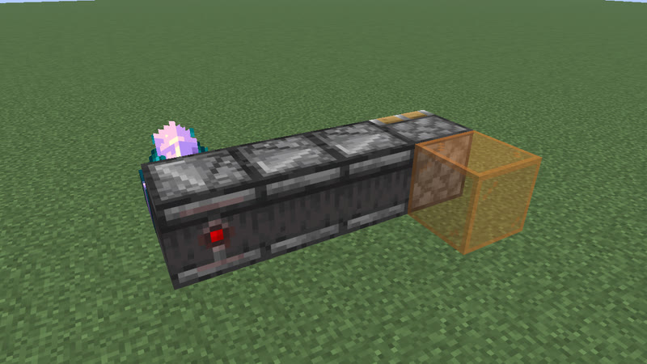</a> 29 gt (1.45 s) · calibrated_sculk_sensor+observer+sticky_piston · 5 blocks</td><td align="center"> 29 gt (1.45 s) · calibrated_sculk_sensor+oak_fence_gate+observer · 5 blocks</td><td align="center"> 29 gt (1.45 s) · calibrated_sculk_sensor+iron_trapdoor+observer · 5 blocks</td></tr>
<tr><td align="center"> 29 gt (1.45 s) · note_block+observer+redstone_block+redstone_lamp+sticky_piston · 7 blocks</td><td align="center"> 29 gt (1.45 s) · note_block+observer+redstone_lamp+sticky_piston · 7 blocks</td><td align="center"> 29 gt (1.45 s) · note_block+observer+redstone_lamp+sticky_piston · 7 blocks</td></tr>
<tr><td align="center"> 29 gt (1.45 s) · observer+redstone_block+redstone_lamp+sticky_piston · 7 blocks</td><td align="center"> 29 gt (1.45 s) · observer+redstone_block+redstone_lamp+sticky_piston · 7 blocks</td><td align="center"> 29 gt (1.45 s) · observer+redstone_lamp+sticky_piston · 7 blocks</td></tr>
<tr><td align="center"> 29 gt (1.45 s) · observer+redstone_lamp+sticky_piston · 7 blocks</td><td align="center"> 29 gt (1.45 s) · note_block+observer+sticky_piston · 7 blocks</td><td align="center"> 29 gt (1.45 s) · note_block+observer+sticky_piston · 7 blocks</td></tr>
<tr><td align="center"> 29 gt (1.45 s) · observer+sticky_piston · 7 blocks</td><td align="center"> 29 gt (1.45 s) · observer+sticky_piston · 7 blocks</td><td align="center"> 29 gt (1.45 s) · copper_bulb+observer+sticky_piston · 7 blocks</td></tr>
<tr><td align="center"> 29 gt (1.45 s) · copper_bulb+observer+sticky_piston · 7 blocks</td><td align="center"> 29 gt (1.45 s) · comparator+dropper+hopper+repeater · 14 blocks</td><td align="center"> 29 gt (1.45 s) · repeater · 20 blocks</td></tr>
</table>

## 30 gt (1.5 s)

Also reachable by: clk-misc-activator_rail-ring (n = 5), clk-misc-crafter-ring (n = 5), clk-misc-iron_door-ring (n = 5), clk-misc-oak_door-ring (n = 5), clk-misc-oak_fence_gate-ring (n = 5), clk-misc-oak_trapdoor-ring (n = 5), clk-misc-powered_rail-ring (n = 5), clk-misc-skeleton_skull-ring (n = 5), clk-obs-note-ring (n = 5), clk-obs-trap-ring (n = 5), clk-item-latch (n = 0).

<table>
<tr><td align="center"> 30 gt (1.5 s) · calibrated_sculk_sensor+dispenser+observer · 4 blocks</td><td align="center"> 30 gt (1.5 s) · calibrated_sculk_sensor+dispenser+observer · 4 blocks</td><td align="center"> 30 gt (1.5 s) · calibrated_sculk_sensor+dispenser+observer · 4 blocks</td></tr>
<tr><td align="center"> 30 gt (1.5 s) · calibrated_sculk_sensor+oak_trapdoor+observer · 5 blocks</td><td align="center"> 30 gt (1.5 s) · calibrated_sculk_sensor+oak_fence_gate+observer · 5 blocks</td><td align="center"> 30 gt (1.5 s) · calibrated_sculk_sensor+iron_trapdoor+observer · 5 blocks</td></tr>
<tr><td align="center"> 30 gt (1.5 s) · calibrated_sculk_sensor+note_block+observer · 5 blocks</td><td align="center"><a href="../archive/clk-sculk-hyb3-p30-17.txt">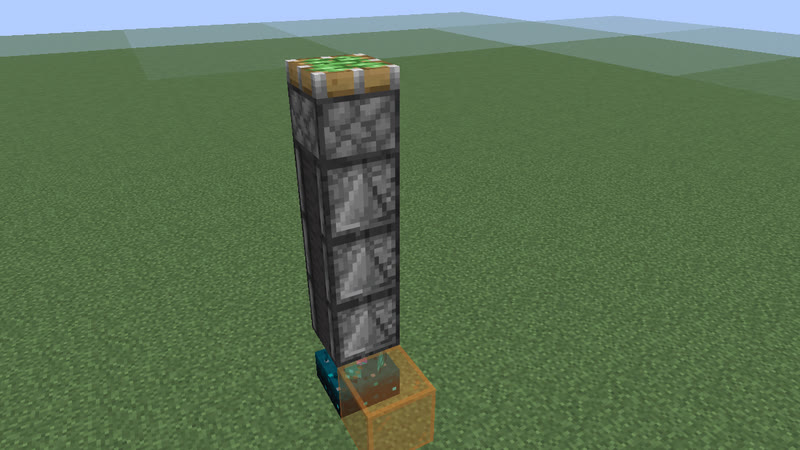</a> 30 gt (1.5 s) · calibrated_sculk_sensor+observer+sticky_piston · 5 blocks</td><td align="center"> 30 gt (1.5 s) · calibrated_sculk_sensor+observer+piston · 5 blocks</td></tr>
<tr><td align="center"> 30 gt (1.5 s) · observer+redstone_block+sticky_piston · 6 blocks</td><td align="center"> 30 gt (1.5 s) · observer+sticky_piston · 6 blocks</td><td align="center"> 30 gt (1.5 s) · observer+sticky_piston · 6 blocks</td></tr>
<tr><td align="center"> 30 gt (1.5 s) · observer+sticky_piston · 6 blocks</td><td align="center"> 30 gt (1.5 s) · note_block+observer+sticky_piston · 6 blocks</td><td align="center"> 30 gt (1.5 s) · observer+redstone_block+sticky_piston · 6 blocks</td></tr>
<tr><td align="center"> 30 gt (1.5 s) · copper_bulb+observer+redstone_block+sticky_piston · 6 blocks</td><td align="center"> 30 gt (1.5 s) · copper_bulb+observer+redstone_block+sticky_piston · 6 blocks</td><td align="center"> 30 gt (1.5 s) · observer+redstone_lamp+sticky_piston · 6 blocks</td></tr>
<tr><td align="center"> 30 gt (1.5 s) · note_block+observer+sticky_piston · 6 blocks</td><td align="center"> 30 gt (1.5 s) · note_block+observer+piston+redstone_lamp+sticky_piston · 7 blocks</td><td align="center"> 30 gt (1.5 s) · note_block+observer+redstone_lamp+sticky_piston · 7 blocks</td></tr>
<tr><td align="center"> 30 gt (1.5 s) · observer+piston+redstone_lamp+sticky_piston · 7 blocks</td><td align="center"><a href="../archive/clk-obs-p30-lamp-obs-stk-7b-b-3e3afa.txt">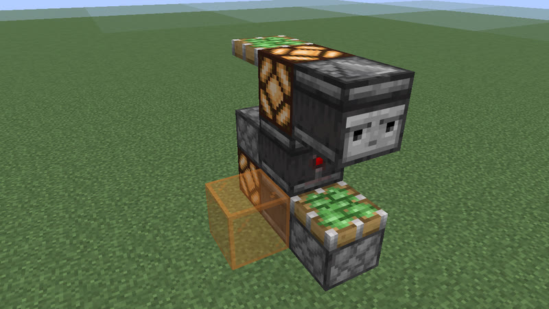</a> 30 gt (1.5 s) · observer+redstone_lamp+sticky_piston · 7 blocks</td><td align="center"><a href="../archive/clk-obs-p30-note-obs-pis-stk-7b-b-a39540.txt">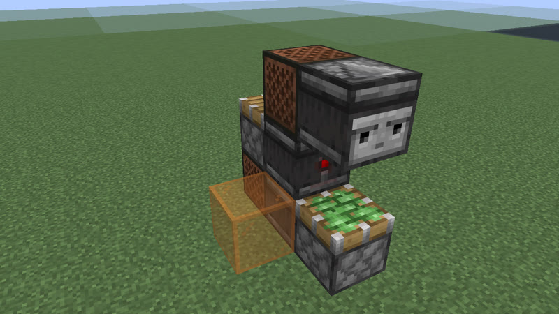</a> 30 gt (1.5 s) · note_block+observer+piston+sticky_piston · 7 blocks</td></tr>
<tr><td align="center"> 30 gt (1.5 s) · note_block+observer+piston+sticky_piston · 7 blocks</td><td align="center"> 30 gt (1.5 s) · note_block+observer+redstone_block+sticky_piston · 7 blocks</td><td align="center"> 30 gt (1.5 s) · observer+piston+sticky_piston · 7 blocks</td></tr>
<tr><td align="center"><a href="../archive/clk-obs-p30-obs-pis-stk-7b-b-7ee916.txt">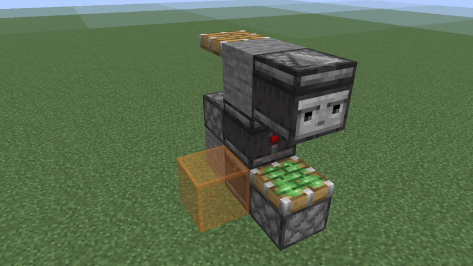</a> 30 gt (1.5 s) · observer+piston+sticky_piston · 7 blocks</td><td align="center"><a href="../archive/clk-obs-p30-bulb-lamp-note-obs-rb-stk-7b-b-1d88db.txt">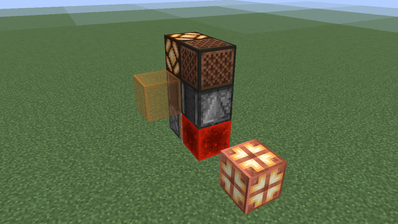</a> 30 gt (1.5 s) · copper_bulb+note_block+observer+redstone_block+redstone_lamp+sticky_piston · 7 blocks</td><td align="center"> 30 gt (1.5 s) · copper_bulb+note_block+observer+redstone_block+redstone_lamp+sticky_piston · 7 blocks</td></tr>
<tr><td align="center"> 30 gt (1.5 s) · copper_bulb+observer+redstone_block+redstone_lamp+sticky_piston · 7 blocks</td><td align="center"><a href="../archive/clk-obs-p30-bulb-lamp-obs-rb-stk-7b-b-7ff7b8.txt">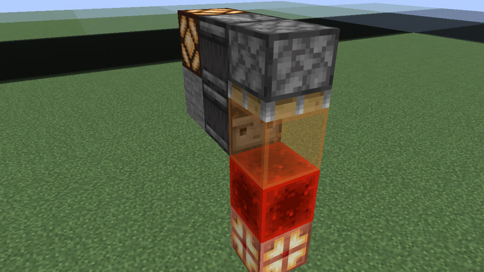</a> 30 gt (1.5 s) · copper_bulb+observer+redstone_block+redstone_lamp+sticky_piston · 7 blocks</td><td align="center"> 30 gt (1.5 s) · observer+redstone_block+redstone_lamp+sticky_piston · 7 blocks</td></tr>
<tr><td align="center"> 30 gt (1.5 s) · observer+piston · 7 blocks</td><td align="center"> 30 gt (1.5 s) · observer+piston · 7 blocks</td><td align="center"> 30 gt (1.5 s) · observer+piston+redstone_block+sticky_piston · 7 blocks</td></tr>
<tr><td align="center"> 30 gt (1.5 s) · observer+redstone_block+redstone_lamp+sticky_piston · 7 blocks</td><td align="center"> 30 gt (1.5 s) · copper_bulb+observer+piston+redstone_block+redstone_lamp+sticky_piston · 7 blocks</td><td align="center"> 30 gt (1.5 s) · copper_bulb+observer+piston+redstone_block+redstone_lamp+sticky_piston · 7 blocks</td></tr>
<tr><td align="center"> 30 gt (1.5 s) · copper_bulb+note_block+observer+piston+redstone_block+sticky_piston · 7 blocks</td><td align="center"> 30 gt (1.5 s) · copper_bulb+note_block+observer+redstone_block+sticky_piston · 7 blocks</td><td align="center"> 30 gt (1.5 s) · copper_bulb+observer+piston+redstone_block+sticky_piston · 7 blocks</td></tr>
<tr><td align="center"> 30 gt (1.5 s) · comparator+hopper · 10 blocks</td><td align="center"> 30 gt (1.5 s) · comparator+redstone_torch+repeater · 12 blocks</td><td align="center"> 30 gt (1.5 s) · redstone_torch+repeater · 12 blocks</td></tr>
<tr><td align="center"> 30 gt (1.5 s) · repeater · 12 blocks</td><td align="center"> 30 gt (1.5 s) · redstone_wire+repeater · 13 blocks</td><td align="center"> 30 gt (1.5 s) · redstone_wire+repeater · 14 blocks</td></tr>
<tr><td align="center"> 30 gt (1.5 s) · comparator+repeater · 16 blocks</td></tr>
</table>

## 31 gt (1.55 s)

Also reachable by: clk-obs-odd-a (n = 5), clk-rt-odd-rect (n = 1), clk-misc-cart-loop (n = 1), clk-item-dropring-2d-r2 (n = 0), clk-sculk-replin (n = 3).

<table>
<tr><td align="center"> 31 gt (1.55 s) · calibrated_sculk_sensor+dispenser+observer · 4 blocks</td><td align="center"> 31 gt (1.55 s) · calibrated_sculk_sensor+dispenser+observer · 4 blocks</td><td align="center"> 31 gt (1.55 s) · calibrated_sculk_sensor+dispenser+observer · 4 blocks</td></tr>
<tr><td align="center"><a href="../archive/clk-sculk-hyb3-p31-7.txt">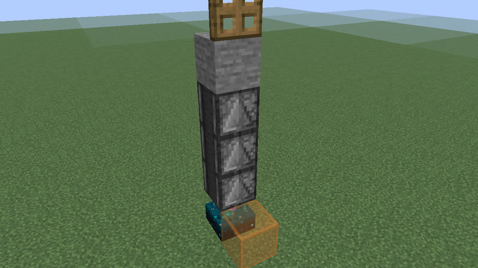</a> 31 gt (1.55 s) · calibrated_sculk_sensor+oak_trapdoor+observer · 6 blocks</td><td align="center"><a href="../archive/clk-sculk-hyb3b-p31-13.txt">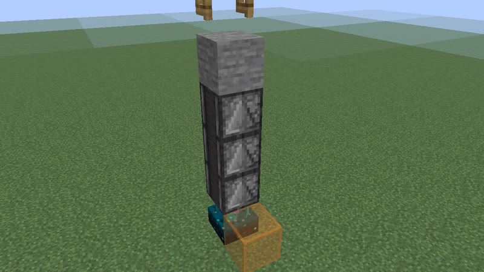</a> 31 gt (1.55 s) · calibrated_sculk_sensor+oak_fence_gate+observer · 6 blocks</td><td align="center"><a href="../archive/clk-sculk-hyb3b-p31-7.txt">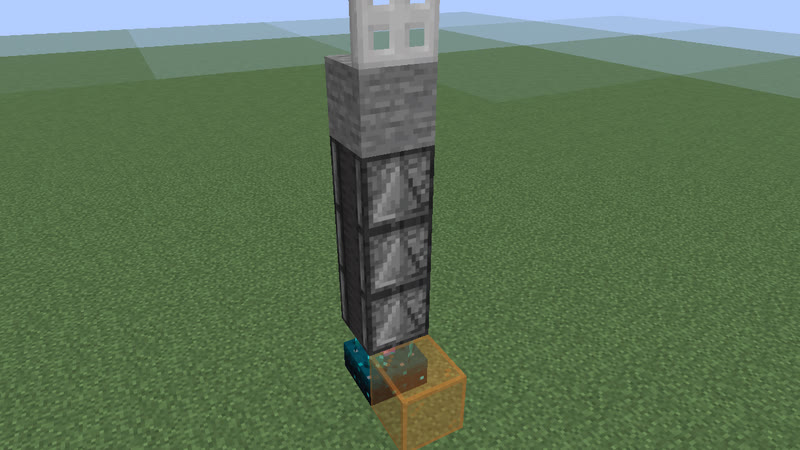</a> 31 gt (1.55 s) · calibrated_sculk_sensor+iron_trapdoor+observer · 6 blocks</td></tr>
<tr><td align="center"><a href="../archive/clk-sculk-hyb3-p31-1.txt">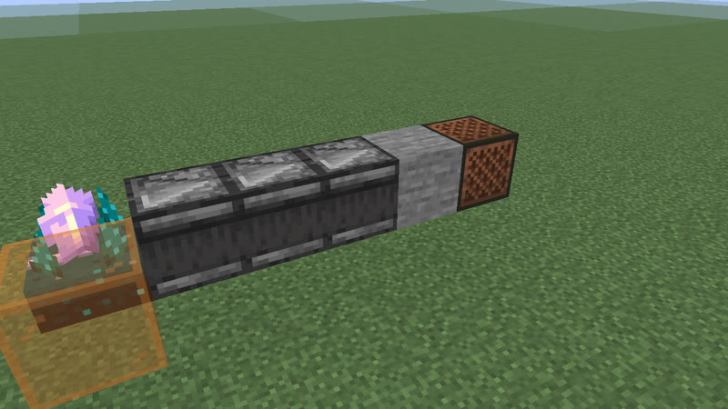</a> 31 gt (1.55 s) · calibrated_sculk_sensor+note_block+observer · 6 blocks</td><td align="center"><a href="../archive/clk-sculk-hyb3-p31-17.txt">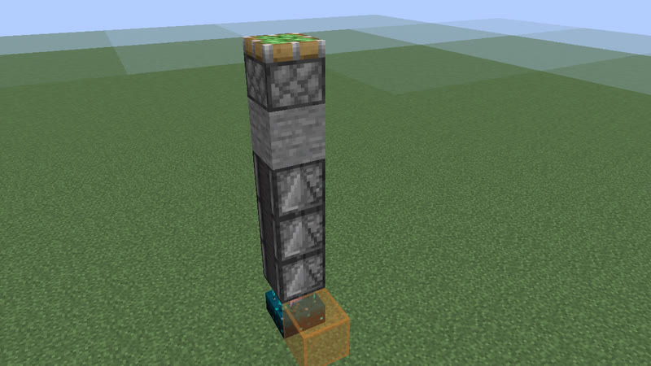</a> 31 gt (1.55 s) · calibrated_sculk_sensor+observer+sticky_piston · 6 blocks</td><td align="center"> 31 gt (1.55 s) · calibrated_sculk_sensor+observer+piston · 6 blocks</td></tr>
<tr><td align="center"> 31 gt (1.55 s) · observer+piston+sticky_piston · 7 blocks</td><td align="center"> 31 gt (1.55 s) · observer+piston+redstone_lamp+sticky_piston · 7 blocks</td><td align="center"> 31 gt (1.55 s) · observer+redstone_lamp+sticky_piston · 7 blocks</td></tr>
<tr><td align="center"> 31 gt (1.55 s) · note_block+observer+piston+sticky_piston · 7 blocks</td><td align="center"> 31 gt (1.55 s) · note_block+observer+sticky_piston · 7 blocks</td><td align="center"><a href="../archive/clk-obs-p31-obs-pis-stk-7b-b-737919.txt">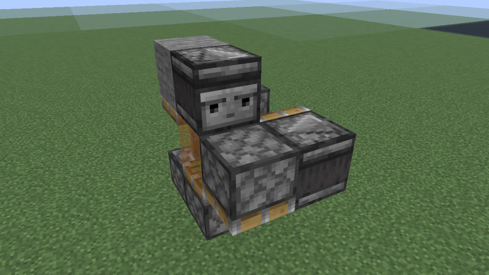</a> 31 gt (1.55 s) · observer+piston+sticky_piston · 7 blocks</td></tr>
<tr><td align="center"> 31 gt (1.55 s) · observer+piston+redstone_block+sticky_piston · 7 blocks</td><td align="center"><a href="../archive/clk-obs-p31-obs-pis-rb-stk-7b-b-5b94e4.txt">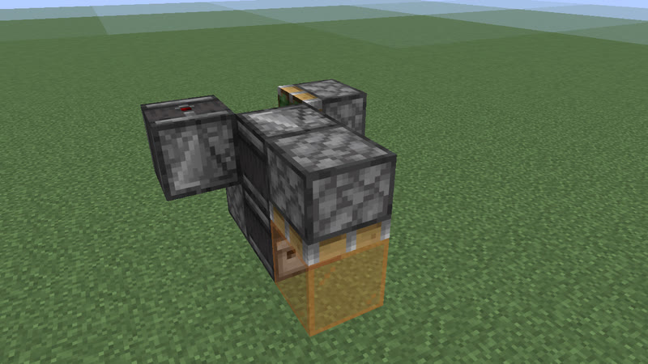</a> 31 gt (1.55 s) · observer+piston+redstone_block+sticky_piston · 7 blocks</td><td align="center"><a href="../archive/clk-obs-p31-obs-rb-stk-7b-b-e1438b.txt">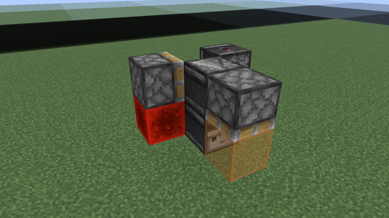</a> 31 gt (1.55 s) · observer+redstone_block+sticky_piston · 7 blocks</td></tr>
<tr><td align="center"> 31 gt (1.55 s) · observer+redstone_block+sticky_piston · 7 blocks</td><td align="center"> 31 gt (1.55 s) · observer+sticky_piston · 7 blocks</td><td align="center"><a href="../archive/clk-obs-p31-obs-stk-7b-b-2cb961.txt">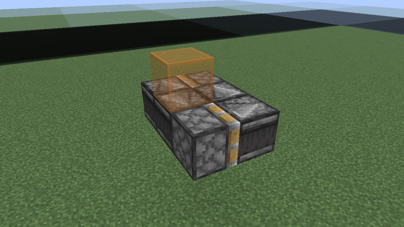</a> 31 gt (1.55 s) · observer+sticky_piston · 7 blocks</td></tr>
</table>

## 32 gt (1.6 s)

Also reachable by: clk-obs-obs-ring (n = 6), clk-rt-rect-pulse (n = 0).

<table>
<tr><td align="center"> 32 gt (1.6 s) · calibrated_sculk_sensor+dispenser+observer · 5 blocks</td><td align="center"> 32 gt (1.6 s) · copper_bulb+observer+redstone_block+sticky_piston · 6 blocks</td><td align="center"> 32 gt (1.6 s) · copper_bulb+observer+sticky_piston · 6 blocks</td></tr>
<tr><td align="center"> 32 gt (1.6 s) · observer+sticky_piston · 6 blocks</td><td align="center"> 32 gt (1.6 s) · note_block+observer+redstone_lamp+sticky_piston · 6 blocks</td><td align="center"> 32 gt (1.6 s) · observer+redstone_lamp+sticky_piston · 6 blocks</td></tr>
<tr><td align="center"><a href="../archive/clk-obs-p32-lamp-obs-stk-6b-b-853c4b.txt">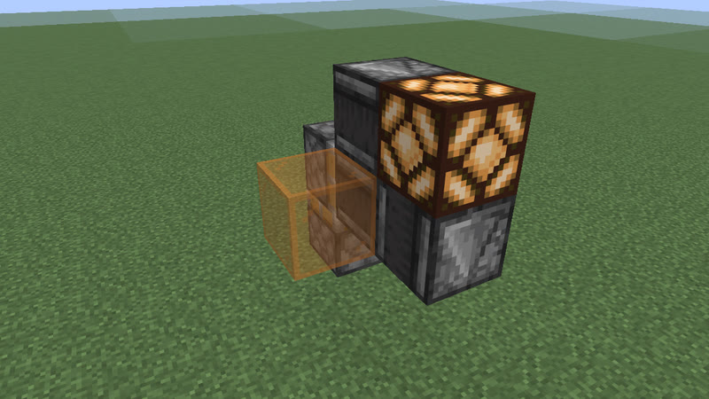</a> 32 gt (1.6 s) · observer+redstone_lamp+sticky_piston · 6 blocks</td><td align="center"> 32 gt (1.6 s) · observer+piston+redstone_block+sticky_piston · 6 blocks</td><td align="center"> 32 gt (1.6 s) · observer+sticky_piston · 6 blocks</td></tr>
<tr><td align="center"> 32 gt (1.6 s) · observer+sticky_piston · 6 blocks</td><td align="center"> 32 gt (1.6 s) · observer+redstone_block+sticky_piston · 6 blocks</td><td align="center"> 32 gt (1.6 s) · observer+redstone_block+sticky_piston · 6 blocks</td></tr>
<tr><td align="center"><a href="../archive/clk-sculk-obs-p32-1.txt">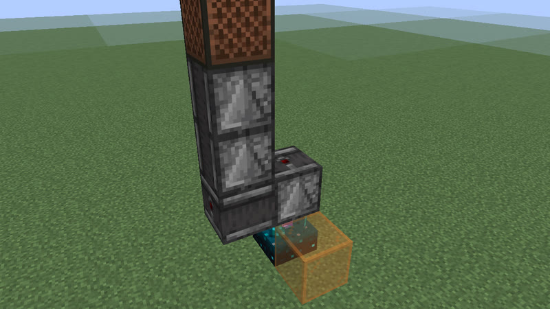</a> 32 gt (1.6 s) · calibrated_sculk_sensor+note_block+observer · 6 blocks</td><td align="center"> 32 gt (1.6 s) · copper_bulb+observer+piston+redstone_block+sticky_piston · 6 blocks</td><td align="center"> 32 gt (1.6 s) · copper_bulb+observer+piston+redstone_block+sticky_piston · 6 blocks</td></tr>
<tr><td align="center"> 32 gt (1.6 s) · copper_bulb+observer+redstone_block+sticky_piston · 6 blocks</td><td align="center"><a href="../archive/clk-obs-p32-lamp-note-obs-stk-6b-b-4951e6.txt">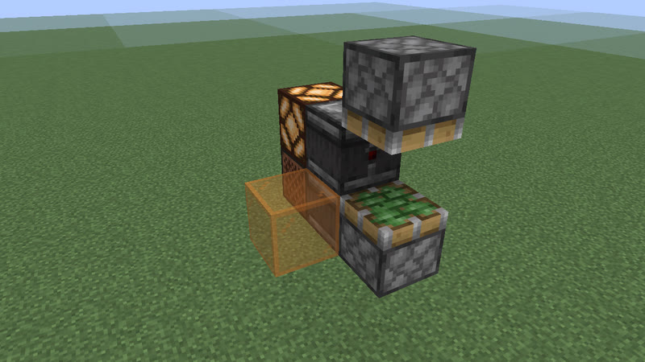</a> 32 gt (1.6 s) · note_block+observer+redstone_lamp+sticky_piston · 6 blocks</td><td align="center"> 32 gt (1.6 s) · note_block+observer+sticky_piston · 6 blocks</td></tr>
<tr><td align="center"> 32 gt (1.6 s) · copper_bulb+observer+piston+sticky_piston · 7 blocks</td><td align="center"> 32 gt (1.6 s) · copper_bulb+observer+sticky_piston · 7 blocks</td><td align="center"> 32 gt (1.6 s) · copper_bulb+note_block+observer+piston+redstone_block+sticky_piston · 7 blocks</td></tr>
<tr><td align="center"><a href="../archive/clk-obs-p32-bulb-note-obs-pis-rb-stk-7b-b-58a2fb.txt">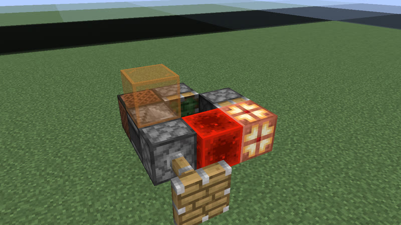</a> 32 gt (1.6 s) · copper_bulb+note_block+observer+piston+redstone_block+sticky_piston · 7 blocks</td><td align="center"><a href="../archive/clk-obs-p32-bulb-note-obs-rb-stk-7b-b-6d8842.txt">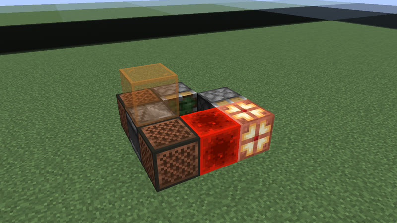</a> 32 gt (1.6 s) · copper_bulb+note_block+observer+redstone_block+sticky_piston · 7 blocks</td><td align="center"> 32 gt (1.6 s) · copper_bulb+note_block+observer+redstone_block+sticky_piston · 7 blocks</td></tr>
<tr><td align="center"> 32 gt (1.6 s) · note_block+observer+piston+redstone_block+sticky_piston · 7 blocks</td><td align="center"> 32 gt (1.6 s) · note_block+observer+piston+redstone_block+sticky_piston · 7 blocks</td><td align="center"> 32 gt (1.6 s) · note_block+observer+redstone_block+sticky_piston · 7 blocks</td></tr>
<tr><td align="center"> 32 gt (1.6 s) · note_block+observer+redstone_block+sticky_piston · 7 blocks</td><td align="center"><a href="../archive/clk-obs-p32-note-obs-stk-7b-b-0b6f5f.txt">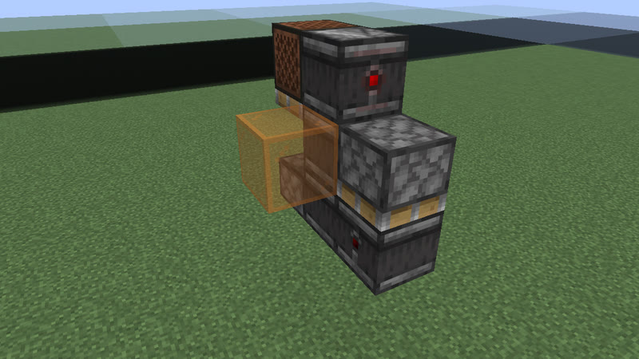</a> 32 gt (1.6 s) · note_block+observer+sticky_piston · 7 blocks</td><td align="center"><a href="../archive/clk-obs-p32-obs-pis-rb-stk-7b-b-9e05fe.txt">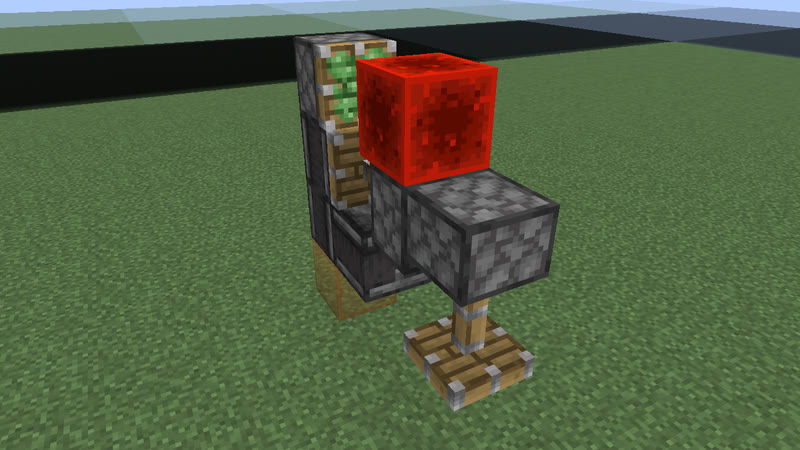</a> 32 gt (1.6 s) · observer+piston+redstone_block+sticky_piston · 7 blocks</td></tr>
<tr><td align="center"> 32 gt (1.6 s) · observer+piston+sticky_piston · 7 blocks</td><td align="center"> 32 gt (1.6 s) · copper_bulb+note_block+observer+redstone_lamp+sticky_piston · 7 blocks</td><td align="center"> 32 gt (1.6 s) · copper_bulb+note_block+observer+sticky_piston · 7 blocks</td></tr>
<tr><td align="center"><a href="../archive/clk-obs-p32-bulb-note-obs-stk-7b-b-d803da.txt">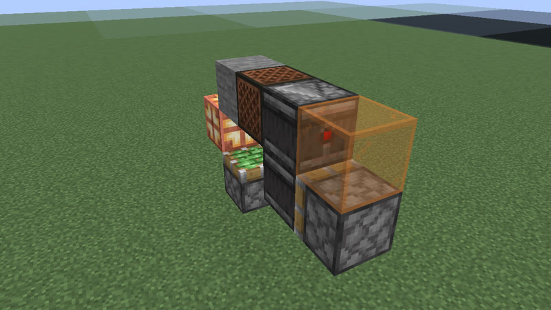</a> 32 gt (1.6 s) · copper_bulb+note_block+observer+sticky_piston · 7 blocks</td><td align="center"> 32 gt (1.6 s) · note_block+observer+piston+sticky_piston · 7 blocks</td><td align="center"><a href="../archive/clk-obs-p32-note-obs-pis-stk-7b-b-6a6a54.txt">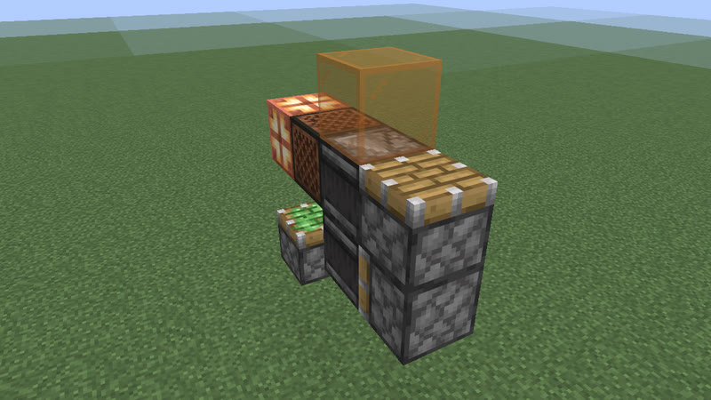</a> 32 gt (1.6 s) · note_block+observer+piston+sticky_piston · 7 blocks</td></tr>
<tr><td align="center"> 32 gt (1.6 s) · redstone_torch+redstone_wire+repeater · 9 blocks</td><td align="center"> 32 gt (1.6 s) · redstone_torch+repeater · 12 blocks</td><td align="center"> 32 gt (1.6 s) · comparator+redstone_torch+redstone_wire+repeater · 12 blocks</td></tr>
<tr><td align="center"> 32 gt (1.6 s) · comparator+redstone_torch+redstone_wire+repeater · 13 blocks</td><td align="center"> 32 gt (1.6 s) · redstone_wire+repeater · 13 blocks</td><td align="center"> 32 gt (1.6 s) · redstone_wire+repeater · 14 blocks</td></tr>
<tr><td align="center"> 32 gt (1.6 s) · comparator+repeater · 16 blocks</td><td align="center"> 32 gt (1.6 s) · comparator+dropper+hopper+repeater · 18 blocks</td></tr>
</table>

## 33 gt (1.65 s)

Also reachable by: clk-obs-odd-b (n = 5), clk-item-dropring-2d-r3 (n = 0), clk-item-lockring-2s (n = 0).

<table>
<tr><td align="center"> 33 gt (1.65 s) · calibrated_sculk_sensor+note_block+observer · 6 blocks</td><td align="center"><a href="../archive/clk-sculk-two-p33-1.txt">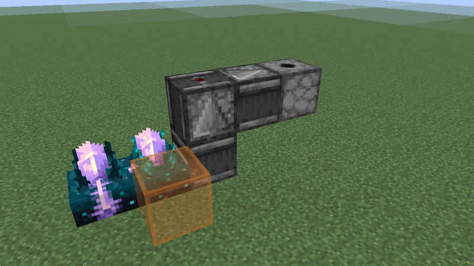</a> 33 gt (1.65 s) · calibrated_sculk_sensor+dispenser+observer · 6 blocks</td><td align="center"> 33 gt (1.65 s) · note_block+observer+redstone_lamp+sticky_piston · 7 blocks</td></tr>
<tr><td align="center"> 33 gt (1.65 s) · note_block+observer+redstone_lamp+sticky_piston · 7 blocks</td><td align="center"> 33 gt (1.65 s) · observer+redstone_lamp+sticky_piston · 7 blocks</td><td align="center"> 33 gt (1.65 s) · observer+redstone_lamp+sticky_piston · 7 blocks</td></tr>
<tr><td align="center"> 33 gt (1.65 s) · note_block+observer+sticky_piston · 7 blocks</td><td align="center"> 33 gt (1.65 s) · note_block+observer+sticky_piston · 7 blocks</td><td align="center"> 33 gt (1.65 s) · observer+sticky_piston · 7 blocks</td></tr>
<tr><td align="center"> 33 gt (1.65 s) · repeater · 23 blocks</td></tr>
</table>

## 34 gt (1.7 s)

Also reachable by: clk-misc-activator_rail-ring (n = 6), clk-misc-crafter-ring (n = 6), clk-misc-iron_door-ring (n = 6), clk-misc-oak_door-ring (n = 6), clk-misc-oak_fence_gate-ring (n = 6), clk-misc-oak_trapdoor-ring (n = 6), clk-misc-powered_rail-ring (n = 6), clk-misc-skeleton_skull-ring (n = 6), clk-obs-note-ring (n = 6), clk-obs-trap-ring (n = 6), clk-item-dropring-2d (n = 0).

<table>
<tr><td align="center"> 34 gt (1.7 s) · calibrated_sculk_sensor+dispenser+observer · 6 blocks</td><td align="center"> 34 gt (1.7 s) · calibrated_sculk_sensor+note_block+observer · 7 blocks</td><td align="center"> 34 gt (1.7 s) · copper_bulb+note_block+observer+redstone_block+sticky_piston · 7 blocks</td></tr>
<tr><td align="center"><a href="../archive/clk-obs-p34-bulb-note-obs-rb-stk-7b-b-58e4ef.txt">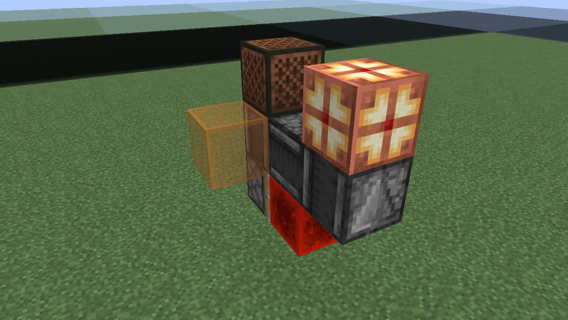</a> 34 gt (1.7 s) · copper_bulb+note_block+observer+redstone_block+sticky_piston · 7 blocks</td><td align="center"> 34 gt (1.7 s) · copper_bulb+note_block+observer+sticky_piston · 7 blocks</td><td align="center"><a href="../archive/clk-obs-p34-bulb-note-obs-stk-7b-b-eb5700.txt">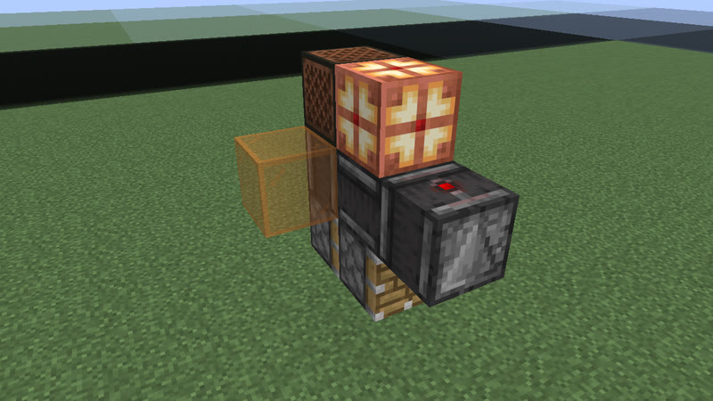</a> 34 gt (1.7 s) · copper_bulb+note_block+observer+sticky_piston · 7 blocks</td></tr>
<tr><td align="center"> 34 gt (1.7 s) · copper_bulb+observer+piston+sticky_piston · 7 blocks</td><td align="center"> 34 gt (1.7 s) · copper_bulb+observer+piston+sticky_piston · 7 blocks</td><td align="center"> 34 gt (1.7 s) · copper_bulb+observer+redstone_block+sticky_piston · 7 blocks</td></tr>
<tr><td align="center"><a href="../archive/clk-obs-p34-bulb-obs-rb-stk-7b-b-883735.txt">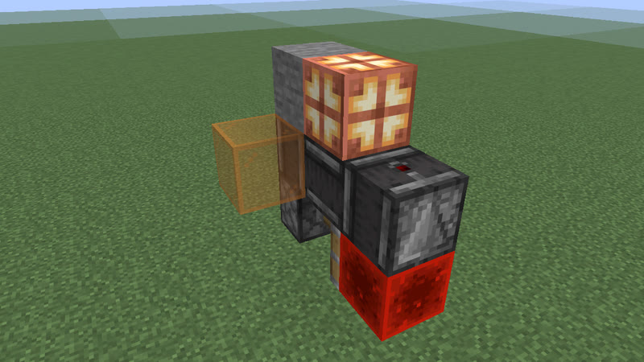</a> 34 gt (1.7 s) · copper_bulb+observer+redstone_block+sticky_piston · 7 blocks</td><td align="center"><a href="../archive/clk-obs-p34-bulb-obs-stk-7b-b-031e37.txt">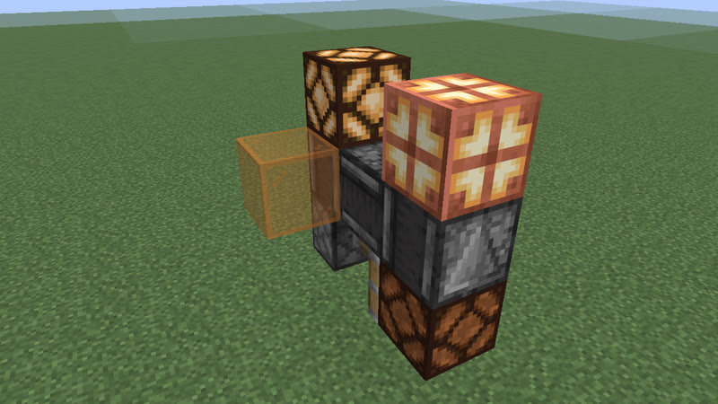</a> 34 gt (1.7 s) · copper_bulb+observer+sticky_piston · 7 blocks</td><td align="center"> 34 gt (1.7 s) · copper_bulb+observer+sticky_piston · 7 blocks</td></tr>
<tr><td align="center"> 34 gt (1.7 s) · copper_bulb+observer+redstone_block+redstone_lamp+sticky_piston · 7 blocks</td><td align="center"> 34 gt (1.7 s) · copper_bulb+observer+redstone_block+redstone_lamp+sticky_piston · 7 blocks</td><td align="center"> 34 gt (1.7 s) · copper_bulb+observer+redstone_lamp+sticky_piston · 7 blocks</td></tr>
<tr><td align="center"><a href="../archive/clk-obs-p34-bulb-lamp-obs-stk-7b-b-d10e86.txt">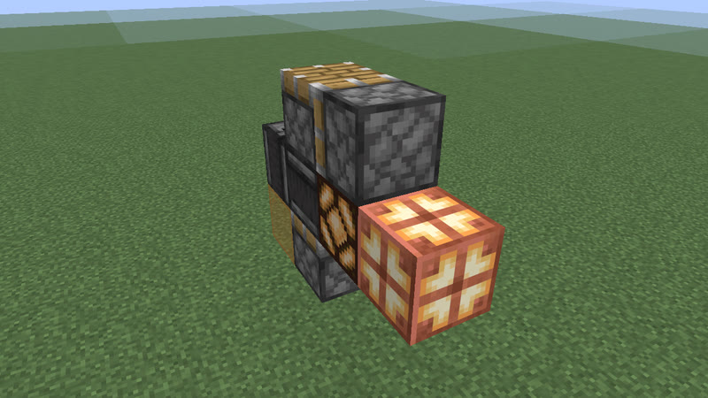</a> 34 gt (1.7 s) · copper_bulb+observer+redstone_lamp+sticky_piston · 7 blocks</td><td align="center"> 34 gt (1.7 s) · observer+piston+redstone_lamp+sticky_piston · 7 blocks</td><td align="center"><a href="../archive/clk-obs-p34-lamp-obs-pis-stk-7b-b-1dbe22.txt">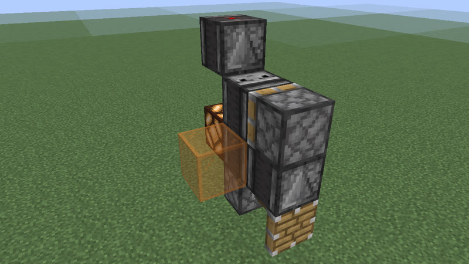</a> 34 gt (1.7 s) · observer+piston+redstone_lamp+sticky_piston · 7 blocks</td></tr>
<tr><td align="center"> 34 gt (1.7 s) · observer+redstone_lamp+sticky_piston · 7 blocks</td><td align="center"> 34 gt (1.7 s) · note_block+observer+piston+sticky_piston · 7 blocks</td><td align="center"><a href="../archive/clk-obs-p34-note-obs-pis-stk-7b-b-a98f5a.txt">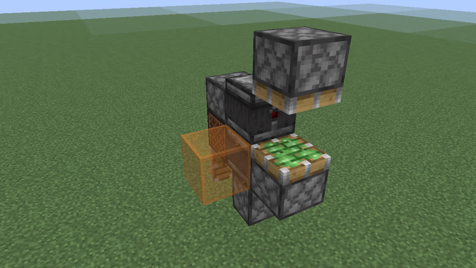</a> 34 gt (1.7 s) · note_block+observer+piston+sticky_piston · 7 blocks</td></tr>
<tr><td align="center"> 34 gt (1.7 s) · note_block+observer+redstone_block+sticky_piston · 7 blocks</td><td align="center"><a href="../archive/clk-obs-p34-note-obs-stk-7b-b-441a8f.txt">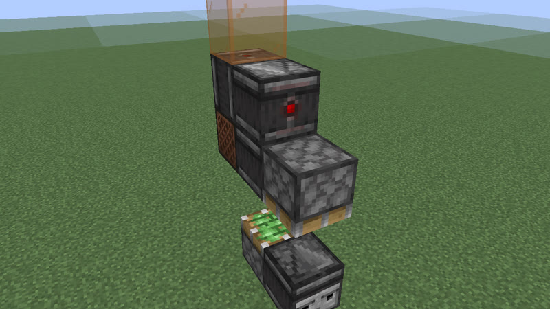</a> 34 gt (1.7 s) · note_block+observer+sticky_piston · 7 blocks</td><td align="center"> 34 gt (1.7 s) · note_block+observer+sticky_piston · 7 blocks</td></tr>
<tr><td align="center"> 34 gt (1.7 s) · observer+piston+sticky_piston · 7 blocks</td><td align="center"> 34 gt (1.7 s) · observer+piston+sticky_piston · 7 blocks</td><td align="center"> 34 gt (1.7 s) · observer+redstone_block+sticky_piston · 7 blocks</td></tr>
<tr><td align="center"><a href="../archive/clk-obs-p34-obs-rb-stk-7b-b-9a1e6b.txt">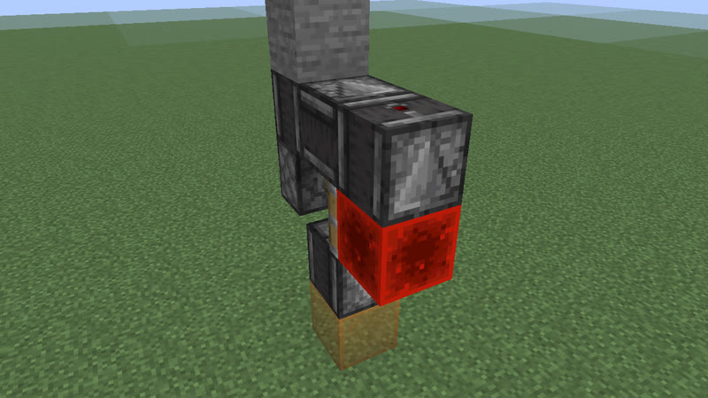</a> 34 gt (1.7 s) · observer+redstone_block+sticky_piston · 7 blocks</td><td align="center"> 34 gt (1.7 s) · observer+sticky_piston · 7 blocks</td><td align="center"><a href="../archive/clk-obs-p34-obs-stk-7b-b-cb9a68.txt">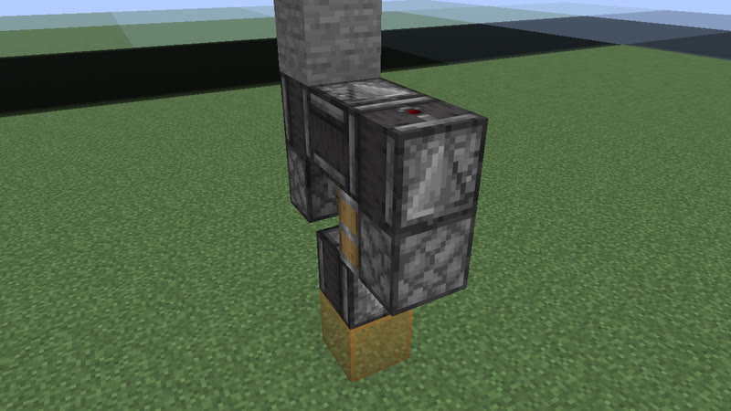</a> 34 gt (1.7 s) · observer+sticky_piston · 7 blocks</td></tr>
<tr><td align="center"> 34 gt (1.7 s) · observer+piston+redstone_block+sticky_piston · 7 blocks</td><td align="center"><a href="../archive/clk-obs-p34-obs-pis-rb-stk-7b-b-222759.txt">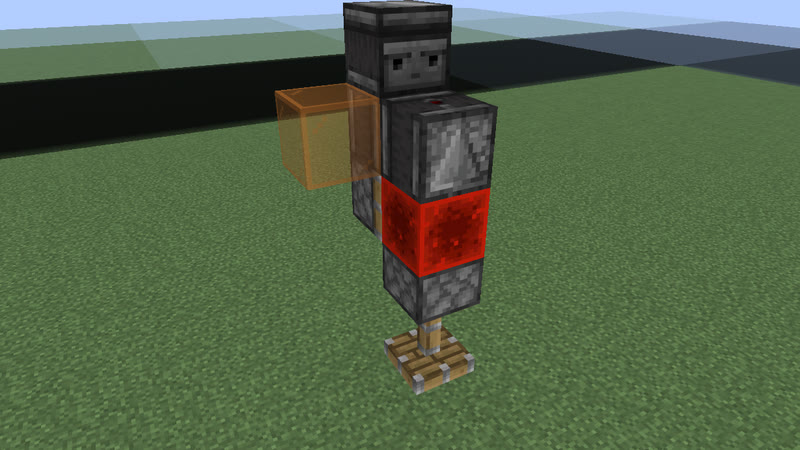</a> 34 gt (1.7 s) · observer+piston+redstone_block+sticky_piston · 7 blocks</td><td align="center"> 34 gt (1.7 s) · note_block+observer+piston+redstone_block+sticky_piston · 7 blocks</td></tr>
<tr><td align="center"><a href="../archive/clk-obs-p34-note-obs-pis-rb-stk-7b-b-27deeb.txt">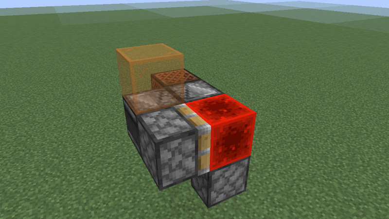</a> 34 gt (1.7 s) · note_block+observer+piston+redstone_block+sticky_piston · 7 blocks</td><td align="center"><a href="../archive/clk-obs-p34-note-obs-rb-stk-7b-b-06c656.txt">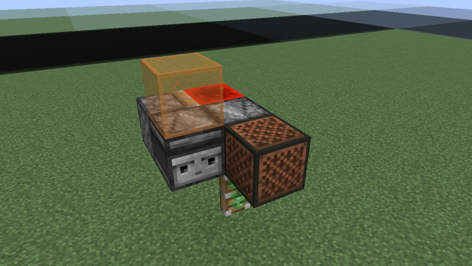</a> 34 gt (1.7 s) · note_block+observer+redstone_block+sticky_piston · 7 blocks</td><td align="center"> 34 gt (1.7 s) · redstone_torch+repeater · 12 blocks</td></tr>
<tr><td align="center"> 34 gt (1.7 s) · redstone_wire+repeater · 16 blocks</td><td align="center"> 34 gt (1.7 s) · comparator+repeater · 16 blocks</td></tr>
</table>

## 35 gt (1.75 s)

Also reachable by: clk-obs-odd-a (n = 6), clk-item-hopper-ring-2 (n = 4), clk-item-lockring-2s (n = 1), clk-item-dropring-2d-r4 (n = 0), clk-sculk-hairpin (n = 2).

<table>
<tr><td align="center"> 35 gt (1.75 s) · observer+piston+redstone_block+sticky_piston · 6 blocks</td><td align="center"> 35 gt (1.75 s) · observer+redstone_block+sticky_piston · 6 blocks</td><td align="center"><a href="../archive/clk-obs-p35-obs-pis-rb-stk-6b-b-61dcec.txt">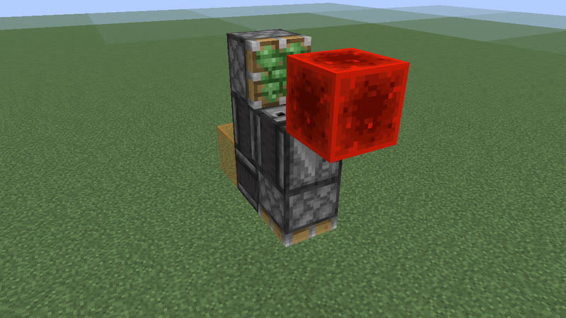</a> 35 gt (1.75 s) · observer+piston+redstone_block+sticky_piston · 6 blocks</td></tr>
<tr><td align="center"> 35 gt (1.75 s) · observer+redstone_block+sticky_piston · 6 blocks</td><td align="center"> 35 gt (1.75 s) · calibrated_sculk_sensor+note_block · 6 blocks</td><td align="center"> 35 gt (1.75 s) · observer+sticky_piston · 7 blocks</td></tr>
<tr><td align="center"> 35 gt (1.75 s) · observer+piston+sticky_piston · 7 blocks</td><td align="center"> 35 gt (1.75 s) · repeater · 23 blocks</td></tr>
</table>

## 36 gt (1.8 s)

Also reachable by: clk-obs-obs-ring (n = 7), clk-obs-bulb-ring (n = 2), clk-rt-uloop2t (n = 1), clk-misc-cart-loop (n = 2), clk-item-dropring-1d-r1 (n = 0), clk-rt-uloop1t (n = 0).

<table>
<tr><td align="center"> 36 gt (1.8 s) · copper_bulb+note_block+observer+piston+redstone_lamp · 6 blocks</td><td align="center"> 36 gt (1.8 s) · copper_bulb+note_block+observer+redstone_lamp+sticky_piston · 6 blocks</td><td align="center"> 36 gt (1.8 s) · copper_bulb+observer+piston+redstone_lamp · 6 blocks</td></tr>
<tr><td align="center"><a href="../archive/clk-obs-p36-bulb-lamp-obs-pis-6b-b-4f8ae7.txt">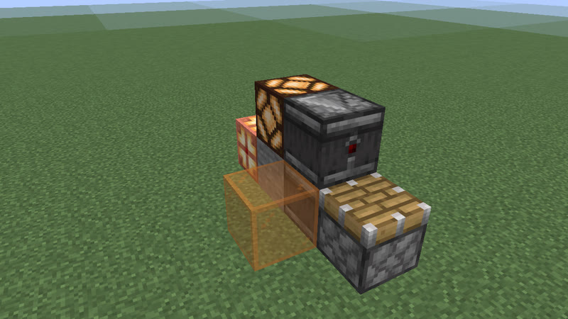</a> 36 gt (1.8 s) · copper_bulb+observer+piston+redstone_lamp · 6 blocks</td><td align="center"> 36 gt (1.8 s) · copper_bulb+observer+redstone_lamp+sticky_piston · 6 blocks</td><td align="center"><a href="../archive/clk-obs-p36-bulb-lamp-obs-stk-6b-b-545a2f.txt">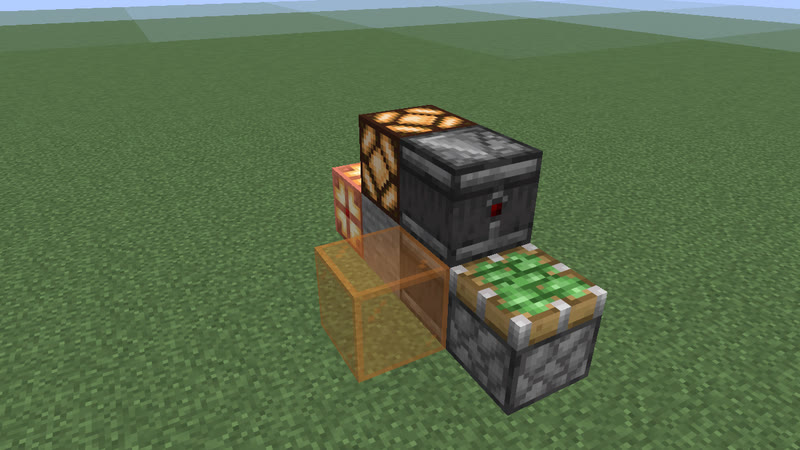</a> 36 gt (1.8 s) · copper_bulb+observer+redstone_lamp+sticky_piston · 6 blocks</td></tr>
<tr><td align="center"><a href="../archive/clk-obs-p36-bulb-lamp-note-obs-pis-6b-b-25502d.txt">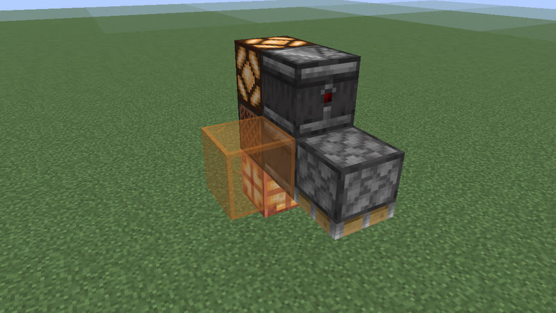</a> 36 gt (1.8 s) · copper_bulb+note_block+observer+piston+redstone_lamp · 6 blocks</td><td align="center"><a href="../archive/clk-obs-p36-bulb-lamp-note-obs-stk-6b-b-7bd6ff.txt">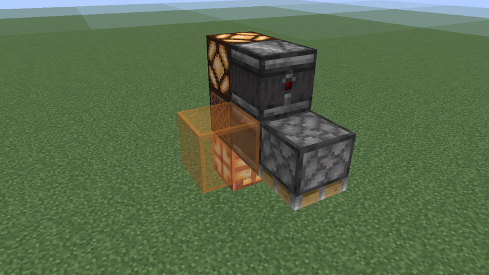</a> 36 gt (1.8 s) · copper_bulb+note_block+observer+redstone_lamp+sticky_piston · 6 blocks</td><td align="center"> 36 gt (1.8 s) · copper_bulb+observer+piston+sticky_piston · 6 blocks</td></tr>
<tr><td align="center"> 36 gt (1.8 s) · copper_bulb+observer+sticky_piston · 6 blocks</td><td align="center"> 36 gt (1.8 s) · note_block+observer+redstone_lamp+sticky_piston · 6 blocks</td><td align="center"><a href="../archive/clk-obs-p36-lamp-note-obs-stk-6b-b-c9be42.txt">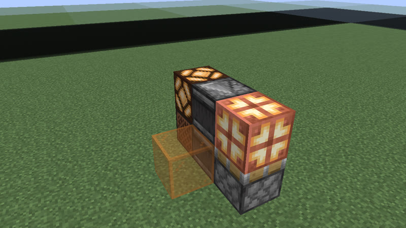</a> 36 gt (1.8 s) · note_block+observer+redstone_lamp+sticky_piston · 6 blocks</td></tr>
<tr><td align="center"> 36 gt (1.8 s) · observer+sticky_piston · 6 blocks</td><td align="center"> 36 gt (1.8 s) · observer+sticky_piston · 6 blocks</td><td align="center"> 36 gt (1.8 s) · copper_bulb+observer+redstone_block+sticky_piston · 6 blocks</td></tr>
<tr><td align="center"> 36 gt (1.8 s) · copper_bulb+observer+redstone_block+sticky_piston · 6 blocks</td><td align="center"> 36 gt (1.8 s) · calibrated_sculk_sensor+note_block · 6 blocks</td><td align="center"> 36 gt (1.8 s) · copper_bulb+observer+piston+redstone_lamp+sticky_piston · 7 blocks</td></tr>
<tr><td align="center"> 36 gt (1.8 s) · copper_bulb+note_block+observer+piston+sticky_piston · 7 blocks</td><td align="center"> 36 gt (1.8 s) · copper_bulb+note_block+observer+sticky_piston · 7 blocks</td><td align="center"> 36 gt (1.8 s) · copper_bulb+observer+piston+sticky_piston · 7 blocks</td></tr>
<tr><td align="center"> 36 gt (1.8 s) · copper_bulb+observer+sticky_piston · 7 blocks</td><td align="center"> 36 gt (1.8 s) · note_block+observer+redstone_block+sticky_piston · 7 blocks</td><td align="center"> 36 gt (1.8 s) · observer+redstone_block+sticky_piston · 7 blocks</td></tr>
<tr><td align="center"> 36 gt (1.8 s) · observer+redstone_block+sticky_piston · 7 blocks</td><td align="center"> 36 gt (1.8 s) · copper_bulb+note_block+observer+redstone_block+sticky_piston · 7 blocks</td><td align="center"><a href="../archive/clk-obs-p36-bulb-note-obs-rb-stk-7b-b-5fdacf.txt">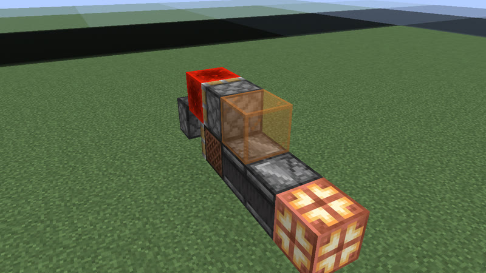</a> 36 gt (1.8 s) · copper_bulb+note_block+observer+redstone_block+sticky_piston · 7 blocks</td></tr>
<tr><td align="center"><a href="../archive/clk-obs-p36-bulb-note-obs-stk-7b-b-76d3c7.txt">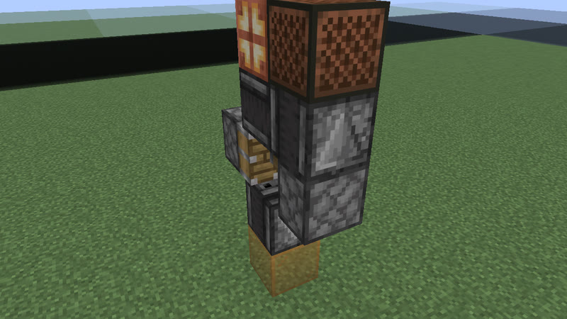</a> 36 gt (1.8 s) · copper_bulb+note_block+observer+sticky_piston · 7 blocks</td><td align="center"> 36 gt (1.8 s) · copper_bulb+observer+piston+redstone_block+sticky_piston · 7 blocks</td><td align="center"> 36 gt (1.8 s) · observer+redstone_block+redstone_lamp+sticky_piston · 7 blocks</td></tr>
<tr><td align="center"><a href="../archive/clk-obs-p36-lamp-obs-stk-7b-b-bcb06d.txt">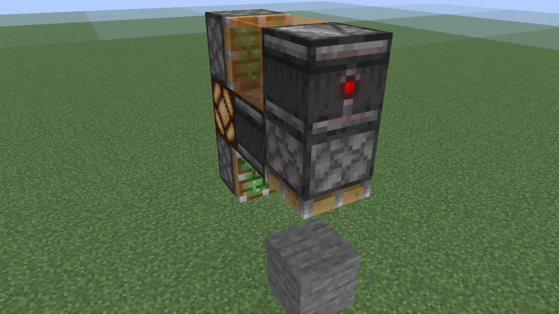</a> 36 gt (1.8 s) · observer+redstone_lamp+sticky_piston · 7 blocks</td><td align="center"> 36 gt (1.8 s) · observer+redstone_lamp+sticky_piston · 7 blocks</td><td align="center"> 36 gt (1.8 s) · note_block+observer+redstone_block+sticky_piston · 7 blocks</td></tr>
<tr><td align="center"> 36 gt (1.8 s) · note_block+observer+sticky_piston · 7 blocks</td><td align="center"> 36 gt (1.8 s) · note_block+observer+sticky_piston · 7 blocks</td><td align="center"> 36 gt (1.8 s) · observer+piston · 7 blocks</td></tr>
<tr><td align="center"> 36 gt (1.8 s) · observer+piston+redstone_block+sticky_piston · 7 blocks</td><td align="center"> 36 gt (1.8 s) · observer+piston+redstone_block+sticky_piston · 7 blocks</td><td align="center"> 36 gt (1.8 s) · observer+piston+sticky_piston · 7 blocks</td></tr>
<tr><td align="center"> 36 gt (1.8 s) · observer+piston+sticky_piston · 7 blocks</td><td align="center"> 36 gt (1.8 s) · observer+redstone_block+redstone_lamp+sticky_piston · 7 blocks</td><td align="center"> 36 gt (1.8 s) · copper_bulb+observer+piston+redstone_block+sticky_piston · 7 blocks</td></tr>
<tr><td align="center"> 36 gt (1.8 s) · comparator+redstone_torch+redstone_wire+repeater · 12 blocks</td><td align="center"> 36 gt (1.8 s) · comparator+redstone_torch+redstone_wire+repeater · 13 blocks</td><td align="center"> 36 gt (1.8 s) · redstone_wire+repeater · 16 blocks</td></tr>
<tr><td align="center"> 36 gt (1.8 s) · comparator+repeater · 16 blocks</td></tr>
</table>

## 37 gt (1.85 s)

Also reachable by: clk-obs-odd-b (n = 6), clk-item-lockring-2s (n = 2).

<table>
<tr><td align="center"> 37 gt (1.85 s) · observer+piston+sticky_piston · 6 blocks</td><td align="center"> 37 gt (1.85 s) · observer+piston+sticky_piston · 6 blocks</td><td align="center"> 37 gt (1.85 s) · observer+sticky_piston · 6 blocks</td></tr>
<tr><td align="center"> 37 gt (1.85 s) · observer+sticky_piston · 6 blocks</td><td align="center"> 37 gt (1.85 s) · calibrated_sculk_sensor+note_block · 6 blocks</td><td align="center"> 37 gt (1.85 s) · observer+redstone_lamp+sticky_piston · 7 blocks</td></tr>
<tr><td align="center"> 37 gt (1.85 s) · note_block+observer+sticky_piston · 7 blocks</td><td align="center"> 37 gt (1.85 s) · repeater · 24 blocks</td></tr>
</table>

## 38 gt (1.9 s)

Also reachable by: clk-misc-activator_rail-ring (n = 7), clk-misc-crafter-ring (n = 7), clk-misc-iron_door-ring (n = 7), clk-misc-oak_door-ring (n = 7), clk-misc-oak_fence_gate-ring (n = 7), clk-misc-oak_trapdoor-ring (n = 7), clk-misc-powered_rail-ring (n = 7), clk-misc-skeleton_skull-ring (n = 7), clk-obs-note-ring (n = 7), clk-obs-trap-ring (n = 7), clk-item-dropring-1d-r2 (n = 0), clk-misc-cart-pingpong (n = 0).

<table>
<tr><td align="center"> 38 gt (1.9 s) · observer+redstone_block+sticky_piston · 6 blocks</td><td align="center"> 38 gt (1.9 s) · observer+sticky_piston · 6 blocks</td><td align="center"><a href="../archive/clk-obs-p38-obs-stk-6b-b-3e7810.txt">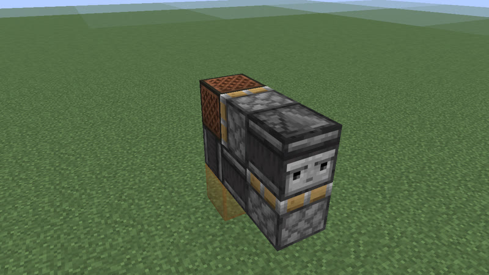</a> 38 gt (1.9 s) · observer+sticky_piston · 6 blocks</td></tr>
<tr><td align="center"> 38 gt (1.9 s) · observer+sticky_piston · 6 blocks</td><td align="center"> 38 gt (1.9 s) · calibrated_sculk_sensor+note_block · 6 blocks</td><td align="center"> 38 gt (1.9 s) · observer+redstone_lamp+sticky_piston · 7 blocks</td></tr>
<tr><td align="center"> 38 gt (1.9 s) · copper_bulb+note_block+observer+redstone_block+redstone_lamp+sticky_piston · 7 blocks</td><td align="center"> 38 gt (1.9 s) · copper_bulb+note_block+observer+redstone_block+sticky_piston · 7 blocks</td><td align="center"><a href="../archive/clk-obs-p38-bulb-note-obs-rb-stk-7b-b-2b34f0.txt">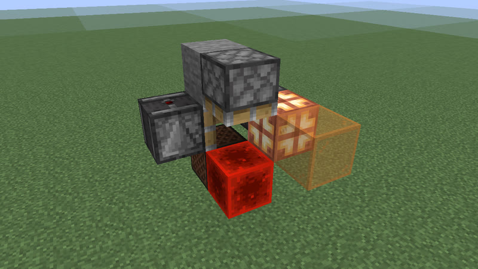</a> 38 gt (1.9 s) · copper_bulb+note_block+observer+redstone_block+sticky_piston · 7 blocks</td></tr>
<tr><td align="center"> 38 gt (1.9 s) · note_block+observer+piston+sticky_piston · 7 blocks</td><td align="center"> 38 gt (1.9 s) · note_block+observer+piston+sticky_piston · 7 blocks</td><td align="center"> 38 gt (1.9 s) · note_block+observer+sticky_piston · 7 blocks</td></tr>
<tr><td align="center"> 38 gt (1.9 s) · redstone_torch+repeater · 16 blocks</td><td align="center"> 38 gt (1.9 s) · redstone_wire+repeater · 16 blocks</td><td align="center"> 38 gt (1.9 s) · comparator+repeater · 16 blocks</td></tr>
</table>

## 39 gt (1.95 s)

Also reachable by: clk-obs-odd-a (n = 7), clk-rt-odd-rect (n = 2), clk-item-lockring-2s (n = 3).

<table>
<tr><td align="center"> 39 gt (1.95 s) · calibrated_sculk_sensor+note_block · 6 blocks</td><td align="center"> 39 gt (1.95 s) · copper_bulb+note_block+observer+piston+sticky_piston · 7 blocks</td><td align="center"> 39 gt (1.95 s) · copper_bulb+note_block+observer+piston+sticky_piston · 7 blocks</td></tr>
<tr><td align="center"> 39 gt (1.95 s) · copper_bulb+note_block+observer+sticky_piston · 7 blocks</td><td align="center"> 39 gt (1.95 s) · copper_bulb+note_block+observer+sticky_piston · 7 blocks</td><td align="center"> 39 gt (1.95 s) · copper_bulb+observer+piston+sticky_piston · 7 blocks</td></tr>
<tr><td align="center"> 39 gt (1.95 s) · copper_bulb+observer+piston+sticky_piston · 7 blocks</td><td align="center"> 39 gt (1.95 s) · copper_bulb+observer+sticky_piston · 7 blocks</td><td align="center"> 39 gt (1.95 s) · copper_bulb+observer+sticky_piston · 7 blocks</td></tr>
<tr><td align="center"> 39 gt (1.95 s) · observer+piston+sticky_piston · 7 blocks</td><td align="center"> 39 gt (1.95 s) · observer+piston+redstone_lamp+sticky_piston · 7 blocks</td><td align="center"> 39 gt (1.95 s) · observer+redstone_lamp+sticky_piston · 7 blocks</td></tr>
<tr><td align="center"> 39 gt (1.95 s) · note_block+observer+piston+sticky_piston · 7 blocks</td><td align="center"> 39 gt (1.95 s) · note_block+observer+sticky_piston · 7 blocks</td><td align="center"> 39 gt (1.95 s) · observer+piston+sticky_piston · 7 blocks</td></tr>
<tr><td align="center"> 39 gt (1.95 s) · observer+sticky_piston · 7 blocks</td><td align="center"> 39 gt (1.95 s) · note_block+observer+redstone_lamp+sticky_piston · 7 blocks</td><td align="center"> 39 gt (1.95 s) · note_block+observer+redstone_lamp+sticky_piston · 7 blocks</td></tr>
<tr><td align="center"> 39 gt (1.95 s) · observer+piston+redstone_lamp+sticky_piston · 7 blocks</td><td align="center"> 39 gt (1.95 s) · observer+redstone_lamp+sticky_piston · 7 blocks</td><td align="center"> 39 gt (1.95 s) · note_block+observer+piston+sticky_piston · 7 blocks</td></tr>
<tr><td align="center"> 39 gt (1.95 s) · note_block+observer+sticky_piston · 7 blocks</td><td align="center"> 39 gt (1.95 s) · observer+sticky_piston · 7 blocks</td></tr>
</table>

[catalog index](../CATALOG.md) · previous: [p24-28](p24-28.md) · next: [p40-47](p40-47.md)
