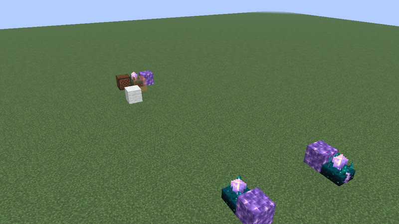
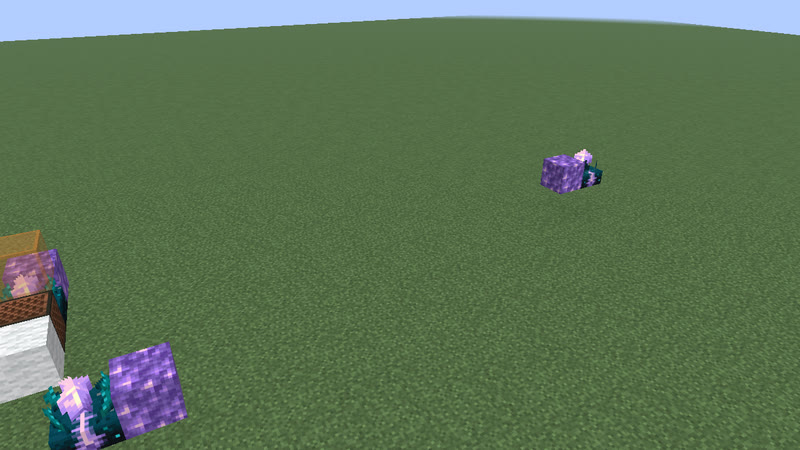
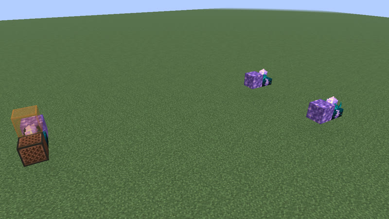
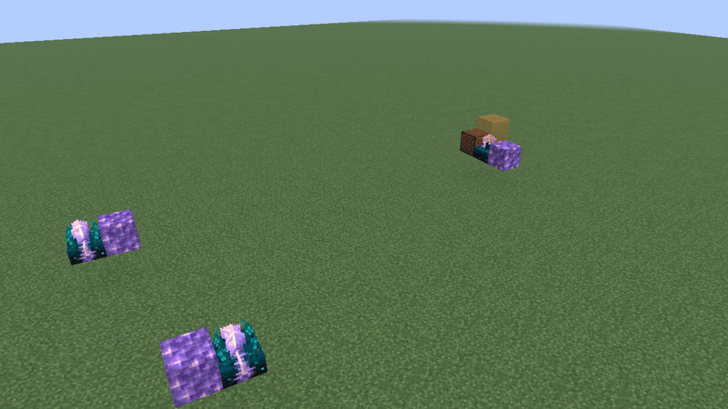
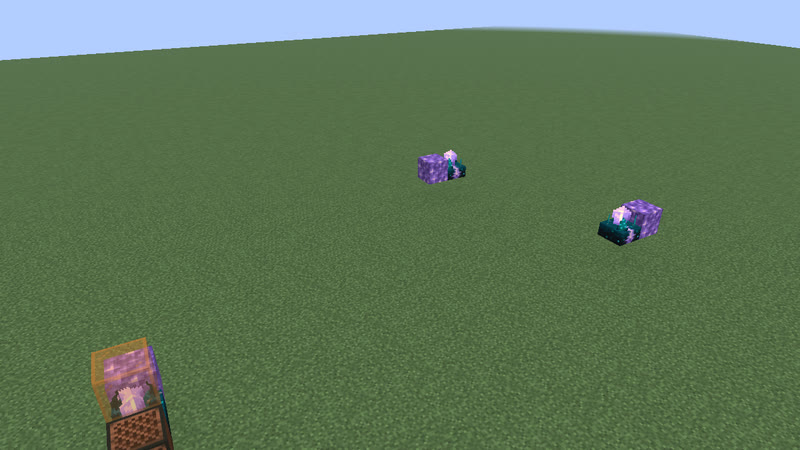
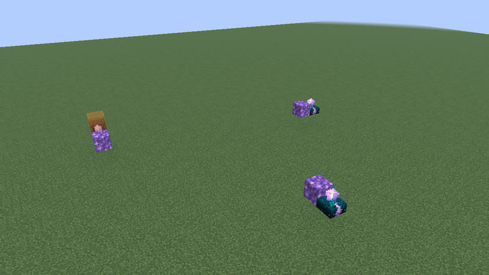
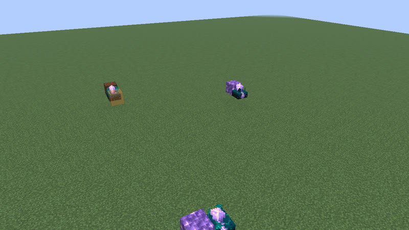
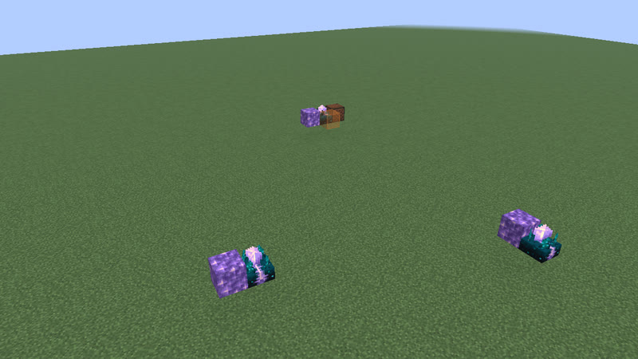

# Clocks: 30 gt (1.5 s) to 42 gt (2.1 s) (279 clock types)

[catalog index](../CATALOG.md) · previous: [p21-29](p21-29.md) · next: [p43-52](p43-52.md)

Orange glass = where the output signal is (placed only for the picture); click a picture for its design. Larger clocks of a period no better than a smaller one on any variation (whatever their block kinds) are listed on [variants](variants.md). Generated by `mctas clock catalog`.

## 30 gt (1.5 s)

Also reachable by: observer ring with a relay block (clk-obs-note-ring, n = 5), clk-item-latch (n = 0).

<table>
<tr><td align="center"> 30 gt (1.5 s) · calibrated_sculk_sensor+dispenser+observer · 4 blocks</td><td align="center"> 30 gt (1.5 s) · calibrated_sculk_sensor+oak_trapdoor+observer · 5 blocks</td><td align="center"> 30 gt (1.5 s) · calibrated_sculk_sensor+oak_fence_gate+observer · 5 blocks</td></tr>
<tr><td align="center"> 30 gt (1.5 s) · calibrated_sculk_sensor+iron_trapdoor+observer · 5 blocks</td><td align="center"> 30 gt (1.5 s) · observer+redstone_block+sticky_piston · 6 blocks</td><td align="center"> 30 gt (1.5 s) · observer+sticky_piston · 6 blocks</td></tr>
<tr><td align="center"> 30 gt (1.5 s) · observer+sticky_piston · 6 blocks</td><td align="center"> 30 gt (1.5 s) · observer+sticky_piston · 6 blocks</td><td align="center"> 30 gt (1.5 s) · note_block+observer+sticky_piston · 6 blocks</td></tr>
<tr><td align="center"> 30 gt (1.5 s) · observer+redstone_block+sticky_piston · 6 blocks</td><td align="center"> 30 gt (1.5 s) · copper_bulb+observer+redstone_block+sticky_piston · 6 blocks</td><td align="center"> 30 gt (1.5 s) · copper_bulb+observer+redstone_block+sticky_piston · 6 blocks</td></tr>
<tr><td align="center"> 30 gt (1.5 s) · note_block+observer+piston+redstone_lamp+sticky_piston · 7 blocks</td><td align="center"> 30 gt (1.5 s) · note_block+observer+redstone_lamp+sticky_piston · 7 blocks</td><td align="center"><a href="../archive/clk-obs-p30-lamp-obs-pis-7b-5c5b87.txt">clk-obs-p30-lamp-obs-pis-7b-5c5b87</a> 30 gt (1.5 s) · observer+piston+redstone_lamp · 7 blocks (picture pending)</td></tr>
<tr><td align="center"> 30 gt (1.5 s) · observer+piston+redstone_lamp+sticky_piston · 7 blocks</td><td align="center"> 30 gt (1.5 s) · observer+redstone_lamp+sticky_piston · 7 blocks</td><td align="center"> 30 gt (1.5 s) · note_block+observer+piston+sticky_piston · 7 blocks</td></tr>
<tr><td align="center"><a href="../archive/clk-obs-p30-bulb-lamp-note-obs-pis-7b-f8ce3d.txt">clk-obs-p30-bulb-lamp-note-obs-pis-7b-f8ce3d</a> 30 gt (1.5 s) · copper_bulb+note_block+observer+piston+redstone_lamp · 7 blocks (picture pending)</td><td align="center"><a href="../archive/clk-obs-p30-bulb-lamp-obs-pis-7b-b7f86f.txt">clk-obs-p30-bulb-lamp-obs-pis-7b-b7f86f</a> 30 gt (1.5 s) · copper_bulb+observer+piston+redstone_lamp · 7 blocks (picture pending)</td><td align="center"> 30 gt (1.5 s) · copper_bulb+note_block+observer+redstone_block+redstone_lamp+sticky_piston · 7 blocks</td></tr>
<tr><td align="center"> 30 gt (1.5 s) · observer+redstone_block+redstone_lamp+sticky_piston · 7 blocks</td><td align="center"> 30 gt (1.5 s) · observer+piston+redstone_block+sticky_piston · 7 blocks</td><td align="center"> 30 gt (1.5 s) · observer+redstone_block+redstone_lamp+sticky_piston · 7 blocks</td></tr>
<tr><td align="center"> 30 gt (1.5 s) · copper_bulb+observer+piston+redstone_block+redstone_lamp+sticky_piston · 7 blocks</td><td align="center"> 30 gt (1.5 s) · copper_bulb+note_block+observer+piston+redstone_block+sticky_piston · 7 blocks</td><td align="center"> 30 gt (1.5 s) · copper_bulb+note_block+observer+redstone_block+sticky_piston · 7 blocks</td></tr>
<tr><td align="center"><a href="../archive/clk-obs-p30-bulb-lamp-note-obs-pis-stk-8b-665ad9.txt">clk-obs-p30-bulb-lamp-note-obs-pis-stk-8b-665ad9</a> 30 gt (1.5 s) · copper_bulb+note_block+observer+piston+redstone_lamp+sticky_piston · 8 blocks (picture pending)</td><td align="center"> 30 gt (1.5 s) · comparator+hopper · 10 blocks</td><td align="center"><a href="../archive/kit-shuttle-minecart-p30-11b.txt">kit-shuttle-minecart-p30-11b</a> 30 gt (1.5 s) · detector_rail+minecart · 11 blocks (picture pending)</td></tr>
<tr><td align="center"> 30 gt (1.5 s) · comparator+redstone_torch+repeater · 12 blocks</td><td align="center"> 30 gt (1.5 s) · redstone_torch+repeater · 12 blocks</td><td align="center"> 30 gt (1.5 s) · repeater · 12 blocks</td></tr>
<tr><td align="center"> 30 gt (1.5 s) · comparator+repeater · 16 blocks</td></tr>
</table>

## 31 gt (1.55 s)

Also reachable by: clk-obs-odd-a (n = 5), clk-rt-odd-rect (n = 1), clk-misc-cart-loop (n = 1), dropper ring (clk-item-dropring-2d-r2, n = 0), clk-sculk-replin (one block swapped: 2 versions) (clk-sculk-replin, n = 3).

<table>
<tr><td align="center"> 31 gt (1.55 s) · calibrated_sculk_sensor+dispenser+observer · 4 blocks</td><td align="center"> 31 gt (1.55 s) · calibrated_sculk_sensor+dispenser+observer · 4 blocks</td><td align="center"> 31 gt (1.55 s) · calibrated_sculk_sensor+dispenser+observer · 4 blocks</td></tr>
<tr><td align="center"> 31 gt (1.55 s) · calibrated_sculk_sensor+oak_trapdoor+observer · 6 blocks</td><td align="center"> 31 gt (1.55 s) · calibrated_sculk_sensor+oak_fence_gate+observer · 6 blocks</td><td align="center"> 31 gt (1.55 s) · calibrated_sculk_sensor+iron_trapdoor+observer · 6 blocks</td></tr>
<tr><td align="center"> 31 gt (1.55 s) · observer+piston+redstone_lamp+sticky_piston · 7 blocks</td><td align="center"> 31 gt (1.55 s) · observer+redstone_lamp+sticky_piston · 7 blocks</td><td align="center"> 31 gt (1.55 s) · note_block+observer+piston+sticky_piston · 7 blocks</td></tr>
<tr><td align="center"> 31 gt (1.55 s) · note_block+observer+sticky_piston · 7 blocks</td><td align="center"> 31 gt (1.55 s) · observer+piston+sticky_piston · 7 blocks</td><td align="center"> 31 gt (1.55 s) · observer+piston+redstone_block+sticky_piston · 7 blocks</td></tr>
<tr><td align="center"> 31 gt (1.55 s) · observer+piston+redstone_block+sticky_piston · 7 blocks</td><td align="center"> 31 gt (1.55 s) · observer+redstone_block+sticky_piston · 7 blocks</td><td align="center"> 31 gt (1.55 s) · observer+redstone_block+sticky_piston · 7 blocks</td></tr>
<tr><td align="center"> 31 gt (1.55 s) · observer+sticky_piston · 7 blocks</td><td align="center"><a href="../archive/clk-obs-p31-lamp-obs-rb-stk-8b-998f1e.txt">clk-obs-p31-lamp-obs-rb-stk-8b-998f1e</a> 31 gt (1.55 s) · observer+redstone_block+redstone_lamp+sticky_piston · 8 blocks (picture pending)</td><td align="center"><a href="../archive/clk-obs-p31-lamp-note-obs-stk-8b-e4aa1e.txt">clk-obs-p31-lamp-note-obs-stk-8b-e4aa1e</a> 31 gt (1.55 s) · note_block+observer+redstone_lamp+sticky_piston · 8 blocks (picture pending)</td></tr>
</table>

## 32 gt (1.6 s)

Also reachable by: clk-obs-obs-ring (n = 6), clk-rt-rect-pulse (n = 0).

<table>
<tr><td align="center"> 32 gt (1.6 s) · calibrated_sculk_sensor+dispenser+observer · 5 blocks</td><td align="center"> 32 gt (1.6 s) · copper_bulb+observer+redstone_block+sticky_piston · 6 blocks</td><td align="center"> 32 gt (1.6 s) · copper_bulb+observer+sticky_piston · 6 blocks</td></tr>
<tr><td align="center"> 32 gt (1.6 s) · observer+sticky_piston · 6 blocks</td><td align="center"> 32 gt (1.6 s) · observer+piston+redstone_block+sticky_piston · 6 blocks</td><td align="center"> 32 gt (1.6 s) · observer+sticky_piston · 6 blocks</td></tr>
<tr><td align="center"> 32 gt (1.6 s) · observer+sticky_piston · 6 blocks</td><td align="center"> 32 gt (1.6 s) · observer+redstone_block+sticky_piston · 6 blocks</td><td align="center"> 32 gt (1.6 s) · copper_bulb+observer+piston+redstone_block+sticky_piston · 6 blocks</td></tr>
<tr><td align="center"> 32 gt (1.6 s) · note_block+observer+redstone_lamp+sticky_piston · 6 blocks</td><td align="center"> 32 gt (1.6 s) · note_block+observer+sticky_piston · 6 blocks</td><td align="center"><a href="../archive/clk-obs-p32-bulb-lamp-obs-rb-stk-7b-7fe871.txt">clk-obs-p32-bulb-lamp-obs-rb-stk-7b-7fe871</a> 32 gt (1.6 s) · copper_bulb+observer+redstone_block+redstone_lamp+sticky_piston · 7 blocks (picture pending)</td></tr>
<tr><td align="center"> 32 gt (1.6 s) · copper_bulb+note_block+observer+piston+redstone_block+sticky_piston · 7 blocks</td><td align="center"> 32 gt (1.6 s) · copper_bulb+note_block+observer+redstone_block+sticky_piston · 7 blocks</td><td align="center"> 32 gt (1.6 s) · note_block+observer+piston+redstone_block+sticky_piston · 7 blocks</td></tr>
<tr><td align="center"> 32 gt (1.6 s) · note_block+observer+piston+redstone_block+sticky_piston · 7 blocks</td><td align="center"> 32 gt (1.6 s) · observer+piston+redstone_block+sticky_piston · 7 blocks</td><td align="center"><a href="../archive/clk-obs-p32-bulb-lamp-obs-pis-8b-dd8b1d.txt">clk-obs-p32-bulb-lamp-obs-pis-8b-dd8b1d</a> 32 gt (1.6 s) · copper_bulb+observer+piston+redstone_lamp · 8 blocks (picture pending)</td></tr>
<tr><td align="center"> 32 gt (1.6 s) · redstone_torch+repeater · 12 blocks</td><td align="center"> 32 gt (1.6 s) · comparator+repeater · 16 blocks</td><td align="center"> 32 gt (1.6 s) · comparator+dropper+hopper+repeater · 18 blocks</td></tr>
</table>

## 33 gt (1.65 s)

Also reachable by: clk-obs-odd-b (n = 5), dropper ring (clk-item-dropring-2d-r3, n = 0), lock ring (clk-item-lockring-2s, n = 0).

<table>
<tr><td align="center"> 33 gt (1.65 s) · calibrated_sculk_sensor+note_block+observer · 6 blocks</td><td align="center"><a href="../archive/clk-obs-p33-lamp-note-obs-pis-stk-7b-1526c7.txt">clk-obs-p33-lamp-note-obs-pis-stk-7b-1526c7</a> 33 gt (1.65 s) · note_block+observer+piston+redstone_lamp+sticky_piston · 7 blocks (picture pending)</td><td align="center"><a href="../archive/clk-obs-p33-lamp-obs-pis-stk-7b-0cb9b7.txt">clk-obs-p33-lamp-obs-pis-stk-7b-0cb9b7</a> 33 gt (1.65 s) · observer+piston+redstone_lamp+sticky_piston · 7 blocks (picture pending)</td></tr>
<tr><td align="center"><a href="../archive/clk-obs-p33-obs-pis-stk-7b-350f07.txt">clk-obs-p33-obs-pis-stk-7b-350f07</a> 33 gt (1.65 s) · observer+piston+sticky_piston · 7 blocks (picture pending)</td><td align="center"><a href="../archive/clk-obs-p33-note-obs-pis-stk-7b-16134f.txt">clk-obs-p33-note-obs-pis-stk-7b-16134f</a> 33 gt (1.65 s) · note_block+observer+piston+sticky_piston · 7 blocks (picture pending)</td><td align="center"> 33 gt (1.65 s) · note_block+observer+sticky_piston · 7 blocks</td></tr>
<tr><td align="center"> 33 gt (1.65 s) · observer+sticky_piston · 7 blocks</td><td align="center"><a href="../archive/clk-obs-p33-obs-pis-rb-stk-8b-d06edf.txt">clk-obs-p33-obs-pis-rb-stk-8b-d06edf</a> 33 gt (1.65 s) · observer+piston+redstone_block+sticky_piston · 8 blocks (picture pending)</td><td align="center"><a href="../archive/clk-obs-p33-obs-rb-stk-8b-75eb12.txt">clk-obs-p33-obs-rb-stk-8b-75eb12</a> 33 gt (1.65 s) · observer+redstone_block+sticky_piston · 8 blocks (picture pending)</td></tr>
<tr><td align="center"><a href="../archive/clk-obs-p33-note-obs-pis-rb-stk-8b-1f8eec.txt">clk-obs-p33-note-obs-pis-rb-stk-8b-1f8eec</a> 33 gt (1.65 s) · note_block+observer+piston+redstone_block+sticky_piston · 8 blocks (picture pending)</td><td align="center"><a href="../archive/clk-obs-p33-bulb-obs-pis-stk-9b-64ffff.txt">clk-obs-p33-bulb-obs-pis-stk-9b-64ffff</a> 33 gt (1.65 s) · copper_bulb+observer+piston+sticky_piston · 9 blocks (picture pending)</td><td align="center"><a href="../archive/clk-obs-p33-bulb-obs-stk-9b-343adb.txt">clk-obs-p33-bulb-obs-stk-9b-343adb</a> 33 gt (1.65 s) · copper_bulb+observer+sticky_piston · 9 blocks (picture pending)</td></tr>
<tr><td align="center"><a href="../archive/kit-shuttle-minecart-p33-13b.txt">kit-shuttle-minecart-p33-13b</a> 33 gt (1.65 s) · detector_rail+minecart · 13 blocks (picture pending)</td><td align="center"> 33 gt (1.65 s) · repeater · 23 blocks</td></tr>
</table>

## 34 gt (1.7 s)

Also reachable by: observer ring with a relay block (clk-obs-note-ring, n = 6), dropper ring (clk-item-dropring-2d, n = 0).

<table>
<tr><td align="center"> 34 gt (1.7 s) · calibrated_sculk_sensor+dispenser+observer · 6 blocks</td><td align="center"> 34 gt (1.7 s) · calibrated_sculk_sensor+note_block+observer · 7 blocks</td><td align="center"> 34 gt (1.7 s) · copper_bulb+observer+piston+sticky_piston · 7 blocks</td></tr>
<tr><td align="center"> 34 gt (1.7 s) · copper_bulb+observer+piston+sticky_piston · 7 blocks</td><td align="center"> 34 gt (1.7 s) · copper_bulb+observer+redstone_block+redstone_lamp+sticky_piston · 7 blocks</td><td align="center"> 34 gt (1.7 s) · copper_bulb+observer+redstone_block+redstone_lamp+sticky_piston · 7 blocks</td></tr>
<tr><td align="center"> 34 gt (1.7 s) · copper_bulb+observer+redstone_lamp+sticky_piston · 7 blocks</td><td align="center"> 34 gt (1.7 s) · note_block+observer+redstone_block+sticky_piston · 7 blocks</td><td align="center"> 34 gt (1.7 s) · note_block+observer+sticky_piston · 7 blocks</td></tr>
<tr><td align="center"> 34 gt (1.7 s) · observer+redstone_block+sticky_piston · 7 blocks</td><td align="center"> 34 gt (1.7 s) · observer+redstone_block+sticky_piston · 7 blocks</td><td align="center"> 34 gt (1.7 s) · observer+sticky_piston · 7 blocks</td></tr>
<tr><td align="center"> 34 gt (1.7 s) · note_block+observer+piston+redstone_block+sticky_piston · 7 blocks</td><td align="center"> 34 gt (1.7 s) · note_block+observer+piston+redstone_block+sticky_piston · 7 blocks</td><td align="center"> 34 gt (1.7 s) · note_block+observer+redstone_block+sticky_piston · 7 blocks</td></tr>
<tr><td align="center"><a href="../archive/clk-obs-p34-lamp-note-obs-stk-7b-46b823.txt">clk-obs-p34-lamp-note-obs-stk-7b-46b823</a> 34 gt (1.7 s) · note_block+observer+redstone_lamp+sticky_piston · 7 blocks (picture pending)</td><td align="center"><a href="../archive/clk-obs-p34-lamp-obs-rb-stk-8b-ea9b74.txt">clk-obs-p34-lamp-obs-rb-stk-8b-ea9b74</a> 34 gt (1.7 s) · observer+redstone_block+redstone_lamp+sticky_piston · 8 blocks (picture pending)</td><td align="center"><a href="../archive/clk-obs-p34-lamp-obs-pis-rb-stk-8b-50886b.txt">clk-obs-p34-lamp-obs-pis-rb-stk-8b-50886b</a> 34 gt (1.7 s) · observer+piston+redstone_block+redstone_lamp+sticky_piston · 8 blocks (picture pending)</td></tr>
<tr><td align="center"> 34 gt (1.7 s) · redstone_torch+repeater · 12 blocks</td><td align="center"><a href="../archive/kit-shuttle-minecart-p34-15b.txt">kit-shuttle-minecart-p34-15b</a> 34 gt (1.7 s) · detector_rail+minecart · 15 blocks (picture pending)</td><td align="center"> 34 gt (1.7 s) · redstone_wire+repeater · 16 blocks</td></tr>
</table>

## 35 gt (1.75 s)

Also reachable by: clk-obs-odd-a (n = 6), hopper ring (clk-item-hopper-ring-2, n = 4), clk-sculk-replin-dispenser (n = 3), dropper ring (clk-item-dropring-2d-r4, n = 0), lock ring (clk-item-lockring-2s, n = 1), clk-sculk-hairpin (one block swapped: 2 versions) (clk-sculk-hairpin, n = 2).

<table>
<tr><td align="center"> 35 gt (1.75 s) · observer+piston+redstone_block+sticky_piston · 6 blocks</td><td align="center"> 35 gt (1.75 s) · observer+redstone_block+sticky_piston · 6 blocks</td><td align="center"> 35 gt (1.75 s) · calibrated_sculk_sensor+note_block · 6 blocks</td></tr>
<tr><td align="center"> 35 gt (1.75 s) · observer+sticky_piston · 7 blocks</td><td align="center"><a href="../archive/clk-obs-p35-lamp-note-obs-stk-8b-fa6368.txt">clk-obs-p35-lamp-note-obs-stk-8b-fa6368</a> 35 gt (1.75 s) · note_block+observer+redstone_lamp+sticky_piston · 8 blocks (picture pending)</td><td align="center"><a href="../archive/clk-obs-p35-note-obs-stk-8b-d3443f.txt">clk-obs-p35-note-obs-stk-8b-d3443f</a> 35 gt (1.75 s) · note_block+observer+sticky_piston · 8 blocks (picture pending)</td></tr>
<tr><td align="center"><a href="../archive/clk-obs-p35-lamp-note-obs-pis-8b-5c12e6.txt">clk-obs-p35-lamp-note-obs-pis-8b-5c12e6</a> 35 gt (1.75 s) · note_block+observer+piston+redstone_lamp · 8 blocks (picture pending)</td><td align="center"> 35 gt (1.75 s) · calibrated_sculk_sensor · 8 blocks</td><td align="center"><a href="../archive/kit-shuttle-minecart-p35-15b.txt">kit-shuttle-minecart-p35-15b</a> 35 gt (1.75 s) · detector_rail+minecart · 15 blocks (picture pending)</td></tr>
<tr><td align="center"> 35 gt (1.75 s) · repeater · 23 blocks</td></tr>
</table>

## 36 gt (1.8 s)

Also reachable by: clk-obs-obs-ring (n = 7), clk-obs-bulb-ring (n = 2), clk-rt-uloop2t (n = 1), clk-misc-cart-loop (n = 2), dropper ring (clk-item-dropring-1d-r1, n = 0), clk-rt-uloop1t (n = 0).

<table>
<tr><td align="center"> 36 gt (1.8 s) · copper_bulb+note_block+observer+piston+redstone_lamp · 6 blocks also found as clk-obs-p36-bulb-lamp-note-obs-stk-6b-a3d475 (built with sticky_piston, without piston)</td><td align="center"> 36 gt (1.8 s) · copper_bulb+observer+piston+redstone_lamp · 6 blocks also found as clk-obs-p36-bulb-lamp-obs-stk-6b-446338 (built with sticky_piston, without piston)</td><td align="center"> 36 gt (1.8 s) · copper_bulb+observer+piston+redstone_lamp · 6 blocks also found as clk-obs-p36-bulb-lamp-obs-stk-6b-b-545a2f (built with sticky_piston, without piston)</td></tr>
<tr><td align="center"> 36 gt (1.8 s) · observer+sticky_piston · 6 blocks</td><td align="center"> 36 gt (1.8 s) · copper_bulb+observer+redstone_block+sticky_piston · 6 blocks</td><td align="center"> 36 gt (1.8 s) · calibrated_sculk_sensor+note_block · 6 blocks</td></tr>
<tr><td align="center"><a href="../archive/clk-obs-p36-bulb-note-obs-pis-7b-9c92c8.txt">clk-obs-p36-bulb-note-obs-pis-7b-9c92c8</a> 36 gt (1.8 s) · copper_bulb+note_block+observer+piston · 7 blocks (picture pending)</td><td align="center"><a href="../archive/clk-obs-p36-bulb-obs-pis-7b-3615d3.txt">clk-obs-p36-bulb-obs-pis-7b-3615d3</a> 36 gt (1.8 s) · copper_bulb+observer+piston · 7 blocks (picture pending)</td><td align="center"><a href="../archive/clk-obs-p36-note-obs-pis-7b-0265ec.txt">clk-obs-p36-note-obs-pis-7b-0265ec</a> 36 gt (1.8 s) · note_block+observer+piston · 7 blocks (picture pending)</td></tr>
<tr><td align="center"><a href="../archive/clk-obs-p36-bulb-lamp-note-obs-rb-stk-7b-36ba93.txt">clk-obs-p36-bulb-lamp-note-obs-rb-stk-7b-36ba93</a> 36 gt (1.8 s) · copper_bulb+note_block+observer+redstone_block+redstone_lamp+sticky_piston · 7 blocks (picture pending)</td><td align="center"><a href="../archive/clk-obs-p36-bulb-lamp-obs-rb-stk-7b-d70aaf.txt">clk-obs-p36-bulb-lamp-obs-rb-stk-7b-d70aaf</a> 36 gt (1.8 s) · copper_bulb+observer+redstone_block+redstone_lamp+sticky_piston · 7 blocks (picture pending)</td><td align="center"> 36 gt (1.8 s) · copper_bulb+note_block+observer+redstone_block+sticky_piston · 7 blocks</td></tr>
<tr><td align="center"> 36 gt (1.8 s) · copper_bulb+note_block+observer+sticky_piston · 7 blocks</td><td align="center"> 36 gt (1.8 s) · copper_bulb+observer+piston+redstone_block+sticky_piston · 7 blocks</td><td align="center"> 36 gt (1.8 s) · observer+piston+redstone_block+sticky_piston · 7 blocks</td></tr>
<tr><td align="center"><a href="../archive/clk-obs-p36-note-obs-pis-stk-7b-23dedb.txt">clk-obs-p36-note-obs-pis-stk-7b-23dedb</a> 36 gt (1.8 s) · note_block+observer+piston+sticky_piston · 7 blocks (picture pending)</td><td align="center"> 36 gt (1.8 s) · copper_bulb+observer+piston+redstone_block+sticky_piston · 7 blocks</td><td align="center"><a href="../archive/clk-obs-p36-bulb-note-obs-pis-rb-stk-8b-bbc25a.txt">clk-obs-p36-bulb-note-obs-pis-rb-stk-8b-bbc25a</a> 36 gt (1.8 s) · copper_bulb+note_block+observer+piston+redstone_block+sticky_piston · 8 blocks (picture pending)</td></tr>
<tr><td align="center"> 36 gt (1.8 s) · calibrated_sculk_sensor · 8 blocks</td><td align="center"><a href="../archive/clk-obs-p36-bulb-lamp-note-obs-pis-rb-stk-9b-2afb28.txt">clk-obs-p36-bulb-lamp-note-obs-pis-rb-stk-9b-2afb28</a> 36 gt (1.8 s) · copper_bulb+note_block+observer+piston+redstone_block+redstone_lamp+sticky_piston · 9 blocks (picture pending)</td><td align="center"> 36 gt (1.8 s) · comparator+redstone_torch+redstone_wire+repeater · 12 blocks</td></tr>
<tr><td align="center"><a href="../archive/kit-shuttle-minecart-p36-15b.txt">kit-shuttle-minecart-p36-15b</a> 36 gt (1.8 s) · detector_rail+minecart · 15 blocks (picture pending)</td><td align="center"> 36 gt (1.8 s) · redstone_wire+repeater · 16 blocks</td></tr>
</table>

## 37 gt (1.85 s)

Also reachable by: clk-obs-odd-b (n = 6), lock ring (clk-item-lockring-2s, n = 2), clk-misc-cart-pingpong (n = 0).

<table>
<tr><td align="center"> 37 gt (1.85 s) · observer+piston+sticky_piston · 6 blocks</td><td align="center"> 37 gt (1.85 s) · observer+piston+sticky_piston · 6 blocks</td><td align="center"> 37 gt (1.85 s) · observer+sticky_piston · 6 blocks</td></tr>
<tr><td align="center"> 37 gt (1.85 s) · observer+sticky_piston · 6 blocks</td><td align="center"> 37 gt (1.85 s) · calibrated_sculk_sensor+note_block · 6 blocks</td><td align="center"> 37 gt (1.85 s) · calibrated_sculk_sensor · 7 blocks</td></tr>
<tr><td align="center"><a href="../archive/clk-obs-p37-obs-rb-stk-8b-096dac.txt">clk-obs-p37-obs-rb-stk-8b-096dac</a> 37 gt (1.85 s) · observer+redstone_block+sticky_piston · 8 blocks (picture pending)</td><td align="center"><a href="../archive/kit-shuttle-minecart-p37-15b.txt">kit-shuttle-minecart-p37-15b</a> 37 gt (1.85 s) · detector_rail+minecart · 15 blocks (picture pending)</td><td align="center"> 37 gt (1.85 s) · repeater · 24 blocks</td></tr>
</table>

## 38 gt (1.9 s)

Also reachable by: observer ring with a relay block (clk-obs-note-ring, n = 7), dropper ring (clk-item-dropring-1d-r2, n = 0).

<table>
<tr><td align="center"> 38 gt (1.9 s) · observer+redstone_block+sticky_piston · 6 blocks</td><td align="center"> 38 gt (1.9 s) · observer+sticky_piston · 6 blocks</td><td align="center"> 38 gt (1.9 s) · observer+sticky_piston · 6 blocks</td></tr>
<tr><td align="center"> 38 gt (1.9 s) · calibrated_sculk_sensor+note_block · 6 blocks</td><td align="center"> 38 gt (1.9 s) · copper_bulb+note_block+observer+redstone_block+redstone_lamp+sticky_piston · 7 blocks</td><td align="center"> 38 gt (1.9 s) · copper_bulb+note_block+observer+redstone_block+sticky_piston · 7 blocks</td></tr>
<tr><td align="center"> 38 gt (1.9 s) · copper_bulb+note_block+observer+redstone_block+sticky_piston · 7 blocks</td><td align="center"> 38 gt (1.9 s) · note_block+observer+piston+sticky_piston · 7 blocks</td><td align="center"> 38 gt (1.9 s) · calibrated_sculk_sensor · 7 blocks</td></tr>
<tr><td align="center"><a href="../archive/clk-obs-p38-bulb-note-obs-stk-8b-574e69.txt">clk-obs-p38-bulb-note-obs-stk-8b-574e69</a> 38 gt (1.9 s) · copper_bulb+note_block+observer+sticky_piston · 8 blocks (picture pending)</td><td align="center"><a href="../archive/clk-obs-p38-lamp-note-obs-rb-stk-9b-5284f4.txt">clk-obs-p38-lamp-note-obs-rb-stk-9b-5284f4</a> 38 gt (1.9 s) · note_block+observer+redstone_block+redstone_lamp+sticky_piston · 9 blocks (picture pending)</td><td align="center"><a href="../archive/kit-shuttle-minecart-p38-15b.txt">kit-shuttle-minecart-p38-15b</a> 38 gt (1.9 s) · detector_rail+minecart · 15 blocks (picture pending)</td></tr>
<tr><td align="center"> 38 gt (1.9 s) · redstone_torch+repeater · 16 blocks</td><td align="center"> 38 gt (1.9 s) · redstone_wire+repeater · 16 blocks</td></tr>
</table>

## 39 gt (1.95 s)

Also reachable by: clk-obs-odd-a (n = 7), clk-rt-odd-rect (n = 2), clk-sculk-hairpin-dispenser (n = 2), lock ring (clk-item-lockring-2s, n = 3).

<table>
<tr><td align="center"> 39 gt (1.95 s) · calibrated_sculk_sensor+note_block · 6 blocks</td><td align="center"> 39 gt (1.95 s) · copper_bulb+note_block+observer+piston+sticky_piston · 7 blocks</td><td align="center"> 39 gt (1.95 s) · copper_bulb+note_block+observer+piston+sticky_piston · 7 blocks</td></tr>
<tr><td align="center"> 39 gt (1.95 s) · copper_bulb+observer+piston+sticky_piston · 7 blocks</td><td align="center"> 39 gt (1.95 s) · observer+piston+sticky_piston · 7 blocks</td><td align="center"> 39 gt (1.95 s) · observer+piston+redstone_lamp+sticky_piston · 7 blocks</td></tr>
<tr><td align="center"> 39 gt (1.95 s) · observer+redstone_lamp+sticky_piston · 7 blocks</td><td align="center"> 39 gt (1.95 s) · note_block+observer+piston+sticky_piston · 7 blocks</td><td align="center"> 39 gt (1.95 s) · note_block+observer+sticky_piston · 7 blocks</td></tr>
<tr><td align="center"> 39 gt (1.95 s) · observer+piston+sticky_piston · 7 blocks</td><td align="center"> 39 gt (1.95 s) · observer+sticky_piston · 7 blocks</td><td align="center"> 39 gt (1.95 s) · note_block+observer+redstone_lamp+sticky_piston · 7 blocks</td></tr>
<tr><td align="center"> 39 gt (1.95 s) · note_block+observer+redstone_lamp+sticky_piston · 7 blocks</td><td align="center"> 39 gt (1.95 s) · observer+piston+redstone_lamp+sticky_piston · 7 blocks</td><td align="center"> 39 gt (1.95 s) · observer+redstone_lamp+sticky_piston · 7 blocks</td></tr>
<tr><td align="center"> 39 gt (1.95 s) · note_block+observer+piston+sticky_piston · 7 blocks</td><td align="center"> 39 gt (1.95 s) · note_block+observer+sticky_piston · 7 blocks</td><td align="center"> 39 gt (1.95 s) · observer+sticky_piston · 7 blocks</td></tr>
<tr><td align="center"> 39 gt (1.95 s) · calibrated_sculk_sensor · 7 blocks</td><td align="center"><a href="../archive/clk-obs-p39-lamp-obs-rb-stk-8b-376d5f.txt">clk-obs-p39-lamp-obs-rb-stk-8b-376d5f</a> 39 gt (1.95 s) · observer+redstone_block+redstone_lamp+sticky_piston · 8 blocks (picture pending)</td><td align="center"><a href="../archive/kit-shuttle-minecart-p39-17b.txt">kit-shuttle-minecart-p39-17b</a> 39 gt (1.95 s) · detector_rail+minecart · 17 blocks (picture pending)</td></tr>
</table>

## 40 gt (2 s)

Also reachable by: clk-obs-obs-ring (n = 8), dropper ring (clk-item-dropring-1d-r3, n = 0), clk-sculk-replin (one block swapped: 2 versions) (clk-sculk-replin, n = 4).

<table>
<tr><td align="center"> 40 gt (2 s) · daylight_detector+observer+sticky_piston · 5 blocks</td><td align="center"> 40 gt (2 s) · copper_bulb+observer+piston+redstone_lamp · 6 blocks also found as clk-obs-p40-bulb-lamp-obs-stk-6b-778471 (built with sticky_piston, without piston)</td><td align="center"> 40 gt (2 s) · copper_bulb+observer+redstone_block+sticky_piston · 6 blocks</td></tr>
<tr><td align="center"> 40 gt (2 s) · copper_bulb+observer+sticky_piston · 6 blocks</td><td align="center"> 40 gt (2 s) · copper_bulb+observer+sticky_piston · 6 blocks</td><td align="center"> 40 gt (2 s) · copper_bulb+observer+redstone_block+sticky_piston · 6 blocks</td></tr>
<tr><td align="center"> 40 gt (2 s) · calibrated_sculk_sensor+note_block · 6 blocks</td><td align="center"> 40 gt (2 s) · observer+redstone_lamp+sticky_piston · 7 blocks</td><td align="center"> 40 gt (2 s) · copper_bulb+note_block+observer+redstone_block+sticky_piston · 7 blocks</td></tr>
<tr><td align="center"> 40 gt (2 s) · copper_bulb+note_block+observer+redstone_block+sticky_piston · 7 blocks</td><td align="center"> 40 gt (2 s) · copper_bulb+note_block+observer+sticky_piston · 7 blocks</td><td align="center"> 40 gt (2 s) · copper_bulb+note_block+observer+sticky_piston · 7 blocks</td></tr>
<tr><td align="center"> 40 gt (2 s) · observer+sticky_piston · 7 blocks</td><td align="center"><a href="../archive/clk-obs-p40-note-obs-pis-stk-7b-852ca4.txt">clk-obs-p40-note-obs-pis-stk-7b-852ca4</a> 40 gt (2 s) · note_block+observer+piston+sticky_piston · 7 blocks (picture pending)</td><td align="center"> 40 gt (2 s) · observer+redstone_block+sticky_piston · 7 blocks</td></tr>
<tr><td align="center"> 40 gt (2 s) · calibrated_sculk_sensor · 7 blocks</td><td align="center"><a href="../archive/clk-obs-p40-bulb-note-obs-pis-rb-stk-9b-da60a1.txt">clk-obs-p40-bulb-note-obs-pis-rb-stk-9b-da60a1</a> 40 gt (2 s) · copper_bulb+note_block+observer+piston+redstone_block+sticky_piston · 9 blocks (picture pending)</td><td align="center"> 40 gt (2 s) · comparator+redstone_torch+redstone_wire+repeater · 12 blocks</td></tr>
<tr><td align="center"> 40 gt (2 s) · redstone_torch+redstone_wire+repeater · 13 blocks</td><td align="center"> 40 gt (2 s) · redstone_wire+repeater · 16 blocks</td></tr>
</table>

## 41 gt (2.05 s)

Also reachable by: clk-obs-odd-b (n = 7), clk-misc-cart-loop (n = 3), dropper ring (clk-item-dropring-1d, n = 1), lock ring (clk-item-lockring-3s, n = 0).

<table>
<tr><td align="center"> 41 gt (2.05 s) · dispenser+observer+sculk_sensor · 5 blocks</td><td align="center"> 41 gt (2.05 s) · calibrated_sculk_sensor+oak_trapdoor+observer+sculk_sensor+sticky_piston · 5 blocks</td><td align="center"> 41 gt (2.05 s) · dispenser+observer+sculk_sensor · 5 blocks</td></tr>
<tr><td align="center"> 41 gt (2.05 s) · dispenser+observer+sculk_sensor+sticky_piston · 5 blocks</td><td align="center"> 41 gt (2.05 s) · note_block+observer+sculk_sensor+sticky_piston · 5 blocks</td><td align="center"> 41 gt (2.05 s) · oak_trapdoor+observer+sculk_sensor+sticky_piston · 5 blocks</td></tr>
<tr><td align="center"> 41 gt (2.05 s) · observer+piston+sculk_sensor+sticky_piston · 5 blocks</td><td align="center"> 41 gt (2.05 s) · observer+sculk_sensor+sticky_piston · 5 blocks</td><td align="center"><a href="../archive/census-p41-dispenser-note_block-observer-sculk_sensor-6b.txt">census-p41-dispenser-note_block-observer-sculk_sensor-6b</a> 41 gt (2.05 s) · dispenser+note_block+observer+sculk_sensor · 6 blocks (picture pending)</td></tr>
<tr><td align="center"><a href="../archive/census-p41-dispenser-oak_trapdoor-observer-sculk_sensor-6b.txt">census-p41-dispenser-oak_trapdoor-observer-sculk_sensor-6b</a> 41 gt (2.05 s) · dispenser+oak_trapdoor+observer+sculk_sensor · 6 blocks (picture pending)</td><td align="center"> 41 gt (2.05 s) · iron_trapdoor+observer+sculk_sensor · 6 blocks</td><td align="center"> 41 gt (2.05 s) · oak_fence_gate+observer+sculk_sensor · 6 blocks</td></tr>
<tr><td align="center"> 41 gt (2.05 s) · oak_trapdoor+observer+sculk_sensor · 6 blocks</td><td align="center"> 41 gt (2.05 s) · calibrated_sculk_sensor+oak_trapdoor+observer+sculk_sensor · 6 blocks</td><td align="center"><a href="../archive/census-p41-note_block-observer-piston-sculk_sensor-sticky_piston-6b.txt">census-p41-note_block-observer-piston-sculk_sensor-sticky_piston-6b</a> 41 gt (2.05 s) · note_block+observer+piston+sculk_sensor+sticky_piston · 6 blocks (picture pending)</td></tr>
<tr><td align="center"><a href="../archive/census-p41-oak_trapdoor-observer-piston-sculk_sensor-sticky_piston-6b.txt">census-p41-oak_trapdoor-observer-piston-sculk_sensor-sticky_piston-6b</a> 41 gt (2.05 s) · oak_trapdoor+observer+piston+sculk_sensor+sticky_piston · 6 blocks (picture pending)</td><td align="center"><a href="../archive/census-p41-observer-piston-sculk_sensor-6b.txt">census-p41-observer-piston-sculk_sensor-6b</a> 41 gt (2.05 s) · observer+piston+sculk_sensor · 6 blocks (picture pending)</td><td align="center"> 41 gt (2.05 s) · note_block+observer+repeater+sculk_sensor · 6 blocks</td></tr>
<tr><td align="center"> 41 gt (2.05 s) · oak_fence_gate+observer+sculk_sensor+sticky_piston · 6 blocks</td><td align="center"> 41 gt (2.05 s) · iron_trapdoor+observer+sculk_sensor+sticky_piston · 6 blocks</td><td align="center"> 41 gt (2.05 s) · calibrated_sculk_sensor+note_block · 6 blocks</td></tr>
<tr><td align="center"> 41 gt (2.05 s) · observer+piston+sticky_piston · 7 blocks</td><td align="center"> 41 gt (2.05 s) · observer+piston+sticky_piston · 7 blocks</td><td align="center"> 41 gt (2.05 s) · observer+sticky_piston · 7 blocks</td></tr>
<tr><td align="center"> 41 gt (2.05 s) · calibrated_sculk_sensor · 7 blocks</td><td align="center"><a href="../archive/clk-obs-p41-lamp-note-obs-stk-8b-8d8ef6.txt">clk-obs-p41-lamp-note-obs-stk-8b-8d8ef6</a> 41 gt (2.05 s) · note_block+observer+redstone_lamp+sticky_piston · 8 blocks (picture pending)</td><td align="center"><a href="../archive/clk-obs-p41-obs-rb-stk-9b-e5fd52.txt">clk-obs-p41-obs-rb-stk-9b-e5fd52</a> 41 gt (2.05 s) · observer+redstone_block+sticky_piston · 9 blocks (picture pending)</td></tr>
<tr><td align="center"><a href="../archive/kit-shuttle-minecart-p41-15b.txt">kit-shuttle-minecart-p41-15b</a> 41 gt (2.05 s) · detector_rail+minecart · 15 blocks (picture pending)</td><td align="center"> 41 gt (2.05 s) · repeater · 27 blocks</td></tr>
</table>

## 42 gt (2.1 s)

Also reachable by: observer ring with a relay block (clk-obs-note-ring, n = 8), hopper ring (clk-item-hopper-ring, n = 2), dropper ring (clk-item-dropring-1d-r4, n = 0), clk-misc-cart-pingpong (n = 1).

<table>
<tr><td align="center"> 42 gt (2.1 s) · note_block+observer+sculk_sensor · 4 blocks</td><td align="center"> 42 gt (2.1 s) · oak_trapdoor+observer+sculk_sensor · 4 blocks</td><td align="center"> 42 gt (2.1 s) · observer+piston+sculk_sensor · 4 blocks also found as census-p42-observer-sculk_sensor-sticky_piston-4b (built with sticky_piston, without piston)</td></tr>
<tr><td align="center"> 42 gt (2.1 s) · calibrated_sculk_sensor+dispenser+observer+sculk_sensor · 5 blocks</td><td align="center"> 42 gt (2.1 s) · calibrated_sculk_sensor+oak_trapdoor+sculk_sensor · 5 blocks</td><td align="center"> 42 gt (2.1 s) · oak_trapdoor+observer+sculk_sensor+sticky_piston · 5 blocks</td></tr>
<tr><td align="center"> 42 gt (2.1 s) · oak_fence_gate+observer+sculk_sensor+sticky_piston · 5 blocks</td><td align="center"> 42 gt (2.1 s) · iron_trapdoor+observer+sculk_sensor+sticky_piston · 5 blocks</td><td align="center"> 42 gt (2.1 s) · calibrated_sculk_sensor+piston+sculk_sensor · 5 blocks also found as census-p42-calibrated_sculk_sensor-sculk_sensor-sticky_piston-5b (built with sticky_piston, without piston)</td></tr>
<tr><td align="center"> 42 gt (2.1 s) · note_block+observer+repeater+sculk_sensor · 5 blocks</td><td align="center"> 42 gt (2.1 s) · iron_trapdoor+observer+sculk_sensor · 6 blocks</td><td align="center"> 42 gt (2.1 s) · oak_fence_gate+observer+sculk_sensor · 6 blocks</td></tr>
<tr><td align="center"> 42 gt (2.1 s) · calibrated_sculk_sensor+oak_trapdoor+observer+sculk_sensor · 6 blocks</td><td align="center"> 42 gt (2.1 s) · copper_bulb+observer+redstone_lamp+sticky_piston · 6 blocks</td><td align="center"> 42 gt (2.1 s) · copper_bulb+note_block+observer+sticky_piston · 6 blocks</td></tr>
<tr><td align="center"> 42 gt (2.1 s) · copper_bulb+observer+sticky_piston · 6 blocks</td><td align="center"> 42 gt (2.1 s) · observer+piston+redstone_lamp+sticky_piston · 6 blocks</td><td align="center"> 42 gt (2.1 s) · observer+piston+redstone_lamp+sticky_piston · 6 blocks</td></tr>
<tr><td align="center"> 42 gt (2.1 s) · observer+redstone_lamp+sticky_piston · 6 blocks</td><td align="center"> 42 gt (2.1 s) · observer+redstone_lamp+sticky_piston · 6 blocks</td><td align="center"> 42 gt (2.1 s) · note_block+observer+piston+sticky_piston · 6 blocks</td></tr>
<tr><td align="center"> 42 gt (2.1 s) · note_block+observer+piston+sticky_piston · 6 blocks</td><td align="center"> 42 gt (2.1 s) · note_block+observer+sticky_piston · 6 blocks</td><td align="center"> 42 gt (2.1 s) · note_block+observer+sticky_piston · 6 blocks</td></tr>
<tr><td align="center"> 42 gt (2.1 s) · observer+piston · 6 blocks also found as clk-obs-p42-obs-pis-stk-6b-b-ab8e35 (built with sticky_piston)</td><td align="center"> 42 gt (2.1 s) · observer+redstone_block+sticky_piston · 6 blocks</td><td align="center"> 42 gt (2.1 s) · observer+sticky_piston · 6 blocks</td></tr>
<tr><td align="center"> 42 gt (2.1 s) · observer+sticky_piston · 6 blocks</td><td align="center"> 42 gt (2.1 s) · calibrated_sculk_sensor+dispenser+observer · 6 blocks</td><td align="center"><a href="../archive/census-p42-calibrated_sculk_sensor-note_block-observer-sticky_piston-6b.txt">census-p42-calibrated_sculk_sensor-note_block-observer-sticky_piston-6b</a> 42 gt (2.1 s) · calibrated_sculk_sensor+note_block+observer+sticky_piston · 6 blocks (picture pending)</td></tr>
<tr><td align="center"><a href="../archive/census-p42-calibrated_sculk_sensor-oak_trapdoor-observer-sticky_piston-6b.txt">census-p42-calibrated_sculk_sensor-oak_trapdoor-observer-sticky_piston-6b</a> 42 gt (2.1 s) · calibrated_sculk_sensor+oak_trapdoor+observer+sticky_piston · 6 blocks (picture pending)</td><td align="center"><a href="../archive/census-p42-calibrated_sculk_sensor-observer-piston-sticky_piston-6b.txt">census-p42-calibrated_sculk_sensor-observer-piston-sticky_piston-6b</a> 42 gt (2.1 s) · calibrated_sculk_sensor+observer+piston+sticky_piston · 6 blocks (picture pending)</td><td align="center"><a href="../archive/census-p42-calibrated_sculk_sensor-observer-sticky_piston-6b.txt">census-p42-calibrated_sculk_sensor-observer-sticky_piston-6b</a> 42 gt (2.1 s) · calibrated_sculk_sensor+observer+sticky_piston · 6 blocks (picture pending)</td></tr>
<tr><td align="center"> 42 gt (2.1 s) · calibrated_sculk_sensor+note_block · 6 blocks</td><td align="center"> 42 gt (2.1 s) · calibrated_sculk_sensor · 7 blocks</td><td align="center"><a href="../archive/clk-obs-p42-bulb-lamp-obs-pis-rb-stk-8b-d62583.txt">clk-obs-p42-bulb-lamp-obs-pis-rb-stk-8b-d62583</a> 42 gt (2.1 s) · copper_bulb+observer+piston+redstone_block+redstone_lamp+sticky_piston · 8 blocks (picture pending)</td></tr>
<tr><td align="center"><a href="../archive/clk-obs-p42-bulb-note-obs-pis-rb-stk-8b-533652.txt">clk-obs-p42-bulb-note-obs-pis-rb-stk-8b-533652</a> 42 gt (2.1 s) · copper_bulb+note_block+observer+piston+redstone_block+sticky_piston · 8 blocks (picture pending)</td><td align="center"><a href="../archive/clk-obs-p42-bulb-obs-pis-rb-stk-8b-36b127.txt">clk-obs-p42-bulb-obs-pis-rb-stk-8b-36b127</a> 42 gt (2.1 s) · copper_bulb+observer+piston+redstone_block+sticky_piston · 8 blocks (picture pending)</td><td align="center"><a href="../archive/clk-obs-p42-bulb-obs-pis-stk-8b-96e301.txt">clk-obs-p42-bulb-obs-pis-stk-8b-96e301</a> 42 gt (2.1 s) · copper_bulb+observer+piston+sticky_piston · 8 blocks (picture pending)</td></tr>
<tr><td align="center"><a href="../archive/clk-obs-p42-bulb-lamp-obs-rb-stk-8b-a4e698.txt">clk-obs-p42-bulb-lamp-obs-rb-stk-8b-a4e698</a> 42 gt (2.1 s) · copper_bulb+observer+redstone_block+redstone_lamp+sticky_piston · 8 blocks (picture pending)</td><td align="center"><a href="../archive/clk-obs-p42-bulb-note-obs-rb-stk-8b-c2b541.txt">clk-obs-p42-bulb-note-obs-rb-stk-8b-c2b541</a> 42 gt (2.1 s) · copper_bulb+note_block+observer+redstone_block+sticky_piston · 8 blocks (picture pending)</td><td align="center"> 42 gt (2.1 s) · redstone_torch+repeater · 16 blocks</td></tr>
<tr><td align="center"> 42 gt (2.1 s) · repeater · 16 blocks</td><td align="center"> 42 gt (2.1 s) · comparator+repeater · 16 blocks</td><td align="center"><a href="../archive/kit-shuttle-minecart-p42-17b.txt">kit-shuttle-minecart-p42-17b</a> 42 gt (2.1 s) · detector_rail+minecart · 17 blocks (picture pending)</td></tr>
</table>

[catalog index](../CATALOG.md) · previous: [p21-29](p21-29.md) · next: [p43-52](p43-52.md)
