# Clocks: 30 gt (1.5 s) to 44 gt (2.2 s) (299 clock types + 123 variants)

[catalog index](../CATALOG.md) · previous: [p19-29](p19-29.md) · next: [p45-70](p45-70.md)

Orange glass = where the output signal is (placed only for the picture); click a picture for its design. A clock whose period has a smaller clock using a subset of its block kinds is listed as a variant under that clock. Generated by `mctas clock catalog`.

## 30 gt (1.5 s)

Also reachable by: clk-misc-activator_rail-ring (n = 5), clk-misc-crafter-ring (n = 5), clk-misc-iron_door-ring (n = 5), clk-misc-oak_door-ring (n = 5), clk-misc-oak_fence_gate-ring (n = 5), clk-misc-oak_trapdoor-ring (n = 5), clk-misc-powered_rail-ring (n = 5), clk-misc-skeleton_skull-ring (n = 5), clk-obs-note-ring (n = 5), clk-obs-trap-ring (n = 5), clk-item-latch (n = 0).

<table>
<tr><td align="center"> 30 gt (1.5 s) · calibrated_sculk_sensor+dispenser+observer · 4 blocks</td><td align="center"> 30 gt (1.5 s) · calibrated_sculk_sensor+dispenser+observer · 4 blocks</td><td align="center"> 30 gt (1.5 s) · calibrated_sculk_sensor+dispenser+observer · 4 blocks</td></tr>
<tr><td align="center"> 30 gt (1.5 s) · calibrated_sculk_sensor+oak_trapdoor+observer · 5 blocks</td><td align="center"> 30 gt (1.5 s) · calibrated_sculk_sensor+oak_fence_gate+observer · 5 blocks</td><td align="center"> 30 gt (1.5 s) · calibrated_sculk_sensor+iron_trapdoor+observer · 5 blocks</td></tr>
<tr><td align="center"> 30 gt (1.5 s) · calibrated_sculk_sensor+note_block+observer · 5 blocks</td><td align="center"> 30 gt (1.5 s) · calibrated_sculk_sensor+observer+piston · 5 blocks also found as clk-sculk-hyb3-p30-17 (built with sticky_piston, without piston)</td><td align="center"> 30 gt (1.5 s) · observer+redstone_block+sticky_piston · 6 blocks</td></tr>
<tr><td align="center"> 30 gt (1.5 s) · observer+sticky_piston · 6 blocks</td><td align="center"> 30 gt (1.5 s) · observer+sticky_piston · 6 blocks</td><td align="center"> 30 gt (1.5 s) · observer+sticky_piston · 6 blocks</td></tr>
<tr><td align="center"> 30 gt (1.5 s) · note_block+observer+sticky_piston · 6 blocks</td><td align="center"> 30 gt (1.5 s) · observer+redstone_block+sticky_piston · 6 blocks</td><td align="center"> 30 gt (1.5 s) · copper_bulb+observer+redstone_block+sticky_piston · 6 blocks</td></tr>
<tr><td align="center"> 30 gt (1.5 s) · copper_bulb+observer+redstone_block+sticky_piston · 6 blocks</td><td align="center"> 30 gt (1.5 s) · observer+redstone_lamp+sticky_piston · 6 blocks</td><td align="center"> 30 gt (1.5 s) · note_block+observer+sticky_piston · 6 blocks</td></tr>
<tr><td align="center"> 30 gt (1.5 s) · observer+piston · 7 blocks</td><td align="center"> 30 gt (1.5 s) · observer+piston · 7 blocks</td><td align="center"> 30 gt (1.5 s) · comparator+hopper · 10 blocks</td></tr>
<tr><td align="center"> 30 gt (1.5 s) · comparator+redstone_torch+repeater · 12 blocks</td><td align="center"> 30 gt (1.5 s) · redstone_torch+repeater · 12 blocks</td><td align="center"> 30 gt (1.5 s) · repeater · 12 blocks</td></tr>
</table>

variants of **clk-obs-p30-obs-rb-stk-6b-2f8834** (6 blocks): [clk-obs-p30-note-obs-rb-stk-7b-fedf8b](../archive/clk-obs-p30-note-obs-rb-stk-7b-fedf8b.txt) (7 blocks, +note_block) · [clk-obs-p30-bulb-lamp-note-obs-rb-stk-7b-b-1d88db](../archive/clk-obs-p30-bulb-lamp-note-obs-rb-stk-7b-b-1d88db.txt) (7 blocks, +copper_bulb, +note_block, +redstone_lamp) · [clk-obs-p30-bulb-lamp-note-obs-rb-stk-7b-b70ea1](../archive/clk-obs-p30-bulb-lamp-note-obs-rb-stk-7b-b70ea1.txt) (7 blocks, +copper_bulb, +note_block, +redstone_lamp) · [clk-obs-p30-bulb-lamp-obs-rb-stk-7b-87c3e1](../archive/clk-obs-p30-bulb-lamp-obs-rb-stk-7b-87c3e1.txt) (7 blocks, +copper_bulb, +redstone_lamp, +stone) · [clk-obs-p30-bulb-lamp-obs-rb-stk-7b-b-7ff7b8](../archive/clk-obs-p30-bulb-lamp-obs-rb-stk-7b-b-7ff7b8.txt) (7 blocks, +copper_bulb, +redstone_lamp, +stone) · [clk-obs-p30-lamp-obs-rb-stk-7b-2990c0](../archive/clk-obs-p30-lamp-obs-rb-stk-7b-2990c0.txt) (7 blocks, +redstone_lamp) · [clk-obs-p30-obs-pis-rb-stk-7b-2b0adc](../archive/clk-obs-p30-obs-pis-rb-stk-7b-2b0adc.txt) (7 blocks, +piston) · [clk-obs-p30-lamp-obs-rb-stk-7b-b-9b8b50](../archive/clk-obs-p30-lamp-obs-rb-stk-7b-b-9b8b50.txt) (7 blocks, +redstone_lamp) · [clk-obs-p30-bulb-lamp-obs-pis-rb-stk-7b-93feb7](../archive/clk-obs-p30-bulb-lamp-obs-pis-rb-stk-7b-93feb7.txt) (7 blocks, +copper_bulb, +piston, +redstone_lamp) · [clk-obs-p30-bulb-lamp-obs-pis-rb-stk-7b-b-0b97b2](../archive/clk-obs-p30-bulb-lamp-obs-pis-rb-stk-7b-b-0b97b2.txt) (7 blocks, +copper_bulb, +piston, +redstone_lamp) · [clk-obs-p30-bulb-note-obs-pis-rb-stk-7b-b28e86](../archive/clk-obs-p30-bulb-note-obs-pis-rb-stk-7b-b28e86.txt) (7 blocks, +copper_bulb, +note_block, +piston) · [clk-obs-p30-bulb-note-obs-rb-stk-7b-9b52fb](../archive/clk-obs-p30-bulb-note-obs-rb-stk-7b-9b52fb.txt) (7 blocks, +copper_bulb, +note_block) · [clk-obs-p30-bulb-obs-pis-rb-stk-7b-9d23c1](../archive/clk-obs-p30-bulb-obs-pis-rb-stk-7b-9d23c1.txt) (7 blocks, +copper_bulb, +piston, +stone)

variants of **clk-obs-p30-obs-stk-6b-b-f8aeef** (6 blocks): [clk-obs-p30-lamp-note-obs-pis-stk-7b-c809dc](../archive/clk-obs-p30-lamp-note-obs-pis-stk-7b-c809dc.txt) (7 blocks, +note_block, +redstone_lamp) · [clk-obs-p30-lamp-obs-pis-stk-7b-1a416b](../archive/clk-obs-p30-lamp-obs-pis-stk-7b-1a416b.txt) (7 blocks, +redstone_lamp) · [clk-obs-p30-note-obs-pis-stk-7b-b-a39540](../archive/clk-obs-p30-note-obs-pis-stk-7b-b-a39540.txt) (7 blocks, +note_block) · [clk-obs-p30-note-obs-pis-stk-7b-dea2f6](../archive/clk-obs-p30-note-obs-pis-stk-7b-dea2f6.txt) (7 blocks, +note_block, +stone) · [clk-obs-p30-obs-pis-stk-7b-29f845](../archive/clk-obs-p30-obs-pis-stk-7b-29f845.txt) (7 blocks, +redstone_lamp, +stone) · [clk-obs-p30-obs-pis-stk-7b-b-7ee916](../archive/clk-obs-p30-obs-pis-stk-7b-b-7ee916.txt) (7 blocks, +stone)

variants of **clk-obs-p30-obs-stk-6b-f5eb19** (6 blocks): [clk-obs-p30-lamp-note-obs-stk-7b-6dd62c](../archive/clk-obs-p30-lamp-note-obs-stk-7b-6dd62c.txt) (7 blocks, +redstone_lamp)

variants of **clk-obs-p30-obs-stk-6b** (6 blocks): [clk-obs-p30-lamp-obs-stk-7b-b-3e3afa](../archive/clk-obs-p30-lamp-obs-stk-7b-b-3e3afa.txt) (7 blocks, +redstone_lamp)

variants of **clk-rt-ring3x3-p30-r-12b** (12 blocks): [clk-rt-ring3x3-p30-rw-r-13b](../archive/clk-rt-ring3x3-p30-rw-r-13b.txt) (13 blocks, +redstone_wire) · [clk-rt-uloop-p30-rw-r-14b](../archive/clk-rt-uloop-p30-rw-r-14b.txt) (14 blocks, +redstone_wire) · [clk-rt-ring3x4-p30-c-r-16b](../archive/clk-rt-ring3x4-p30-c-r-16b.txt) (16 blocks, +comparator)

## 31 gt (1.55 s)

Also reachable by: clk-obs-odd-a (n = 5), clk-rt-odd-rect (n = 1), clk-misc-cart-loop (n = 1), clk-item-dropring-2d-r2 (n = 0), clk-sculk-replin (n = 3).

<table>
<tr><td align="center"> 31 gt (1.55 s) · calibrated_sculk_sensor+dispenser+observer · 4 blocks</td><td align="center"> 31 gt (1.55 s) · calibrated_sculk_sensor+dispenser+observer · 4 blocks</td><td align="center"> 31 gt (1.55 s) · calibrated_sculk_sensor+dispenser+observer · 4 blocks</td></tr>
<tr><td align="center"> 31 gt (1.55 s) · calibrated_sculk_sensor+oak_trapdoor+observer · 6 blocks</td><td align="center"> 31 gt (1.55 s) · calibrated_sculk_sensor+oak_fence_gate+observer · 6 blocks</td><td align="center"> 31 gt (1.55 s) · calibrated_sculk_sensor+iron_trapdoor+observer · 6 blocks</td></tr>
<tr><td align="center"> 31 gt (1.55 s) · calibrated_sculk_sensor+note_block+observer · 6 blocks</td><td align="center"> 31 gt (1.55 s) · calibrated_sculk_sensor+observer+piston · 6 blocks also found as clk-sculk-hyb3-p31-17 (built with sticky_piston, without piston)</td><td align="center"> 31 gt (1.55 s) · observer+piston+sticky_piston · 7 blocks</td></tr>
<tr><td align="center"> 31 gt (1.55 s) · observer+piston+redstone_lamp+sticky_piston · 7 blocks</td><td align="center"> 31 gt (1.55 s) · observer+redstone_lamp+sticky_piston · 7 blocks</td><td align="center"> 31 gt (1.55 s) · note_block+observer+piston+sticky_piston · 7 blocks</td></tr>
<tr><td align="center"> 31 gt (1.55 s) · note_block+observer+sticky_piston · 7 blocks</td><td align="center"> 31 gt (1.55 s) · observer+piston+sticky_piston · 7 blocks</td><td align="center"> 31 gt (1.55 s) · observer+piston+redstone_block+sticky_piston · 7 blocks</td></tr>
<tr><td align="center"> 31 gt (1.55 s) · observer+piston+redstone_block+sticky_piston · 7 blocks</td><td align="center"> 31 gt (1.55 s) · observer+redstone_block+sticky_piston · 7 blocks</td><td align="center"> 31 gt (1.55 s) · observer+redstone_block+sticky_piston · 7 blocks</td></tr>
<tr><td align="center"> 31 gt (1.55 s) · observer+sticky_piston · 7 blocks</td><td align="center"> 31 gt (1.55 s) · observer+sticky_piston · 7 blocks</td></tr>
</table>

## 32 gt (1.6 s)

Also reachable by: clk-obs-obs-ring (n = 6), clk-rt-rect-pulse (n = 0).

<table>
<tr><td align="center"> 32 gt (1.6 s) · calibrated_sculk_sensor+dispenser+observer · 5 blocks</td><td align="center"> 32 gt (1.6 s) · copper_bulb+observer+redstone_block+sticky_piston · 6 blocks</td><td align="center"> 32 gt (1.6 s) · copper_bulb+observer+sticky_piston · 6 blocks</td></tr>
<tr><td align="center"> 32 gt (1.6 s) · observer+sticky_piston · 6 blocks</td><td align="center"> 32 gt (1.6 s) · note_block+observer+redstone_lamp+sticky_piston · 6 blocks</td><td align="center"> 32 gt (1.6 s) · observer+redstone_lamp+sticky_piston · 6 blocks</td></tr>
<tr><td align="center"> 32 gt (1.6 s) · observer+redstone_lamp+sticky_piston · 6 blocks</td><td align="center"> 32 gt (1.6 s) · observer+piston+redstone_block+sticky_piston · 6 blocks</td><td align="center"> 32 gt (1.6 s) · observer+sticky_piston · 6 blocks</td></tr>
<tr><td align="center"> 32 gt (1.6 s) · observer+sticky_piston · 6 blocks</td><td align="center"> 32 gt (1.6 s) · observer+redstone_block+sticky_piston · 6 blocks</td><td align="center"> 32 gt (1.6 s) · observer+redstone_block+sticky_piston · 6 blocks</td></tr>
<tr><td align="center"> 32 gt (1.6 s) · calibrated_sculk_sensor+note_block+observer · 6 blocks</td><td align="center"> 32 gt (1.6 s) · copper_bulb+observer+piston+redstone_block+sticky_piston · 6 blocks</td><td align="center"> 32 gt (1.6 s) · copper_bulb+observer+piston+redstone_block+sticky_piston · 6 blocks</td></tr>
<tr><td align="center"> 32 gt (1.6 s) · copper_bulb+observer+redstone_block+sticky_piston · 6 blocks</td><td align="center"> 32 gt (1.6 s) · note_block+observer+redstone_lamp+sticky_piston · 6 blocks</td><td align="center"> 32 gt (1.6 s) · note_block+observer+sticky_piston · 6 blocks</td></tr>
<tr><td align="center"> 32 gt (1.6 s) · note_block+observer+sticky_piston · 7 blocks</td><td align="center"> 32 gt (1.6 s) · redstone_torch+redstone_wire+repeater · 9 blocks</td><td align="center"> 32 gt (1.6 s) · redstone_torch+repeater · 12 blocks</td></tr>
<tr><td align="center"> 32 gt (1.6 s) · redstone_wire+repeater · 13 blocks</td><td align="center"> 32 gt (1.6 s) · comparator+repeater · 16 blocks</td></tr>
</table>

variants of **clk-obs-p32-bulb-obs-rb-stk-6b-6d609e** (6 blocks): [clk-obs-p32-bulb-note-obs-pis-rb-stk-7b-a23727](../archive/clk-obs-p32-bulb-note-obs-pis-rb-stk-7b-a23727.txt) (7 blocks, +note_block, +piston) · [clk-obs-p32-bulb-note-obs-pis-rb-stk-7b-b-58a2fb](../archive/clk-obs-p32-bulb-note-obs-pis-rb-stk-7b-b-58a2fb.txt) (7 blocks, +note_block, +piston) · [clk-obs-p32-bulb-note-obs-rb-stk-7b-b-6d8842](../archive/clk-obs-p32-bulb-note-obs-rb-stk-7b-b-6d8842.txt) (7 blocks, +note_block) · [clk-obs-p32-bulb-note-obs-rb-stk-7b-d36187](../archive/clk-obs-p32-bulb-note-obs-rb-stk-7b-d36187.txt) (7 blocks, +note_block, +redstone_lamp)

variants of **clk-obs-p32-bulb-obs-stk-6b-72e8f0** (6 blocks): [clk-obs-p32-bulb-obs-pis-stk-7b-3e850e](../archive/clk-obs-p32-bulb-obs-pis-stk-7b-3e850e.txt) (7 blocks, +piston) · [clk-obs-p32-bulb-obs-stk-7b-b-e3c989](../archive/clk-obs-p32-bulb-obs-stk-7b-b-e3c989.txt) (7 blocks) · [clk-obs-p32-obs-pis-stk-7b-0b0659](../archive/clk-obs-p32-obs-pis-stk-7b-0b0659.txt) (7 blocks, +piston) · [clk-obs-p32-bulb-lamp-note-obs-stk-7b-0b93ec](../archive/clk-obs-p32-bulb-lamp-note-obs-stk-7b-0b93ec.txt) (7 blocks, +note_block, +redstone_lamp) · [clk-obs-p32-bulb-note-obs-stk-7b-640d3c](../archive/clk-obs-p32-bulb-note-obs-stk-7b-640d3c.txt) (7 blocks, +note_block) · [clk-obs-p32-bulb-note-obs-stk-7b-b-d803da](../archive/clk-obs-p32-bulb-note-obs-stk-7b-b-d803da.txt) (7 blocks, +note_block, +stone) · [clk-obs-p32-note-obs-pis-stk-7b-aa8f25](../archive/clk-obs-p32-note-obs-pis-stk-7b-aa8f25.txt) (7 blocks, +note_block, +piston) · [clk-obs-p32-note-obs-pis-stk-7b-b-6a6a54](../archive/clk-obs-p32-note-obs-pis-stk-7b-b-6a6a54.txt) (7 blocks, +note_block, +piston)

variants of **clk-obs-p32-obs-pis-rb-stk-6b-687486** (6 blocks): [clk-obs-p32-note-obs-pis-rb-stk-7b-9e00b4](../archive/clk-obs-p32-note-obs-pis-rb-stk-7b-9e00b4.txt) (7 blocks, +note_block) · [clk-obs-p32-note-obs-pis-rb-stk-7b-b-a4ebc5](../archive/clk-obs-p32-note-obs-pis-rb-stk-7b-b-a4ebc5.txt) (7 blocks, +note_block, +stone) · [clk-obs-p32-obs-pis-rb-stk-7b-b-9e05fe](../archive/clk-obs-p32-obs-pis-rb-stk-7b-b-9e05fe.txt) (7 blocks)

variants of **clk-obs-p32-obs-rb-stk-6b-0fb501** (6 blocks): [clk-obs-p32-note-obs-rb-stk-7b-2e1594](../archive/clk-obs-p32-note-obs-rb-stk-7b-2e1594.txt) (7 blocks, +note_block) · [clk-obs-p32-note-obs-rb-stk-7b-b-604487](../archive/clk-obs-p32-note-obs-rb-stk-7b-b-604487.txt) (7 blocks, +note_block)

variants of **clk-rt-uloop-p32-rt-rw-r-9b** (9 blocks): [clk-rt-ring3x3-p32-c-rt-rw-r-12b](../archive/clk-rt-ring3x3-p32-c-rt-rw-r-12b.txt) (12 blocks, +comparator) · [clk-rt-uloop-p32-c-rt-rw-r-13b](../archive/clk-rt-uloop-p32-c-rt-rw-r-13b.txt) (13 blocks, +comparator)

variants of **clk-rt-ring3x3-p32-rw-r-13b** (13 blocks): [clk-rt-uloop-p32-rw-r-14b](../archive/clk-rt-uloop-p32-rw-r-14b.txt) (14 blocks)

variants of **clk-rt-ring3x4-p32-c-r-16b** (16 blocks): [droprep3-p32](../archive/droprep3-p32.txt) (18 blocks, +dropper, +hopper)

## 33 gt (1.65 s)

Also reachable by: clk-obs-odd-b (n = 5), clk-item-dropring-2d-r3 (n = 0), clk-item-lockring-2s (n = 0).

<table>
<tr><td align="center"> 33 gt (1.65 s) · calibrated_sculk_sensor+note_block+observer · 6 blocks</td><td align="center"> 33 gt (1.65 s) · calibrated_sculk_sensor+dispenser+observer · 6 blocks</td><td align="center"> 33 gt (1.65 s) · note_block+observer+redstone_lamp+sticky_piston · 7 blocks</td></tr>
<tr><td align="center"> 33 gt (1.65 s) · note_block+observer+redstone_lamp+sticky_piston · 7 blocks</td><td align="center"> 33 gt (1.65 s) · observer+redstone_lamp+sticky_piston · 7 blocks</td><td align="center"> 33 gt (1.65 s) · observer+redstone_lamp+sticky_piston · 7 blocks</td></tr>
<tr><td align="center"> 33 gt (1.65 s) · note_block+observer+sticky_piston · 7 blocks</td><td align="center"> 33 gt (1.65 s) · note_block+observer+sticky_piston · 7 blocks</td><td align="center"> 33 gt (1.65 s) · observer+sticky_piston · 7 blocks</td></tr>
<tr><td align="center"> 33 gt (1.65 s) · repeater · 23 blocks</td></tr>
</table>

## 34 gt (1.7 s)

Also reachable by: clk-misc-activator_rail-ring (n = 6), clk-misc-crafter-ring (n = 6), clk-misc-iron_door-ring (n = 6), clk-misc-oak_door-ring (n = 6), clk-misc-oak_fence_gate-ring (n = 6), clk-misc-oak_trapdoor-ring (n = 6), clk-misc-powered_rail-ring (n = 6), clk-misc-skeleton_skull-ring (n = 6), clk-obs-note-ring (n = 6), clk-obs-trap-ring (n = 6), clk-item-dropring-2d (n = 0).

<table>
<tr><td align="center"> 34 gt (1.7 s) · calibrated_sculk_sensor+dispenser+observer · 6 blocks</td><td align="center"> 34 gt (1.7 s) · calibrated_sculk_sensor+note_block+observer · 7 blocks</td><td align="center"> 34 gt (1.7 s) · copper_bulb+note_block+observer+redstone_block+sticky_piston · 7 blocks</td></tr>
<tr><td align="center"> 34 gt (1.7 s) · copper_bulb+note_block+observer+redstone_block+sticky_piston · 7 blocks</td><td align="center"> 34 gt (1.7 s) · copper_bulb+note_block+observer+sticky_piston · 7 blocks</td><td align="center"> 34 gt (1.7 s) · copper_bulb+note_block+observer+sticky_piston · 7 blocks</td></tr>
<tr><td align="center"> 34 gt (1.7 s) · copper_bulb+observer+piston+sticky_piston · 7 blocks</td><td align="center"> 34 gt (1.7 s) · copper_bulb+observer+piston+sticky_piston · 7 blocks</td><td align="center"> 34 gt (1.7 s) · copper_bulb+observer+redstone_block+sticky_piston · 7 blocks</td></tr>
<tr><td align="center"> 34 gt (1.7 s) · copper_bulb+observer+redstone_block+sticky_piston · 7 blocks</td><td align="center"> 34 gt (1.7 s) · copper_bulb+observer+sticky_piston · 7 blocks</td><td align="center"> 34 gt (1.7 s) · copper_bulb+observer+sticky_piston · 7 blocks</td></tr>
<tr><td align="center"> 34 gt (1.7 s) · copper_bulb+observer+redstone_block+redstone_lamp+sticky_piston · 7 blocks</td><td align="center"> 34 gt (1.7 s) · copper_bulb+observer+redstone_block+redstone_lamp+sticky_piston · 7 blocks</td><td align="center"> 34 gt (1.7 s) · copper_bulb+observer+redstone_lamp+sticky_piston · 7 blocks</td></tr>
<tr><td align="center"> 34 gt (1.7 s) · copper_bulb+observer+redstone_lamp+sticky_piston · 7 blocks</td><td align="center"> 34 gt (1.7 s) · observer+piston+redstone_lamp+sticky_piston · 7 blocks</td><td align="center"> 34 gt (1.7 s) · observer+piston+redstone_lamp+sticky_piston · 7 blocks</td></tr>
<tr><td align="center"> 34 gt (1.7 s) · observer+redstone_lamp+sticky_piston · 7 blocks</td><td align="center"> 34 gt (1.7 s) · note_block+observer+piston+sticky_piston · 7 blocks</td><td align="center"> 34 gt (1.7 s) · note_block+observer+piston+sticky_piston · 7 blocks</td></tr>
<tr><td align="center"> 34 gt (1.7 s) · note_block+observer+redstone_block+sticky_piston · 7 blocks</td><td align="center"> 34 gt (1.7 s) · note_block+observer+sticky_piston · 7 blocks</td><td align="center"> 34 gt (1.7 s) · note_block+observer+sticky_piston · 7 blocks</td></tr>
<tr><td align="center"> 34 gt (1.7 s) · observer+piston+sticky_piston · 7 blocks</td><td align="center"> 34 gt (1.7 s) · observer+piston+sticky_piston · 7 blocks</td><td align="center"> 34 gt (1.7 s) · observer+redstone_block+sticky_piston · 7 blocks</td></tr>
<tr><td align="center"> 34 gt (1.7 s) · observer+redstone_block+sticky_piston · 7 blocks</td><td align="center"> 34 gt (1.7 s) · observer+sticky_piston · 7 blocks</td><td align="center"> 34 gt (1.7 s) · observer+sticky_piston · 7 blocks</td></tr>
<tr><td align="center"> 34 gt (1.7 s) · observer+piston+redstone_block+sticky_piston · 7 blocks</td><td align="center"> 34 gt (1.7 s) · observer+piston+redstone_block+sticky_piston · 7 blocks</td><td align="center"> 34 gt (1.7 s) · note_block+observer+piston+redstone_block+sticky_piston · 7 blocks</td></tr>
<tr><td align="center"> 34 gt (1.7 s) · note_block+observer+piston+redstone_block+sticky_piston · 7 blocks</td><td align="center"> 34 gt (1.7 s) · note_block+observer+redstone_block+sticky_piston · 7 blocks</td><td align="center"> 34 gt (1.7 s) · redstone_torch+repeater · 12 blocks</td></tr>
<tr><td align="center"> 34 gt (1.7 s) · redstone_wire+repeater · 16 blocks</td><td align="center"> 34 gt (1.7 s) · comparator+repeater · 16 blocks</td></tr>
</table>

## 35 gt (1.75 s)

Also reachable by: clk-obs-odd-a (n = 6), clk-item-hopper-ring-2 (n = 4), clk-item-lockring-2s (n = 1), clk-item-dropring-2d-r4 (n = 0), clk-sculk-hairpin (n = 2).

<table>
<tr><td align="center"> 35 gt (1.75 s) · observer+piston+redstone_block+sticky_piston · 6 blocks</td><td align="center"> 35 gt (1.75 s) · observer+redstone_block+sticky_piston · 6 blocks</td><td align="center"> 35 gt (1.75 s) · observer+piston+redstone_block+sticky_piston · 6 blocks</td></tr>
<tr><td align="center"> 35 gt (1.75 s) · observer+redstone_block+sticky_piston · 6 blocks</td><td align="center"> 35 gt (1.75 s) · calibrated_sculk_sensor+note_block · 6 blocks</td><td align="center"> 35 gt (1.75 s) · observer+sticky_piston · 7 blocks</td></tr>
<tr><td align="center"> 35 gt (1.75 s) · observer+piston+sticky_piston · 7 blocks</td><td align="center"> 35 gt (1.75 s) · repeater · 23 blocks</td></tr>
</table>

## 36 gt (1.8 s)

Also reachable by: clk-obs-obs-ring (n = 7), clk-obs-bulb-ring (n = 2), clk-rt-uloop2t (n = 1), clk-misc-cart-loop (n = 2), clk-item-dropring-1d-r1 (n = 0), clk-rt-uloop1t (n = 0).

<table>
<tr><td align="center"> 36 gt (1.8 s) · copper_bulb+note_block+observer+piston+redstone_lamp · 6 blocks also found as clk-obs-p36-bulb-lamp-note-obs-stk-6b-a3d475 (built with sticky_piston, without piston)</td><td align="center"> 36 gt (1.8 s) · copper_bulb+observer+piston+redstone_lamp · 6 blocks also found as clk-obs-p36-bulb-lamp-obs-stk-6b-446338 (built with sticky_piston, without piston)</td><td align="center"> 36 gt (1.8 s) · copper_bulb+observer+piston+redstone_lamp · 6 blocks also found as clk-obs-p36-bulb-lamp-obs-stk-6b-b-545a2f (built with sticky_piston, without piston)</td></tr>
<tr><td align="center"> 36 gt (1.8 s) · copper_bulb+note_block+observer+piston+redstone_lamp · 6 blocks also found as clk-obs-p36-bulb-lamp-note-obs-stk-6b-b-7bd6ff (built with sticky_piston, without piston)</td><td align="center"> 36 gt (1.8 s) · copper_bulb+observer+piston+sticky_piston · 6 blocks</td><td align="center"> 36 gt (1.8 s) · copper_bulb+observer+sticky_piston · 6 blocks</td></tr>
<tr><td align="center"> 36 gt (1.8 s) · note_block+observer+redstone_lamp+sticky_piston · 6 blocks</td><td align="center"> 36 gt (1.8 s) · note_block+observer+redstone_lamp+sticky_piston · 6 blocks</td><td align="center"> 36 gt (1.8 s) · observer+sticky_piston · 6 blocks</td></tr>
<tr><td align="center"> 36 gt (1.8 s) · observer+sticky_piston · 6 blocks</td><td align="center"> 36 gt (1.8 s) · copper_bulb+observer+redstone_block+sticky_piston · 6 blocks</td><td align="center"> 36 gt (1.8 s) · copper_bulb+observer+redstone_block+sticky_piston · 6 blocks</td></tr>
<tr><td align="center"> 36 gt (1.8 s) · calibrated_sculk_sensor+note_block · 6 blocks</td><td align="center"> 36 gt (1.8 s) · observer+piston · 7 blocks</td><td align="center"> 36 gt (1.8 s) · comparator+redstone_torch+redstone_wire+repeater · 12 blocks</td></tr>
<tr><td align="center"> 36 gt (1.8 s) · redstone_wire+repeater · 16 blocks</td><td align="center"> 36 gt (1.8 s) · comparator+repeater · 16 blocks</td></tr>
</table>

variants of **clk-obs-p36-bulb-lamp-obs-pis-6b-90d099** (6 blocks): [clk-obs-p36-bulb-lamp-obs-pis-stk-7b-25fa36](../archive/clk-obs-p36-bulb-lamp-obs-pis-stk-7b-25fa36.txt) (7 blocks, +sticky_piston)

variants of **clk-obs-p36-bulb-obs-pis-stk-6b-a637fe** (6 blocks): [clk-obs-p36-bulb-note-obs-pis-stk-7b-9cf3e9](../archive/clk-obs-p36-bulb-note-obs-pis-stk-7b-9cf3e9.txt) (7 blocks, +note_block) · [clk-obs-p36-bulb-obs-pis-stk-7b-b-256753](../archive/clk-obs-p36-bulb-obs-pis-stk-7b-b-256753.txt) (7 blocks, +stone) · [clk-obs-p36-bulb-note-obs-stk-7b-b-76d3c7](../archive/clk-obs-p36-bulb-note-obs-stk-7b-b-76d3c7.txt) (7 blocks, +note_block) · [clk-obs-p36-bulb-obs-pis-rb-stk-7b-a4ffc4](../archive/clk-obs-p36-bulb-obs-pis-rb-stk-7b-a4ffc4.txt) (7 blocks, +redstone_block) · [clk-obs-p36-bulb-obs-pis-rb-stk-7b-b-60bbd9](../archive/clk-obs-p36-bulb-obs-pis-rb-stk-7b-b-60bbd9.txt) (7 blocks, +redstone_block)

variants of **clk-obs-p36-bulb-obs-stk-6b-fccbb0** (6 blocks): [clk-obs-p36-bulb-note-obs-stk-7b-443325](../archive/clk-obs-p36-bulb-note-obs-stk-7b-443325.txt) (7 blocks, +note_block) · [clk-obs-p36-bulb-obs-stk-7b-b-ecf67e](../archive/clk-obs-p36-bulb-obs-stk-7b-b-ecf67e.txt) (7 blocks) · [clk-obs-p36-bulb-note-obs-rb-stk-7b-6a3d35](../archive/clk-obs-p36-bulb-note-obs-rb-stk-7b-6a3d35.txt) (7 blocks, +note_block, +redstone_block) · [clk-obs-p36-bulb-note-obs-rb-stk-7b-b-5fdacf](../archive/clk-obs-p36-bulb-note-obs-rb-stk-7b-b-5fdacf.txt) (7 blocks, +note_block, +redstone_block)

variants of **clk-obs-p36-obs-stk-6b-6908b6** (6 blocks): [clk-obs-p36-note-obs-rb-stk-7b-bea41b](../archive/clk-obs-p36-note-obs-rb-stk-7b-bea41b.txt) (7 blocks, +note_block, +redstone_block) · [clk-obs-p36-obs-rb-stk-7b-50d3b5](../archive/clk-obs-p36-obs-rb-stk-7b-50d3b5.txt) (7 blocks, +redstone_block, +redstone_lamp) · [clk-obs-p36-obs-rb-stk-7b-b-2ed455](../archive/clk-obs-p36-obs-rb-stk-7b-b-2ed455.txt) (7 blocks, +redstone_block, +stone) · [clk-obs-p36-lamp-obs-rb-stk-7b-5db3ad](../archive/clk-obs-p36-lamp-obs-rb-stk-7b-5db3ad.txt) (7 blocks, +redstone_block, +redstone_lamp) · [clk-obs-p36-lamp-obs-stk-7b-b-bcb06d](../archive/clk-obs-p36-lamp-obs-stk-7b-b-bcb06d.txt) (7 blocks, +redstone_lamp, +stone) · [clk-obs-p36-lamp-obs-stk-7b-eadd68](../archive/clk-obs-p36-lamp-obs-stk-7b-eadd68.txt) (7 blocks, +note_block, +redstone_lamp) · [clk-obs-p36-note-obs-rb-stk-7b-b-8e067d](../archive/clk-obs-p36-note-obs-rb-stk-7b-b-8e067d.txt) (7 blocks, +note_block, +redstone_block) · [clk-obs-p36-note-obs-stk-7b-607d26](../archive/clk-obs-p36-note-obs-stk-7b-607d26.txt) (7 blocks, +note_block, +redstone_lamp) · [clk-obs-p36-note-obs-stk-7b-b-e8ffaf](../archive/clk-obs-p36-note-obs-stk-7b-b-e8ffaf.txt) (7 blocks, +note_block, +stone) · [clk-obs-p36-obs-pis-rb-stk-7b-3c9f95](../archive/clk-obs-p36-obs-pis-rb-stk-7b-3c9f95.txt) (7 blocks, +piston, +redstone_block) · [clk-obs-p36-obs-pis-rb-stk-7b-b-4d4360](../archive/clk-obs-p36-obs-pis-rb-stk-7b-b-4d4360.txt) (7 blocks, +piston, +redstone_block) · [clk-obs-p36-obs-pis-stk-7b-a1067a](../archive/clk-obs-p36-obs-pis-stk-7b-a1067a.txt) (7 blocks, +note_block, +piston) · [clk-obs-p36-obs-pis-stk-7b-b-0cfa62](../archive/clk-obs-p36-obs-pis-stk-7b-b-0cfa62.txt) (7 blocks, +note_block, +piston) · [clk-obs-p36-lamp-obs-rb-stk-7b-b-2ff2e3](../archive/clk-obs-p36-lamp-obs-rb-stk-7b-b-2ff2e3.txt) (7 blocks, +redstone_block, +redstone_lamp)

variants of **clk-rt-ring3x3-p36-c-rt-rw-r-12b** (12 blocks): [clk-rt-uloop-p36-c-rt-rw-r-13b](../archive/clk-rt-uloop-p36-c-rt-rw-r-13b.txt) (13 blocks)

## 37 gt (1.85 s)

Also reachable by: clk-obs-odd-b (n = 6), clk-item-lockring-2s (n = 2).

<table>
<tr><td align="center"> 37 gt (1.85 s) · observer+piston+sticky_piston · 6 blocks</td><td align="center"> 37 gt (1.85 s) · observer+piston+sticky_piston · 6 blocks</td><td align="center"> 37 gt (1.85 s) · observer+sticky_piston · 6 blocks</td></tr>
<tr><td align="center"> 37 gt (1.85 s) · observer+sticky_piston · 6 blocks</td><td align="center"> 37 gt (1.85 s) · calibrated_sculk_sensor+note_block · 6 blocks</td><td align="center"> 37 gt (1.85 s) · repeater · 24 blocks</td></tr>
</table>

variants of **clk-obs-p37-obs-stk-6b-e5b660** (6 blocks): [clk-obs-p37-lamp-obs-stk-7b-941fc9](../archive/clk-obs-p37-lamp-obs-stk-7b-941fc9.txt) (7 blocks, +redstone_lamp) · [clk-obs-p37-note-obs-stk-7b-60e596](../archive/clk-obs-p37-note-obs-stk-7b-60e596.txt) (7 blocks, +note_block)

## 38 gt (1.9 s)

Also reachable by: clk-misc-activator_rail-ring (n = 7), clk-misc-crafter-ring (n = 7), clk-misc-iron_door-ring (n = 7), clk-misc-oak_door-ring (n = 7), clk-misc-oak_fence_gate-ring (n = 7), clk-misc-oak_trapdoor-ring (n = 7), clk-misc-powered_rail-ring (n = 7), clk-misc-skeleton_skull-ring (n = 7), clk-obs-note-ring (n = 7), clk-obs-trap-ring (n = 7), clk-item-dropring-1d-r2 (n = 0), clk-misc-cart-pingpong (n = 0).

<table>
<tr><td align="center"> 38 gt (1.9 s) · observer+redstone_block+sticky_piston · 6 blocks</td><td align="center"> 38 gt (1.9 s) · observer+sticky_piston · 6 blocks</td><td align="center"> 38 gt (1.9 s) · observer+sticky_piston · 6 blocks</td></tr>
<tr><td align="center"> 38 gt (1.9 s) · observer+sticky_piston · 6 blocks</td><td align="center"> 38 gt (1.9 s) · calibrated_sculk_sensor+note_block · 6 blocks</td><td align="center"> 38 gt (1.9 s) · redstone_torch+repeater · 16 blocks</td></tr>
<tr><td align="center"> 38 gt (1.9 s) · redstone_wire+repeater · 16 blocks</td><td align="center"> 38 gt (1.9 s) · comparator+repeater · 16 blocks</td></tr>
</table>

variants of **clk-obs-p38-obs-rb-stk-6b-09dcb6** (6 blocks): [clk-obs-p38-bulb-lamp-note-obs-rb-stk-7b-1fb71b](../archive/clk-obs-p38-bulb-lamp-note-obs-rb-stk-7b-1fb71b.txt) (7 blocks, +copper_bulb, +note_block, +redstone_lamp) · [clk-obs-p38-bulb-note-obs-rb-stk-7b-32d27b](../archive/clk-obs-p38-bulb-note-obs-rb-stk-7b-32d27b.txt) (7 blocks, +copper_bulb, +note_block) · [clk-obs-p38-bulb-note-obs-rb-stk-7b-b-2b34f0](../archive/clk-obs-p38-bulb-note-obs-rb-stk-7b-b-2b34f0.txt) (7 blocks, +copper_bulb, +note_block, +stone)

variants of **clk-obs-p38-obs-stk-6b-8b1836** (6 blocks): [clk-obs-p38-note-obs-pis-stk-7b-b-72b6ea](../archive/clk-obs-p38-note-obs-pis-stk-7b-b-72b6ea.txt) (7 blocks, +piston) · [clk-obs-p38-note-obs-pis-stk-7b-ce5b96](../archive/clk-obs-p38-note-obs-pis-stk-7b-ce5b96.txt) (7 blocks, +piston) · [clk-obs-p38-note-obs-stk-7b-410cff](../archive/clk-obs-p38-note-obs-stk-7b-410cff.txt) (7 blocks)

variants of **clk-obs-p38-obs-stk-6b** (6 blocks): [clk-obs-p38-lamp-obs-stk-7b-fdbff2](../archive/clk-obs-p38-lamp-obs-stk-7b-fdbff2.txt) (7 blocks, +redstone_lamp)

## 39 gt (1.95 s)

Also reachable by: clk-obs-odd-a (n = 7), clk-rt-odd-rect (n = 2), clk-item-lockring-2s (n = 3).

<table>
<tr><td align="center"> 39 gt (1.95 s) · calibrated_sculk_sensor+note_block · 6 blocks</td><td align="center"> 39 gt (1.95 s) · copper_bulb+note_block+observer+piston+sticky_piston · 7 blocks</td><td align="center"> 39 gt (1.95 s) · copper_bulb+note_block+observer+piston+sticky_piston · 7 blocks</td></tr>
<tr><td align="center"> 39 gt (1.95 s) · copper_bulb+note_block+observer+sticky_piston · 7 blocks</td><td align="center"> 39 gt (1.95 s) · copper_bulb+note_block+observer+sticky_piston · 7 blocks</td><td align="center"> 39 gt (1.95 s) · copper_bulb+observer+piston+sticky_piston · 7 blocks</td></tr>
<tr><td align="center"> 39 gt (1.95 s) · copper_bulb+observer+piston+sticky_piston · 7 blocks</td><td align="center"> 39 gt (1.95 s) · copper_bulb+observer+sticky_piston · 7 blocks</td><td align="center"> 39 gt (1.95 s) · copper_bulb+observer+sticky_piston · 7 blocks</td></tr>
<tr><td align="center"> 39 gt (1.95 s) · observer+piston+sticky_piston · 7 blocks</td><td align="center"> 39 gt (1.95 s) · observer+piston+redstone_lamp+sticky_piston · 7 blocks</td><td align="center"> 39 gt (1.95 s) · observer+redstone_lamp+sticky_piston · 7 blocks</td></tr>
<tr><td align="center"> 39 gt (1.95 s) · note_block+observer+piston+sticky_piston · 7 blocks</td><td align="center"> 39 gt (1.95 s) · note_block+observer+sticky_piston · 7 blocks</td><td align="center"> 39 gt (1.95 s) · observer+piston+sticky_piston · 7 blocks</td></tr>
<tr><td align="center"> 39 gt (1.95 s) · observer+sticky_piston · 7 blocks</td><td align="center"> 39 gt (1.95 s) · note_block+observer+redstone_lamp+sticky_piston · 7 blocks</td><td align="center"> 39 gt (1.95 s) · note_block+observer+redstone_lamp+sticky_piston · 7 blocks</td></tr>
<tr><td align="center"> 39 gt (1.95 s) · observer+piston+redstone_lamp+sticky_piston · 7 blocks</td><td align="center"> 39 gt (1.95 s) · observer+redstone_lamp+sticky_piston · 7 blocks</td><td align="center"> 39 gt (1.95 s) · note_block+observer+piston+sticky_piston · 7 blocks</td></tr>
<tr><td align="center"> 39 gt (1.95 s) · note_block+observer+sticky_piston · 7 blocks</td><td align="center"> 39 gt (1.95 s) · observer+sticky_piston · 7 blocks</td></tr>
</table>

## 40 gt (2 s)

Also reachable by: clk-obs-obs-ring (n = 8), clk-sculk-replin (n = 4), clk-item-dropring-1d-r3 (n = 0).

<table>
<tr><td align="center"> 40 gt (2 s) · daylight_detector+observer+sticky_piston · 5 blocks</td><td align="center"> 40 gt (2 s) · copper_bulb+observer+piston+redstone_lamp · 6 blocks also found as clk-obs-p40-bulb-lamp-obs-stk-6b-778471 (built with sticky_piston, without piston)</td><td align="center"><a href="../archive/clk-obs-p40-bulb-lamp-obs-pis-6b-b-5c343e.txt">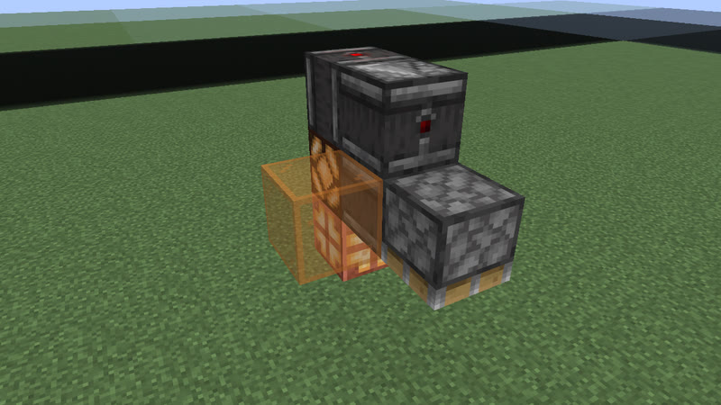</a> 40 gt (2 s) · copper_bulb+observer+piston+redstone_lamp · 6 blocks</td></tr>
<tr><td align="center"><a href="../archive/clk-obs-p40-bulb-lamp-obs-stk-6b-b-f22b7f.txt">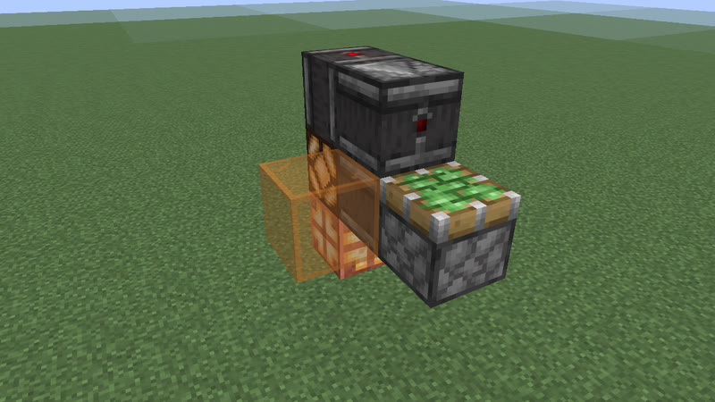</a> 40 gt (2 s) · copper_bulb+observer+redstone_lamp+sticky_piston · 6 blocks</td><td align="center"> 40 gt (2 s) · copper_bulb+observer+redstone_block+sticky_piston · 6 blocks</td><td align="center"> 40 gt (2 s) · copper_bulb+observer+sticky_piston · 6 blocks</td></tr>
<tr><td align="center"> 40 gt (2 s) · copper_bulb+observer+sticky_piston · 6 blocks</td><td align="center"> 40 gt (2 s) · observer+redstone_lamp+sticky_piston · 6 blocks</td><td align="center"> 40 gt (2 s) · copper_bulb+observer+redstone_block+sticky_piston · 6 blocks</td></tr>
<tr><td align="center"> 40 gt (2 s) · calibrated_sculk_sensor+note_block · 6 blocks</td><td align="center"> 40 gt (2 s) · note_block+observer+redstone_lamp+sticky_piston · 7 blocks</td><td align="center"><a href="../archive/clk-obs-p40-lamp-note-obs-stk-7b-b-a4634d.txt">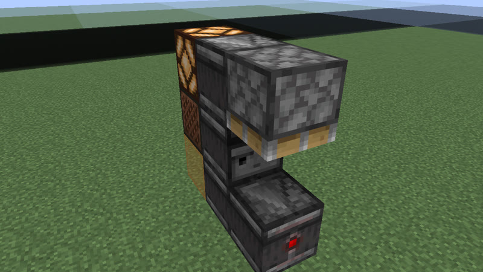</a> 40 gt (2 s) · note_block+observer+redstone_lamp+sticky_piston · 7 blocks</td></tr>
<tr><td align="center"><a href="../archive/clk-obs-p40-lamp-obs-stk-7b-b-c81311.txt">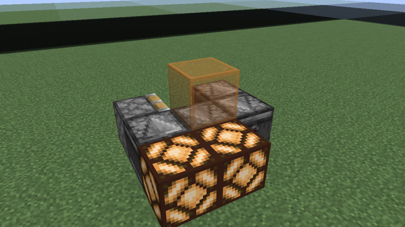</a> 40 gt (2 s) · observer+redstone_lamp+sticky_piston · 7 blocks</td><td align="center"><a href="../archive/clk-obs-p40-obs-stk-7b-b-a16c31.txt">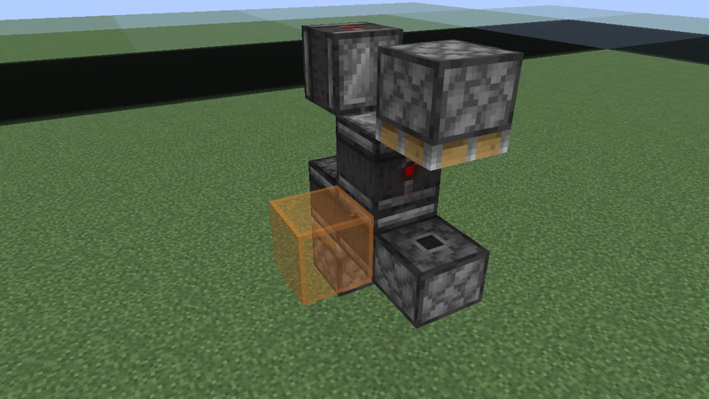</a> 40 gt (2 s) · observer+sticky_piston · 7 blocks</td><td align="center"> 40 gt (2 s) · observer+redstone_block+sticky_piston · 7 blocks</td></tr>
<tr><td align="center"> 40 gt (2 s) · observer+redstone_block+sticky_piston · 7 blocks</td><td align="center"> 40 gt (2 s) · comparator+redstone_torch+redstone_wire+repeater · 12 blocks</td><td align="center"> 40 gt (2 s) · redstone_torch+redstone_wire+repeater · 12 blocks</td></tr>
<tr><td align="center"><a href="../archive/clk-misc-cart-pingpong-bare.txt">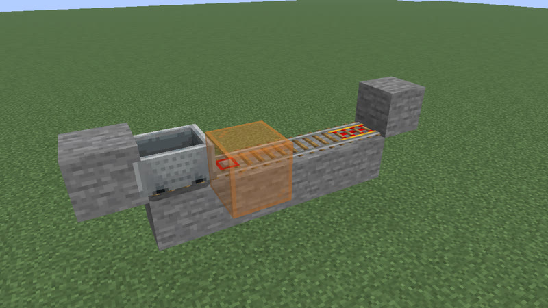</a> 40 gt (2 s) · detector_rail+minecart · 13 blocks</td><td align="center"> 40 gt (2 s) · redstone_wire+repeater · 16 blocks</td><td align="center"> 40 gt (2 s) · comparator+repeater · 16 blocks</td></tr>
</table>

variants of **clk-obs-p40-bulb-lamp-obs-stk-6b-b-f22b7f** (6 blocks): [clk-obs-p40-bulb-lamp-note-obs-stk-7b-95fb0f](../archive/clk-obs-p40-bulb-lamp-note-obs-stk-7b-95fb0f.txt) (7 blocks, +note_block) · [clk-obs-p40-bulb-lamp-obs-rb-stk-7b-3f3fff](../archive/clk-obs-p40-bulb-lamp-obs-rb-stk-7b-3f3fff.txt) (7 blocks, +redstone_block) · [clk-obs-p40-bulb-lamp-obs-rb-stk-7b-b-f5a632](../archive/clk-obs-p40-bulb-lamp-obs-rb-stk-7b-b-f5a632.txt) (7 blocks, +redstone_block)

variants of **clk-obs-p40-bulb-obs-rb-stk-6b-39192b** (6 blocks): [clk-obs-p40-bulb-note-obs-rb-stk-7b-a93749](../archive/clk-obs-p40-bulb-note-obs-rb-stk-7b-a93749.txt) (7 blocks, +note_block) · [clk-obs-p40-bulb-note-obs-rb-stk-7b-b-339c62](../archive/clk-obs-p40-bulb-note-obs-rb-stk-7b-b-339c62.txt) (7 blocks, +note_block) · [clk-obs-p40-obs-stk-7b-7fd43e](../archive/clk-obs-p40-obs-stk-7b-7fd43e.txt) (7 blocks, +stone)

variants of **clk-obs-p40-bulb-obs-stk-6b-31c0be** (6 blocks): [clk-obs-p40-bulb-note-obs-stk-7b-96d678](../archive/clk-obs-p40-bulb-note-obs-stk-7b-96d678.txt) (7 blocks) · [clk-obs-p40-bulb-note-obs-stk-7b-b-d56d78](../archive/clk-obs-p40-bulb-note-obs-stk-7b-b-d56d78.txt) (7 blocks)

variants of **clk-rt-ring3x3-p40-c-rt-rw-r-12b** (12 blocks): [clk-rt-uloop-p40-c-rt-rw-r-13b](../archive/clk-rt-uloop-p40-c-rt-rw-r-13b.txt) (13 blocks)

variants of **clk-rt-ring3x3-p40-rt-rw-r-12b** (12 blocks): [clk-rt-uloop-p40-rt-rw-r-13b](../archive/clk-rt-uloop-p40-rt-rw-r-13b.txt) (13 blocks) · [clk-rt-div-22-x1](../archive/clk-rt-div-22-x1.txt) (27 blocks, +target)

## 41 gt (2.05 s)

Also reachable by: clk-obs-odd-b (n = 7), clk-misc-cart-loop (n = 3), clk-item-dropring-1d (n = 1), clk-item-lockring-3s (n = 0).

<table>
<tr><td align="center"><a href="../archive/census-p41-dispenser-observer-sculk_sensor-5b.txt">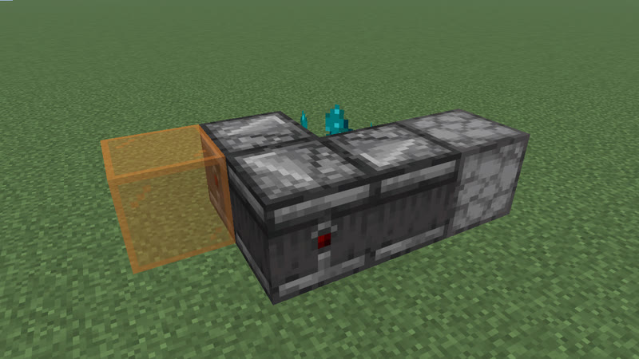</a> 41 gt (2.05 s) · dispenser+observer+sculk_sensor · 5 blocks</td><td align="center"> 41 gt (2.05 s) · calibrated_sculk_sensor+dispenser+observer+piston+sculk_sensor · 5 blocks also found as census-p41-calibrated_sculk_sensor-dispenser-observer-sculk_sensor-sticky_piston-5b (built with sticky_piston, without piston)</td><td align="center"> 41 gt (2.05 s) · calibrated_sculk_sensor+oak_trapdoor+observer+sculk_sensor+sticky_piston · 5 blocks</td></tr>
<tr><td align="center"> 41 gt (2.05 s) · dispenser+observer+sculk_sensor · 5 blocks</td><td align="center"><a href="../archive/census-p41-dispenser-observer-sculk_sensor-sticky_piston-5b.txt">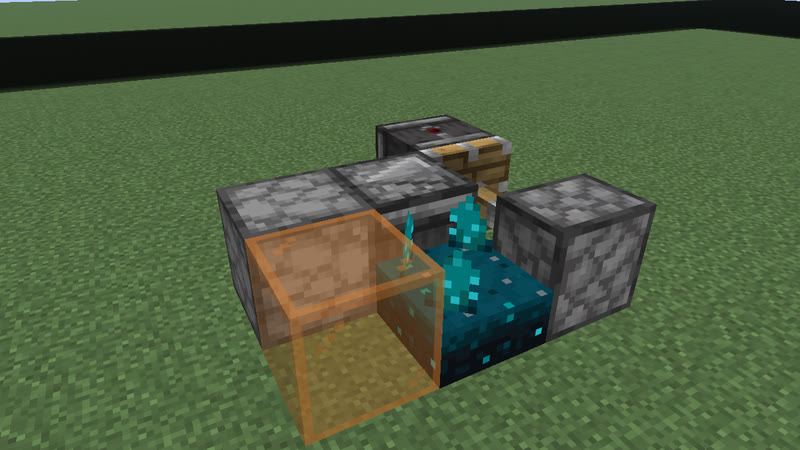</a> 41 gt (2.05 s) · dispenser+observer+sculk_sensor+sticky_piston · 5 blocks</td><td align="center"><a href="../archive/census-p41-note_block-observer-sculk_sensor-sticky_piston-5b.txt">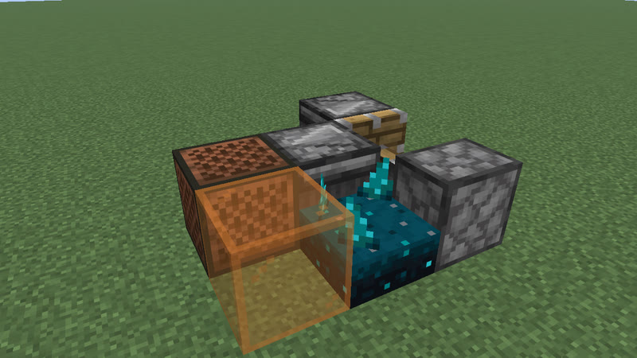</a> 41 gt (2.05 s) · note_block+observer+sculk_sensor+sticky_piston · 5 blocks</td></tr>
<tr><td align="center"> 41 gt (2.05 s) · oak_trapdoor+observer+sculk_sensor+sticky_piston · 5 blocks</td><td align="center"> 41 gt (2.05 s) · observer+piston+sculk_sensor+sticky_piston · 5 blocks</td><td align="center"> 41 gt (2.05 s) · observer+sculk_sensor+sticky_piston · 5 blocks</td></tr>
<tr><td align="center"><a href="../archive/clk-sculk-obs-p41-1.txt">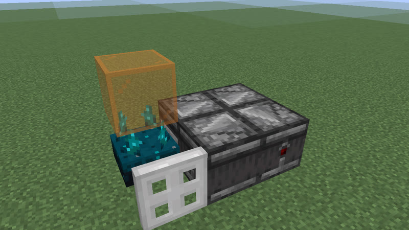</a> 41 gt (2.05 s) · iron_trapdoor+observer+sculk_sensor · 6 blocks</td><td align="center"><a href="../archive/clk-sculk-obs-p41-3.txt">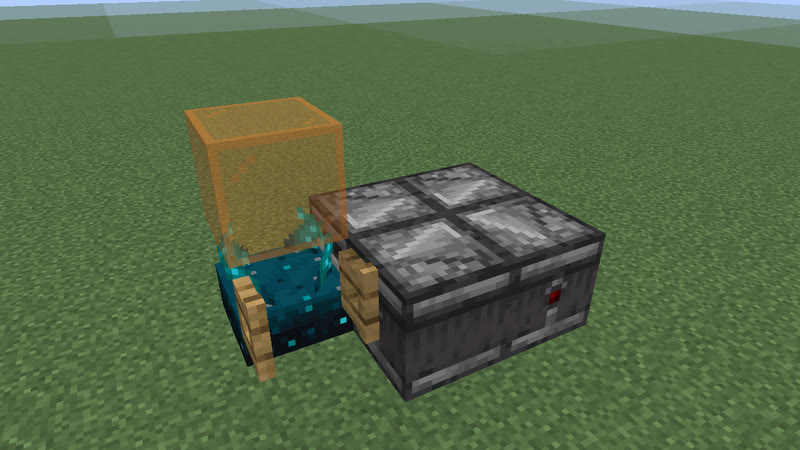</a> 41 gt (2.05 s) · oak_fence_gate+observer+sculk_sensor · 6 blocks</td><td align="center"><a href="../archive/clk-sculk-obs-p41-5.txt">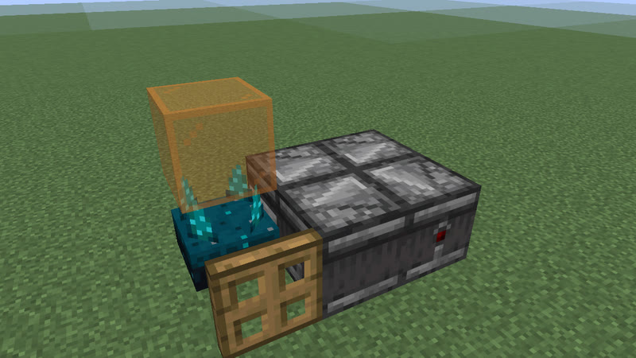</a> 41 gt (2.05 s) · oak_trapdoor+observer+sculk_sensor · 6 blocks</td></tr>
<tr><td align="center"><a href="../archive/clk-sculk-two-p41-3.txt">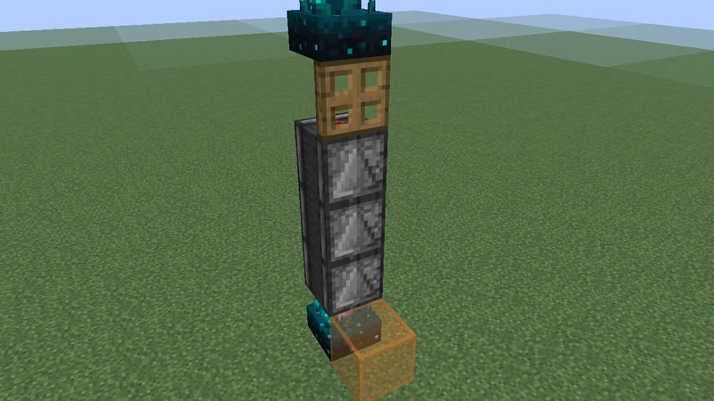</a> 41 gt (2.05 s) · calibrated_sculk_sensor+oak_trapdoor+observer+sculk_sensor · 6 blocks</td><td align="center"> 41 gt (2.05 s) · note_block+observer+repeater+sculk_sensor · 6 blocks</td><td align="center"> 41 gt (2.05 s) · observer+piston+sticky_piston · 7 blocks</td></tr>
<tr><td align="center"><a href="../archive/clk-obs-p41-obs-pis-stk-7b-b-672da7.txt">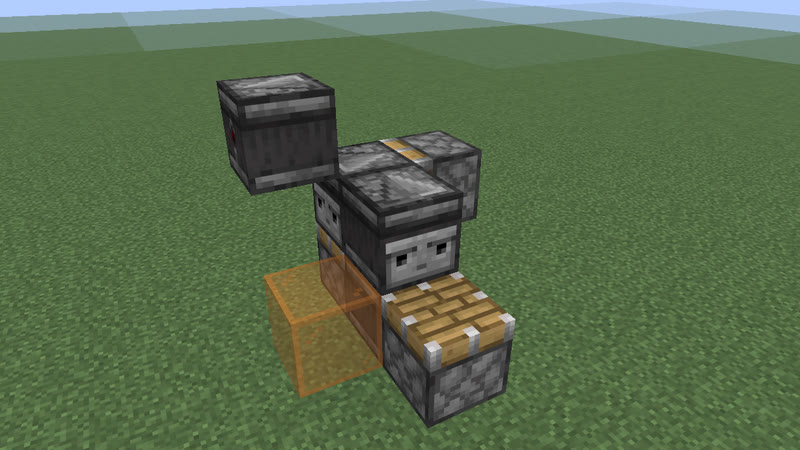</a> 41 gt (2.05 s) · observer+piston+sticky_piston · 7 blocks</td><td align="center"> 41 gt (2.05 s) · observer+sticky_piston · 7 blocks</td><td align="center"> 41 gt (2.05 s) · repeater · 27 blocks</td></tr>
</table>

variants of **census-p41-observer-sculk_sensor-sticky_piston-5b** (5 blocks): [clk-sculk-two-p41-5](../archive/clk-sculk-two-p41-5.txt) (6 blocks, +calibrated_sculk_sensor) · [clk-sculk-hyb3b-p41-10](../archive/clk-sculk-hyb3b-p41-10.txt) (6 blocks, +oak_fence_gate) · [clk-sculk-hyb3b-p41-7](../archive/clk-sculk-hyb3b-p41-7.txt) (6 blocks, +iron_trapdoor)

## 42 gt (2.1 s)

Also reachable by: clk-misc-activator_rail-ring (n = 8), clk-misc-crafter-ring (n = 8), clk-misc-iron_door-ring (n = 8), clk-misc-oak_door-ring (n = 8), clk-misc-oak_fence_gate-ring (n = 8), clk-misc-oak_trapdoor-ring (n = 8), clk-misc-powered_rail-ring (n = 8), clk-misc-skeleton_skull-ring (n = 8), clk-obs-note-ring (n = 8), clk-obs-trap-ring (n = 8), clk-item-hopper-ring (n = 2), clk-item-hopper-ring-2 (n = 5), clk-item-dropring-1d-r4 (n = 0).

<table>
<tr><td align="center"> 42 gt (2.1 s) · dispenser+observer+sculk_sensor · 4 blocks</td><td align="center"> 42 gt (2.1 s) · note_block+observer+sculk_sensor · 4 blocks</td><td align="center"> 42 gt (2.1 s) · oak_trapdoor+observer+sculk_sensor · 4 blocks</td></tr>
<tr><td align="center"> 42 gt (2.1 s) · observer+piston+sculk_sensor · 4 blocks also found as census-p42-observer-sculk_sensor-sticky_piston-4b (built with sticky_piston, without piston)</td><td align="center"><a href="../archive/clk-sculk-hyb3b-p42-13.txt">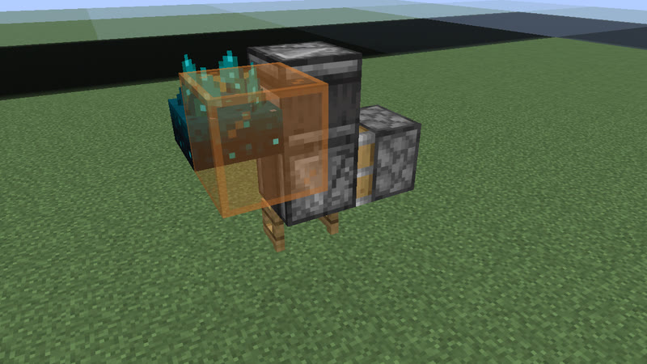</a> 42 gt (2.1 s) · oak_fence_gate+observer+sculk_sensor+sticky_piston · 5 blocks</td><td align="center"><a href="../archive/clk-sculk-hyb3b-p42-9.txt">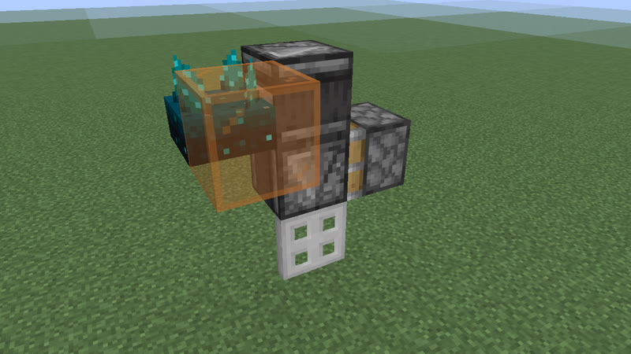</a> 42 gt (2.1 s) · iron_trapdoor+observer+sculk_sensor+sticky_piston · 5 blocks</td></tr>
<tr><td align="center"><a href="../archive/clk-sculk-obs-p42-1.txt">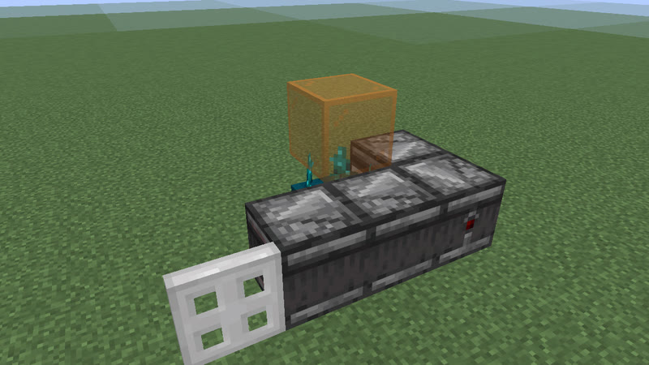</a> 42 gt (2.1 s) · iron_trapdoor+observer+sculk_sensor · 6 blocks</td><td align="center"><a href="../archive/clk-sculk-obs-p42-3.txt">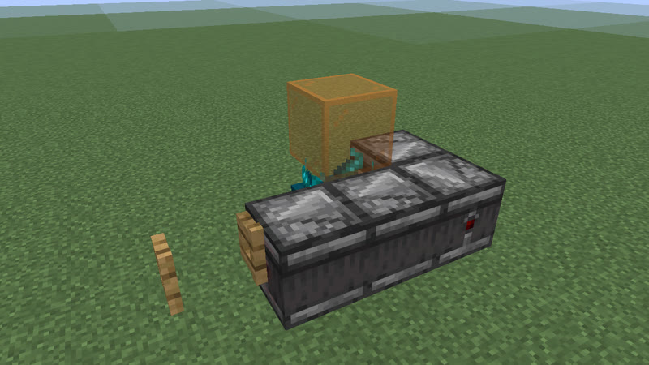</a> 42 gt (2.1 s) · oak_fence_gate+observer+sculk_sensor · 6 blocks</td><td align="center"> 42 gt (2.1 s) · copper_bulb+observer+redstone_lamp+sticky_piston · 6 blocks</td></tr>
<tr><td align="center"><a href="../archive/clk-obs-p42-bulb-lamp-obs-stk-6b-b-9712f1.txt">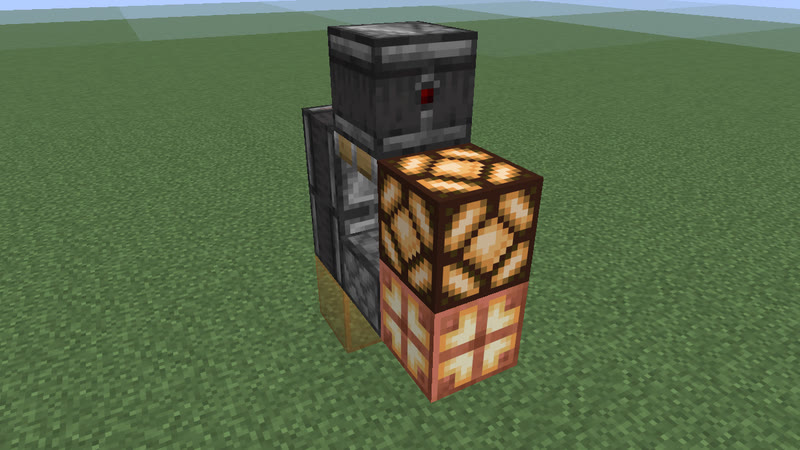</a> 42 gt (2.1 s) · copper_bulb+observer+redstone_lamp+sticky_piston · 6 blocks</td><td align="center"> 42 gt (2.1 s) · copper_bulb+note_block+observer+sticky_piston · 6 blocks</td><td align="center"> 42 gt (2.1 s) · copper_bulb+observer+sticky_piston · 6 blocks</td></tr>
<tr><td align="center"><a href="../archive/clk-obs-p42-bulb-obs-stk-6b-b-b8373e.txt">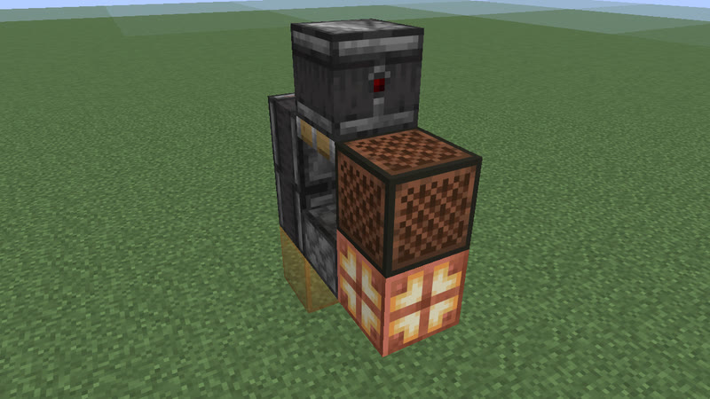</a> 42 gt (2.1 s) · copper_bulb+observer+sticky_piston · 6 blocks</td><td align="center"> 42 gt (2.1 s) · observer+piston+redstone_lamp+sticky_piston · 6 blocks</td><td align="center"><a href="../archive/clk-obs-p42-lamp-obs-pis-stk-6b-b-87c579.txt">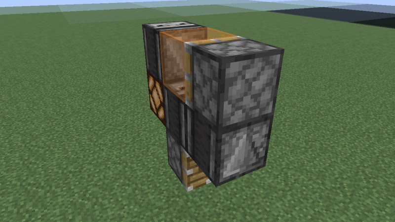</a> 42 gt (2.1 s) · observer+piston+redstone_lamp+sticky_piston · 6 blocks</td></tr>
<tr><td align="center"> 42 gt (2.1 s) · observer+redstone_lamp+sticky_piston · 6 blocks</td><td align="center"> 42 gt (2.1 s) · observer+redstone_lamp+sticky_piston · 6 blocks</td><td align="center"><a href="../archive/clk-obs-p42-note-obs-pis-stk-6b-b-f46c10.txt">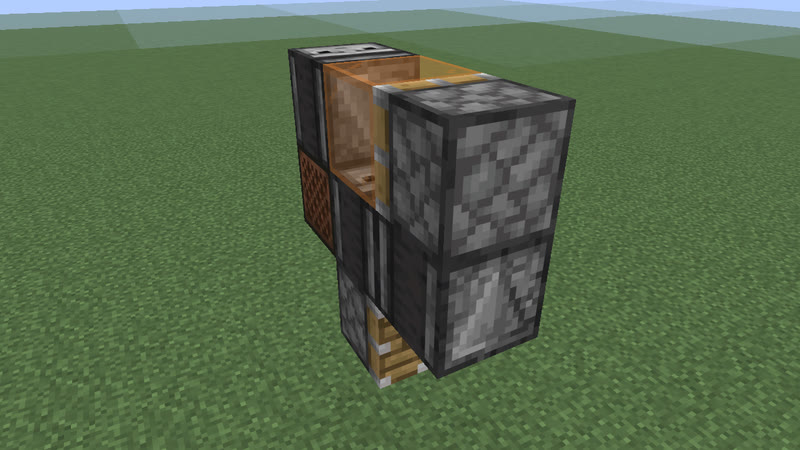</a> 42 gt (2.1 s) · note_block+observer+piston+sticky_piston · 6 blocks</td></tr>
<tr><td align="center"> 42 gt (2.1 s) · note_block+observer+piston+sticky_piston · 6 blocks</td><td align="center"> 42 gt (2.1 s) · note_block+observer+sticky_piston · 6 blocks</td><td align="center"><a href="../archive/clk-obs-p42-note-obs-stk-6b-b-a9dfb5.txt">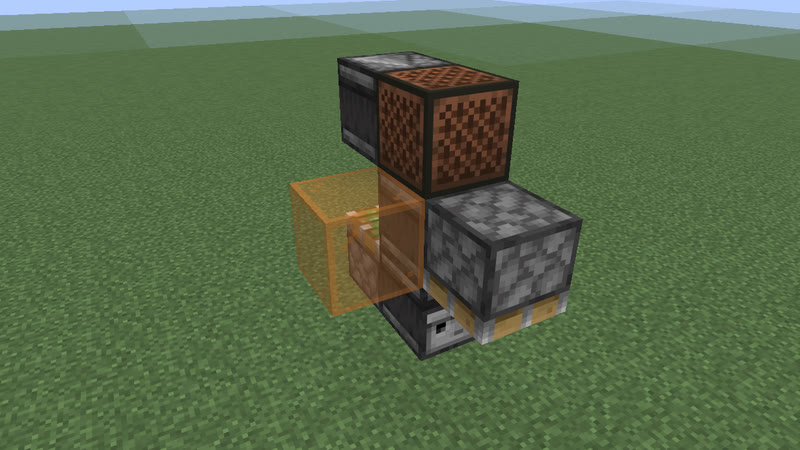</a> 42 gt (2.1 s) · note_block+observer+sticky_piston · 6 blocks</td></tr>
<tr><td align="center"> 42 gt (2.1 s) · observer+piston · 6 blocks also found as clk-obs-p42-obs-pis-stk-6b-b-ab8e35 (built with sticky_piston)</td><td align="center"> 42 gt (2.1 s) · observer+piston · 6 blocks also found as clk-obs-p42-obs-pis-stk-6b-8554c8 (built with sticky_piston)</td><td align="center"> 42 gt (2.1 s) · observer+redstone_block+sticky_piston · 6 blocks</td></tr>
<tr><td align="center"> 42 gt (2.1 s) · observer+redstone_block+sticky_piston · 6 blocks</td><td align="center"> 42 gt (2.1 s) · observer+sticky_piston · 6 blocks</td><td align="center"> 42 gt (2.1 s) · observer+sticky_piston · 6 blocks</td></tr>
<tr><td align="center"><a href="../archive/clk-sculk-two-p42-1.txt">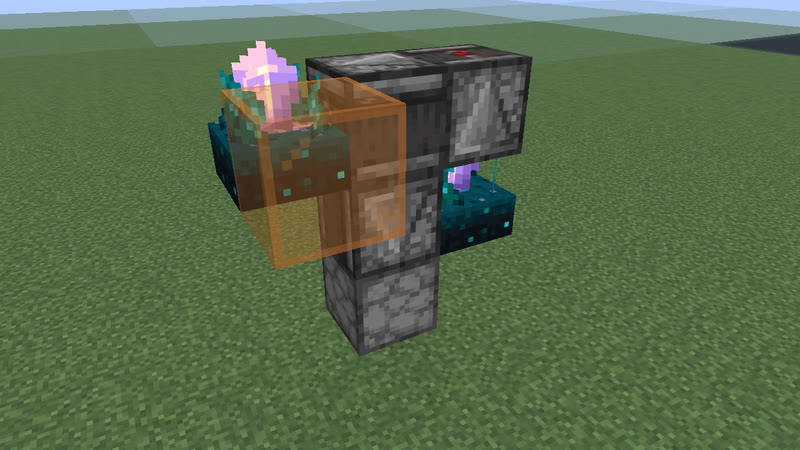</a> 42 gt (2.1 s) · calibrated_sculk_sensor+dispenser+observer · 6 blocks</td><td align="center"> 42 gt (2.1 s) · copper_bulb+note_block+observer+sticky_piston · 6 blocks</td><td align="center"> 42 gt (2.1 s) · redstone_torch+repeater · 16 blocks</td></tr>
<tr><td align="center"> 42 gt (2.1 s) · repeater · 16 blocks</td><td align="center"> 42 gt (2.1 s) · comparator+repeater · 16 blocks</td></tr>
</table>

variants of **census-p42-dispenser-observer-sculk_sensor-4b** (4 blocks): [census-p42-calibrated_sculk_sensor-dispenser-oak_trapdoor-observer-sculk_sensor-5b](../archive/census-p42-calibrated_sculk_sensor-dispenser-oak_trapdoor-observer-sculk_sensor-5b.txt) (5 blocks, +calibrated_sculk_sensor, +oak_trapdoor) · [census-p42-calibrated_sculk_sensor-dispenser-observer-sculk_sensor-5b](../archive/census-p42-calibrated_sculk_sensor-dispenser-observer-sculk_sensor-5b.txt) (5 blocks, +calibrated_sculk_sensor) · [census-p42-calibrated_sculk_sensor-dispenser-observer-piston-sculk_sensor-5b](../archive/census-p42-calibrated_sculk_sensor-dispenser-observer-piston-sculk_sensor-5b.txt) (5 blocks, +calibrated_sculk_sensor, +piston) · [census-p42-calibrated_sculk_sensor-oak_trapdoor-sculk_sensor-5b](../archive/census-p42-calibrated_sculk_sensor-oak_trapdoor-sculk_sensor-5b.txt) (5 blocks, +calibrated_sculk_sensor, +oak_trapdoor) · [census-p42-calibrated_sculk_sensor-piston-sculk_sensor-5b](../archive/census-p42-calibrated_sculk_sensor-piston-sculk_sensor-5b.txt) (5 blocks, +calibrated_sculk_sensor, +piston) · [clk-sculk-hyb3b-p42-5](../archive/clk-sculk-hyb3b-p42-5.txt) (5 blocks, +sticky_piston) · [clk-sculk-hyb3b-p42-1](../archive/clk-sculk-hyb3b-p42-1.txt) (6 blocks, +piston)

variants of **census-p42-note_block-observer-sculk_sensor-4b** (4 blocks): [census-p42-calibrated_sculk_sensor-note_block-oak_trapdoor-observer-sculk_sensor-5b](../archive/census-p42-calibrated_sculk_sensor-note_block-oak_trapdoor-observer-sculk_sensor-5b.txt) (5 blocks, +calibrated_sculk_sensor, +oak_trapdoor) · [census-p42-calibrated_sculk_sensor-note_block-observer-piston-sculk_sensor-5b](../archive/census-p42-calibrated_sculk_sensor-note_block-observer-piston-sculk_sensor-5b.txt) (5 blocks, +calibrated_sculk_sensor, +piston) · [clk-sculk-p42s-rep-obs-note](../archive/clk-sculk-p42s-rep-obs-note.txt) (5 blocks, +repeater, +stone) · [clk-sculk-hyb3-p42-1](../archive/clk-sculk-hyb3-p42-1.txt) (6 blocks, +piston)

variants of **census-p42-oak_trapdoor-observer-sculk_sensor-4b** (4 blocks): [census-p42-calibrated_sculk_sensor-oak_trapdoor-observer-piston-sculk_sensor-5b](../archive/census-p42-calibrated_sculk_sensor-oak_trapdoor-observer-piston-sculk_sensor-5b.txt) (5 blocks, +calibrated_sculk_sensor, +piston) · [clk-sculk-hyb-p42-1](../archive/clk-sculk-hyb-p42-1.txt) (5 blocks, +sticky_piston) · [clk-sculk-two-p42-5](../archive/clk-sculk-two-p42-5.txt) (6 blocks, +calibrated_sculk_sensor) · [clk-sculk-hyb3-p42-5](../archive/clk-sculk-hyb3-p42-5.txt) (7 blocks, +piston, +stone)

variants of **census-p42-observer-piston-sculk_sensor-4b** (4 blocks): [census-p42-calibrated_sculk_sensor-observer-piston-sculk_sensor-sticky_piston-5b](../archive/census-p42-calibrated_sculk_sensor-observer-piston-sculk_sensor-sticky_piston-5b.txt) (5 blocks, +calibrated_sculk_sensor, +sticky_piston) · [clk-sculk-hyb3b-p42-17](../archive/clk-sculk-hyb3b-p42-17.txt) (5 blocks, +sticky_piston) · [clk-sculk-hyb3b-p42-11](../archive/clk-sculk-hyb3b-p42-11.txt) (7 blocks, +oak_fence_gate, +stone) · [clk-sculk-hyb3b-p42-7](../archive/clk-sculk-hyb3b-p42-7.txt) (7 blocks, +iron_trapdoor, +stone)

variants of **clk-obs-p42-obs-pis-6b-505a04** (6 blocks): [clk-obs-p42-note-obs-pis-7b-c6c4f6](../archive/clk-obs-p42-note-obs-pis-7b-c6c4f6.txt) (7 blocks, +note_block) · [clk-obs-p42-obs-pis-rb-stk-7b-1bf621](../archive/clk-obs-p42-obs-pis-rb-stk-7b-1bf621.txt) (7 blocks, +redstone_block, +sticky_piston) · [clk-obs-p42-note-obs-pis-7b-b-e2dcb6](../archive/clk-obs-p42-note-obs-pis-7b-b-e2dcb6.txt) (7 blocks, +note_block)

## 43 gt (2.15 s)

Also reachable by: clk-obs-odd-a (n = 8), clk-misc-cart-pingpong (n = 1), clk-item-lockring-3s (n = 1), clk-item-dropring-2d-r1 (n = 0).

<table>
<tr><td align="center"> 43 gt (2.15 s) · calibrated_sculk_sensor+dispenser+observer+sculk_sensor · 4 blocks</td><td align="center"><a href="../archive/census-p43-calibrated_sculk_sensor-observer-piston-sculk_sensor-4b.txt">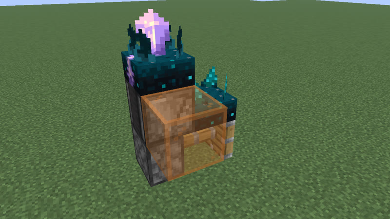</a> 43 gt (2.15 s) · calibrated_sculk_sensor+observer+piston+sculk_sensor · 4 blocks also found as census-p43-calibrated_sculk_sensor-observer-sculk_sensor-sticky_piston-4b (built with sticky_piston, without piston)</td><td align="center"><a href="../archive/census-p43-dispenser-observer-piston-sculk_sensor-4b.txt">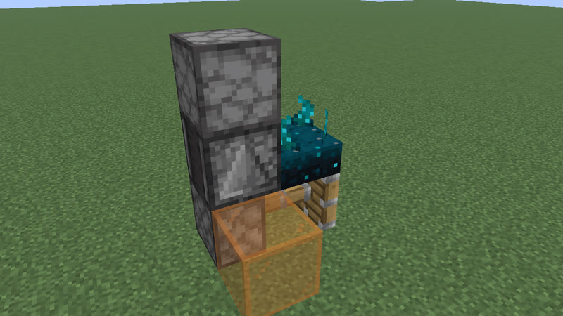</a> 43 gt (2.15 s) · dispenser+observer+piston+sculk_sensor · 4 blocks also found as census-p43-dispenser-observer-sculk_sensor-sticky_piston-4b (built with sticky_piston, without piston)</td></tr>
<tr><td align="center"><a href="../archive/census-p43-note_block-observer-piston-sculk_sensor-4b.txt">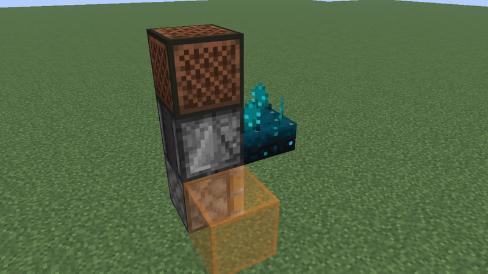</a> 43 gt (2.15 s) · note_block+observer+piston+sculk_sensor · 4 blocks also found as census-p43-note_block-observer-sculk_sensor-sticky_piston-4b (built with sticky_piston, without piston)</td><td align="center"><a href="../archive/census-p43-dispenser-observer-sculk_sensor-5b.txt">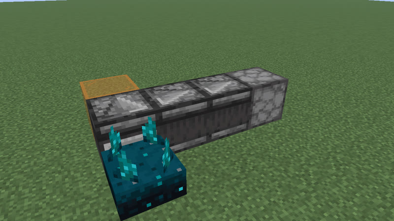</a> 43 gt (2.15 s) · dispenser+observer+sculk_sensor · 5 blocks</td><td align="center"> 43 gt (2.15 s) · note_block+observer+repeater+sculk_sensor · 5 blocks</td></tr>
<tr><td align="center"> 43 gt (2.15 s) · oak_trapdoor+observer+sculk_sensor+sticky_piston · 5 blocks</td><td align="center"><a href="../archive/census-p43-observer-piston-sculk_sensor-sticky_piston-5b.txt">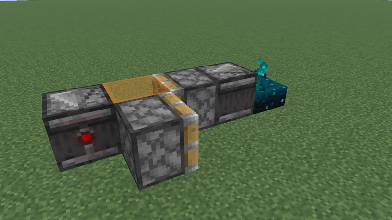</a> 43 gt (2.15 s) · observer+piston+sculk_sensor+sticky_piston · 5 blocks</td><td align="center"> 43 gt (2.15 s) · observer+sculk_sensor+sticky_piston · 5 blocks</td></tr>
<tr><td align="center"><a href="../archive/clk-sculk-hyb3b-p43-11.txt">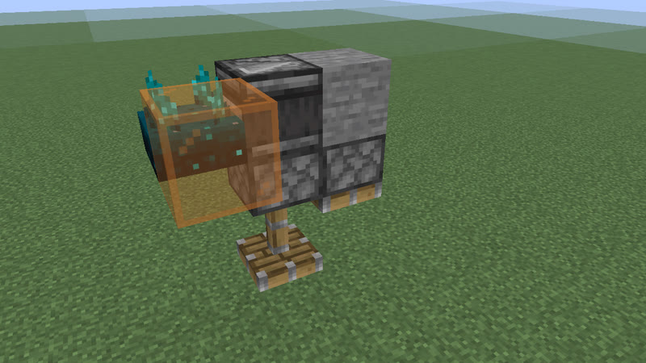</a> 43 gt (2.15 s) · observer+piston+sculk_sensor · 5 blocks</td><td align="center"><a href="../archive/clk-sculk-hyb3b-p43-7.txt">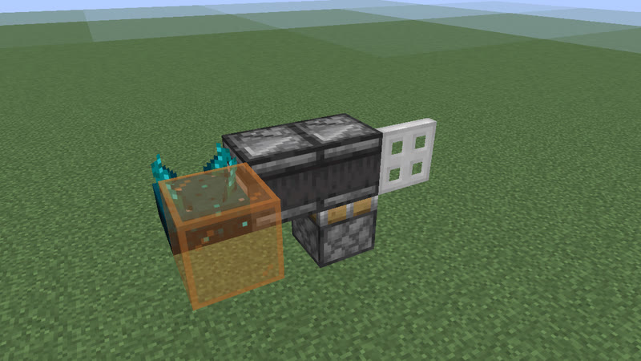</a> 43 gt (2.15 s) · iron_trapdoor+observer+sculk_sensor+sticky_piston · 5 blocks</td><td align="center"><a href="../archive/clk-sculk-hyb3b-p43-9.txt">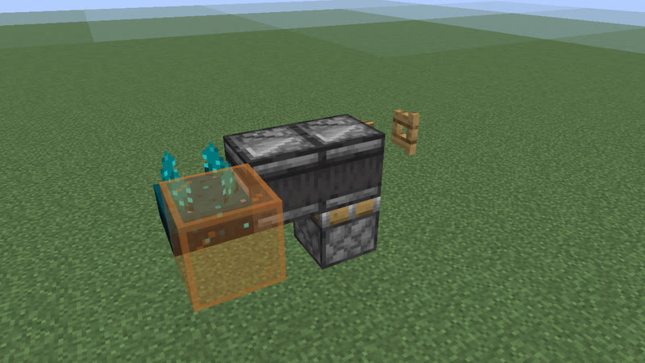</a> 43 gt (2.15 s) · oak_fence_gate+observer+sculk_sensor+sticky_piston · 5 blocks</td></tr>
<tr><td align="center"><a href="../archive/clk-sculk-obs-p43-3.txt">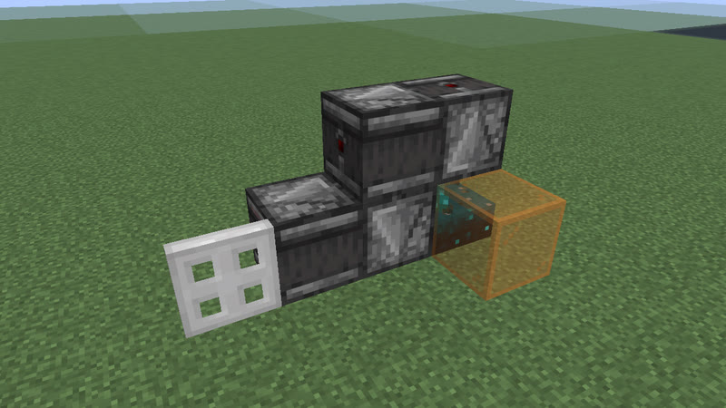</a> 43 gt (2.15 s) · iron_trapdoor+observer+sculk_sensor · 6 blocks</td><td align="center"><a href="../archive/clk-sculk-obs-p43-5.txt">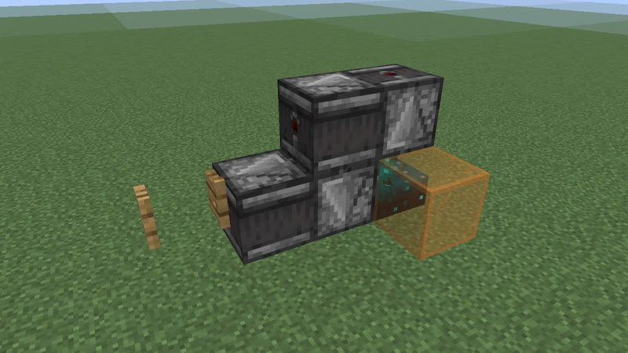</a> 43 gt (2.15 s) · oak_fence_gate+observer+sculk_sensor · 6 blocks</td><td align="center"><a href="../archive/clk-sculk-obs-p43-7.txt">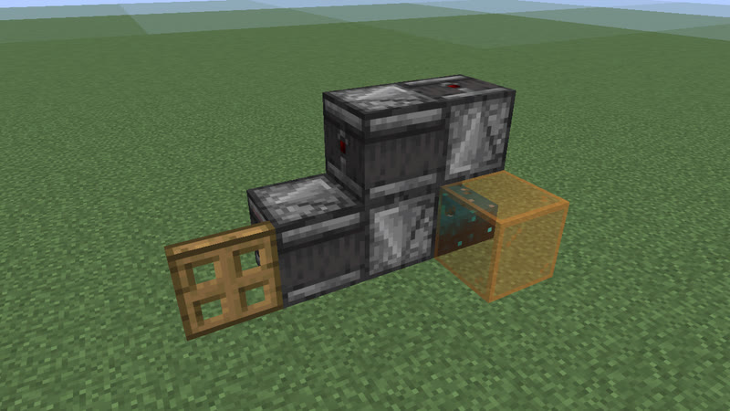</a> 43 gt (2.15 s) · oak_trapdoor+observer+sculk_sensor · 6 blocks</td></tr>
<tr><td align="center"> 43 gt (2.15 s) · observer+redstone_block+sticky_piston · 6 blocks</td><td align="center"> 43 gt (2.15 s) · observer+redstone_block+sticky_piston · 6 blocks</td><td align="center"> 43 gt (2.15 s) · repeater · 27 blocks</td></tr>
</table>

## 44 gt (2.2 s)

Also reachable by: clk-obs-obs-ring (n = 9), clk-obs-bulb-ring (n = 3), clk-item-dropring-2d-r14 (n = 0).

<table>
<tr><td align="center"> 44 gt (2.2 s) · oak_trapdoor+observer+sculk_sensor · 3 blocks</td><td align="center"> 44 gt (2.2 s) · oak_fence_gate+observer+sculk_sensor · 3 blocks</td><td align="center"> 44 gt (2.2 s) · iron_trapdoor+observer+sculk_sensor · 3 blocks</td></tr>
<tr><td align="center"> 44 gt (2.2 s) · oak_fence_gate+observer+sculk_sensor · 3 blocks</td><td align="center"> 44 gt (2.2 s) · observer+piston+sculk_sensor · 3 blocks also found as census-p44-observer-sculk_sensor-sticky_piston-3b (built with sticky_piston, without piston)</td><td align="center"> 44 gt (2.2 s) · note_block+observer+sculk_sensor · 3 blocks</td></tr>
<tr><td align="center"> 44 gt (2.2 s) · dispenser+observer+sculk_sensor+sticky_piston · 4 blocks</td><td align="center"> 44 gt (2.2 s) · calibrated_sculk_sensor+dispenser+observer+sculk_sensor · 4 blocks</td><td align="center"> 44 gt (2.2 s) · dispenser+observer+sculk_sensor · 5 blocks</td></tr>
<tr><td align="center"> 44 gt (2.2 s) · calibrated_sculk_sensor+dispenser+observer · 6 blocks</td><td align="center"> 44 gt (2.2 s) · copper_bulb+note_block+observer+piston+sticky_piston · 7 blocks</td><td align="center"> 44 gt (2.2 s) · copper_bulb+observer+piston+sticky_piston · 7 blocks</td></tr>
<tr><td align="center"> 44 gt (2.2 s) · copper_bulb+observer+piston+sticky_piston · 7 blocks</td><td align="center"> 44 gt (2.2 s) · note_block+observer+redstone_block+redstone_lamp+sticky_piston · 7 blocks</td><td align="center"> 44 gt (2.2 s) · note_block+observer+redstone_block+redstone_lamp+sticky_piston · 7 blocks</td></tr>
<tr><td align="center"> 44 gt (2.2 s) · note_block+observer+redstone_lamp+sticky_piston · 7 blocks</td><td align="center"> 44 gt (2.2 s) · note_block+observer+redstone_lamp+sticky_piston · 7 blocks</td><td align="center"> 44 gt (2.2 s) · observer+redstone_block+redstone_lamp+sticky_piston · 7 blocks</td></tr>
<tr><td align="center"> 44 gt (2.2 s) · observer+redstone_block+redstone_lamp+sticky_piston · 7 blocks</td><td align="center"> 44 gt (2.2 s) · observer+redstone_lamp+sticky_piston · 7 blocks</td><td align="center"> 44 gt (2.2 s) · observer+redstone_lamp+sticky_piston · 7 blocks</td></tr>
<tr><td align="center"> 44 gt (2.2 s) · copper_bulb+note_block+observer+piston+sticky_piston · 7 blocks</td><td align="center"> 44 gt (2.2 s) · copper_bulb+observer+redstone_block+sticky_piston · 7 blocks</td><td align="center"> 44 gt (2.2 s) · observer+piston+sticky_piston · 7 blocks</td></tr>
<tr><td align="center"> 44 gt (2.2 s) · observer+piston+sticky_piston · 7 blocks</td><td align="center"> 44 gt (2.2 s) · copper_bulb+observer+sticky_piston · 7 blocks</td><td align="center"> 44 gt (2.2 s) · copper_bulb+note_block+observer+sticky_piston · 7 blocks</td></tr>
<tr><td align="center"> 44 gt (2.2 s) · copper_bulb+observer+sticky_piston · 7 blocks</td><td align="center"> 44 gt (2.2 s) · copper_bulb+observer+redstone_block+sticky_piston · 7 blocks</td><td align="center"> 44 gt (2.2 s) · calibrated_sculk_sensor+observer+sticky_piston · 7 blocks</td></tr>
<tr><td align="center"> 44 gt (2.2 s) · redstone_torch+redstone_wire+repeater · 12 blocks</td><td align="center"> 44 gt (2.2 s) · comparator+hopper · 12 blocks</td><td align="center"> 44 gt (2.2 s) · repeater · 16 blocks</td></tr>
</table>

variants of **census-p44-oak_trapdoor-observer-sculk_sensor-3b** (3 blocks): [census-p44-dispenser-oak_trapdoor-observer-sculk_sensor-4b](../archive/census-p44-dispenser-oak_trapdoor-observer-sculk_sensor-4b.txt) (4 blocks, +dispenser) · [census-p44-note_block-oak_trapdoor-observer-sculk_sensor-4b](../archive/census-p44-note_block-oak_trapdoor-observer-sculk_sensor-4b.txt) (4 blocks, +note_block)

variants of **census-p44-observer-piston-sculk_sensor-3b** (3 blocks): [census-p44-dispenser-observer-piston-sculk_sensor-4b](../archive/census-p44-dispenser-observer-piston-sculk_sensor-4b.txt) (4 blocks, +dispenser) · [census-p44-note_block-observer-piston-sculk_sensor-4b](../archive/census-p44-note_block-observer-piston-sculk_sensor-4b.txt) (4 blocks, +note_block) · [census-p44-calibrated_sculk_sensor-observer-piston-sculk_sensor-sticky_piston-5b](../archive/census-p44-calibrated_sculk_sensor-observer-piston-sculk_sensor-sticky_piston-5b.txt) (5 blocks, +calibrated_sculk_sensor, +sticky_piston)

variants of **clk-sculk-p44-obs-note** (3 blocks): [census-p44-dispenser-note_block-observer-sculk_sensor-4b](../archive/census-p44-dispenser-note_block-observer-sculk_sensor-4b.txt) (4 blocks, +dispenser)

variants of **clk-rt-ring3x3-p44-rt-rw-r-12b** (12 blocks): [clk-rt-uloop-p44-c-rt-rw-r-13b](../archive/clk-rt-uloop-p44-c-rt-rw-r-13b.txt) (13 blocks, +comparator) · [clk-rt-uloop-p44-rt-rw-r-13b](../archive/clk-rt-uloop-p44-rt-rw-r-13b.txt) (13 blocks)

[catalog index](../CATALOG.md) · previous: [p19-29](p19-29.md) · next: [p45-70](p45-70.md)
