# Clocks: 4 gt (0.2 s) to 11 gt (0.55 s) (270 clocks)

[catalog index](../CATALOG.md) · next: [p12-16](p12-16.md)

Orange glass = where the output signal is (placed only for the picture); click a picture for its design. Generated by `mctas clock catalog`.

## 4 gt (0.2 s)

<table>
<tr><td align="center"> 4 gt (0.2 s) · observer · 4 blocks</td><td align="center"> 4 gt (0.2 s) · observer · 4 blocks</td><td align="center"> 4 gt (0.2 s) · observer+piston · 4 blocks</td></tr>
<tr><td align="center"> 4 gt (0.2 s) · observer+piston · 4 blocks</td><td align="center"> 4 gt (0.2 s) · note_block+observer+piston · 5 blocks</td><td align="center"> 4 gt (0.2 s) · note_block+observer+piston · 5 blocks</td></tr>
<tr><td align="center"> 4 gt (0.2 s) · note_block+observer+sticky_piston · 5 blocks</td><td align="center"> 4 gt (0.2 s) · note_block+observer+sticky_piston · 5 blocks</td><td align="center"> 4 gt (0.2 s) · observer+sticky_piston · 5 blocks</td></tr>
<tr><td align="center"> 4 gt (0.2 s) · note_block+observer+piston+sticky_piston · 5 blocks</td><td align="center"><a href="../archive/clk-obs-p4-note-obs-pis-stk-5b-b-c908ea.txt">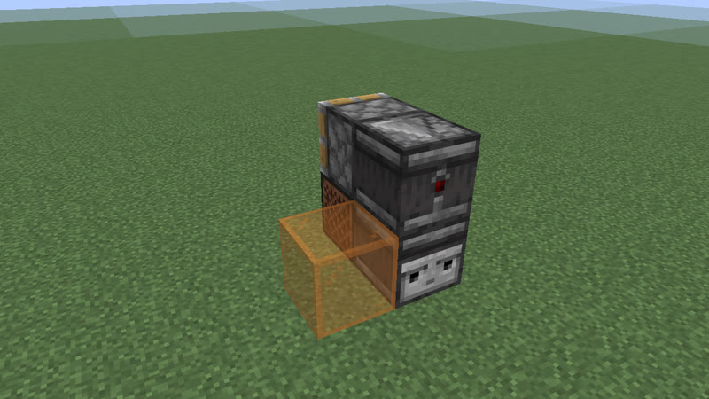</a> 4 gt (0.2 s) · note_block+observer+piston+sticky_piston · 5 blocks</td><td align="center"> 4 gt (0.2 s) · observer+piston+sticky_piston · 5 blocks</td></tr>
<tr><td align="center"><a href="../archive/clk-obs-p4-obs-pis-stk-5b-b-cda837.txt">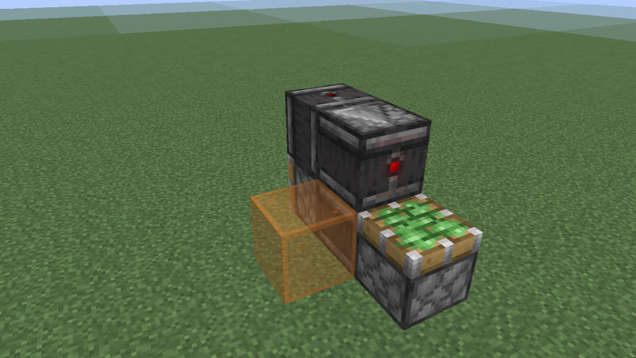</a> 4 gt (0.2 s) · observer+piston+sticky_piston · 5 blocks</td><td align="center"> 4 gt (0.2 s) · observer+sticky_piston · 5 blocks</td><td align="center"><a href="../archive/clk-obs-p4-note-obs-5b-b-26ff18.txt">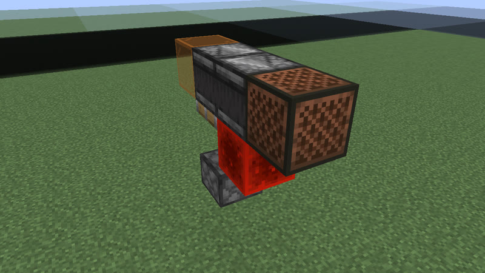</a> 4 gt (0.2 s) · note_block+observer · 5 blocks</td></tr>
<tr><td align="center"> 4 gt (0.2 s) · note_block+observer · 5 blocks</td><td align="center"> 4 gt (0.2 s) · crafter+observer · 6 blocks</td><td align="center"> 4 gt (0.2 s) · crafter+observer · 6 blocks</td></tr>
<tr><td align="center"> 4 gt (0.2 s) · crafter+observer · 6 blocks</td><td align="center"> 4 gt (0.2 s) · comparator+redstone_wire · 8 blocks</td><td align="center"> 4 gt (0.2 s) · comparator+redstone_wire · 9 blocks</td></tr>
<tr><td align="center"> 4 gt (0.2 s) · redstone_wire+repeater · 10 blocks</td><td align="center"> 4 gt (0.2 s) · repeater · 12 blocks</td></tr>
</table>

## 5 gt (0.25 s)

<table>
<tr><td align="center"> 5 gt (0.25 s) · observer+piston · 6 blocks</td><td align="center"> 5 gt (0.25 s) · observer+piston · 6 blocks</td><td align="center"> 5 gt (0.25 s) · observer+piston+sticky_piston · 6 blocks</td></tr>
<tr><td align="center"> 5 gt (0.25 s) · observer+piston+sticky_piston · 6 blocks</td><td align="center"> 5 gt (0.25 s) · note_block+observer+piston · 7 blocks</td><td align="center"> 5 gt (0.25 s) · note_block+observer+piston+sticky_piston · 7 blocks</td></tr>
<tr><td align="center"> 5 gt (0.25 s) · note_block+observer+sticky_piston · 7 blocks</td><td align="center"> 5 gt (0.25 s) · observer+sticky_piston · 7 blocks</td><td align="center"> 5 gt (0.25 s) · observer+sticky_piston · 7 blocks</td></tr>
<tr><td align="center"><a href="../archive/clk-obs-p5-note-obs-pis-stk-7b-b-55254a.txt">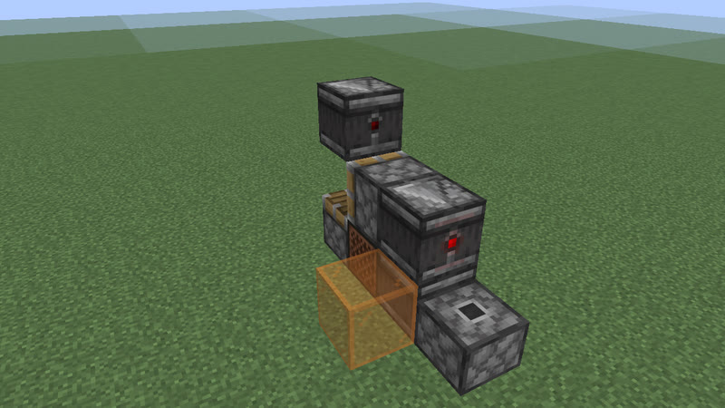</a> 5 gt (0.25 s) · note_block+observer+piston+sticky_piston · 7 blocks</td><td align="center"><a href="../archive/clk-obs-p5-note-obs-pis-7b-b-fd7e0c.txt">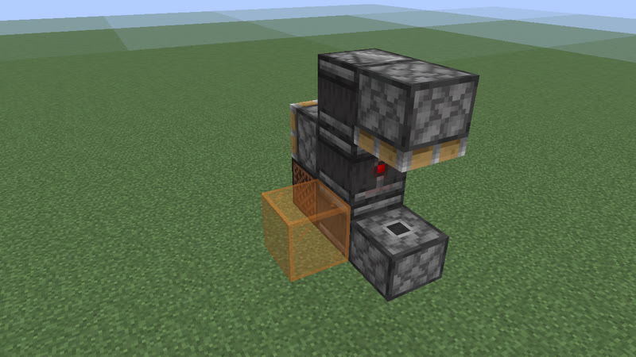</a> 5 gt (0.25 s) · note_block+observer+piston · 7 blocks</td><td align="center"> 5 gt (0.25 s) · redstone_wire+repeater · 16 blocks</td></tr>
<tr><td align="center"> 5 gt (0.25 s) · redstone_wire+repeater · 18 blocks</td></tr>
</table>

## 6 gt (0.3 s)

<table>
<tr><td align="center"> 6 gt (0.3 s) · observer · 2 blocks also found as census-p6-observer-2b, census-p6-observer-2b</td><td align="center"> 6 gt (0.3 s) · note_block+observer · 3 blocks</td><td align="center"> 6 gt (0.3 s) · crafter+observer · 3 blocks</td></tr>
<tr><td align="center"> 6 gt (0.3 s) · observer+piston · 3 blocks</td><td align="center"> 6 gt (0.3 s) · observer+sticky_piston · 3 blocks</td><td align="center"> 6 gt (0.3 s) · redstone_block+sticky_piston · 3 blocks</td></tr>
<tr><td align="center"> 6 gt (0.3 s) · observer · 4 blocks</td><td align="center"> 6 gt (0.3 s) · observer · 4 blocks</td><td align="center"> 6 gt (0.3 s) · note_block+redstone_block+sticky_piston · 4 blocks</td></tr>
<tr><td align="center"> 6 gt (0.3 s) · observer+redstone_block+sticky_piston · 4 blocks</td><td align="center"> 6 gt (0.3 s) · redstone_block+redstone_lamp+sticky_piston · 4 blocks</td><td align="center"> 6 gt (0.3 s) · redstone_block+sticky_piston · 4 blocks</td></tr>
<tr><td align="center"> 6 gt (0.3 s) · note_block+observer · 5 blocks</td><td align="center"><a href="../archive/clk-obs-p6-note-obs-5b-b-3d8333.txt">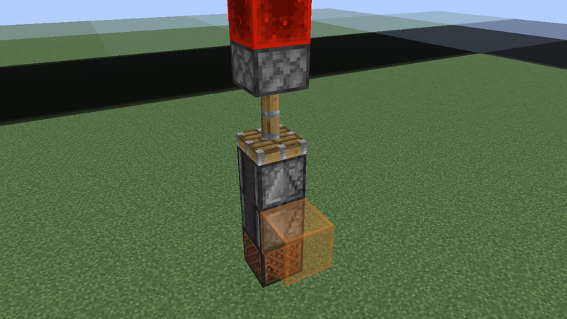</a> 6 gt (0.3 s) · note_block+observer · 5 blocks</td><td align="center"> 6 gt (0.3 s) · note_block+observer+piston · 5 blocks</td></tr>
<tr><td align="center"><a href="../archive/clk-obs-p6-note-obs-pis-5b-b-98ffd6.txt">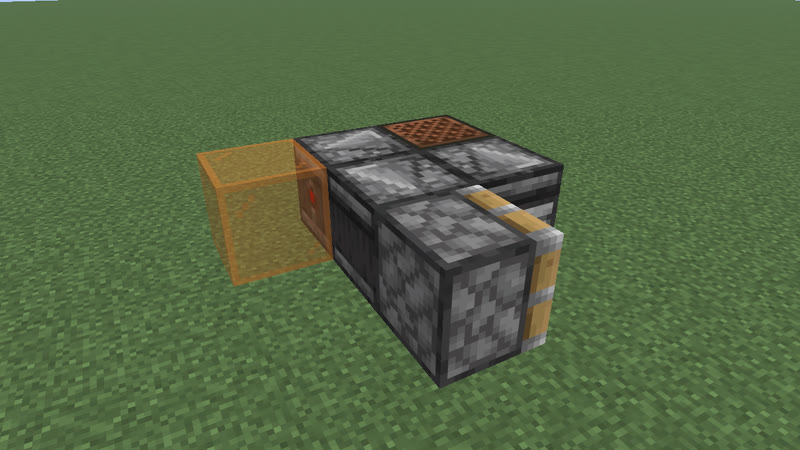</a> 6 gt (0.3 s) · note_block+observer+piston · 5 blocks</td><td align="center"><a href="../archive/clk-obs-p6-note-obs-stk-5b-b-59f0ce.txt">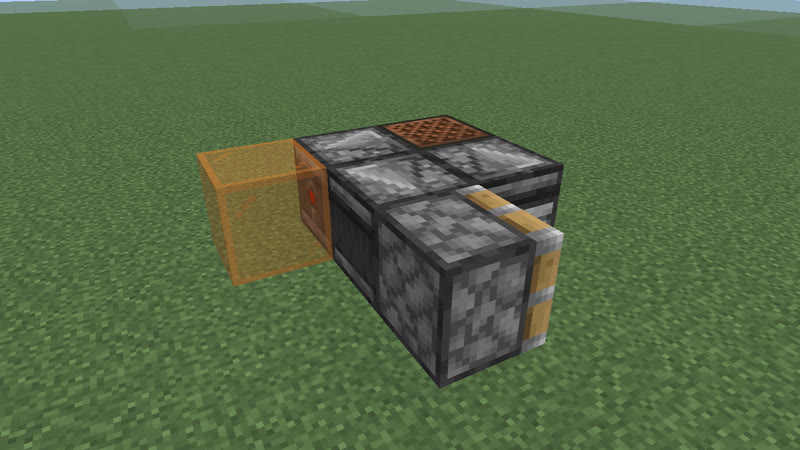</a> 6 gt (0.3 s) · note_block+observer+sticky_piston · 5 blocks</td><td align="center"> 6 gt (0.3 s) · note_block+observer+sticky_piston · 5 blocks</td></tr>
<tr><td align="center"> 6 gt (0.3 s) · observer+piston · 5 blocks</td><td align="center"><a href="../archive/clk-obs-p6-obs-pis-5b-b-2501cc.txt">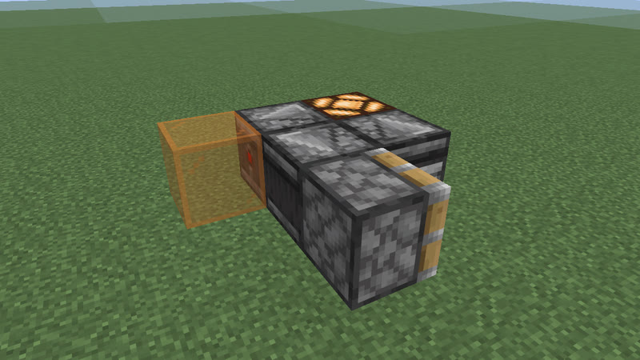</a> 6 gt (0.3 s) · observer+piston · 5 blocks</td><td align="center"><a href="../archive/clk-obs-p6-obs-stk-5b-b-cffd3f.txt">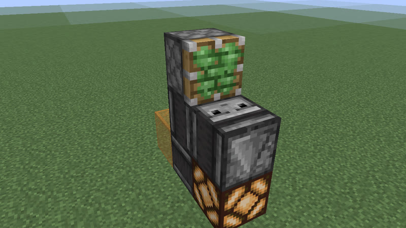</a> 6 gt (0.3 s) · observer+sticky_piston · 5 blocks</td></tr>
<tr><td align="center"> 6 gt (0.3 s) · observer+sticky_piston · 5 blocks</td><td align="center"> 6 gt (0.3 s) · redstone_block+redstone_lamp+sticky_piston · 5 blocks</td><td align="center"><a href="../archive/clk-obs-p6-lamp-rb-stk-5b-b-01666a.txt">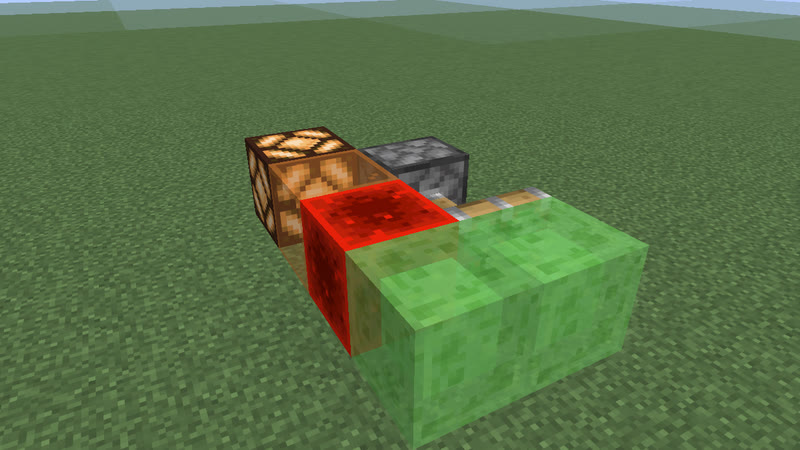</a> 6 gt (0.3 s) · redstone_block+redstone_lamp+sticky_piston · 5 blocks</td></tr>
<tr><td align="center"> 6 gt (0.3 s) · note_block+redstone_block+sticky_piston · 5 blocks</td><td align="center"> 6 gt (0.3 s) · note_block+redstone_block+sticky_piston · 5 blocks</td><td align="center"> 6 gt (0.3 s) · observer+piston+sticky_piston · 5 blocks</td></tr>
<tr><td align="center"> 6 gt (0.3 s) · redstone_block+sticky_piston · 5 blocks</td><td align="center"> 6 gt (0.3 s) · redstone_block+sticky_piston · 5 blocks</td><td align="center"> 6 gt (0.3 s) · crafter+observer · 6 blocks</td></tr>
<tr><td align="center"> 6 gt (0.3 s) · note_block+observer+piston+redstone_block+sticky_piston · 6 blocks</td><td align="center"> 6 gt (0.3 s) · note_block+observer+piston+sticky_piston · 6 blocks</td><td align="center"><a href="../archive/clk-obs-p6-note-obs-pis-stk-6b-b-53d2c9.txt">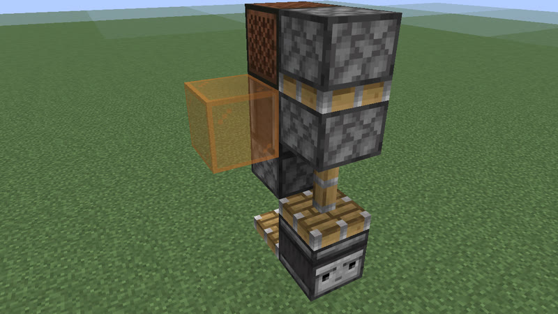</a> 6 gt (0.3 s) · note_block+observer+piston+sticky_piston · 6 blocks</td></tr>
<tr><td align="center"> 6 gt (0.3 s) · note_block+observer+redstone_block+sticky_piston · 6 blocks</td><td align="center"> 6 gt (0.3 s) · observer+piston+redstone_block+sticky_piston · 6 blocks</td><td align="center"><a href="../archive/clk-obs-p6-obs-pis-rb-stk-6b-b-523a68.txt">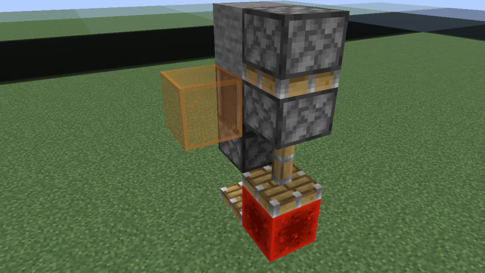</a> 6 gt (0.3 s) · observer+piston+redstone_block+sticky_piston · 6 blocks</td></tr>
<tr><td align="center"><a href="../archive/clk-obs-p6-obs-pis-stk-6b-b-f797bd.txt">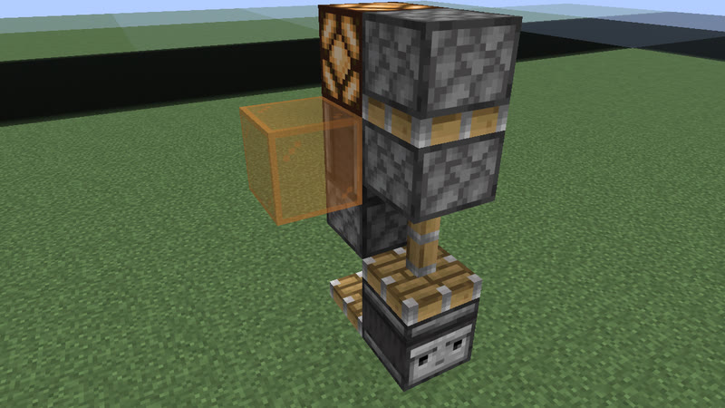</a> 6 gt (0.3 s) · observer+piston+sticky_piston · 6 blocks</td><td align="center"> 6 gt (0.3 s) · observer+redstone_block+sticky_piston · 6 blocks</td><td align="center"><a href="../archive/clk-obs-p6-obs-rb-stk-6b-b-ebf902.txt">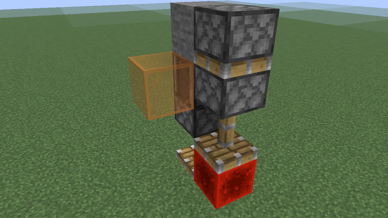</a> 6 gt (0.3 s) · observer+redstone_block+sticky_piston · 6 blocks</td></tr>
<tr><td align="center"><a href="../archive/clk-obs-p6-note-obs-pis-rb-stk-6b-b-38a9df.txt">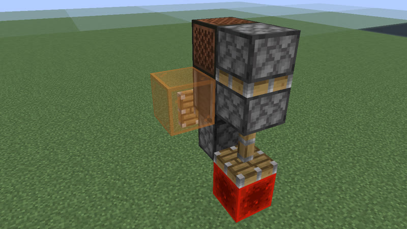</a> 6 gt (0.3 s) · note_block+observer+piston+redstone_block+sticky_piston · 6 blocks</td><td align="center"><a href="../archive/clk-obs-p6-note-obs-rb-stk-6b-b-97d09c.txt">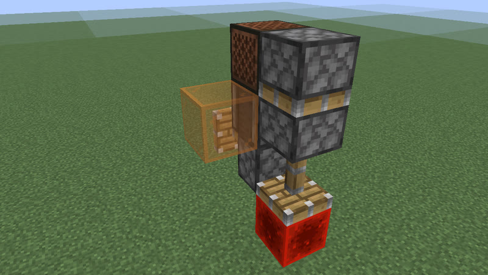</a> 6 gt (0.3 s) · note_block+observer+redstone_block+sticky_piston · 6 blocks</td><td align="center"> 6 gt (0.3 s) · redstone_wire+repeater · 13 blocks</td></tr>
<tr><td align="center"> 6 gt (0.3 s) · comparator+redstone_wire+repeater · 14 blocks</td><td align="center"> 6 gt (0.3 s) · redstone_wire+repeater · 14 blocks</td></tr>
</table>

## 7 gt (0.35 s)

<table>
<tr><td align="center"> 7 gt (0.35 s) · redstone_lamp+sticky_piston · 5 blocks</td><td align="center"> 7 gt (0.35 s) · sticky_piston · 5 blocks</td><td align="center"> 7 gt (0.35 s) · sticky_piston · 5 blocks</td></tr>
<tr><td align="center"> 7 gt (0.35 s) · redstone_lamp+sticky_piston · 5 blocks</td><td align="center"> 7 gt (0.35 s) · note_block+sticky_piston · 5 blocks</td><td align="center"> 7 gt (0.35 s) · note_block+observer+sticky_piston · 6 blocks</td></tr>
<tr><td align="center"> 7 gt (0.35 s) · repeater · 19 blocks</td><td align="center"> 7 gt (0.35 s) · redstone_wire+repeater · 22 blocks</td></tr>
</table>

## 8 gt (0.4 s)

Also reachable by: clk-obs-obs-ring (n = 0).

<table>
<tr><td align="center"> 8 gt (0.4 s) · observer · 4 blocks</td><td align="center"> 8 gt (0.4 s) · note_block+observer+redstone_block+sticky_piston · 4 blocks</td><td align="center"> 8 gt (0.4 s) · note_block+observer+sticky_piston · 4 blocks</td></tr>
<tr><td align="center"> 8 gt (0.4 s) · note_block+observer+sticky_piston · 4 blocks</td><td align="center"> 8 gt (0.4 s) · iron_trapdoor+observer+redstone_block+sticky_piston · 4 blocks</td><td align="center"> 8 gt (0.4 s) · iron_trapdoor+observer+redstone_block+sticky_piston · 4 blocks</td></tr>
<tr><td align="center"> 8 gt (0.4 s) · observer+piston+redstone_block+sticky_piston · 4 blocks</td><td align="center"> 8 gt (0.4 s) · observer+redstone_block+sticky_piston · 4 blocks</td><td align="center"> 8 gt (0.4 s) · comparator+hopper · 4 blocks</td></tr>
<tr><td align="center"> 8 gt (0.4 s) · observer+piston+redstone_block+sticky_piston · 4 blocks</td><td align="center"> 8 gt (0.4 s) · observer+redstone_block+sticky_piston · 4 blocks</td><td align="center"> 8 gt (0.4 s) · crafter+observer · 5 blocks</td></tr>
<tr><td align="center"> 8 gt (0.4 s) · copper_bulb+note_block+observer+piston · 5 blocks</td><td align="center"> 8 gt (0.4 s) · copper_bulb+note_block+observer+redstone_block+sticky_piston · 5 blocks</td><td align="center"> 8 gt (0.4 s) · copper_bulb+note_block+observer+sticky_piston · 5 blocks</td></tr>
<tr><td align="center"><a href="../archive/clk-obs-p8-bulb-obs-pis-5b-b-8ffd3f.txt">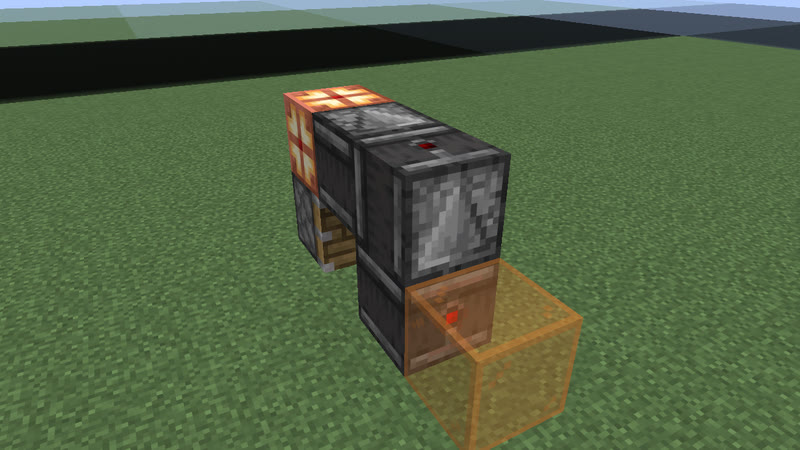</a> 8 gt (0.4 s) · copper_bulb+observer+piston · 5 blocks</td><td align="center"> 8 gt (0.4 s) · copper_bulb+observer+piston · 5 blocks</td><td align="center"> 8 gt (0.4 s) · copper_bulb+observer+sticky_piston · 5 blocks</td></tr>
<tr><td align="center"><a href="../archive/clk-obs-p8-bulb-obs-stk-5b-b-1da673.txt">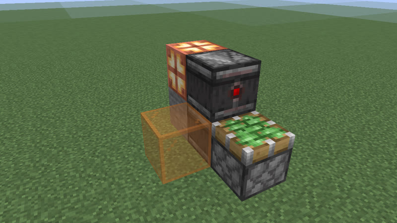</a> 8 gt (0.4 s) · copper_bulb+observer+sticky_piston · 5 blocks</td><td align="center"><a href="../archive/clk-obs-p8-note-obs-rb-stk-5b-b-1dc875.txt">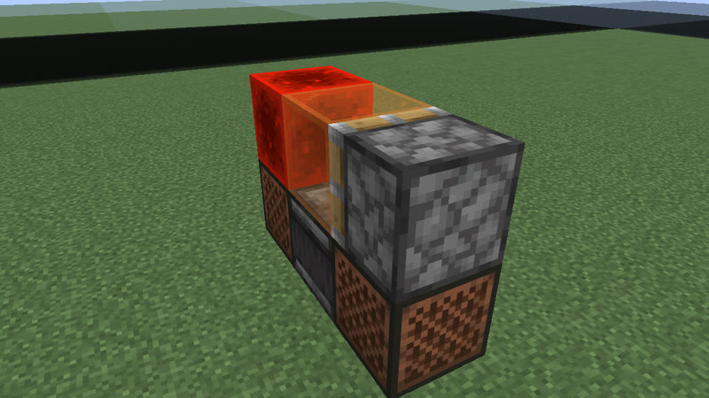</a> 8 gt (0.4 s) · note_block+observer+redstone_block+sticky_piston · 5 blocks</td><td align="center"> 8 gt (0.4 s) · observer+piston · 5 blocks</td></tr>
<tr><td align="center"><a href="../archive/clk-obs-p8-obs-pis-5b-b-0583fb.txt">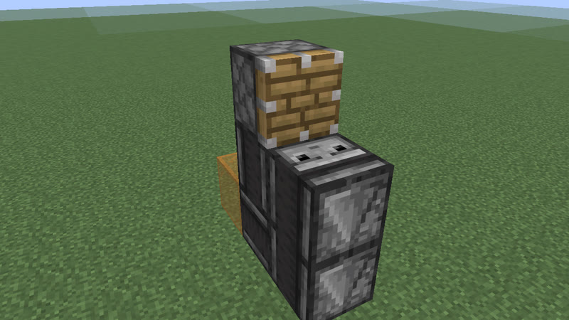</a> 8 gt (0.4 s) · observer+piston · 5 blocks</td><td align="center"> 8 gt (0.4 s) · observer+sticky_piston · 5 blocks</td><td align="center"><a href="../archive/clk-obs-p8-obs-stk-5b-b-6f2fb2.txt">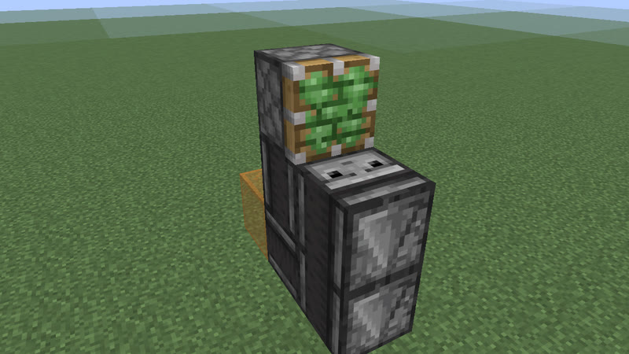</a> 8 gt (0.4 s) · observer+sticky_piston · 5 blocks</td></tr>
<tr><td align="center"><a href="../archive/clk-obs-p8-bulb-note-obs-pis-5b-b-652b0f.txt">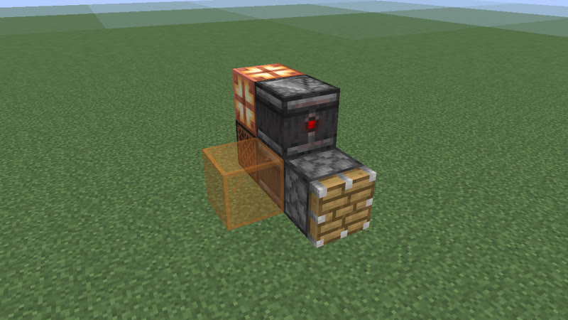</a> 8 gt (0.4 s) · copper_bulb+note_block+observer+piston · 5 blocks</td><td align="center"> 8 gt (0.4 s) · copper_bulb+note_block+observer+piston+sticky_piston · 5 blocks</td><td align="center"><a href="../archive/clk-obs-p8-bulb-note-obs-pis-stk-5b-b-d00fc5.txt">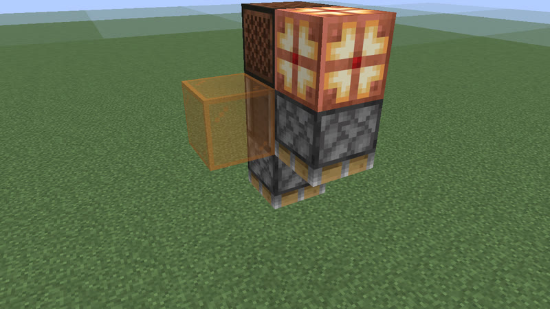</a> 8 gt (0.4 s) · copper_bulb+note_block+observer+piston+sticky_piston · 5 blocks</td></tr>
<tr><td align="center"><a href="../archive/clk-obs-p8-bulb-note-obs-stk-5b-b-4dc57b.txt">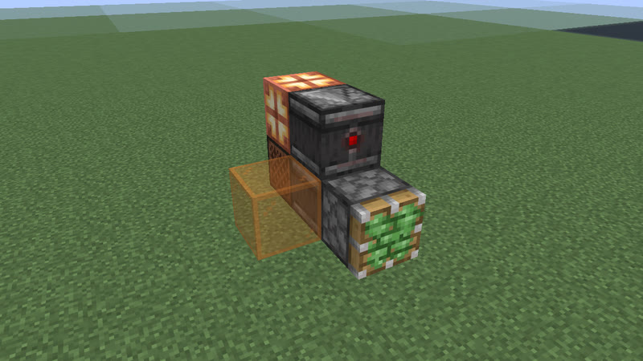</a> 8 gt (0.4 s) · copper_bulb+note_block+observer+sticky_piston · 5 blocks</td><td align="center"> 8 gt (0.4 s) · copper_bulb+observer+piston+redstone_block+sticky_piston · 5 blocks</td><td align="center"> 8 gt (0.4 s) · copper_bulb+observer+piston+sticky_piston · 5 blocks</td></tr>
<tr><td align="center"><a href="../archive/clk-obs-p8-bulb-obs-pis-stk-5b-b-2856cf.txt">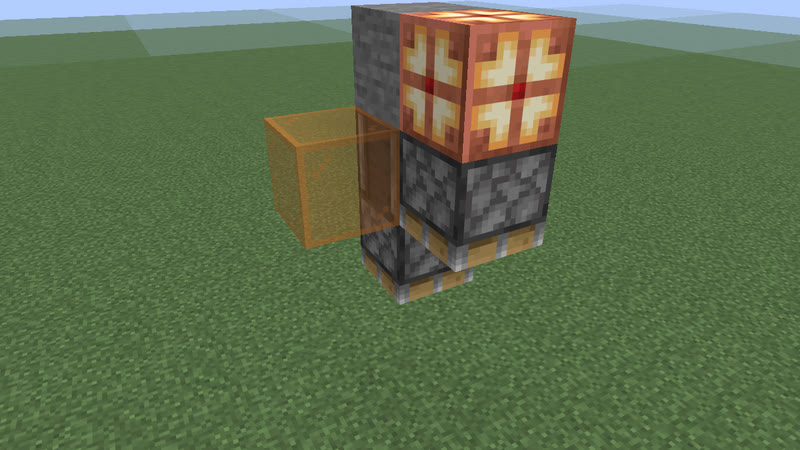</a> 8 gt (0.4 s) · copper_bulb+observer+piston+sticky_piston · 5 blocks</td><td align="center"> 8 gt (0.4 s) · copper_bulb+observer+redstone_block+sticky_piston · 5 blocks</td><td align="center"> 8 gt (0.4 s) · note_block+observer+redstone_lamp+sticky_piston · 5 blocks</td></tr>
<tr><td align="center"> 8 gt (0.4 s) · note_block+observer+piston+redstone_block+sticky_piston · 5 blocks</td><td align="center"><a href="../archive/clk-obs-p8-note-obs-pis-rb-stk-5b-b-21d2d3.txt">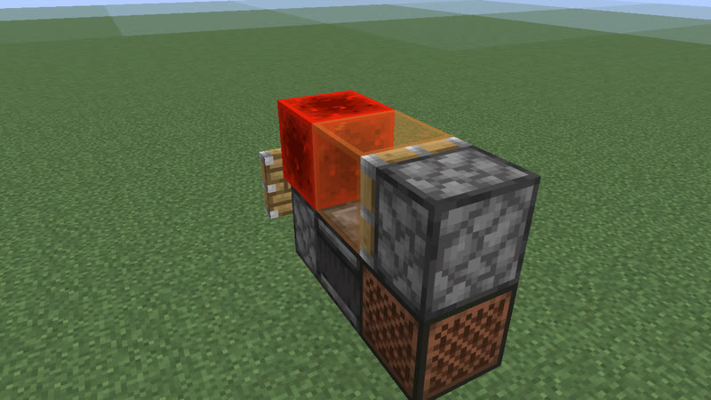</a> 8 gt (0.4 s) · note_block+observer+piston+redstone_block+sticky_piston · 5 blocks</td><td align="center"> 8 gt (0.4 s) · note_block+observer+piston+sticky_piston · 5 blocks</td></tr>
<tr><td align="center"><a href="../archive/clk-obs-p8-note-obs-pis-stk-5b-b-bc5934.txt">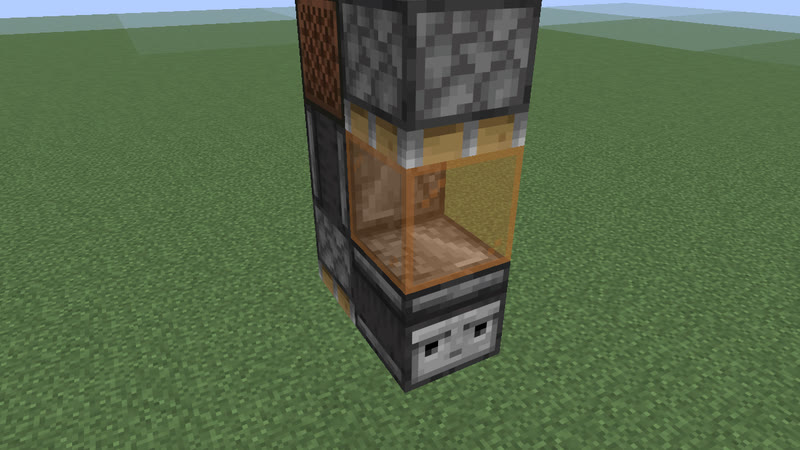</a> 8 gt (0.4 s) · note_block+observer+piston+sticky_piston · 5 blocks</td><td align="center"> 8 gt (0.4 s) · observer+piston+sticky_piston · 5 blocks</td><td align="center"><a href="../archive/clk-obs-p8-obs-pis-stk-5b-b-b7f1ad.txt">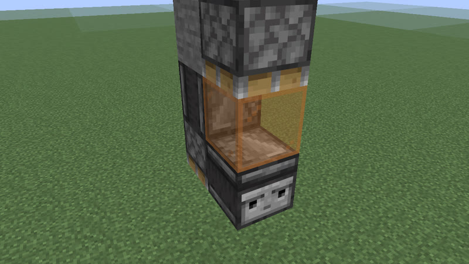</a> 8 gt (0.4 s) · observer+piston+sticky_piston · 5 blocks</td></tr>
<tr><td align="center"> 8 gt (0.4 s) · copper_bulb+observer · 5 blocks</td><td align="center"><a href="../archive/clk-obs-p8-bulb-obs-5b-b-459c8b.txt">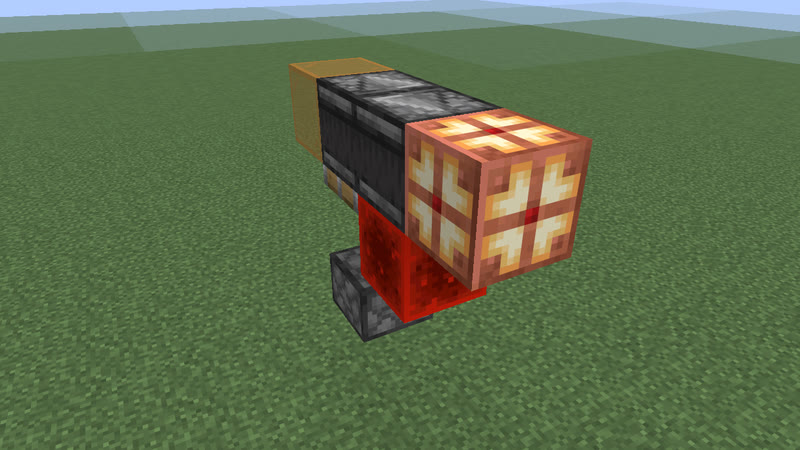</a> 8 gt (0.4 s) · copper_bulb+observer · 5 blocks</td><td align="center"><a href="../archive/clk-obs-p8-bulb-obs-pis-rb-stk-5b-b-59f6b6.txt">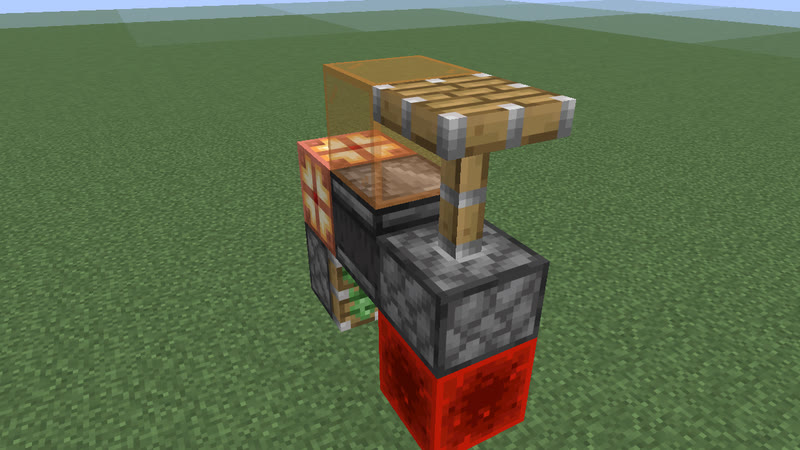</a> 8 gt (0.4 s) · copper_bulb+observer+piston+redstone_block+sticky_piston · 5 blocks</td></tr>
<tr><td align="center"><a href="../archive/clk-obs-p8-bulb-obs-rb-stk-5b-b-452562.txt">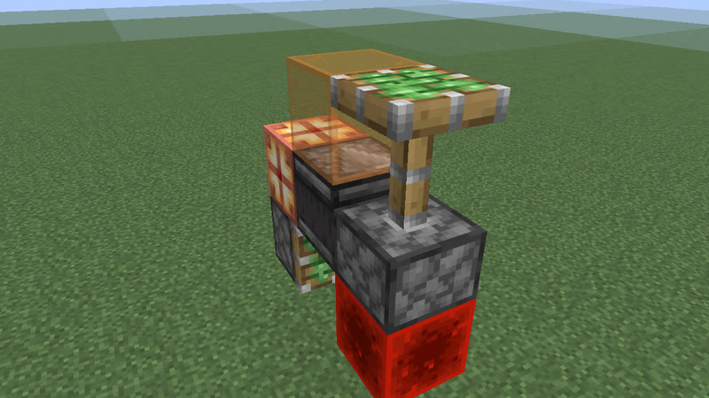</a> 8 gt (0.4 s) · copper_bulb+observer+redstone_block+sticky_piston · 5 blocks</td><td align="center"> 8 gt (0.4 s) · crafter+observer · 6 blocks</td><td align="center"> 8 gt (0.4 s) · copper_bulb+note_block+observer · 6 blocks</td></tr>
<tr><td align="center"><a href="../archive/clk-obs-p8-bulb-note-obs-6b-b-4615fe.txt">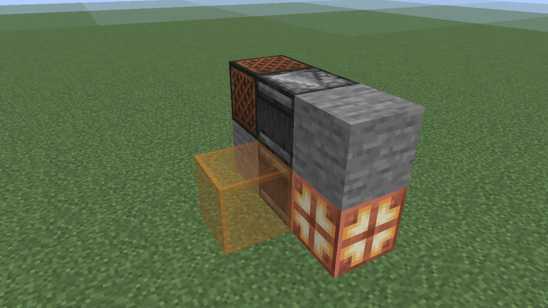</a> 8 gt (0.4 s) · copper_bulb+note_block+observer · 6 blocks</td><td align="center"> 8 gt (0.4 s) · note_block+observer+redstone_lamp · 6 blocks</td><td align="center"><a href="../archive/clk-obs-p8-lamp-note-obs-6b-b-0dcf7c.txt">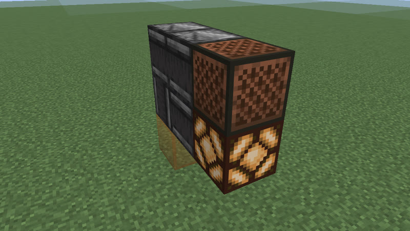</a> 8 gt (0.4 s) · note_block+observer+redstone_lamp · 6 blocks</td></tr>
<tr><td align="center"><a href="../archive/clk-obs-p8-note-obs-6b-b-34c0b3.txt">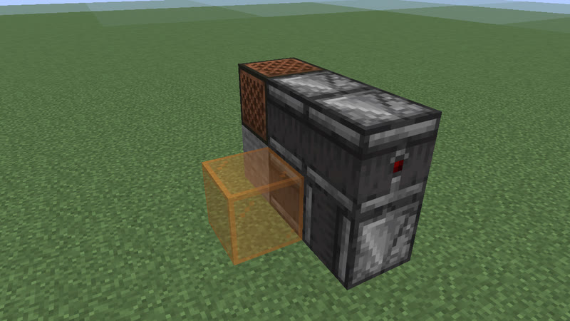</a> 8 gt (0.4 s) · note_block+observer · 6 blocks</td><td align="center"> 8 gt (0.4 s) · note_block+observer · 6 blocks</td><td align="center"> 8 gt (0.4 s) · note_block+observer+piston+redstone_lamp · 6 blocks</td></tr>
<tr><td align="center"> 8 gt (0.4 s) · note_block+observer+piston+redstone_lamp+sticky_piston · 6 blocks</td><td align="center"><a href="../archive/clk-obs-p8-lamp-note-obs-stk-6b-b-711069.txt">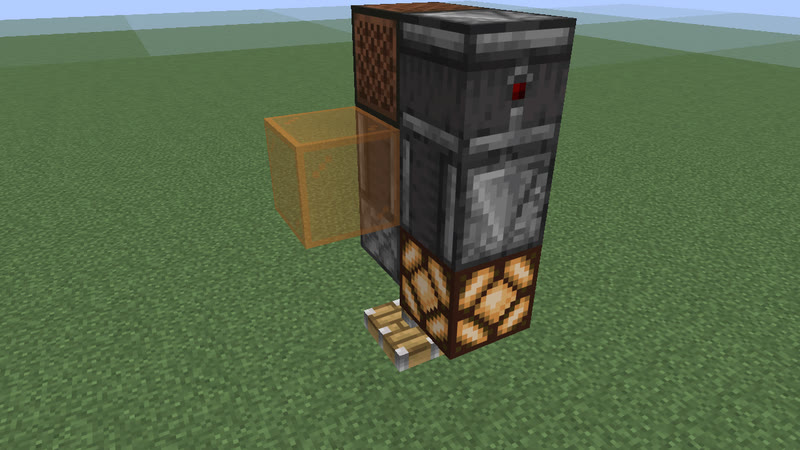</a> 8 gt (0.4 s) · note_block+observer+redstone_lamp+sticky_piston · 6 blocks</td><td align="center"> 8 gt (0.4 s) · observer+piston+redstone_lamp+sticky_piston · 6 blocks</td></tr>
<tr><td align="center"><a href="../archive/clk-obs-p8-lamp-obs-pis-stk-6b-b-21e49a.txt">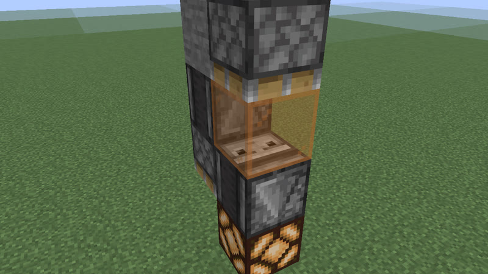</a> 8 gt (0.4 s) · observer+piston+redstone_lamp+sticky_piston · 6 blocks</td><td align="center"> 8 gt (0.4 s) · observer+redstone_lamp+sticky_piston · 6 blocks</td><td align="center"><a href="../archive/clk-obs-p8-lamp-obs-stk-6b-b-7722cc.txt">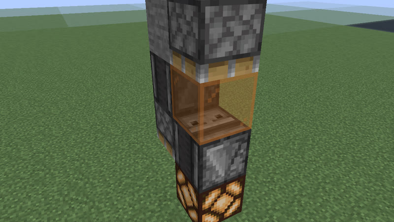</a> 8 gt (0.4 s) · observer+redstone_lamp+sticky_piston · 6 blocks</td></tr>
<tr><td align="center"><a href="../archive/clk-obs-p8-note-obs-pis-6b-b-bb4379.txt">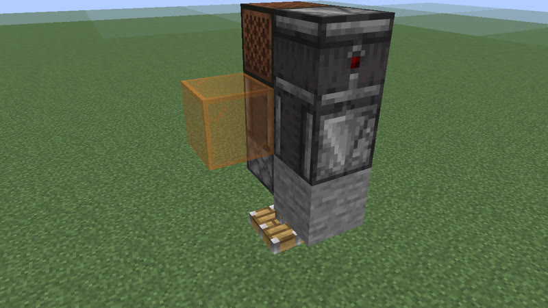</a> 8 gt (0.4 s) · note_block+observer+piston · 6 blocks</td><td align="center"> 8 gt (0.4 s) · note_block+observer+piston · 6 blocks</td><td align="center"><a href="../archive/clk-obs-p8-lamp-note-obs-pis-6b-b-473cb8.txt">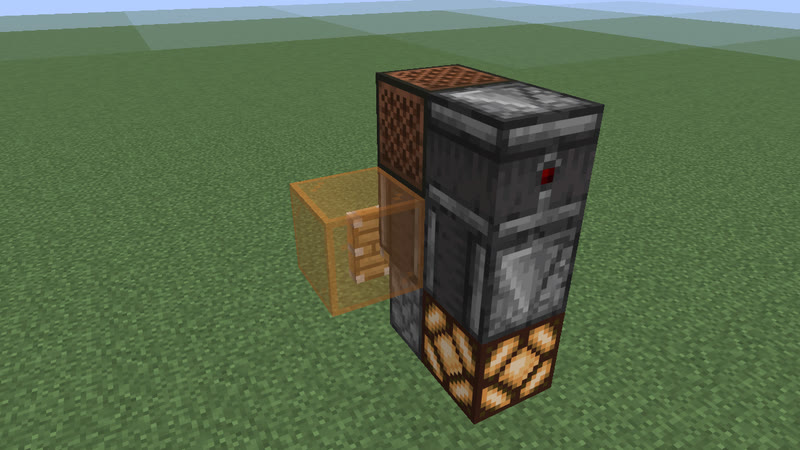</a> 8 gt (0.4 s) · note_block+observer+piston+redstone_lamp · 6 blocks</td></tr>
<tr><td align="center"> 8 gt (0.4 s) · note_block+observer+redstone_block+redstone_lamp+sticky_piston · 6 blocks</td><td align="center"> 8 gt (0.4 s) · observer+redstone_block+redstone_lamp+sticky_piston · 6 blocks</td><td align="center"> 8 gt (0.4 s) · observer+redstone_block+redstone_lamp+sticky_piston · 6 blocks</td></tr>
<tr><td align="center"><a href="../archive/clk-obs-p8-lamp-note-obs-pis-stk-6b-b-db6f18.txt">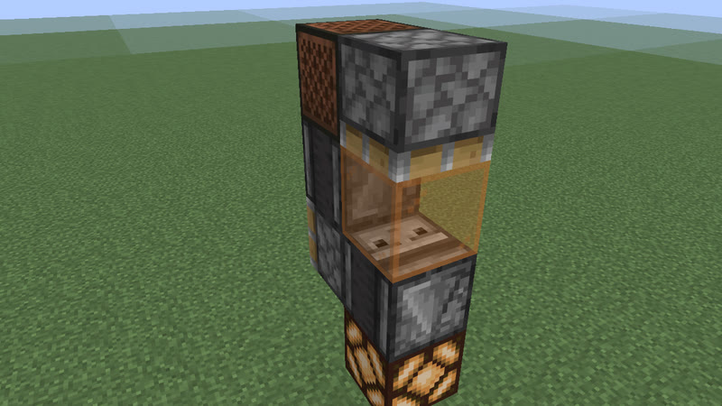</a> 8 gt (0.4 s) · note_block+observer+piston+redstone_lamp+sticky_piston · 6 blocks</td><td align="center"> 8 gt (0.4 s) · observer+piston+redstone_lamp · 6 blocks</td><td align="center"><a href="../archive/clk-obs-p8-lamp-obs-pis-6b-b-7db6a6.txt">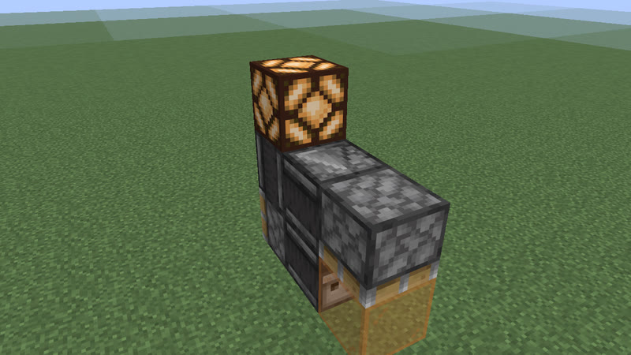</a> 8 gt (0.4 s) · observer+piston+redstone_lamp · 6 blocks</td></tr>
<tr><td align="center"><a href="../archive/clk-obs-p8-bulb-note-obs-rb-stk-7b-b-814260.txt">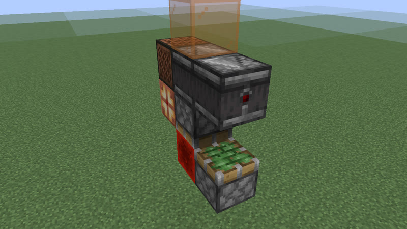</a> 8 gt (0.4 s) · copper_bulb+note_block+observer+redstone_block+sticky_piston · 7 blocks</td><td align="center"> 8 gt (0.4 s) · comparator+hopper · 7 blocks</td><td align="center"> 8 gt (0.4 s) · observer+redstone_lamp · 10 blocks</td></tr>
<tr><td align="center"> 8 gt (0.4 s) · redstone_wire+repeater · 10 blocks</td><td align="center"> 8 gt (0.4 s) · comparator · 12 blocks</td><td align="center"> 8 gt (0.4 s) · comparator+repeater · 12 blocks</td></tr>
<tr><td align="center"> 8 gt (0.4 s) · repeater · 12 blocks</td><td align="center"> 8 gt (0.4 s) · comparator+redstone_wire+repeater · 13 blocks</td><td align="center"> 8 gt (0.4 s) · comparator+redstone_wire+repeater · 14 blocks</td></tr>
</table>

## 9 gt (0.45 s)

<table>
<tr><td align="center"> 9 gt (0.45 s) · copper_bulb+note_block+observer+piston · 5 blocks</td><td align="center"> 9 gt (0.45 s) · copper_bulb+note_block+observer+piston · 5 blocks</td><td align="center"><a href="../archive/clk-obs-p9-bulb-note-obs-stk-5b-b-b66127.txt">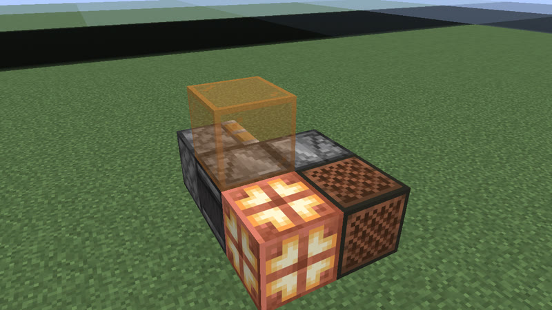</a> 9 gt (0.45 s) · copper_bulb+note_block+observer+sticky_piston · 5 blocks</td></tr>
<tr><td align="center"> 9 gt (0.45 s) · copper_bulb+note_block+observer+sticky_piston · 5 blocks</td><td align="center"> 9 gt (0.45 s) · copper_bulb+observer+piston · 5 blocks</td><td align="center"> 9 gt (0.45 s) · copper_bulb+observer+piston · 5 blocks</td></tr>
<tr><td align="center"> 9 gt (0.45 s) · copper_bulb+observer+sticky_piston · 5 blocks</td><td align="center"><a href="../archive/clk-obs-p9-bulb-obs-stk-5b-b-612f66.txt">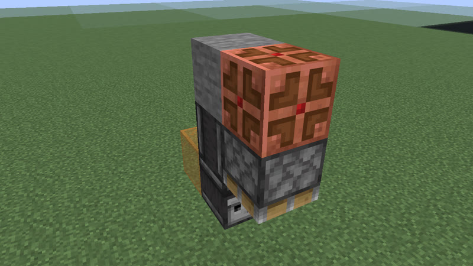</a> 9 gt (0.45 s) · copper_bulb+observer+sticky_piston · 5 blocks</td><td align="center"> 9 gt (0.45 s) · note_block+observer+piston · 5 blocks</td></tr>
<tr><td align="center"> 9 gt (0.45 s) · note_block+observer+piston · 5 blocks</td><td align="center"> 9 gt (0.45 s) · note_block+observer+sticky_piston · 5 blocks</td><td align="center"><a href="../archive/clk-obs-p9-note-obs-stk-5b-b-88c3da.txt">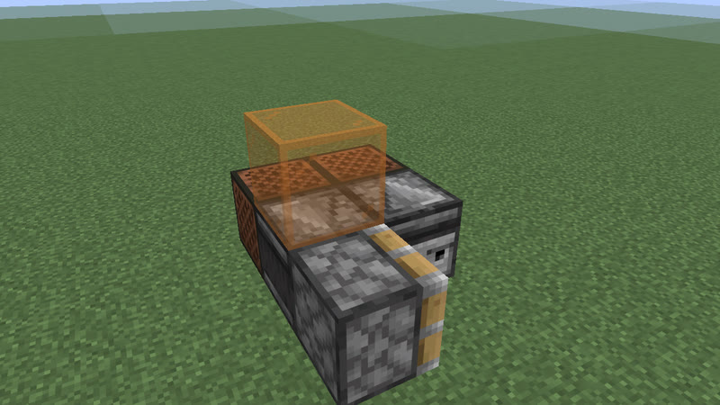</a> 9 gt (0.45 s) · note_block+observer+sticky_piston · 5 blocks</td></tr>
<tr><td align="center"> 9 gt (0.45 s) · oak_leaves+observer+sticky_piston · 5 blocks</td><td align="center"><a href="../archive/clk-obs-p9-note-obs-pis-stk-5b-b-a32f29.txt">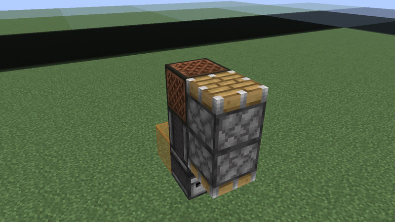</a> 9 gt (0.45 s) · note_block+observer+piston+sticky_piston · 5 blocks</td><td align="center"> 9 gt (0.45 s) · note_block+observer+piston+sticky_piston · 5 blocks</td></tr>
<tr><td align="center"> 9 gt (0.45 s) · observer+piston · 5 blocks</td><td align="center"> 9 gt (0.45 s) · observer+piston · 5 blocks</td><td align="center"> 9 gt (0.45 s) · observer+piston+sticky_piston · 5 blocks</td></tr>
<tr><td align="center"><a href="../archive/clk-obs-p9-obs-pis-stk-5b-b-e0550d.txt">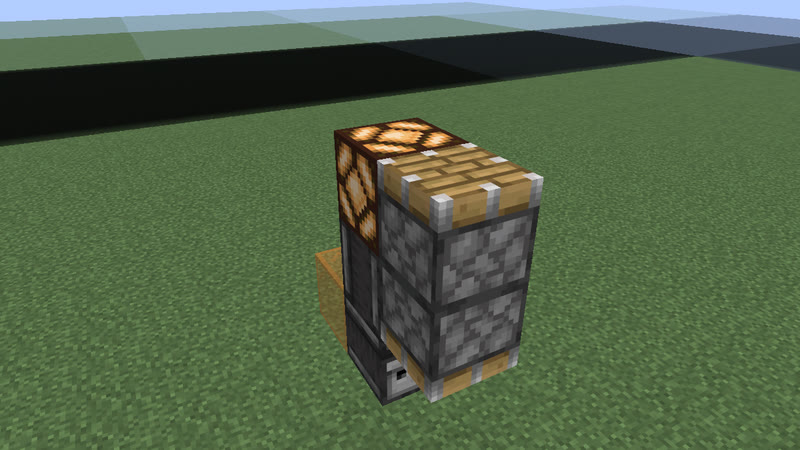</a> 9 gt (0.45 s) · observer+piston+sticky_piston · 5 blocks</td><td align="center"> 9 gt (0.45 s) · observer+sticky_piston · 5 blocks</td><td align="center"><a href="../archive/clk-obs-p9-obs-stk-5b-b-a11811.txt">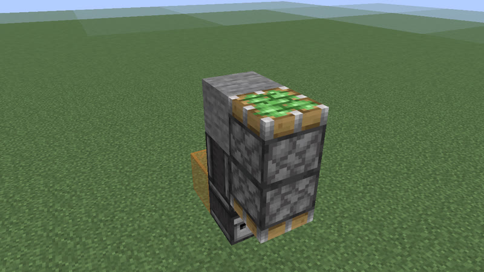</a> 9 gt (0.45 s) · observer+sticky_piston · 5 blocks</td></tr>
<tr><td align="center"> 9 gt (0.45 s) · oak_leaves+observer+sticky_piston · 5 blocks</td><td align="center"> 9 gt (0.45 s) · observer+piston+redstone_block+sticky_piston · 5 blocks</td><td align="center"> 9 gt (0.45 s) · observer+piston+redstone_block+sticky_piston · 5 blocks</td></tr>
<tr><td align="center"> 9 gt (0.45 s) · observer+redstone_block+sticky_piston · 5 blocks</td><td align="center"> 9 gt (0.45 s) · observer+redstone_block+sticky_piston · 5 blocks</td><td align="center"> 9 gt (0.45 s) · oak_leaves+observer+sticky_piston · 5 blocks</td></tr>
<tr><td align="center"> 9 gt (0.45 s) · piston+redstone_block · 5 blocks</td><td align="center"> 9 gt (0.45 s) · piston+redstone_block+sticky_piston · 5 blocks</td><td align="center"> 9 gt (0.45 s) · piston+redstone_block · 5 blocks</td></tr>
<tr><td align="center"><a href="../archive/clk-obs-p9-pis-rb-stk-5b-b-0a37d3.txt">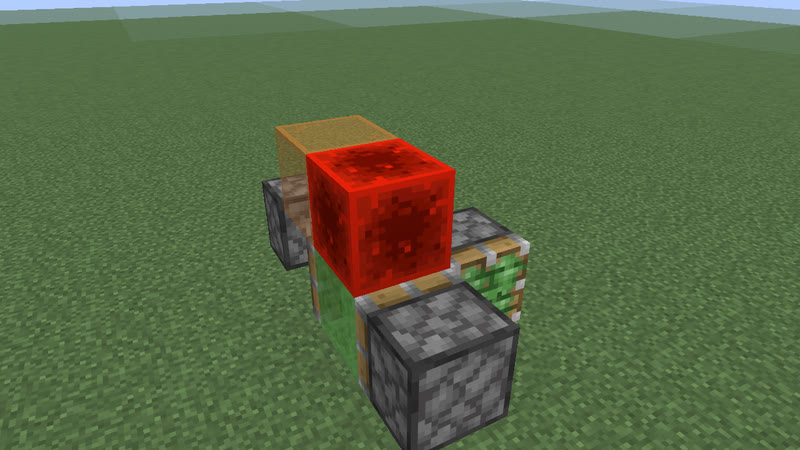</a> 9 gt (0.45 s) · piston+redstone_block+sticky_piston · 5 blocks</td><td align="center"> 9 gt (0.45 s) · observer+redstone_block+redstone_lamp+sticky_piston · 6 blocks</td><td align="center"> 9 gt (0.45 s) · observer+redstone_block+redstone_lamp+sticky_piston · 6 blocks</td></tr>
<tr><td align="center"> 9 gt (0.45 s) · note_block+observer+redstone_block+sticky_piston · 6 blocks</td><td align="center"> 9 gt (0.45 s) · note_block+observer+redstone_block+sticky_piston · 6 blocks</td><td align="center"> 9 gt (0.45 s) · note_block+observer+piston+redstone_block+redstone_lamp+sticky_piston · 7 blocks</td></tr>
<tr><td align="center"> 9 gt (0.45 s) · observer+piston+redstone_block+redstone_lamp+sticky_piston · 7 blocks</td><td align="center"> 9 gt (0.45 s) · observer+piston+redstone_block+redstone_lamp+sticky_piston · 7 blocks</td><td align="center"> 9 gt (0.45 s) · note_block+observer+piston+redstone_block+sticky_piston · 7 blocks</td></tr>
<tr><td align="center"> 9 gt (0.45 s) · comparator+hopper+redstone_wire · 8 blocks</td><td align="center"> 9 gt (0.45 s) · redstone_wire+repeater · 16 blocks</td><td align="center"> 9 gt (0.45 s) · redstone_wire+repeater · 18 blocks</td></tr>
</table>

## 10 gt (0.5 s)

Also reachable by: clk-misc-activator_rail-ring (n = 0), clk-misc-crafter-ring (n = 0), clk-misc-iron_door-ring (n = 0), clk-misc-oak_door-ring (n = 0), clk-misc-oak_fence_gate-ring (n = 0), clk-misc-oak_trapdoor-ring (n = 0), clk-misc-powered_rail-ring (n = 0), clk-misc-skeleton_skull-ring (n = 0), clk-obs-note-ring (n = 0), clk-obs-trap-ring (n = 0).

<table>
<tr><td align="center"> 10 gt (0.5 s) · oak_leaves+observer+sticky_piston · 4 blocks</td><td align="center"> 10 gt (0.5 s) · observer+redstone_block+sticky_piston · 4 blocks</td><td align="center"> 10 gt (0.5 s) · observer+sticky_piston · 4 blocks</td></tr>
<tr><td align="center"> 10 gt (0.5 s) · observer+sticky_piston · 4 blocks</td><td align="center"> 10 gt (0.5 s) · observer+sticky_piston · 4 blocks</td><td align="center"> 10 gt (0.5 s) · observer+piston+sticky_piston · 4 blocks</td></tr>
<tr><td align="center"> 10 gt (0.5 s) · observer+piston+sticky_piston · 4 blocks</td><td align="center"> 10 gt (0.5 s) · oak_leaves+observer+sticky_piston · 5 blocks</td><td align="center"> 10 gt (0.5 s) · oak_leaves+observer+sticky_piston · 5 blocks</td></tr>
<tr><td align="center"> 10 gt (0.5 s) · oak_leaves+observer+sticky_piston · 5 blocks</td><td align="center"> 10 gt (0.5 s) · note_block+observer+redstone_block+sticky_piston · 5 blocks</td><td align="center"> 10 gt (0.5 s) · note_block+observer+redstone_block+sticky_piston · 5 blocks</td></tr>
<tr><td align="center"> 10 gt (0.5 s) · note_block+observer+sticky_piston · 5 blocks</td><td align="center"> 10 gt (0.5 s) · note_block+observer+sticky_piston · 5 blocks</td><td align="center"> 10 gt (0.5 s) · observer+redstone_block+sticky_piston · 5 blocks</td></tr>
<tr><td align="center"> 10 gt (0.5 s) · observer+redstone_block+redstone_lamp+sticky_piston · 5 blocks</td><td align="center"> 10 gt (0.5 s) · note_block+observer+piston+sticky_piston · 5 blocks</td><td align="center"> 10 gt (0.5 s) · note_block+observer+piston+sticky_piston · 5 blocks</td></tr>
<tr><td align="center"> 10 gt (0.5 s) · copper_bulb+note_block+observer+sticky_piston · 6 blocks</td><td align="center"> 10 gt (0.5 s) · copper_bulb+note_block+observer+sticky_piston · 6 blocks</td><td align="center"> 10 gt (0.5 s) · copper_bulb+observer+sticky_piston · 6 blocks</td></tr>
<tr><td align="center"> 10 gt (0.5 s) · copper_bulb+observer+sticky_piston · 6 blocks</td><td align="center"> 10 gt (0.5 s) · observer+piston+redstone_lamp+sticky_piston · 6 blocks</td><td align="center"> 10 gt (0.5 s) · observer+redstone_block+redstone_lamp+sticky_piston · 6 blocks</td></tr>
<tr><td align="center"> 10 gt (0.5 s) · observer+piston+redstone_block+sticky_piston · 6 blocks</td><td align="center"> 10 gt (0.5 s) · observer+scaffolding+sticky_piston · 6 blocks</td><td align="center"> 10 gt (0.5 s) · observer+redstone_lamp+sticky_piston · 6 blocks</td></tr>
<tr><td align="center"> 10 gt (0.5 s) · note_block+observer+piston+redstone_block+sticky_piston · 6 blocks</td><td align="center"> 10 gt (0.5 s) · note_block+observer+piston+redstone_lamp+sticky_piston · 7 blocks</td><td align="center"> 10 gt (0.5 s) · copper_bulb+note_block+observer+redstone_block+sticky_piston · 7 blocks</td></tr>
<tr><td align="center"> 10 gt (0.5 s) · copper_bulb+observer+piston · 7 blocks</td><td align="center"> 10 gt (0.5 s) · copper_bulb+observer+redstone_block+sticky_piston · 7 blocks</td><td align="center"> 10 gt (0.5 s) · copper_bulb+observer+redstone_block+sticky_piston · 7 blocks</td></tr>
<tr><td align="center"> 10 gt (0.5 s) · note_block+observer+piston+redstone_block+sticky_piston · 7 blocks</td><td align="center"> 10 gt (0.5 s) · copper_bulb+observer+piston · 7 blocks</td><td align="center"> 10 gt (0.5 s) · iron_trapdoor+observer · 8 blocks</td></tr>
<tr><td align="center"> 10 gt (0.5 s) · comparator+redstone_torch+repeater · 8 blocks</td><td align="center"> 10 gt (0.5 s) · redstone_torch+repeater · 8 blocks</td><td align="center"> 10 gt (0.5 s) · comparator+redstone_torch+redstone_wire · 12 blocks</td></tr>
<tr><td align="center"> 10 gt (0.5 s) · comparator+redstone_torch+redstone_wire+repeater · 12 blocks</td><td align="center"> 10 gt (0.5 s) · redstone_torch+redstone_wire+repeater · 12 blocks</td><td align="center"> 10 gt (0.5 s) · comparator+repeater · 12 blocks</td></tr>
<tr><td align="center"> 10 gt (0.5 s) · repeater · 12 blocks</td><td align="center"> 10 gt (0.5 s) · redstone_torch+redstone_wire+repeater · 12 blocks</td><td align="center"> 10 gt (0.5 s) · comparator+redstone_wire+repeater · 13 blocks</td></tr>
<tr><td align="center"> 10 gt (0.5 s) · redstone_wire+repeater · 13 blocks</td><td align="center"> 10 gt (0.5 s) · comparator+redstone_wire+repeater · 14 blocks</td><td align="center"> 10 gt (0.5 s) · redstone_wire+repeater · 14 blocks</td></tr>
</table>

## 11 gt (0.55 s)

Also reachable by: clk-item-lockpair (n = 0), clk-obs-odd-a (n = 0).

<table>
<tr><td align="center"> 11 gt (0.55 s) · note_block+observer+piston · 6 blocks</td><td align="center"> 11 gt (0.55 s) · observer+piston · 6 blocks</td><td align="center"> 11 gt (0.55 s) · observer+piston · 6 blocks</td></tr>
<tr><td align="center"> 11 gt (0.55 s) · observer+piston+sticky_piston · 6 blocks</td><td align="center"> 11 gt (0.55 s) · observer+piston+sticky_piston · 6 blocks</td><td align="center"> 11 gt (0.55 s) · observer+sticky_piston · 6 blocks</td></tr>
<tr><td align="center"> 11 gt (0.55 s) · observer+sticky_piston · 6 blocks</td><td align="center"> 11 gt (0.55 s) · note_block+observer+piston+redstone_block+redstone_lamp+sticky_piston · 7 blocks</td><td align="center"> 11 gt (0.55 s) · note_block+observer+piston · 7 blocks</td></tr>
<tr><td align="center"> 11 gt (0.55 s) · note_block+observer+piston+redstone_block+sticky_piston · 7 blocks</td><td align="center"> 11 gt (0.55 s) · note_block+observer+piston+redstone_block+sticky_piston · 7 blocks</td><td align="center"> 11 gt (0.55 s) · observer+piston+redstone_block+redstone_lamp+sticky_piston · 7 blocks</td></tr>
<tr><td align="center"> 11 gt (0.55 s) · observer+piston+redstone_block+redstone_lamp+sticky_piston · 7 blocks</td><td align="center"> 11 gt (0.55 s) · observer+piston+redstone_block+sticky_piston · 7 blocks</td><td align="center"> 11 gt (0.55 s) · observer+piston+redstone_block+sticky_piston · 7 blocks</td></tr>
<tr><td align="center"> 11 gt (0.55 s) · repeater · 16 blocks</td><td align="center"> 11 gt (0.55 s) · redstone_wire+repeater · 18 blocks</td></tr>
</table>

[catalog index](../CATALOG.md) · next: [p12-16](p12-16.md)
