# Clocks: 4 gt (0.2 s) to 20 gt (1 s) (282 clock types)

[catalog index](../CATALOG.md) · next: [p21-30](p21-30.md)

Orange glass = where the output signal is (placed only for the picture); click a picture for its design. Larger clocks of a period that only add block kinds to a smaller one are listed on [variants](variants.md). Generated by `mctas clock catalog`.

## 4 gt (0.2 s)

<table>
<tr><td align="center"><a href="../archive/clk-obs-p4-obs-4b-f94a10.txt">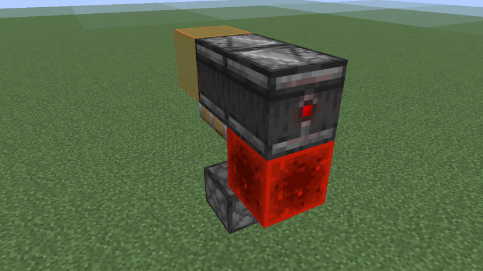</a> 4 gt (0.2 s) · observer · 4 blocks</td><td align="center"><a href="../archive/clk-obs-p4-obs-4b.txt">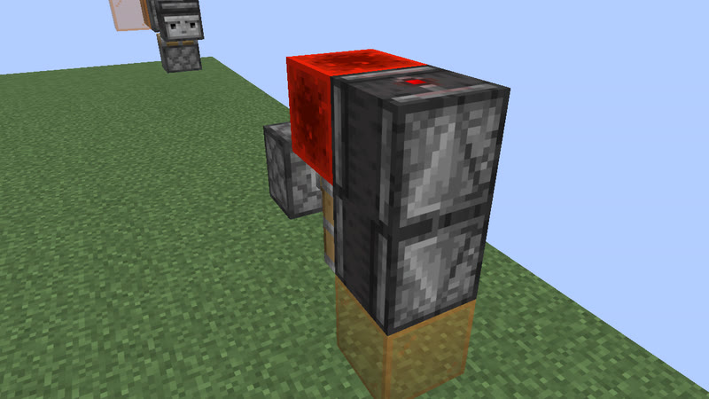</a> 4 gt (0.2 s) · observer · 4 blocks</td><td align="center"><a href="../archive/clk-obs-p4-obs-pis-4b-a1415e.txt">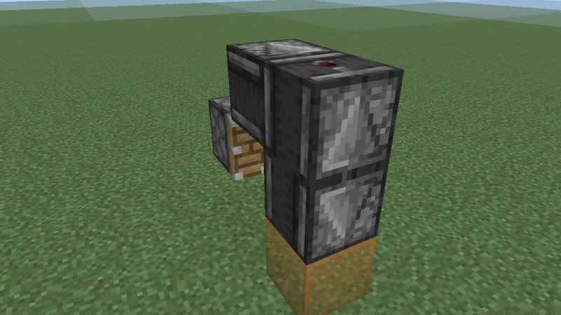</a> 4 gt (0.2 s) · observer+piston · 4 blocks</td></tr>
<tr><td align="center"><a href="../archive/clk-obs-p4-obs-pis-4b-b-d8986c.txt">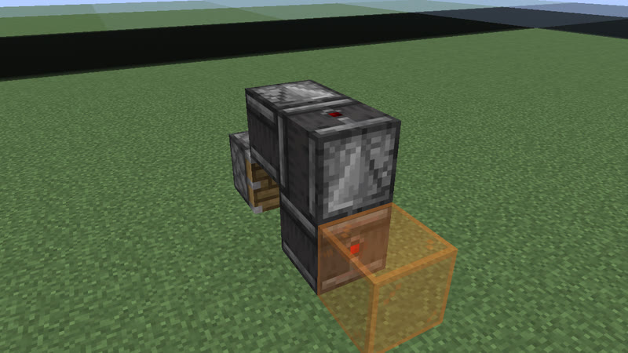</a> 4 gt (0.2 s) · observer+piston · 4 blocks</td><td align="center"><a href="../archive/clk-obs-p4-note-obs-stk-5b-b-37591f.txt">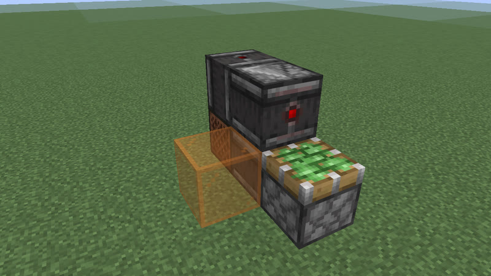</a> 4 gt (0.2 s) · note_block+observer+sticky_piston · 5 blocks</td><td align="center"><a href="../archive/clk-obs-p4-note-obs-stk-5b-fa0ce3.txt">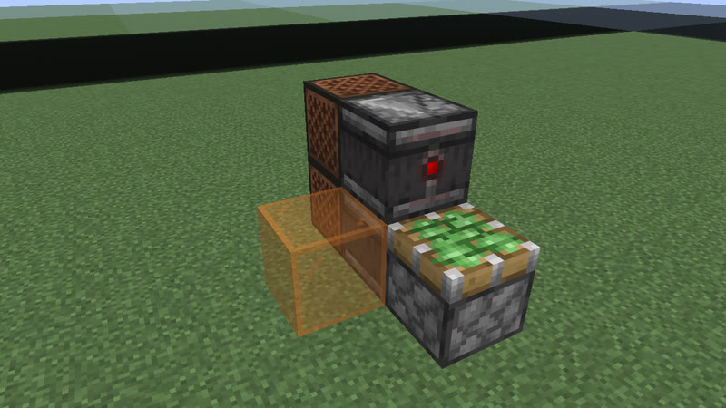</a> 4 gt (0.2 s) · note_block+observer+sticky_piston · 5 blocks</td></tr>
<tr><td align="center"><a href="../archive/clk-obs-p4-obs-stk-5b-7833f4.txt">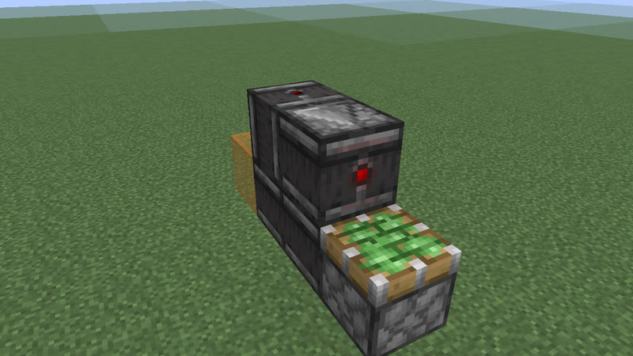</a> 4 gt (0.2 s) · observer+sticky_piston · 5 blocks</td><td align="center"><a href="../archive/clk-obs-p4-obs-stk-5b-b-a00c4d.txt">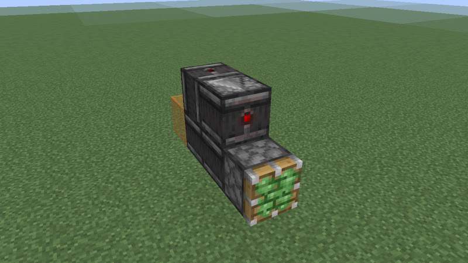</a> 4 gt (0.2 s) · observer+sticky_piston · 5 blocks</td><td align="center"><a href="../archive/clk-misc-p4-crafter-obs-6b-a-1a85f4.txt">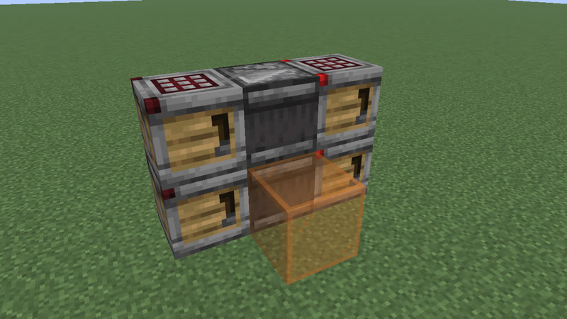</a> 4 gt (0.2 s) · crafter+observer · 6 blocks</td></tr>
<tr><td align="center"><a href="../archive/clk-misc-p4-crafter-obs-6b-b-2a7658.txt">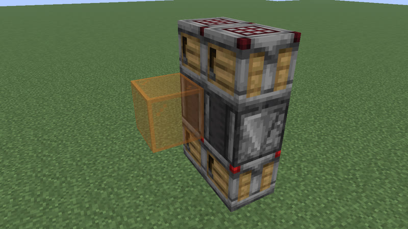</a> 4 gt (0.2 s) · crafter+observer · 6 blocks</td><td align="center"><a href="../archive/clk-misc-p4-crafter-obs-6b-c-db7d4c.txt">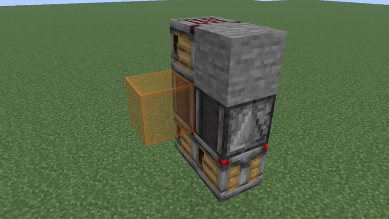</a> 4 gt (0.2 s) · crafter+observer · 6 blocks</td><td align="center"><a href="../archive/clk-misc-dripleaf-stand.txt">clk-misc-dripleaf-stand</a> 4 gt (0.2 s) · armor_stand+big_dripleaf+observer+redstone_wire · 8 blocks (picture pending)</td></tr>
<tr><td align="center"><a href="../archive/clk-rt-cmp-sub-4b.txt">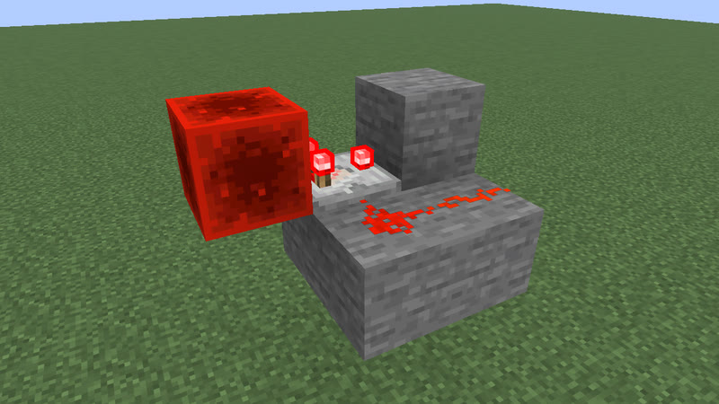</a> 4 gt (0.2 s) · comparator+redstone_wire · 8 blocks</td><td align="center"><a href="../archive/clk-rt-uloop-p4-rw-r-10b.txt">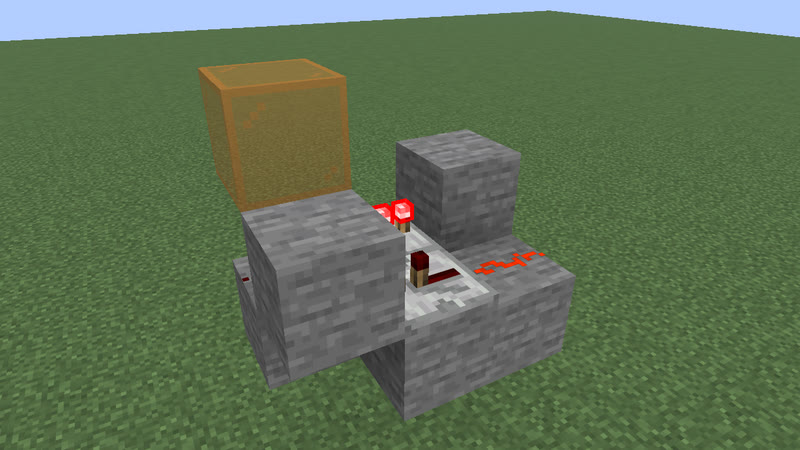</a> 4 gt (0.2 s) · redstone_wire+repeater · 10 blocks</td><td align="center"><a href="../archive/clk-rt-ring3x3-p4-r-12b.txt">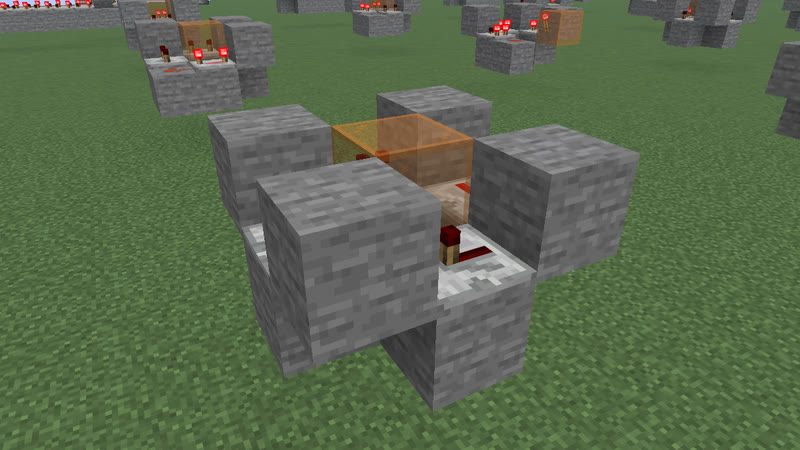</a> 4 gt (0.2 s) · repeater · 12 blocks</td></tr>
</table>

## 5 gt (0.25 s)

<table>
<tr><td align="center"><a href="../archive/clk-obs-p5-obs-pis-6b-2c1363.txt">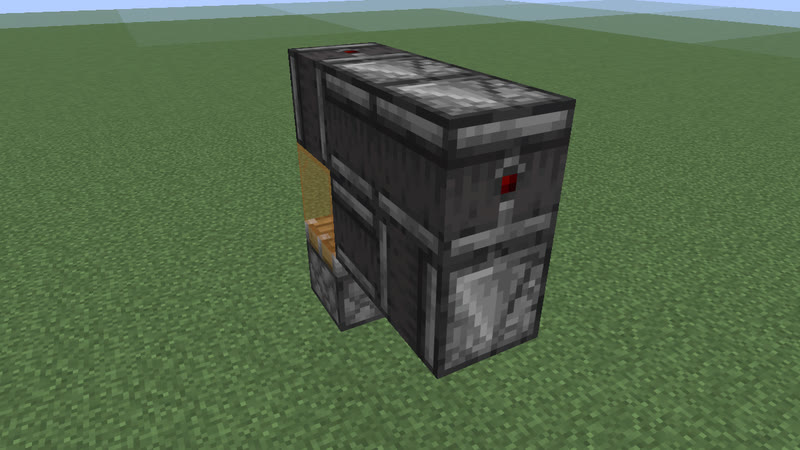</a> 5 gt (0.25 s) · observer+piston · 6 blocks</td><td align="center"><a href="../archive/clk-obs-p5-obs-pis-6b.txt">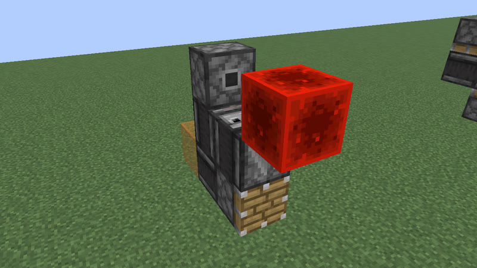</a> 5 gt (0.25 s) · observer+piston · 6 blocks also found as clk-obs-p5-obs-pis-stk-6b-1877b8 (built with sticky_piston)</td><td align="center"><a href="../archive/clk-obs-p5-obs-pis-stk-6b-b-7f4ebb.txt">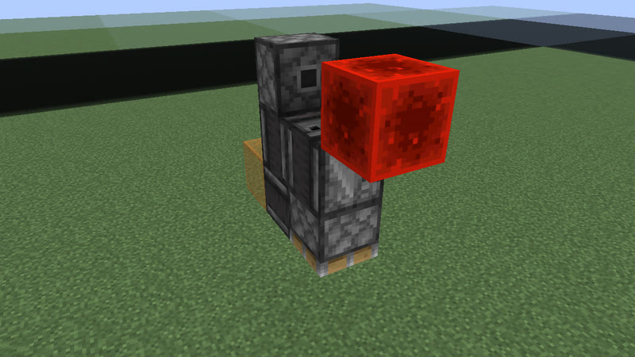</a> 5 gt (0.25 s) · observer+piston+sticky_piston · 6 blocks</td></tr>
<tr><td align="center"><a href="../archive/clk-obs-p5-obs-stk-7b-b-8db298.txt">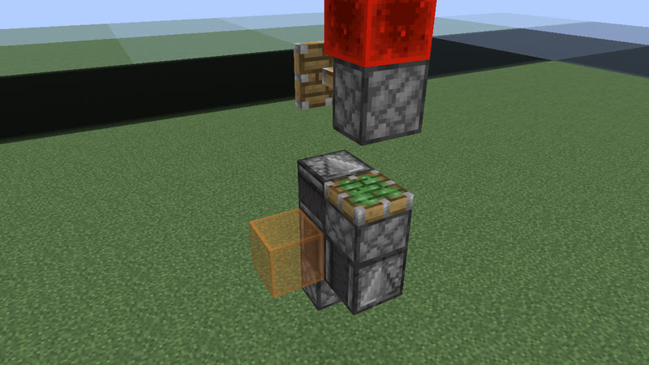</a> 5 gt (0.25 s) · observer+sticky_piston · 7 blocks</td><td align="center"><a href="../archive/clk-obs-p5-obs-stk-7b-cac243.txt">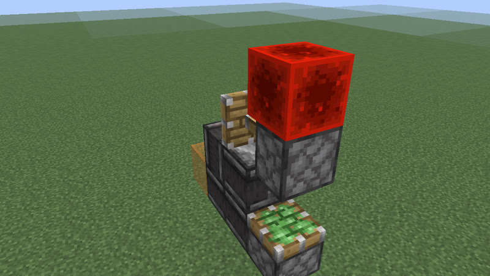</a> 5 gt (0.25 s) · observer+sticky_piston · 7 blocks</td><td align="center"> 5 gt (0.25 s) · redstone_wire+repeater · 16 blocks</td></tr>
</table>

## 6 gt (0.3 s)

<table>
<tr><td align="center"><a href="../archive/clk-obs-obs2.txt">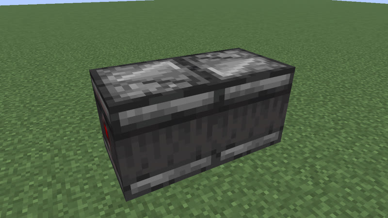</a> 6 gt (0.3 s) · observer · 2 blocks also found as census-p6-observer-2b, census-p6-observer-2b</td><td align="center"><a href="../archive/census-p6-redstone_block-sticky_piston-3b.txt">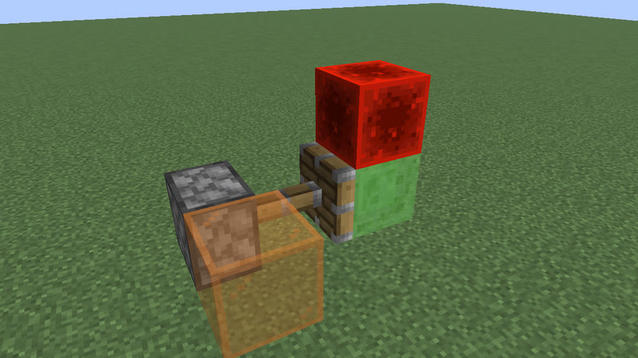</a> 6 gt (0.3 s) · redstone_block+sticky_piston · 3 blocks</td><td align="center"><a href="../archive/clk-rt-ring3x3-p6-rw-r-13b.txt">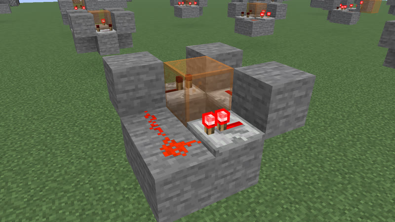</a> 6 gt (0.3 s) · redstone_wire+repeater · 13 blocks</td></tr>
</table>

## 7 gt (0.35 s)

<table>
<tr><td align="center"><a href="../archive/clk-obs-p7-lamp-stk-5b-48f365.txt">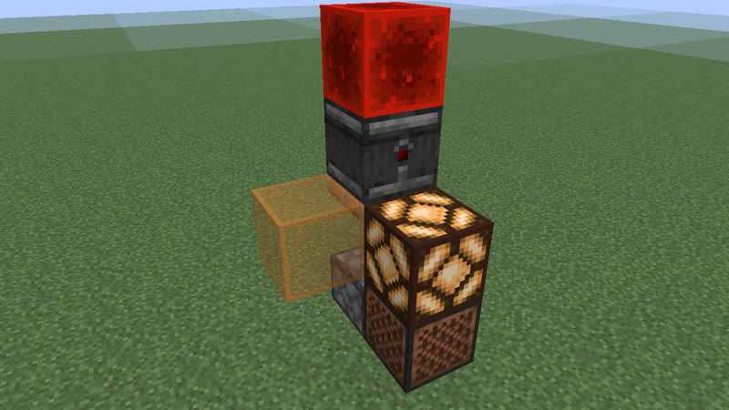</a> 7 gt (0.35 s) · redstone_lamp+sticky_piston · 5 blocks</td><td align="center"><a href="../archive/clk-obs-p7-obs-stk-5b.txt">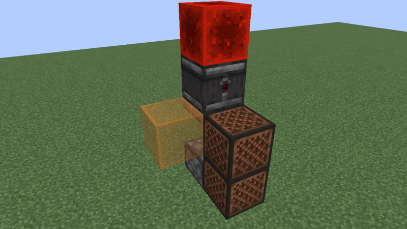</a> 7 gt (0.35 s) · sticky_piston · 5 blocks</td><td align="center"><a href="../archive/clk-obs-p7-stk-5b-f9b6f4.txt">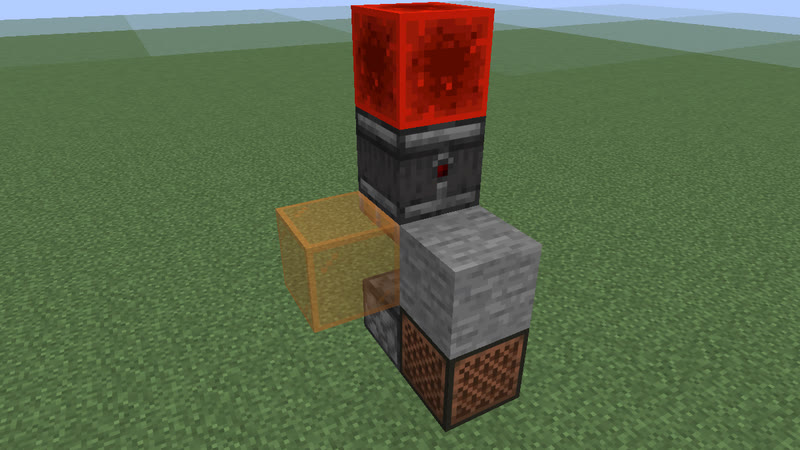</a> 7 gt (0.35 s) · sticky_piston · 5 blocks</td></tr>
<tr><td align="center"><a href="../archive/clk-obs-p7-lamp-stk-5b-b-5dcaf9.txt">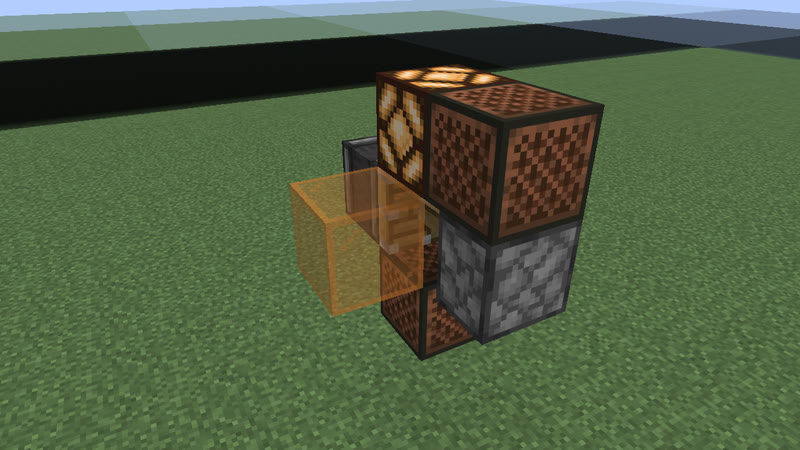</a> 7 gt (0.35 s) · redstone_lamp+sticky_piston · 5 blocks</td><td align="center"><a href="../archive/clk-obs-p7-note-stk-5b-de5326.txt">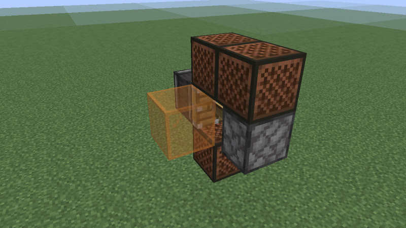</a> 7 gt (0.35 s) · note_block+sticky_piston · 5 blocks</td><td align="center"><a href="../archive/clk-rt-odd-rect-p7-19b.txt">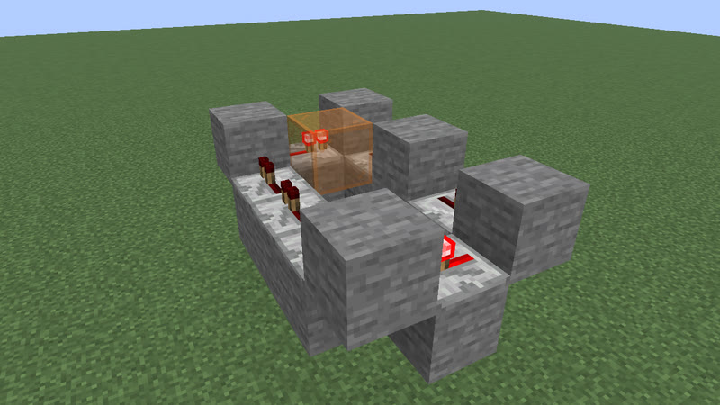</a> 7 gt (0.35 s) · repeater · 19 blocks</td></tr>
</table>

## 8 gt (0.4 s)

Also reachable by: clk-obs-obs-ring (n = 0).

<table>
<tr><td align="center"><a href="../archive/census-p8-observer-4b-2.txt">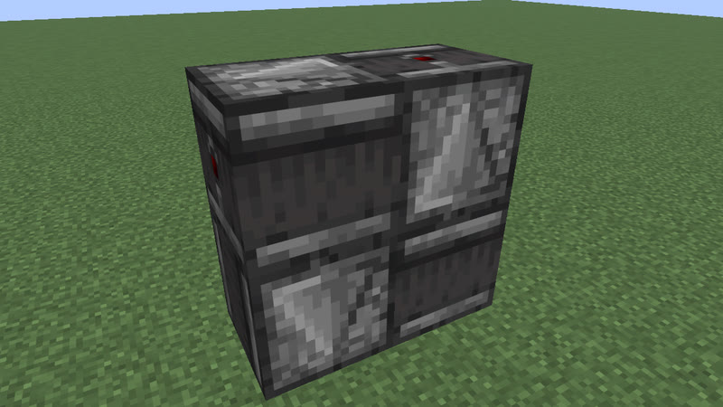</a> 8 gt (0.4 s) · observer · 4 blocks</td><td align="center"><a href="../archive/clk-obs-p8-note-obs-rb-stk-4b-a1ec50.txt">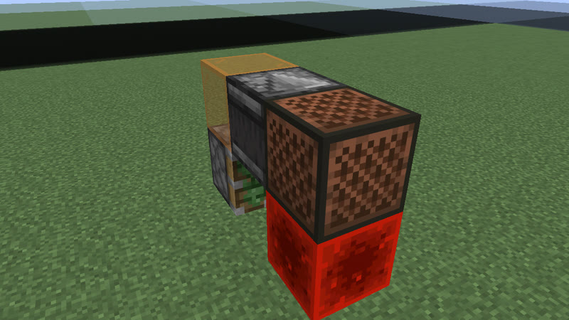</a> 8 gt (0.4 s) · note_block+observer+redstone_block+sticky_piston · 4 blocks</td><td align="center"><a href="../archive/clk-obs-p8-note-obs-stk-4b-11a22c.txt">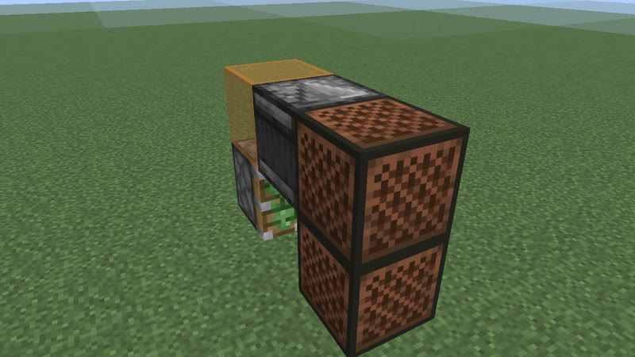</a> 8 gt (0.4 s) · note_block+observer+sticky_piston · 4 blocks</td></tr>
<tr><td align="center"><a href="../archive/clk-obs-p8-note-obs-stk-4b-b-4498f3.txt">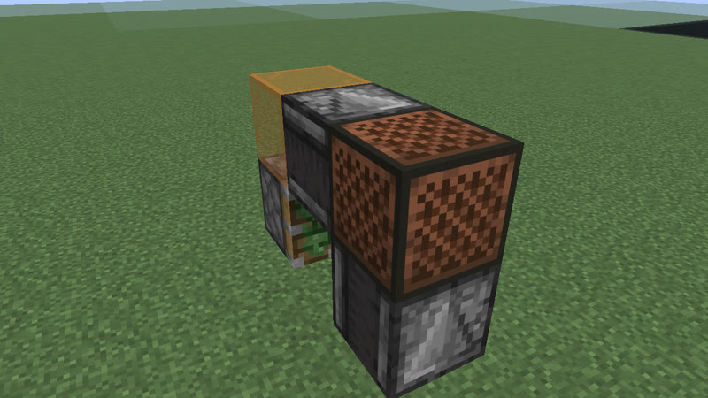</a> 8 gt (0.4 s) · note_block+observer+sticky_piston · 4 blocks</td><td align="center"><a href="../archive/clk-obs-p8-obs-rb-stk-trap-4b-b-33ecee.txt">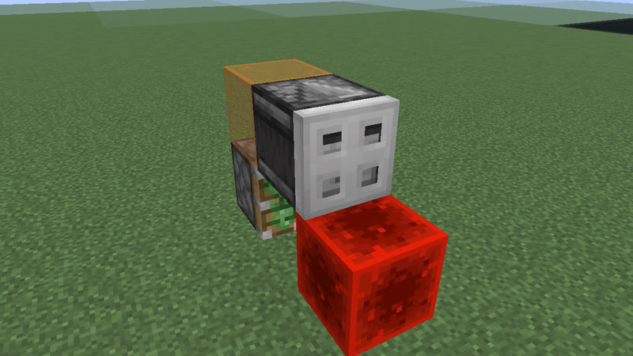</a> 8 gt (0.4 s) · iron_trapdoor+observer+redstone_block+sticky_piston · 4 blocks</td><td align="center"><a href="../archive/clk-obs-p8-obs-rb-stk-trap-4b-f7099e.txt">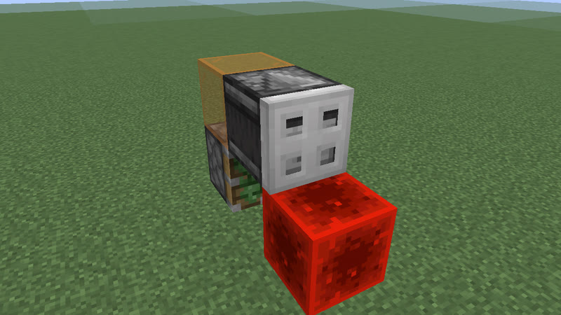</a> 8 gt (0.4 s) · iron_trapdoor+observer+redstone_block+sticky_piston · 4 blocks</td></tr>
<tr><td align="center"><a href="../archive/clk-obs-p8-obs-pis-rb-stk-4b-5c2e9c.txt">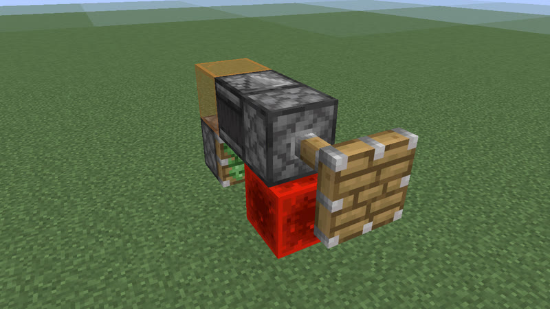</a> 8 gt (0.4 s) · observer+piston+redstone_block+sticky_piston · 4 blocks</td><td align="center"><a href="../archive/clk-obs-p8-obs-rb-stk-4b-385993.txt">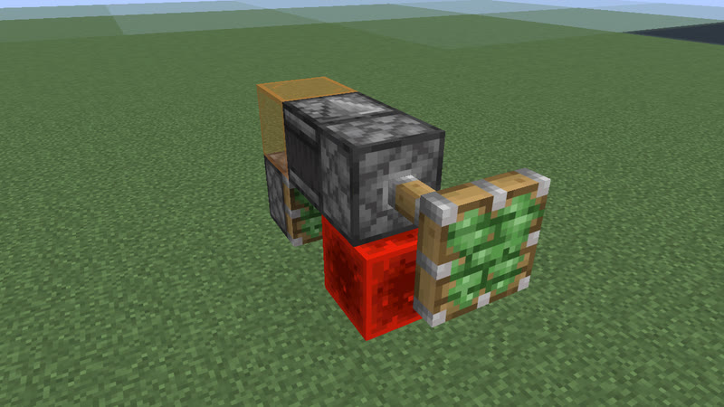</a> 8 gt (0.4 s) · observer+redstone_block+sticky_piston · 4 blocks</td><td align="center"><a href="../archive/hop2x3cd-p8a.txt">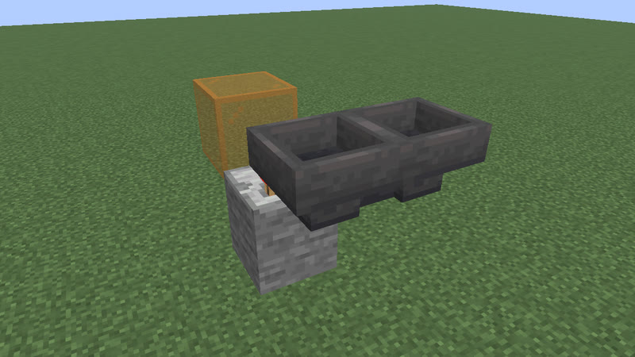</a> 8 gt (0.4 s) · comparator+hopper · 4 blocks</td></tr>
<tr><td align="center"><a href="../archive/clk-obs-p8-obs-pis-rb-stk-4b-b-7daabd.txt">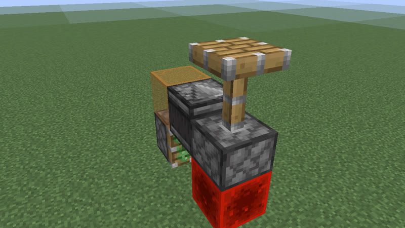</a> 8 gt (0.4 s) · observer+piston+redstone_block+sticky_piston · 4 blocks</td><td align="center"> 8 gt (0.4 s) · observer+redstone_block+sticky_piston · 4 blocks</td><td align="center"> 8 gt (0.4 s) · redstone_wire+repeater · 10 blocks</td></tr>
<tr><td align="center"><a href="../archive/clk-rt-ring3x3-b-c-b-c-b-c-b-c-kick-p8.txt">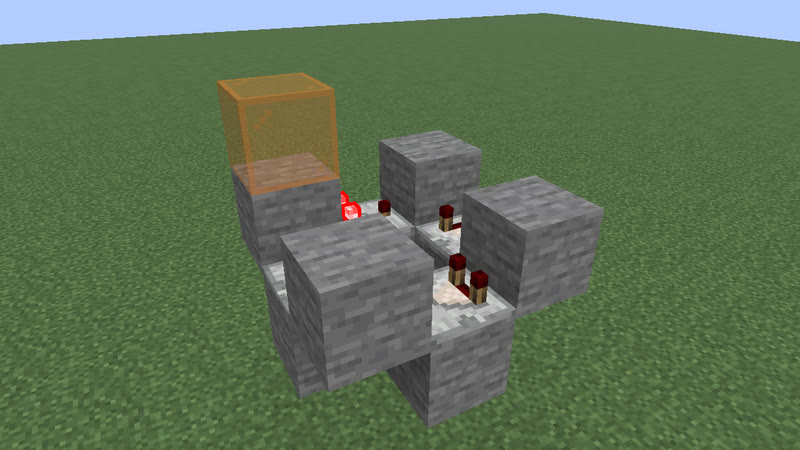</a> 8 gt (0.4 s) · comparator · 12 blocks</td><td align="center"><a href="../archive/clk-rt-ring3x3-p8-c-r-12b.txt">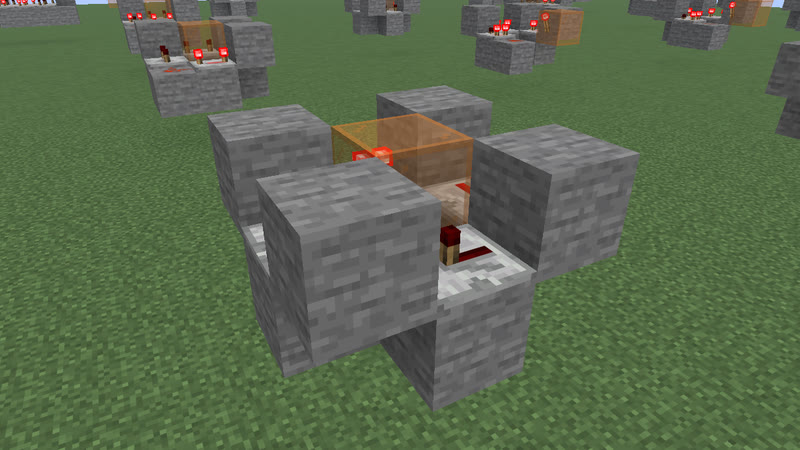</a> 8 gt (0.4 s) · comparator+repeater · 12 blocks</td><td align="center"><a href="../archive/clk-rt-ring3x3-p8-r-12b.txt">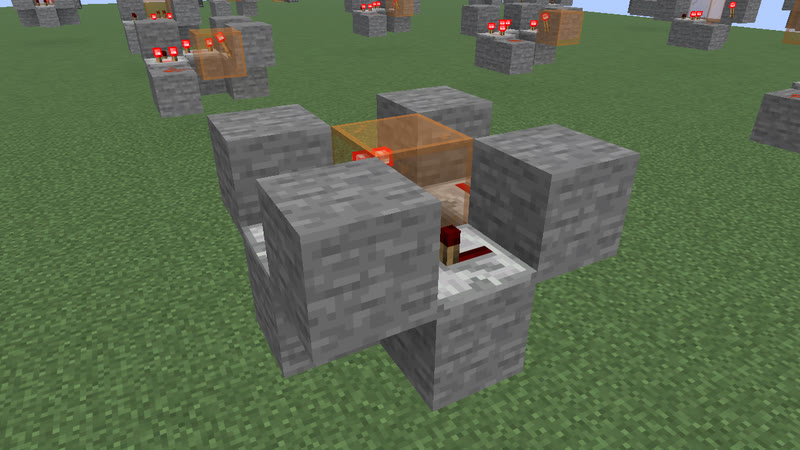</a> 8 gt (0.4 s) · repeater · 12 blocks</td></tr>
</table>

## 9 gt (0.45 s)

<table>
<tr><td align="center"><a href="../archive/clk-obs-p9-bulb-note-obs-pis-5b-b-2c36cd.txt">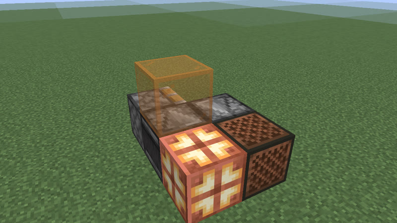</a> 9 gt (0.45 s) · copper_bulb+note_block+observer+piston · 5 blocks also found as clk-obs-p9-bulb-note-obs-stk-5b-b-b66127 (built with sticky_piston, without piston)</td><td align="center"><a href="../archive/clk-obs-p9-bulb-note-obs-pis-5b-d9f740.txt">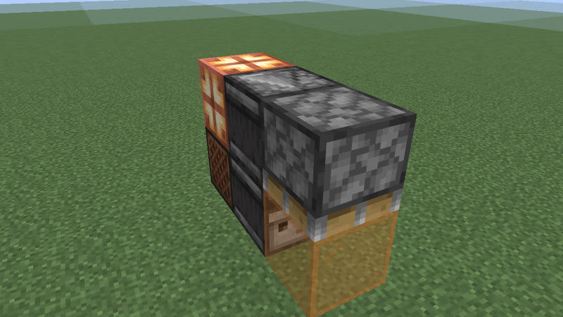</a> 9 gt (0.45 s) · copper_bulb+note_block+observer+piston · 5 blocks also found as clk-obs-p9-bulb-note-obs-stk-5b-fa4d38 (built with sticky_piston, without piston)</td><td align="center"><a href="../archive/clk-obs-p9-bulb-obs-pis-5b-afceb4.txt">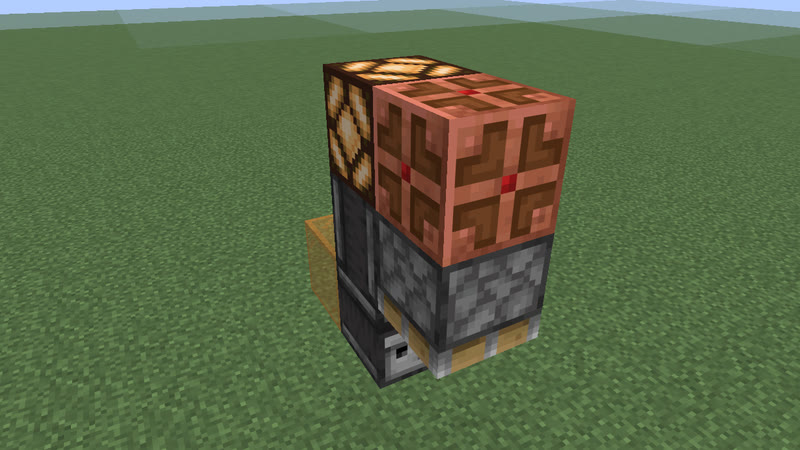</a> 9 gt (0.45 s) · copper_bulb+observer+piston · 5 blocks also found as clk-obs-p9-bulb-obs-stk-5b-6d2863 (built with sticky_piston, without piston)</td></tr>
<tr><td align="center"><a href="../archive/clk-obs-p9-bulb-obs-pis-5b-b-de47ac.txt">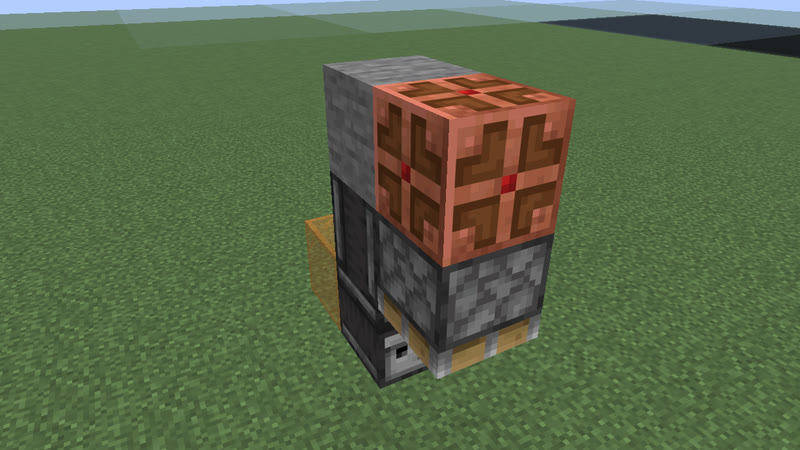</a> 9 gt (0.45 s) · copper_bulb+observer+piston · 5 blocks also found as clk-obs-p9-bulb-obs-stk-5b-b-612f66 (built with sticky_piston, without piston)</td><td align="center"><a href="../archive/clk-obs-p9-note-obs-pis-5b-6153b8.txt">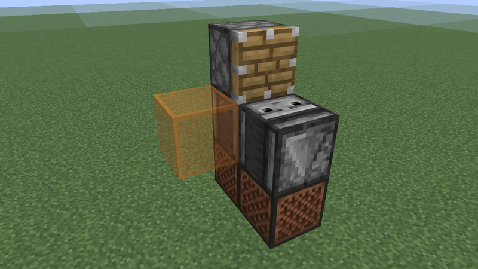</a> 9 gt (0.45 s) · note_block+observer+piston · 5 blocks also found as clk-obs-p9-note-obs-stk-5b-8a4005 (built with sticky_piston, without piston)</td><td align="center"><a href="../archive/clk-obs-p9-note-obs-pis-5b-b-ddc162.txt">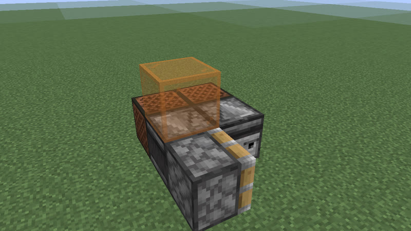</a> 9 gt (0.45 s) · note_block+observer+piston · 5 blocks also found as clk-obs-p9-note-obs-stk-5b-b-88c3da (built with sticky_piston, without piston)</td></tr>
<tr><td align="center"><a href="../archive/clk-misc-p9-oak_leaves-obs-stk-5b-a-38744a.txt">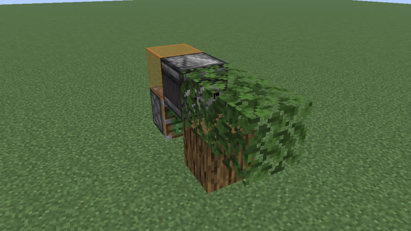</a> 9 gt (0.45 s) · oak_leaves+observer+sticky_piston · 5 blocks</td><td align="center"><a href="../archive/clk-obs-p9-note-obs-pis-stk-5b-bae335.txt">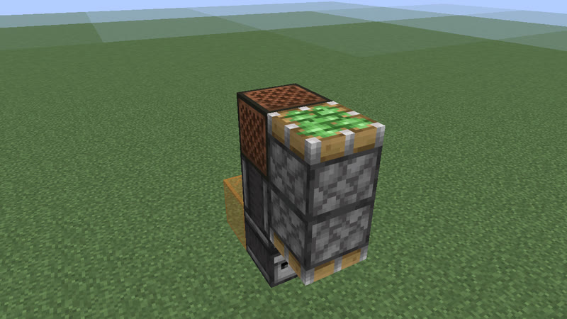</a> 9 gt (0.45 s) · note_block+observer+piston+sticky_piston · 5 blocks also found as clk-obs-p9-note-obs-pis-stk-5b-b-a32f29</td><td align="center"><a href="../archive/clk-obs-p9-obs-pis-5b-cef52e.txt">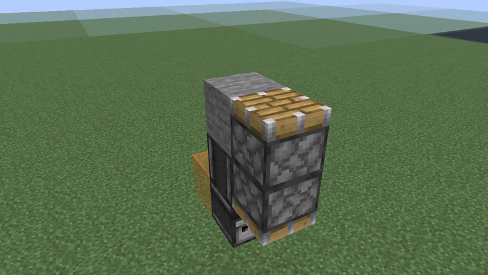</a> 9 gt (0.45 s) · observer+piston · 5 blocks also found as clk-obs-p9-obs-stk-5b-b-a11811 (built with sticky_piston, without piston)</td></tr>
<tr><td align="center"> 9 gt (0.45 s) · observer+piston · 5 blocks also found as clk-obs-p9-obs-pis-stk-5b-637e1f (built with sticky_piston), clk-obs-p9-obs-stk-5b-00e02d (built with sticky_piston, without piston), clk-obs-p9-obs-pis-stk-5b-b-e0550d (built with sticky_piston)</td><td align="center"> 9 gt (0.45 s) · oak_leaves+observer+sticky_piston · 5 blocks</td><td align="center"> 9 gt (0.45 s) · observer+piston+redstone_block+sticky_piston · 5 blocks</td></tr>
<tr><td align="center"> 9 gt (0.45 s) · observer+piston+redstone_block+sticky_piston · 5 blocks</td><td align="center"> 9 gt (0.45 s) · observer+redstone_block+sticky_piston · 5 blocks</td><td align="center"> 9 gt (0.45 s) · observer+redstone_block+sticky_piston · 5 blocks</td></tr>
<tr><td align="center"> 9 gt (0.45 s) · oak_leaves+observer+sticky_piston · 5 blocks</td><td align="center"> 9 gt (0.45 s) · piston+redstone_block · 5 blocks also found as clk-obs-p9-pis-rb-stk-5b-88a9aa (built with sticky_piston)</td><td align="center"> 9 gt (0.45 s) · piston+redstone_block · 5 blocks also found as clk-obs-p9-pis-rb-stk-5b-b-0a37d3 (built with sticky_piston)</td></tr>
<tr><td align="center"><a href="../archive/clk-obs-p9-lamp-obs-stk-7b-073d1e.txt">clk-obs-p9-lamp-obs-stk-7b-073d1e</a> 9 gt (0.45 s) · observer+redstone_lamp+sticky_piston · 7 blocks (picture pending)</td><td align="center"><a href="../archive/clk-obs-p9-bulb-lamp-note-obs-stk-7b-58d216.txt">clk-obs-p9-bulb-lamp-note-obs-stk-7b-58d216</a> 9 gt (0.45 s) · copper_bulb+note_block+observer+redstone_lamp+sticky_piston · 7 blocks (picture pending)</td><td align="center"> 9 gt (0.45 s) · comparator+hopper+redstone_wire · 8 blocks</td></tr>
<tr><td align="center"> 9 gt (0.45 s) · redstone_wire+repeater · 16 blocks</td></tr>
</table>

## 10 gt (0.5 s)

Also reachable by: observer ring with a relay block (clk-obs-note-ring, n = 0).

<table>
<tr><td align="center"> 10 gt (0.5 s) · oak_leaves+observer+sticky_piston · 4 blocks</td><td align="center"> 10 gt (0.5 s) · observer+redstone_block+sticky_piston · 4 blocks</td><td align="center"> 10 gt (0.5 s) · observer+sticky_piston · 4 blocks</td></tr>
<tr><td align="center"> 10 gt (0.5 s) · observer+sticky_piston · 4 blocks</td><td align="center"> 10 gt (0.5 s) · observer+sticky_piston · 4 blocks</td><td align="center"> 10 gt (0.5 s) · observer+piston+sticky_piston · 4 blocks</td></tr>
<tr><td align="center"> 10 gt (0.5 s) · observer+piston+sticky_piston · 4 blocks</td><td align="center"><a href="../archive/clk-obs-p10-lamp-note-obs-pis-rb-7b-95f65b.txt">clk-obs-p10-lamp-note-obs-pis-rb-7b-95f65b</a> 10 gt (0.5 s) · note_block+observer+piston+redstone_block+redstone_lamp · 7 blocks (picture pending)</td><td align="center"><a href="../archive/clk-obs-p10-lamp-obs-pis-rb-7b-ade7d5.txt">clk-obs-p10-lamp-obs-pis-rb-7b-ade7d5</a> 10 gt (0.5 s) · observer+piston+redstone_block+redstone_lamp · 7 blocks (picture pending)</td></tr>
<tr><td align="center"> 10 gt (0.5 s) · copper_bulb+observer+piston · 7 blocks also found as clk-obs-p10-bulb-obs-pis-stk-7b-928d0e (built with sticky_piston)</td><td align="center"> 10 gt (0.5 s) · copper_bulb+observer+piston · 7 blocks</td><td align="center"> 10 gt (0.5 s) · iron_trapdoor+observer · 8 blocks</td></tr>
<tr><td align="center"> 10 gt (0.5 s) · comparator+redstone_torch+repeater · 8 blocks</td><td align="center"> 10 gt (0.5 s) · redstone_torch+repeater · 8 blocks</td><td align="center"> 10 gt (0.5 s) · comparator+redstone_torch+redstone_wire · 12 blocks</td></tr>
<tr><td align="center"> 10 gt (0.5 s) · comparator+repeater · 12 blocks</td><td align="center"> 10 gt (0.5 s) · repeater · 12 blocks</td></tr>
</table>

## 11 gt (0.55 s)

Also reachable by: clk-item-lockpair (n = 0), clk-obs-odd-a (n = 0).

<table>
<tr><td align="center"> 11 gt (0.55 s) · note_block+observer+piston · 6 blocks</td><td align="center"> 11 gt (0.55 s) · observer+piston · 6 blocks</td><td align="center"> 11 gt (0.55 s) · observer+piston · 6 blocks</td></tr>
<tr><td align="center"> 11 gt (0.55 s) · observer+piston+sticky_piston · 6 blocks</td><td align="center"> 11 gt (0.55 s) · observer+piston+sticky_piston · 6 blocks</td><td align="center"> 11 gt (0.55 s) · observer+sticky_piston · 6 blocks</td></tr>
<tr><td align="center"> 11 gt (0.55 s) · observer+sticky_piston · 6 blocks</td><td align="center"><a href="../archive/clk-obs-p11-obs-rb-stk-7b-fe8152.txt">clk-obs-p11-obs-rb-stk-7b-fe8152</a> 11 gt (0.55 s) · observer+redstone_block+sticky_piston · 7 blocks (picture pending)</td><td align="center"><a href="../archive/clk-obs-p11-bulb-obs-rb-stk-7b-f4ca30.txt">clk-obs-p11-bulb-obs-rb-stk-7b-f4ca30</a> 11 gt (0.55 s) · copper_bulb+observer+redstone_block+sticky_piston · 7 blocks (picture pending)</td></tr>
<tr><td align="center"><a href="../archive/clk-obs-p11-lamp-obs-stk-8b-32f043.txt">clk-obs-p11-lamp-obs-stk-8b-32f043</a> 11 gt (0.55 s) · observer+redstone_lamp+sticky_piston · 8 blocks (picture pending)</td><td align="center"><a href="../archive/clk-obs-p11-lamp-note-obs-stk-8b-3ea037.txt">clk-obs-p11-lamp-note-obs-stk-8b-3ea037</a> 11 gt (0.55 s) · note_block+observer+redstone_lamp+sticky_piston · 8 blocks (picture pending)</td><td align="center"> 11 gt (0.55 s) · repeater · 16 blocks</td></tr>
</table>

## 12 gt (0.6 s)

Also reachable by: clk-obs-obs-ring (n = 1), clk-obs-divider (n = 0).

<table>
<tr><td align="center"> 12 gt (0.6 s) · copper_bulb+observer · 3 blocks</td><td align="center"> 12 gt (0.6 s) · observer+piston · 4 blocks</td><td align="center"> 12 gt (0.6 s) · observer+redstone_block+sticky_piston · 4 blocks</td></tr>
<tr><td align="center"> 12 gt (0.6 s) · observer+sticky_piston · 4 blocks</td><td align="center"> 12 gt (0.6 s) · observer+sticky_piston · 4 blocks</td><td align="center"> 12 gt (0.6 s) · copper_bulb+redstone_block+sticky_piston · 4 blocks</td></tr>
<tr><td align="center"> 12 gt (0.6 s) · observer+redstone_block+redstone_lamp+sticky_piston · 4 blocks</td><td align="center"> 12 gt (0.6 s) · observer+piston · 4 blocks</td><td align="center"> 12 gt (0.6 s) · observer+redstone_lamp+sticky_piston · 4 blocks</td></tr>
<tr><td align="center"> 12 gt (0.6 s) · note_block+observer+sticky_piston · 5 blocks</td><td align="center"> 12 gt (0.6 s) · note_block+observer+sticky_piston · 5 blocks</td><td align="center"> 12 gt (0.6 s) · redstone_block+redstone_lamp+sticky_piston · 5 blocks</td></tr>
<tr><td align="center"> 12 gt (0.6 s) · redstone_block+redstone_lamp+sticky_piston · 5 blocks</td><td align="center"> 12 gt (0.6 s) · note_block+redstone_block+sticky_piston · 5 blocks</td><td align="center"> 12 gt (0.6 s) · note_block+redstone_block+sticky_piston · 5 blocks</td></tr>
<tr><td align="center"> 12 gt (0.6 s) · redstone_block+sticky_piston · 5 blocks</td><td align="center"> 12 gt (0.6 s) · redstone_block+sticky_piston · 5 blocks</td><td align="center"> 12 gt (0.6 s) · dispenser+observer+redstone_wire · 5 blocks</td></tr>
<tr><td align="center"><a href="../archive/clk-obs-p12-pis-rb-6b-2e8a01.txt">clk-obs-p12-pis-rb-6b-2e8a01</a> 12 gt (0.6 s) · piston+redstone_block · 6 blocks (picture pending)</td><td align="center"> 12 gt (0.6 s) · comparator+redstone_torch+repeater · 8 blocks</td><td align="center"> 12 gt (0.6 s) · redstone_torch+repeater · 8 blocks</td></tr>
<tr><td align="center"> 12 gt (0.6 s) · comparator+redstone_torch+redstone_wire · 9 blocks</td><td align="center"> 12 gt (0.6 s) · redstone_wire+repeater · 10 blocks</td><td align="center"> 12 gt (0.6 s) · comparator+redstone_torch · 12 blocks</td></tr>
<tr><td align="center"> 12 gt (0.6 s) · comparator+repeater · 12 blocks</td><td align="center"> 12 gt (0.6 s) · repeater · 12 blocks</td><td align="center"> 12 gt (0.6 s) · redstone_torch+redstone_wire · 14 blocks</td></tr>
<tr><td align="center"> 12 gt (0.6 s) · comparator · 16 blocks</td></tr>
</table>

## 13 gt (0.65 s)

Also reachable by: clk-item-lockpair (n = 1), clk-obs-odd-b (n = 0).

<table>
<tr><td align="center"> 13 gt (0.65 s) · observer+piston · 4 blocks also found as clk-obs-p13-obs-pis-stk-4b-df95ac (built with sticky_piston), clk-obs-p13-obs-stk-4b-59c598 (built with sticky_piston, without piston), clk-obs-p13-obs-pis-stk-4b-b-cd9fda (built with sticky_piston)</td><td align="center"> 13 gt (0.65 s) · observer+piston · 4 blocks also found as clk-obs-p13-obs-stk-4b-b-ce4e6f (built with sticky_piston, without piston)</td><td align="center"> 13 gt (0.65 s) · observer+redstone_block+sticky_piston · 5 blocks</td></tr>
<tr><td align="center"> 13 gt (0.65 s) · observer+redstone_lamp+sticky_piston · 6 blocks</td><td align="center"> 13 gt (0.65 s) · observer+redstone_lamp+sticky_piston · 6 blocks</td><td align="center"><a href="../archive/clk-obs-p13-bulb-note-obs-stk-8b-a7ad6c.txt">clk-obs-p13-bulb-note-obs-stk-8b-a7ad6c</a> 13 gt (0.65 s) · copper_bulb+note_block+observer+sticky_piston · 8 blocks (picture pending)</td></tr>
<tr><td align="center"> 13 gt (0.65 s) · comparator+hopper+redstone_torch+redstone_wire · 9 blocks</td><td align="center"> 13 gt (0.65 s) · comparator+hopper+redstone_torch+redstone_wire · 9 blocks</td><td align="center"> 13 gt (0.65 s) · redstone_wire+repeater · 16 blocks</td></tr>
</table>

## 14 gt (0.7 s)

Also reachable by: observer ring with a relay block (clk-obs-note-ring, n = 1), hopper ring (clk-item-hopper-ring, n = 0).

<table>
<tr><td align="center"> 14 gt (0.7 s) · comparator+hopper · 4 blocks</td><td align="center"> 14 gt (0.7 s) · copper_bulb+redstone_lamp+sticky_piston · 5 blocks</td><td align="center"> 14 gt (0.7 s) · copper_bulb+sticky_piston · 5 blocks</td></tr>
<tr><td align="center"> 14 gt (0.7 s) · copper_bulb+sticky_piston · 5 blocks</td><td align="center"> 14 gt (0.7 s) · copper_bulb+observer+redstone_lamp+sticky_piston · 5 blocks</td><td align="center"> 14 gt (0.7 s) · copper_bulb+observer+redstone_lamp+sticky_piston · 5 blocks</td></tr>
<tr><td align="center"> 14 gt (0.7 s) · copper_bulb+redstone_lamp+sticky_piston · 5 blocks</td><td align="center"> 14 gt (0.7 s) · copper_bulb+note_block+observer+sticky_piston · 5 blocks</td><td align="center"> 14 gt (0.7 s) · copper_bulb+note_block+sticky_piston · 5 blocks</td></tr>
<tr><td align="center"> 14 gt (0.7 s) · copper_bulb+observer+sticky_piston · 5 blocks</td><td align="center"> 14 gt (0.7 s) · copper_bulb+observer+sticky_piston · 5 blocks</td><td align="center"> 14 gt (0.7 s) · observer+redstone_lamp+sticky_piston · 5 blocks</td></tr>
<tr><td align="center"> 14 gt (0.7 s) · observer+redstone_lamp+sticky_piston · 5 blocks</td><td align="center"> 14 gt (0.7 s) · note_block+observer+sticky_piston · 5 blocks</td><td align="center"> 14 gt (0.7 s) · observer+piston · 5 blocks also found as clk-obs-p14-obs-pis-stk-5b-b-f03e8a (built with sticky_piston)</td></tr>
<tr><td align="center"> 14 gt (0.7 s) · observer+piston · 5 blocks also found as clk-obs-p14-obs-pis-stk-5b-edbcf8 (built with sticky_piston)</td><td align="center"> 14 gt (0.7 s) · observer+sticky_piston · 5 blocks</td><td align="center"> 14 gt (0.7 s) · observer+sticky_piston · 5 blocks</td></tr>
<tr><td align="center"> 14 gt (0.7 s) · copper_bulb+observer+redstone_lamp · 6 blocks</td><td align="center"> 14 gt (0.7 s) · copper_bulb+observer+redstone_lamp · 6 blocks</td><td align="center"> 14 gt (0.7 s) · note_block+observer+redstone_lamp · 6 blocks</td></tr>
<tr><td align="center"> 14 gt (0.7 s) · note_block+observer+redstone_lamp · 6 blocks</td><td align="center"> 14 gt (0.7 s) · observer+redstone_lamp · 6 blocks</td><td align="center"> 14 gt (0.7 s) · observer+redstone_lamp · 6 blocks</td></tr>
<tr><td align="center"> 14 gt (0.7 s) · observer+piston+redstone_lamp · 6 blocks</td><td align="center"> 14 gt (0.7 s) · observer+piston+redstone_lamp · 6 blocks</td><td align="center"> 14 gt (0.7 s) · observer+piston+redstone_lamp+sticky_piston · 6 blocks</td></tr>
<tr><td align="center"> 14 gt (0.7 s) · observer+redstone_block+redstone_lamp+sticky_piston · 6 blocks</td><td align="center"> 14 gt (0.7 s) · observer+redstone_block+redstone_lamp+sticky_piston · 6 blocks</td><td align="center"> 14 gt (0.7 s) · observer+piston+redstone_block+sticky_piston · 6 blocks</td></tr>
<tr><td align="center"> 14 gt (0.7 s) · observer+redstone_block+sticky_piston · 6 blocks</td><td align="center"> 14 gt (0.7 s) · observer+piston+redstone_block+sticky_piston · 6 blocks</td><td align="center"> 14 gt (0.7 s) · observer+redstone_block+sticky_piston · 6 blocks</td></tr>
<tr><td align="center"><a href="../archive/clk-obs-p14-bulb-obs-pis-8b-6b0e88.txt">clk-obs-p14-bulb-obs-pis-8b-6b0e88</a> 14 gt (0.7 s) · copper_bulb+observer+piston · 8 blocks (picture pending)</td><td align="center"> 14 gt (0.7 s) · redstone_torch+repeater · 8 blocks</td><td align="center"> 14 gt (0.7 s) · note_block+observer · 10 blocks</td></tr>
<tr><td align="center"> 14 gt (0.7 s) · iron_trapdoor+observer · 10 blocks</td><td align="center"> 14 gt (0.7 s) · comparator+repeater · 12 blocks</td><td align="center"> 14 gt (0.7 s) · repeater · 12 blocks</td></tr>
</table>

## 15 gt (0.75 s)

Also reachable by: clk-item-lockpair (n = 2), clk-obs-odd-a (n = 1).

<table>
<tr><td align="center"> 15 gt (0.75 s) · note_block+observer+piston+redstone_lamp · 5 blocks also found as clk-obs-p15-lamp-note-obs-stk-5b-b4c294 (built with sticky_piston, without piston)</td><td align="center"> 15 gt (0.75 s) · note_block+observer+piston+redstone_lamp · 5 blocks also found as clk-obs-p15-lamp-note-obs-stk-5b-b-66d58d (built with sticky_piston, without piston)</td><td align="center"> 15 gt (0.75 s) · observer+piston+redstone_lamp · 5 blocks also found as clk-obs-p15-lamp-obs-stk-5b-b-e9847b (built with sticky_piston, without piston)</td></tr>
<tr><td align="center"> 15 gt (0.75 s) · observer+piston+redstone_lamp · 5 blocks also found as clk-obs-p15-lamp-obs-stk-5b-fb17dd (built with sticky_piston, without piston)</td><td align="center"> 15 gt (0.75 s) · observer+redstone_block+sticky_piston · 5 blocks</td><td align="center"> 15 gt (0.75 s) · observer+sticky_piston · 6 blocks</td></tr>
<tr><td align="center"> 15 gt (0.75 s) · observer+sticky_piston · 6 blocks</td><td align="center"> 15 gt (0.75 s) · observer+piston+sticky_piston · 6 blocks</td><td align="center"> 15 gt (0.75 s) · note_block+observer+piston+sticky_piston · 6 blocks</td></tr>
<tr><td align="center"> 15 gt (0.75 s) · note_block+observer+sticky_piston · 6 blocks</td><td align="center"> 15 gt (0.75 s) · observer+piston+sticky_piston · 6 blocks</td><td align="center"><a href="../archive/clk-obs-p15-bulb-lamp-obs-stk-7b-dc35a3.txt">clk-obs-p15-bulb-lamp-obs-stk-7b-dc35a3</a> 15 gt (0.75 s) · copper_bulb+observer+redstone_lamp+sticky_piston · 7 blocks (picture pending)</td></tr>
<tr><td align="center"> 15 gt (0.75 s) · comparator+hopper+redstone_torch+repeater · 9 blocks</td><td align="center"> 15 gt (0.75 s) · comparator+hopper · 10 blocks</td><td align="center"> 15 gt (0.75 s) · redstone_wire+repeater · 16 blocks</td></tr>
</table>

## 16 gt (0.8 s)

Also reachable by: clk-obs-obs-ring (n = 2), clk-item-snowdisp (n = 0).

<table>
<tr><td align="center"> 16 gt (0.8 s) · copper_bulb+observer+redstone_block+sticky_piston · 4 blocks</td><td align="center"> 16 gt (0.8 s) · copper_bulb+observer · 5 blocks</td><td align="center"> 16 gt (0.8 s) · copper_bulb+observer · 5 blocks</td></tr>
<tr><td align="center"> 16 gt (0.8 s) · copper_bulb+note_block+observer+sticky_piston · 5 blocks</td><td align="center"> 16 gt (0.8 s) · copper_bulb+note_block+observer+sticky_piston · 5 blocks</td><td align="center"> 16 gt (0.8 s) · observer+piston+redstone_block+sticky_piston · 5 blocks</td></tr>
<tr><td align="center"> 16 gt (0.8 s) · observer+piston+redstone_block+sticky_piston · 5 blocks</td><td align="center"> 16 gt (0.8 s) · observer+redstone_block+sticky_piston · 5 blocks</td><td align="center"> 16 gt (0.8 s) · observer+redstone_block+sticky_piston · 5 blocks</td></tr>
<tr><td align="center"> 16 gt (0.8 s) · note_block+observer+piston+redstone_block+sticky_piston · 5 blocks</td><td align="center"> 16 gt (0.8 s) · note_block+observer+redstone_block+sticky_piston · 5 blocks</td><td align="center"> 16 gt (0.8 s) · observer+piston+sticky_piston · 5 blocks</td></tr>
<tr><td align="center"> 16 gt (0.8 s) · observer+piston+sticky_piston · 5 blocks</td><td align="center"> 16 gt (0.8 s) · observer+sticky_piston · 5 blocks</td><td align="center"> 16 gt (0.8 s) · observer+sticky_piston · 5 blocks</td></tr>
<tr><td align="center"> 16 gt (0.8 s) · note_block+observer+redstone_lamp+sticky_piston · 6 blocks</td><td align="center"> 16 gt (0.8 s) · note_block+observer+redstone_lamp+sticky_piston · 6 blocks</td><td align="center"> 16 gt (0.8 s) · observer+redstone_lamp+sticky_piston · 6 blocks</td></tr>
<tr><td align="center"> 16 gt (0.8 s) · observer+redstone_lamp+sticky_piston · 6 blocks</td><td align="center"> 16 gt (0.8 s) · note_block+observer+sticky_piston · 6 blocks</td><td align="center"> 16 gt (0.8 s) · note_block+observer+piston · 7 blocks</td></tr>
<tr><td align="center"> 16 gt (0.8 s) · note_block+observer+piston · 7 blocks</td><td align="center"> 16 gt (0.8 s) · observer+piston+redstone_lamp · 7 blocks</td><td align="center"> 16 gt (0.8 s) · observer+piston+redstone_lamp · 7 blocks</td></tr>
<tr><td align="center"> 16 gt (0.8 s) · redstone_torch+repeater · 8 blocks</td><td align="center"> 16 gt (0.8 s) · comparator+hopper · 9 blocks</td><td align="center"> 16 gt (0.8 s) · redstone_wire+repeater · 10 blocks</td></tr>
<tr><td align="center"> 16 gt (0.8 s) · comparator+repeater · 12 blocks</td><td align="center"> 16 gt (0.8 s) · comparator+redstone_torch+redstone_wire · 12 blocks</td><td align="center"> 16 gt (0.8 s) · repeater · 12 blocks</td></tr>
<tr><td align="center"><a href="../archive/clk-misc-bubble-flip.txt">clk-misc-bubble-flip</a> 16 gt (0.8 s) · bubble_column+observer+redstone_wire+sticky_piston · 12 blocks (picture pending)</td></tr>
</table>

## 17 gt (0.85 s)

Also reachable by: clk-obs-odd-b (n = 1).

<table>
<tr><td align="center"> 17 gt (0.85 s) · observer+piston+sticky_piston · 5 blocks</td><td align="center"> 17 gt (0.85 s) · observer+piston+sticky_piston · 5 blocks</td><td align="center"> 17 gt (0.85 s) · observer+sticky_piston · 5 blocks</td></tr>
<tr><td align="center"> 17 gt (0.85 s) · observer+sticky_piston · 5 blocks</td><td align="center"> 17 gt (0.85 s) · observer+sticky_piston · 5 blocks</td><td align="center"> 17 gt (0.85 s) · observer+piston · 6 blocks</td></tr>
<tr><td align="center"> 17 gt (0.85 s) · observer+piston · 6 blocks</td><td align="center"> 17 gt (0.85 s) · comparator+hopper+redstone_torch+repeater · 9 blocks</td><td align="center"> 17 gt (0.85 s) · redstone_wire+repeater · 16 blocks</td></tr>
</table>

## 18 gt (0.9 s)

Also reachable by: observer ring with a relay block (clk-obs-note-ring, n = 2).

<table>
<tr><td align="center"> 18 gt (0.9 s) · observer+sticky_piston · 4 blocks</td><td align="center"> 18 gt (0.9 s) · observer+sticky_piston · 4 blocks</td><td align="center"> 18 gt (0.9 s) · note_block+observer+piston+redstone_lamp · 5 blocks also found as clk-obs-p18-lamp-note-obs-stk-5b-b49e8b (built with sticky_piston, without piston)</td></tr>
<tr><td align="center"> 18 gt (0.9 s) · observer+piston+redstone_lamp · 5 blocks also found as clk-obs-p18-lamp-obs-stk-5b-2a94b8 (built with sticky_piston, without piston)</td><td align="center"> 18 gt (0.9 s) · observer+piston+redstone_lamp · 5 blocks also found as clk-obs-p18-lamp-obs-stk-5b-b-62783f (built with sticky_piston, without piston)</td><td align="center"> 18 gt (0.9 s) · note_block+observer+piston+redstone_lamp · 5 blocks also found as clk-obs-p18-lamp-note-obs-stk-5b-b-b9dcbb (built with sticky_piston, without piston)</td></tr>
<tr><td align="center"> 18 gt (0.9 s) · note_block+observer+piston · 6 blocks also found as clk-obs-p18-note-obs-pis-stk-6b-368e83 (built with sticky_piston)</td><td align="center"> 18 gt (0.9 s) · note_block+observer+piston · 6 blocks also found as clk-obs-p18-note-obs-pis-stk-6b-b-9059c1 (built with sticky_piston)</td><td align="center"> 18 gt (0.9 s) · observer+piston · 6 blocks</td></tr>
<tr><td align="center"><a href="../archive/clk-obs-p18-rb-stk-6b-762e50.txt">clk-obs-p18-rb-stk-6b-762e50</a> 18 gt (0.9 s) · redstone_block+sticky_piston · 6 blocks (picture pending)</td><td align="center"><a href="../archive/clk-obs-p18-pis-rb-stk-6b-d6fe1c.txt">clk-obs-p18-pis-rb-stk-6b-d6fe1c</a> 18 gt (0.9 s) · piston+redstone_block+sticky_piston · 6 blocks (picture pending)</td><td align="center"> 18 gt (0.9 s) · redstone_torch+repeater · 8 blocks</td></tr>
<tr><td align="center"> 18 gt (0.9 s) · comparator+hopper+redstone_wire+repeater · 9 blocks</td><td align="center"> 18 gt (0.9 s) · comparator+repeater · 12 blocks</td><td align="center"> 18 gt (0.9 s) · repeater · 12 blocks</td></tr>
</table>

## 19 gt (0.95 s)

Also reachable by: clk-obs-odd-a (n = 2).

<table>
<tr><td align="center"> 19 gt (0.95 s) · observer+piston+sticky_piston · 6 blocks</td><td align="center"> 19 gt (0.95 s) · observer+piston+sticky_piston · 6 blocks</td><td align="center"> 19 gt (0.95 s) · observer+sticky_piston · 6 blocks</td></tr>
<tr><td align="center"> 19 gt (0.95 s) · observer+sticky_piston · 6 blocks</td><td align="center"> 19 gt (0.95 s) · observer+sticky_piston · 6 blocks</td><td align="center"> 19 gt (0.95 s) · copper_bulb+observer+piston+sticky_piston · 6 blocks</td></tr>
<tr><td align="center"> 19 gt (0.95 s) · copper_bulb+observer+sticky_piston · 6 blocks</td><td align="center"> 19 gt (0.95 s) · observer+piston+redstone_lamp+sticky_piston · 6 blocks</td><td align="center"> 19 gt (0.95 s) · observer+redstone_lamp+sticky_piston · 6 blocks</td></tr>
<tr><td align="center"> 19 gt (0.95 s) · note_block+observer+piston+sticky_piston · 6 blocks</td><td align="center"> 19 gt (0.95 s) · note_block+observer+piston+sticky_piston · 6 blocks</td><td align="center"> 19 gt (0.95 s) · note_block+observer+sticky_piston · 6 blocks</td></tr>
<tr><td align="center"> 19 gt (0.95 s) · note_block+observer+sticky_piston · 6 blocks</td><td align="center"><a href="../archive/clk-obs-p19-lamp-obs-pis-7b-21e63a.txt">clk-obs-p19-lamp-obs-pis-7b-21e63a</a> 19 gt (0.95 s) · observer+piston+redstone_lamp · 7 blocks (picture pending)</td><td align="center"><a href="../archive/clk-obs-p19-note-obs-pis-7b-241a1f.txt">clk-obs-p19-note-obs-pis-7b-241a1f</a> 19 gt (0.95 s) · note_block+observer+piston · 7 blocks (picture pending)</td></tr>
<tr><td align="center"><a href="../archive/clk-obs-p19-obs-pis-7b-4d562f.txt">clk-obs-p19-obs-pis-7b-4d562f</a> 19 gt (0.95 s) · observer+piston · 7 blocks (picture pending)</td><td align="center"> 19 gt (0.95 s) · comparator+dropper+hopper+repeater · 14 blocks</td><td align="center"> 19 gt (0.95 s) · redstone_wire+repeater · 16 blocks</td></tr>
</table>

## 20 gt (1 s)

Also reachable by: clk-obs-obs-ring (n = 3), clk-item-snowdisp (n = 1), clk-obs-bulb-ring (n = 0), clk-rt-uloop2t (n = 0).

<table>
<tr><td align="center"> 20 gt (1 s) · observer+piston+redstone_lamp · 5 blocks also found as clk-obs-p20-lamp-obs-stk-5b-5df641 (built with sticky_piston, without piston)</td><td align="center"> 20 gt (1 s) · observer+redstone_block+sticky_piston · 5 blocks</td><td align="center"> 20 gt (1 s) · observer+sticky_piston · 5 blocks</td></tr>
<tr><td align="center"> 20 gt (1 s) · observer+sticky_piston · 5 blocks</td><td align="center"> 20 gt (1 s) · copper_bulb+observer+redstone_block+sticky_piston · 5 blocks</td><td align="center"> 20 gt (1 s) · observer+piston+redstone_lamp · 5 blocks also found as clk-obs-p20-lamp-obs-stk-5b-b-b200e9 (built with sticky_piston, without piston)</td></tr>
<tr><td align="center"> 20 gt (1 s) · observer+piston+sticky_piston · 5 blocks</td><td align="center"> 20 gt (1 s) · observer+redstone_block+sticky_piston · 5 blocks</td><td align="center"> 20 gt (1 s) · copper_bulb+observer+redstone_block+sticky_piston · 5 blocks</td></tr>
<tr><td align="center"> 20 gt (1 s) · observer+piston+sticky_piston · 5 blocks</td><td align="center"> 20 gt (1 s) · observer+redstone_lamp · 6 blocks</td><td align="center"> 20 gt (1 s) · observer+redstone_lamp · 6 blocks</td></tr>
<tr><td align="center"><a href="../archive/clk-obs-p20-obs-pis-8b-e9bb7c.txt">clk-obs-p20-obs-pis-8b-e9bb7c</a> 20 gt (1 s) · observer+piston · 8 blocks (picture pending)</td><td align="center"><a href="../archive/clk-obs-p20-note-obs-pis-8b-d22b9f.txt">clk-obs-p20-note-obs-pis-8b-d22b9f</a> 20 gt (1 s) · note_block+observer+piston · 8 blocks (picture pending)</td><td align="center"> 20 gt (1 s) · comparator+redstone_torch+redstone_wire+repeater · 9 blocks</td></tr>
<tr><td align="center"> 20 gt (1 s) · redstone_torch+redstone_wire+repeater · 9 blocks</td><td align="center"> 20 gt (1 s) · comparator+hopper+redstone_torch+repeater · 9 blocks</td><td align="center"> 20 gt (1 s) · comparator+dropper+hopper · 10 blocks</td></tr>
<tr><td align="center"> 20 gt (1 s) · comparator+redstone_torch+repeater · 12 blocks</td><td align="center"> 20 gt (1 s) · comparator+repeater · 12 blocks</td><td align="center"> 20 gt (1 s) · repeater · 12 blocks</td></tr>
<tr><td align="center"> 20 gt (1 s) · comparator+redstone_torch+redstone_wire · 13 blocks</td></tr>
</table>

[catalog index](../CATALOG.md) · next: [p21-30](p21-30.md)
