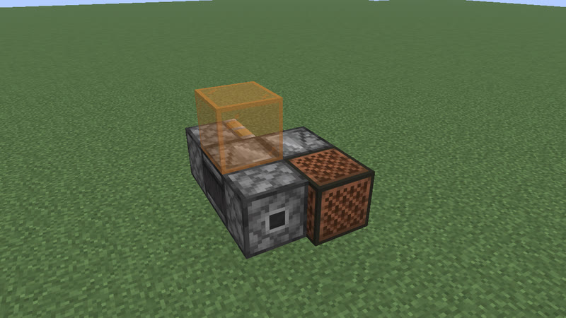

# Clocks: 4 gt (0.2 s) to 23 gt (1.15 s) (280 clock types)

[catalog index](../CATALOG.md) · next: [p24-35](p24-35.md)

Orange glass = where the output signal is (placed only for the picture); click a picture for its design. Larger clocks of a period with the same on-time and pulses as a smaller one (whatever their block kinds), and clocks that are not robust, are listed on [variants](variants.md). Generated by `mctas clock catalog`.

## 4 gt (0.2 s)

<table>
<tr><td align="center"> 4 gt (0.2 s) · observer · 4 blocks</td><td align="center"> 4 gt (0.2 s) · observer · 4 blocks</td><td align="center"> 4 gt (0.2 s) · observer+piston · 4 blocks</td></tr>
<tr><td align="center"> 4 gt (0.2 s) · observer+piston · 4 blocks</td><td align="center"> 4 gt (0.2 s) · note_block+observer+piston · 5 blocks</td><td align="center"> 4 gt (0.2 s) · note_block+observer+piston · 5 blocks</td></tr>
<tr><td align="center"><a href="../archive/clk-misc-dripleaf-stand.txt">clk-misc-dripleaf-stand</a> 4 gt (0.2 s) · armor_stand+big_dripleaf+observer+redstone_wire · 8 blocks (picture pending)</td></tr>
</table>

## 5 gt (0.25 s)

<table>
<tr><td align="center"> 5 gt (0.25 s) · observer+piston · 6 blocks</td><td align="center"> 5 gt (0.25 s) · observer+piston · 6 blocks also found as clk-obs-p5-obs-pis-stk-6b-1877b8 (built with sticky_piston)</td><td align="center"> 5 gt (0.25 s) · observer+piston+sticky_piston · 6 blocks</td></tr>
</table>

## 6 gt (0.3 s)

<table>
<tr><td align="center"> 6 gt (0.3 s) · observer · 2 blocks also found as census-p6-observer-2b, census-p6-observer-2b</td><td align="center"> 6 gt (0.3 s) · observer+piston · 3 blocks also found as census-p6-observer-sticky_piston-3b (built with sticky_piston, without piston)</td><td align="center"> 6 gt (0.3 s) · redstone_block+sticky_piston · 3 blocks</td></tr>
<tr><td align="center"> 6 gt (0.3 s) · redstone_block+sticky_piston · 4 blocks</td><td align="center"> 6 gt (0.3 s) · note_block+redstone_block+sticky_piston · 5 blocks</td><td align="center"> 6 gt (0.3 s) · redstone_block+sticky_piston · 5 blocks</td></tr>
</table>

## 7 gt (0.35 s)

<table>
<tr><td align="center"> 7 gt (0.35 s) · redstone_lamp+sticky_piston · 5 blocks</td><td align="center"> 7 gt (0.35 s) · sticky_piston · 5 blocks</td><td align="center"> 7 gt (0.35 s) · sticky_piston · 5 blocks</td></tr>
<tr><td align="center"> 7 gt (0.35 s) · redstone_lamp+sticky_piston · 5 blocks</td><td align="center"> 7 gt (0.35 s) · note_block+sticky_piston · 5 blocks</td><td align="center"> 7 gt (0.35 s) · note_block+observer+sticky_piston · 6 blocks</td></tr>
</table>

## 8 gt (0.4 s)

Also reachable by: clk-obs-obs-ring (n = 0).

<table>
<tr><td align="center"> 8 gt (0.4 s) · observer · 4 blocks</td><td align="center"> 8 gt (0.4 s) · note_block+observer+redstone_block+sticky_piston · 4 blocks</td><td align="center"> 8 gt (0.4 s) · note_block+observer+sticky_piston · 4 blocks</td></tr>
<tr><td align="center"> 8 gt (0.4 s) · note_block+observer+sticky_piston · 4 blocks</td><td align="center"> 8 gt (0.4 s) · iron_trapdoor+observer+redstone_block+sticky_piston · 4 blocks</td><td align="center"> 8 gt (0.4 s) · iron_trapdoor+observer+redstone_block+sticky_piston · 4 blocks</td></tr>
<tr><td align="center"> 8 gt (0.4 s) · observer+piston+redstone_block+sticky_piston · 4 blocks</td><td align="center"> 8 gt (0.4 s) · observer+redstone_block+sticky_piston · 4 blocks</td><td align="center"> 8 gt (0.4 s) · comparator+hopper · 4 blocks</td></tr>
<tr><td align="center"> 8 gt (0.4 s) · observer+piston+redstone_block+sticky_piston · 4 blocks</td><td align="center"> 8 gt (0.4 s) · observer+redstone_block+sticky_piston · 4 blocks</td><td align="center"> 8 gt (0.4 s) · observer+piston · 5 blocks also found as clk-obs-p8-obs-stk-5b-1a14af (built with sticky_piston, without piston)</td></tr>
<tr><td align="center"> 8 gt (0.4 s) · comparator+hopper · 7 blocks</td><td align="center"> 8 gt (0.4 s) · redstone_wire+repeater · 10 blocks</td></tr>
</table>

## 9 gt (0.45 s)

<table>
<tr><td align="center"> 9 gt (0.45 s) · copper_bulb+note_block+observer+piston · 5 blocks also found as clk-obs-p9-bulb-note-obs-stk-5b-b-b66127 (built with sticky_piston, without piston)</td><td align="center"> 9 gt (0.45 s) · note_block+observer+piston · 5 blocks also found as clk-obs-p9-note-obs-stk-5b-b-88c3da (built with sticky_piston, without piston)</td><td align="center"> 9 gt (0.45 s) · observer+piston+redstone_block+sticky_piston · 5 blocks</td></tr>
<tr><td align="center"> 9 gt (0.45 s) · observer+redstone_block+sticky_piston · 5 blocks</td><td align="center"> 9 gt (0.45 s) · piston+redstone_block · 5 blocks also found as clk-obs-p9-pis-rb-stk-5b-88a9aa (built with sticky_piston)</td><td align="center"> 9 gt (0.45 s) · observer+redstone_block+redstone_lamp+sticky_piston · 6 blocks</td></tr>
<tr><td align="center"> 9 gt (0.45 s) · observer+redstone_block+redstone_lamp+sticky_piston · 6 blocks</td><td align="center"> 9 gt (0.45 s) · note_block+observer+redstone_block+sticky_piston · 6 blocks</td><td align="center"> 9 gt (0.45 s) · note_block+observer+redstone_block+sticky_piston · 6 blocks</td></tr>
<tr><td align="center"> 9 gt (0.45 s) · comparator+hopper+redstone_wire · 8 blocks</td></tr>
</table>

## 10 gt (0.5 s)

Also reachable by: observer ring with a relay block (clk-obs-note-ring, n = 0).

<table>
<tr><td align="center"> 10 gt (0.5 s) · oak_leaves+observer+sticky_piston · 4 blocks</td><td align="center"> 10 gt (0.5 s) · observer+redstone_block+sticky_piston · 4 blocks</td><td align="center"> 10 gt (0.5 s) · observer+sticky_piston · 4 blocks</td></tr>
<tr><td align="center"> 10 gt (0.5 s) · observer+sticky_piston · 4 blocks</td><td align="center"> 10 gt (0.5 s) · observer+sticky_piston · 4 blocks</td><td align="center"> 10 gt (0.5 s) · observer+piston+sticky_piston · 4 blocks</td></tr>
<tr><td align="center"> 10 gt (0.5 s) · observer+piston+sticky_piston · 4 blocks</td><td align="center"> 10 gt (0.5 s) · oak_leaves+observer+sticky_piston · 5 blocks</td><td align="center"> 10 gt (0.5 s) · note_block+observer+redstone_block+sticky_piston · 5 blocks</td></tr>
<tr><td align="center"> 10 gt (0.5 s) · note_block+observer+sticky_piston · 5 blocks</td><td align="center"> 10 gt (0.5 s) · observer+redstone_block+sticky_piston · 5 blocks</td><td align="center"> 10 gt (0.5 s) · note_block+observer+piston+sticky_piston · 5 blocks</td></tr>
<tr><td align="center"> 10 gt (0.5 s) · observer+scaffolding+sticky_piston · 6 blocks</td><td align="center"> 10 gt (0.5 s) · iron_trapdoor+observer · 8 blocks</td><td align="center"> 10 gt (0.5 s) · comparator+redstone_torch+repeater · 8 blocks</td></tr>
<tr><td align="center"> 10 gt (0.5 s) · redstone_torch+repeater · 8 blocks</td><td align="center"> 10 gt (0.5 s) · comparator+redstone_torch+redstone_wire+repeater · 12 blocks</td><td align="center"> 10 gt (0.5 s) · redstone_torch+redstone_wire+repeater · 12 blocks</td></tr>
<tr><td align="center"> 10 gt (0.5 s) · redstone_torch+redstone_wire+repeater · 12 blocks</td></tr>
</table>

## 11 gt (0.55 s)

Also reachable by: clk-item-lockpair (n = 0), clk-obs-odd-a (n = 0).

<table>
<tr><td align="center"> 11 gt (0.55 s) · note_block+observer+piston · 6 blocks</td><td align="center"> 11 gt (0.55 s) · observer+piston · 6 blocks</td><td align="center"> 11 gt (0.55 s) · observer+piston · 6 blocks</td></tr>
<tr><td align="center"> 11 gt (0.55 s) · observer+piston+sticky_piston · 6 blocks</td><td align="center"> 11 gt (0.55 s) · observer+piston+sticky_piston · 6 blocks</td><td align="center"> 11 gt (0.55 s) · observer+sticky_piston · 6 blocks</td></tr>
<tr><td align="center"> 11 gt (0.55 s) · observer+sticky_piston · 6 blocks</td><td align="center"><a href="../archive/clk-obs-p11-obs-rb-stk-7b-fe8152.txt">clk-obs-p11-obs-rb-stk-7b-fe8152</a> 11 gt (0.55 s) · observer+redstone_block+sticky_piston · 7 blocks (picture pending)</td><td align="center"> 11 gt (0.55 s) · repeater · 16 blocks</td></tr>
</table>

## 12 gt (0.6 s)

Also reachable by: clk-obs-obs-ring (n = 1), clk-obs-divider (n = 0).

<table>
<tr><td align="center"> 12 gt (0.6 s) · copper_bulb+observer · 3 blocks</td><td align="center"> 12 gt (0.6 s) · copper_bulb+note_block+observer · 4 blocks</td><td align="center"> 12 gt (0.6 s) · observer+piston · 4 blocks</td></tr>
<tr><td align="center"> 12 gt (0.6 s) · observer+redstone_block+sticky_piston · 4 blocks</td><td align="center"> 12 gt (0.6 s) · observer+sticky_piston · 4 blocks</td><td align="center"> 12 gt (0.6 s) · copper_bulb+redstone_block+sticky_piston · 4 blocks</td></tr>
<tr><td align="center"> 12 gt (0.6 s) · observer+piston · 4 blocks</td><td align="center"> 12 gt (0.6 s) · note_block+observer+piston · 5 blocks</td><td align="center"> 12 gt (0.6 s) · redstone_block+redstone_lamp+sticky_piston · 5 blocks</td></tr>
<tr><td align="center"> 12 gt (0.6 s) · redstone_block+redstone_lamp+sticky_piston · 5 blocks</td><td align="center"> 12 gt (0.6 s) · note_block+redstone_block+sticky_piston · 5 blocks</td><td align="center"> 12 gt (0.6 s) · note_block+redstone_block+sticky_piston · 5 blocks</td></tr>
<tr><td align="center"> 12 gt (0.6 s) · redstone_block+sticky_piston · 5 blocks</td><td align="center"> 12 gt (0.6 s) · dispenser+observer+redstone_wire · 5 blocks</td><td align="center"> 12 gt (0.6 s) · comparator · 16 blocks</td></tr>
</table>

## 13 gt (0.65 s)

Also reachable by: clk-item-lockpair (n = 1), clk-obs-odd-b (n = 0).

<table>
<tr><td align="center"> 13 gt (0.65 s) · observer+piston · 4 blocks also found as clk-obs-p13-obs-pis-stk-4b-df95ac (built with sticky_piston), clk-obs-p13-obs-stk-4b-59c598 (built with sticky_piston, without piston), clk-obs-p13-obs-pis-stk-4b-b-cd9fda (built with sticky_piston)</td><td align="center"> 13 gt (0.65 s) · observer+piston · 4 blocks also found as clk-obs-p13-obs-stk-4b-b-ce4e6f (built with sticky_piston, without piston)</td><td align="center"> 13 gt (0.65 s) · note_block+observer+piston · 5 blocks also found as clk-obs-p13-note-obs-stk-5b-b-a62286 (built with sticky_piston, without piston)</td></tr>
<tr><td align="center"> 13 gt (0.65 s) · observer+piston+redstone_block+sticky_piston · 5 blocks</td><td align="center"> 13 gt (0.65 s) · observer+redstone_block+sticky_piston · 5 blocks</td><td align="center"> 13 gt (0.65 s) · observer+piston+redstone_lamp+sticky_piston · 6 blocks</td></tr>
<tr><td align="center"> 13 gt (0.65 s) · comparator+hopper+redstone_torch+redstone_wire · 9 blocks</td><td align="center"> 13 gt (0.65 s) · comparator+hopper+redstone_torch+redstone_wire · 9 blocks</td><td align="center"> 13 gt (0.65 s) · redstone_wire+repeater · 16 blocks</td></tr>
</table>

## 14 gt (0.7 s)

Also reachable by: observer ring with a relay block (clk-obs-note-ring, n = 1), hopper ring (clk-item-hopper-ring, n = 0).

<table>
<tr><td align="center"> 14 gt (0.7 s) · comparator+hopper · 4 blocks</td><td align="center"> 14 gt (0.7 s) · copper_bulb+redstone_lamp+sticky_piston · 5 blocks</td><td align="center"> 14 gt (0.7 s) · copper_bulb+sticky_piston · 5 blocks</td></tr>
<tr><td align="center"> 14 gt (0.7 s) · copper_bulb+sticky_piston · 5 blocks</td><td align="center"> 14 gt (0.7 s) · copper_bulb+redstone_lamp+sticky_piston · 5 blocks</td><td align="center"> 14 gt (0.7 s) · copper_bulb+note_block+sticky_piston · 5 blocks</td></tr>
<tr><td align="center"> 14 gt (0.7 s) · observer+piston · 5 blocks also found as clk-obs-p14-obs-pis-stk-5b-edbcf8 (built with sticky_piston)</td><td align="center"> 14 gt (0.7 s) · copper_bulb+observer+redstone_lamp · 6 blocks</td><td align="center"> 14 gt (0.7 s) · note_block+observer+redstone_lamp · 6 blocks</td></tr>
<tr><td align="center"> 14 gt (0.7 s) · observer+redstone_lamp · 6 blocks</td><td align="center"> 14 gt (0.7 s) · note_block+observer+redstone_block+redstone_lamp+sticky_piston · 6 blocks</td><td align="center"> 14 gt (0.7 s) · observer+piston+redstone_lamp+sticky_piston · 6 blocks</td></tr>
<tr><td align="center"> 14 gt (0.7 s) · redstone_torch+repeater · 8 blocks</td><td align="center"> 14 gt (0.7 s) · note_block+observer · 10 blocks</td><td align="center"> 14 gt (0.7 s) · iron_trapdoor+observer · 10 blocks</td></tr>
<tr><td align="center"> 14 gt (0.7 s) · redstone_torch+redstone_wire+repeater · 12 blocks</td></tr>
</table>

## 15 gt (0.75 s)

Also reachable by: clk-item-lockpair (n = 2), clk-obs-odd-a (n = 1).

<table>
<tr><td align="center"> 15 gt (0.75 s) · note_block+observer+piston+redstone_lamp · 5 blocks also found as clk-obs-p15-lamp-note-obs-stk-5b-b-66d58d (built with sticky_piston, without piston)</td><td align="center"> 15 gt (0.75 s) · observer+piston+redstone_lamp · 5 blocks also found as clk-obs-p15-lamp-obs-stk-5b-b-e9847b (built with sticky_piston, without piston)</td><td align="center"> 15 gt (0.75 s) · observer+piston+redstone_lamp · 5 blocks also found as clk-obs-p15-lamp-obs-stk-5b-fb17dd (built with sticky_piston, without piston)</td></tr>
<tr><td align="center"> 15 gt (0.75 s) · observer+redstone_block+sticky_piston · 5 blocks</td><td align="center"><a href="../archive/clk-obs-p15-lamp-note-obs-rb-stk-7b-e75451.txt">clk-obs-p15-lamp-note-obs-rb-stk-7b-e75451</a> 15 gt (0.75 s) · note_block+observer+redstone_block+redstone_lamp+sticky_piston · 7 blocks (picture pending)</td><td align="center"> 15 gt (0.75 s) · comparator+hopper+redstone_torch+repeater · 9 blocks</td></tr>
<tr><td align="center"> 15 gt (0.75 s) · redstone_wire+repeater · 16 blocks</td></tr>
</table>

## 16 gt (0.8 s)

Also reachable by: clk-obs-obs-ring (n = 2), clk-item-snowdisp (n = 0).

<table>
<tr><td align="center"> 16 gt (0.8 s) · copper_bulb+observer+redstone_block+sticky_piston · 4 blocks</td><td align="center"> 16 gt (0.8 s) · copper_bulb+observer · 5 blocks</td><td align="center"> 16 gt (0.8 s) · observer+piston+redstone_block+sticky_piston · 5 blocks</td></tr>
<tr><td align="center"> 16 gt (0.8 s) · observer+piston+redstone_block+sticky_piston · 5 blocks</td><td align="center"> 16 gt (0.8 s) · observer+redstone_block+sticky_piston · 5 blocks</td><td align="center"> 16 gt (0.8 s) · observer+redstone_block+sticky_piston · 5 blocks</td></tr>
<tr><td align="center"> 16 gt (0.8 s) · copper_bulb+note_block+observer+piston+redstone_block+sticky_piston · 6 blocks</td><td align="center"> 16 gt (0.8 s) · observer+redstone_block+redstone_lamp+sticky_piston · 6 blocks</td><td align="center"> 16 gt (0.8 s) · observer+redstone_block+redstone_lamp+sticky_piston · 6 blocks</td></tr>
<tr><td align="center"> 16 gt (0.8 s) · redstone_torch+repeater · 8 blocks</td><td align="center"> 16 gt (0.8 s) · comparator+redstone_torch+repeater · 12 blocks</td><td align="center"><a href="../archive/clk-misc-bubble-flip.txt">clk-misc-bubble-flip</a> 16 gt (0.8 s) · bubble_column+observer+redstone_wire+sticky_piston · 12 blocks (picture pending)</td></tr>
</table>

## 17 gt (0.85 s)

Also reachable by: clk-obs-odd-b (n = 1).

<table>
<tr><td align="center"> 17 gt (0.85 s) · observer+piston+sticky_piston · 5 blocks</td><td align="center"> 17 gt (0.85 s) · observer+piston+sticky_piston · 5 blocks</td><td align="center"> 17 gt (0.85 s) · observer+sticky_piston · 5 blocks</td></tr>
<tr><td align="center"> 17 gt (0.85 s) · observer+sticky_piston · 5 blocks</td><td align="center"> 17 gt (0.85 s) · observer+sticky_piston · 5 blocks</td><td align="center"> 17 gt (0.85 s) · note_block+observer+redstone_block+sticky_piston · 6 blocks</td></tr>
<tr><td align="center"> 17 gt (0.85 s) · note_block+observer+sticky_piston · 6 blocks</td><td align="center"> 17 gt (0.85 s) · observer+piston+redstone_block+sticky_piston · 6 blocks</td><td align="center"> 17 gt (0.85 s) · observer+redstone_block+sticky_piston · 6 blocks</td></tr>
<tr><td align="center"> 17 gt (0.85 s) · note_block+observer+piston+redstone_block+sticky_piston · 6 blocks</td><td align="center"> 17 gt (0.85 s) · note_block+observer+piston+sticky_piston · 6 blocks</td><td align="center"> 17 gt (0.85 s) · comparator+hopper+redstone_torch+repeater · 9 blocks</td></tr>
<tr><td align="center"> 17 gt (0.85 s) · redstone_wire+repeater · 16 blocks</td></tr>
</table>

## 18 gt (0.9 s)

Also reachable by: observer ring with a relay block (clk-obs-note-ring, n = 2).

<table>
<tr><td align="center"> 18 gt (0.9 s) · observer+sticky_piston · 4 blocks</td><td align="center"> 18 gt (0.9 s) · observer+sticky_piston · 4 blocks</td><td align="center"> 18 gt (0.9 s) · note_block+observer+piston+redstone_lamp · 5 blocks also found as clk-obs-p18-lamp-note-obs-stk-5b-b49e8b (built with sticky_piston, without piston)</td></tr>
<tr><td align="center"> 18 gt (0.9 s) · observer+piston+redstone_lamp · 5 blocks also found as clk-obs-p18-lamp-obs-stk-5b-2a94b8 (built with sticky_piston, without piston)</td><td align="center"> 18 gt (0.9 s) · observer+piston+redstone_lamp · 5 blocks also found as clk-obs-p18-lamp-obs-stk-5b-b-62783f (built with sticky_piston, without piston)</td><td align="center"> 18 gt (0.9 s) · note_block+observer+sticky_piston · 5 blocks</td></tr>
<tr><td align="center"> 18 gt (0.9 s) · note_block+observer+sticky_piston · 5 blocks</td><td align="center"> 18 gt (0.9 s) · note_block+observer+piston+redstone_lamp · 5 blocks also found as clk-obs-p18-lamp-note-obs-stk-5b-b-b9dcbb (built with sticky_piston, without piston)</td><td align="center"> 18 gt (0.9 s) · observer+piston+sticky_piston · 5 blocks</td></tr>
<tr><td align="center"> 18 gt (0.9 s) · observer+redstone_block+sticky_piston · 6 blocks</td><td align="center"><a href="../archive/clk-obs-p18-rb-stk-6b-762e50.txt">clk-obs-p18-rb-stk-6b-762e50</a> 18 gt (0.9 s) · redstone_block+sticky_piston · 6 blocks (picture pending)</td><td align="center"> 18 gt (0.9 s) · oak_leaves+observer+sticky_piston · 8 blocks</td></tr>
<tr><td align="center"> 18 gt (0.9 s) · redstone_torch+repeater · 8 blocks</td><td align="center"> 18 gt (0.9 s) · comparator+hopper+redstone_wire+repeater · 9 blocks</td><td align="center"> 18 gt (0.9 s) · comparator+redstone_torch+repeater · 12 blocks</td></tr>
<tr><td align="center"> 18 gt (0.9 s) · redstone_torch+redstone_wire+repeater · 12 blocks</td></tr>
</table>

## 19 gt (0.95 s)

Also reachable by: clk-obs-odd-a (n = 2).

<table>
<tr><td align="center"> 19 gt (0.95 s) · observer+piston+sticky_piston · 6 blocks</td><td align="center"> 19 gt (0.95 s) · observer+piston+sticky_piston · 6 blocks</td><td align="center"> 19 gt (0.95 s) · observer+sticky_piston · 6 blocks</td></tr>
<tr><td align="center"> 19 gt (0.95 s) · observer+sticky_piston · 6 blocks</td><td align="center"> 19 gt (0.95 s) · observer+sticky_piston · 6 blocks</td><td align="center"> 19 gt (0.95 s) · copper_bulb+observer+piston+sticky_piston · 6 blocks</td></tr>
<tr><td align="center"> 19 gt (0.95 s) · copper_bulb+observer+sticky_piston · 6 blocks</td><td align="center"> 19 gt (0.95 s) · observer+piston+redstone_lamp+sticky_piston · 6 blocks</td><td align="center"> 19 gt (0.95 s) · observer+redstone_lamp+sticky_piston · 6 blocks</td></tr>
<tr><td align="center"> 19 gt (0.95 s) · note_block+observer+piston+sticky_piston · 6 blocks</td><td align="center"> 19 gt (0.95 s) · note_block+observer+piston+sticky_piston · 6 blocks</td><td align="center"> 19 gt (0.95 s) · note_block+observer+sticky_piston · 6 blocks</td></tr>
<tr><td align="center"> 19 gt (0.95 s) · note_block+observer+sticky_piston · 6 blocks</td><td align="center"> 19 gt (0.95 s) · observer+piston+redstone_block+sticky_piston · 7 blocks</td><td align="center"><a href="../archive/clk-obs-p19-lamp-obs-pis-rb-stk-8b-f3f7f2.txt">clk-obs-p19-lamp-obs-pis-rb-stk-8b-f3f7f2</a> 19 gt (0.95 s) · observer+piston+redstone_block+redstone_lamp+sticky_piston · 8 blocks (picture pending)</td></tr>
<tr><td align="center"> 19 gt (0.95 s) · comparator+dropper+hopper+repeater · 14 blocks</td><td align="center"> 19 gt (0.95 s) · redstone_wire+repeater · 16 blocks</td></tr>
</table>

## 20 gt (1 s)

Also reachable by: clk-obs-obs-ring (n = 3), clk-item-snowdisp (n = 1), clk-obs-bulb-ring (n = 0), clk-rt-uloop2t (n = 0).

<table>
<tr><td align="center"> 20 gt (1 s) · observer+piston+redstone_lamp · 5 blocks also found as clk-obs-p20-lamp-obs-stk-5b-5df641 (built with sticky_piston, without piston)</td><td align="center"> 20 gt (1 s) · observer+redstone_block+sticky_piston · 5 blocks</td><td align="center"> 20 gt (1 s) · observer+sticky_piston · 5 blocks</td></tr>
<tr><td align="center"> 20 gt (1 s) · observer+sticky_piston · 5 blocks</td><td align="center"> 20 gt (1 s) · copper_bulb+observer+redstone_block+sticky_piston · 5 blocks</td><td align="center"> 20 gt (1 s) · observer+piston+redstone_lamp · 5 blocks also found as clk-obs-p20-lamp-obs-stk-5b-b-b200e9 (built with sticky_piston, without piston)</td></tr>
<tr><td align="center"> 20 gt (1 s) · observer+piston+sticky_piston · 5 blocks</td><td align="center"> 20 gt (1 s) · observer+redstone_block+sticky_piston · 5 blocks</td><td align="center"> 20 gt (1 s) · copper_bulb+observer+redstone_block+sticky_piston · 5 blocks</td></tr>
<tr><td align="center"> 20 gt (1 s) · observer+piston+sticky_piston · 5 blocks</td><td align="center"> 20 gt (1 s) · observer+redstone_lamp · 6 blocks</td><td align="center"> 20 gt (1 s) · copper_bulb+note_block+observer+redstone_block+sticky_piston · 6 blocks</td></tr>
<tr><td align="center"> 20 gt (1 s) · note_block+observer+piston+redstone_lamp · 6 blocks</td><td align="center"> 20 gt (1 s) · note_block+observer+redstone_block+sticky_piston · 6 blocks</td><td align="center"> 20 gt (1 s) · note_block+observer+sticky_piston · 6 blocks</td></tr>
<tr><td align="center"> 20 gt (1 s) · observer+redstone_block+redstone_lamp+sticky_piston · 6 blocks</td><td align="center"><a href="../archive/clk-obs-p20-lamp-note-obs-rb-stk-7b-6210cc.txt">clk-obs-p20-lamp-note-obs-rb-stk-7b-6210cc</a> 20 gt (1 s) · note_block+observer+redstone_block+redstone_lamp+sticky_piston · 7 blocks (picture pending)</td><td align="center"><a href="../archive/clk-obs-p20-lamp-obs-pis-rb-stk-7b-60e89a.txt">clk-obs-p20-lamp-obs-pis-rb-stk-7b-60e89a</a> 20 gt (1 s) · observer+piston+redstone_block+redstone_lamp+sticky_piston · 7 blocks (picture pending)</td></tr>
<tr><td align="center"> 20 gt (1 s) · comparator+redstone_torch+redstone_wire+repeater · 9 blocks</td><td align="center"> 20 gt (1 s) · redstone_torch+redstone_wire+repeater · 9 blocks</td><td align="center"> 20 gt (1 s) · comparator+hopper+redstone_torch+repeater · 9 blocks</td></tr>
<tr><td align="center"> 20 gt (1 s) · oak_leaves+observer+sticky_piston · 9 blocks</td><td align="center"> 20 gt (1 s) · comparator+dropper+hopper · 10 blocks</td><td align="center"> 20 gt (1 s) · comparator+redstone_torch+repeater · 12 blocks</td></tr>
<tr><td align="center"> 20 gt (1 s) · repeater · 12 blocks</td></tr>
</table>

## 21 gt (1.05 s)

Also reachable by: clk-obs-odd-b (n = 2), hopper ring (clk-item-hopper-ring-2, n = 2).

<table>
<tr><td align="center"> 21 gt (1.05 s) · calibrated_sculk_sensor+dispenser+observer · 5 blocks</td><td align="center"> 21 gt (1.05 s) · calibrated_sculk_sensor+dispenser+observer · 5 blocks</td><td align="center"> 21 gt (1.05 s) · calibrated_sculk_sensor+dispenser+observer+sticky_piston · 5 blocks</td></tr>
<tr><td align="center"> 21 gt (1.05 s) · calibrated_sculk_sensor+note_block+observer+sticky_piston · 5 blocks</td><td align="center"> 21 gt (1.05 s) · calibrated_sculk_sensor+oak_trapdoor+observer+sticky_piston · 5 blocks</td><td align="center"> 21 gt (1.05 s) · calibrated_sculk_sensor+observer+piston+sticky_piston · 5 blocks</td></tr>
<tr><td align="center"> 21 gt (1.05 s) · calibrated_sculk_sensor+observer+sticky_piston · 5 blocks</td><td align="center"><a href="../archive/census-p21-calibrated_sculk_sensor-dispenser-note_block-observer-6b.txt">census-p21-calibrated_sculk_sensor-dispenser-note_block-observer-6b</a> 21 gt (1.05 s) · calibrated_sculk_sensor+dispenser+note_block+observer · 6 blocks (picture pending)</td><td align="center"><a href="../archive/census-p21-calibrated_sculk_sensor-dispenser-oak_trapdoor-observer-6b.txt">census-p21-calibrated_sculk_sensor-dispenser-oak_trapdoor-observer-6b</a> 21 gt (1.05 s) · calibrated_sculk_sensor+dispenser+oak_trapdoor+observer · 6 blocks (picture pending)</td></tr>
<tr><td align="center"><a href="../archive/census-p21-calibrated_sculk_sensor-dispenser-note_block-observer-sticky_piston-6b.txt">census-p21-calibrated_sculk_sensor-dispenser-note_block-observer-sticky_piston-6b</a> 21 gt (1.05 s) · calibrated_sculk_sensor+dispenser+note_block+observer+sticky_piston · 6 blocks (picture pending)</td><td align="center"><a href="../archive/census-p21-calibrated_sculk_sensor-dispenser-oak_trapdoor-observer-sticky_piston-6b.txt">census-p21-calibrated_sculk_sensor-dispenser-oak_trapdoor-observer-sticky_piston-6b</a> 21 gt (1.05 s) · calibrated_sculk_sensor+dispenser+oak_trapdoor+observer+sticky_piston · 6 blocks (picture pending)</td><td align="center"><a href="../archive/census-p21-calibrated_sculk_sensor-dispenser-observer-piston-sticky_piston-6b.txt">census-p21-calibrated_sculk_sensor-dispenser-observer-piston-sticky_piston-6b</a> 21 gt (1.05 s) · calibrated_sculk_sensor+dispenser+observer+piston+sticky_piston · 6 blocks (picture pending)</td></tr>
<tr><td align="center"><a href="../archive/census-p21-calibrated_sculk_sensor-note_block-observer-piston-sticky_piston-6b.txt">census-p21-calibrated_sculk_sensor-note_block-observer-piston-sticky_piston-6b</a> 21 gt (1.05 s) · calibrated_sculk_sensor+note_block+observer+piston+sticky_piston · 6 blocks (picture pending)</td><td align="center"><a href="../archive/census-p21-calibrated_sculk_sensor-oak_trapdoor-observer-piston-sticky_piston-6b.txt">census-p21-calibrated_sculk_sensor-oak_trapdoor-observer-piston-sticky_piston-6b</a> 21 gt (1.05 s) · calibrated_sculk_sensor+oak_trapdoor+observer+piston+sticky_piston · 6 blocks (picture pending)</td><td align="center"><a href="../archive/census-p21-calibrated_sculk_sensor-observer-piston-6b.txt">census-p21-calibrated_sculk_sensor-observer-piston-6b</a> 21 gt (1.05 s) · calibrated_sculk_sensor+observer+piston · 6 blocks (picture pending)</td></tr>
<tr><td align="center"> 21 gt (1.05 s) · calibrated_sculk_sensor+note_block+redstone_torch+repeater · 6 blocks</td><td align="center"><a href="../archive/clk-obs-p21-lamp-note-obs-pis-7b-f20367.txt">clk-obs-p21-lamp-note-obs-pis-7b-f20367</a> 21 gt (1.05 s) · note_block+observer+piston+redstone_lamp · 7 blocks (picture pending)</td><td align="center"><a href="../archive/clk-obs-p21-lamp-obs-pis-7b-dd426e.txt">clk-obs-p21-lamp-obs-pis-7b-dd426e</a> 21 gt (1.05 s) · observer+piston+redstone_lamp · 7 blocks (picture pending)</td></tr>
<tr><td align="center"><a href="../archive/clk-obs-p21-note-obs-pis-7b-ba527d.txt">clk-obs-p21-note-obs-pis-7b-ba527d</a> 21 gt (1.05 s) · note_block+observer+piston · 7 blocks (picture pending)</td><td align="center"><a href="../archive/clk-obs-p21-obs-pis-7b-064bf3.txt">clk-obs-p21-obs-pis-7b-064bf3</a> 21 gt (1.05 s) · observer+piston · 7 blocks (picture pending)</td><td align="center"> 21 gt (1.05 s) · note_block+observer+sticky_piston · 7 blocks</td></tr>
<tr><td align="center"> 21 gt (1.05 s) · observer+redstone_lamp+sticky_piston · 7 blocks</td><td align="center"> 21 gt (1.05 s) · calibrated_sculk_sensor+piston+redstone_wire+repeater · 10 blocks</td><td align="center"> 21 gt (1.05 s) · comparator+dropper+hopper+repeater · 14 blocks</td></tr>
<tr><td align="center"> 21 gt (1.05 s) · repeater · 16 blocks</td></tr>
</table>

## 22 gt (1.1 s)

Also reachable by: observer ring with a relay block (clk-obs-note-ring, n = 3).

<table>
<tr><td align="center"> 22 gt (1.1 s) · calibrated_sculk_sensor+oak_trapdoor+observer+repeater · 5 blocks</td><td align="center"> 22 gt (1.1 s) · calibrated_sculk_sensor+oak_trapdoor+observer+sticky_piston · 5 blocks</td><td align="center"> 22 gt (1.1 s) · calibrated_sculk_sensor+observer+piston+sticky_piston · 5 blocks</td></tr>
<tr><td align="center"> 22 gt (1.1 s) · calibrated_sculk_sensor+observer+sticky_piston · 5 blocks</td><td align="center"> 22 gt (1.1 s) · calibrated_sculk_sensor+oak_fence_gate+observer+sticky_piston · 5 blocks</td><td align="center"> 22 gt (1.1 s) · calibrated_sculk_sensor+iron_trapdoor+observer+sticky_piston · 5 blocks</td></tr>
<tr><td align="center"> 22 gt (1.1 s) · calibrated_sculk_sensor+note_block+observer+repeater · 5 blocks</td><td align="center"> 22 gt (1.1 s) · calibrated_sculk_sensor+dispenser+observer+repeater · 5 blocks</td><td align="center"> 22 gt (1.1 s) · calibrated_sculk_sensor+dispenser+observer · 5 blocks</td></tr>
<tr><td align="center"> 22 gt (1.1 s) · calibrated_sculk_sensor+dispenser+observer+sticky_piston · 5 blocks</td><td align="center"> 22 gt (1.1 s) · calibrated_sculk_sensor+iron_trapdoor+observer · 6 blocks</td><td align="center"> 22 gt (1.1 s) · calibrated_sculk_sensor+oak_fence_gate+observer · 6 blocks</td></tr>
<tr><td align="center"> 22 gt (1.1 s) · calibrated_sculk_sensor+oak_trapdoor+observer · 6 blocks</td><td align="center"> 22 gt (1.1 s) · observer+piston+redstone_lamp+sticky_piston · 6 blocks</td><td align="center"> 22 gt (1.1 s) · note_block+observer+piston+sticky_piston · 6 blocks</td></tr>
<tr><td align="center"> 22 gt (1.1 s) · note_block+observer+piston+sticky_piston · 6 blocks</td><td align="center"> 22 gt (1.1 s) · observer+piston+sticky_piston · 6 blocks</td><td align="center"> 22 gt (1.1 s) · observer+redstone_block+redstone_lamp+sticky_piston · 6 blocks</td></tr>
<tr><td align="center"> 22 gt (1.1 s) · observer+sticky_piston · 6 blocks</td><td align="center"><a href="../archive/clk-obs-p22-bulb-lamp-obs-rb-stk-8b-c7fd5f.txt">clk-obs-p22-bulb-lamp-obs-rb-stk-8b-c7fd5f</a> 22 gt (1.1 s) · copper_bulb+observer+redstone_block+redstone_lamp+sticky_piston · 8 blocks (picture pending)</td><td align="center"><a href="../archive/clk-obs-p22-bulb-note-obs-rb-stk-8b-220e3b.txt">clk-obs-p22-bulb-note-obs-rb-stk-8b-220e3b</a> 22 gt (1.1 s) · copper_bulb+note_block+observer+redstone_block+sticky_piston · 8 blocks (picture pending)</td></tr>
<tr><td align="center"><a href="../archive/clk-obs-p22-lamp-note-obs-rb-stk-8b-c72166.txt">clk-obs-p22-lamp-note-obs-rb-stk-8b-c72166</a> 22 gt (1.1 s) · note_block+observer+redstone_block+redstone_lamp+sticky_piston · 8 blocks (picture pending)</td><td align="center"> 22 gt (1.1 s) · comparator+redstone_torch+repeater · 12 blocks</td><td align="center"> 22 gt (1.1 s) · comparator+redstone_torch+redstone_wire+repeater · 12 blocks</td></tr>
<tr><td align="center"> 22 gt (1.1 s) · redstone_torch+repeater · 12 blocks</td><td align="center"> 22 gt (1.1 s) · redstone_torch+redstone_wire+repeater · 12 blocks</td><td align="center"> 22 gt (1.1 s) · comparator+repeater · 12 blocks</td></tr>
<tr><td align="center"> 22 gt (1.1 s) · repeater · 12 blocks</td><td align="center"> 22 gt (1.1 s) · comparator+dropper+hopper+repeater · 18 blocks</td></tr>
</table>

## 23 gt (1.15 s)

Also reachable by: clk-obs-odd-a (n = 3), clk-rt-odd-rect (n = 0), clk-sculk-hairpin-dispenser (n = 1).

<table>
<tr><td align="center"> 23 gt (1.15 s) · calibrated_sculk_sensor+dispenser+observer+piston · 4 blocks also found as census-p23-calibrated_sculk_sensor-dispenser-observer-sticky_piston-4b (built with sticky_piston, without piston)</td><td align="center"> 23 gt (1.15 s) · calibrated_sculk_sensor+note_block+observer+piston · 4 blocks also found as census-p23-calibrated_sculk_sensor-note_block-observer-sticky_piston-4b (built with sticky_piston, without piston)</td><td align="center"> 23 gt (1.15 s) · calibrated_sculk_sensor+dispenser+observer · 5 blocks</td></tr>
<tr><td align="center"> 23 gt (1.15 s) · calibrated_sculk_sensor+note_block+observer+repeater · 5 blocks</td><td align="center"> 23 gt (1.15 s) · observer+piston+sticky_piston · 5 blocks</td><td align="center"> 23 gt (1.15 s) · observer+piston+sticky_piston · 5 blocks</td></tr>
<tr><td align="center"> 23 gt (1.15 s) · observer+sticky_piston · 5 blocks</td><td align="center"> 23 gt (1.15 s) · calibrated_sculk_sensor+oak_trapdoor+observer+sticky_piston · 5 blocks</td><td align="center"> 23 gt (1.15 s) · calibrated_sculk_sensor+observer+piston+sticky_piston · 5 blocks</td></tr>
<tr><td align="center"> 23 gt (1.15 s) · calibrated_sculk_sensor+observer+sticky_piston · 5 blocks</td><td align="center"> 23 gt (1.15 s) · calibrated_sculk_sensor+dispenser+observer+repeater · 5 blocks</td><td align="center"> 23 gt (1.15 s) · observer+sticky_piston · 5 blocks</td></tr>
<tr><td align="center"> 23 gt (1.15 s) · calibrated_sculk_sensor+observer+piston · 5 blocks</td><td align="center"> 23 gt (1.15 s) · calibrated_sculk_sensor+iron_trapdoor+observer+sticky_piston · 5 blocks</td><td align="center"> 23 gt (1.15 s) · calibrated_sculk_sensor+oak_fence_gate+observer+sticky_piston · 5 blocks</td></tr>
<tr><td align="center"><a href="../archive/census-p23-calibrated_sculk_sensor-dispenser-note_block-observer-piston-6b.txt">census-p23-calibrated_sculk_sensor-dispenser-note_block-observer-piston-6b</a> 23 gt (1.15 s) · calibrated_sculk_sensor+dispenser+note_block+observer+piston · 6 blocks (picture pending) also found as census-p23-calibrated_sculk_sensor-dispenser-note_block-observer-sticky_piston-6b (built with sticky_piston, without piston)</td><td align="center"> 23 gt (1.15 s) · calibrated_sculk_sensor+iron_trapdoor+observer · 6 blocks</td><td align="center"> 23 gt (1.15 s) · calibrated_sculk_sensor+oak_fence_gate+observer · 6 blocks</td></tr>
<tr><td align="center"> 23 gt (1.15 s) · calibrated_sculk_sensor+oak_trapdoor+observer · 6 blocks</td><td align="center"> 23 gt (1.15 s) · observer+piston+redstone_lamp+sticky_piston · 7 blocks</td><td align="center"> 23 gt (1.15 s) · comparator+dropper+hopper · 10 blocks</td></tr>
<tr><td align="center"> 23 gt (1.15 s) · redstone_wire+repeater · 18 blocks</td></tr>
</table>

[catalog index](../CATALOG.md) · next: [p24-35](p24-35.md)
