# Clocks: 4 gt (0.2 s) to 26 gt (1.3 s) (299 clock types)

[catalog index](../CATALOG.md) · next: [p27-50](p27-50.md)

Orange glass = where the output signal is (placed only for the picture); click a picture for its design. Larger clocks of a period with the same on-time and pulses as a smaller one (whatever their block kinds), and clocks that are not robust, are listed on [variants](variants.md). Generated by `mctas clock catalog`.

## 4 gt (0.2 s)

<table>
<tr><td align="center"> 4 gt (0.2 s) · observer · 4 blocks</td><td align="center"> 4 gt (0.2 s) · observer · 4 blocks</td><td align="center"> 4 gt (0.2 s) · observer+piston · 4 blocks</td></tr>
<tr><td align="center"> 4 gt (0.2 s) · observer+piston · 4 blocks</td><td align="center"><a href="../archive/clk-obs-p4-note-obs-pis-5b-b-ae3ce6.txt">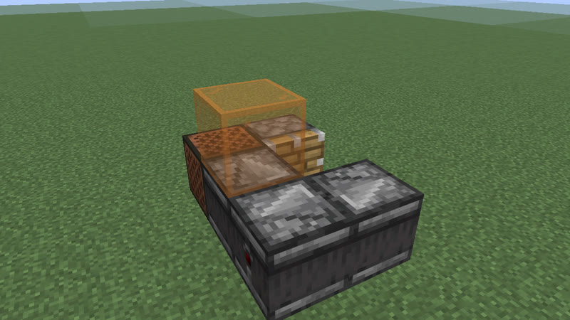</a> 4 gt (0.2 s) · note_block+observer+piston · 5 blocks</td><td align="center"> 4 gt (0.2 s) · note_block+observer+piston · 5 blocks</td></tr>
</table>

## 5 gt (0.25 s)

<table>
<tr><td align="center"> 5 gt (0.25 s) · observer+piston · 6 blocks</td><td align="center"> 5 gt (0.25 s) · observer+piston · 6 blocks also found as clk-obs-p5-obs-pis-stk-6b-1877b8 (built with sticky_piston)</td><td align="center"> 5 gt (0.25 s) · observer+piston+sticky_piston · 6 blocks</td></tr>
</table>

## 6 gt (0.3 s)

<table>
<tr><td align="center"> 6 gt (0.3 s) · observer · 2 blocks also found as census-p6-observer-2b, census-p6-observer-2b</td><td align="center"> 6 gt (0.3 s) · redstone_block+sticky_piston · 3 blocks</td><td align="center"><a href="../archive/census-p6-redstone_block-sticky_piston-4b.txt">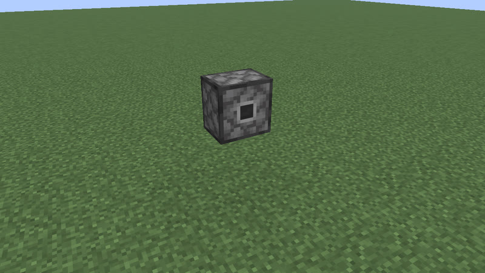</a> 6 gt (0.3 s) · redstone_block+sticky_piston · 4 blocks</td></tr>
<tr><td align="center"> 6 gt (0.3 s) · redstone_wire+repeater · 13 blocks</td></tr>
</table>

## 7 gt (0.35 s)

<table>
<tr><td align="center"><a href="../archive/clk-obs-p7-note-obs-stk-6b-301916.txt">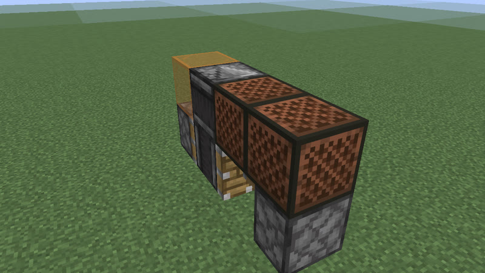</a> 7 gt (0.35 s) · note_block+observer+sticky_piston · 6 blocks</td></tr>
</table>

## 8 gt (0.4 s)

Also reachable by: clk-obs-obs-ring (n = 0).

<table>
<tr><td align="center"> 8 gt (0.4 s) · observer · 4 blocks</td><td align="center"> 8 gt (0.4 s) · note_block+observer+redstone_block+sticky_piston · 4 blocks</td><td align="center"> 8 gt (0.4 s) · note_block+observer+sticky_piston · 4 blocks</td></tr>
<tr><td align="center"> 8 gt (0.4 s) · note_block+observer+sticky_piston · 4 blocks</td><td align="center"> 8 gt (0.4 s) · iron_trapdoor+observer+redstone_block+sticky_piston · 4 blocks</td><td align="center"> 8 gt (0.4 s) · iron_trapdoor+observer+redstone_block+sticky_piston · 4 blocks</td></tr>
<tr><td align="center"> 8 gt (0.4 s) · observer+piston+redstone_block+sticky_piston · 4 blocks</td><td align="center"> 8 gt (0.4 s) · observer+redstone_block+sticky_piston · 4 blocks</td><td align="center"> 8 gt (0.4 s) · observer+piston+redstone_block+sticky_piston · 4 blocks</td></tr>
<tr><td align="center"> 8 gt (0.4 s) · observer+redstone_block+sticky_piston · 4 blocks</td><td align="center"><a href="../archive/clk-obs-p8-obs-pis-5b-8c0c98.txt">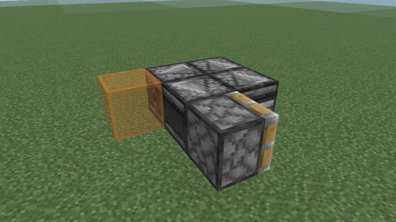</a> 8 gt (0.4 s) · observer+piston · 5 blocks also found as clk-obs-p8-obs-stk-5b-1a14af (built with sticky_piston, without piston)</td><td align="center"><a href="../archive/clk-obs-p8-lamp-note-obs-rb-stk-6b-f3f3b3.txt">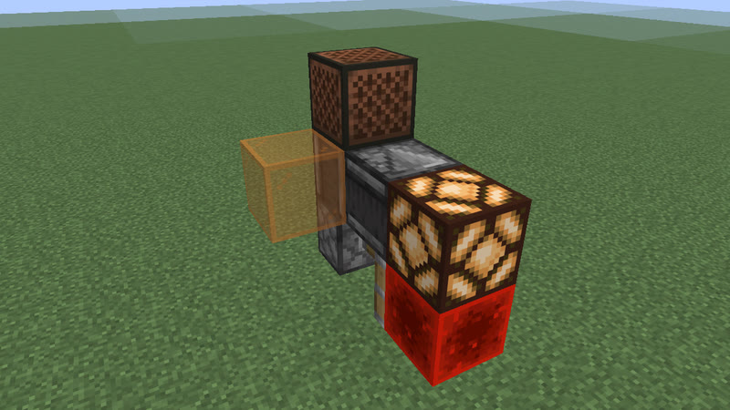</a> 8 gt (0.4 s) · note_block+observer+redstone_block+redstone_lamp+sticky_piston · 6 blocks</td></tr>
<tr><td align="center"><a href="../archive/clk-obs-p8-lamp-obs-rb-stk-6b-b-d4e252.txt">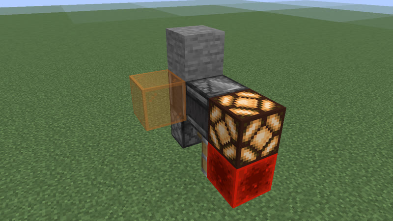</a> 8 gt (0.4 s) · observer+redstone_block+redstone_lamp+sticky_piston · 6 blocks</td><td align="center"><a href="../archive/clk-obs-p8-lamp-obs-rb-stk-6b-b63bb5.txt">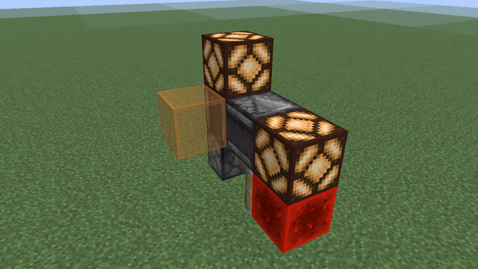</a> 8 gt (0.4 s) · observer+redstone_block+redstone_lamp+sticky_piston · 6 blocks</td><td align="center"><a href="../archive/hop2x3sub-p8.txt">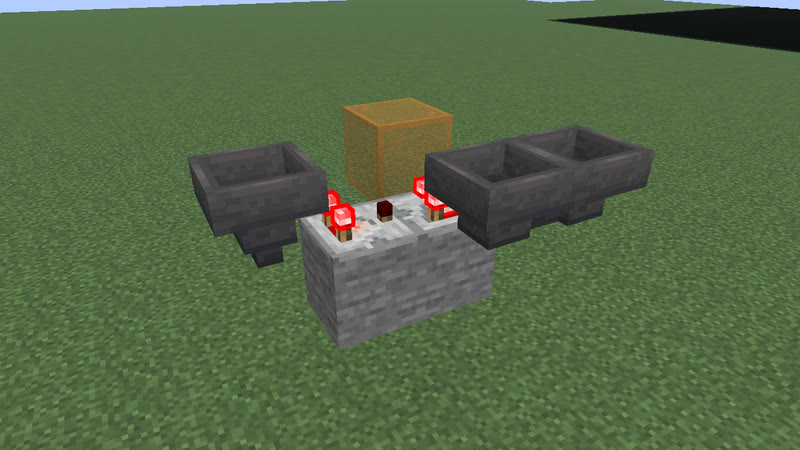</a> 8 gt (0.4 s) · comparator+hopper · 7 blocks</td></tr>
</table>

## 9 gt (0.45 s)

<table>
<tr><td align="center"> 9 gt (0.45 s) · observer+piston+redstone_block+sticky_piston · 5 blocks</td><td align="center"> 9 gt (0.45 s) · observer+piston+redstone_block+sticky_piston · 5 blocks</td><td align="center"> 9 gt (0.45 s) · observer+redstone_block+sticky_piston · 5 blocks</td></tr>
<tr><td align="center"> 9 gt (0.45 s) · observer+redstone_block+sticky_piston · 5 blocks</td><td align="center"> 9 gt (0.45 s) · piston+redstone_block · 5 blocks also found as clk-obs-p9-pis-rb-stk-5b-88a9aa (built with sticky_piston)</td><td align="center"><a href="../archive/clk-obs-p9-lamp-note-obs-pis-stk-7b-65b648.txt">clk-obs-p9-lamp-note-obs-pis-stk-7b-65b648</a> 9 gt (0.45 s) · note_block+observer+piston+redstone_lamp+sticky_piston · 7 blocks (picture pending)</td></tr>
<tr><td align="center"><a href="../archive/clk-obs-p9-lamp-obs-pis-stk-7b-f22814.txt">clk-obs-p9-lamp-obs-pis-stk-7b-f22814</a> 9 gt (0.45 s) · observer+piston+redstone_lamp+sticky_piston · 7 blocks (picture pending)</td><td align="center"><a href="../archive/clk-obs-p9-lamp-obs-stk-7b-073d1e.txt">clk-obs-p9-lamp-obs-stk-7b-073d1e</a> 9 gt (0.45 s) · observer+redstone_lamp+sticky_piston · 7 blocks (picture pending)</td><td align="center"><a href="../archive/clk-obs-p9-bulb-note-obs-rb-stk-7b-c5332f.txt">clk-obs-p9-bulb-note-obs-rb-stk-7b-c5332f</a> 9 gt (0.45 s) · copper_bulb+note_block+observer+redstone_block+sticky_piston · 7 blocks (picture pending)</td></tr>
</table>

## 10 gt (0.5 s)

Also reachable by: observer ring with a relay block (clk-obs-note-ring, n = 0).

<table>
<tr><td align="center"> 10 gt (0.5 s) · oak_leaves+observer+sticky_piston · 4 blocks</td><td align="center"> 10 gt (0.5 s) · observer+redstone_block+sticky_piston · 4 blocks</td><td align="center"><a href="../archive/clk-misc-p10-oak_leaves-obs-stk-5b-c-2577c8.txt">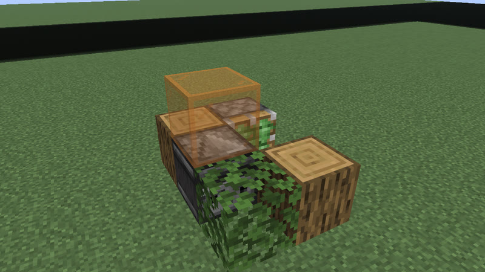</a> 10 gt (0.5 s) · oak_leaves+observer+sticky_piston · 5 blocks</td></tr>
<tr><td align="center"><a href="../archive/clk-obs-p10-note-obs-rb-stk-5b-4a9db2.txt">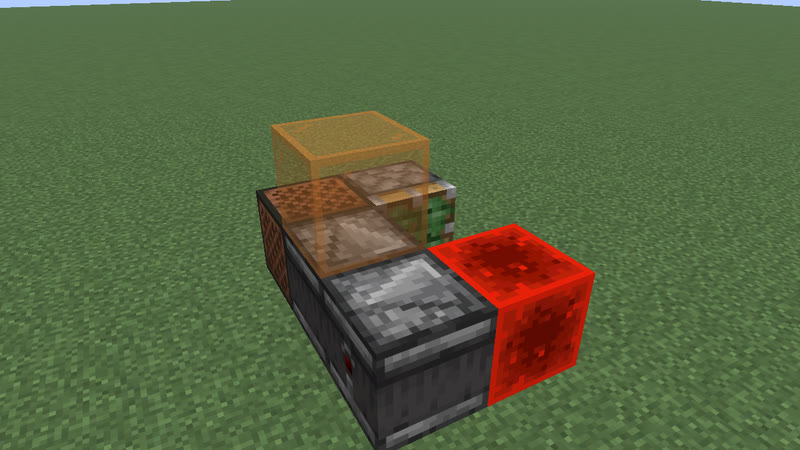</a> 10 gt (0.5 s) · note_block+observer+redstone_block+sticky_piston · 5 blocks</td><td align="center"><a href="../archive/clk-obs-p10-obs-rb-stk-5b-b-09c5ce.txt">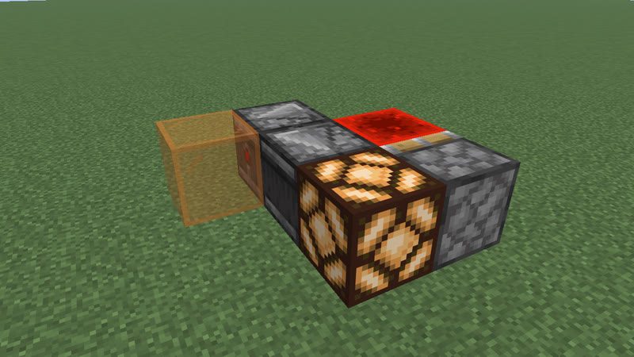</a> 10 gt (0.5 s) · observer+redstone_block+sticky_piston · 5 blocks</td><td align="center"><a href="../archive/clk-obs-p10-obs-pis-rb-stk-6b-9d3af0.txt">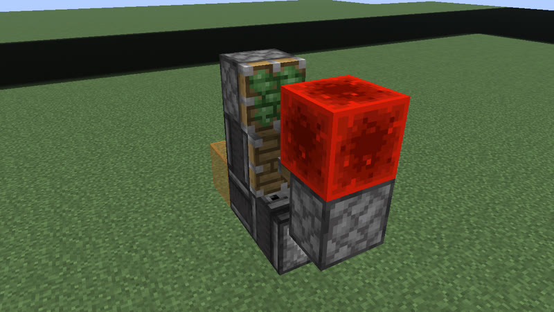</a> 10 gt (0.5 s) · observer+piston+redstone_block+sticky_piston · 6 blocks</td></tr>
<tr><td align="center"><a href="../archive/clk-obs-p10-lamp-note-obs-stk-7b-694425.txt">clk-obs-p10-lamp-note-obs-stk-7b-694425</a> 10 gt (0.5 s) · note_block+observer+redstone_lamp+sticky_piston · 7 blocks (picture pending)</td><td align="center"><a href="../archive/clk-obs-p10-bulb-note-obs-rb-stk-7b-6c7e1f.txt">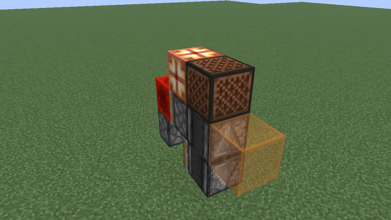</a> 10 gt (0.5 s) · copper_bulb+note_block+observer+redstone_block+sticky_piston · 7 blocks</td><td align="center"><a href="../archive/clk-obs-p10-bulb-obs-rb-stk-7b-628528.txt">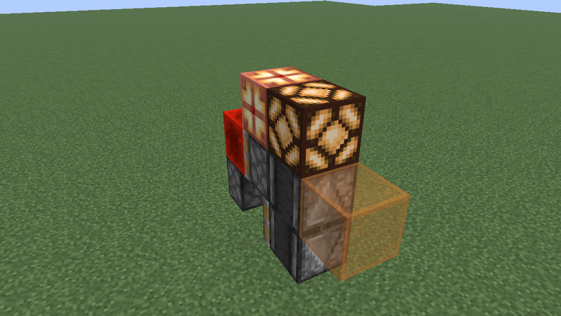</a> 10 gt (0.5 s) · copper_bulb+observer+redstone_block+sticky_piston · 7 blocks</td></tr>
<tr><td align="center"><a href="../archive/clk-obs-p10-bulb-obs-rb-stk-7b-b-702582.txt">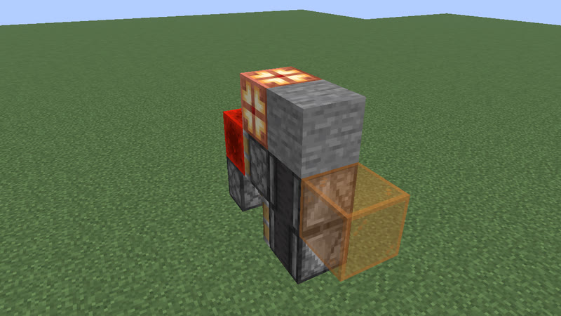</a> 10 gt (0.5 s) · copper_bulb+observer+redstone_block+sticky_piston · 7 blocks</td><td align="center"><a href="../archive/clk-obs-p10-note-obs-pis-rb-stk-7b-b-4aa047.txt">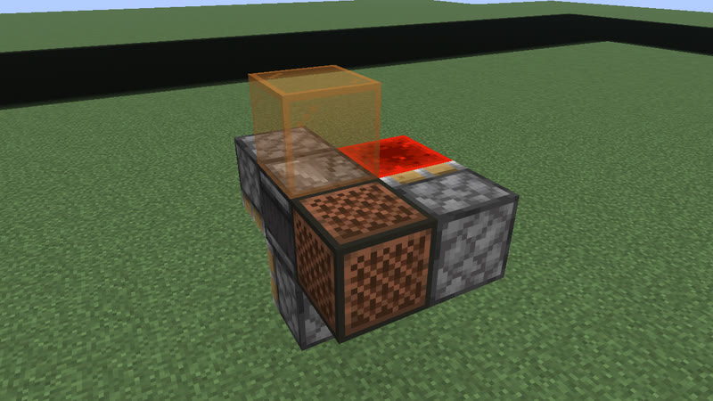</a> 10 gt (0.5 s) · note_block+observer+piston+redstone_block+sticky_piston · 7 blocks</td></tr>
</table>

## 11 gt (0.55 s)

Also reachable by: clk-item-lockpair (n = 0), clk-obs-odd-a (n = 0).

<table>
<tr><td align="center"><a href="../archive/clk-obs-p11-bulb-lamp-obs-pis-rb-stk-7b-da31b6.txt">clk-obs-p11-bulb-lamp-obs-pis-rb-stk-7b-da31b6</a> 11 gt (0.55 s) · copper_bulb+observer+piston+redstone_block+redstone_lamp+sticky_piston · 7 blocks (picture pending)</td><td align="center"><a href="../archive/clk-obs-p11-bulb-note-obs-pis-rb-stk-7b-a0bafc.txt">clk-obs-p11-bulb-note-obs-pis-rb-stk-7b-a0bafc</a> 11 gt (0.55 s) · copper_bulb+note_block+observer+piston+redstone_block+sticky_piston · 7 blocks (picture pending)</td><td align="center"><a href="../archive/clk-obs-p11-bulb-obs-pis-rb-stk-7b-d8e14e.txt">clk-obs-p11-bulb-obs-pis-rb-stk-7b-d8e14e</a> 11 gt (0.55 s) · copper_bulb+observer+piston+redstone_block+sticky_piston · 7 blocks (picture pending)</td></tr>
<tr><td align="center"> 11 gt (0.55 s) · note_block+observer+piston+redstone_block+redstone_lamp+sticky_piston · 7 blocks</td><td align="center"><a href="../archive/clk-obs-p11-note-obs-pis-rb-stk-7b-38399e.txt">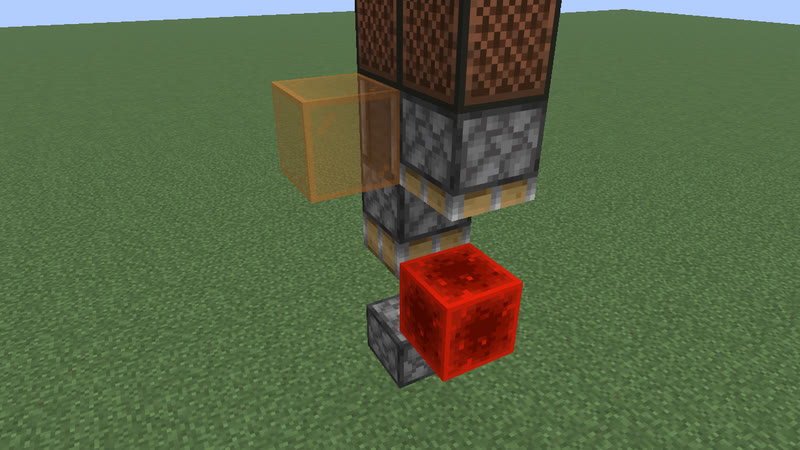</a> 11 gt (0.55 s) · note_block+observer+piston+redstone_block+sticky_piston · 7 blocks</td><td align="center"><a href="../archive/clk-obs-p11-note-obs-pis-rb-stk-7b-b-f4c0f4.txt">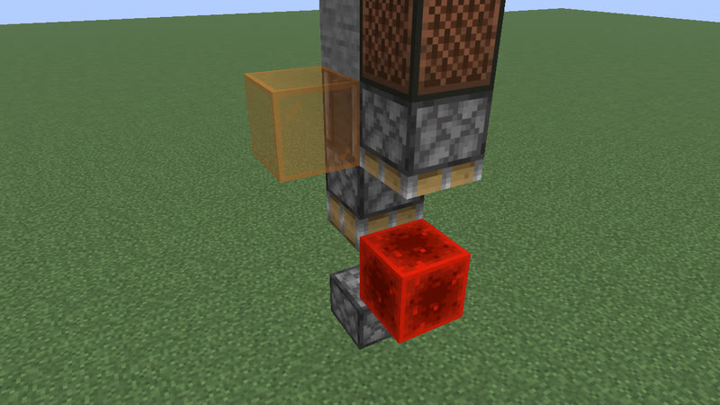</a> 11 gt (0.55 s) · note_block+observer+piston+redstone_block+sticky_piston · 7 blocks</td></tr>
<tr><td align="center"><a href="../archive/clk-obs-p11-obs-rb-stk-7b-fe8152.txt">clk-obs-p11-obs-rb-stk-7b-fe8152</a> 11 gt (0.55 s) · observer+redstone_block+sticky_piston · 7 blocks (picture pending)</td><td align="center"><a href="../archive/clk-obs-p11-lamp-obs-pis-rb-stk-7b-6debd9.txt">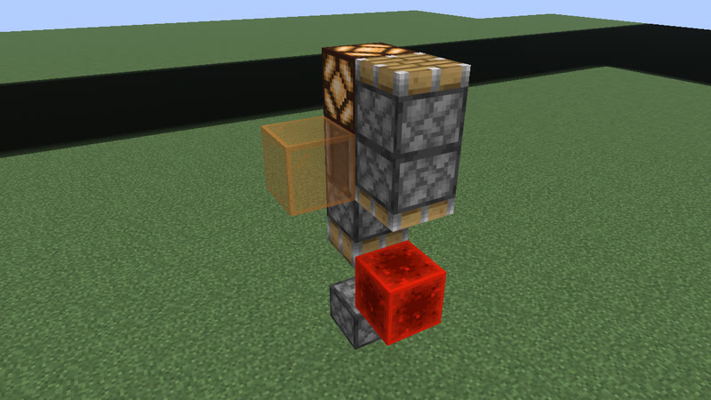</a> 11 gt (0.55 s) · observer+piston+redstone_block+redstone_lamp+sticky_piston · 7 blocks</td><td align="center"><a href="../archive/clk-obs-p11-lamp-obs-pis-rb-stk-7b-b-2b1d79.txt">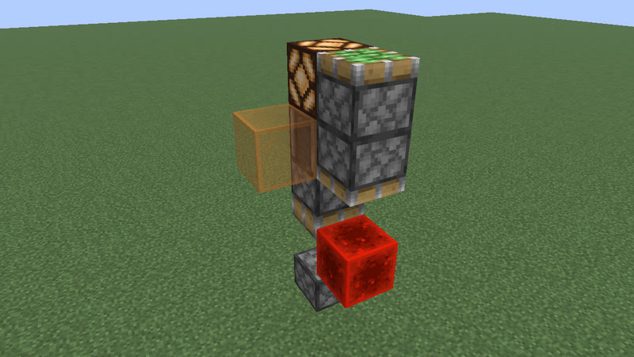</a> 11 gt (0.55 s) · observer+piston+redstone_block+redstone_lamp+sticky_piston · 7 blocks</td></tr>
<tr><td align="center"><a href="../archive/clk-obs-p11-obs-pis-rb-stk-7b-2d3e86.txt">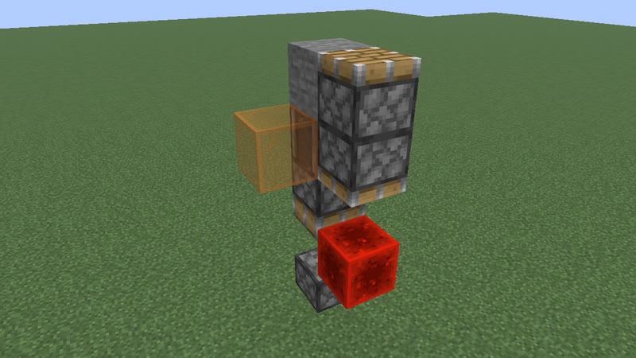</a> 11 gt (0.55 s) · observer+piston+redstone_block+sticky_piston · 7 blocks</td><td align="center"> 11 gt (0.55 s) · observer+piston+redstone_block+sticky_piston · 7 blocks</td></tr>
</table>

## 12 gt (0.6 s)

Also reachable by: clk-obs-obs-ring (n = 1), clk-obs-divider (n = 0).

<table>
<tr><td align="center"> 12 gt (0.6 s) · copper_bulb+observer · 3 blocks</td><td align="center"><a href="../archive/clk-obs-p12-bulb-note-obs-4b-c5bc33.txt">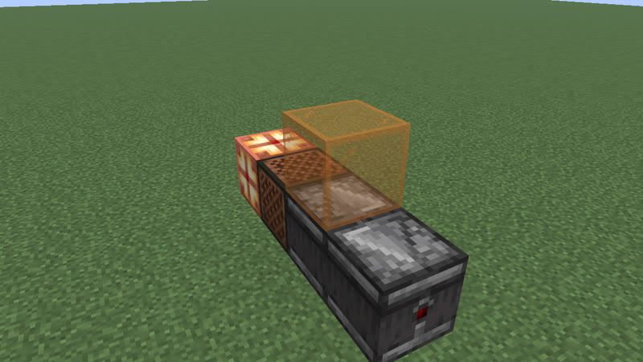</a> 12 gt (0.6 s) · copper_bulb+note_block+observer · 4 blocks</td><td align="center"> 12 gt (0.6 s) · observer+redstone_block+sticky_piston · 4 blocks</td></tr>
<tr><td align="center"> 12 gt (0.6 s) · observer+sticky_piston · 4 blocks</td><td align="center"> 12 gt (0.6 s) · copper_bulb+redstone_block+sticky_piston · 4 blocks</td><td align="center"> 12 gt (0.6 s) · observer+redstone_block+redstone_lamp+sticky_piston · 4 blocks</td></tr>
<tr><td align="center"><a href="../archive/clk-obs-p12-lamp-obs-pis-stk-5b-21ed35.txt">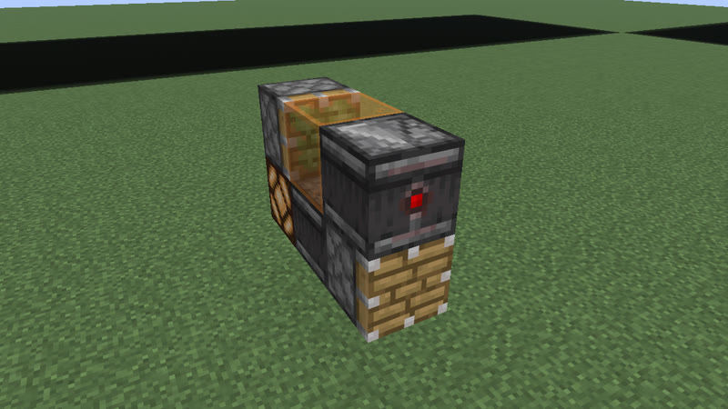</a> 12 gt (0.6 s) · observer+piston+redstone_lamp+sticky_piston · 5 blocks</td><td align="center"><a href="../archive/clk-obs-p12-lamp-obs-stk-5b-b-01b07b.txt">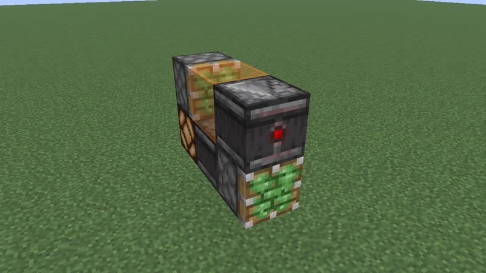</a> 12 gt (0.6 s) · observer+redstone_lamp+sticky_piston · 5 blocks</td><td align="center"><a href="../archive/clk-obs-p12-note-obs-pis-stk-5b-1c3951.txt">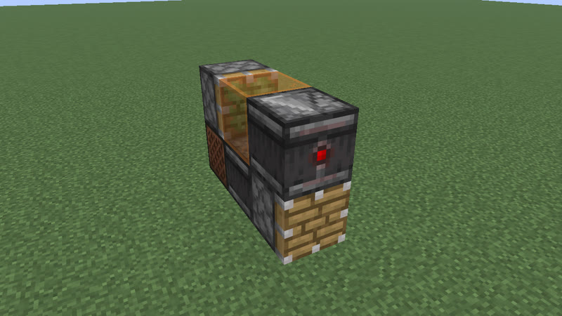</a> 12 gt (0.6 s) · note_block+observer+piston+sticky_piston · 5 blocks</td></tr>
<tr><td align="center"><a href="../archive/clk-obs-p12-lamp-obs-pis-stk-5b-b-f3ab23.txt">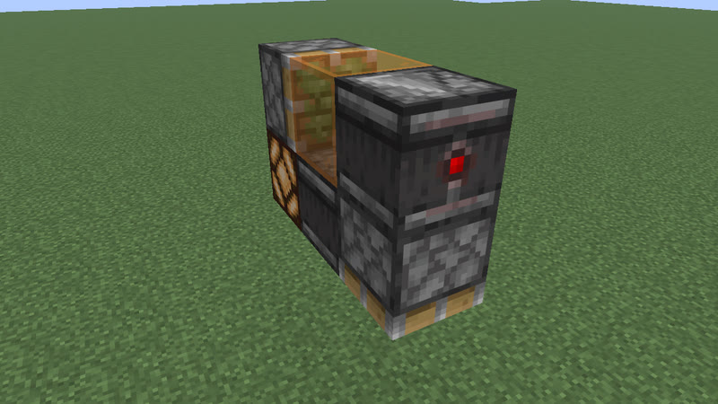</a> 12 gt (0.6 s) · observer+piston+redstone_lamp+sticky_piston · 5 blocks</td><td align="center"><a href="../archive/clk-obs-p12-note-obs-pis-stk-5b-b-d02ea0.txt">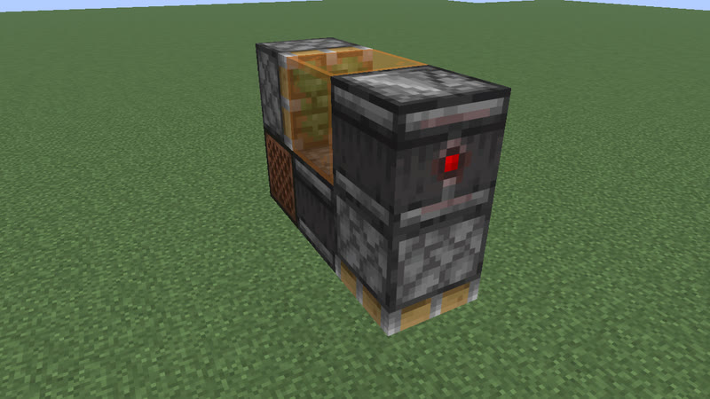</a> 12 gt (0.6 s) · note_block+observer+piston+sticky_piston · 5 blocks</td><td align="center"><a href="../archive/clk-obs-p12-pis-rb-6b-2e8a01.txt">clk-obs-p12-pis-rb-6b-2e8a01</a> 12 gt (0.6 s) · piston+redstone_block · 6 blocks (picture pending)</td></tr>
<tr><td align="center"> 12 gt (0.6 s) · redstone_torch+redstone_wire · 14 blocks</td><td align="center"> 12 gt (0.6 s) · comparator · 16 blocks</td></tr>
</table>

## 13 gt (0.65 s)

Also reachable by: clk-item-lockpair (n = 1), clk-obs-odd-b (n = 0).

<table>
<tr><td align="center"><a href="../archive/clk-obs-p13-obs-pis-rb-stk-5b-bfa866.txt">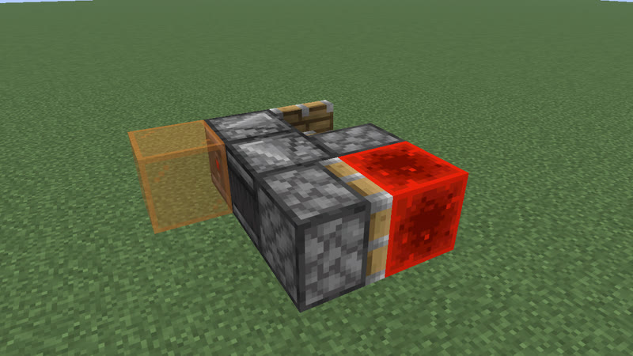</a> 13 gt (0.65 s) · observer+piston+redstone_block+sticky_piston · 5 blocks</td><td align="center"> 13 gt (0.65 s) · observer+redstone_block+sticky_piston · 5 blocks</td><td align="center"> 13 gt (0.65 s) · observer+redstone_lamp+sticky_piston · 6 blocks</td></tr>
<tr><td align="center"><a href="../archive/clk-obs-p13-lamp-obs-pis-stk-6b-68b855.txt">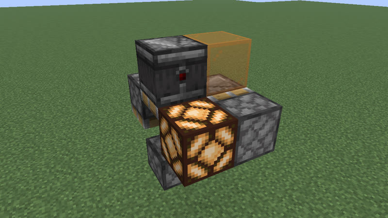</a> 13 gt (0.65 s) · observer+piston+redstone_lamp+sticky_piston · 6 blocks</td><td align="center"><a href="../archive/clk-obs-p13-lamp-note-obs-rb-stk-7b-63e1c0.txt">clk-obs-p13-lamp-note-obs-rb-stk-7b-63e1c0</a> 13 gt (0.65 s) · note_block+observer+redstone_block+redstone_lamp+sticky_piston · 7 blocks (picture pending)</td><td align="center"><a href="../archive/clk-obs-p13-lamp-obs-pis-rb-stk-7b-ede8ea.txt">clk-obs-p13-lamp-obs-pis-rb-stk-7b-ede8ea</a> 13 gt (0.65 s) · observer+piston+redstone_block+redstone_lamp+sticky_piston · 7 blocks (picture pending)</td></tr>
<tr><td align="center"><a href="../archive/clk-obs-p13-lamp-obs-rb-stk-7b-8ffabb.txt">clk-obs-p13-lamp-obs-rb-stk-7b-8ffabb</a> 13 gt (0.65 s) · observer+redstone_block+redstone_lamp+sticky_piston · 7 blocks (picture pending)</td><td align="center"><a href="../archive/clk-obs-p13-bulb-lamp-obs-rb-stk-8b-0b16bf.txt">clk-obs-p13-bulb-lamp-obs-rb-stk-8b-0b16bf</a> 13 gt (0.65 s) · copper_bulb+observer+redstone_block+redstone_lamp+sticky_piston · 8 blocks (picture pending)</td><td align="center"><a href="../archive/clk-obs-p13-bulb-note-obs-rb-stk-8b-7aab2e.txt">clk-obs-p13-bulb-note-obs-rb-stk-8b-7aab2e</a> 13 gt (0.65 s) · copper_bulb+note_block+observer+redstone_block+sticky_piston · 8 blocks (picture pending)</td></tr>
<tr><td align="center"><a href="../archive/clk-obs-p13-bulb-obs-rb-stk-8b-30fda0.txt">clk-obs-p13-bulb-obs-rb-stk-8b-30fda0</a> 13 gt (0.65 s) · copper_bulb+observer+redstone_block+sticky_piston · 8 blocks (picture pending)</td><td align="center"> 13 gt (0.65 s) · comparator+hopper+redstone_torch+redstone_wire · 9 blocks</td><td align="center"> 13 gt (0.65 s) · redstone_wire+repeater · 16 blocks</td></tr>
</table>

## 14 gt (0.7 s)

Also reachable by: observer ring with a relay block (clk-obs-note-ring, n = 1), hopper ring (clk-item-hopper-ring, n = 0).

<table>
<tr><td align="center"> 14 gt (0.7 s) · comparator+hopper · 4 blocks</td><td align="center"><a href="../archive/clk-obs-p14-bulb-note-obs-stk-6b-b-cf304d.txt">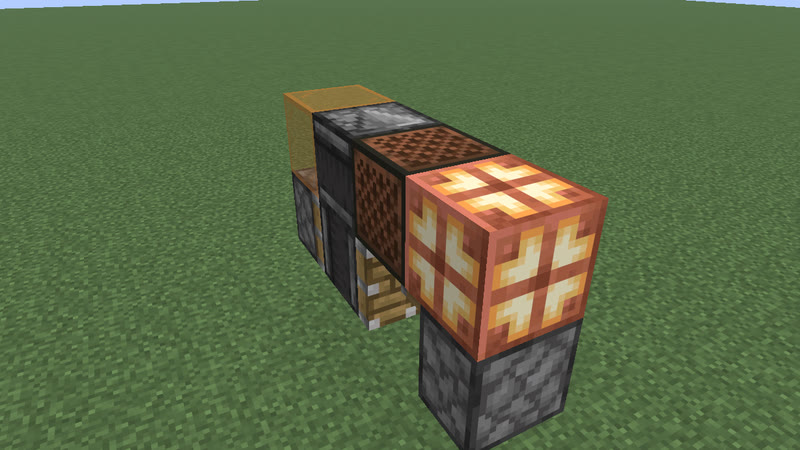</a> 14 gt (0.7 s) · copper_bulb+note_block+observer+sticky_piston · 6 blocks</td><td align="center"><a href="../archive/clk-obs-p14-lamp-note-obs-rb-stk-6b-b-f8a0e7.txt">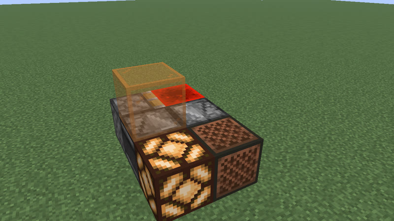</a> 14 gt (0.7 s) · note_block+observer+redstone_block+redstone_lamp+sticky_piston · 6 blocks</td></tr>
<tr><td align="center"> 14 gt (0.7 s) · observer+piston+redstone_lamp+sticky_piston · 6 blocks</td><td align="center"> 14 gt (0.7 s) · observer+piston+redstone_block+sticky_piston · 6 blocks</td><td align="center"> 14 gt (0.7 s) · observer+redstone_block+sticky_piston · 6 blocks</td></tr>
<tr><td align="center"><a href="../archive/clk-obs-p14-bulb-note-obs-pis-stk-6b-07a537.txt">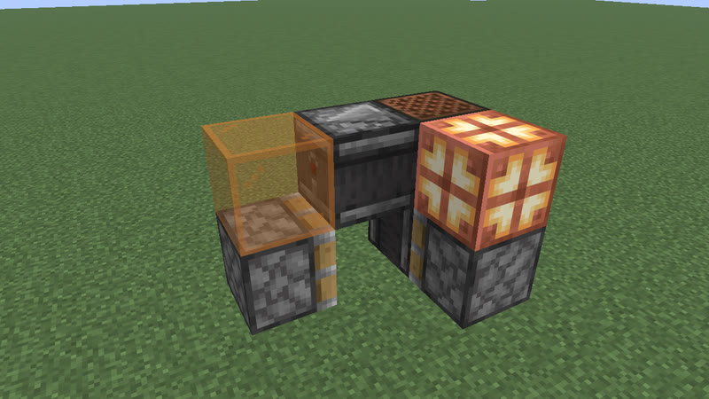</a> 14 gt (0.7 s) · copper_bulb+note_block+observer+piston+sticky_piston · 6 blocks</td><td align="center"><a href="../archive/clk-obs-p14-bulb-obs-rb-stk-7b-6df6f1.txt">clk-obs-p14-bulb-obs-rb-stk-7b-6df6f1</a> 14 gt (0.7 s) · copper_bulb+observer+redstone_block+sticky_piston · 7 blocks (picture pending)</td><td align="center"> 14 gt (0.7 s) · redstone_torch+repeater · 8 blocks</td></tr>
<tr><td align="center"><a href="../archive/clk-obs-p14-bulb-obs-pis-rb-stk-9b-1b50dd.txt">clk-obs-p14-bulb-obs-pis-rb-stk-9b-1b50dd</a> 14 gt (0.7 s) · copper_bulb+observer+piston+redstone_block+sticky_piston · 9 blocks (picture pending)</td></tr>
</table>

## 15 gt (0.75 s)

Also reachable by: clk-item-lockpair (n = 2), clk-obs-odd-a (n = 1).

<table>
<tr><td align="center"> 15 gt (0.75 s) · observer+redstone_block+sticky_piston · 5 blocks</td><td align="center"><a href="../archive/clk-obs-p15-obs-rb-stk-6b-b-c0356e.txt">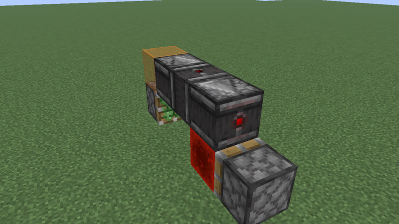</a> 15 gt (0.75 s) · observer+redstone_block+sticky_piston · 6 blocks</td><td align="center"><a href="../archive/clk-obs-p15-lamp-obs-pis-rb-stk-7b-5adae1.txt">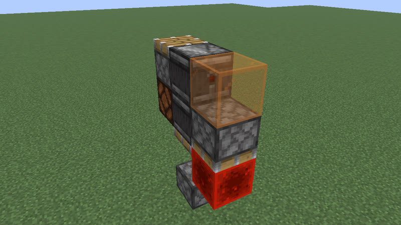</a> 15 gt (0.75 s) · observer+piston+redstone_block+redstone_lamp+sticky_piston · 7 blocks</td></tr>
<tr><td align="center"><a href="../archive/clk-obs-p15-lamp-obs-rb-stk-7b-d57bc1.txt">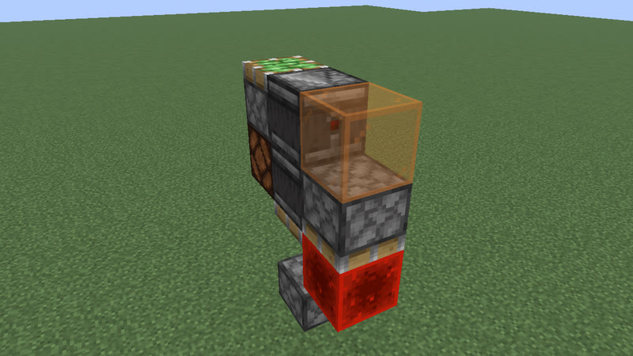</a> 15 gt (0.75 s) · observer+redstone_block+redstone_lamp+sticky_piston · 7 blocks</td><td align="center"> 15 gt (0.75 s) · note_block+observer+piston+redstone_block+sticky_piston · 7 blocks</td><td align="center"><a href="../archive/clk-obs-p15-note-obs-rb-stk-7b-2fcd2e.txt">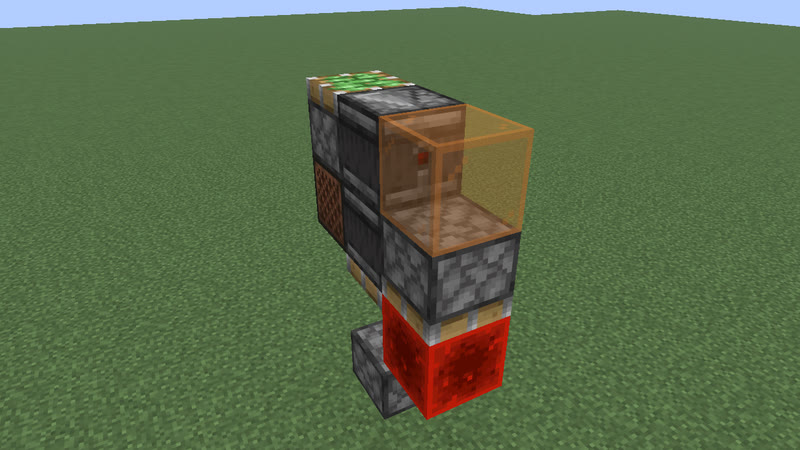</a> 15 gt (0.75 s) · note_block+observer+redstone_block+sticky_piston · 7 blocks</td></tr>
<tr><td align="center"><a href="../archive/clk-obs-p15-obs-pis-rb-stk-7b-542b73.txt">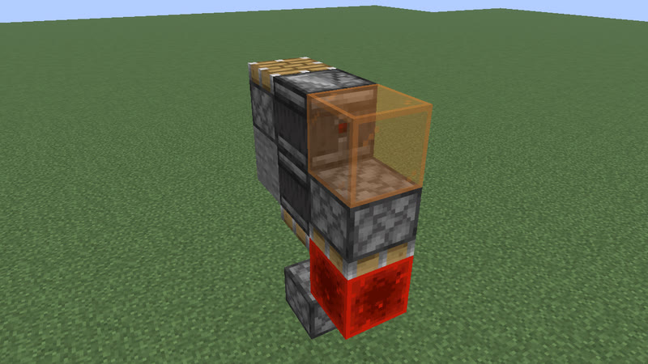</a> 15 gt (0.75 s) · observer+piston+redstone_block+sticky_piston · 7 blocks</td><td align="center"><a href="../archive/clk-obs-p15-lamp-obs-pis-rb-stk-7b-b-f6d13c.txt">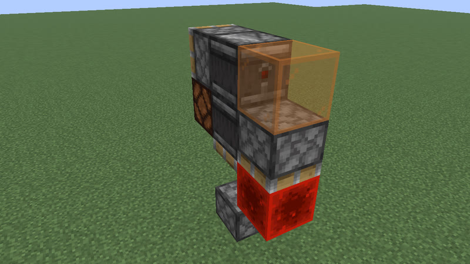</a> 15 gt (0.75 s) · observer+piston+redstone_block+redstone_lamp+sticky_piston · 7 blocks</td><td align="center"><a href="../archive/clk-obs-p15-obs-pis-rb-stk-7b-b-c7c311.txt">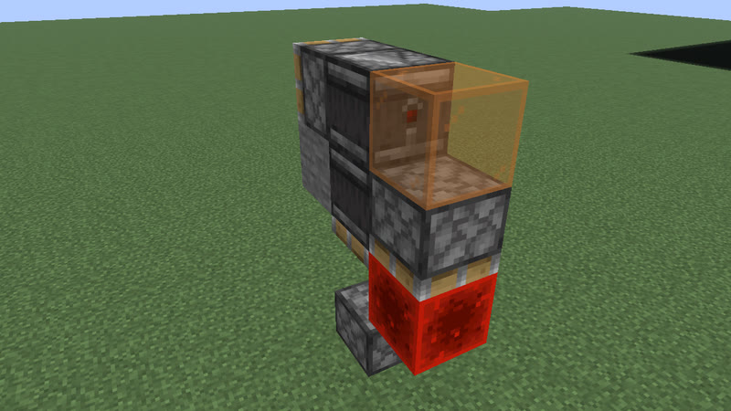</a> 15 gt (0.75 s) · observer+piston+redstone_block+sticky_piston · 7 blocks</td></tr>
<tr><td align="center"><a href="../archive/clk-obs-p15-lamp-note-obs-pis-rb-stk-7b-36ee1f.txt">clk-obs-p15-lamp-note-obs-pis-rb-stk-7b-36ee1f</a> 15 gt (0.75 s) · note_block+observer+piston+redstone_block+redstone_lamp+sticky_piston · 7 blocks (picture pending)</td><td align="center"><a href="../archive/clk-obs-p15-lamp-note-obs-rb-stk-7b-e75451.txt">clk-obs-p15-lamp-note-obs-rb-stk-7b-e75451</a> 15 gt (0.75 s) · note_block+observer+redstone_block+redstone_lamp+sticky_piston · 7 blocks (picture pending)</td><td align="center"><a href="../archive/clk-obs-p15-bulb-lamp-note-obs-stk-8b-4a0708.txt">clk-obs-p15-bulb-lamp-note-obs-stk-8b-4a0708</a> 15 gt (0.75 s) · copper_bulb+note_block+observer+redstone_lamp+sticky_piston · 8 blocks (picture pending)</td></tr>
</table>

## 16 gt (0.8 s)

Also reachable by: clk-obs-obs-ring (n = 2), clk-item-snowdisp (n = 0).

<table>
<tr><td align="center"> 16 gt (0.8 s) · copper_bulb+observer+redstone_block+sticky_piston · 4 blocks</td><td align="center"> 16 gt (0.8 s) · copper_bulb+observer · 5 blocks</td><td align="center"> 16 gt (0.8 s) · copper_bulb+note_block+observer+sticky_piston · 5 blocks</td></tr>
<tr><td align="center"> 16 gt (0.8 s) · observer+piston+redstone_block+sticky_piston · 5 blocks</td><td align="center"> 16 gt (0.8 s) · observer+piston+redstone_block+sticky_piston · 5 blocks</td><td align="center"> 16 gt (0.8 s) · observer+redstone_block+sticky_piston · 5 blocks</td></tr>
<tr><td align="center"> 16 gt (0.8 s) · observer+redstone_block+sticky_piston · 5 blocks</td><td align="center"> 16 gt (0.8 s) · observer+piston+sticky_piston · 5 blocks</td><td align="center"> 16 gt (0.8 s) · observer+sticky_piston · 5 blocks</td></tr>
<tr><td align="center"><a href="../archive/clk-obs-p16-bulb-note-obs-pis-rb-stk-6b-b-b22f33.txt">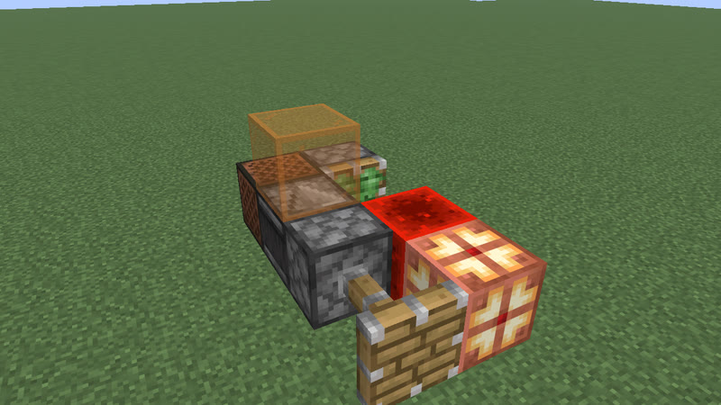</a> 16 gt (0.8 s) · copper_bulb+note_block+observer+piston+redstone_block+sticky_piston · 6 blocks</td><td align="center"> 16 gt (0.8 s) · note_block+observer+redstone_lamp+sticky_piston · 6 blocks</td><td align="center"> 16 gt (0.8 s) · observer+redstone_lamp+sticky_piston · 6 blocks</td></tr>
<tr><td align="center"><a href="../archive/clk-obs-p16-note-obs-rb-stk-6b-b-aa28bc.txt">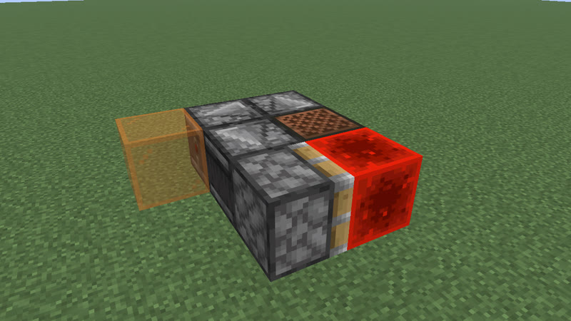</a> 16 gt (0.8 s) · note_block+observer+redstone_block+sticky_piston · 6 blocks</td><td align="center"> 16 gt (0.8 s) · note_block+observer+sticky_piston · 6 blocks</td><td align="center"><a href="../archive/clk-obs-p16-bulb-obs-pis-stk-6b-b-bebdf5.txt">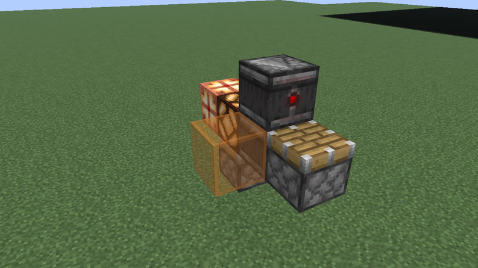</a> 16 gt (0.8 s) · copper_bulb+observer+piston+sticky_piston · 6 blocks</td></tr>
<tr><td align="center"><a href="../archive/clk-obs-p16-bulb-obs-pis-stk-6b-e50b92.txt">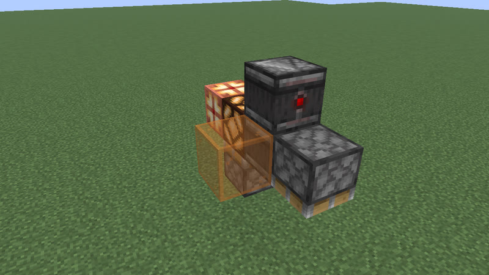</a> 16 gt (0.8 s) · copper_bulb+observer+piston+sticky_piston · 6 blocks</td><td align="center"><a href="../archive/clk-obs-p16-lamp-obs-rb-stk-6b-b-7a58ec.txt">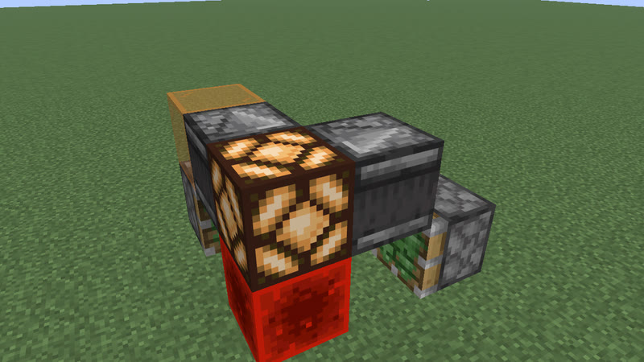</a> 16 gt (0.8 s) · observer+redstone_block+redstone_lamp+sticky_piston · 6 blocks</td><td align="center"><a href="../archive/clk-obs-p16-bulb-lamp-note-obs-rb-stk-7b-53b49d.txt">clk-obs-p16-bulb-lamp-note-obs-rb-stk-7b-53b49d</a> 16 gt (0.8 s) · copper_bulb+note_block+observer+redstone_block+redstone_lamp+sticky_piston · 7 blocks (picture pending)</td></tr>
<tr><td align="center"> 16 gt (0.8 s) · redstone_torch+repeater · 8 blocks</td><td align="center"><a href="../archive/clk-rt-uloop-p16-c-rt-r-12b.txt">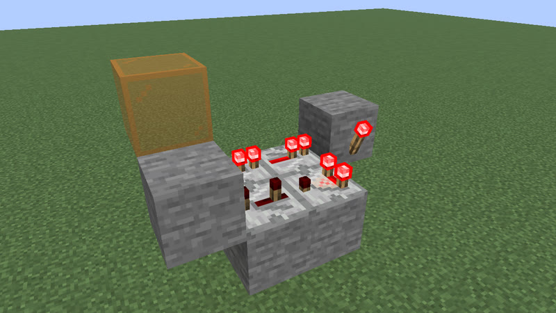</a> 16 gt (0.8 s) · comparator+redstone_torch+repeater · 12 blocks</td></tr>
</table>

## 17 gt (0.85 s)

Also reachable by: clk-obs-odd-b (n = 1).

<table>
<tr><td align="center"><a href="../archive/clk-obs-p17-lamp-obs-rb-stk-6b-231c89.txt">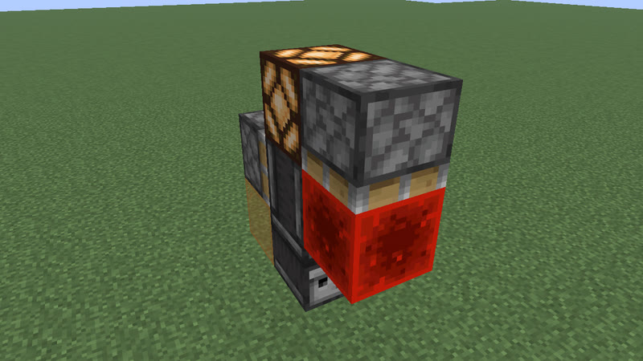</a> 17 gt (0.85 s) · observer+redstone_block+redstone_lamp+sticky_piston · 6 blocks</td><td align="center"><a href="../archive/clk-obs-p17-lamp-obs-rb-stk-6b-b-618767.txt">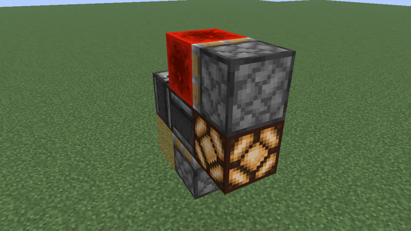</a> 17 gt (0.85 s) · observer+redstone_block+redstone_lamp+sticky_piston · 6 blocks</td><td align="center"><a href="../archive/clk-obs-p17-note-obs-rb-stk-6b-b-f76fb2.txt">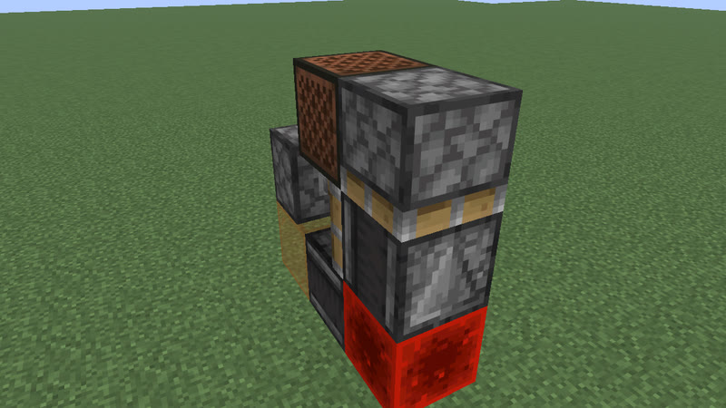</a> 17 gt (0.85 s) · note_block+observer+redstone_block+sticky_piston · 6 blocks</td></tr>
<tr><td align="center"><a href="../archive/clk-obs-p17-obs-rb-stk-6b-9de7ed.txt">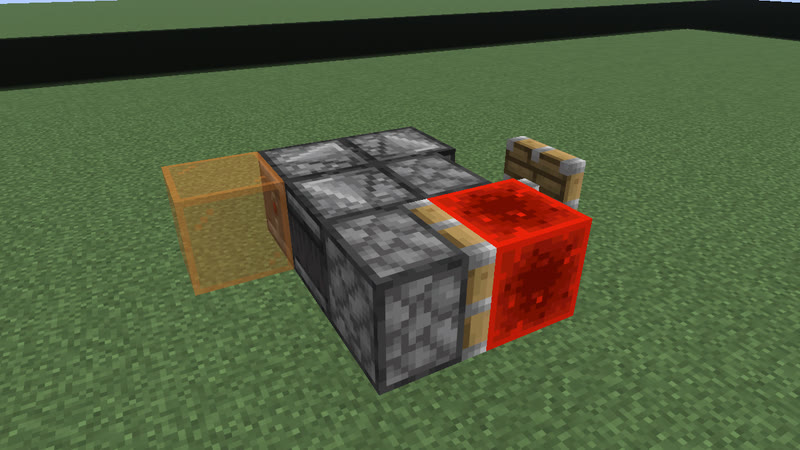</a> 17 gt (0.85 s) · observer+redstone_block+sticky_piston · 6 blocks</td><td align="center"><a href="../archive/clk-obs-p17-lamp-obs-pis-rb-stk-8b-783844.txt">clk-obs-p17-lamp-obs-pis-rb-stk-8b-783844</a> 17 gt (0.85 s) · observer+piston+redstone_block+redstone_lamp+sticky_piston · 8 blocks (picture pending)</td><td align="center"> 17 gt (0.85 s) · comparator+hopper+redstone_torch+repeater · 9 blocks</td></tr>
<tr><td align="center"> 17 gt (0.85 s) · redstone_wire+repeater · 16 blocks</td></tr>
</table>

## 18 gt (0.9 s)

Also reachable by: observer ring with a relay block (clk-obs-note-ring, n = 2).

<table>
<tr><td align="center"><a href="../archive/clk-obs-p18-obs-pis-stk-5b-b-960813.txt">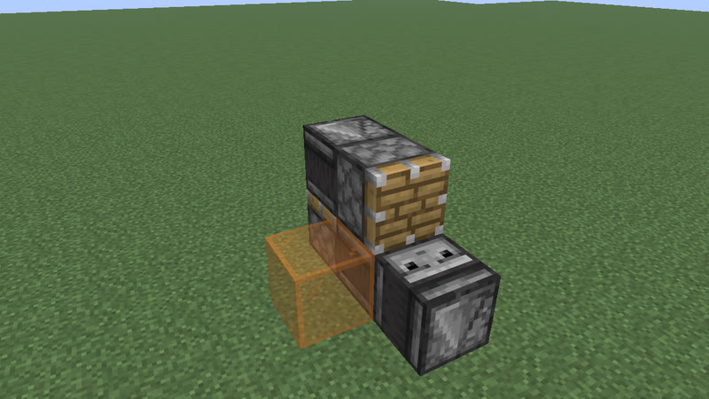</a> 18 gt (0.9 s) · observer+piston+sticky_piston · 5 blocks</td><td align="center"> 18 gt (0.9 s) · copper_bulb+observer+piston+redstone_block+sticky_piston · 6 blocks</td><td align="center"> 18 gt (0.9 s) · copper_bulb+observer+piston+redstone_block+sticky_piston · 6 blocks</td></tr>
<tr><td align="center"> 18 gt (0.9 s) · copper_bulb+observer+redstone_block+sticky_piston · 6 blocks</td><td align="center"> 18 gt (0.9 s) · copper_bulb+observer+redstone_block+sticky_piston · 6 blocks</td><td align="center"> 18 gt (0.9 s) · observer+redstone_block+redstone_lamp+sticky_piston · 6 blocks</td></tr>
<tr><td align="center"> 18 gt (0.9 s) · note_block+observer+redstone_block+sticky_piston · 6 blocks</td><td align="center"> 18 gt (0.9 s) · observer+redstone_block+sticky_piston · 6 blocks</td><td align="center"> 18 gt (0.9 s) · note_block+observer+redstone_block+sticky_piston · 6 blocks</td></tr>
<tr><td align="center"><a href="../archive/clk-obs-p18-rb-stk-6b-762e50.txt">clk-obs-p18-rb-stk-6b-762e50</a> 18 gt (0.9 s) · redstone_block+sticky_piston · 6 blocks (picture pending)</td><td align="center"> 18 gt (0.9 s) · observer+piston+redstone_block+sticky_piston · 6 blocks</td><td align="center"> 18 gt (0.9 s) · observer+redstone_block+redstone_lamp+sticky_piston · 7 blocks</td></tr>
<tr><td align="center"><a href="../archive/clk-obs-p18-lamp-note-obs-pis-rb-stk-8b-0fa74e.txt">clk-obs-p18-lamp-note-obs-pis-rb-stk-8b-0fa74e</a> 18 gt (0.9 s) · note_block+observer+piston+redstone_block+redstone_lamp+sticky_piston · 8 blocks (picture pending)</td><td align="center"> 18 gt (0.9 s) · redstone_torch+repeater · 8 blocks</td><td align="center"> 18 gt (0.9 s) · comparator+hopper+redstone_wire+repeater · 9 blocks</td></tr>
<tr><td align="center"> 18 gt (0.9 s) · observer+scaffolding+sticky_piston · 10 blocks</td></tr>
</table>

## 19 gt (0.95 s)

Also reachable by: clk-obs-odd-a (n = 2).

<table>
<tr><td align="center"> 19 gt (0.95 s) · observer+piston+redstone_block+sticky_piston · 7 blocks</td><td align="center"><a href="../archive/clk-obs-p19-lamp-note-obs-pis-stk-8b-ee338b.txt">clk-obs-p19-lamp-note-obs-pis-stk-8b-ee338b</a> 19 gt (0.95 s) · note_block+observer+piston+redstone_lamp+sticky_piston · 8 blocks (picture pending)</td><td align="center"><a href="../archive/clk-obs-p19-bulb-lamp-obs-rb-stk-9b-1efec1.txt">clk-obs-p19-bulb-lamp-obs-rb-stk-9b-1efec1</a> 19 gt (0.95 s) · copper_bulb+observer+redstone_block+redstone_lamp+sticky_piston · 9 blocks (picture pending)</td></tr>
<tr><td align="center"><a href="../archive/clk-obs-p19-bulb-note-obs-rb-stk-9b-6eec29.txt">clk-obs-p19-bulb-note-obs-rb-stk-9b-6eec29</a> 19 gt (0.95 s) · copper_bulb+note_block+observer+redstone_block+sticky_piston · 9 blocks (picture pending)</td><td align="center"><a href="../archive/clk-obs-p19-bulb-obs-rb-stk-9b-a784e9.txt">clk-obs-p19-bulb-obs-rb-stk-9b-a784e9</a> 19 gt (0.95 s) · copper_bulb+observer+redstone_block+sticky_piston · 9 blocks (picture pending)</td><td align="center"> 19 gt (0.95 s) · comparator+dropper+hopper+repeater · 14 blocks</td></tr>
</table>

## 20 gt (1 s)

Also reachable by: clk-obs-obs-ring (n = 3), clk-item-snowdisp (n = 1), clk-obs-bulb-ring (n = 0), clk-obs-hopclk (n = 2), clk-rt-uloop2t (n = 0).

<table>
<tr><td align="center"> 20 gt (1 s) · observer+redstone_block+sticky_piston · 5 blocks</td><td align="center"> 20 gt (1 s) · copper_bulb+observer+redstone_block+sticky_piston · 5 blocks</td><td align="center"> 20 gt (1 s) · observer+redstone_block+sticky_piston · 5 blocks</td></tr>
<tr><td align="center"> 20 gt (1 s) · copper_bulb+observer+redstone_block+sticky_piston · 5 blocks</td><td align="center"> 20 gt (1 s) · copper_bulb+note_block+observer+redstone_block+sticky_piston · 6 blocks</td><td align="center"> 20 gt (1 s) · note_block+observer+redstone_block+sticky_piston · 6 blocks</td></tr>
<tr><td align="center"> 20 gt (1 s) · note_block+observer+sticky_piston · 6 blocks</td><td align="center"> 20 gt (1 s) · observer+redstone_block+redstone_lamp+sticky_piston · 6 blocks</td><td align="center"><a href="../archive/clk-obs-p20-lamp-note-obs-rb-stk-7b-6210cc.txt">clk-obs-p20-lamp-note-obs-rb-stk-7b-6210cc</a> 20 gt (1 s) · note_block+observer+redstone_block+redstone_lamp+sticky_piston · 7 blocks (picture pending)</td></tr>
<tr><td align="center"> 20 gt (1 s) · observer+piston+redstone_lamp+sticky_piston · 7 blocks</td><td align="center"> 20 gt (1 s) · note_block+observer+piston+sticky_piston · 7 blocks</td><td align="center"><a href="../archive/clk-obs-p20-lamp-obs-pis-rb-stk-7b-60e89a.txt">clk-obs-p20-lamp-obs-pis-rb-stk-7b-60e89a</a> 20 gt (1 s) · observer+piston+redstone_block+redstone_lamp+sticky_piston · 7 blocks (picture pending)</td></tr>
<tr><td align="center"> 20 gt (1 s) · copper_bulb+note_block+observer+piston+redstone_block+sticky_piston · 7 blocks</td><td align="center"> 20 gt (1 s) · copper_bulb+note_block+observer+piston+redstone_block+sticky_piston · 7 blocks</td><td align="center"> 20 gt (1 s) · copper_bulb+observer+piston+redstone_block+sticky_piston · 7 blocks</td></tr>
<tr><td align="center"> 20 gt (1 s) · copper_bulb+observer+piston+redstone_block+sticky_piston · 7 blocks</td><td align="center"><a href="../archive/clk-obs-p20-bulb-lamp-note-obs-pis-stk-8b-4064d3.txt">clk-obs-p20-bulb-lamp-note-obs-pis-stk-8b-4064d3</a> 20 gt (1 s) · copper_bulb+note_block+observer+piston+redstone_lamp+sticky_piston · 8 blocks (picture pending)</td><td align="center"><a href="../archive/clk-obs-p20-bulb-lamp-obs-stk-8b-8820da.txt">clk-obs-p20-bulb-lamp-obs-stk-8b-8820da</a> 20 gt (1 s) · copper_bulb+observer+redstone_lamp+sticky_piston · 8 blocks (picture pending)</td></tr>
<tr><td align="center"><a href="../archive/clk-obs-p20-bulb-note-obs-pis-stk-8b-bd0529.txt">clk-obs-p20-bulb-note-obs-pis-stk-8b-bd0529</a> 20 gt (1 s) · copper_bulb+note_block+observer+piston+sticky_piston · 8 blocks (picture pending)</td><td align="center"><a href="../archive/clk-obs-p20-bulb-obs-pis-stk-8b-bf037e.txt">clk-obs-p20-bulb-obs-pis-stk-8b-bf037e</a> 20 gt (1 s) · copper_bulb+observer+piston+sticky_piston · 8 blocks (picture pending)</td><td align="center"> 20 gt (1 s) · comparator+hopper+redstone_torch+repeater · 9 blocks</td></tr>
<tr><td align="center"> 20 gt (1 s) · comparator+dropper+hopper · 10 blocks</td><td align="center"> 20 gt (1 s) · repeater · 12 blocks</td></tr>
</table>

## 21 gt (1.05 s)

Also reachable by: clk-obs-odd-b (n = 2), hopper ring (clk-item-hopper-ring-2, n = 2).

<table>
<tr><td align="center"> 21 gt (1.05 s) · calibrated_sculk_sensor+dispenser+observer · 5 blocks</td><td align="center"> 21 gt (1.05 s) · calibrated_sculk_sensor+dispenser+observer · 5 blocks</td><td align="center"> 21 gt (1.05 s) · calibrated_sculk_sensor+dispenser+observer+sticky_piston · 5 blocks</td></tr>
<tr><td align="center"> 21 gt (1.05 s) · calibrated_sculk_sensor+note_block+observer+sticky_piston · 5 blocks</td><td align="center"> 21 gt (1.05 s) · calibrated_sculk_sensor+oak_trapdoor+observer+sticky_piston · 5 blocks</td><td align="center"> 21 gt (1.05 s) · calibrated_sculk_sensor+observer+piston+sticky_piston · 5 blocks</td></tr>
<tr><td align="center"> 21 gt (1.05 s) · calibrated_sculk_sensor+observer+sticky_piston · 5 blocks</td><td align="center"> 21 gt (1.05 s) · calibrated_sculk_sensor+note_block+redstone_torch+repeater · 6 blocks</td><td align="center"> 21 gt (1.05 s) · calibrated_sculk_sensor+dispenser+redstone_torch+repeater · 6 blocks</td></tr>
<tr><td align="center"> 21 gt (1.05 s) · observer+piston+redstone_block+redstone_lamp+sticky_piston · 7 blocks</td><td align="center"> 21 gt (1.05 s) · note_block+observer+piston+redstone_block+sticky_piston · 7 blocks</td><td align="center"> 21 gt (1.05 s) · observer+piston+redstone_block+sticky_piston · 7 blocks</td></tr>
<tr><td align="center"> 21 gt (1.05 s) · observer+piston+sticky_piston · 7 blocks</td><td align="center"> 21 gt (1.05 s) · observer+sticky_piston · 7 blocks</td><td align="center"> 21 gt (1.05 s) · comparator+dropper+hopper+repeater · 14 blocks</td></tr>
</table>

## 22 gt (1.1 s)

Also reachable by: observer ring with a relay block (clk-obs-note-ring, n = 3).

<table>
<tr><td align="center"> 22 gt (1.1 s) · calibrated_sculk_sensor+oak_trapdoor+observer+sticky_piston · 5 blocks</td><td align="center"> 22 gt (1.1 s) · calibrated_sculk_sensor+observer+piston+sticky_piston · 5 blocks</td><td align="center"> 22 gt (1.1 s) · calibrated_sculk_sensor+observer+sticky_piston · 5 blocks</td></tr>
<tr><td align="center"> 22 gt (1.1 s) · observer+redstone_lamp+sticky_piston · 6 blocks</td><td align="center"> 22 gt (1.1 s) · note_block+observer+sticky_piston · 6 blocks</td><td align="center"> 22 gt (1.1 s) · calibrated_sculk_sensor+dispenser+redstone_torch+repeater · 6 blocks</td></tr>
<tr><td align="center"><a href="../archive/clk-obs-p22-bulb-lamp-obs-stk-7b-8c8146.txt">clk-obs-p22-bulb-lamp-obs-stk-7b-8c8146</a> 22 gt (1.1 s) · copper_bulb+observer+redstone_lamp+sticky_piston · 7 blocks (picture pending)</td><td align="center"><a href="../archive/clk-obs-p22-bulb-note-obs-stk-7b-4b8fd9.txt">clk-obs-p22-bulb-note-obs-stk-7b-4b8fd9</a> 22 gt (1.1 s) · copper_bulb+note_block+observer+sticky_piston · 7 blocks (picture pending)</td><td align="center"><a href="../archive/clk-obs-p22-note-obs-pis-7b-8e1432.txt">clk-obs-p22-note-obs-pis-7b-8e1432</a> 22 gt (1.1 s) · note_block+observer+piston · 7 blocks (picture pending)</td></tr>
<tr><td align="center"><a href="../archive/clk-obs-p22-obs-pis-7b-eb5e03.txt">clk-obs-p22-obs-pis-7b-eb5e03</a> 22 gt (1.1 s) · observer+piston · 7 blocks (picture pending)</td><td align="center"><a href="../archive/clk-obs-p22-bulb-obs-pis-rb-stk-7b-21967f.txt">clk-obs-p22-bulb-obs-pis-rb-stk-7b-21967f</a> 22 gt (1.1 s) · copper_bulb+observer+piston+redstone_block+sticky_piston · 7 blocks (picture pending)</td><td align="center"><a href="../archive/clk-obs-p22-bulb-lamp-note-obs-pis-rb-stk-8b-31939d.txt">clk-obs-p22-bulb-lamp-note-obs-pis-rb-stk-8b-31939d</a> 22 gt (1.1 s) · copper_bulb+note_block+observer+piston+redstone_block+redstone_lamp+sticky_piston · 8 blocks (picture pending)</td></tr>
<tr><td align="center"><a href="../archive/clk-obs-p22-bulb-lamp-obs-pis-rb-stk-8b-e83b1e.txt">clk-obs-p22-bulb-lamp-obs-pis-rb-stk-8b-e83b1e</a> 22 gt (1.1 s) · copper_bulb+observer+piston+redstone_block+redstone_lamp+sticky_piston · 8 blocks (picture pending)</td><td align="center"><a href="../archive/clk-obs-p22-bulb-note-obs-pis-rb-stk-8b-de8eec.txt">clk-obs-p22-bulb-note-obs-pis-rb-stk-8b-de8eec</a> 22 gt (1.1 s) · copper_bulb+note_block+observer+piston+redstone_block+sticky_piston · 8 blocks (picture pending)</td><td align="center"><a href="../archive/clk-obs-p22-bulb-obs-rb-stk-8b-65d5c7.txt">clk-obs-p22-bulb-obs-rb-stk-8b-65d5c7</a> 22 gt (1.1 s) · copper_bulb+observer+redstone_block+sticky_piston · 8 blocks (picture pending)</td></tr>
<tr><td align="center"><a href="../archive/clk-obs-p22-lamp-obs-pis-rb-stk-8b-e4a710.txt">clk-obs-p22-lamp-obs-pis-rb-stk-8b-e4a710</a> 22 gt (1.1 s) · observer+piston+redstone_block+redstone_lamp+sticky_piston · 8 blocks (picture pending)</td><td align="center"><a href="../archive/clk-obs-p22-note-obs-pis-rb-stk-8b-b6a87b.txt">clk-obs-p22-note-obs-pis-rb-stk-8b-b6a87b</a> 22 gt (1.1 s) · note_block+observer+piston+redstone_block+sticky_piston · 8 blocks (picture pending)</td><td align="center"><a href="../archive/clk-obs-p22-note-obs-rb-stk-8b-3cb8d7.txt">clk-obs-p22-note-obs-rb-stk-8b-3cb8d7</a> 22 gt (1.1 s) · note_block+observer+redstone_block+sticky_piston · 8 blocks (picture pending)</td></tr>
<tr><td align="center"><a href="../archive/clk-obs-p22-lamp-note-obs-pis-rb-stk-8b-f09d82.txt">clk-obs-p22-lamp-note-obs-pis-rb-stk-8b-f09d82</a> 22 gt (1.1 s) · note_block+observer+piston+redstone_block+redstone_lamp+sticky_piston · 8 blocks (picture pending)</td><td align="center"> 22 gt (1.1 s) · comparator+redstone_torch+repeater · 12 blocks</td><td align="center"> 22 gt (1.1 s) · comparator+redstone_torch+redstone_wire+repeater · 12 blocks</td></tr>
<tr><td align="center"> 22 gt (1.1 s) · redstone_torch+repeater · 12 blocks</td><td align="center"> 22 gt (1.1 s) · redstone_torch+redstone_wire+repeater · 12 blocks</td><td align="center"> 22 gt (1.1 s) · comparator+repeater · 12 blocks</td></tr>
<tr><td align="center"> 22 gt (1.1 s) · repeater · 12 blocks</td></tr>
</table>

## 23 gt (1.15 s)

Also reachable by: clk-obs-odd-a (n = 3), clk-rt-odd-rect (n = 0), clk-sculk-hairpin-dispenser (n = 1).

<table>
<tr><td align="center"> 23 gt (1.15 s) · calibrated_sculk_sensor+dispenser+observer+piston · 4 blocks also found as census-p23-calibrated_sculk_sensor-dispenser-observer-sticky_piston-4b (built with sticky_piston, without piston)</td><td align="center"> 23 gt (1.15 s) · calibrated_sculk_sensor+note_block+observer+piston · 4 blocks also found as census-p23-calibrated_sculk_sensor-note_block-observer-sticky_piston-4b (built with sticky_piston, without piston)</td><td align="center"> 23 gt (1.15 s) · calibrated_sculk_sensor+dispenser+observer · 5 blocks</td></tr>
<tr><td align="center"> 23 gt (1.15 s) · calibrated_sculk_sensor+oak_trapdoor+observer+sticky_piston · 5 blocks</td><td align="center"> 23 gt (1.15 s) · calibrated_sculk_sensor+observer+piston+sticky_piston · 5 blocks</td><td align="center"> 23 gt (1.15 s) · calibrated_sculk_sensor+observer+sticky_piston · 5 blocks</td></tr>
<tr><td align="center"> 23 gt (1.15 s) · calibrated_sculk_sensor+dispenser+redstone_torch+repeater · 6 blocks</td><td align="center"><a href="../archive/clk-obs-p23-lamp-note-obs-pis-stk-8b-bbc182.txt">clk-obs-p23-lamp-note-obs-pis-stk-8b-bbc182</a> 23 gt (1.15 s) · note_block+observer+piston+redstone_lamp+sticky_piston · 8 blocks (picture pending)</td><td align="center"><a href="../archive/clk-obs-p23-lamp-obs-pis-rb-stk-8b-f32415.txt">clk-obs-p23-lamp-obs-pis-rb-stk-8b-f32415</a> 23 gt (1.15 s) · observer+piston+redstone_block+redstone_lamp+sticky_piston · 8 blocks (picture pending)</td></tr>
<tr><td align="center"><a href="../archive/clk-obs-p23-note-obs-rb-stk-8b-f2475e.txt">clk-obs-p23-note-obs-rb-stk-8b-f2475e</a> 23 gt (1.15 s) · note_block+observer+redstone_block+sticky_piston · 8 blocks (picture pending)</td><td align="center"> 23 gt (1.15 s) · redstone_wire+repeater · 18 blocks</td></tr>
</table>

## 24 gt (1.2 s)

Also reachable by: clk-obs-obs-ring (n = 4), clk-obs-divider (n = 1), clk-item-snowdisp (n = 2).

<table>
<tr><td align="center"> 24 gt (1.2 s) · calibrated_sculk_sensor+note_block+observer · 3 blocks</td><td align="center"> 24 gt (1.2 s) · calibrated_sculk_sensor+oak_trapdoor+observer · 3 blocks</td><td align="center"> 24 gt (1.2 s) · calibrated_sculk_sensor+oak_fence_gate+observer · 3 blocks</td></tr>
<tr><td align="center"> 24 gt (1.2 s) · calibrated_sculk_sensor+iron_trapdoor+observer · 3 blocks</td><td align="center"> 24 gt (1.2 s) · calibrated_sculk_sensor+oak_trapdoor+observer · 3 blocks</td><td align="center"> 24 gt (1.2 s) · calibrated_sculk_sensor+oak_trapdoor+observer · 3 blocks</td></tr>
<tr><td align="center"> 24 gt (1.2 s) · calibrated_sculk_sensor+observer+piston · 3 blocks also found as census-p24-calibrated_sculk_sensor-observer-sticky_piston-3b (built with sticky_piston, without piston)</td><td align="center"> 24 gt (1.2 s) · calibrated_sculk_sensor+note_block+observer · 3 blocks</td><td align="center"> 24 gt (1.2 s) · calibrated_sculk_sensor+observer+sticky_piston · 3 blocks</td></tr>
<tr><td align="center"> 24 gt (1.2 s) · observer+sticky_piston · 4 blocks</td><td align="center"> 24 gt (1.2 s) · copper_bulb+observer+redstone_block+sticky_piston · 5 blocks</td><td align="center"> 24 gt (1.2 s) · observer+sticky_piston · 5 blocks</td></tr>
<tr><td align="center"> 24 gt (1.2 s) · copper_bulb+observer+redstone_block+redstone_lamp+sticky_piston · 5 blocks</td><td align="center"> 24 gt (1.2 s) · copper_bulb+observer+redstone_block+redstone_lamp+sticky_piston · 5 blocks</td><td align="center"> 24 gt (1.2 s) · note_block+observer+piston+redstone_block+sticky_piston · 5 blocks</td></tr>
<tr><td align="center"> 24 gt (1.2 s) · note_block+observer+redstone_block+sticky_piston · 5 blocks</td><td align="center"> 24 gt (1.2 s) · note_block+observer+piston+redstone_block+sticky_piston · 5 blocks</td><td align="center"> 24 gt (1.2 s) · note_block+observer+redstone_block+sticky_piston · 5 blocks</td></tr>
<tr><td align="center"> 24 gt (1.2 s) · observer+piston+redstone_block+sticky_piston · 5 blocks</td><td align="center"> 24 gt (1.2 s) · observer+piston+redstone_block+sticky_piston · 5 blocks</td><td align="center"> 24 gt (1.2 s) · observer+redstone_block+sticky_piston · 5 blocks</td></tr>
<tr><td align="center"> 24 gt (1.2 s) · observer+redstone_block+sticky_piston · 5 blocks</td><td align="center"> 24 gt (1.2 s) · copper_bulb+observer+piston+redstone_block+sticky_piston · 6 blocks</td><td align="center"> 24 gt (1.2 s) · observer+piston+redstone_block · 6 blocks</td></tr>
<tr><td align="center"> 24 gt (1.2 s) · copper_bulb+note_block+observer+redstone_block+redstone_lamp+sticky_piston · 6 blocks</td><td align="center"> 24 gt (1.2 s) · observer+piston+redstone_lamp+sticky_piston · 6 blocks</td><td align="center"> 24 gt (1.2 s) · observer+redstone_block+redstone_lamp+sticky_piston · 6 blocks</td></tr>
<tr><td align="center"> 24 gt (1.2 s) · note_block+observer+piston+sticky_piston · 6 blocks</td><td align="center"> 24 gt (1.2 s) · calibrated_sculk_sensor+dispenser+redstone_torch+repeater · 6 blocks</td><td align="center"> 24 gt (1.2 s) · observer+piston+redstone_block+redstone_lamp+sticky_piston · 7 blocks</td></tr>
<tr><td align="center"> 24 gt (1.2 s) · observer+piston+redstone_block+redstone_lamp+sticky_piston · 7 blocks</td><td align="center"> 24 gt (1.2 s) · comparator+hopper · 9 blocks</td><td align="center"> 24 gt (1.2 s) · comparator+redstone_torch+repeater · 12 blocks</td></tr>
<tr><td align="center"> 24 gt (1.2 s) · redstone_torch+repeater · 12 blocks</td><td align="center"> 24 gt (1.2 s) · comparator+repeater · 12 blocks</td><td align="center"> 24 gt (1.2 s) · repeater · 12 blocks</td></tr>
</table>

## 25 gt (1.25 s)

Also reachable by: clk-obs-odd-b (n = 3).

<table>
<tr><td align="center"> 25 gt (1.25 s) · calibrated_sculk_sensor+dispenser+note_block+observer · 4 blocks</td><td align="center"> 25 gt (1.25 s) · calibrated_sculk_sensor+dispenser+oak_trapdoor+observer · 4 blocks</td><td align="center"> 25 gt (1.25 s) · calibrated_sculk_sensor+note_block+observer · 4 blocks</td></tr>
<tr><td align="center"> 25 gt (1.25 s) · calibrated_sculk_sensor+oak_trapdoor+observer · 4 blocks</td><td align="center"> 25 gt (1.25 s) · calibrated_sculk_sensor+oak_trapdoor+observer · 4 blocks</td><td align="center"> 25 gt (1.25 s) · calibrated_sculk_sensor+dispenser+observer+piston · 4 blocks also found as census-p25-calibrated_sculk_sensor-dispenser-observer-sticky_piston-4b (built with sticky_piston, without piston)</td></tr>
<tr><td align="center"> 25 gt (1.25 s) · calibrated_sculk_sensor+observer+piston · 4 blocks also found as census-p25-calibrated_sculk_sensor-observer-sticky_piston-4b (built with sticky_piston, without piston)</td><td align="center"> 25 gt (1.25 s) · calibrated_sculk_sensor+note_block+observer · 4 blocks</td><td align="center"> 25 gt (1.25 s) · calibrated_sculk_sensor+dispenser+redstone_torch+repeater · 6 blocks</td></tr>
<tr><td align="center"> 25 gt (1.25 s) · note_block+observer+redstone_lamp+sticky_piston · 7 blocks</td><td align="center"> 25 gt (1.25 s) · observer+redstone_lamp+sticky_piston · 7 blocks</td><td align="center"><a href="../archive/kit-shuttle-minecart-p25-11b.txt">kit-shuttle-minecart-p25-11b</a> 25 gt (1.25 s) · detector_rail+minecart · 11 blocks (picture pending)</td></tr>
<tr><td align="center"> 25 gt (1.25 s) · comparator+dropper+hopper+repeater · 16 blocks</td><td align="center"> 25 gt (1.25 s) · repeater · 19 blocks</td></tr>
</table>

## 26 gt (1.3 s)

Also reachable by: observer ring with a relay block (clk-obs-note-ring, n = 4), clk-sculk-replin-dispenser (n = 2).

<table>
<tr><td align="center"> 26 gt (1.3 s) · calibrated_sculk_sensor+note_block+observer · 4 blocks</td><td align="center"> 26 gt (1.3 s) · calibrated_sculk_sensor+oak_trapdoor+observer · 4 blocks</td><td align="center"> 26 gt (1.3 s) · calibrated_sculk_sensor+observer+piston · 4 blocks also found as census-p26-calibrated_sculk_sensor-observer-sticky_piston-4b (built with sticky_piston, without piston)</td></tr>
<tr><td align="center"> 26 gt (1.3 s) · calibrated_sculk_sensor+note_block+observer · 4 blocks</td><td align="center"> 26 gt (1.3 s) · copper_bulb+observer+piston+redstone_block+sticky_piston · 6 blocks</td><td align="center"> 26 gt (1.3 s) · copper_bulb+observer+redstone_block+sticky_piston · 6 blocks</td></tr>
<tr><td align="center"> 26 gt (1.3 s) · copper_bulb+observer+piston+redstone_lamp+sticky_piston · 7 blocks</td><td align="center"> 26 gt (1.3 s) · copper_bulb+observer+piston+redstone_lamp+sticky_piston · 7 blocks</td><td align="center"> 26 gt (1.3 s) · copper_bulb+observer+redstone_lamp+sticky_piston · 7 blocks</td></tr>
<tr><td align="center"> 26 gt (1.3 s) · copper_bulb+observer+redstone_lamp+sticky_piston · 7 blocks</td><td align="center"> 26 gt (1.3 s) · copper_bulb+observer+redstone_block+redstone_lamp+sticky_piston · 7 blocks</td><td align="center"> 26 gt (1.3 s) · copper_bulb+observer+redstone_block+redstone_lamp+sticky_piston · 7 blocks</td></tr>
<tr><td align="center"> 26 gt (1.3 s) · copper_bulb+note_block+observer+redstone_block+sticky_piston · 7 blocks</td><td align="center"> 26 gt (1.3 s) · comparator+redstone_torch+repeater · 12 blocks</td><td align="center"> 26 gt (1.3 s) · redstone_torch+repeater · 12 blocks</td></tr>
<tr><td align="center"> 26 gt (1.3 s) · redstone_torch+redstone_wire+repeater · 12 blocks</td><td align="center"> 26 gt (1.3 s) · comparator+repeater · 12 blocks</td><td align="center"> 26 gt (1.3 s) · comparator+dropper+hopper+repeater · 16 blocks</td></tr>
</table>

[catalog index](../CATALOG.md) · next: [p27-50](p27-50.md)
