# Clocks: 4 gt (0.2 s) to 40 gt (2 s) (296 clock types)

[catalog index](../CATALOG.md) · next: [p41-101](p41-101.md)

Orange glass = where the output signal is (placed only for the picture); click a picture for its design. Larger clocks of a period with the same on-time and pulses as a smaller one (whatever their block kinds), and clocks that are not robust, are listed on [variants](variants.md). Generated by `mctas clock catalog`.

## 4 gt (0.2 s)

<table>
<tr><td align="center"> 4 gt (0.2 s) · observer · 4 blocks</td><td align="center"> 4 gt (0.2 s) · observer · 4 blocks</td><td align="center"> 4 gt (0.2 s) · observer+piston · 4 blocks</td></tr>
<tr><td align="center"> 4 gt (0.2 s) · observer+piston · 4 blocks</td><td align="center"> 4 gt (0.2 s) · note_block+observer+piston · 5 blocks</td><td align="center"> 4 gt (0.2 s) · note_block+observer+piston · 5 blocks</td></tr>
<tr><td align="center"><a href="../archive/clk-misc-dripleaf-stand.txt">clk-misc-dripleaf-stand</a> 4 gt (0.2 s) · armor_stand+big_dripleaf+observer+redstone_wire · 8 blocks (picture pending)</td></tr>
</table>

## 5 gt (0.25 s)

<table>
<tr><td align="center"> 5 gt (0.25 s) · observer+piston · 6 blocks</td><td align="center"> 5 gt (0.25 s) · observer+piston · 6 blocks also found as clk-obs-p5-obs-pis-stk-6b-1877b8 (built with sticky_piston)</td><td align="center"> 5 gt (0.25 s) · observer+piston+sticky_piston · 6 blocks</td></tr>
</table>

## 6 gt (0.3 s)

<table>
<tr><td align="center"> 6 gt (0.3 s) · observer · 2 blocks also found as census-p6-observer-2b, census-p6-observer-2b</td><td align="center"> 6 gt (0.3 s) · observer+piston · 3 blocks also found as census-p6-observer-sticky_piston-3b (built with sticky_piston, without piston)</td><td align="center"> 6 gt (0.3 s) · redstone_block+sticky_piston · 3 blocks</td></tr>
<tr><td align="center"> 6 gt (0.3 s) · redstone_block+sticky_piston · 4 blocks</td><td align="center"><a href="../archive/clk-obs-p6-note-rb-stk-5b-b-8d3cb7.txt">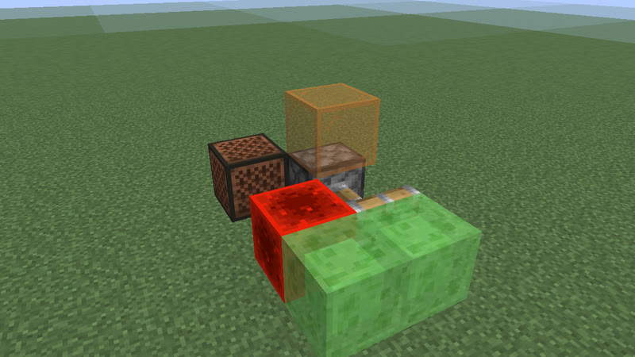</a> 6 gt (0.3 s) · note_block+redstone_block+sticky_piston · 5 blocks</td><td align="center"><a href="../archive/clk-obs-p6-rb-stk-5b-b-c0f8d1.txt">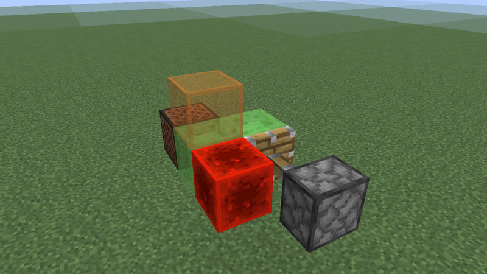</a> 6 gt (0.3 s) · redstone_block+sticky_piston · 5 blocks</td></tr>
</table>

## 7 gt (0.35 s)

<table>
<tr><td align="center"> 7 gt (0.35 s) · redstone_lamp+sticky_piston · 5 blocks</td><td align="center"> 7 gt (0.35 s) · sticky_piston · 5 blocks</td><td align="center"> 7 gt (0.35 s) · sticky_piston · 5 blocks</td></tr>
<tr><td align="center"> 7 gt (0.35 s) · redstone_lamp+sticky_piston · 5 blocks</td><td align="center"> 7 gt (0.35 s) · note_block+sticky_piston · 5 blocks</td><td align="center"> 7 gt (0.35 s) · note_block+observer+sticky_piston · 6 blocks</td></tr>
</table>

## 8 gt (0.4 s)

Also reachable by: clk-obs-obs-ring (n = 0).

<table>
<tr><td align="center"> 8 gt (0.4 s) · observer · 4 blocks</td><td align="center"> 8 gt (0.4 s) · note_block+observer+redstone_block+sticky_piston · 4 blocks</td><td align="center"> 8 gt (0.4 s) · note_block+observer+sticky_piston · 4 blocks</td></tr>
<tr><td align="center"> 8 gt (0.4 s) · note_block+observer+sticky_piston · 4 blocks</td><td align="center"> 8 gt (0.4 s) · iron_trapdoor+observer+redstone_block+sticky_piston · 4 blocks</td><td align="center"> 8 gt (0.4 s) · iron_trapdoor+observer+redstone_block+sticky_piston · 4 blocks</td></tr>
<tr><td align="center"> 8 gt (0.4 s) · observer+piston+redstone_block+sticky_piston · 4 blocks</td><td align="center"> 8 gt (0.4 s) · observer+redstone_block+sticky_piston · 4 blocks</td><td align="center"> 8 gt (0.4 s) · comparator+hopper · 4 blocks</td></tr>
<tr><td align="center"> 8 gt (0.4 s) · observer+piston+redstone_block+sticky_piston · 4 blocks</td><td align="center"> 8 gt (0.4 s) · observer+redstone_block+sticky_piston · 4 blocks</td><td align="center"> 8 gt (0.4 s) · observer+piston · 5 blocks also found as clk-obs-p8-obs-stk-5b-1a14af (built with sticky_piston, without piston)</td></tr>
<tr><td align="center"> 8 gt (0.4 s) · comparator+hopper · 7 blocks</td><td align="center"> 8 gt (0.4 s) · redstone_wire+repeater · 10 blocks</td></tr>
</table>

## 9 gt (0.45 s)

<table>
<tr><td align="center"> 9 gt (0.45 s) · piston+redstone_block · 5 blocks also found as clk-obs-p9-pis-rb-stk-5b-88a9aa (built with sticky_piston)</td><td align="center"><a href="../archive/clk-obs-p9-lamp-obs-rb-stk-6b-b-55bb34.txt">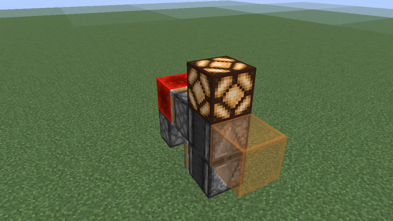</a> 9 gt (0.45 s) · observer+redstone_block+redstone_lamp+sticky_piston · 6 blocks</td><td align="center"> 9 gt (0.45 s) · observer+redstone_block+redstone_lamp+sticky_piston · 6 blocks</td></tr>
<tr><td align="center"> 9 gt (0.45 s) · note_block+observer+redstone_block+sticky_piston · 6 blocks</td><td align="center"><a href="../archive/clk-obs-p9-note-obs-rb-stk-6b-b-1dd67b.txt">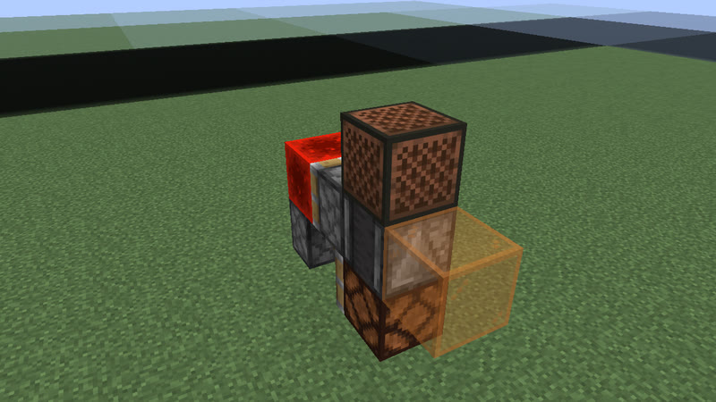</a> 9 gt (0.45 s) · note_block+observer+redstone_block+sticky_piston · 6 blocks</td><td align="center"> 9 gt (0.45 s) · comparator+hopper+redstone_wire · 8 blocks</td></tr>
</table>

## 10 gt (0.5 s)

Also reachable by: observer ring with a relay block (clk-obs-note-ring, n = 0).

<table>
<tr><td align="center"> 10 gt (0.5 s) · oak_leaves+observer+sticky_piston · 4 blocks</td><td align="center"> 10 gt (0.5 s) · oak_leaves+observer+sticky_piston · 5 blocks</td><td align="center"><a href="../archive/clk-misc-scaffold-a.txt">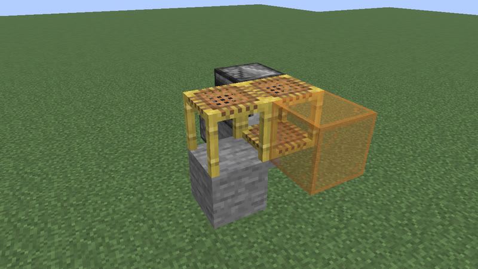</a> 10 gt (0.5 s) · observer+scaffolding+sticky_piston · 6 blocks</td></tr>
<tr><td align="center"> 10 gt (0.5 s) · iron_trapdoor+observer · 8 blocks</td><td align="center"> 10 gt (0.5 s) · comparator+redstone_torch+repeater · 8 blocks</td><td align="center"> 10 gt (0.5 s) · redstone_torch+repeater · 8 blocks</td></tr>
<tr><td align="center"> 10 gt (0.5 s) · comparator+redstone_torch+redstone_wire+repeater · 12 blocks</td><td align="center"> 10 gt (0.5 s) · redstone_torch+redstone_wire+repeater · 12 blocks</td><td align="center"> 10 gt (0.5 s) · redstone_torch+redstone_wire+repeater · 12 blocks</td></tr>
</table>

## 11 gt (0.55 s)

Also reachable by: clk-item-lockpair (n = 0), clk-obs-odd-a (n = 0).

<table>
<tr><td align="center"> 11 gt (0.55 s) · repeater · 16 blocks</td></tr>
</table>

## 12 gt (0.6 s)

Also reachable by: clk-obs-obs-ring (n = 1), clk-obs-divider (n = 0).

<table>
<tr><td align="center"> 12 gt (0.6 s) · copper_bulb+observer · 3 blocks</td><td align="center"> 12 gt (0.6 s) · copper_bulb+note_block+observer · 4 blocks</td><td align="center"> 12 gt (0.6 s) · observer+piston · 4 blocks</td></tr>
<tr><td align="center"> 12 gt (0.6 s) · observer+redstone_block+sticky_piston · 4 blocks</td><td align="center"> 12 gt (0.6 s) · observer+sticky_piston · 4 blocks</td><td align="center"> 12 gt (0.6 s) · copper_bulb+redstone_block+sticky_piston · 4 blocks</td></tr>
<tr><td align="center"> 12 gt (0.6 s) · observer+piston · 4 blocks</td><td align="center"><a href="../archive/clk-obs-p12-note-obs-pis-5b-b-17b1cc.txt">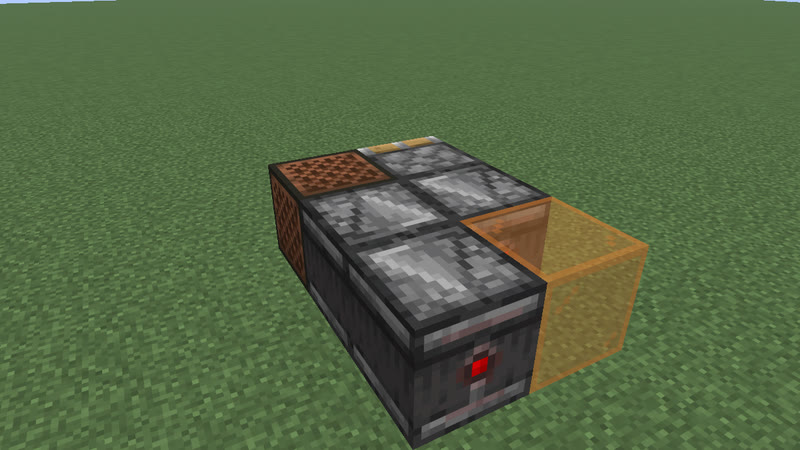</a> 12 gt (0.6 s) · note_block+observer+piston · 5 blocks</td><td align="center"> 12 gt (0.6 s) · redstone_block+redstone_lamp+sticky_piston · 5 blocks</td></tr>
<tr><td align="center"> 12 gt (0.6 s) · redstone_block+redstone_lamp+sticky_piston · 5 blocks</td><td align="center"> 12 gt (0.6 s) · note_block+redstone_block+sticky_piston · 5 blocks</td><td align="center"> 12 gt (0.6 s) · note_block+redstone_block+sticky_piston · 5 blocks</td></tr>
<tr><td align="center"> 12 gt (0.6 s) · redstone_block+sticky_piston · 5 blocks</td><td align="center"> 12 gt (0.6 s) · comparator · 16 blocks</td></tr>
</table>

## 13 gt (0.65 s)

Also reachable by: clk-item-lockpair (n = 1), clk-obs-odd-b (n = 0).

<table>
<tr><td align="center"> 13 gt (0.65 s) · observer+piston+redstone_lamp+sticky_piston · 6 blocks</td><td align="center"> 13 gt (0.65 s) · comparator+hopper+redstone_torch+redstone_wire · 9 blocks</td><td align="center"> 13 gt (0.65 s) · comparator+hopper+redstone_torch+redstone_wire · 9 blocks</td></tr>
<tr><td align="center"> 13 gt (0.65 s) · redstone_wire+repeater · 16 blocks</td></tr>
</table>

## 14 gt (0.7 s)

Also reachable by: observer ring with a relay block (clk-obs-note-ring, n = 1), hopper ring (clk-item-hopper-ring, n = 0).

<table>
<tr><td align="center"> 14 gt (0.7 s) · comparator+hopper · 4 blocks</td><td align="center"> 14 gt (0.7 s) · copper_bulb+redstone_lamp+sticky_piston · 5 blocks</td><td align="center"> 14 gt (0.7 s) · copper_bulb+sticky_piston · 5 blocks</td></tr>
<tr><td align="center"> 14 gt (0.7 s) · copper_bulb+sticky_piston · 5 blocks</td><td align="center"> 14 gt (0.7 s) · copper_bulb+redstone_lamp+sticky_piston · 5 blocks</td><td align="center"> 14 gt (0.7 s) · copper_bulb+note_block+sticky_piston · 5 blocks</td></tr>
<tr><td align="center"> 14 gt (0.7 s) · copper_bulb+note_block+observer+sticky_piston · 6 blocks</td><td align="center"> 14 gt (0.7 s) · copper_bulb+note_block+observer+piston+sticky_piston · 6 blocks</td><td align="center"> 14 gt (0.7 s) · redstone_torch+repeater · 8 blocks</td></tr>
<tr><td align="center"> 14 gt (0.7 s) · note_block+observer · 10 blocks</td><td align="center"> 14 gt (0.7 s) · iron_trapdoor+observer · 10 blocks</td><td align="center"> 14 gt (0.7 s) · redstone_torch+redstone_wire+repeater · 12 blocks</td></tr>
</table>

## 15 gt (0.75 s)

Also reachable by: clk-item-lockpair (n = 2), clk-obs-odd-a (n = 1).

<table>
<tr><td align="center"> 15 gt (0.75 s) · comparator+hopper+redstone_torch+repeater · 9 blocks</td><td align="center"> 15 gt (0.75 s) · redstone_wire+repeater · 16 blocks</td></tr>
</table>

## 16 gt (0.8 s)

Also reachable by: clk-obs-obs-ring (n = 2).

<table>
<tr><td align="center"> 16 gt (0.8 s) · copper_bulb+observer+redstone_block+sticky_piston · 4 blocks</td><td align="center"> 16 gt (0.8 s) · copper_bulb+observer · 5 blocks</td><td align="center"> 16 gt (0.8 s) · copper_bulb+note_block+observer+piston+redstone_block+sticky_piston · 6 blocks</td></tr>
<tr><td align="center"> 16 gt (0.8 s) · redstone_torch+repeater · 8 blocks</td><td align="center"> 16 gt (0.8 s) · comparator+redstone_torch+repeater · 12 blocks</td><td align="center"><a href="../archive/clk-misc-bubble-flip.txt">clk-misc-bubble-flip</a> 16 gt (0.8 s) · bubble_column+observer+redstone_wire+sticky_piston · 12 blocks (picture pending)</td></tr>
</table>

## 17 gt (0.85 s)

Also reachable by: clk-obs-odd-b (n = 1).

<table>
<tr><td align="center"> 17 gt (0.85 s) · comparator+hopper+redstone_torch+repeater · 9 blocks</td><td align="center"> 17 gt (0.85 s) · redstone_wire+repeater · 16 blocks</td></tr>
</table>

## 18 gt (0.9 s)

Also reachable by: observer ring with a relay block (clk-obs-note-ring, n = 2).

<table>
<tr><td align="center"> 18 gt (0.9 s) · observer+redstone_block+sticky_piston · 6 blocks</td><td align="center"> 18 gt (0.9 s) · copper_bulb+observer+redstone_block+redstone_lamp+sticky_piston · 7 blocks</td><td align="center"><a href="../archive/clk-obs-p18-bulb-lamp-obs-rb-stk-7b-b-cddaea.txt">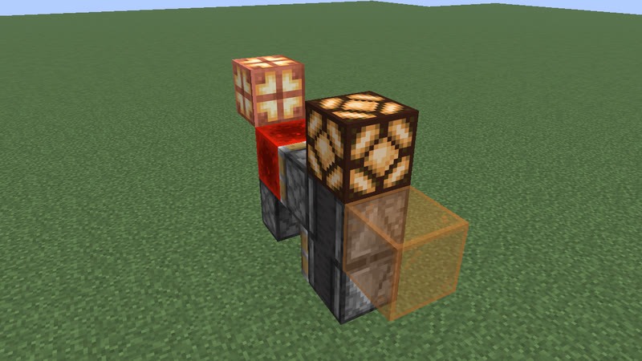</a> 18 gt (0.9 s) · copper_bulb+observer+redstone_block+redstone_lamp+sticky_piston · 7 blocks</td></tr>
<tr><td align="center"> 18 gt (0.9 s) · observer+piston+redstone_block+redstone_lamp+sticky_piston · 7 blocks</td><td align="center"> 18 gt (0.9 s) · note_block+observer+piston+redstone_block+sticky_piston · 7 blocks</td><td align="center"><a href="../archive/clk-misc-leaf-chain5-p18.txt">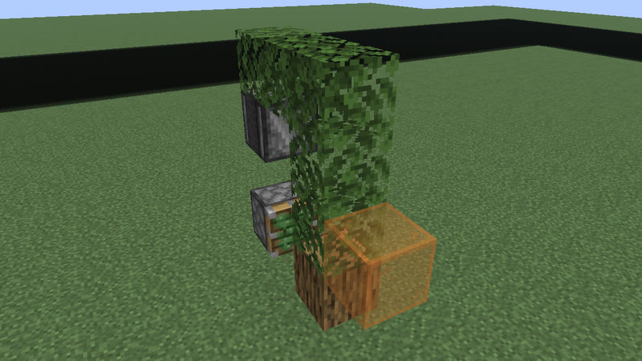</a> 18 gt (0.9 s) · oak_leaves+observer+sticky_piston · 8 blocks</td></tr>
<tr><td align="center"> 18 gt (0.9 s) · redstone_torch+repeater · 8 blocks</td><td align="center"> 18 gt (0.9 s) · comparator+hopper+redstone_wire+repeater · 9 blocks</td><td align="center"> 18 gt (0.9 s) · comparator+redstone_torch+repeater · 12 blocks</td></tr>
<tr><td align="center"> 18 gt (0.9 s) · redstone_torch+redstone_wire+repeater · 12 blocks</td></tr>
</table>

## 19 gt (0.95 s)

Also reachable by: clk-obs-odd-a (n = 2).

<table>
<tr><td align="center"> 19 gt (0.95 s) · comparator+dropper+hopper+repeater · 14 blocks</td><td align="center"> 19 gt (0.95 s) · redstone_wire+repeater · 16 blocks</td></tr>
</table>

## 20 gt (1 s)

Also reachable by: clk-obs-obs-ring (n = 3), clk-obs-bulb-ring (n = 0), clk-rt-uloop2t (n = 0).

<table>
<tr><td align="center"> 20 gt (1 s) · observer+redstone_block+sticky_piston · 5 blocks</td><td align="center"> 20 gt (1 s) · observer+sticky_piston · 5 blocks</td><td align="center"> 20 gt (1 s) · observer+sticky_piston · 5 blocks</td></tr>
<tr><td align="center"> 20 gt (1 s) · observer+piston+sticky_piston · 5 blocks</td><td align="center"> 20 gt (1 s) · observer+redstone_block+sticky_piston · 5 blocks</td><td align="center"> 20 gt (1 s) · observer+piston+sticky_piston · 5 blocks</td></tr>
<tr><td align="center"> 20 gt (1 s) · note_block+observer+redstone_block+sticky_piston · 6 blocks</td><td align="center"> 20 gt (1 s) · note_block+observer+sticky_piston · 6 blocks</td><td align="center"> 20 gt (1 s) · observer+redstone_block+redstone_lamp+sticky_piston · 6 blocks</td></tr>
<tr><td align="center"><a href="../archive/clk-obs-p20-lamp-note-obs-rb-stk-7b-6210cc.txt">clk-obs-p20-lamp-note-obs-rb-stk-7b-6210cc</a> 20 gt (1 s) · note_block+observer+redstone_block+redstone_lamp+sticky_piston · 7 blocks (picture pending)</td><td align="center"><a href="../archive/clk-obs-p20-lamp-obs-pis-rb-stk-7b-60e89a.txt">clk-obs-p20-lamp-obs-pis-rb-stk-7b-60e89a</a> 20 gt (1 s) · observer+piston+redstone_block+redstone_lamp+sticky_piston · 7 blocks (picture pending)</td><td align="center"> 20 gt (1 s) · copper_bulb+observer+piston+redstone_lamp+sticky_piston · 7 blocks</td></tr>
<tr><td align="center"> 20 gt (1 s) · comparator+redstone_torch+redstone_wire+repeater · 9 blocks</td><td align="center"> 20 gt (1 s) · redstone_torch+redstone_wire+repeater · 9 blocks</td><td align="center"> 20 gt (1 s) · comparator+hopper+redstone_torch+repeater · 9 blocks</td></tr>
<tr><td align="center"><a href="../archive/clk-misc-leaf-chain6.txt">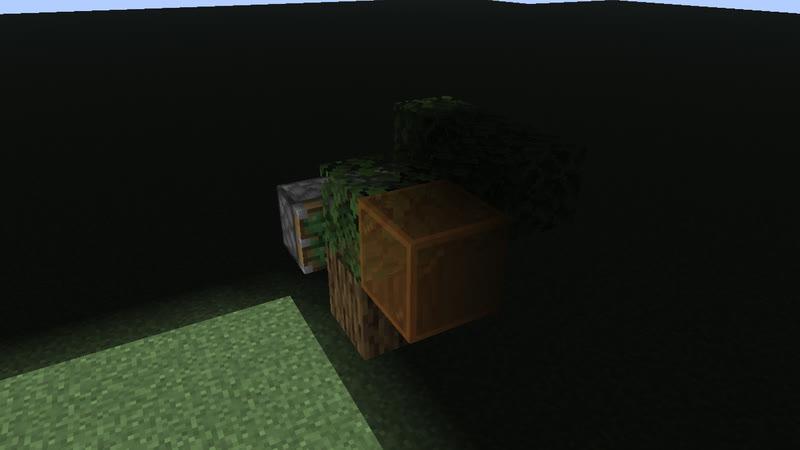</a> 20 gt (1 s) · oak_leaves+observer+sticky_piston · 9 blocks</td><td align="center"> 20 gt (1 s) · comparator+dropper+hopper · 10 blocks</td><td align="center"> 20 gt (1 s) · comparator+redstone_torch+repeater · 12 blocks</td></tr>
<tr><td align="center"> 20 gt (1 s) · repeater · 12 blocks</td></tr>
</table>

## 21 gt (1.05 s)

Also reachable by: clk-obs-odd-b (n = 2), hopper ring (clk-item-hopper-ring-2, n = 2).

<table>
<tr><td align="center"> 21 gt (1.05 s) · calibrated_sculk_sensor+dispenser+observer · 5 blocks</td><td align="center"><a href="../archive/census-p21-calibrated_sculk_sensor-note_block-observer-piston-sticky_piston-6b.txt">census-p21-calibrated_sculk_sensor-note_block-observer-piston-sticky_piston-6b</a> 21 gt (1.05 s) · calibrated_sculk_sensor+note_block+observer+piston+sticky_piston · 6 blocks (picture pending)</td><td align="center"><a href="../archive/census-p21-calibrated_sculk_sensor-oak_trapdoor-observer-piston-sticky_piston-6b.txt">census-p21-calibrated_sculk_sensor-oak_trapdoor-observer-piston-sticky_piston-6b</a> 21 gt (1.05 s) · calibrated_sculk_sensor+oak_trapdoor+observer+piston+sticky_piston · 6 blocks (picture pending)</td></tr>
<tr><td align="center"><a href="../archive/census-p21-calibrated_sculk_sensor-observer-piston-6b.txt">census-p21-calibrated_sculk_sensor-observer-piston-6b</a> 21 gt (1.05 s) · calibrated_sculk_sensor+observer+piston · 6 blocks (picture pending)</td><td align="center"> 21 gt (1.05 s) · calibrated_sculk_sensor+note_block+redstone_torch+repeater · 6 blocks</td><td align="center"> 21 gt (1.05 s) · calibrated_sculk_sensor+piston+redstone_wire+repeater · 10 blocks</td></tr>
<tr><td align="center"> 21 gt (1.05 s) · comparator+dropper+hopper+repeater · 14 blocks</td><td align="center"> 21 gt (1.05 s) · repeater · 16 blocks</td></tr>
</table>

## 22 gt (1.1 s)

Also reachable by: observer ring with a relay block (clk-obs-note-ring, n = 3).

<table>
<tr><td align="center"> 22 gt (1.1 s) · calibrated_sculk_sensor+oak_trapdoor+observer+repeater · 5 blocks</td><td align="center"> 22 gt (1.1 s) · calibrated_sculk_sensor+oak_fence_gate+observer+sticky_piston · 5 blocks</td><td align="center"> 22 gt (1.1 s) · calibrated_sculk_sensor+iron_trapdoor+observer+sticky_piston · 5 blocks</td></tr>
<tr><td align="center"> 22 gt (1.1 s) · calibrated_sculk_sensor+note_block+observer+repeater · 5 blocks</td><td align="center"> 22 gt (1.1 s) · calibrated_sculk_sensor+dispenser+observer+repeater · 5 blocks</td><td align="center"> 22 gt (1.1 s) · calibrated_sculk_sensor+dispenser+observer · 5 blocks</td></tr>
<tr><td align="center"> 22 gt (1.1 s) · calibrated_sculk_sensor+dispenser+observer+sticky_piston · 5 blocks</td><td align="center"> 22 gt (1.1 s) · calibrated_sculk_sensor+iron_trapdoor+observer · 6 blocks</td><td align="center"> 22 gt (1.1 s) · calibrated_sculk_sensor+oak_fence_gate+observer · 6 blocks</td></tr>
<tr><td align="center"> 22 gt (1.1 s) · calibrated_sculk_sensor+oak_trapdoor+observer · 6 blocks</td><td align="center"><a href="../archive/clk-obs-p22-lamp-obs-pis-stk-7b-b-17ef94.txt">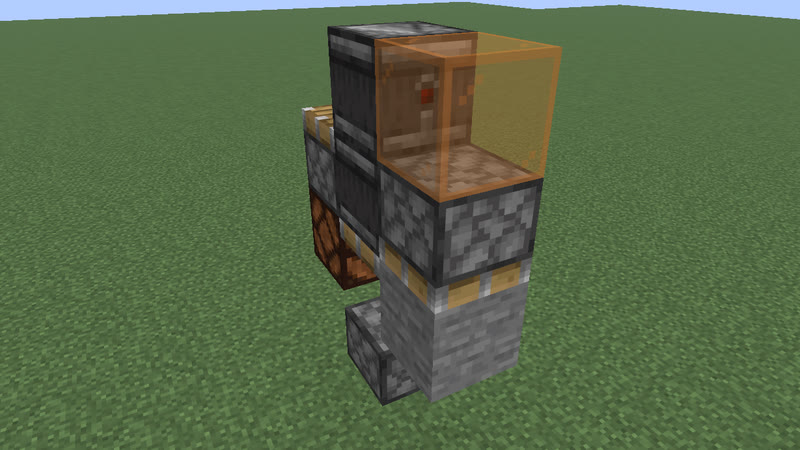</a> 22 gt (1.1 s) · observer+piston+redstone_lamp+sticky_piston · 7 blocks</td><td align="center"><a href="../archive/clk-obs-p22-lamp-obs-stk-7b-b-01e6be.txt">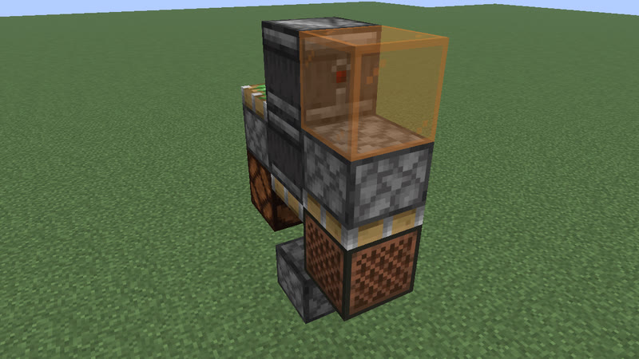</a> 22 gt (1.1 s) · observer+redstone_lamp+sticky_piston · 7 blocks</td></tr>
<tr><td align="center"> 22 gt (1.1 s) · comparator+redstone_torch+repeater · 12 blocks</td><td align="center"> 22 gt (1.1 s) · comparator+redstone_torch+redstone_wire+repeater · 12 blocks</td><td align="center"> 22 gt (1.1 s) · redstone_torch+repeater · 12 blocks</td></tr>
<tr><td align="center"> 22 gt (1.1 s) · redstone_torch+redstone_wire+repeater · 12 blocks</td><td align="center"> 22 gt (1.1 s) · comparator+repeater · 12 blocks</td><td align="center"> 22 gt (1.1 s) · repeater · 12 blocks</td></tr>
<tr><td align="center"> 22 gt (1.1 s) · comparator+dropper+hopper+repeater · 18 blocks</td></tr>
</table>

## 23 gt (1.15 s)

Also reachable by: clk-obs-odd-a (n = 3), clk-rt-odd-rect (n = 0), clk-sculk-hairpin-dispenser (n = 1).

<table>
<tr><td align="center"> 23 gt (1.15 s) · calibrated_sculk_sensor+note_block+observer+piston · 4 blocks also found as census-p23-calibrated_sculk_sensor-note_block-observer-sticky_piston-4b (built with sticky_piston, without piston)</td><td align="center"> 23 gt (1.15 s) · calibrated_sculk_sensor+note_block+observer+repeater · 5 blocks</td><td align="center"> 23 gt (1.15 s) · calibrated_sculk_sensor+oak_trapdoor+observer+sticky_piston · 5 blocks</td></tr>
<tr><td align="center"> 23 gt (1.15 s) · calibrated_sculk_sensor+observer+piston+sticky_piston · 5 blocks</td><td align="center"> 23 gt (1.15 s) · calibrated_sculk_sensor+observer+sticky_piston · 5 blocks</td><td align="center"> 23 gt (1.15 s) · calibrated_sculk_sensor+dispenser+observer+repeater · 5 blocks</td></tr>
<tr><td align="center"> 23 gt (1.15 s) · calibrated_sculk_sensor+observer+piston · 5 blocks</td><td align="center"> 23 gt (1.15 s) · calibrated_sculk_sensor+iron_trapdoor+observer+sticky_piston · 5 blocks</td><td align="center"> 23 gt (1.15 s) · calibrated_sculk_sensor+oak_fence_gate+observer+sticky_piston · 5 blocks</td></tr>
<tr><td align="center"> 23 gt (1.15 s) · calibrated_sculk_sensor+iron_trapdoor+observer · 6 blocks</td><td align="center"> 23 gt (1.15 s) · calibrated_sculk_sensor+oak_fence_gate+observer · 6 blocks</td><td align="center"> 23 gt (1.15 s) · calibrated_sculk_sensor+oak_trapdoor+observer · 6 blocks</td></tr>
<tr><td align="center"> 23 gt (1.15 s) · redstone_wire+repeater · 18 blocks</td></tr>
</table>

## 24 gt (1.2 s)

Also reachable by: clk-obs-obs-ring (n = 4), clk-obs-divider (n = 1).

<table>
<tr><td align="center"> 24 gt (1.2 s) · calibrated_sculk_sensor+oak_fence_gate+observer · 3 blocks</td><td align="center"> 24 gt (1.2 s) · calibrated_sculk_sensor+iron_trapdoor+observer · 3 blocks</td><td align="center"> 24 gt (1.2 s) · calibrated_sculk_sensor+oak_trapdoor+observer · 3 blocks</td></tr>
<tr><td align="center"> 24 gt (1.2 s) · calibrated_sculk_sensor+oak_trapdoor+observer · 3 blocks</td><td align="center"> 24 gt (1.2 s) · calibrated_sculk_sensor+observer+piston · 3 blocks also found as census-p24-calibrated_sculk_sensor-observer-sticky_piston-3b (built with sticky_piston, without piston)</td><td align="center"> 24 gt (1.2 s) · calibrated_sculk_sensor+note_block+observer · 3 blocks</td></tr>
<tr><td align="center"> 24 gt (1.2 s) · calibrated_sculk_sensor+observer+sticky_piston · 3 blocks</td><td align="center"> 24 gt (1.2 s) · observer+sticky_piston · 4 blocks</td><td align="center"> 24 gt (1.2 s) · calibrated_sculk_sensor+dispenser+observer+piston+sticky_piston · 5 blocks</td></tr>
<tr><td align="center"> 24 gt (1.2 s) · copper_bulb+observer+piston · 5 blocks also found as clk-obs-p24-bulb-obs-stk-5b-fe7000 (built with sticky_piston, without piston)</td><td align="center"> 24 gt (1.2 s) · copper_bulb+observer+redstone_block+sticky_piston · 5 blocks</td><td align="center"> 24 gt (1.2 s) · observer+sticky_piston · 5 blocks</td></tr>
<tr><td align="center"> 24 gt (1.2 s) · copper_bulb+observer+piston · 5 blocks also found as clk-obs-p24-bulb-obs-stk-5b-b-b9ef2e (built with sticky_piston, without piston)</td><td align="center"> 24 gt (1.2 s) · note_block+observer+piston+redstone_block+sticky_piston · 5 blocks</td><td align="center"> 24 gt (1.2 s) · note_block+observer+redstone_block+sticky_piston · 5 blocks</td></tr>
<tr><td align="center"> 24 gt (1.2 s) · note_block+observer+piston+redstone_block+sticky_piston · 5 blocks</td><td align="center"> 24 gt (1.2 s) · note_block+observer+redstone_block+sticky_piston · 5 blocks</td><td align="center"> 24 gt (1.2 s) · observer+piston+redstone_block+sticky_piston · 5 blocks</td></tr>
<tr><td align="center"> 24 gt (1.2 s) · observer+piston+redstone_block+sticky_piston · 5 blocks</td><td align="center"> 24 gt (1.2 s) · observer+redstone_block+sticky_piston · 5 blocks</td><td align="center"> 24 gt (1.2 s) · observer+redstone_block+sticky_piston · 5 blocks</td></tr>
<tr><td align="center"> 24 gt (1.2 s) · copper_bulb+note_block+observer+sticky_piston · 6 blocks</td><td align="center"> 24 gt (1.2 s) · comparator+redstone_torch+redstone_wire+repeater · 9 blocks</td><td align="center"> 24 gt (1.2 s) · redstone_torch+redstone_wire+repeater · 9 blocks</td></tr>
<tr><td align="center"> 24 gt (1.2 s) · comparator+redstone_torch+repeater · 12 blocks</td><td align="center"> 24 gt (1.2 s) · redstone_torch+repeater · 12 blocks</td><td align="center"> 24 gt (1.2 s) · comparator+repeater · 12 blocks</td></tr>
<tr><td align="center"> 24 gt (1.2 s) · repeater · 12 blocks</td></tr>
</table>

## 25 gt (1.25 s)

Also reachable by: clk-obs-odd-b (n = 3).

<table>
<tr><td align="center"> 25 gt (1.25 s) · calibrated_sculk_sensor+oak_trapdoor+observer · 4 blocks</td><td align="center"> 25 gt (1.25 s) · calibrated_sculk_sensor+note_block+observer · 4 blocks</td><td align="center"> 25 gt (1.25 s) · comparator+hopper+redstone_wire+repeater · 9 blocks</td></tr>
<tr><td align="center"><a href="../archive/kit-shuttle-minecart-p25-11b.txt">kit-shuttle-minecart-p25-11b</a> 25 gt (1.25 s) · detector_rail+minecart · 11 blocks (picture pending)</td><td align="center"> 25 gt (1.25 s) · comparator+dropper+hopper+repeater · 16 blocks</td><td align="center"> 25 gt (1.25 s) · repeater · 19 blocks</td></tr>
</table>

## 26 gt (1.3 s)

Also reachable by: observer ring with a relay block (clk-obs-note-ring, n = 4), clk-misc-cart-loop (n = 0), clk-sculk-replin-dispenser (n = 2).

<table>
<tr><td align="center"> 26 gt (1.3 s) · calibrated_sculk_sensor+oak_trapdoor+observer · 4 blocks</td><td align="center"> 26 gt (1.3 s) · calibrated_sculk_sensor+oak_fence_gate+observer · 4 blocks</td><td align="center"> 26 gt (1.3 s) · calibrated_sculk_sensor+iron_trapdoor+observer · 4 blocks</td></tr>
<tr><td align="center"> 26 gt (1.3 s) · comparator+redstone_torch+repeater · 12 blocks</td><td align="center"> 26 gt (1.3 s) · redstone_torch+redstone_wire+repeater · 12 blocks</td><td align="center"> 26 gt (1.3 s) · comparator+repeater · 12 blocks</td></tr>
<tr><td align="center"> 26 gt (1.3 s) · comparator+dropper+hopper+repeater · 16 blocks</td></tr>
</table>

## 27 gt (1.35 s)

Also reachable by: clk-obs-odd-a (n = 4), dropper ring (clk-item-dropring-1d, n = 0).

<table>
<tr><td align="center"> 27 gt (1.35 s) · calibrated_sculk_sensor+oak_trapdoor+observer · 4 blocks</td><td align="center"> 27 gt (1.35 s) · calibrated_sculk_sensor+oak_fence_gate+observer · 4 blocks</td><td align="center"> 27 gt (1.35 s) · calibrated_sculk_sensor+iron_trapdoor+observer · 4 blocks</td></tr>
<tr><td align="center"> 27 gt (1.35 s) · calibrated_sculk_sensor+dispenser+observer+piston · 5 blocks also found as clk-sculk-hyb3b-p27-3 (built with sticky_piston, without piston)</td><td align="center"> 27 gt (1.35 s) · repeater · 19 blocks</td></tr>
</table>

## 28 gt (1.4 s)

Also reachable by: clk-obs-obs-ring (n = 5), hopper ring (clk-item-hopper-ring, n = 1), clk-obs-bulb-ring (n = 1).

<table>
<tr><td align="center"> 28 gt (1.4 s) · calibrated_sculk_sensor+dispenser+observer · 3 blocks</td><td align="center"> 28 gt (1.4 s) · calibrated_sculk_sensor+dispenser+observer · 3 blocks</td><td align="center"> 28 gt (1.4 s) · observer+piston · 6 blocks</td></tr>
<tr><td align="center"> 28 gt (1.4 s) · redstone_torch+redstone_wire+repeater · 9 blocks</td><td align="center"> 28 gt (1.4 s) · copper_bulb+observer · 10 blocks</td><td align="center"> 28 gt (1.4 s) · comparator+redstone_torch+repeater · 12 blocks</td></tr>
<tr><td align="center"> 28 gt (1.4 s) · repeater · 12 blocks</td><td align="center"><a href="../archive/kit-shuttle-minecart-p28-13b.txt">kit-shuttle-minecart-p28-13b</a> 28 gt (1.4 s) · detector_rail+minecart · 13 blocks (picture pending)</td><td align="center"> 28 gt (1.4 s) · comparator+repeater · 16 blocks</td></tr>
<tr><td align="center"> 28 gt (1.4 s) · comparator+dropper+hopper+repeater · 16 blocks</td><td align="center"><a href="../archive/clk-misc-bookshelf-cart-b2.txt">clk-misc-bookshelf-cart-b2</a> 28 gt (1.4 s) · chiseled_bookshelf+hopper+hopper_minecart · 20 blocks (picture pending)</td></tr>
</table>

## 29 gt (1.45 s)

Also reachable by: clk-obs-odd-b (n = 4).

<table>
<tr><td align="center"> 29 gt (1.45 s) · calibrated_sculk_sensor+dispenser+observer · 4 blocks</td><td align="center"> 29 gt (1.45 s) · calibrated_sculk_sensor+dispenser+observer · 4 blocks</td><td align="center"><a href="../archive/kit-shuttle-minecart-p29-13b.txt">kit-shuttle-minecart-p29-13b</a> 29 gt (1.45 s) · detector_rail+minecart · 13 blocks (picture pending)</td></tr>
<tr><td align="center"> 29 gt (1.45 s) · comparator+dropper+hopper+repeater · 14 blocks</td><td align="center"> 29 gt (1.45 s) · repeater · 20 blocks</td></tr>
</table>

## 30 gt (1.5 s)

Also reachable by: observer ring with a relay block (clk-obs-note-ring, n = 5), clk-item-latch (n = 0).

<table>
<tr><td align="center"> 30 gt (1.5 s) · calibrated_sculk_sensor+dispenser+observer · 4 blocks</td><td align="center"> 30 gt (1.5 s) · calibrated_sculk_sensor+dispenser+observer · 4 blocks</td><td align="center"> 30 gt (1.5 s) · note_block+observer+sticky_piston · 6 blocks</td></tr>
<tr><td align="center"><a href="../archive/clk-obs-p30-lamp-obs-pis-7b-5c5b87.txt">clk-obs-p30-lamp-obs-pis-7b-5c5b87</a> 30 gt (1.5 s) · observer+piston+redstone_lamp · 7 blocks (picture pending)</td><td align="center"><a href="../archive/clk-obs-p30-note-obs-pis-8b-96700c.txt">clk-obs-p30-note-obs-pis-8b-96700c</a> 30 gt (1.5 s) · note_block+observer+piston · 8 blocks (picture pending)</td><td align="center"> 30 gt (1.5 s) · comparator+hopper · 10 blocks</td></tr>
<tr><td align="center"><a href="../archive/kit-shuttle-minecart-p30-11b.txt">kit-shuttle-minecart-p30-11b</a> 30 gt (1.5 s) · detector_rail+minecart · 11 blocks (picture pending)</td><td align="center"> 30 gt (1.5 s) · redstone_torch+repeater · 12 blocks</td><td align="center"> 30 gt (1.5 s) · repeater · 12 blocks</td></tr>
<tr><td align="center"> 30 gt (1.5 s) · comparator+repeater · 16 blocks</td></tr>
</table>

## 31 gt (1.55 s)

Also reachable by: clk-obs-odd-a (n = 5), clk-rt-odd-rect (n = 1), clk-misc-cart-loop (n = 1), dropper ring (clk-item-dropring-2d-r2, n = 0), clk-sculk-replin (one block swapped: 2 versions) (clk-sculk-replin, n = 3).

<table>
<tr><td align="center"> 31 gt (1.55 s) · calibrated_sculk_sensor+dispenser+observer · 4 blocks</td><td align="center"> 31 gt (1.55 s) · calibrated_sculk_sensor+dispenser+observer · 4 blocks</td></tr>
</table>

## 32 gt (1.6 s)

Also reachable by: clk-obs-obs-ring (n = 6), clk-rt-rect-pulse (n = 0).

<table>
<tr><td align="center"> 32 gt (1.6 s) · calibrated_sculk_sensor+dispenser+observer · 5 blocks</td><td align="center"> 32 gt (1.6 s) · copper_bulb+observer+redstone_block+sticky_piston · 6 blocks</td><td align="center"> 32 gt (1.6 s) · copper_bulb+observer+sticky_piston · 6 blocks</td></tr>
<tr><td align="center"> 32 gt (1.6 s) · observer+sticky_piston · 6 blocks</td><td align="center"> 32 gt (1.6 s) · observer+sticky_piston · 6 blocks</td><td align="center"><a href="../archive/clk-obs-p32-obs-stk-6b-b-482603.txt">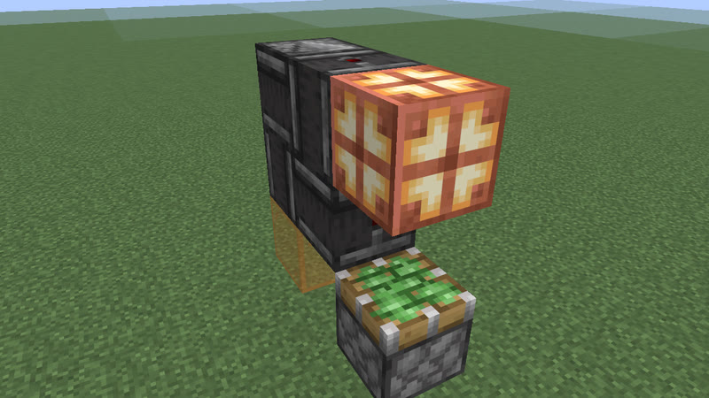</a> 32 gt (1.6 s) · observer+sticky_piston · 6 blocks</td></tr>
<tr><td align="center"> 32 gt (1.6 s) · copper_bulb+observer+piston+redstone_block+sticky_piston · 6 blocks</td><td align="center"><a href="../archive/clk-obs-p32-bulb-obs-pis-rb-stk-6b-b-294529.txt">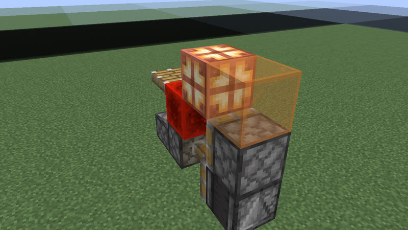</a> 32 gt (1.6 s) · copper_bulb+observer+piston+redstone_block+sticky_piston · 6 blocks</td><td align="center"><a href="../archive/clk-obs-p32-bulb-obs-rb-stk-6b-b-8feae3.txt">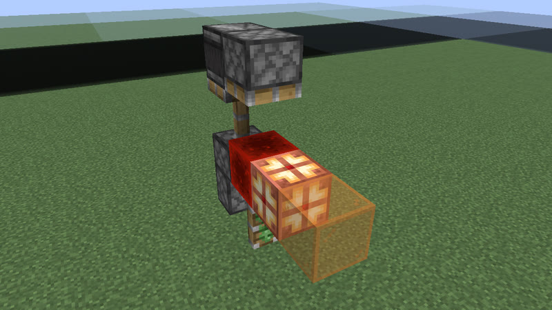</a> 32 gt (1.6 s) · copper_bulb+observer+redstone_block+sticky_piston · 6 blocks</td></tr>
<tr><td align="center"> 32 gt (1.6 s) · note_block+observer+sticky_piston · 6 blocks</td><td align="center"> 32 gt (1.6 s) · redstone_torch+repeater · 12 blocks</td><td align="center"> 32 gt (1.6 s) · comparator+repeater · 16 blocks</td></tr>
<tr><td align="center"> 32 gt (1.6 s) · comparator+dropper+hopper+repeater · 18 blocks</td></tr>
</table>

## 33 gt (1.65 s)

Also reachable by: clk-obs-odd-b (n = 5), dropper ring (clk-item-dropring-2d-r3, n = 0), lock ring (clk-item-lockring-2s, n = 0).

<table>
<tr><td align="center"> 33 gt (1.65 s) · calibrated_sculk_sensor+note_block+observer · 6 blocks</td><td align="center"> 33 gt (1.65 s) · note_block+observer+sticky_piston · 7 blocks</td><td align="center"><a href="../archive/clk-obs-p33-note-obs-stk-7b-b-571777.txt">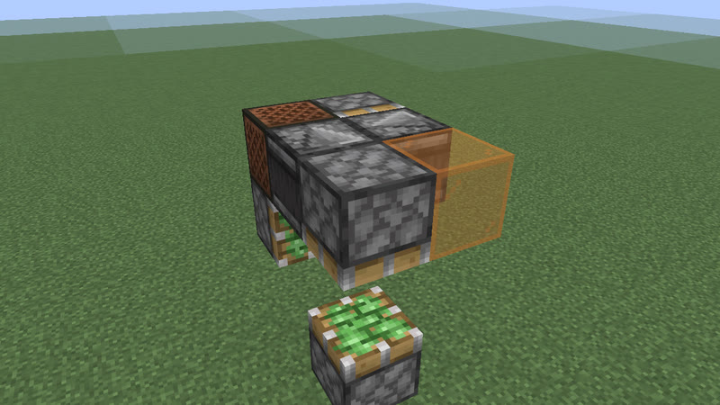</a> 33 gt (1.65 s) · note_block+observer+sticky_piston · 7 blocks</td></tr>
<tr><td align="center"> 33 gt (1.65 s) · observer+sticky_piston · 7 blocks</td><td align="center"><a href="../archive/kit-shuttle-minecart-p33-13b.txt">kit-shuttle-minecart-p33-13b</a> 33 gt (1.65 s) · detector_rail+minecart · 13 blocks (picture pending)</td><td align="center"> 33 gt (1.65 s) · repeater · 23 blocks</td></tr>
</table>

## 34 gt (1.7 s)

Also reachable by: observer ring with a relay block (clk-obs-note-ring, n = 6), dropper ring (clk-item-dropring-2d, n = 0).

<table>
<tr><td align="center"><a href="../archive/clk-sculk-two-p34-1.txt">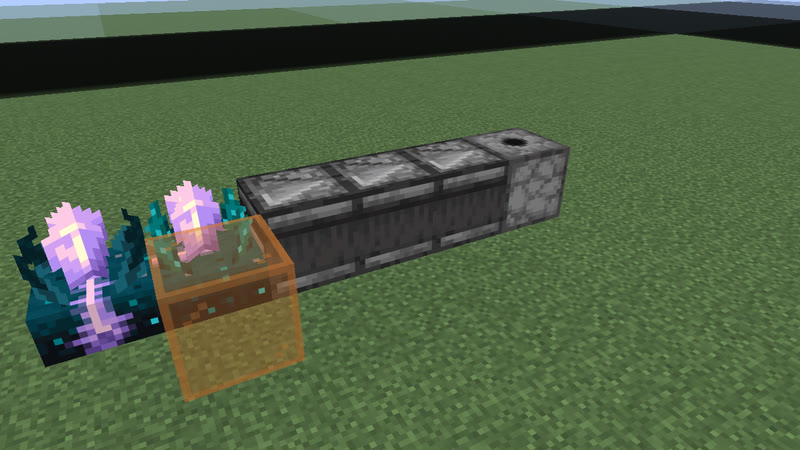</a> 34 gt (1.7 s) · calibrated_sculk_sensor+dispenser+observer · 6 blocks</td><td align="center"> 34 gt (1.7 s) · redstone_torch+repeater · 12 blocks</td><td align="center"><a href="../archive/kit-shuttle-minecart-p34-15b.txt">kit-shuttle-minecart-p34-15b</a> 34 gt (1.7 s) · detector_rail+minecart · 15 blocks (picture pending)</td></tr>
<tr><td align="center"> 34 gt (1.7 s) · redstone_wire+repeater · 16 blocks</td><td align="center"> 34 gt (1.7 s) · comparator+repeater · 16 blocks</td></tr>
</table>

## 35 gt (1.75 s)

Also reachable by: clk-obs-odd-a (n = 6), hopper ring (clk-item-hopper-ring-2, n = 4), clk-sculk-replin-dispenser (n = 3), dropper ring (clk-item-dropring-2d-r4, n = 0), lock ring (clk-item-lockring-2s, n = 1), clk-sculk-hairpin (one block swapped: 2 versions) (clk-sculk-hairpin, n = 2).

<table>
<tr><td align="center"> 35 gt (1.75 s) · calibrated_sculk_sensor+note_block · 6 blocks</td><td align="center"><a href="../archive/kit-shuttle-minecart-p35-15b.txt">kit-shuttle-minecart-p35-15b</a> 35 gt (1.75 s) · detector_rail+minecart · 15 blocks (picture pending)</td><td align="center"> 35 gt (1.75 s) · repeater · 23 blocks</td></tr>
</table>

## 36 gt (1.8 s)

Also reachable by: clk-obs-obs-ring (n = 7), clk-obs-bulb-ring (n = 2), clk-rt-uloop2t (n = 1), clk-misc-cart-loop (n = 2), dropper ring (clk-item-dropring-1d-r1, n = 0), clk-rt-uloop1t (n = 0).

<table>
<tr><td align="center"> 36 gt (1.8 s) · observer+sticky_piston · 6 blocks</td><td align="center"> 36 gt (1.8 s) · observer+sticky_piston · 6 blocks</td><td align="center"> 36 gt (1.8 s) · calibrated_sculk_sensor+note_block · 6 blocks</td></tr>
<tr><td align="center"><a href="../archive/clk-obs-p36-bulb-note-obs-pis-7b-9c92c8.txt">clk-obs-p36-bulb-note-obs-pis-7b-9c92c8</a> 36 gt (1.8 s) · copper_bulb+note_block+observer+piston · 7 blocks (picture pending)</td><td align="center"><a href="../archive/clk-obs-p36-bulb-obs-pis-7b-3615d3.txt">clk-obs-p36-bulb-obs-pis-7b-3615d3</a> 36 gt (1.8 s) · copper_bulb+observer+piston · 7 blocks (picture pending)</td><td align="center"><a href="../archive/clk-obs-p36-note-obs-pis-7b-0265ec.txt">clk-obs-p36-note-obs-pis-7b-0265ec</a> 36 gt (1.8 s) · note_block+observer+piston · 7 blocks (picture pending)</td></tr>
<tr><td align="center"><a href="../archive/clk-obs-p36-obs-pis-rb-stk-7b-b-4d4360.txt">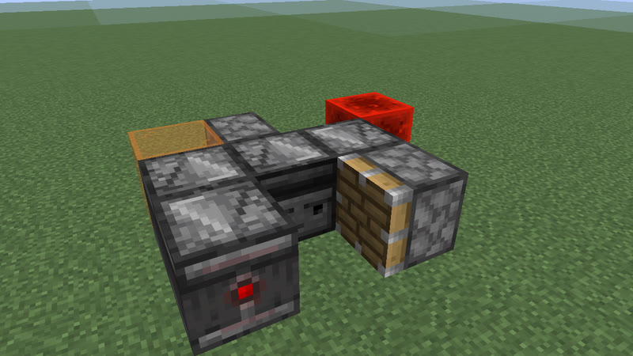</a> 36 gt (1.8 s) · observer+piston+redstone_block+sticky_piston · 7 blocks</td><td align="center"><a href="../archive/clk-obs-p36-obs-pis-stk-7b-b-0cfa62.txt">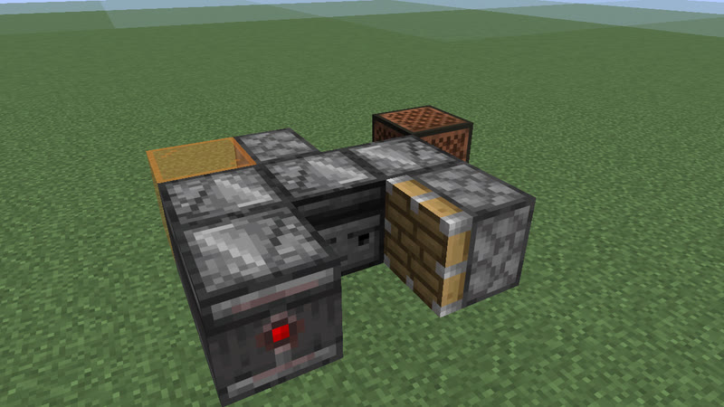</a> 36 gt (1.8 s) · observer+piston+sticky_piston · 7 blocks</td><td align="center"><a href="../archive/clk-obs-p36-bulb-lamp-obs-pis-rb-stk-8b-0ce997.txt">clk-obs-p36-bulb-lamp-obs-pis-rb-stk-8b-0ce997</a> 36 gt (1.8 s) · copper_bulb+observer+piston+redstone_block+redstone_lamp+sticky_piston · 8 blocks (picture pending)</td></tr>
<tr><td align="center"> 36 gt (1.8 s) · comparator+redstone_torch+redstone_wire+repeater · 12 blocks</td><td align="center"><a href="../archive/kit-shuttle-minecart-p36-15b.txt">kit-shuttle-minecart-p36-15b</a> 36 gt (1.8 s) · detector_rail+minecart · 15 blocks (picture pending)</td><td align="center"> 36 gt (1.8 s) · redstone_wire+repeater · 16 blocks</td></tr>
<tr><td align="center"> 36 gt (1.8 s) · comparator+repeater · 16 blocks</td></tr>
</table>

## 37 gt (1.85 s)

Also reachable by: clk-obs-odd-b (n = 6), lock ring (clk-item-lockring-2s, n = 2), clk-misc-cart-pingpong (n = 0).

<table>
<tr><td align="center"> 37 gt (1.85 s) · calibrated_sculk_sensor+note_block · 6 blocks</td><td align="center"><a href="../archive/kit-shuttle-minecart-p37-15b.txt">kit-shuttle-minecart-p37-15b</a> 37 gt (1.85 s) · detector_rail+minecart · 15 blocks (picture pending)</td><td align="center"> 37 gt (1.85 s) · repeater · 24 blocks</td></tr>
</table>

## 38 gt (1.9 s)

Also reachable by: observer ring with a relay block (clk-obs-note-ring, n = 7), dropper ring (clk-item-dropring-1d-r2, n = 0).

<table>
<tr><td align="center"> 38 gt (1.9 s) · calibrated_sculk_sensor+note_block · 6 blocks</td><td align="center"><a href="../archive/kit-shuttle-minecart-p38-15b.txt">kit-shuttle-minecart-p38-15b</a> 38 gt (1.9 s) · detector_rail+minecart · 15 blocks (picture pending)</td><td align="center"> 38 gt (1.9 s) · redstone_torch+repeater · 16 blocks</td></tr>
<tr><td align="center"> 38 gt (1.9 s) · redstone_wire+repeater · 16 blocks</td><td align="center"> 38 gt (1.9 s) · comparator+repeater · 16 blocks</td></tr>
</table>

## 39 gt (1.95 s)

Also reachable by: clk-obs-odd-a (n = 7), clk-rt-odd-rect (n = 2), clk-sculk-hairpin-dispenser (n = 2), lock ring (clk-item-lockring-2s, n = 3).

<table>
<tr><td align="center"> 39 gt (1.95 s) · calibrated_sculk_sensor+note_block · 6 blocks</td><td align="center"><a href="../archive/kit-shuttle-minecart-p39-17b.txt">kit-shuttle-minecart-p39-17b</a> 39 gt (1.95 s) · detector_rail+minecart · 17 blocks (picture pending)</td></tr>
</table>

## 40 gt (2 s)

Also reachable by: clk-obs-obs-ring (n = 8), dropper ring (clk-item-dropring-1d-r3, n = 0), clk-sculk-replin (one block swapped: 2 versions) (clk-sculk-replin, n = 4).

<table>
<tr><td align="center"> 40 gt (2 s) · daylight_detector+observer+sticky_piston · 5 blocks</td><td align="center"> 40 gt (2 s) · copper_bulb+observer+redstone_block+sticky_piston · 6 blocks</td><td align="center"> 40 gt (2 s) · copper_bulb+observer+sticky_piston · 6 blocks</td></tr>
<tr><td align="center"> 40 gt (2 s) · copper_bulb+observer+sticky_piston · 6 blocks</td><td align="center"> 40 gt (2 s) · calibrated_sculk_sensor+note_block · 6 blocks</td><td align="center"> 40 gt (2 s) · copper_bulb+note_block+observer+sticky_piston · 7 blocks</td></tr>
<tr><td align="center"><a href="../archive/clk-obs-p40-bulb-note-obs-stk-7b-b-d56d78.txt">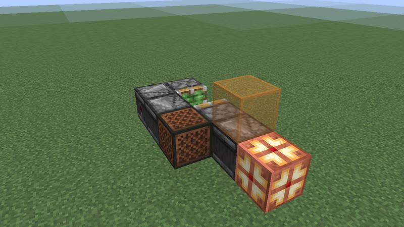</a> 40 gt (2 s) · copper_bulb+note_block+observer+sticky_piston · 7 blocks</td><td align="center"> 40 gt (2 s) · redstone_wire+repeater · 16 blocks</td><td align="center"> 40 gt (2 s) · comparator+repeater · 16 blocks</td></tr>
</table>

[catalog index](../CATALOG.md) · next: [p41-101](p41-101.md)
