# Clocks: 40 gt (2 s) to 47 gt (2.35 s) (282 clocks)

[catalog index](../CATALOG.md) · previous: [p29-39](p29-39.md) · next: [p48-65](p48-65.md)

Orange glass = where the output signal is (placed only for the picture); click a picture for its design. Generated by `mctas clock catalog`.

## 40 gt (2 s)

Also reachable by: clk-obs-obs-ring (n = 8), clk-sculk-replin (n = 4), clk-item-dropring-1d-r3 (n = 0).

<table>
<tr><td align="center"> 40 gt (2 s) · daylight_detector+observer+sticky_piston · 5 blocks</td><td align="center"> 40 gt (2 s) · copper_bulb+observer+piston+redstone_lamp · 6 blocks</td><td align="center"> 40 gt (2 s) · copper_bulb+observer+redstone_lamp+sticky_piston · 6 blocks</td></tr>
<tr><td align="center"> 40 gt (2 s) · copper_bulb+observer+piston+redstone_lamp · 6 blocks</td><td align="center"> 40 gt (2 s) · copper_bulb+observer+redstone_lamp+sticky_piston · 6 blocks</td><td align="center"> 40 gt (2 s) · copper_bulb+observer+redstone_block+sticky_piston · 6 blocks</td></tr>
<tr><td align="center"> 40 gt (2 s) · copper_bulb+observer+sticky_piston · 6 blocks</td><td align="center"> 40 gt (2 s) · copper_bulb+observer+sticky_piston · 6 blocks</td><td align="center"> 40 gt (2 s) · observer+redstone_lamp+sticky_piston · 6 blocks</td></tr>
<tr><td align="center"> 40 gt (2 s) · copper_bulb+observer+redstone_block+sticky_piston · 6 blocks</td><td align="center"> 40 gt (2 s) · calibrated_sculk_sensor+note_block · 6 blocks</td><td align="center"> 40 gt (2 s) · copper_bulb+note_block+observer+redstone_lamp+sticky_piston · 7 blocks</td></tr>
<tr><td align="center"> 40 gt (2 s) · copper_bulb+observer+redstone_block+redstone_lamp+sticky_piston · 7 blocks</td><td align="center"><a href="../archive/clk-obs-p40-bulb-lamp-obs-rb-stk-7b-b-f5a632.txt">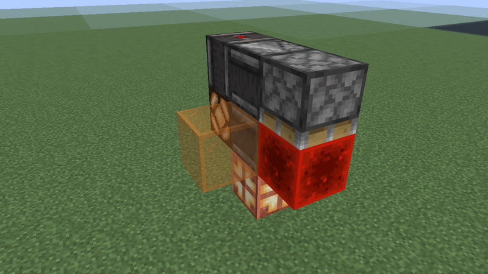</a> 40 gt (2 s) · copper_bulb+observer+redstone_block+redstone_lamp+sticky_piston · 7 blocks</td><td align="center"> 40 gt (2 s) · note_block+observer+redstone_lamp+sticky_piston · 7 blocks</td></tr>
<tr><td align="center"> 40 gt (2 s) · note_block+observer+redstone_lamp+sticky_piston · 7 blocks</td><td align="center"> 40 gt (2 s) · observer+redstone_lamp+sticky_piston · 7 blocks</td><td align="center"> 40 gt (2 s) · copper_bulb+note_block+observer+redstone_block+sticky_piston · 7 blocks</td></tr>
<tr><td align="center"> 40 gt (2 s) · copper_bulb+note_block+observer+redstone_block+sticky_piston · 7 blocks</td><td align="center"> 40 gt (2 s) · copper_bulb+note_block+observer+sticky_piston · 7 blocks</td><td align="center"> 40 gt (2 s) · copper_bulb+note_block+observer+sticky_piston · 7 blocks</td></tr>
<tr><td align="center"> 40 gt (2 s) · observer+sticky_piston · 7 blocks</td><td align="center"> 40 gt (2 s) · observer+sticky_piston · 7 blocks</td><td align="center"> 40 gt (2 s) · observer+redstone_block+sticky_piston · 7 blocks</td></tr>
<tr><td align="center"> 40 gt (2 s) · observer+redstone_block+sticky_piston · 7 blocks</td><td align="center"> 40 gt (2 s) · comparator+redstone_torch+redstone_wire+repeater · 12 blocks</td><td align="center"> 40 gt (2 s) · redstone_torch+redstone_wire+repeater · 12 blocks</td></tr>
<tr><td align="center"> 40 gt (2 s) · detector_rail+minecart · 13 blocks</td><td align="center"> 40 gt (2 s) · comparator+redstone_torch+redstone_wire+repeater · 13 blocks</td><td align="center"> 40 gt (2 s) · redstone_torch+redstone_wire+repeater · 13 blocks</td></tr>
<tr><td align="center"> 40 gt (2 s) · redstone_wire+repeater · 16 blocks</td><td align="center"> 40 gt (2 s) · comparator+repeater · 16 blocks</td><td align="center"> 40 gt (2 s) · redstone_torch+redstone_wire+repeater · 27 blocks</td></tr>
</table>

## 41 gt (2.05 s)

Also reachable by: clk-obs-odd-b (n = 7), clk-misc-cart-loop (n = 3), clk-item-dropring-1d (n = 1), clk-item-lockring-3s (n = 0).

<table>
<tr><td align="center"> 41 gt (2.05 s) · dispenser+observer+sculk_sensor · 5 blocks</td><td align="center"> 41 gt (2.05 s) · calibrated_sculk_sensor+dispenser+observer+piston+sculk_sensor · 5 blocks</td><td align="center"><a href="../archive/census-p41-calibrated_sculk_sensor-dispenser-observer-sculk_sensor-sticky_piston-5b.txt">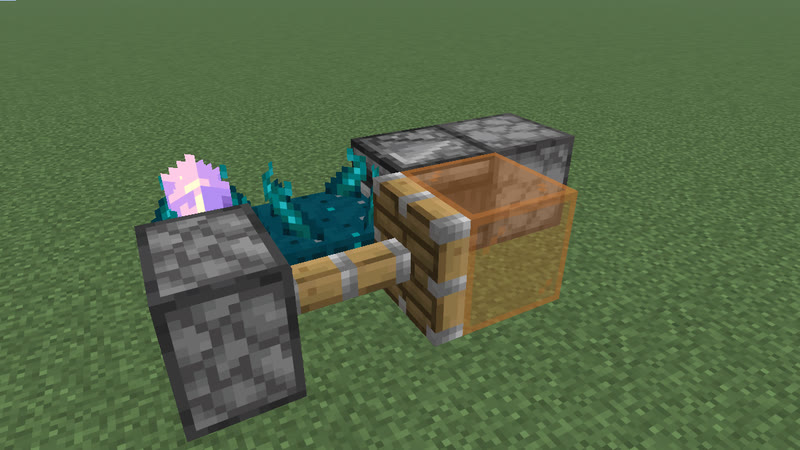</a> 41 gt (2.05 s) · calibrated_sculk_sensor+dispenser+observer+sculk_sensor+sticky_piston · 5 blocks</td></tr>
<tr><td align="center"> 41 gt (2.05 s) · calibrated_sculk_sensor+oak_trapdoor+observer+sculk_sensor+sticky_piston · 5 blocks</td><td align="center"> 41 gt (2.05 s) · dispenser+observer+sculk_sensor · 5 blocks</td><td align="center"> 41 gt (2.05 s) · dispenser+observer+sculk_sensor+sticky_piston · 5 blocks</td></tr>
<tr><td align="center"> 41 gt (2.05 s) · note_block+observer+sculk_sensor+sticky_piston · 5 blocks</td><td align="center"> 41 gt (2.05 s) · oak_trapdoor+observer+sculk_sensor+sticky_piston · 5 blocks</td><td align="center"> 41 gt (2.05 s) · observer+piston+sculk_sensor+sticky_piston · 5 blocks</td></tr>
<tr><td align="center"> 41 gt (2.05 s) · observer+sculk_sensor+sticky_piston · 5 blocks</td><td align="center"> 41 gt (2.05 s) · iron_trapdoor+observer+sculk_sensor · 6 blocks</td><td align="center"> 41 gt (2.05 s) · oak_fence_gate+observer+sculk_sensor · 6 blocks</td></tr>
<tr><td align="center"> 41 gt (2.05 s) · oak_trapdoor+observer+sculk_sensor · 6 blocks</td><td align="center"> 41 gt (2.05 s) · calibrated_sculk_sensor+oak_trapdoor+observer+sculk_sensor · 6 blocks</td><td align="center"> 41 gt (2.05 s) · note_block+observer+repeater+sculk_sensor · 6 blocks</td></tr>
<tr><td align="center"><a href="../archive/clk-sculk-two-p41-5.txt">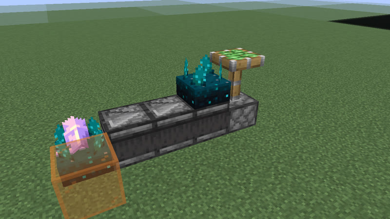</a> 41 gt (2.05 s) · calibrated_sculk_sensor+observer+sculk_sensor+sticky_piston · 6 blocks</td><td align="center"><a href="../archive/clk-sculk-hyb3b-p41-10.txt">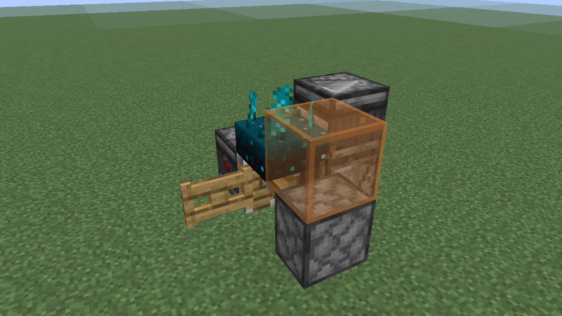</a> 41 gt (2.05 s) · oak_fence_gate+observer+sculk_sensor+sticky_piston · 6 blocks</td><td align="center"><a href="../archive/clk-sculk-hyb3b-p41-7.txt">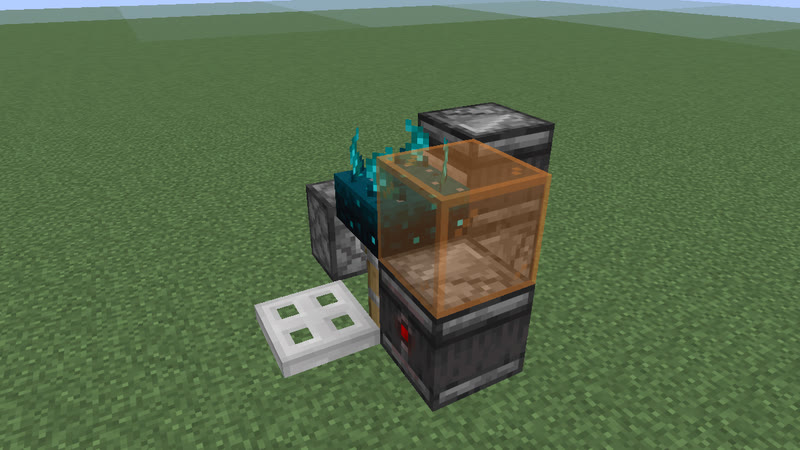</a> 41 gt (2.05 s) · iron_trapdoor+observer+sculk_sensor+sticky_piston · 6 blocks</td></tr>
<tr><td align="center"> 41 gt (2.05 s) · observer+piston+sticky_piston · 7 blocks</td><td align="center"> 41 gt (2.05 s) · observer+piston+sticky_piston · 7 blocks</td><td align="center"> 41 gt (2.05 s) · observer+sticky_piston · 7 blocks</td></tr>
<tr><td align="center"> 41 gt (2.05 s) · repeater · 27 blocks</td></tr>
</table>

## 42 gt (2.1 s)

Also reachable by: clk-misc-activator_rail-ring (n = 8), clk-misc-crafter-ring (n = 8), clk-misc-iron_door-ring (n = 8), clk-misc-oak_door-ring (n = 8), clk-misc-oak_fence_gate-ring (n = 8), clk-misc-oak_trapdoor-ring (n = 8), clk-misc-powered_rail-ring (n = 8), clk-misc-skeleton_skull-ring (n = 8), clk-obs-note-ring (n = 8), clk-obs-trap-ring (n = 8), clk-item-hopper-ring (n = 2), clk-item-hopper-ring-2 (n = 5), clk-item-dropring-1d-r4 (n = 0).

<table>
<tr><td align="center"> 42 gt (2.1 s) · dispenser+observer+sculk_sensor · 4 blocks</td><td align="center"> 42 gt (2.1 s) · note_block+observer+sculk_sensor · 4 blocks</td><td align="center"> 42 gt (2.1 s) · oak_trapdoor+observer+sculk_sensor · 4 blocks</td></tr>
<tr><td align="center"> 42 gt (2.1 s) · observer+piston+sculk_sensor · 4 blocks</td><td align="center"><a href="../archive/census-p42-observer-sculk_sensor-sticky_piston-4b.txt">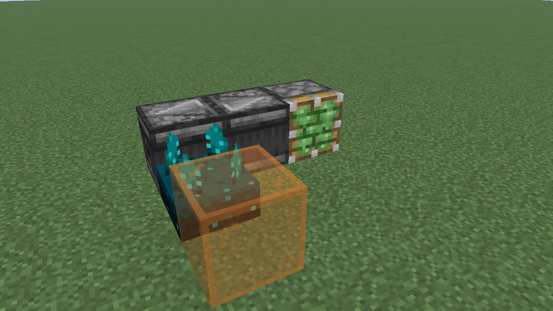</a> 42 gt (2.1 s) · observer+sculk_sensor+sticky_piston · 4 blocks</td><td align="center"><a href="../archive/census-p42-calibrated_sculk_sensor-dispenser-oak_trapdoor-observer-sculk_sensor-5b.txt">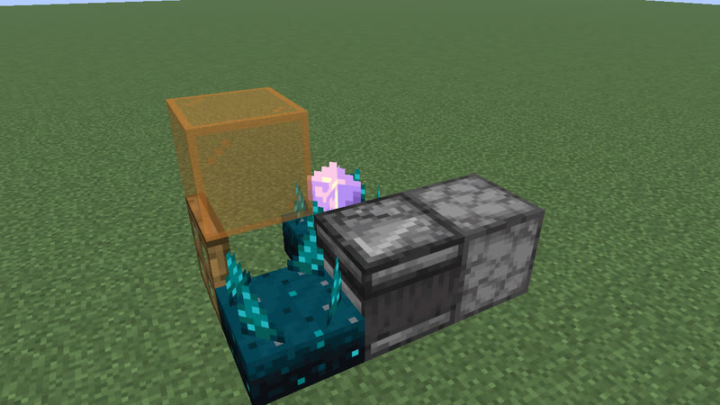</a> 42 gt (2.1 s) · calibrated_sculk_sensor+dispenser+oak_trapdoor+observer+sculk_sensor · 5 blocks</td></tr>
<tr><td align="center"><a href="../archive/census-p42-calibrated_sculk_sensor-dispenser-observer-sculk_sensor-5b.txt">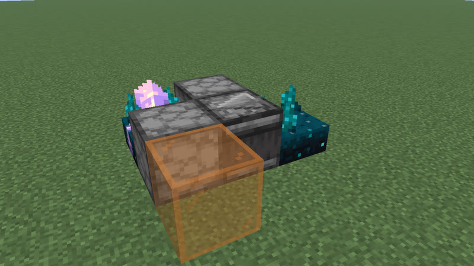</a> 42 gt (2.1 s) · calibrated_sculk_sensor+dispenser+observer+sculk_sensor · 5 blocks</td><td align="center"><a href="../archive/census-p42-calibrated_sculk_sensor-note_block-oak_trapdoor-observer-sculk_sensor-5b.txt">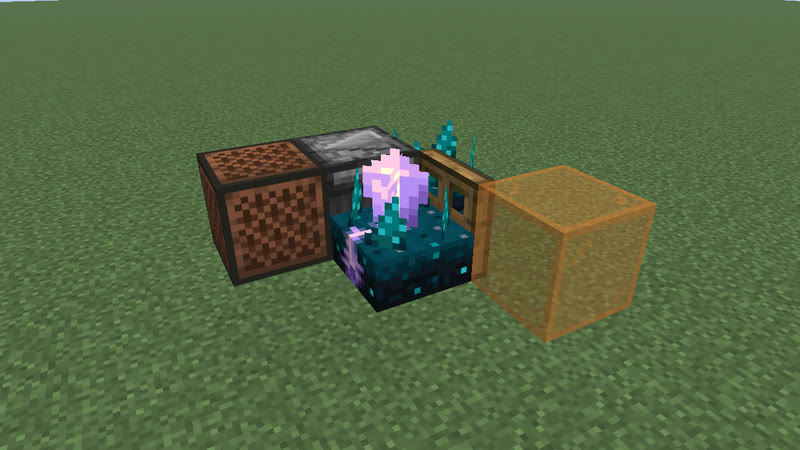</a> 42 gt (2.1 s) · calibrated_sculk_sensor+note_block+oak_trapdoor+observer+sculk_sensor · 5 blocks</td><td align="center"> 42 gt (2.1 s) · calibrated_sculk_sensor+oak_trapdoor+observer+piston+sculk_sensor · 5 blocks</td></tr>
<tr><td align="center"><a href="../archive/census-p42-calibrated_sculk_sensor-oak_trapdoor-observer-sculk_sensor-sticky_piston-5b.txt">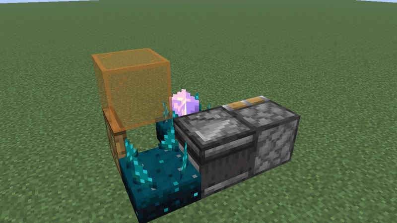</a> 42 gt (2.1 s) · calibrated_sculk_sensor+oak_trapdoor+observer+sculk_sensor+sticky_piston · 5 blocks</td><td align="center"><a href="../archive/census-p42-calibrated_sculk_sensor-dispenser-observer-piston-sculk_sensor-5b.txt">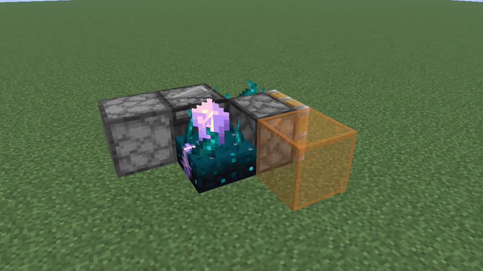</a> 42 gt (2.1 s) · calibrated_sculk_sensor+dispenser+observer+piston+sculk_sensor · 5 blocks</td><td align="center"><a href="../archive/census-p42-calibrated_sculk_sensor-dispenser-observer-sculk_sensor-sticky_piston-5b.txt">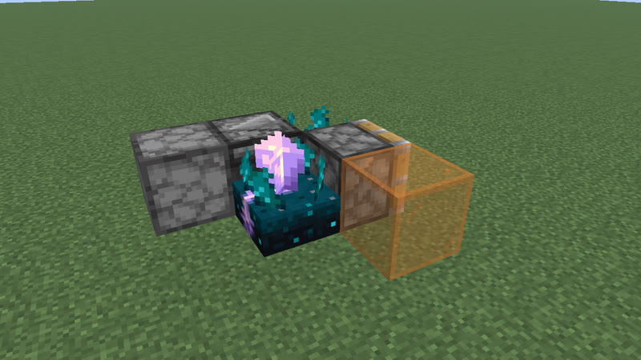</a> 42 gt (2.1 s) · calibrated_sculk_sensor+dispenser+observer+sculk_sensor+sticky_piston · 5 blocks</td></tr>
<tr><td align="center"><a href="../archive/census-p42-calibrated_sculk_sensor-note_block-observer-piston-sculk_sensor-5b.txt">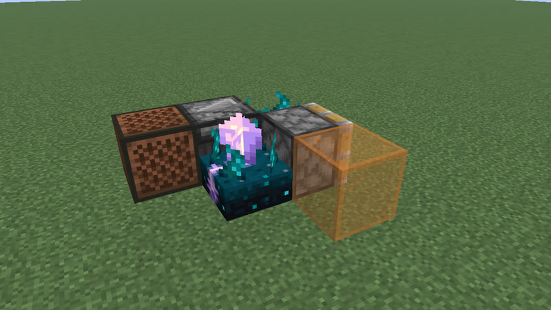</a> 42 gt (2.1 s) · calibrated_sculk_sensor+note_block+observer+piston+sculk_sensor · 5 blocks</td><td align="center"><a href="../archive/census-p42-calibrated_sculk_sensor-note_block-observer-sculk_sensor-sticky_piston-5b.txt">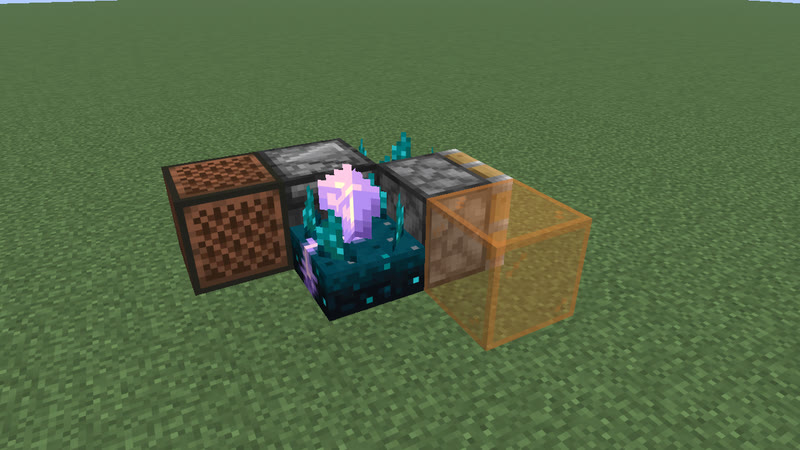</a> 42 gt (2.1 s) · calibrated_sculk_sensor+note_block+observer+sculk_sensor+sticky_piston · 5 blocks</td><td align="center"><a href="../archive/census-p42-calibrated_sculk_sensor-oak_trapdoor-sculk_sensor-5b.txt">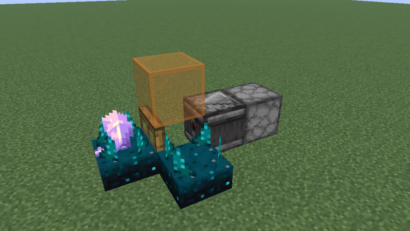</a> 42 gt (2.1 s) · calibrated_sculk_sensor+oak_trapdoor+sculk_sensor · 5 blocks</td></tr>
<tr><td align="center"><a href="../archive/census-p42-calibrated_sculk_sensor-observer-piston-sculk_sensor-sticky_piston-5b.txt">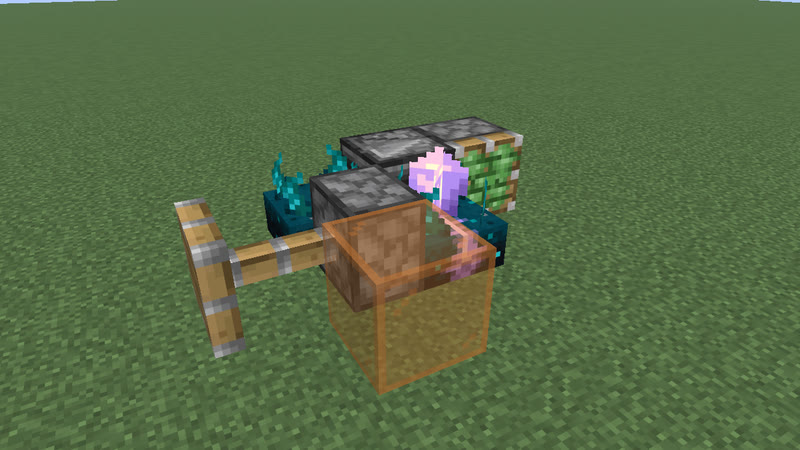</a> 42 gt (2.1 s) · calibrated_sculk_sensor+observer+piston+sculk_sensor+sticky_piston · 5 blocks</td><td align="center"><a href="../archive/clk-sculk-hyb-p42-1.txt">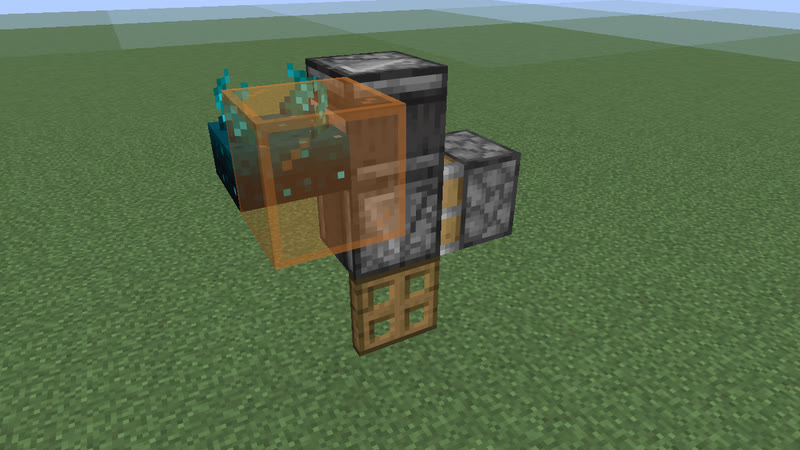</a> 42 gt (2.1 s) · oak_trapdoor+observer+sculk_sensor+sticky_piston · 5 blocks</td><td align="center"> 42 gt (2.1 s) · oak_fence_gate+observer+sculk_sensor+sticky_piston · 5 blocks</td></tr>
<tr><td align="center"><a href="../archive/clk-sculk-hyb3b-p42-17.txt">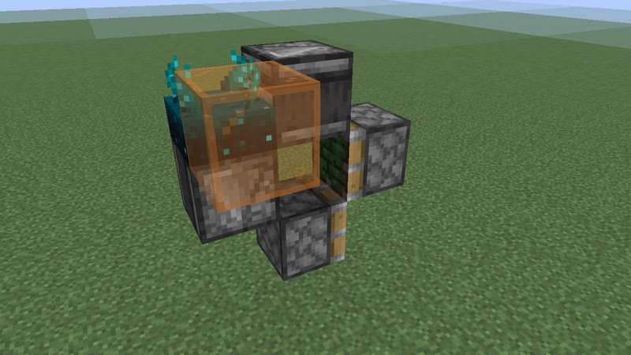</a> 42 gt (2.1 s) · observer+piston+sculk_sensor+sticky_piston · 5 blocks</td><td align="center"> 42 gt (2.1 s) · iron_trapdoor+observer+sculk_sensor+sticky_piston · 5 blocks</td><td align="center"><a href="../archive/census-p42-calibrated_sculk_sensor-piston-sculk_sensor-5b.txt">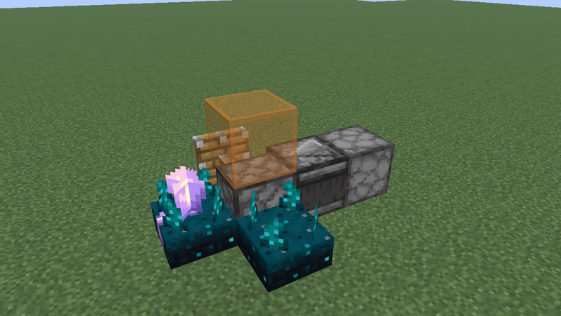</a> 42 gt (2.1 s) · calibrated_sculk_sensor+piston+sculk_sensor · 5 blocks</td></tr>
<tr><td align="center"><a href="../archive/census-p42-calibrated_sculk_sensor-sculk_sensor-sticky_piston-5b.txt">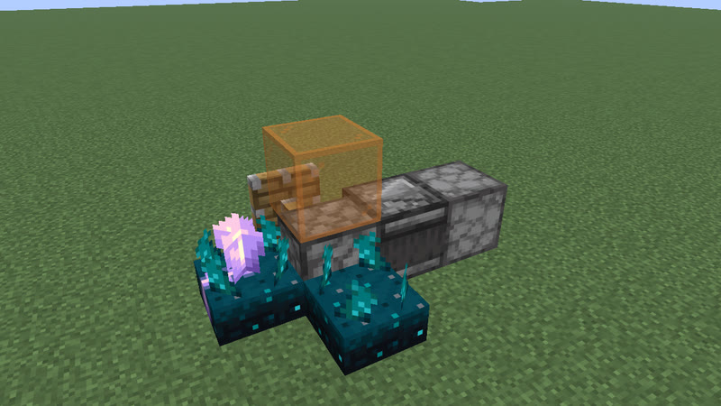</a> 42 gt (2.1 s) · calibrated_sculk_sensor+sculk_sensor+sticky_piston · 5 blocks</td><td align="center"> 42 gt (2.1 s) · note_block+observer+repeater+sculk_sensor · 5 blocks</td><td align="center"><a href="../archive/clk-sculk-hyb3b-p42-5.txt">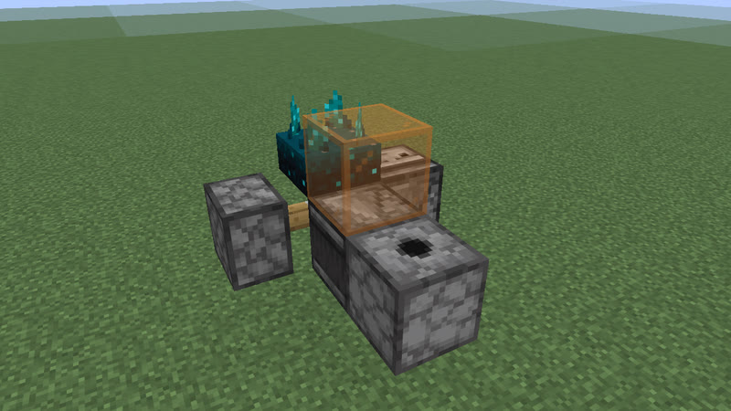</a> 42 gt (2.1 s) · dispenser+observer+sculk_sensor+sticky_piston · 5 blocks</td></tr>
<tr><td align="center"><a href="../archive/clk-sculk-hyb3-p42-1.txt">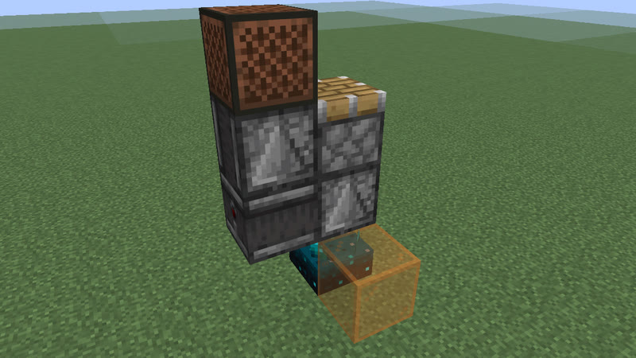</a> 42 gt (2.1 s) · note_block+observer+piston+sculk_sensor · 6 blocks</td><td align="center"><a href="../archive/clk-sculk-hyb3-p42-3.txt">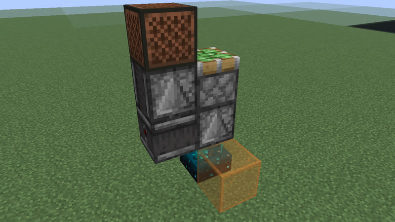</a> 42 gt (2.1 s) · note_block+observer+sculk_sensor+sticky_piston · 6 blocks</td><td align="center"><a href="../archive/clk-sculk-hyb3b-p42-1.txt">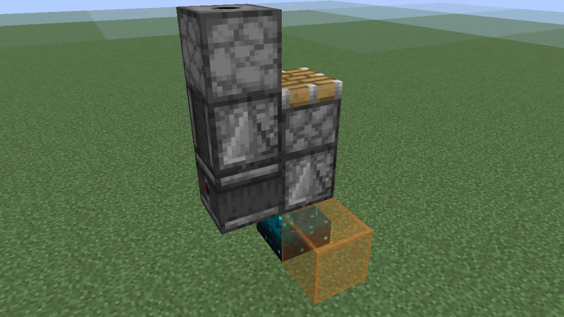</a> 42 gt (2.1 s) · dispenser+observer+piston+sculk_sensor · 6 blocks</td></tr>
<tr><td align="center"> 42 gt (2.1 s) · iron_trapdoor+observer+sculk_sensor · 6 blocks</td><td align="center"> 42 gt (2.1 s) · oak_fence_gate+observer+sculk_sensor · 6 blocks</td><td align="center"><a href="../archive/clk-sculk-two-p42-5.txt">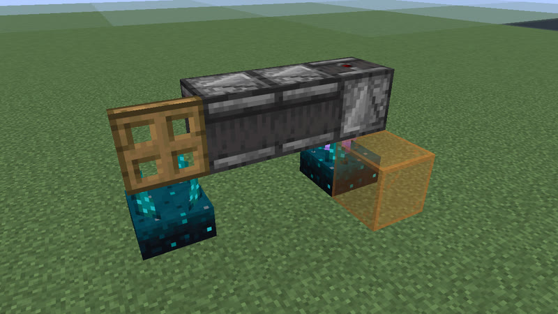</a> 42 gt (2.1 s) · calibrated_sculk_sensor+oak_trapdoor+observer+sculk_sensor · 6 blocks</td></tr>
<tr><td align="center"> 42 gt (2.1 s) · copper_bulb+observer+redstone_lamp+sticky_piston · 6 blocks</td><td align="center"> 42 gt (2.1 s) · copper_bulb+observer+redstone_lamp+sticky_piston · 6 blocks</td><td align="center"> 42 gt (2.1 s) · copper_bulb+note_block+observer+sticky_piston · 6 blocks</td></tr>
<tr><td align="center"> 42 gt (2.1 s) · copper_bulb+observer+sticky_piston · 6 blocks</td><td align="center"> 42 gt (2.1 s) · copper_bulb+observer+sticky_piston · 6 blocks</td><td align="center"> 42 gt (2.1 s) · observer+piston+redstone_lamp+sticky_piston · 6 blocks</td></tr>
<tr><td align="center"> 42 gt (2.1 s) · observer+piston+redstone_lamp+sticky_piston · 6 blocks</td><td align="center"> 42 gt (2.1 s) · observer+redstone_lamp+sticky_piston · 6 blocks</td><td align="center"> 42 gt (2.1 s) · observer+redstone_lamp+sticky_piston · 6 blocks</td></tr>
<tr><td align="center"> 42 gt (2.1 s) · note_block+observer+piston+sticky_piston · 6 blocks</td><td align="center"> 42 gt (2.1 s) · note_block+observer+piston+sticky_piston · 6 blocks</td><td align="center"> 42 gt (2.1 s) · note_block+observer+sticky_piston · 6 blocks</td></tr>
<tr><td align="center"> 42 gt (2.1 s) · note_block+observer+sticky_piston · 6 blocks</td><td align="center"> 42 gt (2.1 s) · observer+piston · 6 blocks</td><td align="center"> 42 gt (2.1 s) · observer+piston · 6 blocks</td></tr>
<tr><td align="center"> 42 gt (2.1 s) · observer+piston+sticky_piston · 6 blocks</td><td align="center"><a href="../archive/clk-obs-p42-obs-pis-stk-6b-b-ab8e35.txt">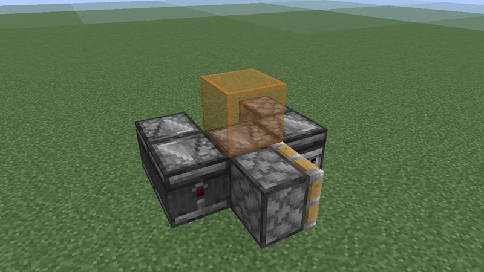</a> 42 gt (2.1 s) · observer+piston+sticky_piston · 6 blocks</td><td align="center"> 42 gt (2.1 s) · observer+redstone_block+sticky_piston · 6 blocks</td></tr>
<tr><td align="center"> 42 gt (2.1 s) · observer+redstone_block+sticky_piston · 6 blocks</td><td align="center"> 42 gt (2.1 s) · observer+sticky_piston · 6 blocks</td><td align="center"> 42 gt (2.1 s) · observer+sticky_piston · 6 blocks</td></tr>
<tr><td align="center"> 42 gt (2.1 s) · calibrated_sculk_sensor+dispenser+observer · 6 blocks</td><td align="center"> 42 gt (2.1 s) · copper_bulb+note_block+observer+sticky_piston · 6 blocks</td><td align="center"><a href="../archive/clk-sculk-hyb3-p42-5.txt">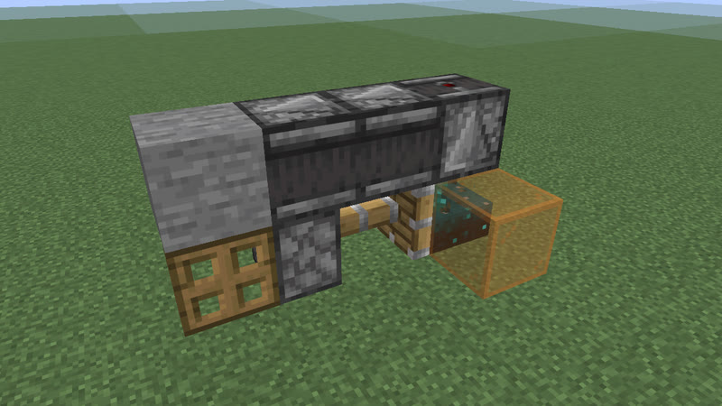</a> 42 gt (2.1 s) · oak_trapdoor+observer+piston+sculk_sensor · 7 blocks</td></tr>
<tr><td align="center"><a href="../archive/clk-sculk-hyb3b-p42-11.txt">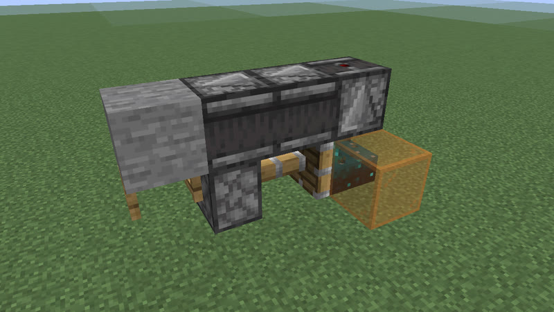</a> 42 gt (2.1 s) · oak_fence_gate+observer+piston+sculk_sensor · 7 blocks</td><td align="center"><a href="../archive/clk-sculk-hyb3b-p42-7.txt">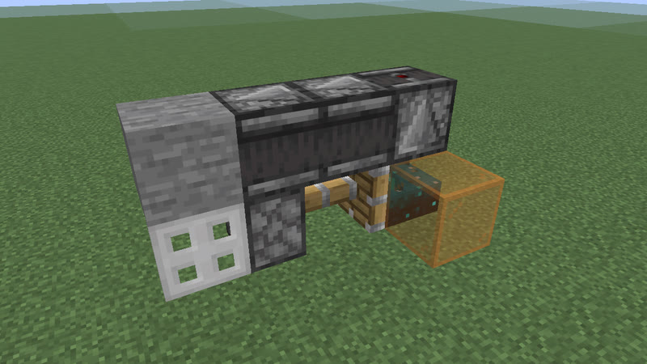</a> 42 gt (2.1 s) · iron_trapdoor+observer+piston+sculk_sensor · 7 blocks</td><td align="center"> 42 gt (2.1 s) · note_block+observer+piston · 7 blocks</td></tr>
<tr><td align="center"> 42 gt (2.1 s) · observer+piston+redstone_block+sticky_piston · 7 blocks</td><td align="center"><a href="../archive/clk-obs-p42-note-obs-pis-7b-b-e2dcb6.txt">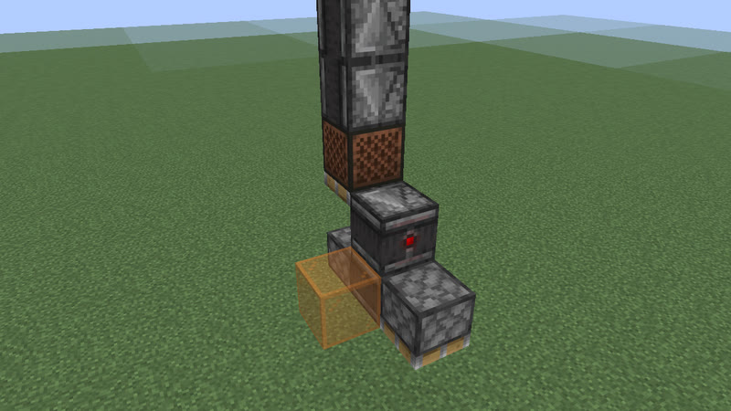</a> 42 gt (2.1 s) · note_block+observer+piston · 7 blocks</td><td align="center"> 42 gt (2.1 s) · redstone_torch+repeater · 16 blocks</td></tr>
<tr><td align="center"> 42 gt (2.1 s) · repeater · 16 blocks</td><td align="center"> 42 gt (2.1 s) · comparator+repeater · 16 blocks</td></tr>
</table>

## 43 gt (2.15 s)

Also reachable by: clk-obs-odd-a (n = 8), clk-misc-cart-pingpong (n = 1), clk-item-lockring-3s (n = 1), clk-item-dropring-2d-r1 (n = 0).

<table>
<tr><td align="center"> 43 gt (2.15 s) · calibrated_sculk_sensor+dispenser+observer+sculk_sensor · 4 blocks</td><td align="center"> 43 gt (2.15 s) · calibrated_sculk_sensor+observer+piston+sculk_sensor · 4 blocks</td><td align="center"><a href="../archive/census-p43-calibrated_sculk_sensor-observer-sculk_sensor-sticky_piston-4b.txt">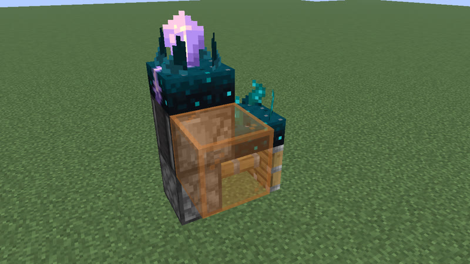</a> 43 gt (2.15 s) · calibrated_sculk_sensor+observer+sculk_sensor+sticky_piston · 4 blocks</td></tr>
<tr><td align="center"> 43 gt (2.15 s) · dispenser+observer+piston+sculk_sensor · 4 blocks</td><td align="center"><a href="../archive/census-p43-dispenser-observer-sculk_sensor-sticky_piston-4b.txt">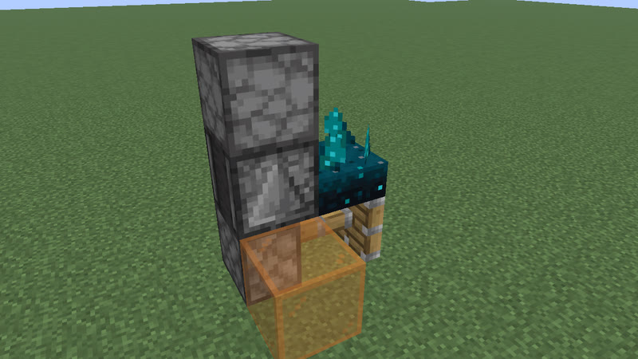</a> 43 gt (2.15 s) · dispenser+observer+sculk_sensor+sticky_piston · 4 blocks</td><td align="center"> 43 gt (2.15 s) · note_block+observer+piston+sculk_sensor · 4 blocks</td></tr>
<tr><td align="center"><a href="../archive/census-p43-note_block-observer-sculk_sensor-sticky_piston-4b.txt">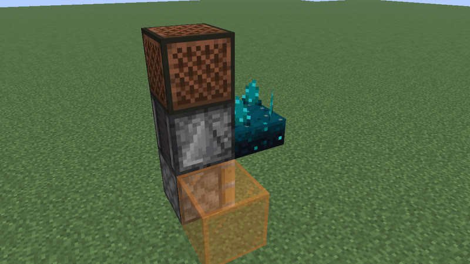</a> 43 gt (2.15 s) · note_block+observer+sculk_sensor+sticky_piston · 4 blocks</td><td align="center"> 43 gt (2.15 s) · dispenser+observer+sculk_sensor · 5 blocks</td><td align="center"> 43 gt (2.15 s) · note_block+observer+repeater+sculk_sensor · 5 blocks</td></tr>
<tr><td align="center"> 43 gt (2.15 s) · oak_trapdoor+observer+sculk_sensor+sticky_piston · 5 blocks</td><td align="center"> 43 gt (2.15 s) · observer+piston+sculk_sensor+sticky_piston · 5 blocks</td><td align="center"> 43 gt (2.15 s) · observer+sculk_sensor+sticky_piston · 5 blocks</td></tr>
<tr><td align="center"> 43 gt (2.15 s) · observer+piston+sculk_sensor · 5 blocks</td><td align="center"> 43 gt (2.15 s) · iron_trapdoor+observer+sculk_sensor+sticky_piston · 5 blocks</td><td align="center"> 43 gt (2.15 s) · oak_fence_gate+observer+sculk_sensor+sticky_piston · 5 blocks</td></tr>
<tr><td align="center"> 43 gt (2.15 s) · iron_trapdoor+observer+sculk_sensor · 6 blocks</td><td align="center"> 43 gt (2.15 s) · oak_fence_gate+observer+sculk_sensor · 6 blocks</td><td align="center"> 43 gt (2.15 s) · oak_trapdoor+observer+sculk_sensor · 6 blocks</td></tr>
<tr><td align="center"> 43 gt (2.15 s) · observer+redstone_block+sticky_piston · 6 blocks</td><td align="center"> 43 gt (2.15 s) · observer+redstone_block+sticky_piston · 6 blocks</td><td align="center"> 43 gt (2.15 s) · repeater · 27 blocks</td></tr>
</table>

## 44 gt (2.2 s)

Also reachable by: clk-obs-obs-ring (n = 9), clk-obs-bulb-ring (n = 3), clk-item-dropring-2d-r14 (n = 0).

<table>
<tr><td align="center"> 44 gt (2.2 s) · oak_trapdoor+observer+sculk_sensor · 3 blocks</td><td align="center"> 44 gt (2.2 s) · oak_fence_gate+observer+sculk_sensor · 3 blocks</td><td align="center"> 44 gt (2.2 s) · iron_trapdoor+observer+sculk_sensor · 3 blocks</td></tr>
<tr><td align="center"> 44 gt (2.2 s) · oak_fence_gate+observer+sculk_sensor · 3 blocks</td><td align="center"> 44 gt (2.2 s) · observer+piston+sculk_sensor · 3 blocks</td><td align="center"><a href="../archive/census-p44-observer-sculk_sensor-sticky_piston-3b.txt">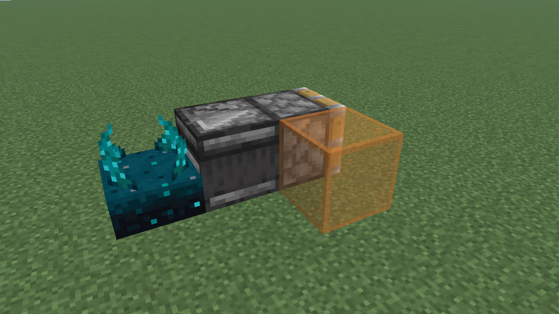</a> 44 gt (2.2 s) · observer+sculk_sensor+sticky_piston · 3 blocks</td></tr>
<tr><td align="center"> 44 gt (2.2 s) · note_block+observer+sculk_sensor · 3 blocks</td><td align="center"><a href="../archive/census-p44-dispenser-note_block-observer-sculk_sensor-4b.txt">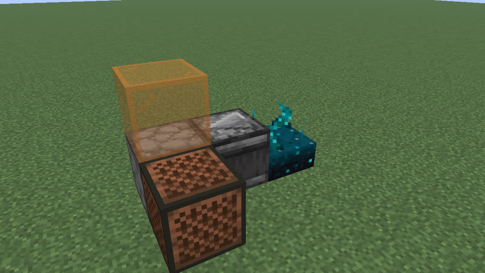</a> 44 gt (2.2 s) · dispenser+note_block+observer+sculk_sensor · 4 blocks</td><td align="center"><a href="../archive/census-p44-dispenser-oak_trapdoor-observer-sculk_sensor-4b.txt">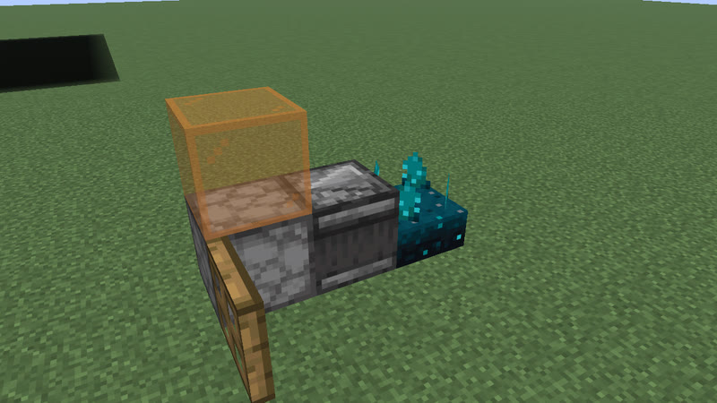</a> 44 gt (2.2 s) · dispenser+oak_trapdoor+observer+sculk_sensor · 4 blocks</td></tr>
<tr><td align="center"><a href="../archive/census-p44-dispenser-observer-piston-sculk_sensor-4b.txt">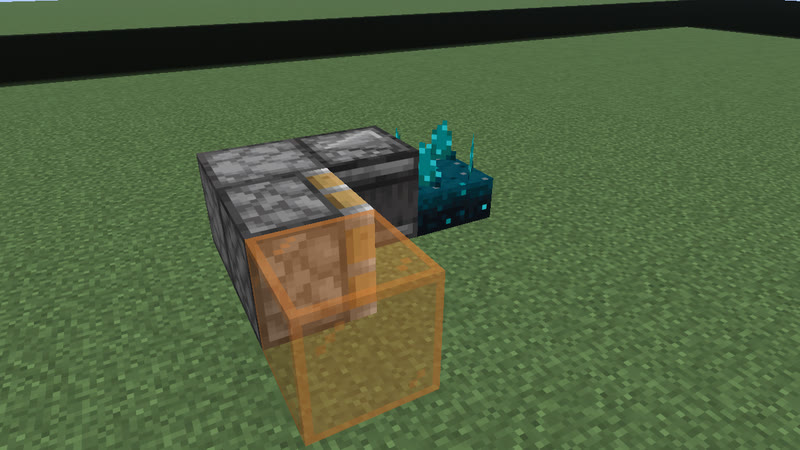</a> 44 gt (2.2 s) · dispenser+observer+piston+sculk_sensor · 4 blocks</td><td align="center"> 44 gt (2.2 s) · dispenser+observer+sculk_sensor+sticky_piston · 4 blocks</td><td align="center"><a href="../archive/census-p44-note_block-oak_trapdoor-observer-sculk_sensor-4b.txt">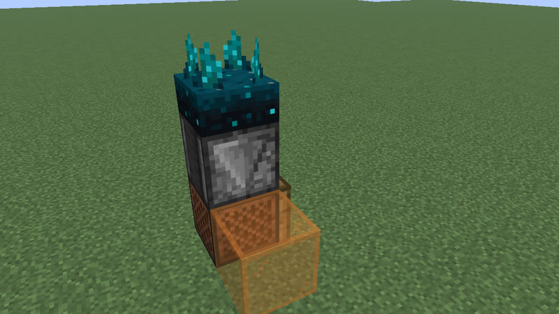</a> 44 gt (2.2 s) · note_block+oak_trapdoor+observer+sculk_sensor · 4 blocks</td></tr>
<tr><td align="center"><a href="../archive/census-p44-note_block-observer-piston-sculk_sensor-4b.txt">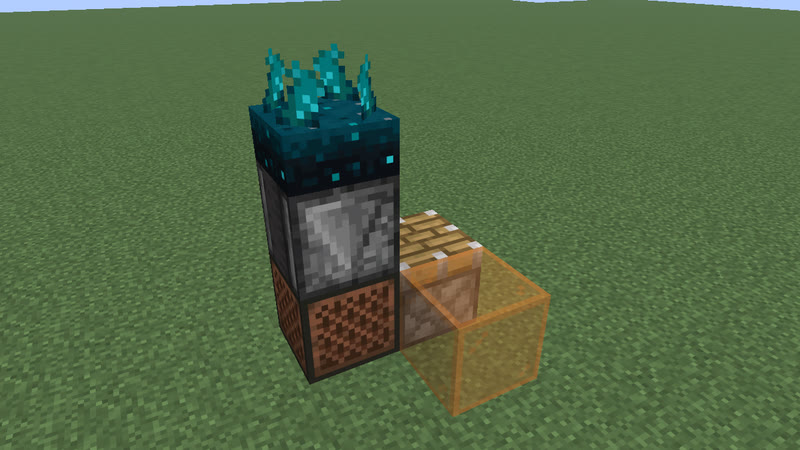</a> 44 gt (2.2 s) · note_block+observer+piston+sculk_sensor · 4 blocks</td><td align="center"><a href="../archive/census-p44-note_block-observer-sculk_sensor-sticky_piston-4b.txt">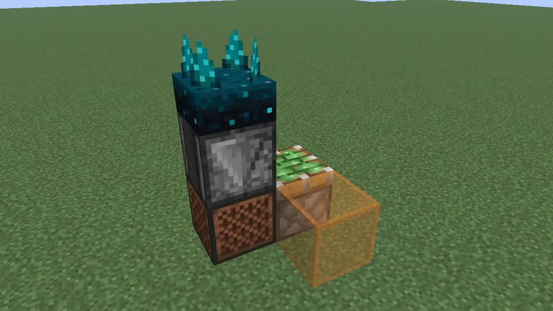</a> 44 gt (2.2 s) · note_block+observer+sculk_sensor+sticky_piston · 4 blocks</td><td align="center"> 44 gt (2.2 s) · calibrated_sculk_sensor+dispenser+observer+sculk_sensor · 4 blocks</td></tr>
<tr><td align="center"> 44 gt (2.2 s) · dispenser+observer+sculk_sensor · 5 blocks</td><td align="center"><a href="../archive/census-p44-calibrated_sculk_sensor-observer-piston-sculk_sensor-sticky_piston-5b.txt">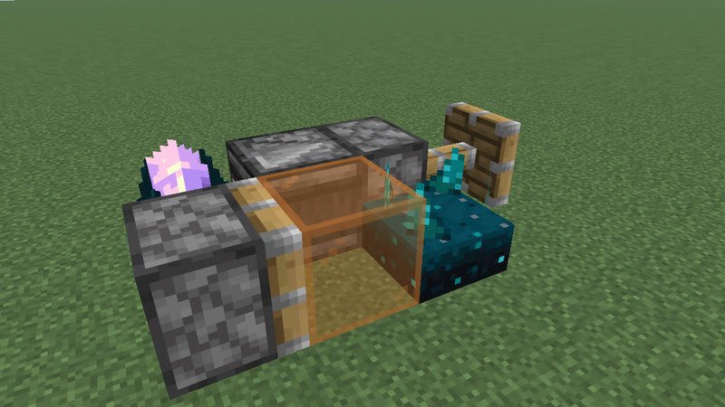</a> 44 gt (2.2 s) · calibrated_sculk_sensor+observer+piston+sculk_sensor+sticky_piston · 5 blocks</td><td align="center"> 44 gt (2.2 s) · calibrated_sculk_sensor+dispenser+observer · 6 blocks</td></tr>
<tr><td align="center"> 44 gt (2.2 s) · copper_bulb+note_block+observer+piston+sticky_piston · 7 blocks</td><td align="center"> 44 gt (2.2 s) · copper_bulb+observer+piston+sticky_piston · 7 blocks</td><td align="center"> 44 gt (2.2 s) · copper_bulb+observer+piston+sticky_piston · 7 blocks</td></tr>
<tr><td align="center"> 44 gt (2.2 s) · note_block+observer+redstone_block+redstone_lamp+sticky_piston · 7 blocks</td><td align="center"> 44 gt (2.2 s) · note_block+observer+redstone_block+redstone_lamp+sticky_piston · 7 blocks</td><td align="center"> 44 gt (2.2 s) · note_block+observer+redstone_lamp+sticky_piston · 7 blocks</td></tr>
<tr><td align="center"> 44 gt (2.2 s) · note_block+observer+redstone_lamp+sticky_piston · 7 blocks</td><td align="center"> 44 gt (2.2 s) · observer+redstone_block+redstone_lamp+sticky_piston · 7 blocks</td><td align="center"> 44 gt (2.2 s) · observer+redstone_block+redstone_lamp+sticky_piston · 7 blocks</td></tr>
<tr><td align="center"> 44 gt (2.2 s) · observer+redstone_lamp+sticky_piston · 7 blocks</td><td align="center"> 44 gt (2.2 s) · observer+redstone_lamp+sticky_piston · 7 blocks</td><td align="center"> 44 gt (2.2 s) · copper_bulb+note_block+observer+piston+sticky_piston · 7 blocks</td></tr>
<tr><td align="center"> 44 gt (2.2 s) · copper_bulb+observer+redstone_block+sticky_piston · 7 blocks</td><td align="center"> 44 gt (2.2 s) · observer+piston+sticky_piston · 7 blocks</td><td align="center"> 44 gt (2.2 s) · observer+piston+sticky_piston · 7 blocks</td></tr>
<tr><td align="center"> 44 gt (2.2 s) · copper_bulb+observer+sticky_piston · 7 blocks</td><td align="center"> 44 gt (2.2 s) · copper_bulb+note_block+observer+sticky_piston · 7 blocks</td><td align="center"> 44 gt (2.2 s) · copper_bulb+observer+sticky_piston · 7 blocks</td></tr>
<tr><td align="center"> 44 gt (2.2 s) · copper_bulb+observer+redstone_block+sticky_piston · 7 blocks</td><td align="center"> 44 gt (2.2 s) · calibrated_sculk_sensor+observer+sticky_piston · 7 blocks</td><td align="center"> 44 gt (2.2 s) · redstone_torch+redstone_wire+repeater · 12 blocks</td></tr>
<tr><td align="center"> 44 gt (2.2 s) · comparator+hopper · 12 blocks</td><td align="center"> 44 gt (2.2 s) · comparator+redstone_torch+redstone_wire+repeater · 13 blocks</td><td align="center"> 44 gt (2.2 s) · redstone_torch+redstone_wire+repeater · 13 blocks</td></tr>
<tr><td align="center"> 44 gt (2.2 s) · repeater · 16 blocks</td></tr>
</table>

## 45 gt (2.25 s)

Also reachable by: clk-obs-odd-b (n = 8), clk-item-dropring-2d-r2 (n = 1), clk-item-lockring-3s (n = 2).

<table>
<tr><td align="center"> 45 gt (2.25 s) · calibrated_sculk_sensor+oak_trapdoor+observer+sculk_sensor · 4 blocks</td><td align="center"> 45 gt (2.25 s) · dispenser+note_block+observer+sculk_sensor · 4 blocks</td><td align="center"> 45 gt (2.25 s) · dispenser+oak_trapdoor+observer+sculk_sensor · 4 blocks</td></tr>
<tr><td align="center"> 45 gt (2.25 s) · note_block+observer+sculk_sensor · 4 blocks</td><td align="center"> 45 gt (2.25 s) · oak_trapdoor+observer+sculk_sensor · 4 blocks</td><td align="center"> 45 gt (2.25 s) · oak_fence_gate+observer+sculk_sensor · 4 blocks</td></tr>
<tr><td align="center"> 45 gt (2.25 s) · iron_trapdoor+observer+sculk_sensor · 4 blocks</td><td align="center"> 45 gt (2.25 s) · oak_fence_gate+observer+sculk_sensor · 4 blocks</td><td align="center"> 45 gt (2.25 s) · dispenser+observer+piston+sculk_sensor · 4 blocks</td></tr>
<tr><td align="center"><a href="../archive/census-p45-dispenser-observer-sculk_sensor-sticky_piston-4b.txt">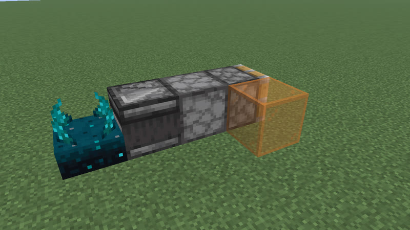</a> 45 gt (2.25 s) · dispenser+observer+sculk_sensor+sticky_piston · 4 blocks</td><td align="center"> 45 gt (2.25 s) · observer+piston+sculk_sensor · 4 blocks</td><td align="center"><a href="../archive/census-p45-observer-sculk_sensor-sticky_piston-4b.txt">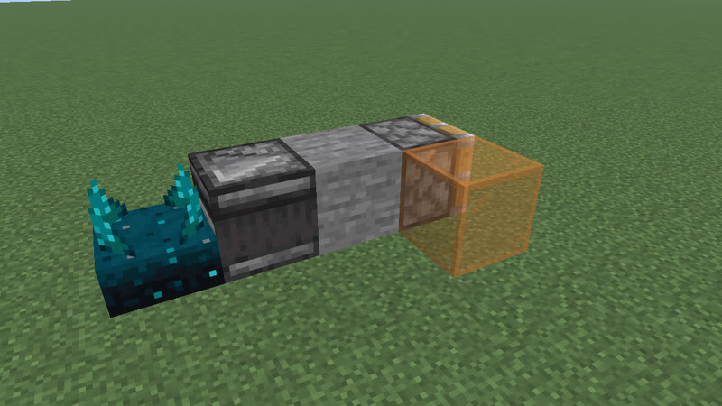</a> 45 gt (2.25 s) · observer+sculk_sensor+sticky_piston · 4 blocks</td></tr>
<tr><td align="center"> 45 gt (2.25 s) · calibrated_sculk_sensor+observer+piston+sculk_sensor · 4 blocks</td><td align="center"><a href="../archive/census-p45-calibrated_sculk_sensor-observer-sculk_sensor-sticky_piston-4b.txt">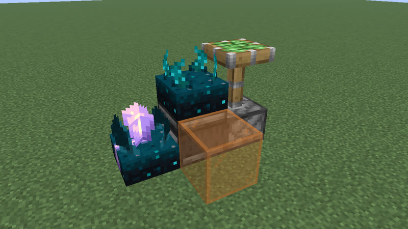</a> 45 gt (2.25 s) · calibrated_sculk_sensor+observer+sculk_sensor+sticky_piston · 4 blocks</td><td align="center"> 45 gt (2.25 s) · calibrated_sculk_sensor+dispenser+observer+sculk_sensor · 5 blocks</td></tr>
<tr><td align="center"><a href="../archive/census-p45-calibrated_sculk_sensor-note_block-observer-piston-sculk_sensor-5b.txt">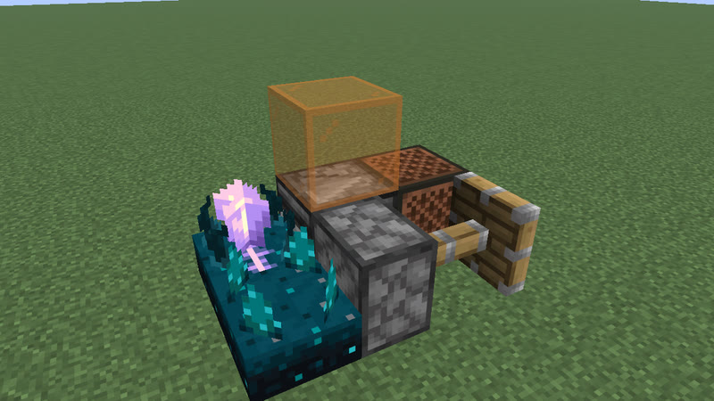</a> 45 gt (2.25 s) · calibrated_sculk_sensor+note_block+observer+piston+sculk_sensor · 5 blocks</td><td align="center"><a href="../archive/census-p45-calibrated_sculk_sensor-note_block-observer-sculk_sensor-sticky_piston-5b.txt">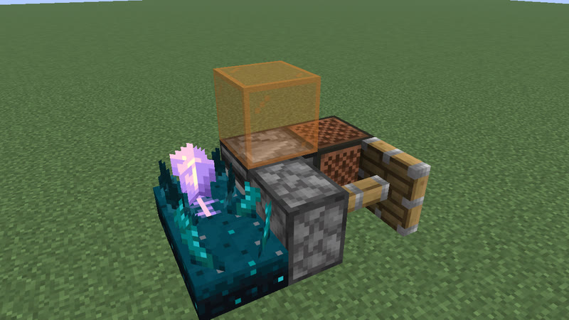</a> 45 gt (2.25 s) · calibrated_sculk_sensor+note_block+observer+sculk_sensor+sticky_piston · 5 blocks</td><td align="center"><a href="../archive/census-p45-calibrated_sculk_sensor-oak_trapdoor-observer-piston-sculk_sensor-5b.txt">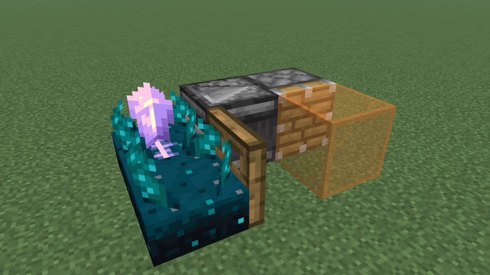</a> 45 gt (2.25 s) · calibrated_sculk_sensor+oak_trapdoor+observer+piston+sculk_sensor · 5 blocks</td></tr>
<tr><td align="center"><a href="../archive/census-p45-calibrated_sculk_sensor-oak_trapdoor-observer-sculk_sensor-sticky_piston-5b.txt">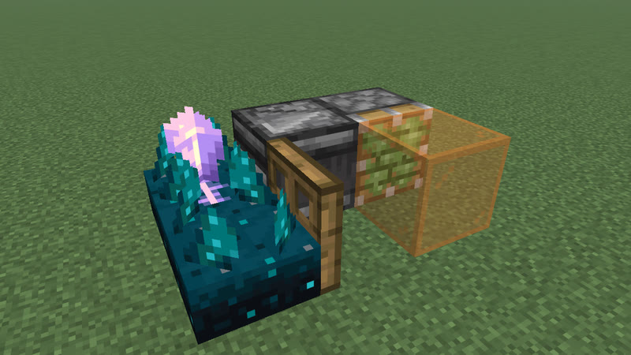</a> 45 gt (2.25 s) · calibrated_sculk_sensor+oak_trapdoor+observer+sculk_sensor+sticky_piston · 5 blocks</td><td align="center"><a href="../archive/census-p45-calibrated_sculk_sensor-observer-piston-sculk_sensor-sticky_piston-5b.txt">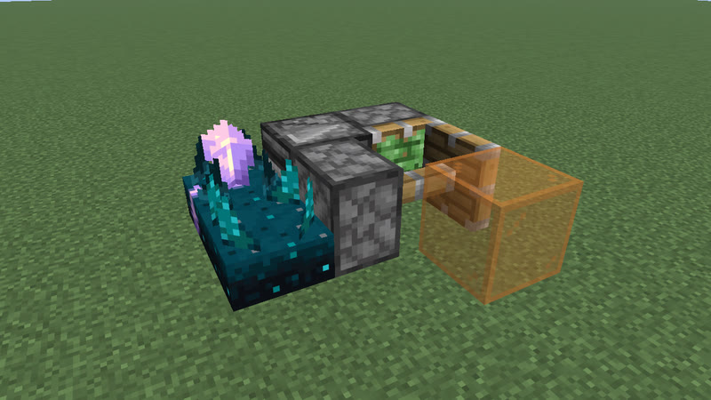</a> 45 gt (2.25 s) · calibrated_sculk_sensor+observer+piston+sculk_sensor+sticky_piston · 5 blocks</td><td align="center"> 45 gt (2.25 s) · dispenser+observer+sculk_sensor · 6 blocks</td></tr>
<tr><td align="center"> 45 gt (2.25 s) · calibrated_sculk_sensor+observer+sticky_piston · 6 blocks</td><td align="center"> 45 gt (2.25 s) · copper_bulb+observer+piston+sticky_piston · 7 blocks</td><td align="center"> 45 gt (2.25 s) · copper_bulb+observer+sticky_piston · 7 blocks</td></tr>
<tr><td align="center"> 45 gt (2.25 s) · observer+piston+redstone_lamp+sticky_piston · 7 blocks</td><td align="center"> 45 gt (2.25 s) · observer+redstone_lamp+sticky_piston · 7 blocks</td><td align="center"> 45 gt (2.25 s) · observer+redstone_lamp+sticky_piston · 7 blocks</td></tr>
<tr><td align="center"> 45 gt (2.25 s) · note_block+observer+piston+sticky_piston · 7 blocks</td><td align="center"> 45 gt (2.25 s) · note_block+observer+piston+sticky_piston · 7 blocks</td><td align="center"> 45 gt (2.25 s) · note_block+observer+sticky_piston · 7 blocks</td></tr>
<tr><td align="center"> 45 gt (2.25 s) · note_block+observer+sticky_piston · 7 blocks</td><td align="center"> 45 gt (2.25 s) · observer+piston+sticky_piston · 7 blocks</td><td align="center"> 45 gt (2.25 s) · observer+piston+sticky_piston · 7 blocks</td></tr>
<tr><td align="center"> 45 gt (2.25 s) · observer+sticky_piston · 7 blocks</td><td align="center"> 45 gt (2.25 s) · observer+sticky_piston · 7 blocks</td><td align="center"><a href="../archive/clk-sculk-hyb3-p45-5.txt">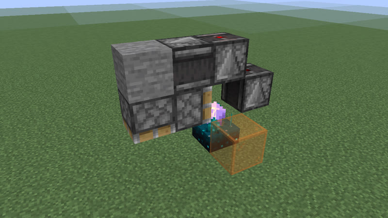</a> 45 gt (2.25 s) · calibrated_sculk_sensor+observer+piston+sticky_piston · 7 blocks</td></tr>
<tr><td align="center"> 45 gt (2.25 s) · calibrated_sculk_sensor+observer+piston · 7 blocks</td><td align="center"> 45 gt (2.25 s) · copper_bulb+observer+piston+sticky_piston · 7 blocks</td><td align="center"> 45 gt (2.25 s) · copper_bulb+observer+sticky_piston · 7 blocks</td></tr>
<tr><td align="center"> 45 gt (2.25 s) · calibrated_sculk_sensor · 7 blocks</td><td align="center"> 45 gt (2.25 s) · repeater · 28 blocks</td></tr>
</table>

## 46 gt (2.3 s)

Also reachable by: clk-misc-activator_rail-ring (n = 9), clk-misc-crafter-ring (n = 9), clk-misc-iron_door-ring (n = 9), clk-misc-oak_door-ring (n = 9), clk-misc-oak_fence_gate-ring (n = 9), clk-misc-oak_trapdoor-ring (n = 9), clk-misc-powered_rail-ring (n = 9), clk-misc-skeleton_skull-ring (n = 9), clk-obs-note-ring (n = 9), clk-obs-trap-ring (n = 9), clk-misc-cart-loop (n = 4), clk-item-latch (n = 1), clk-item-dropring-2d-r24 (n = 0).

<table>
<tr><td align="center"> 46 gt (2.3 s) · calibrated_sculk_sensor+oak_trapdoor+observer+sculk_sensor · 4 blocks</td><td align="center"> 46 gt (2.3 s) · calibrated_sculk_sensor+observer+piston+sculk_sensor · 4 blocks</td><td align="center"> 46 gt (2.3 s) · calibrated_sculk_sensor+observer+sculk_sensor+sticky_piston · 4 blocks</td></tr>
<tr><td align="center"> 46 gt (2.3 s) · note_block+observer+sculk_sensor · 4 blocks</td><td align="center"> 46 gt (2.3 s) · oak_trapdoor+observer+sculk_sensor · 4 blocks</td><td align="center"> 46 gt (2.3 s) · observer+piston+sculk_sensor · 4 blocks</td></tr>
<tr><td align="center"> 46 gt (2.3 s) · observer+sculk_sensor+sticky_piston · 4 blocks</td><td align="center"> 46 gt (2.3 s) · oak_trapdoor+observer+sculk_sensor · 4 blocks</td><td align="center"> 46 gt (2.3 s) · oak_fence_gate+observer+sculk_sensor · 4 blocks</td></tr>
<tr><td align="center"> 46 gt (2.3 s) · iron_trapdoor+observer+sculk_sensor · 4 blocks</td><td align="center"> 46 gt (2.3 s) · calibrated_sculk_sensor+dispenser+observer+sculk_sensor · 5 blocks</td><td align="center"> 46 gt (2.3 s) · dispenser+observer+sculk_sensor · 5 blocks</td></tr>
<tr><td align="center"> 46 gt (2.3 s) · dispenser+observer+piston+sculk_sensor · 5 blocks</td><td align="center"> 46 gt (2.3 s) · dispenser+observer+sculk_sensor+sticky_piston · 5 blocks</td><td align="center"> 46 gt (2.3 s) · observer+piston+sticky_piston · 6 blocks</td></tr>
<tr><td align="center"> 46 gt (2.3 s) · observer+piston+sticky_piston · 6 blocks</td><td align="center"> 46 gt (2.3 s) · observer+sticky_piston · 6 blocks</td><td align="center"> 46 gt (2.3 s) · observer+sticky_piston · 6 blocks</td></tr>
<tr><td align="center"> 46 gt (2.3 s) · calibrated_sculk_sensor+observer+sticky_piston · 6 blocks</td><td align="center"> 46 gt (2.3 s) · calibrated_sculk_sensor+dispenser+observer · 6 blocks</td><td align="center"> 46 gt (2.3 s) · copper_bulb+observer+piston+redstone_block+sticky_piston · 7 blocks</td></tr>
<tr><td align="center"> 46 gt (2.3 s) · copper_bulb+observer+piston+redstone_block+sticky_piston · 7 blocks</td><td align="center"> 46 gt (2.3 s) · copper_bulb+observer+piston+sticky_piston · 7 blocks</td><td align="center"> 46 gt (2.3 s) · copper_bulb+observer+redstone_block+sticky_piston · 7 blocks</td></tr>
<tr><td align="center"> 46 gt (2.3 s) · copper_bulb+observer+redstone_block+sticky_piston · 7 blocks</td><td align="center"> 46 gt (2.3 s) · copper_bulb+observer+sticky_piston · 7 blocks</td><td align="center"> 46 gt (2.3 s) · observer+piston+redstone_block+sticky_piston · 7 blocks</td></tr>
<tr><td align="center"> 46 gt (2.3 s) · observer+piston+redstone_block+sticky_piston · 7 blocks</td><td align="center"> 46 gt (2.3 s) · observer+redstone_block+sticky_piston · 7 blocks</td><td align="center"> 46 gt (2.3 s) · observer+redstone_block+sticky_piston · 7 blocks</td></tr>
<tr><td align="center"> 46 gt (2.3 s) · copper_bulb+note_block+observer+piston+sticky_piston · 7 blocks</td><td align="center"> 46 gt (2.3 s) · copper_bulb+note_block+observer+sticky_piston · 7 blocks</td><td align="center"> 46 gt (2.3 s) · comparator+hopper · 10 blocks</td></tr>
<tr><td align="center"> 46 gt (2.3 s) · redstone_torch+repeater · 16 blocks</td><td align="center"> 46 gt (2.3 s) · repeater · 16 blocks</td></tr>
</table>

## 47 gt (2.35 s)

Also reachable by: clk-obs-odd-a (n = 9), clk-rt-odd-rect (n = 3), clk-item-dropring-2d-r3 (n = 1), clk-item-lockring-3s (n = 3).

<table>
<tr><td align="center"> 47 gt (2.35 s) · note_block+observer+sculk_sensor · 4 blocks</td><td align="center"> 47 gt (2.35 s) · oak_trapdoor+observer+sculk_sensor · 4 blocks</td><td align="center"> 47 gt (2.35 s) · oak_trapdoor+observer+sculk_sensor · 4 blocks</td></tr>
<tr><td align="center"> 47 gt (2.35 s) · oak_fence_gate+observer+sculk_sensor · 4 blocks</td><td align="center"> 47 gt (2.35 s) · iron_trapdoor+observer+sculk_sensor · 4 blocks</td><td align="center"> 47 gt (2.35 s) · observer+piston+sculk_sensor · 4 blocks</td></tr>
<tr><td align="center"> 47 gt (2.35 s) · observer+sculk_sensor+sticky_piston · 4 blocks</td><td align="center"> 47 gt (2.35 s) · calibrated_sculk_sensor+observer+piston+sculk_sensor · 4 blocks</td><td align="center"> 47 gt (2.35 s) · calibrated_sculk_sensor+observer+sculk_sensor+sticky_piston · 4 blocks</td></tr>
<tr><td align="center"> 47 gt (2.35 s) · calibrated_sculk_sensor+oak_trapdoor+observer+sculk_sensor · 5 blocks</td><td align="center"> 47 gt (2.35 s) · calibrated_sculk_sensor+dispenser+note_block+observer+sculk_sensor · 5 blocks</td><td align="center"> 47 gt (2.35 s) · calibrated_sculk_sensor+dispenser+oak_trapdoor+observer+sculk_sensor · 5 blocks</td></tr>
<tr><td align="center"> 47 gt (2.35 s) · dispenser+note_block+observer+sculk_sensor · 5 blocks</td><td align="center"> 47 gt (2.35 s) · dispenser+oak_trapdoor+observer+sculk_sensor · 5 blocks</td><td align="center"> 47 gt (2.35 s) · dispenser+observer+piston+sculk_sensor · 5 blocks</td></tr>
<tr><td align="center"> 47 gt (2.35 s) · calibrated_sculk_sensor+dispenser+observer+piston+sculk_sensor · 5 blocks</td><td align="center"> 47 gt (2.35 s) · calibrated_sculk_sensor+dispenser+observer+sculk_sensor+sticky_piston · 5 blocks</td><td align="center"> 47 gt (2.35 s) · dispenser+observer+sculk_sensor+sticky_piston · 5 blocks</td></tr>
<tr><td align="center"> 47 gt (2.35 s) · dispenser+observer+sculk_sensor · 6 blocks</td><td align="center"> 47 gt (2.35 s) · calibrated_sculk_sensor+observer+sticky_piston · 6 blocks</td><td align="center"> 47 gt (2.35 s) · observer+piston+redstone_block+redstone_lamp+sticky_piston · 7 blocks</td></tr>
<tr><td align="center"> 47 gt (2.35 s) · note_block+observer+piston+redstone_block+sticky_piston · 7 blocks</td><td align="center"> 47 gt (2.35 s) · observer+piston+redstone_block+sticky_piston · 7 blocks</td><td align="center"> 47 gt (2.35 s) · calibrated_sculk_sensor+observer+piston+sticky_piston · 7 blocks</td></tr>
<tr><td align="center"> 47 gt (2.35 s) · observer+sticky_piston · 7 blocks</td></tr>
</table>

[catalog index](../CATALOG.md) · previous: [p29-39](p29-39.md) · next: [p48-65](p48-65.md)
