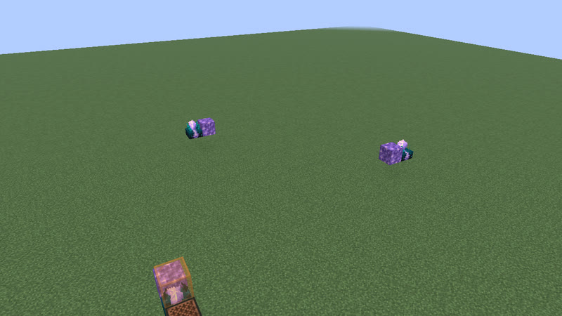
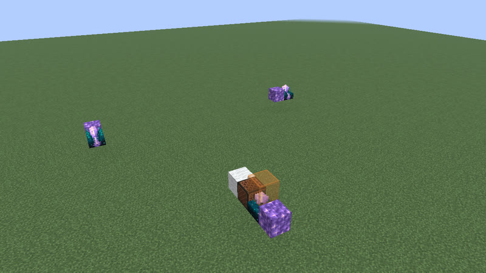
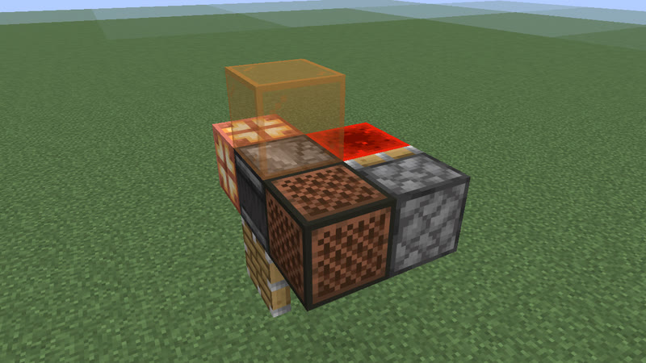
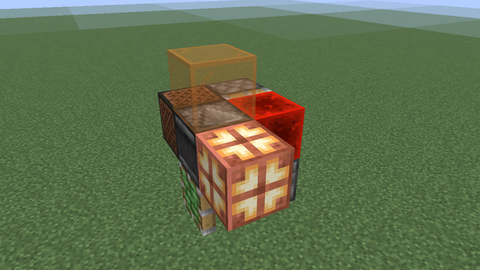
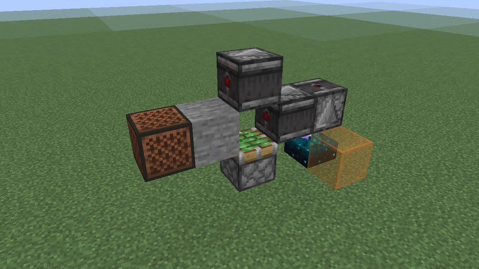
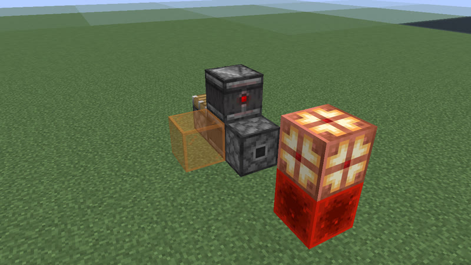
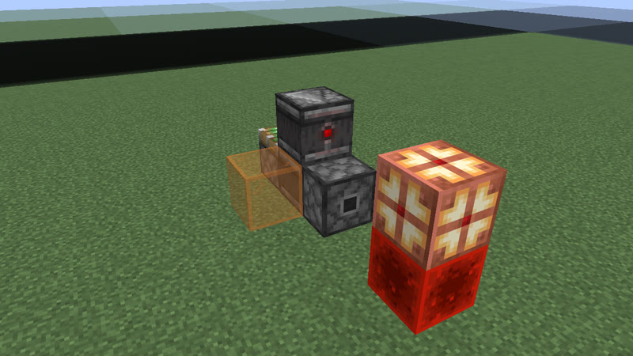
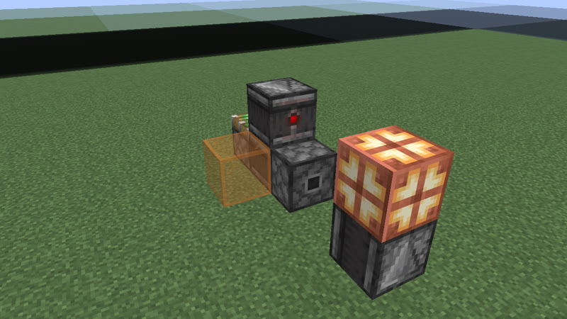

# Clocks: 43 gt (2.15 s) to 52 gt (2.6 s) (296 clock types)

[catalog index](../CATALOG.md) · previous: [p30-42](p30-42.md) · next: [p53-75](p53-75.md)

Orange glass = where the output signal is (placed only for the picture); click a picture for its design. Larger clocks of a period no better than a smaller one on any variation (whatever their block kinds) are listed on [variants](variants.md). Generated by `mctas clock catalog`.

## 43 gt (2.15 s)

Also reachable by: clk-obs-odd-a (n = 8), dropper ring (clk-item-dropring-2d-r1, n = 0), lock ring (clk-item-lockring-3s, n = 1).

<table>
<tr><td align="center"> 43 gt (2.15 s) · calibrated_sculk_sensor+dispenser+observer+sculk_sensor · 4 blocks</td><td align="center"> 43 gt (2.15 s) · calibrated_sculk_sensor+observer+piston+sculk_sensor · 4 blocks also found as census-p43-calibrated_sculk_sensor-observer-sculk_sensor-sticky_piston-4b (built with sticky_piston, without piston)</td><td align="center"> 43 gt (2.15 s) · note_block+observer+piston+sculk_sensor · 4 blocks also found as census-p43-note_block-observer-sculk_sensor-sticky_piston-4b (built with sticky_piston, without piston)</td></tr>
<tr><td align="center"> 43 gt (2.15 s) · dispenser+observer+sculk_sensor · 5 blocks</td><td align="center"> 43 gt (2.15 s) · note_block+observer+repeater+sculk_sensor · 5 blocks</td><td align="center"> 43 gt (2.15 s) · oak_trapdoor+observer+sculk_sensor+sticky_piston · 5 blocks</td></tr>
<tr><td align="center"> 43 gt (2.15 s) · observer+piston+sculk_sensor+sticky_piston · 5 blocks</td><td align="center"> 43 gt (2.15 s) · observer+sculk_sensor+sticky_piston · 5 blocks</td><td align="center"> 43 gt (2.15 s) · observer+piston+sculk_sensor · 5 blocks</td></tr>
<tr><td align="center"> 43 gt (2.15 s) · iron_trapdoor+observer+sculk_sensor+sticky_piston · 5 blocks</td><td align="center"> 43 gt (2.15 s) · oak_fence_gate+observer+sculk_sensor+sticky_piston · 5 blocks</td><td align="center"><a href="../archive/census-p43-calibrated_sculk_sensor-oak_trapdoor-sculk_sensor-6b.txt">census-p43-calibrated_sculk_sensor-oak_trapdoor-sculk_sensor-6b</a> 43 gt (2.15 s) · calibrated_sculk_sensor+oak_trapdoor+sculk_sensor · 6 blocks (picture pending)</td></tr>
<tr><td align="center"><a href="../archive/census-p43-calibrated_sculk_sensor-note_block-observer-piston-sculk_sensor-sticky_piston-6b.txt">census-p43-calibrated_sculk_sensor-note_block-observer-piston-sculk_sensor-sticky_piston-6b</a> 43 gt (2.15 s) · calibrated_sculk_sensor+note_block+observer+piston+sculk_sensor+sticky_piston · 6 blocks (picture pending)</td><td align="center"><a href="../archive/census-p43-calibrated_sculk_sensor-note_block-observer-sculk_sensor-sticky_piston-6b.txt">census-p43-calibrated_sculk_sensor-note_block-observer-sculk_sensor-sticky_piston-6b</a> 43 gt (2.15 s) · calibrated_sculk_sensor+note_block+observer+sculk_sensor+sticky_piston · 6 blocks (picture pending)</td><td align="center"><a href="../archive/census-p43-calibrated_sculk_sensor-oak_trapdoor-piston-sculk_sensor-6b.txt">census-p43-calibrated_sculk_sensor-oak_trapdoor-piston-sculk_sensor-6b</a> 43 gt (2.15 s) · calibrated_sculk_sensor+oak_trapdoor+piston+sculk_sensor · 6 blocks (picture pending) also found as census-p43-calibrated_sculk_sensor-oak_trapdoor-sculk_sensor-sticky_piston-6b (built with sticky_piston, without piston)</td></tr>
<tr><td align="center"><a href="../archive/census-p43-dispenser-note_block-observer-piston-sculk_sensor-6b.txt">census-p43-dispenser-note_block-observer-piston-sculk_sensor-6b</a> 43 gt (2.15 s) · dispenser+note_block+observer+piston+sculk_sensor · 6 blocks (picture pending) also found as census-p43-dispenser-note_block-observer-sculk_sensor-sticky_piston-6b (built with sticky_piston, without piston)</td><td align="center"> 43 gt (2.15 s) · iron_trapdoor+observer+sculk_sensor · 6 blocks</td><td align="center"> 43 gt (2.15 s) · oak_fence_gate+observer+sculk_sensor · 6 blocks</td></tr>
<tr><td align="center"> 43 gt (2.15 s) · oak_trapdoor+observer+sculk_sensor · 6 blocks</td><td align="center"><a href="../archive/census-p43-calibrated_sculk_sensor-note_block-piston-sculk_sensor-6b.txt">census-p43-calibrated_sculk_sensor-note_block-piston-sculk_sensor-6b</a> 43 gt (2.15 s) · calibrated_sculk_sensor+note_block+piston+sculk_sensor · 6 blocks (picture pending)</td><td align="center"><a href="../archive/census-p43-calibrated_sculk_sensor-note_block-piston-sculk_sensor-sticky_piston-6b.txt">census-p43-calibrated_sculk_sensor-note_block-piston-sculk_sensor-sticky_piston-6b</a> 43 gt (2.15 s) · calibrated_sculk_sensor+note_block+piston+sculk_sensor+sticky_piston · 6 blocks (picture pending)</td></tr>
<tr><td align="center"><a href="../archive/census-p43-calibrated_sculk_sensor-piston-sculk_sensor-6b.txt">census-p43-calibrated_sculk_sensor-piston-sculk_sensor-6b</a> 43 gt (2.15 s) · calibrated_sculk_sensor+piston+sculk_sensor · 6 blocks (picture pending) also found as census-p43-calibrated_sculk_sensor-piston-sculk_sensor-sticky_piston-6b (built with sticky_piston)</td><td align="center"> 43 gt (2.15 s) · observer+redstone_block+sticky_piston · 6 blocks</td><td align="center"><a href="../archive/census-p43-calibrated_sculk_sensor-sculk_sensor-sticky_piston-6b.txt">census-p43-calibrated_sculk_sensor-sculk_sensor-sticky_piston-6b</a> 43 gt (2.15 s) · calibrated_sculk_sensor+sculk_sensor+sticky_piston · 6 blocks (picture pending)</td></tr>
<tr><td align="center"> 43 gt (2.15 s) · calibrated_sculk_sensor+note_block · 6 blocks</td><td align="center"><a href="../archive/clk-obs-p43-obs-pis-stk-7b-0af5b3.txt">clk-obs-p43-obs-pis-stk-7b-0af5b3</a> 43 gt (2.15 s) · observer+piston+sticky_piston · 7 blocks (picture pending)</td><td align="center"><a href="../archive/clk-obs-p43-obs-stk-7b-682616.txt">clk-obs-p43-obs-stk-7b-682616</a> 43 gt (2.15 s) · observer+sticky_piston · 7 blocks (picture pending)</td></tr>
<tr><td align="center"> 43 gt (2.15 s) · calibrated_sculk_sensor · 7 blocks</td><td align="center"><a href="../archive/clk-obs-p43-note-obs-pis-stk-8b-ced3d4.txt">clk-obs-p43-note-obs-pis-stk-8b-ced3d4</a> 43 gt (2.15 s) · note_block+observer+piston+sticky_piston · 8 blocks (picture pending)</td><td align="center"><a href="../archive/clk-obs-p43-note-obs-stk-8b-504b48.txt">clk-obs-p43-note-obs-stk-8b-504b48</a> 43 gt (2.15 s) · note_block+observer+sticky_piston · 8 blocks (picture pending)</td></tr>
<tr><td align="center"><a href="../archive/clk-obs-p43-lamp-obs-pis-stk-8b-6d47ab.txt">clk-obs-p43-lamp-obs-pis-stk-8b-6d47ab</a> 43 gt (2.15 s) · observer+piston+redstone_lamp+sticky_piston · 8 blocks (picture pending)</td><td align="center"><a href="../archive/clk-obs-p43-lamp-obs-stk-8b-3b2290.txt">clk-obs-p43-lamp-obs-stk-8b-3b2290</a> 43 gt (2.15 s) · observer+redstone_lamp+sticky_piston · 8 blocks (picture pending)</td><td align="center"><a href="../archive/kit-shuttle-minecart-p43-15b.txt">kit-shuttle-minecart-p43-15b</a> 43 gt (2.15 s) · detector_rail+minecart+powered_rail · 15 blocks (picture pending)</td></tr>
<tr><td align="center"> 43 gt (2.15 s) · repeater · 27 blocks</td></tr>
</table>

## 44 gt (2.2 s)

Also reachable by: clk-obs-obs-ring (n = 9), clk-obs-bulb-ring (n = 3), clk-sculk-replin-dispenser (n = 4), dropper ring (clk-item-dropring-2d-r14, n = 0).

<table>
<tr><td align="center"> 44 gt (2.2 s) · oak_trapdoor+observer+sculk_sensor · 3 blocks</td><td align="center"> 44 gt (2.2 s) · oak_fence_gate+observer+sculk_sensor · 3 blocks</td><td align="center"> 44 gt (2.2 s) · observer+piston+sculk_sensor · 3 blocks also found as census-p44-observer-sculk_sensor-sticky_piston-3b (built with sticky_piston, without piston)</td></tr>
<tr><td align="center"> 44 gt (2.2 s) · note_block+observer+sculk_sensor · 3 blocks</td><td align="center"><a href="../archive/census-p44-calibrated_sculk_sensor-dispenser-note_block-observer-sculk_sensor-6b.txt">census-p44-calibrated_sculk_sensor-dispenser-note_block-observer-sculk_sensor-6b</a> 44 gt (2.2 s) · calibrated_sculk_sensor+dispenser+note_block+observer+sculk_sensor · 6 blocks (picture pending)</td><td align="center"><a href="../archive/census-p44-calibrated_sculk_sensor-oak_trapdoor-observer-piston-sculk_sensor-sticky_piston-6b.txt">census-p44-calibrated_sculk_sensor-oak_trapdoor-observer-piston-sculk_sensor-sticky_piston-6b</a> 44 gt (2.2 s) · calibrated_sculk_sensor+oak_trapdoor+observer+piston+sculk_sensor+sticky_piston · 6 blocks (picture pending)</td></tr>
<tr><td align="center"> 44 gt (2.2 s) · calibrated_sculk_sensor+dispenser+observer · 6 blocks</td><td align="center"> 44 gt (2.2 s) · calibrated_sculk_sensor+note_block · 6 blocks</td><td align="center"> 44 gt (2.2 s) · copper_bulb+note_block+observer+piston+sticky_piston · 7 blocks</td></tr>
<tr><td align="center"> 44 gt (2.2 s) · copper_bulb+observer+piston+sticky_piston · 7 blocks</td><td align="center"> 44 gt (2.2 s) · copper_bulb+observer+piston+sticky_piston · 7 blocks</td><td align="center"> 44 gt (2.2 s) · note_block+observer+redstone_block+redstone_lamp+sticky_piston · 7 blocks</td></tr>
<tr><td align="center"> 44 gt (2.2 s) · note_block+observer+redstone_lamp+sticky_piston · 7 blocks</td><td align="center"> 44 gt (2.2 s) · note_block+observer+redstone_lamp+sticky_piston · 7 blocks</td><td align="center"> 44 gt (2.2 s) · observer+redstone_lamp+sticky_piston · 7 blocks</td></tr>
<tr><td align="center"> 44 gt (2.2 s) · observer+redstone_lamp+sticky_piston · 7 blocks</td><td align="center"><a href="../archive/clk-obs-p44-bulb-lamp-obs-rb-stk-7b-8e8128.txt">clk-obs-p44-bulb-lamp-obs-rb-stk-7b-8e8128</a> 44 gt (2.2 s) · copper_bulb+observer+redstone_block+redstone_lamp+sticky_piston · 7 blocks (picture pending)</td><td align="center"> 44 gt (2.2 s) · copper_bulb+observer+redstone_block+sticky_piston · 7 blocks</td></tr>
<tr><td align="center"> 44 gt (2.2 s) · copper_bulb+observer+redstone_block+sticky_piston · 7 blocks</td><td align="center"> 44 gt (2.2 s) · calibrated_sculk_sensor+observer+sticky_piston · 7 blocks</td><td align="center"><a href="../archive/clk-obs-p44-obs-stk-8b-45ef68.txt">clk-obs-p44-obs-stk-8b-45ef68</a> 44 gt (2.2 s) · observer+sticky_piston · 8 blocks (picture pending)</td></tr>
<tr><td align="center"><a href="../archive/clk-obs-p44-obs-rb-stk-8b-df8c80.txt">clk-obs-p44-obs-rb-stk-8b-df8c80</a> 44 gt (2.2 s) · observer+redstone_block+sticky_piston · 8 blocks (picture pending)</td><td align="center"> 44 gt (2.2 s) · calibrated_sculk_sensor · 8 blocks</td><td align="center"><a href="../archive/clk-obs-p44-bulb-lamp-note-obs-pis-rb-stk-9b-e8de42.txt">clk-obs-p44-bulb-lamp-note-obs-pis-rb-stk-9b-e8de42</a> 44 gt (2.2 s) · copper_bulb+note_block+observer+piston+redstone_block+redstone_lamp+sticky_piston · 9 blocks (picture pending)</td></tr>
<tr><td align="center"><a href="../archive/clk-obs-p44-bulb-note-obs-pis-rb-stk-9b-c08b36.txt">clk-obs-p44-bulb-note-obs-pis-rb-stk-9b-c08b36</a> 44 gt (2.2 s) · copper_bulb+note_block+observer+piston+redstone_block+sticky_piston · 9 blocks (picture pending)</td><td align="center"> 44 gt (2.2 s) · redstone_torch+redstone_wire+repeater · 12 blocks</td><td align="center"> 44 gt (2.2 s) · comparator+hopper · 12 blocks</td></tr>
<tr><td align="center"> 44 gt (2.2 s) · redstone_torch+redstone_wire+repeater · 13 blocks</td><td align="center"> 44 gt (2.2 s) · repeater · 16 blocks</td></tr>
</table>

## 45 gt (2.25 s)

Also reachable by: clk-obs-odd-b (n = 8), dropper ring (clk-item-dropring-2d-r2, n = 1), lock ring (clk-item-lockring-3s, n = 2).

<table>
<tr><td align="center"> 45 gt (2.25 s) · dispenser+note_block+observer+sculk_sensor · 4 blocks</td><td align="center"> 45 gt (2.25 s) · dispenser+oak_trapdoor+observer+sculk_sensor · 4 blocks</td><td align="center"> 45 gt (2.25 s) · note_block+observer+sculk_sensor · 4 blocks</td></tr>
<tr><td align="center"> 45 gt (2.25 s) · oak_trapdoor+observer+sculk_sensor · 4 blocks</td><td align="center"> 45 gt (2.25 s) · oak_fence_gate+observer+sculk_sensor · 4 blocks</td><td align="center"> 45 gt (2.25 s) · dispenser+observer+piston+sculk_sensor · 4 blocks also found as census-p45-dispenser-observer-sculk_sensor-sticky_piston-4b (built with sticky_piston, without piston)</td></tr>
<tr><td align="center"> 45 gt (2.25 s) · observer+piston+sculk_sensor · 4 blocks also found as census-p45-observer-sculk_sensor-sticky_piston-4b (built with sticky_piston, without piston)</td><td align="center"> 45 gt (2.25 s) · calibrated_sculk_sensor+observer+piston+sculk_sensor+sticky_piston · 5 blocks</td><td align="center"> 45 gt (2.25 s) · dispenser+observer+sculk_sensor · 6 blocks</td></tr>
<tr><td align="center"><a href="../archive/census-p45-calibrated_sculk_sensor-dispenser-oak_trapdoor-observer-piston-sculk_sensor-6b.txt">census-p45-calibrated_sculk_sensor-dispenser-oak_trapdoor-observer-piston-sculk_sensor-6b</a> 45 gt (2.25 s) · calibrated_sculk_sensor+dispenser+oak_trapdoor+observer+piston+sculk_sensor · 6 blocks (picture pending) also found as census-p45-calibrated_sculk_sensor-dispenser-oak_trapdoor-observer-sculk_sensor-sticky_piston-6b (built with sticky_piston, without piston)</td><td align="center"><a href="../archive/census-p45-calibrated_sculk_sensor-dispenser-observer-piston-sculk_sensor-sticky_piston-6b.txt">census-p45-calibrated_sculk_sensor-dispenser-observer-piston-sculk_sensor-sticky_piston-6b</a> 45 gt (2.25 s) · calibrated_sculk_sensor+dispenser+observer+piston+sculk_sensor+sticky_piston · 6 blocks (picture pending)</td><td align="center"><a href="../archive/census-p45-calibrated_sculk_sensor-note_block-oak_trapdoor-observer-piston-sculk_sensor-6b.txt">census-p45-calibrated_sculk_sensor-note_block-oak_trapdoor-observer-piston-sculk_sensor-6b</a> 45 gt (2.25 s) · calibrated_sculk_sensor+note_block+oak_trapdoor+observer+piston+sculk_sensor · 6 blocks (picture pending) also found as census-p45-calibrated_sculk_sensor-note_block-oak_trapdoor-observer-sculk_sensor-sticky_piston-6b (built with sticky_piston, without piston)</td></tr>
<tr><td align="center"><a href="../archive/census-p45-calibrated_sculk_sensor-note_block-observer-piston-sculk_sensor-sticky_piston-6b.txt">census-p45-calibrated_sculk_sensor-note_block-observer-piston-sculk_sensor-sticky_piston-6b</a> 45 gt (2.25 s) · calibrated_sculk_sensor+note_block+observer+piston+sculk_sensor+sticky_piston · 6 blocks (picture pending)</td><td align="center"> 45 gt (2.25 s) · calibrated_sculk_sensor+observer+sticky_piston · 6 blocks</td><td align="center"> 45 gt (2.25 s) · calibrated_sculk_sensor+note_block · 6 blocks</td></tr>
<tr><td align="center"> 45 gt (2.25 s) · copper_bulb+observer+piston+sticky_piston · 7 blocks</td><td align="center"> 45 gt (2.25 s) · copper_bulb+observer+sticky_piston · 7 blocks</td><td align="center"> 45 gt (2.25 s) · note_block+observer+piston+sticky_piston · 7 blocks</td></tr>
<tr><td align="center"> 45 gt (2.25 s) · note_block+observer+sticky_piston · 7 blocks</td><td align="center"> 45 gt (2.25 s) · observer+piston+sticky_piston · 7 blocks</td><td align="center"> 45 gt (2.25 s) · observer+piston+sticky_piston · 7 blocks</td></tr>
<tr><td align="center"> 45 gt (2.25 s) · observer+sticky_piston · 7 blocks</td><td align="center"> 45 gt (2.25 s) · copper_bulb+observer+piston+sticky_piston · 7 blocks</td><td align="center"> 45 gt (2.25 s) · copper_bulb+observer+sticky_piston · 7 blocks</td></tr>
<tr><td align="center"> 45 gt (2.25 s) · calibrated_sculk_sensor · 7 blocks</td><td align="center"><a href="../archive/clk-obs-p45-bulb-note-obs-pis-stk-8b-e66e4e.txt">clk-obs-p45-bulb-note-obs-pis-stk-8b-e66e4e</a> 45 gt (2.25 s) · copper_bulb+note_block+observer+piston+sticky_piston · 8 blocks (picture pending)</td><td align="center"><a href="../archive/clk-obs-p45-bulb-note-obs-stk-8b-2caffd.txt">clk-obs-p45-bulb-note-obs-stk-8b-2caffd</a> 45 gt (2.25 s) · copper_bulb+note_block+observer+sticky_piston · 8 blocks (picture pending)</td></tr>
<tr><td align="center"><a href="../archive/clk-obs-p45-lamp-note-obs-pis-stk-8b-6a7f65.txt">clk-obs-p45-lamp-note-obs-pis-stk-8b-6a7f65</a> 45 gt (2.25 s) · note_block+observer+piston+redstone_lamp+sticky_piston · 8 blocks (picture pending)</td><td align="center"><a href="../archive/clk-obs-p45-lamp-note-obs-stk-8b-48c729.txt">clk-obs-p45-lamp-note-obs-stk-8b-48c729</a> 45 gt (2.25 s) · note_block+observer+redstone_lamp+sticky_piston · 8 blocks (picture pending)</td><td align="center"><a href="../archive/kit-shuttle-minecart-p45-17b.txt">kit-shuttle-minecart-p45-17b</a> 45 gt (2.25 s) · detector_rail+minecart · 17 blocks (picture pending)</td></tr>
<tr><td align="center"> 45 gt (2.25 s) · repeater · 28 blocks</td></tr>
</table>

## 46 gt (2.3 s)

Also reachable by: observer ring with a relay block (clk-obs-note-ring, n = 9), clk-misc-cart-loop (n = 4), dropper ring (clk-item-dropring-2d-r24, n = 0), clk-item-latch (n = 1).

<table>
<tr><td align="center"> 46 gt (2.3 s) · note_block+observer+sculk_sensor · 4 blocks</td><td align="center"> 46 gt (2.3 s) · oak_trapdoor+observer+sculk_sensor · 4 blocks</td><td align="center"> 46 gt (2.3 s) · observer+piston+sculk_sensor · 4 blocks also found as census-p46-observer-sculk_sensor-sticky_piston-4b (built with sticky_piston, without piston)</td></tr>
<tr><td align="center"> 46 gt (2.3 s) · oak_trapdoor+observer+sculk_sensor · 4 blocks</td><td align="center"> 46 gt (2.3 s) · oak_fence_gate+observer+sculk_sensor · 4 blocks</td><td align="center"> 46 gt (2.3 s) · iron_trapdoor+observer+sculk_sensor · 4 blocks</td></tr>
<tr><td align="center"> 46 gt (2.3 s) · calibrated_sculk_sensor+dispenser+observer+sculk_sensor · 5 blocks</td><td align="center"> 46 gt (2.3 s) · dispenser+observer+piston+sculk_sensor · 5 blocks also found as clk-sculk-hyb3b-p46-3 (built with sticky_piston, without piston)</td><td align="center"><a href="../archive/census-p46-calibrated_sculk_sensor-note_block-oak_trapdoor-observer-6b.txt">census-p46-calibrated_sculk_sensor-note_block-oak_trapdoor-observer-6b</a> 46 gt (2.3 s) · calibrated_sculk_sensor+note_block+oak_trapdoor+observer · 6 blocks (picture pending)</td></tr>
<tr><td align="center"><a href="../archive/census-p46-calibrated_sculk_sensor-note_block-observer-6b.txt">census-p46-calibrated_sculk_sensor-note_block-observer-6b</a> 46 gt (2.3 s) · calibrated_sculk_sensor+note_block+observer · 6 blocks (picture pending)</td><td align="center"><a href="../archive/census-p46-calibrated_sculk_sensor-oak_trapdoor-observer-6b.txt">census-p46-calibrated_sculk_sensor-oak_trapdoor-observer-6b</a> 46 gt (2.3 s) · calibrated_sculk_sensor+oak_trapdoor+observer · 6 blocks (picture pending)</td><td align="center"><a href="../archive/census-p46-calibrated_sculk_sensor-dispenser-observer-piston-sculk_sensor-6b.txt">census-p46-calibrated_sculk_sensor-dispenser-observer-piston-sculk_sensor-6b</a> 46 gt (2.3 s) · calibrated_sculk_sensor+dispenser+observer+piston+sculk_sensor · 6 blocks (picture pending) also found as census-p46-calibrated_sculk_sensor-dispenser-observer-sculk_sensor-sticky_piston-6b (built with sticky_piston, without piston)</td></tr>
<tr><td align="center"><a href="../archive/census-p46-calibrated_sculk_sensor-note_block-observer-piston-6b.txt">census-p46-calibrated_sculk_sensor-note_block-observer-piston-6b</a> 46 gt (2.3 s) · calibrated_sculk_sensor+note_block+observer+piston · 6 blocks (picture pending) also found as census-p46-calibrated_sculk_sensor-note_block-observer-sticky_piston-6b (built with sticky_piston, without piston)</td><td align="center"><a href="../archive/census-p46-calibrated_sculk_sensor-oak_trapdoor-observer-piston-6b.txt">census-p46-calibrated_sculk_sensor-oak_trapdoor-observer-piston-6b</a> 46 gt (2.3 s) · calibrated_sculk_sensor+oak_trapdoor+observer+piston · 6 blocks (picture pending) also found as census-p46-calibrated_sculk_sensor-oak_trapdoor-observer-sticky_piston-6b (built with sticky_piston, without piston)</td><td align="center"> 46 gt (2.3 s) · observer+piston+sticky_piston · 6 blocks</td></tr>
<tr><td align="center"> 46 gt (2.3 s) · observer+piston+sticky_piston · 6 blocks</td><td align="center"> 46 gt (2.3 s) · observer+sticky_piston · 6 blocks</td><td align="center"><a href="../archive/census-p46-calibrated_sculk_sensor-observer-piston-6b.txt">census-p46-calibrated_sculk_sensor-observer-piston-6b</a> 46 gt (2.3 s) · calibrated_sculk_sensor+observer+piston · 6 blocks (picture pending) also found as census-p46-calibrated_sculk_sensor-observer-piston-sticky_piston-6b (built with sticky_piston)</td></tr>
<tr><td align="center"> 46 gt (2.3 s) · observer+sticky_piston · 6 blocks</td><td align="center"> 46 gt (2.3 s) · calibrated_sculk_sensor+observer+sticky_piston · 6 blocks</td><td align="center"> 46 gt (2.3 s) · calibrated_sculk_sensor+dispenser+observer · 6 blocks</td></tr>
<tr><td align="center"> 46 gt (2.3 s) · calibrated_sculk_sensor+note_block · 6 blocks</td><td align="center"> 46 gt (2.3 s) · observer+piston+redstone_block+sticky_piston · 7 blocks</td><td align="center"> 46 gt (2.3 s) · observer+piston+redstone_block+sticky_piston · 7 blocks</td></tr>
<tr><td align="center"> 46 gt (2.3 s) · observer+redstone_block+sticky_piston · 7 blocks</td><td align="center"> 46 gt (2.3 s) · observer+redstone_block+sticky_piston · 7 blocks</td><td align="center"> 46 gt (2.3 s) · copper_bulb+note_block+observer+piston+sticky_piston · 7 blocks</td></tr>
<tr><td align="center"> 46 gt (2.3 s) · copper_bulb+note_block+observer+sticky_piston · 7 blocks</td><td align="center"> 46 gt (2.3 s) · calibrated_sculk_sensor · 8 blocks</td><td align="center"><a href="../archive/clk-obs-p46-bulb-lamp-obs-pis-rb-stk-9b-fceb53.txt">clk-obs-p46-bulb-lamp-obs-pis-rb-stk-9b-fceb53</a> 46 gt (2.3 s) · copper_bulb+observer+piston+redstone_block+redstone_lamp+sticky_piston · 9 blocks (picture pending)</td></tr>
<tr><td align="center"><a href="../archive/clk-obs-p46-lamp-note-obs-stk-9b-71bcdd.txt">clk-obs-p46-lamp-note-obs-stk-9b-71bcdd</a> 46 gt (2.3 s) · note_block+observer+redstone_lamp+sticky_piston · 9 blocks (picture pending)</td><td align="center"> 46 gt (2.3 s) · comparator+hopper · 10 blocks</td><td align="center"> 46 gt (2.3 s) · redstone_torch+repeater · 16 blocks</td></tr>
<tr><td align="center"> 46 gt (2.3 s) · repeater · 16 blocks</td><td align="center"><a href="../archive/clk-misc-hopper-cart.txt">clk-misc-hopper-cart</a> 46 gt (2.3 s) · hopper+hopper_minecart · 17 blocks (picture pending)</td></tr>
</table>

## 47 gt (2.35 s)

Also reachable by: clk-obs-odd-a (n = 9), clk-rt-odd-rect (n = 3), dropper ring (clk-item-dropring-2d-r3, n = 1), lock ring (clk-item-lockring-3s, n = 3), clk-misc-cart-pingpong (n = 2).

<table>
<tr><td align="center"> 47 gt (2.35 s) · note_block+observer+sculk_sensor · 4 blocks</td><td align="center"> 47 gt (2.35 s) · oak_trapdoor+observer+sculk_sensor · 4 blocks</td><td align="center"> 47 gt (2.35 s) · oak_trapdoor+observer+sculk_sensor · 4 blocks</td></tr>
<tr><td align="center"> 47 gt (2.35 s) · oak_fence_gate+observer+sculk_sensor · 4 blocks</td><td align="center"> 47 gt (2.35 s) · iron_trapdoor+observer+sculk_sensor · 4 blocks</td><td align="center"> 47 gt (2.35 s) · observer+piston+sculk_sensor · 4 blocks also found as census-p47-observer-sculk_sensor-sticky_piston-4b (built with sticky_piston, without piston)</td></tr>
<tr><td align="center"> 47 gt (2.35 s) · calibrated_sculk_sensor+observer+piston+sculk_sensor · 4 blocks also found as census-p47-calibrated_sculk_sensor-observer-sculk_sensor-sticky_piston-4b (built with sticky_piston, without piston)</td><td align="center"> 47 gt (2.35 s) · calibrated_sculk_sensor+oak_trapdoor+observer+sculk_sensor · 5 blocks</td><td align="center"> 47 gt (2.35 s) · calibrated_sculk_sensor+dispenser+note_block+observer+sculk_sensor · 5 blocks</td></tr>
<tr><td align="center"> 47 gt (2.35 s) · calibrated_sculk_sensor+dispenser+oak_trapdoor+observer+sculk_sensor · 5 blocks</td><td align="center"> 47 gt (2.35 s) · calibrated_sculk_sensor+dispenser+observer+piston+sculk_sensor · 5 blocks also found as census-p47-calibrated_sculk_sensor-dispenser-observer-sculk_sensor-sticky_piston-5b (built with sticky_piston, without piston)</td><td align="center"> 47 gt (2.35 s) · dispenser+observer+sculk_sensor+sticky_piston · 5 blocks</td></tr>
<tr><td align="center"> 47 gt (2.35 s) · dispenser+observer+sculk_sensor · 6 blocks</td><td align="center"> 47 gt (2.35 s) · calibrated_sculk_sensor+observer+sticky_piston · 6 blocks</td><td align="center"> 47 gt (2.35 s) · note_block+observer+piston+redstone_block+sticky_piston · 7 blocks</td></tr>
<tr><td align="center"> 47 gt (2.35 s) · observer+piston+redstone_block+sticky_piston · 7 blocks</td><td align="center"> 47 gt (2.35 s) · observer+sticky_piston · 7 blocks</td><td align="center"><a href="../archive/clk-obs-p47-lamp-note-obs-stk-8b-dae05d.txt">clk-obs-p47-lamp-note-obs-stk-8b-dae05d</a> 47 gt (2.35 s) · note_block+observer+redstone_lamp+sticky_piston · 8 blocks (picture pending)</td></tr>
<tr><td align="center"><a href="../archive/clk-obs-p47-lamp-obs-stk-8b-a789bd.txt">clk-obs-p47-lamp-obs-stk-8b-a789bd</a> 47 gt (2.35 s) · observer+redstone_lamp+sticky_piston · 8 blocks (picture pending)</td><td align="center"><a href="../archive/clk-obs-p47-note-obs-stk-8b-fe4660.txt">clk-obs-p47-note-obs-stk-8b-fe4660</a> 47 gt (2.35 s) · note_block+observer+sticky_piston · 8 blocks (picture pending)</td><td align="center"><a href="../archive/clk-obs-p47-obs-pis-stk-8b-8675ce.txt">clk-obs-p47-obs-pis-stk-8b-8675ce</a> 47 gt (2.35 s) · observer+piston+sticky_piston · 8 blocks (picture pending)</td></tr>
<tr><td align="center"><a href="../archive/clk-obs-p47-obs-rb-stk-8b-8441c9.txt">clk-obs-p47-obs-rb-stk-8b-8441c9</a> 47 gt (2.35 s) · observer+redstone_block+sticky_piston · 8 blocks (picture pending)</td><td align="center"><a href="../archive/clk-obs-p47-note-obs-pis-stk-8b-8a6043.txt">clk-obs-p47-note-obs-pis-stk-8b-8a6043</a> 47 gt (2.35 s) · note_block+observer+piston+sticky_piston · 8 blocks (picture pending)</td><td align="center"><a href="../archive/kit-shuttle-minecart-p47-17b.txt">kit-shuttle-minecart-p47-17b</a> 47 gt (2.35 s) · detector_rail+minecart+powered_rail · 17 blocks (picture pending)</td></tr>
</table>

## 48 gt (2.4 s)

Also reachable by: clk-obs-obs-ring (n = 10), clk-obs-divider (n = 2), dropper ring (clk-item-dropring-2d, n = 1), clk-rt-rect-pulse (n = 1).

<table>
<tr><td align="center"> 48 gt (2.4 s) · dispenser+observer+sculk_sensor · 3 blocks</td><td align="center"> 48 gt (2.4 s) · dispenser+observer+sculk_sensor · 3 blocks</td><td align="center"> 48 gt (2.4 s) · dispenser+observer+sculk_sensor · 3 blocks</td></tr>
<tr><td align="center"> 48 gt (2.4 s) · calibrated_sculk_sensor+note_block+observer+sculk_sensor · 4 blocks</td><td align="center"> 48 gt (2.4 s) · calibrated_sculk_sensor+oak_trapdoor+observer+sculk_sensor · 4 blocks</td><td align="center"> 48 gt (2.4 s) · note_block+observer+sculk_sensor · 4 blocks</td></tr>
<tr><td align="center"> 48 gt (2.4 s) · calibrated_sculk_sensor+observer+piston+sculk_sensor · 4 blocks also found as census-p48-calibrated_sculk_sensor-observer-sculk_sensor-sticky_piston-4b (built with sticky_piston, without piston)</td><td align="center"> 48 gt (2.4 s) · calibrated_sculk_sensor+observer+sticky_piston · 4 blocks</td><td align="center"> 48 gt (2.4 s) · calibrated_sculk_sensor+note_block+observer+sticky_piston · 4 blocks</td></tr>
<tr><td align="center"> 48 gt (2.4 s) · oak_trapdoor+observer+sculk_sensor · 5 blocks</td><td align="center"> 48 gt (2.4 s) · iron_trapdoor+observer+sculk_sensor · 5 blocks</td><td align="center"> 48 gt (2.4 s) · oak_fence_gate+observer+sculk_sensor · 5 blocks</td></tr>
<tr><td align="center"> 48 gt (2.4 s) · calibrated_sculk_sensor+dispenser+observer+sticky_piston · 5 blocks</td><td align="center"> 48 gt (2.4 s) · copper_bulb+observer+piston+redstone_block+sticky_piston · 5 blocks</td><td align="center"> 48 gt (2.4 s) · copper_bulb+observer+redstone_block+sticky_piston · 5 blocks</td></tr>
<tr><td align="center"> 48 gt (2.4 s) · calibrated_sculk_sensor+iron_trapdoor+observer+sticky_piston · 5 blocks</td><td align="center"> 48 gt (2.4 s) · calibrated_sculk_sensor+oak_fence_gate+observer+sticky_piston · 5 blocks</td><td align="center"><a href="../archive/census-p48-calibrated_sculk_sensor-note_block-observer-6b.txt">census-p48-calibrated_sculk_sensor-note_block-observer-6b</a> 48 gt (2.4 s) · calibrated_sculk_sensor+note_block+observer · 6 blocks (picture pending)</td></tr>
<tr><td align="center"> 48 gt (2.4 s) · copper_bulb+observer+sticky_piston · 6 blocks</td><td align="center"> 48 gt (2.4 s) · observer+redstone_lamp+sticky_piston · 6 blocks</td><td align="center"> 48 gt (2.4 s) · note_block+observer+sticky_piston · 6 blocks</td></tr>
<tr><td align="center"> 48 gt (2.4 s) · observer+sticky_piston · 6 blocks</td><td align="center"> 48 gt (2.4 s) · copper_bulb+note_block+observer+piston+redstone_block+sticky_piston · 6 blocks</td><td align="center"> 48 gt (2.4 s) · copper_bulb+note_block+observer+redstone_block+sticky_piston · 6 blocks</td></tr>
<tr><td align="center"> 48 gt (2.4 s) · observer+redstone_block+sticky_piston · 6 blocks</td><td align="center"> 48 gt (2.4 s) · observer+piston · 7 blocks</td><td align="center"> 48 gt (2.4 s) · copper_bulb+observer+redstone_block+redstone_lamp+sticky_piston · 7 blocks</td></tr>
<tr><td align="center"> 48 gt (2.4 s) · copper_bulb+observer+redstone_lamp+sticky_piston · 7 blocks</td><td align="center"> 48 gt (2.4 s) · observer+redstone_block+redstone_lamp+sticky_piston · 7 blocks</td><td align="center"><a href="../archive/clk-obs-p48-lamp-note-obs-pis-stk-8b-569d3d.txt">clk-obs-p48-lamp-note-obs-pis-stk-8b-569d3d</a> 48 gt (2.4 s) · note_block+observer+piston+redstone_lamp+sticky_piston · 8 blocks (picture pending)</td></tr>
<tr><td align="center"><a href="../archive/clk-obs-p48-bulb-lamp-obs-pis-rb-stk-8b-f1d23f.txt">clk-obs-p48-bulb-lamp-obs-pis-rb-stk-8b-f1d23f</a> 48 gt (2.4 s) · copper_bulb+observer+piston+redstone_block+redstone_lamp+sticky_piston · 8 blocks (picture pending)</td><td align="center"> 48 gt (2.4 s) · redstone_torch+redstone_wire+repeater · 12 blocks</td><td align="center"> 48 gt (2.4 s) · redstone_torch+redstone_wire+repeater · 13 blocks</td></tr>
</table>

## 49 gt (2.45 s)

Also reachable by: clk-obs-odd-b (n = 9), hopper ring (clk-item-hopper-ring-2, n = 6), dropper ring (clk-item-dropring-2d-r4, n = 1), clk-sculk-replin (one block swapped: 2 versions) (clk-sculk-replin, n = 5).

<table>
<tr><td align="center"> 49 gt (2.45 s) · dispenser+observer+sculk_sensor · 4 blocks</td><td align="center"> 49 gt (2.45 s) · dispenser+observer+sculk_sensor · 4 blocks</td><td align="center"> 49 gt (2.45 s) · calibrated_sculk_sensor+oak_trapdoor+observer+sculk_sensor · 5 blocks</td></tr>
<tr><td align="center"> 49 gt (2.45 s) · calibrated_sculk_sensor+dispenser+observer+piston+sculk_sensor · 5 blocks also found as census-p49-calibrated_sculk_sensor-dispenser-observer-sculk_sensor-sticky_piston-5b (built with sticky_piston, without piston)</td><td align="center"> 49 gt (2.45 s) · calibrated_sculk_sensor+dispenser+note_block+observer+sculk_sensor · 5 blocks</td><td align="center"> 49 gt (2.45 s) · calibrated_sculk_sensor+note_block+oak_trapdoor+observer+sculk_sensor · 5 blocks</td></tr>
<tr><td align="center"> 49 gt (2.45 s) · calibrated_sculk_sensor+note_block+observer+piston+sculk_sensor · 5 blocks also found as census-p49-calibrated_sculk_sensor-note_block-observer-sculk_sensor-sticky_piston-5b (built with sticky_piston, without piston)</td><td align="center"> 49 gt (2.45 s) · calibrated_sculk_sensor+note_block+observer+sculk_sensor · 5 blocks</td><td align="center"> 49 gt (2.45 s) · iron_trapdoor+observer+sculk_sensor · 5 blocks</td></tr>
<tr><td align="center"> 49 gt (2.45 s) · oak_fence_gate+observer+sculk_sensor · 5 blocks</td><td align="center"> 49 gt (2.45 s) · calibrated_sculk_sensor+observer+piston+sculk_sensor · 5 blocks also found as census-p49-calibrated_sculk_sensor-observer-sculk_sensor-sticky_piston-5b (built with sticky_piston, without piston)</td><td align="center"><a href="../archive/census-p49-calibrated_sculk_sensor-oak_trapdoor-observer-sculk_sensor-sticky_piston-6b.txt">census-p49-calibrated_sculk_sensor-oak_trapdoor-observer-sculk_sensor-sticky_piston-6b</a> 49 gt (2.45 s) · calibrated_sculk_sensor+oak_trapdoor+observer+sculk_sensor+sticky_piston · 6 blocks (picture pending)</td></tr>
<tr><td align="center"> 49 gt (2.45 s) · note_block+observer+redstone_lamp+sticky_piston · 7 blocks</td><td align="center"> 49 gt (2.45 s) · observer+redstone_lamp+sticky_piston · 7 blocks</td><td align="center"><a href="../archive/clk-obs-p49-note-obs-stk-7b-cf86c5.txt">clk-obs-p49-note-obs-stk-7b-cf86c5</a> 49 gt (2.45 s) · note_block+observer+sticky_piston · 7 blocks (picture pending)</td></tr>
<tr><td align="center"> 49 gt (2.45 s) · observer+sticky_piston · 7 blocks</td><td align="center"> 49 gt (2.45 s) · calibrated_sculk_sensor+oak_trapdoor+observer+sticky_piston · 7 blocks</td><td align="center"> 49 gt (2.45 s) · calibrated_sculk_sensor+iron_trapdoor+observer+sticky_piston · 7 blocks</td></tr>
<tr><td align="center"> 49 gt (2.45 s) · calibrated_sculk_sensor+oak_fence_gate+observer+sticky_piston · 7 blocks</td><td align="center"> 49 gt (2.45 s) · calibrated_sculk_sensor+observer+piston+sticky_piston · 7 blocks</td><td align="center"><a href="../archive/clk-obs-p49-obs-rb-stk-9b-857fe9.txt">clk-obs-p49-obs-rb-stk-9b-857fe9</a> 49 gt (2.45 s) · observer+redstone_block+sticky_piston · 9 blocks (picture pending)</td></tr>
<tr><td align="center"> 49 gt (2.45 s) · comparator+hopper · 10 blocks</td><td align="center"> 49 gt (2.45 s) · repeater · 31 blocks</td></tr>
</table>

## 50 gt (2.5 s)

Also reachable by: observer ring with a relay block (clk-obs-note-ring, n = 10), dropper ring (clk-item-dropring-1d-r1, n = 1).

<table>
<tr><td align="center"> 50 gt (2.5 s) · dispenser+observer+sculk_sensor · 4 blocks</td><td align="center"> 50 gt (2.5 s) · dispenser+observer+sculk_sensor · 4 blocks</td><td align="center"> 50 gt (2.5 s) · oak_trapdoor+observer+sculk_sensor · 5 blocks</td></tr>
<tr><td align="center"> 50 gt (2.5 s) · iron_trapdoor+observer+sculk_sensor · 5 blocks</td><td align="center"> 50 gt (2.5 s) · oak_fence_gate+observer+sculk_sensor · 5 blocks</td><td align="center"> 50 gt (2.5 s) · calibrated_sculk_sensor+oak_trapdoor+observer+sculk_sensor · 5 blocks</td></tr>
<tr><td align="center"> 50 gt (2.5 s) · calibrated_sculk_sensor+dispenser+oak_trapdoor+observer+sculk_sensor · 5 blocks</td><td align="center"> 50 gt (2.5 s) · calibrated_sculk_sensor+dispenser+observer+piston+sculk_sensor · 5 blocks also found as census-p50-calibrated_sculk_sensor-dispenser-observer-sculk_sensor-sticky_piston-5b (built with sticky_piston, without piston)</td><td align="center"> 50 gt (2.5 s) · calibrated_sculk_sensor+note_block+observer+sculk_sensor · 5 blocks</td></tr>
<tr><td align="center"> 50 gt (2.5 s) · calibrated_sculk_sensor+observer+piston+sculk_sensor · 5 blocks also found as census-p50-calibrated_sculk_sensor-observer-sculk_sensor-sticky_piston-5b (built with sticky_piston, without piston)</td><td align="center"> 50 gt (2.5 s) · calibrated_sculk_sensor+dispenser+observer+sticky_piston · 5 blocks</td><td align="center"> 50 gt (2.5 s) · calibrated_sculk_sensor+observer+sticky_piston · 5 blocks</td></tr>
<tr><td align="center"><a href="../archive/census-p50-calibrated_sculk_sensor-dispenser-note_block-observer-6b.txt">census-p50-calibrated_sculk_sensor-dispenser-note_block-observer-6b</a> 50 gt (2.5 s) · calibrated_sculk_sensor+dispenser+note_block+observer · 6 blocks (picture pending)</td><td align="center"><a href="../archive/census-p50-calibrated_sculk_sensor-dispenser-oak_trapdoor-observer-6b.txt">census-p50-calibrated_sculk_sensor-dispenser-oak_trapdoor-observer-6b</a> 50 gt (2.5 s) · calibrated_sculk_sensor+dispenser+oak_trapdoor+observer · 6 blocks (picture pending)</td><td align="center"><a href="../archive/census-p50-calibrated_sculk_sensor-oak_trapdoor-observer-6b.txt">census-p50-calibrated_sculk_sensor-oak_trapdoor-observer-6b</a> 50 gt (2.5 s) · calibrated_sculk_sensor+oak_trapdoor+observer · 6 blocks (picture pending)</td></tr>
<tr><td align="center"><a href="../archive/census-p50-calibrated_sculk_sensor-dispenser-observer-piston-6b.txt">census-p50-calibrated_sculk_sensor-dispenser-observer-piston-6b</a> 50 gt (2.5 s) · calibrated_sculk_sensor+dispenser+observer+piston · 6 blocks (picture pending)</td><td align="center"><a href="../archive/census-p50-calibrated_sculk_sensor-note_block-observer-sticky_piston-6b.txt">census-p50-calibrated_sculk_sensor-note_block-observer-sticky_piston-6b</a> 50 gt (2.5 s) · calibrated_sculk_sensor+note_block+observer+sticky_piston · 6 blocks (picture pending)</td><td align="center"><a href="../archive/census-p50-calibrated_sculk_sensor-oak_trapdoor-observer-sticky_piston-6b.txt">census-p50-calibrated_sculk_sensor-oak_trapdoor-observer-sticky_piston-6b</a> 50 gt (2.5 s) · calibrated_sculk_sensor+oak_trapdoor+observer+sticky_piston · 6 blocks (picture pending)</td></tr>
<tr><td align="center"> 50 gt (2.5 s) · calibrated_sculk_sensor+oak_fence_gate+observer+redstone_wire+sculk_sensor · 6 blocks</td><td align="center"> 50 gt (2.5 s) · calibrated_sculk_sensor+iron_trapdoor+observer+redstone_wire+sculk_sensor · 6 blocks</td><td align="center"> 50 gt (2.5 s) · calibrated_sculk_sensor+oak_trapdoor+observer+redstone_wire+sculk_sensor · 6 blocks</td></tr>
<tr><td align="center"><a href="../archive/clk-obs-p50-bulb-obs-rb-stk-7b-b4312a.txt">clk-obs-p50-bulb-obs-rb-stk-7b-b4312a</a> 50 gt (2.5 s) · copper_bulb+observer+redstone_block+sticky_piston · 7 blocks (picture pending)</td><td align="center"> 50 gt (2.5 s) · calibrated_sculk_sensor+note_block+observer+sticky_piston · 7 blocks</td><td align="center"><a href="../archive/clk-obs-p50-bulb-lamp-note-obs-pis-stk-8b-72c2bb.txt">clk-obs-p50-bulb-lamp-note-obs-pis-stk-8b-72c2bb</a> 50 gt (2.5 s) · copper_bulb+note_block+observer+piston+redstone_lamp+sticky_piston · 8 blocks (picture pending)</td></tr>
<tr><td align="center"><a href="../archive/clk-obs-p50-bulb-lamp-note-obs-stk-8b-b2cb34.txt">clk-obs-p50-bulb-lamp-note-obs-stk-8b-b2cb34</a> 50 gt (2.5 s) · copper_bulb+note_block+observer+redstone_lamp+sticky_piston · 8 blocks (picture pending)</td><td align="center"><a href="../archive/clk-obs-p50-bulb-lamp-obs-pis-stk-8b-f02875.txt">clk-obs-p50-bulb-lamp-obs-pis-stk-8b-f02875</a> 50 gt (2.5 s) · copper_bulb+observer+piston+redstone_lamp+sticky_piston · 8 blocks (picture pending)</td><td align="center"><a href="../archive/clk-obs-p50-bulb-lamp-obs-rb-stk-8b-a4e0e2.txt">clk-obs-p50-bulb-lamp-obs-rb-stk-8b-a4e0e2</a> 50 gt (2.5 s) · copper_bulb+observer+redstone_block+redstone_lamp+sticky_piston · 8 blocks (picture pending)</td></tr>
<tr><td align="center"><a href="../archive/clk-obs-p50-bulb-lamp-obs-stk-8b-c92fe1.txt">clk-obs-p50-bulb-lamp-obs-stk-8b-c92fe1</a> 50 gt (2.5 s) · copper_bulb+observer+redstone_lamp+sticky_piston · 8 blocks (picture pending)</td><td align="center"><a href="../archive/clk-obs-p50-bulb-note-obs-pis-stk-8b-e94a09.txt">clk-obs-p50-bulb-note-obs-pis-stk-8b-e94a09</a> 50 gt (2.5 s) · copper_bulb+note_block+observer+piston+sticky_piston · 8 blocks (picture pending)</td><td align="center"><a href="../archive/clk-obs-p50-bulb-note-obs-rb-stk-8b-af6e32.txt">clk-obs-p50-bulb-note-obs-rb-stk-8b-af6e32</a> 50 gt (2.5 s) · copper_bulb+note_block+observer+redstone_block+sticky_piston · 8 blocks (picture pending)</td></tr>
<tr><td align="center"><a href="../archive/clk-obs-p50-bulb-note-obs-stk-8b-15b74c.txt">clk-obs-p50-bulb-note-obs-stk-8b-15b74c</a> 50 gt (2.5 s) · copper_bulb+note_block+observer+sticky_piston · 8 blocks (picture pending)</td><td align="center"><a href="../archive/clk-obs-p50-lamp-note-obs-stk-8b-81d927.txt">clk-obs-p50-lamp-note-obs-stk-8b-81d927</a> 50 gt (2.5 s) · note_block+observer+redstone_lamp+sticky_piston · 8 blocks (picture pending)</td><td align="center"><a href="../archive/clk-obs-p50-bulb-note-obs-pis-rb-stk-9b-93b558.txt">clk-obs-p50-bulb-note-obs-pis-rb-stk-9b-93b558</a> 50 gt (2.5 s) · copper_bulb+note_block+observer+piston+redstone_block+sticky_piston · 9 blocks (picture pending)</td></tr>
<tr><td align="center"> 50 gt (2.5 s) · redstone_torch+repeater · 16 blocks</td><td align="center"> 50 gt (2.5 s) · repeater · 19 blocks</td></tr>
</table>

## 51 gt (2.55 s)

Also reachable by: clk-obs-odd-a (n = 10), clk-misc-cart-loop (n = 5), dropper ring (clk-item-dropring-1d-r14, n = 0), clk-sculk-hairpin (one block swapped: 2 versions) (clk-sculk-hairpin, n = 3), clk-sculk-hairpin-plain (n = 3).

<table>
<tr><td align="center"> 51 gt (2.55 s) · dispenser+observer+sculk_sensor · 4 blocks</td><td align="center"> 51 gt (2.55 s) · dispenser+observer+sculk_sensor · 4 blocks</td><td align="center"> 51 gt (2.55 s) · calibrated_sculk_sensor+dispenser+observer+sculk_sensor · 5 blocks</td></tr>
<tr><td align="center"> 51 gt (2.55 s) · oak_trapdoor+observer+sculk_sensor · 6 blocks</td><td align="center"> 51 gt (2.55 s) · iron_trapdoor+observer+sculk_sensor · 6 blocks</td><td align="center"> 51 gt (2.55 s) · oak_fence_gate+observer+sculk_sensor · 6 blocks</td></tr>
<tr><td align="center"> 51 gt (2.55 s) · calibrated_sculk_sensor+oak_trapdoor+observer+sculk_sensor · 6 blocks</td><td align="center"> 51 gt (2.55 s) · calibrated_sculk_sensor+oak_trapdoor+observer+sticky_piston · 6 blocks</td><td align="center"> 51 gt (2.55 s) · calibrated_sculk_sensor+iron_trapdoor+observer+sticky_piston · 6 blocks</td></tr>
<tr><td align="center"> 51 gt (2.55 s) · calibrated_sculk_sensor+oak_fence_gate+observer+sticky_piston · 6 blocks</td><td align="center"> 51 gt (2.55 s) · calibrated_sculk_sensor+observer+sticky_piston · 6 blocks</td><td align="center"> 51 gt (2.55 s) · calibrated_sculk_sensor+observer+piston+sticky_piston · 6 blocks</td></tr>
<tr><td align="center"><a href="../archive/clk-obs-p51-note-obs-pis-stk-8b-82e9b3.txt">clk-obs-p51-note-obs-pis-stk-8b-82e9b3</a> 51 gt (2.55 s) · note_block+observer+piston+sticky_piston · 8 blocks (picture pending)</td><td align="center"><a href="../archive/clk-obs-p51-note-obs-stk-8b-5439da.txt">clk-obs-p51-note-obs-stk-8b-5439da</a> 51 gt (2.55 s) · note_block+observer+sticky_piston · 8 blocks (picture pending)</td><td align="center"><a href="../archive/clk-obs-p51-obs-pis-stk-8b-8596cd.txt">clk-obs-p51-obs-pis-stk-8b-8596cd</a> 51 gt (2.55 s) · observer+piston+sticky_piston · 8 blocks (picture pending)</td></tr>
<tr><td align="center"><a href="../archive/clk-obs-p51-obs-stk-8b-31cd4c.txt">clk-obs-p51-obs-stk-8b-31cd4c</a> 51 gt (2.55 s) · observer+sticky_piston · 8 blocks (picture pending)</td><td align="center"><a href="../archive/clk-obs-p51-note-obs-pis-rb-stk-8b-796fcf.txt">clk-obs-p51-note-obs-pis-rb-stk-8b-796fcf</a> 51 gt (2.55 s) · note_block+observer+piston+redstone_block+sticky_piston · 8 blocks (picture pending)</td><td align="center"><a href="../archive/clk-obs-p51-note-obs-rb-stk-8b-451805.txt">clk-obs-p51-note-obs-rb-stk-8b-451805</a> 51 gt (2.55 s) · note_block+observer+redstone_block+sticky_piston · 8 blocks (picture pending)</td></tr>
<tr><td align="center"><a href="../archive/clk-obs-p51-obs-rb-stk-8b-1816be.txt">clk-obs-p51-obs-rb-stk-8b-1816be</a> 51 gt (2.55 s) · observer+redstone_block+sticky_piston · 8 blocks (picture pending)</td><td align="center"><a href="../archive/clk-obs-p51-lamp-note-obs-stk-9b-e9639d.txt">clk-obs-p51-lamp-note-obs-stk-9b-e9639d</a> 51 gt (2.55 s) · note_block+observer+redstone_lamp+sticky_piston · 9 blocks (picture pending)</td><td align="center"><a href="../archive/kit-shuttle-minecart-p51-17b.txt">kit-shuttle-minecart-p51-17b</a> 51 gt (2.55 s) · detector_rail+minecart · 17 blocks (picture pending)</td></tr>
<tr><td align="center"> 51 gt (2.55 s) · repeater · 31 blocks</td></tr>
</table>

## 52 gt (2.6 s)

Also reachable by: clk-obs-obs-ring (n = 11), clk-obs-bulb-ring (n = 4), clk-rt-uloop2t (n = 2), dropper ring (clk-item-dropring-1d-r2, n = 1), clk-misc-cart-pingpong (n = 3), clk-rt-rect-inv (n = 0).

<table>
<tr><td align="center"> 52 gt (2.6 s) · dispenser+observer+sculk_sensor · 5 blocks</td><td align="center"> 52 gt (2.6 s) · calibrated_sculk_sensor+dispenser+observer+sculk_sensor · 5 blocks</td><td align="center"> 52 gt (2.6 s) · calibrated_sculk_sensor+note_block+observer+sculk_sensor · 5 blocks</td></tr>
<tr><td align="center"> 52 gt (2.6 s) · calibrated_sculk_sensor+observer+sticky_piston · 5 blocks</td><td align="center"> 52 gt (2.6 s) · observer+sticky_piston · 5 blocks</td><td align="center"> 52 gt (2.6 s) · observer+piston+sticky_piston · 5 blocks</td></tr>
<tr><td align="center"> 52 gt (2.6 s) · calibrated_sculk_sensor+oak_trapdoor+observer+sculk_sensor · 6 blocks</td><td align="center"> 52 gt (2.6 s) · copper_bulb+observer+piston+redstone_block+sticky_piston · 6 blocks</td><td align="center"> 52 gt (2.6 s) · copper_bulb+observer+piston+redstone_block+sticky_piston · 6 blocks</td></tr>
<tr><td align="center"> 52 gt (2.6 s) · copper_bulb+observer+redstone_block+sticky_piston · 6 blocks</td><td align="center"> 52 gt (2.6 s) · copper_bulb+observer+redstone_block+sticky_piston · 6 blocks</td><td align="center"> 52 gt (2.6 s) · copper_bulb+observer+sticky_piston · 6 blocks</td></tr>
<tr><td align="center"> 52 gt (2.6 s) · observer+sticky_piston · 6 blocks</td><td align="center"> 52 gt (2.6 s) · observer+piston · 6 blocks also found as clk-obs-p52-obs-pis-stk-6b-b-780fb8 (built with sticky_piston)</td><td align="center"> 52 gt (2.6 s) · calibrated_sculk_sensor+dispenser+observer+sticky_piston · 6 blocks</td></tr>
<tr><td align="center"> 52 gt (2.6 s) · observer+piston · 6 blocks</td><td align="center"> 52 gt (2.6 s) · note_block+observer+piston+sticky_piston · 7 blocks</td><td align="center"> 52 gt (2.6 s) · copper_bulb+note_block+observer+piston+redstone_block+sticky_piston · 7 blocks</td></tr>
<tr><td align="center"> 52 gt (2.6 s) · copper_bulb+note_block+observer+redstone_block+sticky_piston · 7 blocks</td><td align="center"><a href="../archive/clk-obs-p52-bulb-note-obs-stk-7b-56606a.txt">clk-obs-p52-bulb-note-obs-stk-7b-56606a</a> 52 gt (2.6 s) · copper_bulb+note_block+observer+sticky_piston · 7 blocks (picture pending)</td><td align="center"> 52 gt (2.6 s) · note_block+observer+sticky_piston · 7 blocks</td></tr>
<tr><td align="center"> 52 gt (2.6 s) · note_block+observer+piston · 7 blocks</td><td align="center"> 52 gt (2.6 s) · observer+piston+redstone_block+sticky_piston · 7 blocks</td><td align="center"> 52 gt (2.6 s) · calibrated_sculk_sensor+observer+piston+sticky_piston · 7 blocks</td></tr>
<tr><td align="center"><a href="../archive/clk-obs-p52-bulb-lamp-obs-rb-stk-8b-0220ce.txt">clk-obs-p52-bulb-lamp-obs-rb-stk-8b-0220ce</a> 52 gt (2.6 s) · copper_bulb+observer+redstone_block+redstone_lamp+sticky_piston · 8 blocks (picture pending)</td><td align="center"><a href="../archive/clk-obs-p52-lamp-note-obs-pis-stk-9b-47cdbc.txt">clk-obs-p52-lamp-note-obs-pis-stk-9b-47cdbc</a> 52 gt (2.6 s) · note_block+observer+piston+redstone_lamp+sticky_piston · 9 blocks (picture pending)</td><td align="center"><a href="../archive/clk-obs-p52-lamp-note-obs-stk-9b-d04d7e.txt">clk-obs-p52-lamp-note-obs-stk-9b-d04d7e</a> 52 gt (2.6 s) · note_block+observer+redstone_lamp+sticky_piston · 9 blocks (picture pending)</td></tr>
<tr><td align="center"> 52 gt (2.6 s) · comparator+hopper · 12 blocks</td><td align="center"> 52 gt (2.6 s) · redstone_torch+redstone_wire+repeater · 13 blocks</td><td align="center"> 52 gt (2.6 s) · repeater · 19 blocks</td></tr>
</table>

[catalog index](../CATALOG.md) · previous: [p30-42](p30-42.md) · next: [p53-75](p53-75.md)
