# Clocks: 44 gt (2.2 s) to 54 gt (2.7 s) (294 clock types)

[catalog index](../CATALOG.md) · previous: [p31-43](p31-43.md) · next: [p55-89](p55-89.md)

Orange glass = where the output signal is (placed only for the picture); click a picture for its design. Larger clocks of a period that only add block kinds to a smaller one are listed on [variants](variants.md). Generated by `mctas clock catalog`.

## 44 gt (2.2 s)

Also reachable by: clk-obs-obs-ring (n = 9), clk-obs-bulb-ring (n = 3), clk-sculk-replin-dispenser (n = 4), dropper ring (clk-item-dropring-2d-r14, n = 0).

<table>
<tr><td align="center"><a href="../archive/census-p44-oak_trapdoor-observer-sculk_sensor-3b.txt">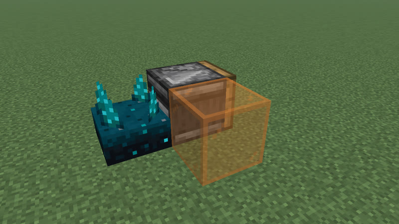</a> 44 gt (2.2 s) · oak_trapdoor+observer+sculk_sensor · 3 blocks</td><td align="center"><a href="../archive/clk-sculk-chain-p44-39.txt">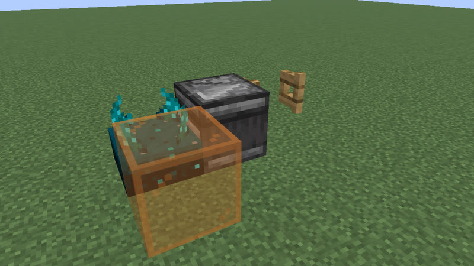</a> 44 gt (2.2 s) · oak_fence_gate+observer+sculk_sensor · 3 blocks</td><td align="center"><a href="../archive/clk-sculk-hyb3b-p44-15.txt">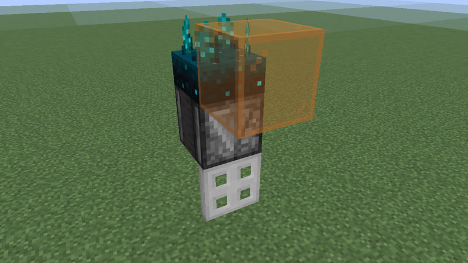</a> 44 gt (2.2 s) · iron_trapdoor+observer+sculk_sensor · 3 blocks</td></tr>
<tr><td align="center"><a href="../archive/clk-sculk-hyb3b-p44-21.txt">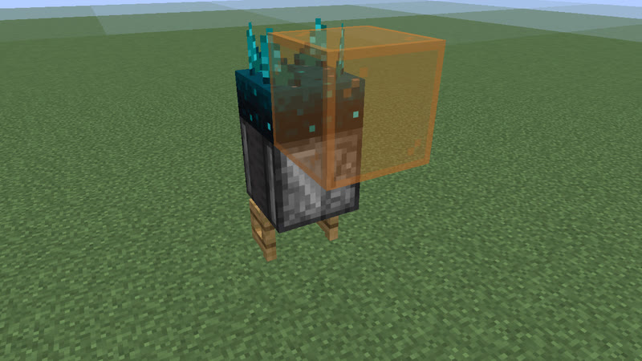</a> 44 gt (2.2 s) · oak_fence_gate+observer+sculk_sensor · 3 blocks</td><td align="center"><a href="../archive/census-p44-observer-piston-sculk_sensor-3b.txt">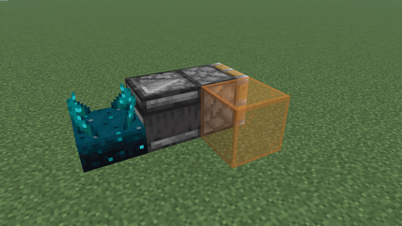</a> 44 gt (2.2 s) · observer+piston+sculk_sensor · 3 blocks also found as census-p44-observer-sculk_sensor-sticky_piston-3b (built with sticky_piston, without piston)</td><td align="center"><a href="../archive/clk-sculk-p44-obs-note.txt">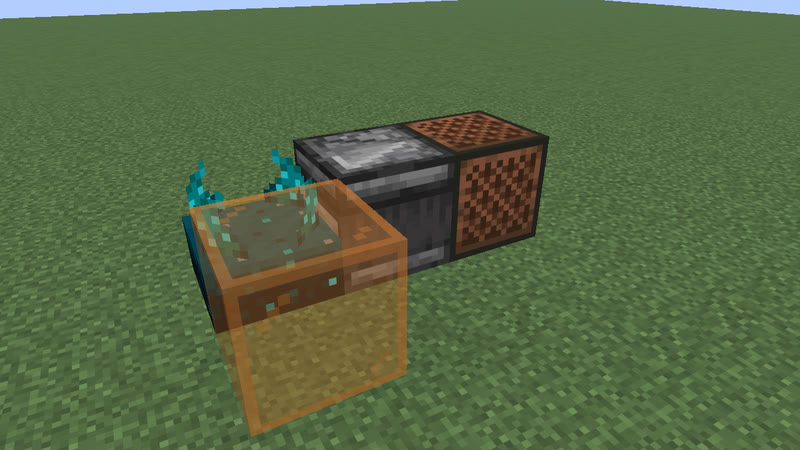</a> 44 gt (2.2 s) · note_block+observer+sculk_sensor · 3 blocks</td></tr>
<tr><td align="center"><a href="../archive/census-p44-dispenser-observer-sculk_sensor-sticky_piston-4b.txt">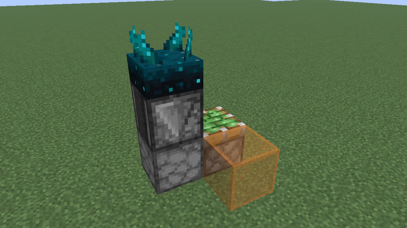</a> 44 gt (2.2 s) · dispenser+observer+sculk_sensor+sticky_piston · 4 blocks</td><td align="center"><a href="../archive/census-p44-calibrated_sculk_sensor-dispenser-observer-sculk_sensor-4b.txt">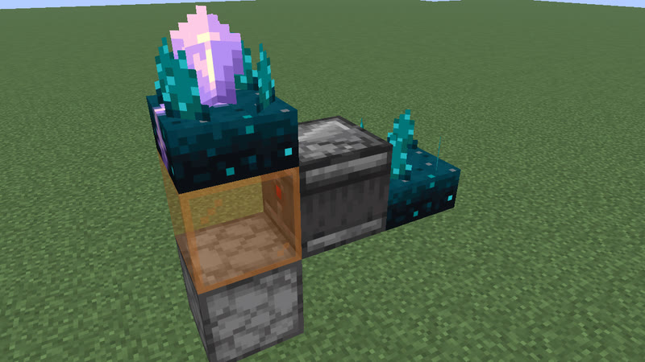</a> 44 gt (2.2 s) · calibrated_sculk_sensor+dispenser+observer+sculk_sensor · 4 blocks</td><td align="center"><a href="../archive/clk-sculk-hyb3b-p44-9.txt">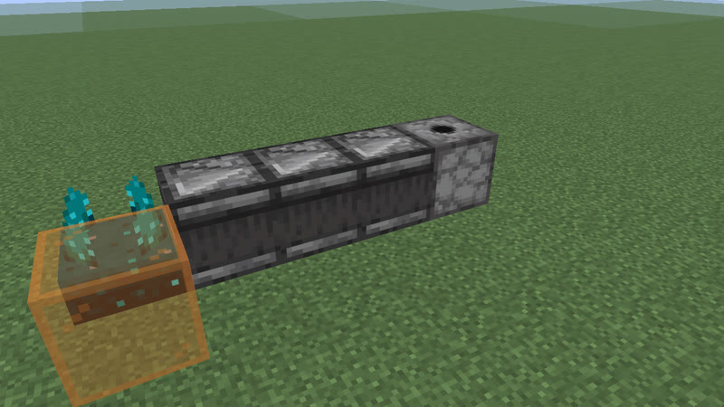</a> 44 gt (2.2 s) · dispenser+observer+sculk_sensor · 5 blocks</td></tr>
<tr><td align="center"><a href="../archive/clk-sculk-two-p44-1.txt">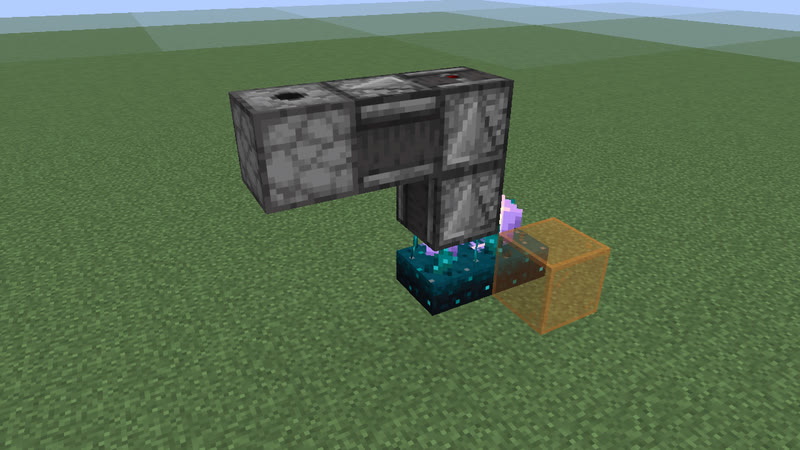</a> 44 gt (2.2 s) · calibrated_sculk_sensor+dispenser+observer · 6 blocks</td><td align="center"><a href="../archive/clk-sculk-ring3-p44-1.txt">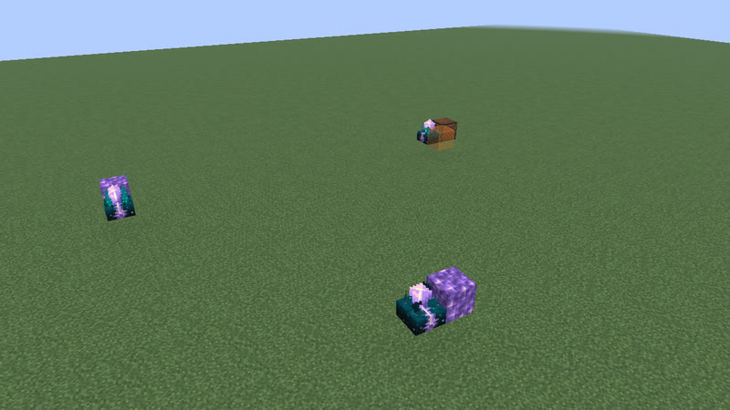</a> 44 gt (2.2 s) · calibrated_sculk_sensor+note_block · 6 blocks</td><td align="center"><a href="../archive/clk-obs-p44-bulb-lamp-obs-pis-stk-7b-f253e2.txt">clk-obs-p44-bulb-lamp-obs-pis-stk-7b-f253e2</a> 44 gt (2.2 s) · copper_bulb+observer+piston+redstone_lamp+sticky_piston · 7 blocks (picture pending)</td></tr>
<tr><td align="center"><a href="../archive/clk-obs-p44-bulb-note-obs-pis-stk-7b-afee97.txt">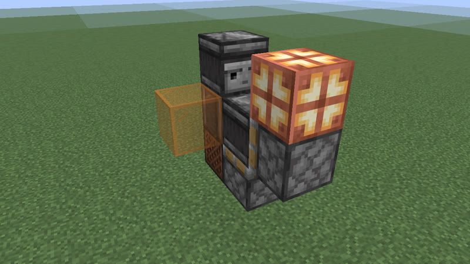</a> 44 gt (2.2 s) · copper_bulb+note_block+observer+piston+sticky_piston · 7 blocks</td><td align="center"><a href="../archive/clk-obs-p44-bulb-obs-pis-stk-7b-79c74a.txt">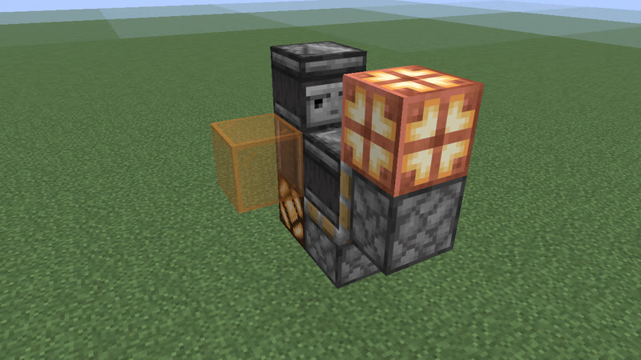</a> 44 gt (2.2 s) · copper_bulb+observer+piston+sticky_piston · 7 blocks</td><td align="center"> 44 gt (2.2 s) · copper_bulb+observer+piston+sticky_piston · 7 blocks</td></tr>
<tr><td align="center"><a href="../archive/clk-obs-p44-lamp-note-obs-rb-stk-7b-228072.txt">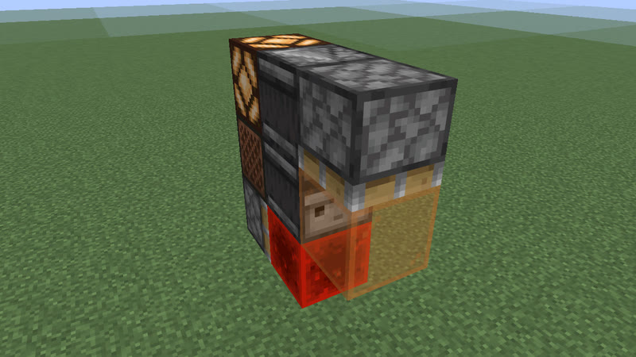</a> 44 gt (2.2 s) · note_block+observer+redstone_block+redstone_lamp+sticky_piston · 7 blocks</td><td align="center"><a href="../archive/clk-obs-p44-lamp-note-obs-rb-stk-7b-b-118253.txt">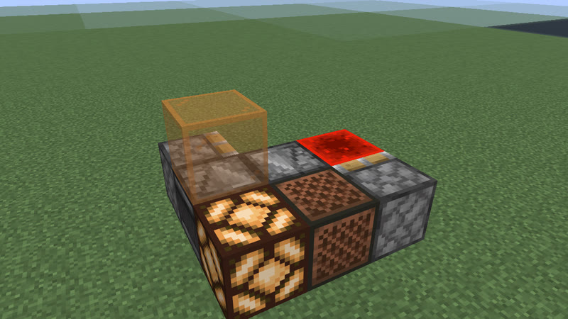</a> 44 gt (2.2 s) · note_block+observer+redstone_block+redstone_lamp+sticky_piston · 7 blocks</td><td align="center"><a href="../archive/clk-obs-p44-lamp-note-obs-stk-7b-b-074da5.txt">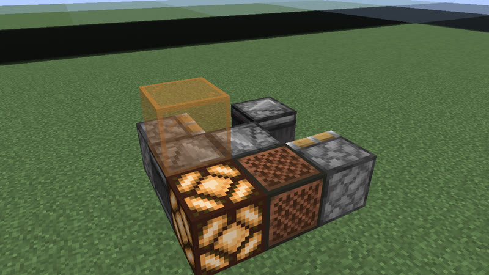</a> 44 gt (2.2 s) · note_block+observer+redstone_lamp+sticky_piston · 7 blocks</td></tr>
<tr><td align="center"><a href="../archive/clk-obs-p44-lamp-note-obs-stk-7b-fa7be7.txt">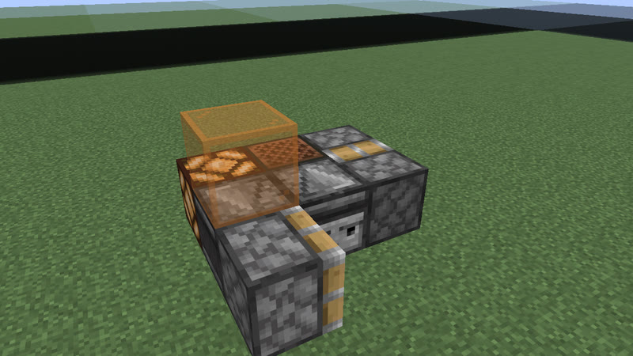</a> 44 gt (2.2 s) · note_block+observer+redstone_lamp+sticky_piston · 7 blocks</td><td align="center"><a href="../archive/clk-obs-p44-lamp-obs-rb-stk-7b-a76296.txt">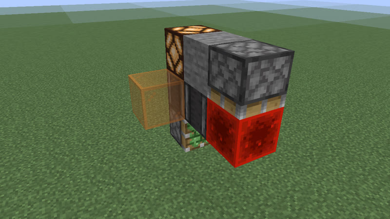</a> 44 gt (2.2 s) · observer+redstone_block+redstone_lamp+sticky_piston · 7 blocks</td><td align="center"><a href="../archive/clk-obs-p44-lamp-obs-rb-stk-7b-b-0251f7.txt">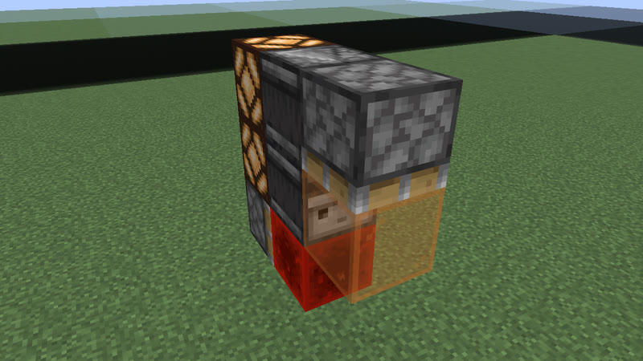</a> 44 gt (2.2 s) · observer+redstone_block+redstone_lamp+sticky_piston · 7 blocks</td></tr>
<tr><td align="center"><a href="../archive/clk-obs-p44-lamp-obs-stk-7b-77ba59.txt">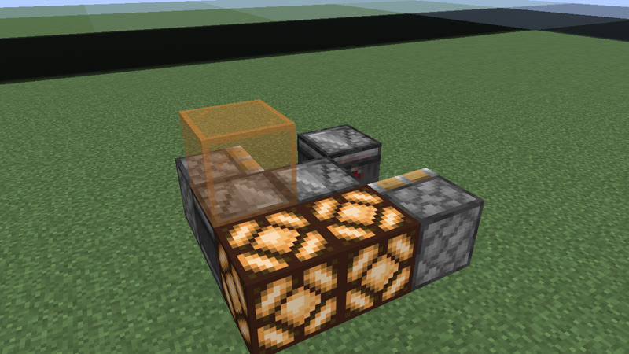</a> 44 gt (2.2 s) · observer+redstone_lamp+sticky_piston · 7 blocks</td><td align="center"><a href="../archive/clk-obs-p44-lamp-obs-stk-7b-b-23a5f6.txt">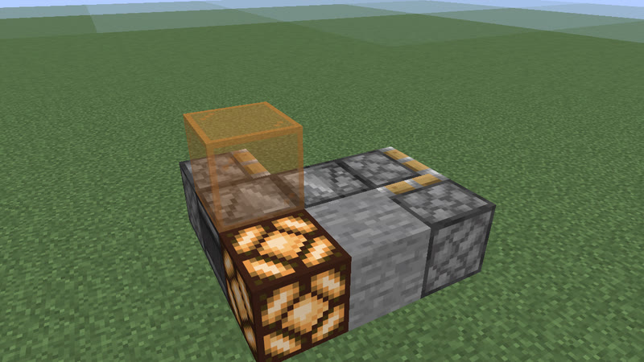</a> 44 gt (2.2 s) · observer+redstone_lamp+sticky_piston · 7 blocks</td><td align="center"><a href="../archive/clk-obs-p44-bulb-lamp-obs-rb-stk-7b-8e8128.txt">clk-obs-p44-bulb-lamp-obs-rb-stk-7b-8e8128</a> 44 gt (2.2 s) · copper_bulb+observer+redstone_block+redstone_lamp+sticky_piston · 7 blocks (picture pending)</td></tr>
<tr><td align="center"><a href="../archive/clk-obs-p44-bulb-note-obs-pis-stk-7b-b-3edf07.txt">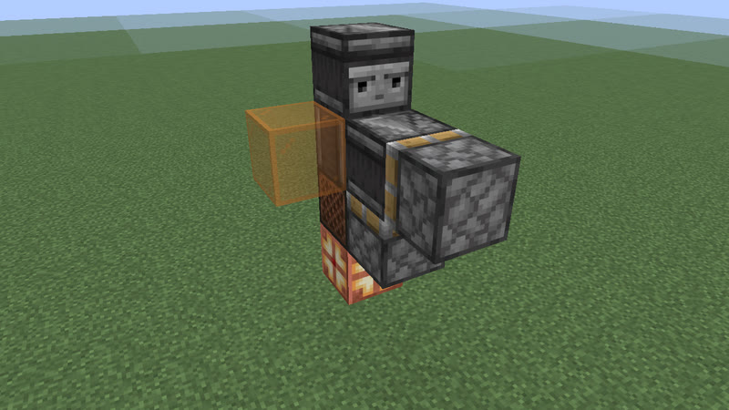</a> 44 gt (2.2 s) · copper_bulb+note_block+observer+piston+sticky_piston · 7 blocks</td><td align="center"><a href="../archive/clk-obs-p44-bulb-obs-rb-stk-7b-9f2bc4.txt">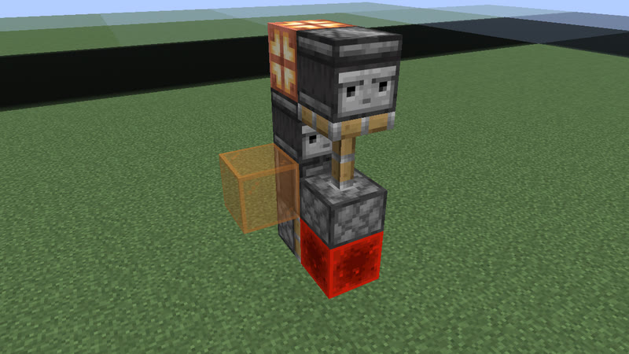</a> 44 gt (2.2 s) · copper_bulb+observer+redstone_block+sticky_piston · 7 blocks</td><td align="center"><a href="../archive/clk-obs-p44-obs-pis-stk-7b-b-7e18dd.txt">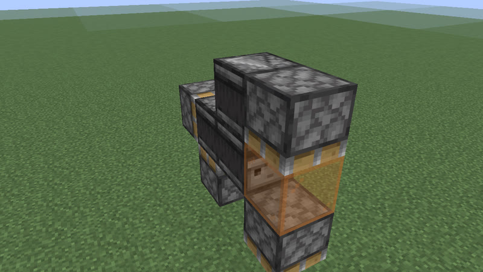</a> 44 gt (2.2 s) · observer+piston+sticky_piston · 7 blocks</td></tr>
<tr><td align="center"><a href="../archive/clk-obs-p44-obs-pis-stk-7b-f547cf.txt">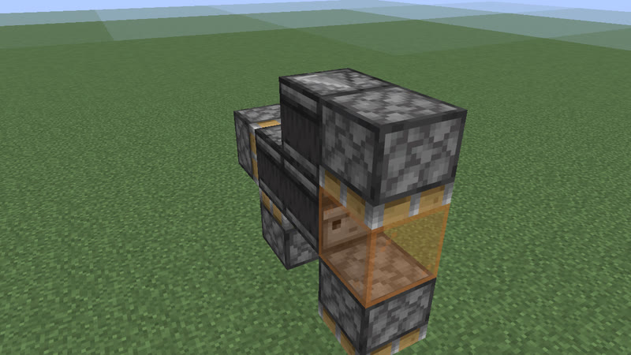</a> 44 gt (2.2 s) · observer+piston+sticky_piston · 7 blocks</td><td align="center"><a href="../archive/clk-obs-p44-bulb-obs-stk-7b-d577c1.txt">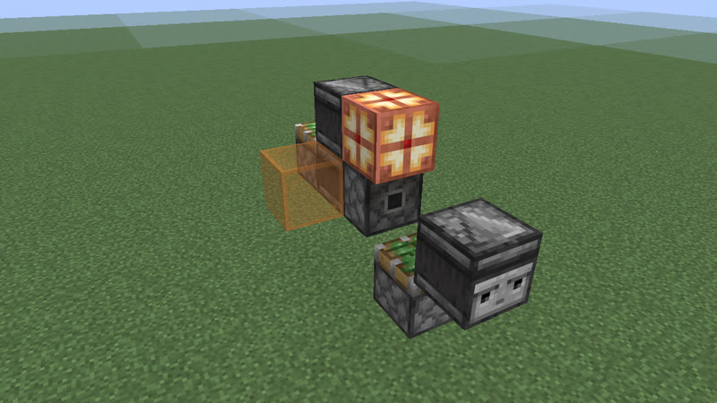</a> 44 gt (2.2 s) · copper_bulb+observer+sticky_piston · 7 blocks</td><td align="center"><a href="../archive/clk-obs-p44-bulb-note-obs-stk-7b-0026e6.txt">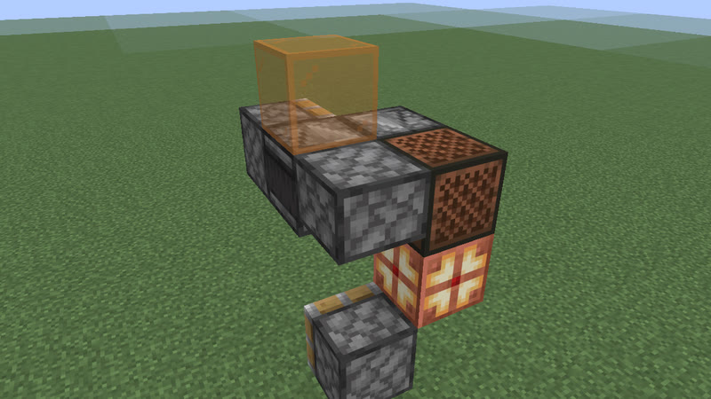</a> 44 gt (2.2 s) · copper_bulb+note_block+observer+sticky_piston · 7 blocks</td></tr>
<tr><td align="center"><a href="../archive/clk-obs-p44-bulb-obs-stk-7b-b-0239fe.txt">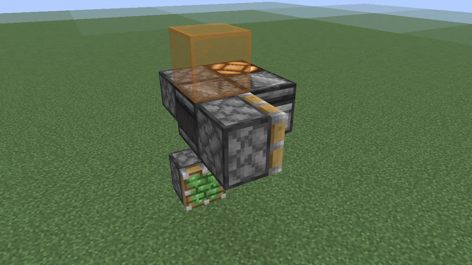</a> 44 gt (2.2 s) · copper_bulb+observer+sticky_piston · 7 blocks</td><td align="center"><a href="../archive/clk-obs-p44-bulb-obs-rb-stk-7b-b-26cbf0.txt">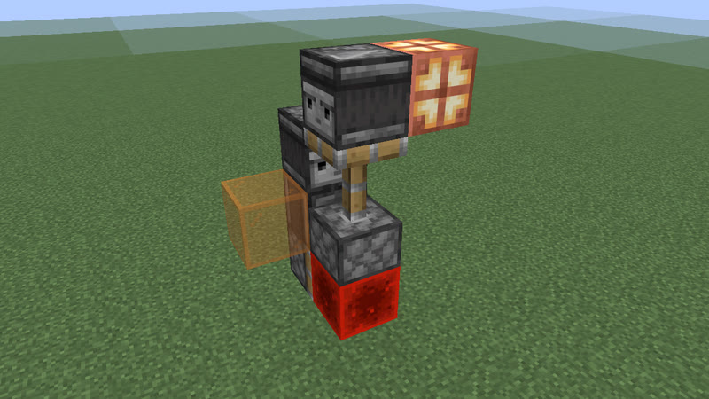</a> 44 gt (2.2 s) · copper_bulb+observer+redstone_block+sticky_piston · 7 blocks</td><td align="center"><a href="../archive/clk-sculk-hyb3-p44-5.txt">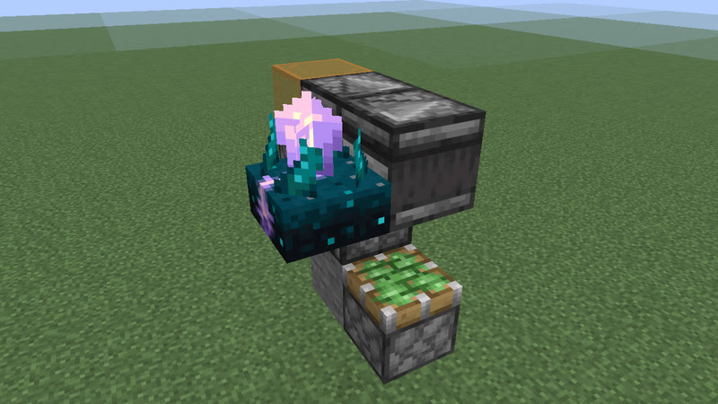</a> 44 gt (2.2 s) · calibrated_sculk_sensor+observer+sticky_piston · 7 blocks</td></tr>
<tr><td align="center"><a href="../archive/clk-obs-p44-obs-stk-8b-45ef68.txt">clk-obs-p44-obs-stk-8b-45ef68</a> 44 gt (2.2 s) · observer+sticky_piston · 8 blocks (picture pending)</td><td align="center"><a href="../archive/clk-obs-p44-obs-rb-stk-8b-df8c80.txt">clk-obs-p44-obs-rb-stk-8b-df8c80</a> 44 gt (2.2 s) · observer+redstone_block+sticky_piston · 8 blocks (picture pending)</td><td align="center"><a href="../archive/clk-obs-p44-note-obs-rb-stk-8b-4deaf5.txt">clk-obs-p44-note-obs-rb-stk-8b-4deaf5</a> 44 gt (2.2 s) · note_block+observer+redstone_block+sticky_piston · 8 blocks (picture pending)</td></tr>
<tr><td align="center"><a href="../archive/clk-obs-p44-lamp-obs-pis-9b-861514.txt">clk-obs-p44-lamp-obs-pis-9b-861514</a> 44 gt (2.2 s) · observer+piston+redstone_lamp · 9 blocks (picture pending)</td><td align="center"><a href="../archive/clk-rt-ring3x3-p44-rt-rw-r-12b.txt">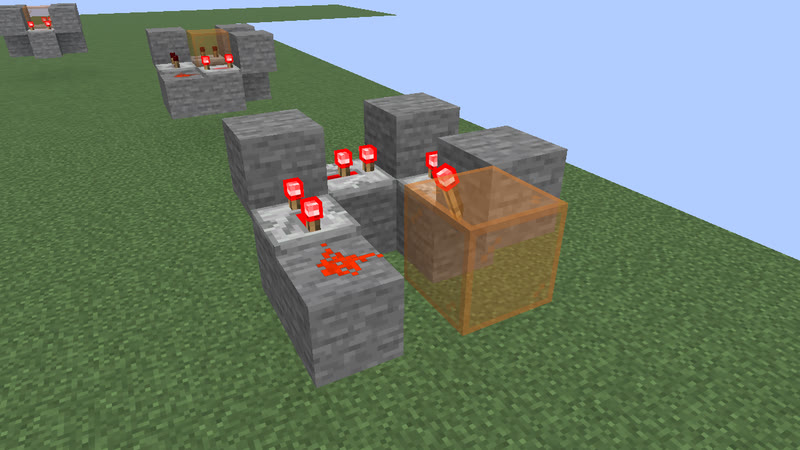</a> 44 gt (2.2 s) · redstone_torch+redstone_wire+repeater · 12 blocks</td><td align="center"> 44 gt (2.2 s) · comparator+hopper · 12 blocks</td></tr>
<tr><td align="center"> 44 gt (2.2 s) · repeater · 16 blocks</td></tr>
</table>

## 45 gt (2.25 s)

Also reachable by: clk-obs-odd-b (n = 8), dropper ring (clk-item-dropring-2d-r2, n = 1), lock ring (clk-item-lockring-3s, n = 2).

<table>
<tr><td align="center"><a href="../archive/census-p45-calibrated_sculk_sensor-oak_trapdoor-observer-sculk_sensor-4b.txt">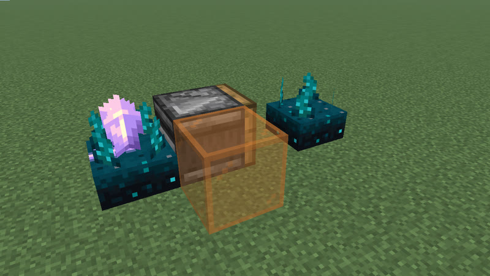</a> 45 gt (2.25 s) · calibrated_sculk_sensor+oak_trapdoor+observer+sculk_sensor · 4 blocks</td><td align="center"><a href="../archive/census-p45-dispenser-note_block-observer-sculk_sensor-4b.txt">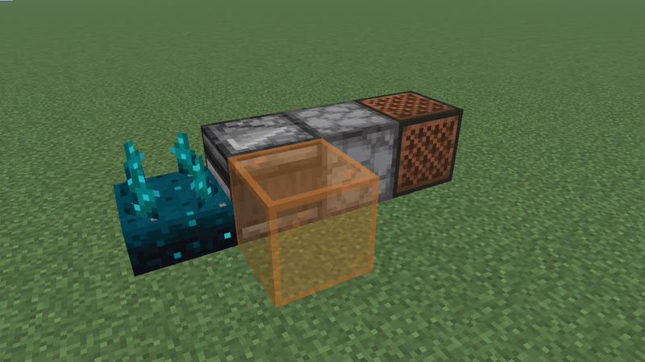</a> 45 gt (2.25 s) · dispenser+note_block+observer+sculk_sensor · 4 blocks</td><td align="center"><a href="../archive/census-p45-dispenser-oak_trapdoor-observer-sculk_sensor-4b.txt">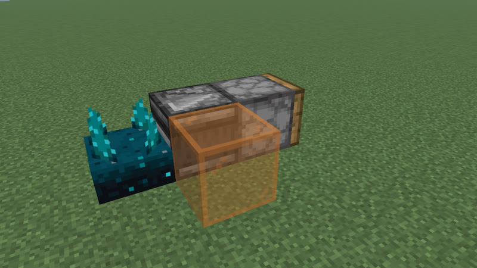</a> 45 gt (2.25 s) · dispenser+oak_trapdoor+observer+sculk_sensor · 4 blocks</td></tr>
<tr><td align="center"><a href="../archive/census-p45-note_block-observer-sculk_sensor-4b.txt">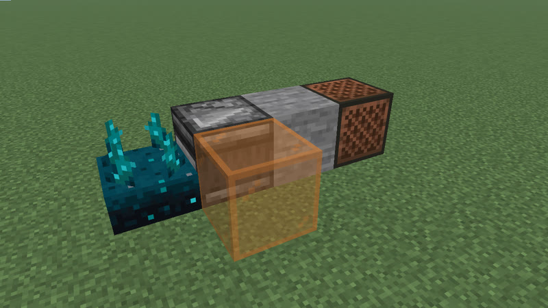</a> 45 gt (2.25 s) · note_block+observer+sculk_sensor · 4 blocks</td><td align="center"><a href="../archive/census-p45-oak_trapdoor-observer-sculk_sensor-4b.txt">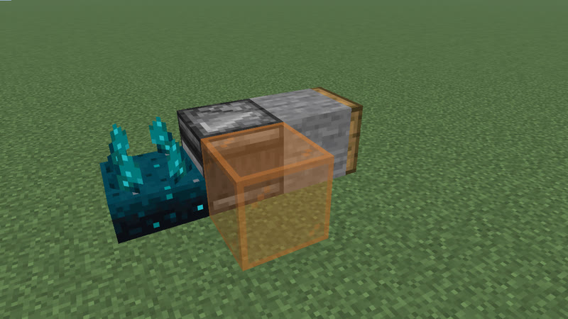</a> 45 gt (2.25 s) · oak_trapdoor+observer+sculk_sensor · 4 blocks</td><td align="center"><a href="../archive/clk-sculk-chain-p45-28.txt">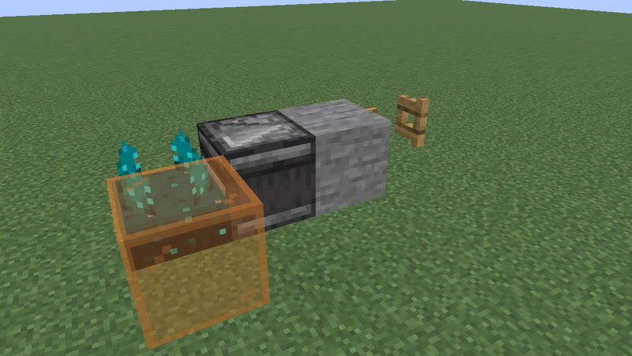</a> 45 gt (2.25 s) · oak_fence_gate+observer+sculk_sensor · 4 blocks</td></tr>
<tr><td align="center"><a href="../archive/clk-sculk-hyb3b-p45-13.txt">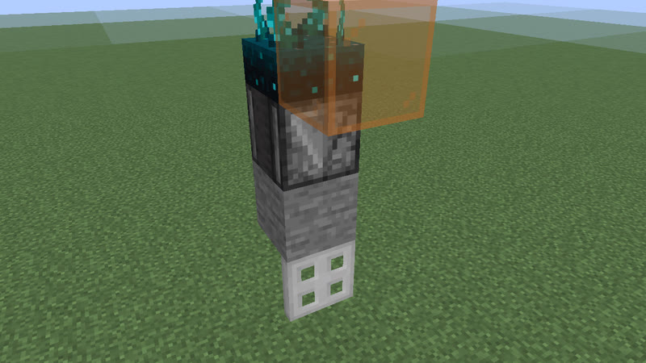</a> 45 gt (2.25 s) · iron_trapdoor+observer+sculk_sensor · 4 blocks</td><td align="center"><a href="../archive/clk-sculk-hyb3b-p45-19.txt">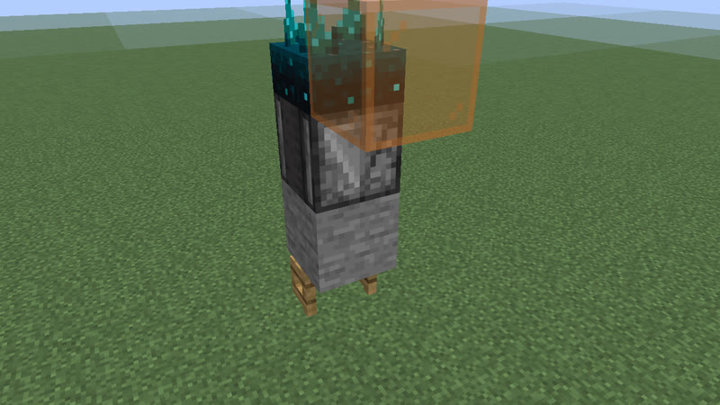</a> 45 gt (2.25 s) · oak_fence_gate+observer+sculk_sensor · 4 blocks</td><td align="center"><a href="../archive/census-p45-dispenser-observer-piston-sculk_sensor-4b.txt">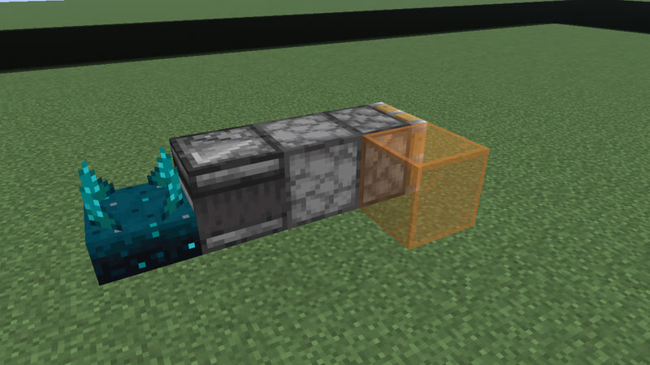</a> 45 gt (2.25 s) · dispenser+observer+piston+sculk_sensor · 4 blocks also found as census-p45-dispenser-observer-sculk_sensor-sticky_piston-4b (built with sticky_piston, without piston)</td></tr>
<tr><td align="center"><a href="../archive/census-p45-observer-piston-sculk_sensor-4b.txt">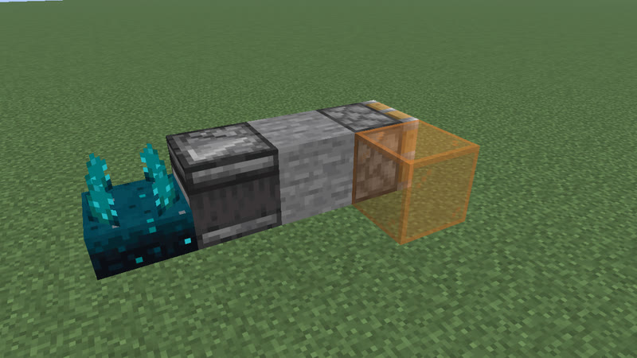</a> 45 gt (2.25 s) · observer+piston+sculk_sensor · 4 blocks also found as census-p45-observer-sculk_sensor-sticky_piston-4b (built with sticky_piston, without piston)</td><td align="center"><a href="../archive/census-p45-calibrated_sculk_sensor-observer-piston-sculk_sensor-4b.txt">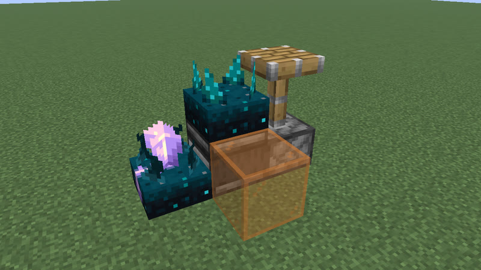</a> 45 gt (2.25 s) · calibrated_sculk_sensor+observer+piston+sculk_sensor · 4 blocks also found as census-p45-calibrated_sculk_sensor-observer-sculk_sensor-sticky_piston-4b (built with sticky_piston, without piston)</td><td align="center"><a href="../archive/census-p45-calibrated_sculk_sensor-dispenser-observer-sculk_sensor-5b.txt">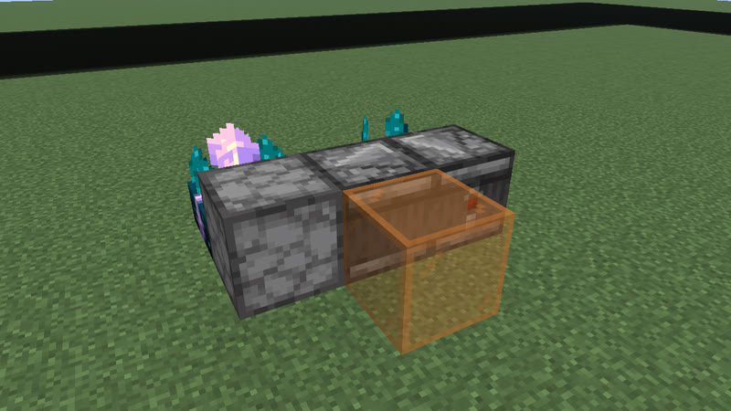</a> 45 gt (2.25 s) · calibrated_sculk_sensor+dispenser+observer+sculk_sensor · 5 blocks</td></tr>
<tr><td align="center"><a href="../archive/clk-sculk-hyb3b-p45-7.txt">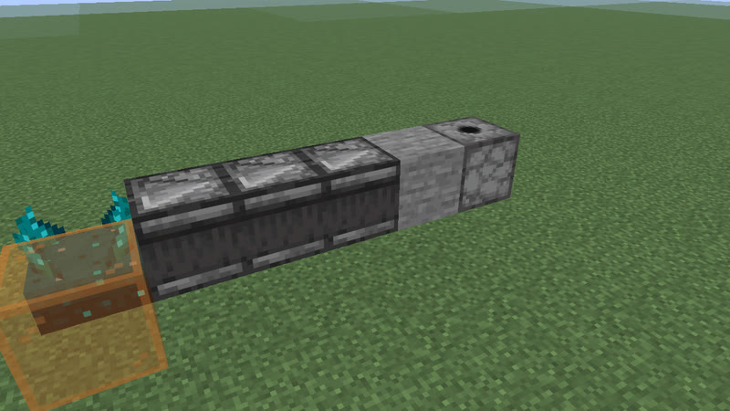</a> 45 gt (2.25 s) · dispenser+observer+sculk_sensor · 6 blocks</td><td align="center"><a href="../archive/clk-sculk-hyb-p45-1.txt">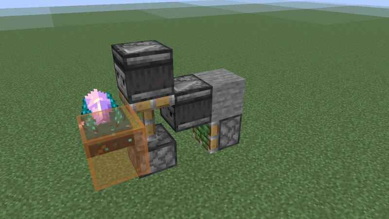</a> 45 gt (2.25 s) · calibrated_sculk_sensor+observer+sticky_piston · 6 blocks</td><td align="center"><a href="../archive/clk-sculk-ring3-p45-1.txt">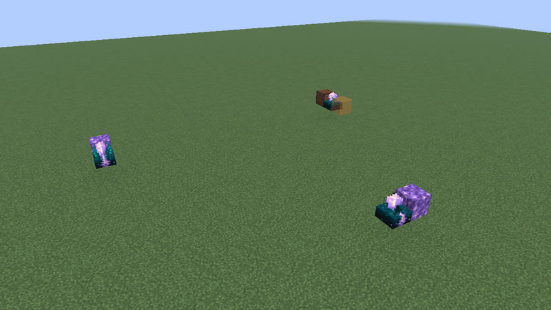</a> 45 gt (2.25 s) · calibrated_sculk_sensor+note_block · 6 blocks</td></tr>
<tr><td align="center"><a href="../archive/clk-obs-p45-bulb-obs-pis-stk-7b-8ace65.txt">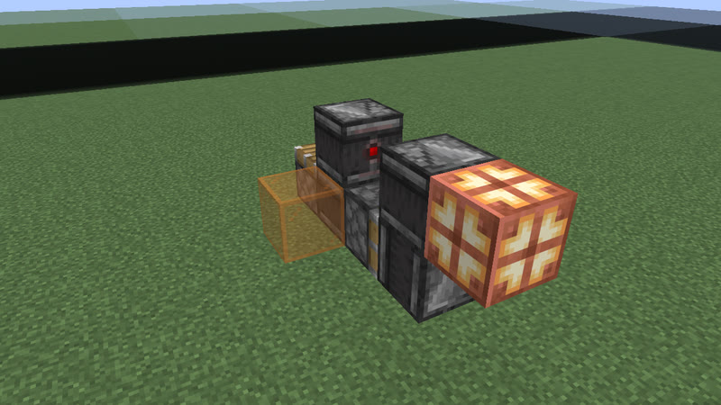</a> 45 gt (2.25 s) · copper_bulb+observer+piston+sticky_piston · 7 blocks</td><td align="center"><a href="../archive/clk-obs-p45-bulb-obs-stk-7b-58e33c.txt">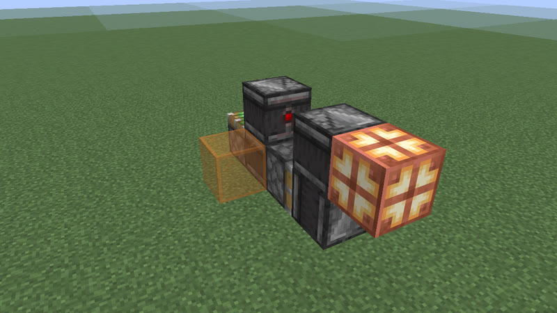</a> 45 gt (2.25 s) · copper_bulb+observer+sticky_piston · 7 blocks</td><td align="center"><a href="../archive/clk-obs-p45-lamp-obs-pis-stk-7b-0e45cc.txt">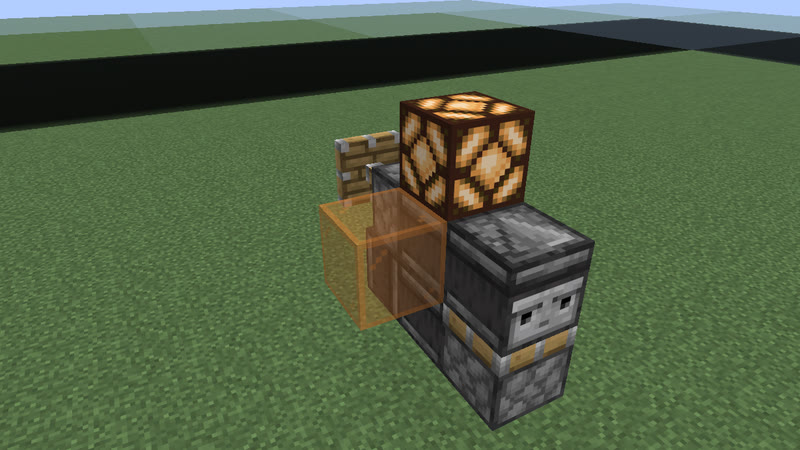</a> 45 gt (2.25 s) · observer+piston+redstone_lamp+sticky_piston · 7 blocks</td></tr>
<tr><td align="center"><a href="../archive/clk-obs-p45-lamp-obs-stk-7b-b-877e4e.txt">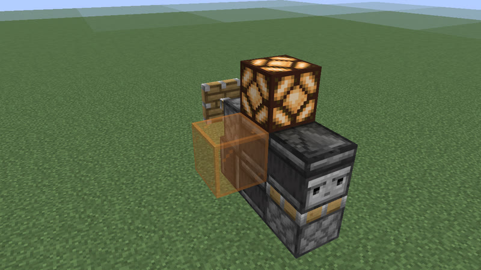</a> 45 gt (2.25 s) · observer+redstone_lamp+sticky_piston · 7 blocks</td><td align="center"> 45 gt (2.25 s) · observer+redstone_lamp+sticky_piston · 7 blocks</td><td align="center"> 45 gt (2.25 s) · note_block+observer+piston+sticky_piston · 7 blocks</td></tr>
<tr><td align="center"> 45 gt (2.25 s) · note_block+observer+piston+sticky_piston · 7 blocks</td><td align="center"> 45 gt (2.25 s) · note_block+observer+sticky_piston · 7 blocks</td><td align="center"> 45 gt (2.25 s) · note_block+observer+sticky_piston · 7 blocks</td></tr>
<tr><td align="center"> 45 gt (2.25 s) · observer+piston+sticky_piston · 7 blocks</td><td align="center"> 45 gt (2.25 s) · observer+piston+sticky_piston · 7 blocks</td><td align="center"> 45 gt (2.25 s) · observer+sticky_piston · 7 blocks</td></tr>
<tr><td align="center"> 45 gt (2.25 s) · observer+sticky_piston · 7 blocks</td><td align="center"> 45 gt (2.25 s) · calibrated_sculk_sensor+observer+piston · 7 blocks also found as clk-sculk-hyb3-p45-5 (built with sticky_piston)</td><td align="center"> 45 gt (2.25 s) · copper_bulb+observer+piston+sticky_piston · 7 blocks</td></tr>
<tr><td align="center"> 45 gt (2.25 s) · copper_bulb+observer+sticky_piston · 7 blocks</td><td align="center"><a href="../archive/clk-obs-p45-obs-rb-stk-8b-37bec4.txt">clk-obs-p45-obs-rb-stk-8b-37bec4</a> 45 gt (2.25 s) · observer+redstone_block+sticky_piston · 8 blocks (picture pending)</td><td align="center"> 45 gt (2.25 s) · repeater · 28 blocks</td></tr>
</table>

## 46 gt (2.3 s)

Also reachable by: observer ring with a relay block (clk-obs-note-ring, n = 9), clk-misc-cart-loop (n = 4), dropper ring (clk-item-dropring-2d-r24, n = 0), clk-item-latch (n = 1).

<table>
<tr><td align="center"> 46 gt (2.3 s) · calibrated_sculk_sensor+oak_trapdoor+observer+sculk_sensor · 4 blocks</td><td align="center"> 46 gt (2.3 s) · calibrated_sculk_sensor+observer+piston+sculk_sensor · 4 blocks</td><td align="center"> 46 gt (2.3 s) · calibrated_sculk_sensor+observer+sculk_sensor+sticky_piston · 4 blocks</td></tr>
<tr><td align="center"> 46 gt (2.3 s) · note_block+observer+sculk_sensor · 4 blocks</td><td align="center"> 46 gt (2.3 s) · oak_trapdoor+observer+sculk_sensor · 4 blocks</td><td align="center"> 46 gt (2.3 s) · observer+piston+sculk_sensor · 4 blocks also found as census-p46-observer-sculk_sensor-sticky_piston-4b (built with sticky_piston, without piston)</td></tr>
<tr><td align="center"> 46 gt (2.3 s) · oak_trapdoor+observer+sculk_sensor · 4 blocks</td><td align="center"> 46 gt (2.3 s) · oak_fence_gate+observer+sculk_sensor · 4 blocks</td><td align="center"> 46 gt (2.3 s) · iron_trapdoor+observer+sculk_sensor · 4 blocks</td></tr>
<tr><td align="center"> 46 gt (2.3 s) · calibrated_sculk_sensor+dispenser+observer+sculk_sensor · 5 blocks</td><td align="center"> 46 gt (2.3 s) · dispenser+observer+sculk_sensor · 5 blocks</td><td align="center"><a href="../archive/census-p46-calibrated_sculk_sensor-note_block-oak_trapdoor-observer-6b.txt">census-p46-calibrated_sculk_sensor-note_block-oak_trapdoor-observer-6b</a> 46 gt (2.3 s) · calibrated_sculk_sensor+note_block+oak_trapdoor+observer · 6 blocks (picture pending)</td></tr>
<tr><td align="center"><a href="../archive/census-p46-calibrated_sculk_sensor-note_block-observer-6b.txt">census-p46-calibrated_sculk_sensor-note_block-observer-6b</a> 46 gt (2.3 s) · calibrated_sculk_sensor+note_block+observer · 6 blocks (picture pending)</td><td align="center"><a href="../archive/census-p46-calibrated_sculk_sensor-oak_trapdoor-observer-6b.txt">census-p46-calibrated_sculk_sensor-oak_trapdoor-observer-6b</a> 46 gt (2.3 s) · calibrated_sculk_sensor+oak_trapdoor+observer · 6 blocks (picture pending)</td><td align="center"><a href="../archive/census-p46-calibrated_sculk_sensor-note_block-observer-piston-6b.txt">census-p46-calibrated_sculk_sensor-note_block-observer-piston-6b</a> 46 gt (2.3 s) · calibrated_sculk_sensor+note_block+observer+piston · 6 blocks (picture pending) also found as census-p46-calibrated_sculk_sensor-note_block-observer-sticky_piston-6b (built with sticky_piston, without piston)</td></tr>
<tr><td align="center"><a href="../archive/census-p46-calibrated_sculk_sensor-oak_trapdoor-observer-piston-6b.txt">census-p46-calibrated_sculk_sensor-oak_trapdoor-observer-piston-6b</a> 46 gt (2.3 s) · calibrated_sculk_sensor+oak_trapdoor+observer+piston · 6 blocks (picture pending) also found as census-p46-calibrated_sculk_sensor-oak_trapdoor-observer-sticky_piston-6b (built with sticky_piston, without piston)</td><td align="center"> 46 gt (2.3 s) · observer+piston+sticky_piston · 6 blocks</td><td align="center"> 46 gt (2.3 s) · observer+piston+sticky_piston · 6 blocks</td></tr>
<tr><td align="center"> 46 gt (2.3 s) · observer+sticky_piston · 6 blocks</td><td align="center"><a href="../archive/census-p46-calibrated_sculk_sensor-observer-piston-6b.txt">census-p46-calibrated_sculk_sensor-observer-piston-6b</a> 46 gt (2.3 s) · calibrated_sculk_sensor+observer+piston · 6 blocks (picture pending) also found as census-p46-calibrated_sculk_sensor-observer-piston-sticky_piston-6b (built with sticky_piston)</td><td align="center"> 46 gt (2.3 s) · observer+sticky_piston · 6 blocks</td></tr>
<tr><td align="center"> 46 gt (2.3 s) · calibrated_sculk_sensor+observer+sticky_piston · 6 blocks</td><td align="center"> 46 gt (2.3 s) · calibrated_sculk_sensor+dispenser+observer · 6 blocks</td><td align="center"> 46 gt (2.3 s) · calibrated_sculk_sensor+note_block · 6 blocks</td></tr>
<tr><td align="center"><a href="../archive/clk-obs-p46-bulb-lamp-note-obs-pis-9b-65a02b.txt">clk-obs-p46-bulb-lamp-note-obs-pis-9b-65a02b</a> 46 gt (2.3 s) · copper_bulb+note_block+observer+piston+redstone_lamp · 9 blocks (picture pending)</td><td align="center"><a href="../archive/clk-obs-p46-bulb-lamp-obs-pis-9b-ed561e.txt">clk-obs-p46-bulb-lamp-obs-pis-9b-ed561e</a> 46 gt (2.3 s) · copper_bulb+observer+piston+redstone_lamp · 9 blocks (picture pending)</td><td align="center"> 46 gt (2.3 s) · comparator+hopper · 10 blocks</td></tr>
<tr><td align="center"> 46 gt (2.3 s) · redstone_torch+repeater · 16 blocks</td><td align="center"> 46 gt (2.3 s) · repeater · 16 blocks</td><td align="center"><a href="../archive/clk-misc-hopper-cart.txt">clk-misc-hopper-cart</a> 46 gt (2.3 s) · hopper+hopper_minecart · 17 blocks (picture pending)</td></tr>
</table>

## 47 gt (2.35 s)

Also reachable by: clk-obs-odd-a (n = 9), clk-rt-odd-rect (n = 3), dropper ring (clk-item-dropring-2d-r3, n = 1), lock ring (clk-item-lockring-3s, n = 3), clk-misc-cart-pingpong (n = 2).

<table>
<tr><td align="center"> 47 gt (2.35 s) · note_block+observer+sculk_sensor · 4 blocks</td><td align="center"> 47 gt (2.35 s) · oak_trapdoor+observer+sculk_sensor · 4 blocks</td><td align="center"> 47 gt (2.35 s) · oak_trapdoor+observer+sculk_sensor · 4 blocks</td></tr>
<tr><td align="center"> 47 gt (2.35 s) · oak_fence_gate+observer+sculk_sensor · 4 blocks</td><td align="center"> 47 gt (2.35 s) · iron_trapdoor+observer+sculk_sensor · 4 blocks</td><td align="center"> 47 gt (2.35 s) · observer+piston+sculk_sensor · 4 blocks also found as census-p47-observer-sculk_sensor-sticky_piston-4b (built with sticky_piston, without piston)</td></tr>
<tr><td align="center"> 47 gt (2.35 s) · calibrated_sculk_sensor+observer+piston+sculk_sensor · 4 blocks also found as census-p47-calibrated_sculk_sensor-observer-sculk_sensor-sticky_piston-4b (built with sticky_piston, without piston)</td><td align="center"> 47 gt (2.35 s) · dispenser+observer+sculk_sensor+sticky_piston · 5 blocks</td><td align="center"> 47 gt (2.35 s) · dispenser+observer+sculk_sensor · 6 blocks</td></tr>
<tr><td align="center"> 47 gt (2.35 s) · calibrated_sculk_sensor+observer+sticky_piston · 6 blocks</td><td align="center"> 47 gt (2.35 s) · observer+piston+redstone_block+redstone_lamp+sticky_piston · 7 blocks</td><td align="center"> 47 gt (2.35 s) · note_block+observer+piston+redstone_block+sticky_piston · 7 blocks</td></tr>
<tr><td align="center"> 47 gt (2.35 s) · observer+piston+redstone_block+sticky_piston · 7 blocks</td><td align="center"> 47 gt (2.35 s) · observer+sticky_piston · 7 blocks</td></tr>
</table>

## 48 gt (2.4 s)

Also reachable by: clk-obs-obs-ring (n = 10), clk-obs-divider (n = 2), dropper ring (clk-item-dropring-2d, n = 1), clk-rt-rect-pulse (n = 1).

<table>
<tr><td align="center"> 48 gt (2.4 s) · dispenser+observer+sculk_sensor · 3 blocks</td><td align="center"> 48 gt (2.4 s) · dispenser+observer+sculk_sensor · 3 blocks</td><td align="center"> 48 gt (2.4 s) · dispenser+observer+sculk_sensor · 3 blocks</td></tr>
<tr><td align="center"> 48 gt (2.4 s) · calibrated_sculk_sensor+note_block+observer+sculk_sensor · 4 blocks</td><td align="center"> 48 gt (2.4 s) · calibrated_sculk_sensor+oak_trapdoor+observer+sculk_sensor · 4 blocks</td><td align="center"> 48 gt (2.4 s) · note_block+observer+sculk_sensor · 4 blocks</td></tr>
<tr><td align="center"> 48 gt (2.4 s) · calibrated_sculk_sensor+observer+piston+sculk_sensor · 4 blocks also found as census-p48-calibrated_sculk_sensor-observer-sculk_sensor-sticky_piston-4b (built with sticky_piston, without piston)</td><td align="center"> 48 gt (2.4 s) · calibrated_sculk_sensor+observer+sticky_piston · 4 blocks</td><td align="center"> 48 gt (2.4 s) · calibrated_sculk_sensor+note_block+observer+sticky_piston · 4 blocks</td></tr>
<tr><td align="center"> 48 gt (2.4 s) · calibrated_sculk_sensor+oak_trapdoor+observer+sticky_piston · 4 blocks</td><td align="center"> 48 gt (2.4 s) · oak_trapdoor+observer+sculk_sensor · 5 blocks</td><td align="center"> 48 gt (2.4 s) · iron_trapdoor+observer+sculk_sensor · 5 blocks</td></tr>
<tr><td align="center"> 48 gt (2.4 s) · oak_fence_gate+observer+sculk_sensor · 5 blocks</td><td align="center"> 48 gt (2.4 s) · calibrated_sculk_sensor+dispenser+observer+sticky_piston · 5 blocks</td><td align="center"> 48 gt (2.4 s) · copper_bulb+observer+piston+redstone_block+sticky_piston · 5 blocks</td></tr>
<tr><td align="center"> 48 gt (2.4 s) · copper_bulb+observer+redstone_block+sticky_piston · 5 blocks</td><td align="center"> 48 gt (2.4 s) · copper_bulb+observer+piston+redstone_block+sticky_piston · 5 blocks</td><td align="center"> 48 gt (2.4 s) · copper_bulb+observer+redstone_block+sticky_piston · 5 blocks</td></tr>
<tr><td align="center"> 48 gt (2.4 s) · observer+sculk_sensor+sticky_piston · 5 blocks</td><td align="center"> 48 gt (2.4 s) · observer+piston+sculk_sensor · 5 blocks</td><td align="center"> 48 gt (2.4 s) · calibrated_sculk_sensor+iron_trapdoor+observer+sticky_piston · 5 blocks</td></tr>
<tr><td align="center"> 48 gt (2.4 s) · calibrated_sculk_sensor+oak_fence_gate+observer+sticky_piston · 5 blocks</td><td align="center"><a href="../archive/census-p48-calibrated_sculk_sensor-note_block-observer-6b.txt">census-p48-calibrated_sculk_sensor-note_block-observer-6b</a> 48 gt (2.4 s) · calibrated_sculk_sensor+note_block+observer · 6 blocks (picture pending)</td><td align="center"> 48 gt (2.4 s) · copper_bulb+observer+sticky_piston · 6 blocks</td></tr>
<tr><td align="center"> 48 gt (2.4 s) · observer+redstone_lamp+sticky_piston · 6 blocks</td><td align="center"> 48 gt (2.4 s) · observer+redstone_lamp+sticky_piston · 6 blocks</td><td align="center"> 48 gt (2.4 s) · note_block+observer+sticky_piston · 6 blocks</td></tr>
<tr><td align="center"> 48 gt (2.4 s) · note_block+observer+sticky_piston · 6 blocks</td><td align="center"> 48 gt (2.4 s) · observer+sticky_piston · 6 blocks</td><td align="center"> 48 gt (2.4 s) · observer+sticky_piston · 6 blocks</td></tr>
<tr><td align="center"> 48 gt (2.4 s) · copper_bulb+observer+sticky_piston · 6 blocks</td><td align="center"> 48 gt (2.4 s) · observer+piston+sticky_piston · 6 blocks</td><td align="center"> 48 gt (2.4 s) · observer+piston+sticky_piston · 6 blocks</td></tr>
<tr><td align="center"> 48 gt (2.4 s) · observer+redstone_block+sticky_piston · 6 blocks</td><td align="center"> 48 gt (2.4 s) · observer+redstone_block+sticky_piston · 6 blocks</td><td align="center"><a href="../archive/clk-obs-p48-note-obs-pis-7b-6f313e.txt">clk-obs-p48-note-obs-pis-7b-6f313e</a> 48 gt (2.4 s) · note_block+observer+piston · 7 blocks (picture pending)</td></tr>
<tr><td align="center"> 48 gt (2.4 s) · observer+piston · 7 blocks</td><td align="center"> 48 gt (2.4 s) · redstone_torch+redstone_wire+repeater · 12 blocks</td></tr>
</table>

## 49 gt (2.45 s)

Also reachable by: clk-obs-odd-b (n = 9), hopper ring (clk-item-hopper-ring-2, n = 6), dropper ring (clk-item-dropring-2d-r4, n = 1), clk-sculk-replin (one block swapped: 2 versions) (clk-sculk-replin, n = 5).

<table>
<tr><td align="center"> 49 gt (2.45 s) · dispenser+observer+sculk_sensor · 4 blocks</td><td align="center"> 49 gt (2.45 s) · dispenser+observer+sculk_sensor · 4 blocks</td><td align="center"> 49 gt (2.45 s) · calibrated_sculk_sensor+oak_trapdoor+observer+sculk_sensor · 5 blocks</td></tr>
<tr><td align="center"> 49 gt (2.45 s) · calibrated_sculk_sensor+dispenser+oak_trapdoor+observer+sculk_sensor · 5 blocks</td><td align="center"> 49 gt (2.45 s) · calibrated_sculk_sensor+dispenser+observer+piston+sculk_sensor · 5 blocks also found as census-p49-calibrated_sculk_sensor-dispenser-observer-sculk_sensor-sticky_piston-5b (built with sticky_piston, without piston)</td><td align="center"> 49 gt (2.45 s) · calibrated_sculk_sensor+dispenser+note_block+observer+sculk_sensor · 5 blocks</td></tr>
<tr><td align="center"> 49 gt (2.45 s) · calibrated_sculk_sensor+note_block+oak_trapdoor+observer+sculk_sensor · 5 blocks</td><td align="center"> 49 gt (2.45 s) · calibrated_sculk_sensor+note_block+observer+piston+sculk_sensor · 5 blocks also found as census-p49-calibrated_sculk_sensor-note_block-observer-sculk_sensor-sticky_piston-5b (built with sticky_piston, without piston)</td><td align="center"> 49 gt (2.45 s) · calibrated_sculk_sensor+note_block+observer+sculk_sensor · 5 blocks</td></tr>
<tr><td align="center"> 49 gt (2.45 s) · note_block+observer+sculk_sensor · 5 blocks</td><td align="center"> 49 gt (2.45 s) · oak_trapdoor+observer+sculk_sensor · 5 blocks</td><td align="center"> 49 gt (2.45 s) · observer+piston+sculk_sensor · 5 blocks also found as census-p49-observer-sculk_sensor-sticky_piston-5b (built with sticky_piston, without piston)</td></tr>
<tr><td align="center"> 49 gt (2.45 s) · iron_trapdoor+observer+sculk_sensor · 5 blocks</td><td align="center"> 49 gt (2.45 s) · oak_fence_gate+observer+sculk_sensor · 5 blocks</td><td align="center"> 49 gt (2.45 s) · calibrated_sculk_sensor+observer+piston+sculk_sensor · 5 blocks also found as census-p49-calibrated_sculk_sensor-observer-sculk_sensor-sticky_piston-5b (built with sticky_piston, without piston)</td></tr>
<tr><td align="center"> 49 gt (2.45 s) · note_block+observer+redstone_lamp+sticky_piston · 7 blocks</td><td align="center"> 49 gt (2.45 s) · observer+redstone_lamp+sticky_piston · 7 blocks</td><td align="center"><a href="../archive/clk-obs-p49-note-obs-stk-7b-cf86c5.txt">clk-obs-p49-note-obs-stk-7b-cf86c5</a> 49 gt (2.45 s) · note_block+observer+sticky_piston · 7 blocks (picture pending)</td></tr>
<tr><td align="center"> 49 gt (2.45 s) · observer+sticky_piston · 7 blocks</td><td align="center"> 49 gt (2.45 s) · calibrated_sculk_sensor+observer+sticky_piston · 7 blocks</td><td align="center"> 49 gt (2.45 s) · calibrated_sculk_sensor+oak_trapdoor+observer+sticky_piston · 7 blocks</td></tr>
<tr><td align="center"> 49 gt (2.45 s) · calibrated_sculk_sensor+iron_trapdoor+observer+sticky_piston · 7 blocks</td><td align="center"> 49 gt (2.45 s) · calibrated_sculk_sensor+oak_fence_gate+observer+sticky_piston · 7 blocks</td><td align="center"> 49 gt (2.45 s) · calibrated_sculk_sensor+observer+piston+sticky_piston · 7 blocks</td></tr>
<tr><td align="center"> 49 gt (2.45 s) · comparator+hopper · 10 blocks</td><td align="center"> 49 gt (2.45 s) · repeater · 31 blocks</td></tr>
</table>

## 50 gt (2.5 s)

Also reachable by: observer ring with a relay block (clk-obs-note-ring, n = 10), dropper ring (clk-item-dropring-1d-r1, n = 1).

<table>
<tr><td align="center"> 50 gt (2.5 s) · dispenser+observer+sculk_sensor · 4 blocks</td><td align="center"> 50 gt (2.5 s) · dispenser+observer+sculk_sensor · 4 blocks</td><td align="center"> 50 gt (2.5 s) · oak_trapdoor+observer+sculk_sensor · 5 blocks</td></tr>
<tr><td align="center"> 50 gt (2.5 s) · iron_trapdoor+observer+sculk_sensor · 5 blocks</td><td align="center"> 50 gt (2.5 s) · oak_fence_gate+observer+sculk_sensor · 5 blocks</td><td align="center"> 50 gt (2.5 s) · calibrated_sculk_sensor+oak_trapdoor+observer+sculk_sensor · 5 blocks</td></tr>
<tr><td align="center"> 50 gt (2.5 s) · note_block+observer+sculk_sensor · 5 blocks</td><td align="center"> 50 gt (2.5 s) · calibrated_sculk_sensor+note_block+observer+sculk_sensor · 5 blocks</td><td align="center"> 50 gt (2.5 s) · calibrated_sculk_sensor+observer+piston+sculk_sensor · 5 blocks also found as census-p50-calibrated_sculk_sensor-observer-sculk_sensor-sticky_piston-5b (built with sticky_piston, without piston)</td></tr>
<tr><td align="center"> 50 gt (2.5 s) · calibrated_sculk_sensor+dispenser+observer+sticky_piston · 5 blocks</td><td align="center"> 50 gt (2.5 s) · calibrated_sculk_sensor+observer+sticky_piston · 5 blocks</td><td align="center"> 50 gt (2.5 s) · observer+piston+sculk_sensor · 5 blocks also found as clk-sculk-hyb3-p50-23 (built with sticky_piston, without piston)</td></tr>
<tr><td align="center"><a href="../archive/census-p50-calibrated_sculk_sensor-dispenser-note_block-observer-6b.txt">census-p50-calibrated_sculk_sensor-dispenser-note_block-observer-6b</a> 50 gt (2.5 s) · calibrated_sculk_sensor+dispenser+note_block+observer · 6 blocks (picture pending)</td><td align="center"><a href="../archive/census-p50-calibrated_sculk_sensor-dispenser-oak_trapdoor-observer-6b.txt">census-p50-calibrated_sculk_sensor-dispenser-oak_trapdoor-observer-6b</a> 50 gt (2.5 s) · calibrated_sculk_sensor+dispenser+oak_trapdoor+observer · 6 blocks (picture pending)</td><td align="center"><a href="../archive/census-p50-calibrated_sculk_sensor-oak_trapdoor-observer-6b.txt">census-p50-calibrated_sculk_sensor-oak_trapdoor-observer-6b</a> 50 gt (2.5 s) · calibrated_sculk_sensor+oak_trapdoor+observer · 6 blocks (picture pending)</td></tr>
<tr><td align="center"><a href="../archive/census-p50-calibrated_sculk_sensor-dispenser-observer-piston-6b.txt">census-p50-calibrated_sculk_sensor-dispenser-observer-piston-6b</a> 50 gt (2.5 s) · calibrated_sculk_sensor+dispenser+observer+piston · 6 blocks (picture pending)</td><td align="center"><a href="../archive/census-p50-calibrated_sculk_sensor-observer-piston-6b.txt">census-p50-calibrated_sculk_sensor-observer-piston-6b</a> 50 gt (2.5 s) · calibrated_sculk_sensor+observer+piston · 6 blocks (picture pending)</td><td align="center"><a href="../archive/census-p50-calibrated_sculk_sensor-note_block-observer-sticky_piston-6b.txt">census-p50-calibrated_sculk_sensor-note_block-observer-sticky_piston-6b</a> 50 gt (2.5 s) · calibrated_sculk_sensor+note_block+observer+sticky_piston · 6 blocks (picture pending)</td></tr>
<tr><td align="center"><a href="../archive/census-p50-calibrated_sculk_sensor-oak_trapdoor-observer-sticky_piston-6b.txt">census-p50-calibrated_sculk_sensor-oak_trapdoor-observer-sticky_piston-6b</a> 50 gt (2.5 s) · calibrated_sculk_sensor+oak_trapdoor+observer+sticky_piston · 6 blocks (picture pending)</td><td align="center"><a href="../archive/clk-obs-p50-lamp-obs-stk-7b-bd1a37.txt">clk-obs-p50-lamp-obs-stk-7b-bd1a37</a> 50 gt (2.5 s) · observer+redstone_lamp+sticky_piston · 7 blocks (picture pending)</td><td align="center"><a href="../archive/clk-obs-p50-bulb-obs-rb-stk-7b-b4312a.txt">clk-obs-p50-bulb-obs-rb-stk-7b-b4312a</a> 50 gt (2.5 s) · copper_bulb+observer+redstone_block+sticky_piston · 7 blocks (picture pending)</td></tr>
<tr><td align="center"><a href="../archive/clk-obs-p50-bulb-note-obs-pis-stk-8b-e94a09.txt">clk-obs-p50-bulb-note-obs-pis-stk-8b-e94a09</a> 50 gt (2.5 s) · copper_bulb+note_block+observer+piston+sticky_piston · 8 blocks (picture pending)</td><td align="center"><a href="../archive/clk-obs-p50-bulb-note-obs-stk-8b-15b74c.txt">clk-obs-p50-bulb-note-obs-stk-8b-15b74c</a> 50 gt (2.5 s) · copper_bulb+note_block+observer+sticky_piston · 8 blocks (picture pending)</td><td align="center"><a href="../archive/clk-obs-p50-bulb-obs-pis-stk-8b-b70b0c.txt">clk-obs-p50-bulb-obs-pis-stk-8b-b70b0c</a> 50 gt (2.5 s) · copper_bulb+observer+piston+sticky_piston · 8 blocks (picture pending)</td></tr>
<tr><td align="center"><a href="../archive/clk-obs-p50-bulb-obs-stk-8b-5f2641.txt">clk-obs-p50-bulb-obs-stk-8b-5f2641</a> 50 gt (2.5 s) · copper_bulb+observer+sticky_piston · 8 blocks (picture pending)</td><td align="center"><a href="../archive/clk-obs-p50-obs-stk-8b-abe57e.txt">clk-obs-p50-obs-stk-8b-abe57e</a> 50 gt (2.5 s) · observer+sticky_piston · 8 blocks (picture pending)</td><td align="center"><a href="../archive/clk-obs-p50-obs-rb-stk-8b-44e546.txt">clk-obs-p50-obs-rb-stk-8b-44e546</a> 50 gt (2.5 s) · observer+redstone_block+sticky_piston · 8 blocks (picture pending)</td></tr>
<tr><td align="center"><a href="../archive/clk-obs-p50-note-obs-stk-8b-3925ea.txt">clk-obs-p50-note-obs-stk-8b-3925ea</a> 50 gt (2.5 s) · note_block+observer+sticky_piston · 8 blocks (picture pending)</td><td align="center"> 50 gt (2.5 s) · redstone_torch+repeater · 16 blocks</td><td align="center"> 50 gt (2.5 s) · repeater · 19 blocks</td></tr>
</table>

## 51 gt (2.55 s)

Also reachable by: clk-obs-odd-a (n = 10), clk-misc-cart-loop (n = 5), dropper ring (clk-item-dropring-1d-r14, n = 0), clk-sculk-hairpin (one block swapped: 2 versions) (clk-sculk-hairpin, n = 3), clk-sculk-hairpin-plain (n = 3).

<table>
<tr><td align="center"> 51 gt (2.55 s) · dispenser+observer+sculk_sensor · 4 blocks</td><td align="center"> 51 gt (2.55 s) · dispenser+observer+sculk_sensor · 4 blocks</td><td align="center"> 51 gt (2.55 s) · oak_trapdoor+observer+sculk_sensor · 6 blocks</td></tr>
<tr><td align="center"> 51 gt (2.55 s) · iron_trapdoor+observer+sculk_sensor · 6 blocks</td><td align="center"> 51 gt (2.55 s) · oak_fence_gate+observer+sculk_sensor · 6 blocks</td><td align="center"> 51 gt (2.55 s) · note_block+observer+sculk_sensor · 6 blocks</td></tr>
<tr><td align="center"> 51 gt (2.55 s) · calibrated_sculk_sensor+oak_trapdoor+observer+sculk_sensor · 6 blocks</td><td align="center"> 51 gt (2.55 s) · calibrated_sculk_sensor+observer+sculk_sensor+sticky_piston · 6 blocks</td><td align="center"> 51 gt (2.55 s) · observer+piston+sculk_sensor · 6 blocks also found as clk-sculk-hyb3-p51-23 (built with sticky_piston, without piston)</td></tr>
<tr><td align="center"> 51 gt (2.55 s) · calibrated_sculk_sensor+oak_trapdoor+observer+sticky_piston · 6 blocks</td><td align="center"> 51 gt (2.55 s) · calibrated_sculk_sensor+dispenser+observer+sticky_piston · 6 blocks</td><td align="center"> 51 gt (2.55 s) · calibrated_sculk_sensor+iron_trapdoor+observer+sticky_piston · 6 blocks</td></tr>
<tr><td align="center"> 51 gt (2.55 s) · calibrated_sculk_sensor+oak_fence_gate+observer+sticky_piston · 6 blocks</td><td align="center"> 51 gt (2.55 s) · calibrated_sculk_sensor+note_block+observer+sticky_piston · 6 blocks</td><td align="center"> 51 gt (2.55 s) · calibrated_sculk_sensor+observer+sticky_piston · 6 blocks</td></tr>
<tr><td align="center"> 51 gt (2.55 s) · calibrated_sculk_sensor+observer+piston+sticky_piston · 6 blocks</td><td align="center"><a href="../archive/clk-obs-p51-lamp-obs-pis-stk-8b-492c13.txt">clk-obs-p51-lamp-obs-pis-stk-8b-492c13</a> 51 gt (2.55 s) · observer+piston+redstone_lamp+sticky_piston · 8 blocks (picture pending)</td><td align="center"><a href="../archive/clk-obs-p51-lamp-obs-stk-8b-437b63.txt">clk-obs-p51-lamp-obs-stk-8b-437b63</a> 51 gt (2.55 s) · observer+redstone_lamp+sticky_piston · 8 blocks (picture pending)</td></tr>
<tr><td align="center"><a href="../archive/clk-obs-p51-note-obs-pis-stk-8b-82e9b3.txt">clk-obs-p51-note-obs-pis-stk-8b-82e9b3</a> 51 gt (2.55 s) · note_block+observer+piston+sticky_piston · 8 blocks (picture pending)</td><td align="center"><a href="../archive/clk-obs-p51-note-obs-stk-8b-5439da.txt">clk-obs-p51-note-obs-stk-8b-5439da</a> 51 gt (2.55 s) · note_block+observer+sticky_piston · 8 blocks (picture pending)</td><td align="center"><a href="../archive/clk-obs-p51-obs-pis-stk-8b-8596cd.txt">clk-obs-p51-obs-pis-stk-8b-8596cd</a> 51 gt (2.55 s) · observer+piston+sticky_piston · 8 blocks (picture pending)</td></tr>
<tr><td align="center"><a href="../archive/clk-obs-p51-obs-stk-8b-31cd4c.txt">clk-obs-p51-obs-stk-8b-31cd4c</a> 51 gt (2.55 s) · observer+sticky_piston · 8 blocks (picture pending)</td><td align="center"><a href="../archive/clk-obs-p51-note-obs-pis-rb-stk-8b-796fcf.txt">clk-obs-p51-note-obs-pis-rb-stk-8b-796fcf</a> 51 gt (2.55 s) · note_block+observer+piston+redstone_block+sticky_piston · 8 blocks (picture pending)</td><td align="center"><a href="../archive/clk-obs-p51-note-obs-rb-stk-8b-451805.txt">clk-obs-p51-note-obs-rb-stk-8b-451805</a> 51 gt (2.55 s) · note_block+observer+redstone_block+sticky_piston · 8 blocks (picture pending)</td></tr>
<tr><td align="center"><a href="../archive/clk-obs-p51-obs-rb-stk-8b-1816be.txt">clk-obs-p51-obs-rb-stk-8b-1816be</a> 51 gt (2.55 s) · observer+redstone_block+sticky_piston · 8 blocks (picture pending)</td><td align="center"> 51 gt (2.55 s) · repeater · 31 blocks</td></tr>
</table>

## 52 gt (2.6 s)

Also reachable by: clk-obs-obs-ring (n = 11), clk-obs-bulb-ring (n = 4), clk-rt-uloop2t (n = 2), dropper ring (clk-item-dropring-1d-r2, n = 1), clk-misc-cart-pingpong (n = 3), clk-rt-rect-inv (n = 0).

<table>
<tr><td align="center"> 52 gt (2.6 s) · dispenser+observer+sculk_sensor · 5 blocks</td><td align="center"> 52 gt (2.6 s) · calibrated_sculk_sensor+dispenser+observer+sculk_sensor · 5 blocks</td><td align="center"> 52 gt (2.6 s) · calibrated_sculk_sensor+note_block+observer+sculk_sensor · 5 blocks</td></tr>
<tr><td align="center"> 52 gt (2.6 s) · calibrated_sculk_sensor+observer+sticky_piston · 5 blocks</td><td align="center"> 52 gt (2.6 s) · observer+sticky_piston · 5 blocks</td><td align="center"> 52 gt (2.6 s) · observer+piston+sticky_piston · 5 blocks</td></tr>
<tr><td align="center"> 52 gt (2.6 s) · calibrated_sculk_sensor+oak_trapdoor+observer+sculk_sensor · 6 blocks</td><td align="center"> 52 gt (2.6 s) · note_block+observer+sculk_sensor · 6 blocks</td><td align="center"> 52 gt (2.6 s) · observer+piston · 6 blocks also found as clk-obs-p52-obs-pis-stk-6b-b-780fb8 (built with sticky_piston)</td></tr>
<tr><td align="center"> 52 gt (2.6 s) · calibrated_sculk_sensor+dispenser+observer+sticky_piston · 6 blocks</td><td align="center"> 52 gt (2.6 s) · calibrated_sculk_sensor+observer+sculk_sensor+sticky_piston · 6 blocks</td><td align="center"> 52 gt (2.6 s) · observer+piston · 6 blocks</td></tr>
<tr><td align="center"><a href="../archive/clk-obs-p52-lamp-obs-stk-7b-5e3f61.txt">clk-obs-p52-lamp-obs-stk-7b-5e3f61</a> 52 gt (2.6 s) · observer+redstone_lamp+sticky_piston · 7 blocks (picture pending)</td><td align="center"><a href="../archive/clk-obs-p52-lamp-obs-rb-stk-7b-ee19dd.txt">clk-obs-p52-lamp-obs-rb-stk-7b-ee19dd</a> 52 gt (2.6 s) · observer+redstone_block+redstone_lamp+sticky_piston · 7 blocks (picture pending)</td><td align="center"><a href="../archive/clk-obs-p52-note-obs-rb-stk-7b-955214.txt">clk-obs-p52-note-obs-rb-stk-7b-955214</a> 52 gt (2.6 s) · note_block+observer+redstone_block+sticky_piston · 7 blocks (picture pending)</td></tr>
<tr><td align="center"><a href="../archive/clk-obs-p52-obs-rb-stk-7b-0c6b66.txt">clk-obs-p52-obs-rb-stk-7b-0c6b66</a> 52 gt (2.6 s) · observer+redstone_block+sticky_piston · 7 blocks (picture pending)</td><td align="center"> 52 gt (2.6 s) · comparator+hopper · 12 blocks</td><td align="center"> 52 gt (2.6 s) · comparator+redstone_torch+redstone_wire+repeater · 13 blocks</td></tr>
<tr><td align="center"> 52 gt (2.6 s) · redstone_torch+redstone_wire+repeater · 13 blocks</td><td align="center"> 52 gt (2.6 s) · repeater · 19 blocks</td></tr>
</table>

## 53 gt (2.65 s)

Also reachable by: clk-obs-odd-b (n = 10), clk-sculk-replin-dispenser (n = 5), dropper ring (clk-item-dropring-1d-r24, n = 0).

<table>
<tr><td align="center"> 53 gt (2.65 s) · note_block+observer+sculk_sensor · 6 blocks</td><td align="center"> 53 gt (2.65 s) · calibrated_sculk_sensor+dispenser+observer+sticky_piston · 6 blocks</td><td align="center"> 53 gt (2.65 s) · calibrated_sculk_sensor+oak_trapdoor+observer+sculk_sensor · 7 blocks</td></tr>
<tr><td align="center"> 53 gt (2.65 s) · dispenser+observer+sculk_sensor · 7 blocks</td><td align="center"> 53 gt (2.65 s) · calibrated_sculk_sensor+observer+sculk_sensor+sticky_piston · 7 blocks</td><td align="center"> 53 gt (2.65 s) · calibrated_sculk_sensor+observer+piston+sticky_piston · 7 blocks</td></tr>
<tr><td align="center"><a href="../archive/clk-obs-p53-lamp-obs-pis-stk-8b-3cc113.txt">clk-obs-p53-lamp-obs-pis-stk-8b-3cc113</a> 53 gt (2.65 s) · observer+piston+redstone_lamp+sticky_piston · 8 blocks (picture pending)</td><td align="center"><a href="../archive/clk-obs-p53-note-obs-pis-stk-8b-1e7c2e.txt">clk-obs-p53-note-obs-pis-stk-8b-1e7c2e</a> 53 gt (2.65 s) · note_block+observer+piston+sticky_piston · 8 blocks (picture pending)</td><td align="center"><a href="../archive/clk-obs-p53-obs-pis-stk-8b-ada3c2.txt">clk-obs-p53-obs-pis-stk-8b-ada3c2</a> 53 gt (2.65 s) · observer+piston+sticky_piston · 8 blocks (picture pending)</td></tr>
<tr><td align="center"><a href="../archive/clk-obs-p53-note-obs-pis-rb-stk-8b-ffb004.txt">clk-obs-p53-note-obs-pis-rb-stk-8b-ffb004</a> 53 gt (2.65 s) · note_block+observer+piston+redstone_block+sticky_piston · 8 blocks (picture pending)</td><td align="center"><a href="../archive/clk-obs-p53-obs-stk-8b-accc78.txt">clk-obs-p53-obs-stk-8b-accc78</a> 53 gt (2.65 s) · observer+sticky_piston · 8 blocks (picture pending)</td><td align="center"><a href="../archive/clk-obs-p53-lamp-obs-stk-9b-6351f8.txt">clk-obs-p53-lamp-obs-stk-9b-6351f8</a> 53 gt (2.65 s) · observer+redstone_lamp+sticky_piston · 9 blocks (picture pending)</td></tr>
<tr><td align="center"> 53 gt (2.65 s) · repeater · 32 blocks</td></tr>
</table>

## 54 gt (2.7 s)

Also reachable by: observer ring with a relay block (clk-obs-note-ring, n = 11), dropper ring (clk-item-dropring-1d-r3, n = 1).

<table>
<tr><td align="center"> 54 gt (2.7 s) · calibrated_sculk_sensor+observer+sticky_piston · 5 blocks</td><td align="center"> 54 gt (2.7 s) · calibrated_sculk_sensor+observer+sticky_piston · 5 blocks</td><td align="center"><a href="../archive/census-p54-calibrated_sculk_sensor-dispenser-observer-6b.txt">census-p54-calibrated_sculk_sensor-dispenser-observer-6b</a> 54 gt (2.7 s) · calibrated_sculk_sensor+dispenser+observer · 6 blocks (picture pending)</td></tr>
<tr><td align="center"><a href="../archive/census-p54-calibrated_sculk_sensor-dispenser-observer-sculk_sensor-6b.txt">census-p54-calibrated_sculk_sensor-dispenser-observer-sculk_sensor-6b</a> 54 gt (2.7 s) · calibrated_sculk_sensor+dispenser+observer+sculk_sensor · 6 blocks (picture pending)</td><td align="center"> 54 gt (2.7 s) · copper_bulb+observer+piston+sticky_piston · 6 blocks</td><td align="center"> 54 gt (2.7 s) · copper_bulb+observer+piston+sticky_piston · 6 blocks</td></tr>
<tr><td align="center"> 54 gt (2.7 s) · copper_bulb+observer+sticky_piston · 6 blocks</td><td align="center"> 54 gt (2.7 s) · observer+sticky_piston · 6 blocks</td><td align="center"> 54 gt (2.7 s) · observer+sticky_piston · 6 blocks</td></tr>
<tr><td align="center"> 54 gt (2.7 s) · note_block+observer+sculk_sensor · 7 blocks</td><td align="center"> 54 gt (2.7 s) · calibrated_sculk_sensor+note_block+observer+sculk_sensor · 7 blocks</td><td align="center"> 54 gt (2.7 s) · observer+piston+sticky_piston · 7 blocks</td></tr>
<tr><td align="center"> 54 gt (2.7 s) · observer+piston+sticky_piston · 7 blocks</td><td align="center"> 54 gt (2.7 s) · observer+piston+redstone_lamp+sticky_piston · 7 blocks</td><td align="center"> 54 gt (2.7 s) · observer+redstone_lamp+sticky_piston · 7 blocks</td></tr>
<tr><td align="center"> 54 gt (2.7 s) · note_block+observer+piston+sticky_piston · 7 blocks</td><td align="center"> 54 gt (2.7 s) · note_block+observer+sticky_piston · 7 blocks</td><td align="center"> 54 gt (2.7 s) · observer+piston+redstone_lamp+sticky_piston · 7 blocks</td></tr>
<tr><td align="center"> 54 gt (2.7 s) · observer+redstone_lamp+sticky_piston · 7 blocks</td><td align="center"> 54 gt (2.7 s) · note_block+observer+piston+sticky_piston · 7 blocks</td><td align="center"> 54 gt (2.7 s) · note_block+observer+sticky_piston · 7 blocks</td></tr>
<tr><td align="center"><a href="../archive/clk-obs-p54-obs-rb-stk-8b-a44687.txt">clk-obs-p54-obs-rb-stk-8b-a44687</a> 54 gt (2.7 s) · observer+redstone_block+sticky_piston · 8 blocks (picture pending)</td><td align="center"> 54 gt (2.7 s) · comparator+dropper+hopper · 10 blocks</td><td align="center"> 54 gt (2.7 s) · repeater · 19 blocks</td></tr>
</table>

[catalog index](../CATALOG.md) · previous: [p31-43](p31-43.md) · next: [p55-89](p55-89.md)
