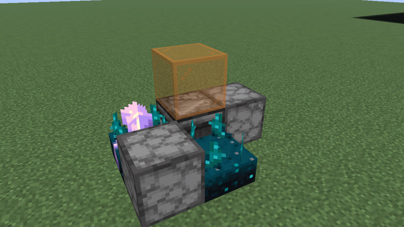
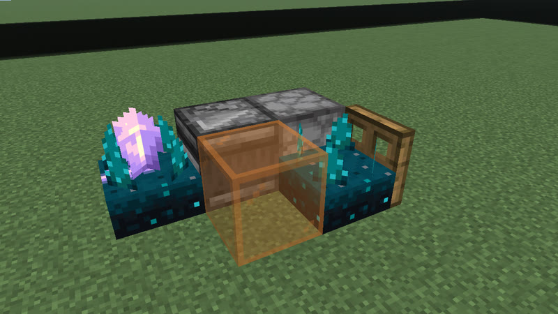
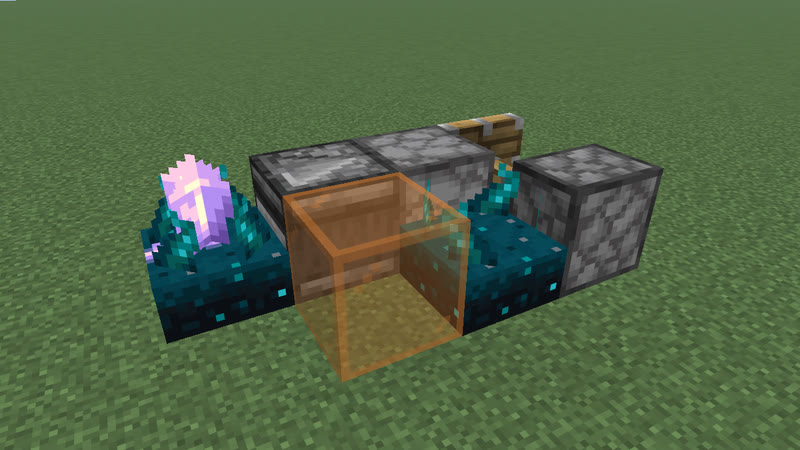
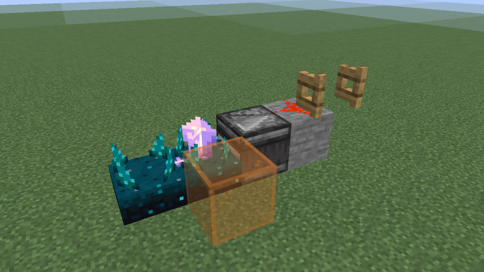
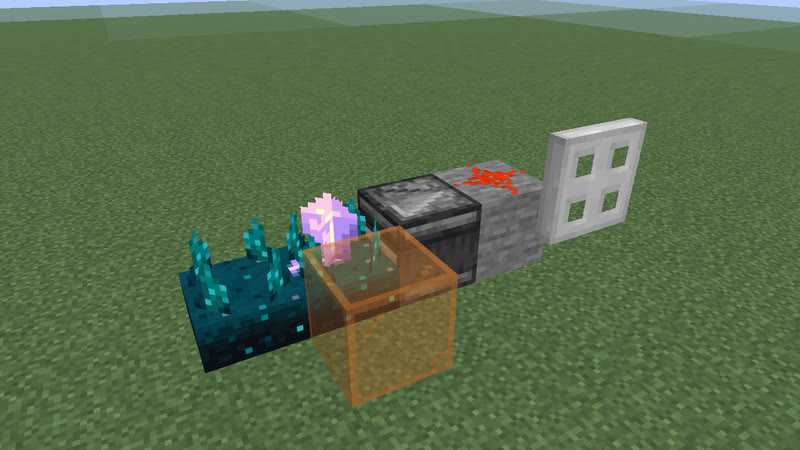
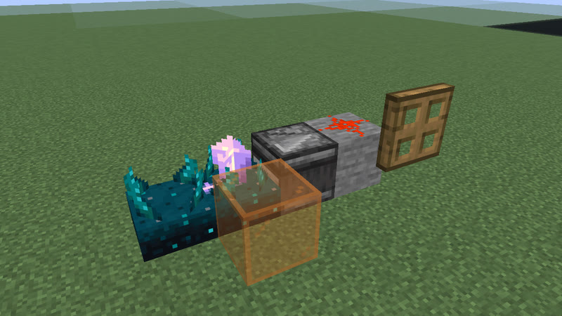
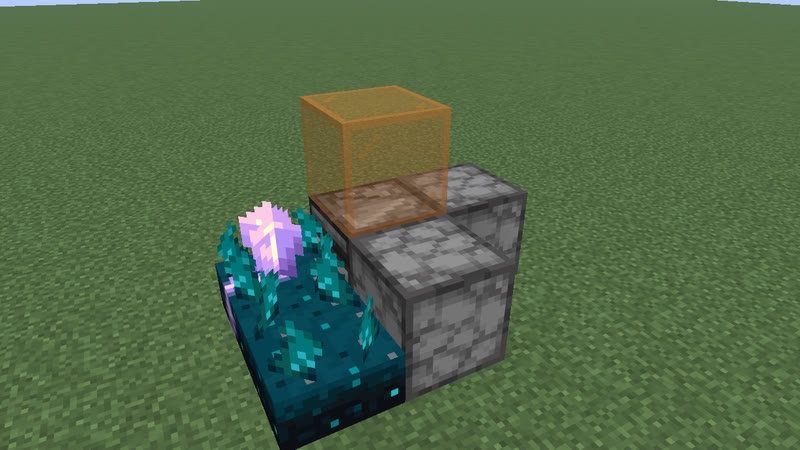
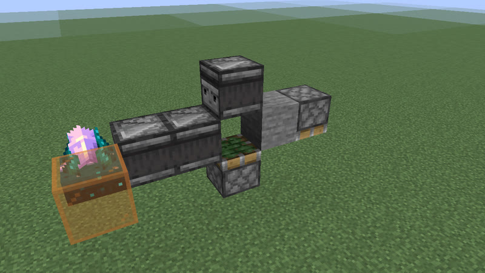
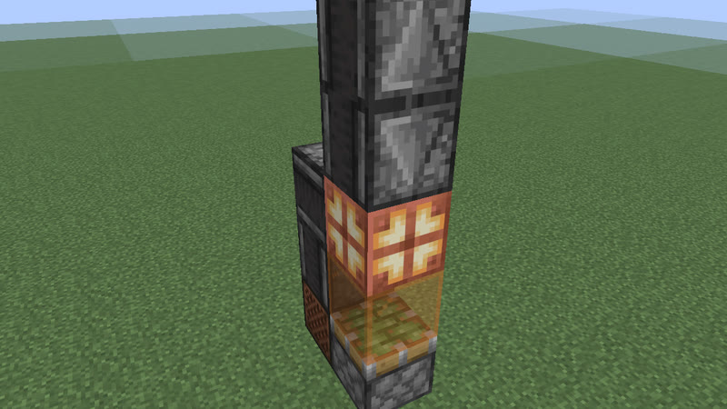

# Clocks: 47 gt (2.35 s) to 63 gt (3.15 s) (293 clock types)

[catalog index](../CATALOG.md) · previous: [p36-46](p36-46.md) · next: [p64-87](p64-87.md)

Orange glass = where the output signal is (placed only for the picture); click a picture for its design. Larger clocks of a period with the same on-time and pulses as a smaller one (whatever their block kinds), and clocks that are not robust, are listed on [variants](variants.md). Generated by `mctas clock catalog`.

## 47 gt (2.35 s)

Also reachable by: clk-obs-odd-a (n = 9), clk-rt-odd-rect (n = 3), dropper ring (clk-item-dropring-2d-r3, n = 1), lock ring (clk-item-lockring-3s, n = 3), clk-misc-cart-pingpong (n = 2).

<table>
<tr><td align="center"> 47 gt (2.35 s) · note_block+observer+sculk_sensor · 4 blocks</td><td align="center"> 47 gt (2.35 s) · oak_trapdoor+observer+sculk_sensor · 4 blocks</td><td align="center"> 47 gt (2.35 s) · oak_trapdoor+observer+sculk_sensor · 4 blocks</td></tr>
<tr><td align="center"> 47 gt (2.35 s) · oak_fence_gate+observer+sculk_sensor · 4 blocks</td><td align="center"> 47 gt (2.35 s) · iron_trapdoor+observer+sculk_sensor · 4 blocks</td><td align="center"> 47 gt (2.35 s) · observer+piston+sculk_sensor · 4 blocks also found as census-p47-observer-sculk_sensor-sticky_piston-4b (built with sticky_piston, without piston)</td></tr>
<tr><td align="center"> 47 gt (2.35 s) · calibrated_sculk_sensor+observer+piston+sculk_sensor · 4 blocks also found as census-p47-calibrated_sculk_sensor-observer-sculk_sensor-sticky_piston-4b (built with sticky_piston, without piston)</td><td align="center"> 47 gt (2.35 s) · calibrated_sculk_sensor+oak_trapdoor+observer+sculk_sensor · 5 blocks</td><td align="center"> 47 gt (2.35 s) · calibrated_sculk_sensor+dispenser+note_block+observer+sculk_sensor · 5 blocks</td></tr>
<tr><td align="center"> 47 gt (2.35 s) · calibrated_sculk_sensor+dispenser+oak_trapdoor+observer+sculk_sensor · 5 blocks</td><td align="center"> 47 gt (2.35 s) · calibrated_sculk_sensor+dispenser+observer+piston+sculk_sensor · 5 blocks also found as census-p47-calibrated_sculk_sensor-dispenser-observer-sculk_sensor-sticky_piston-5b (built with sticky_piston, without piston)</td><td align="center"> 47 gt (2.35 s) · calibrated_sculk_sensor+observer+sticky_piston · 6 blocks</td></tr>
<tr><td align="center"> 47 gt (2.35 s) · observer+piston+redstone_block+redstone_lamp+sticky_piston · 7 blocks</td><td align="center"> 47 gt (2.35 s) · note_block+observer+piston+redstone_block+sticky_piston · 7 blocks</td><td align="center"> 47 gt (2.35 s) · observer+piston+redstone_block+sticky_piston · 7 blocks</td></tr>
<tr><td align="center"> 47 gt (2.35 s) · observer+sticky_piston · 7 blocks</td><td align="center"><a href="../archive/clk-obs-p47-lamp-note-obs-stk-8b-dae05d.txt">clk-obs-p47-lamp-note-obs-stk-8b-dae05d</a> 47 gt (2.35 s) · note_block+observer+redstone_lamp+sticky_piston · 8 blocks (picture pending)</td><td align="center"><a href="../archive/clk-obs-p47-lamp-obs-stk-8b-a789bd.txt">clk-obs-p47-lamp-obs-stk-8b-a789bd</a> 47 gt (2.35 s) · observer+redstone_lamp+sticky_piston · 8 blocks (picture pending)</td></tr>
<tr><td align="center"><a href="../archive/clk-obs-p47-note-obs-stk-8b-fe4660.txt">clk-obs-p47-note-obs-stk-8b-fe4660</a> 47 gt (2.35 s) · note_block+observer+sticky_piston · 8 blocks (picture pending)</td><td align="center"><a href="../archive/clk-obs-p47-obs-pis-stk-8b-8675ce.txt">clk-obs-p47-obs-pis-stk-8b-8675ce</a> 47 gt (2.35 s) · observer+piston+sticky_piston · 8 blocks (picture pending)</td><td align="center"><a href="../archive/kit-shuttle-minecart-p47-17b.txt">kit-shuttle-minecart-p47-17b</a> 47 gt (2.35 s) · detector_rail+minecart+powered_rail · 17 blocks (picture pending)</td></tr>
</table>

## 48 gt (2.4 s)

Also reachable by: clk-obs-obs-ring (n = 10), clk-obs-divider (n = 2), dropper ring (clk-item-dropring-2d, n = 1), clk-rt-rect-pulse (n = 1).

<table>
<tr><td align="center"> 48 gt (2.4 s) · dispenser+observer+sculk_sensor · 3 blocks</td><td align="center"> 48 gt (2.4 s) · dispenser+observer+sculk_sensor · 3 blocks</td><td align="center"> 48 gt (2.4 s) · dispenser+observer+sculk_sensor · 3 blocks</td></tr>
<tr><td align="center"> 48 gt (2.4 s) · calibrated_sculk_sensor+observer+sticky_piston · 4 blocks</td><td align="center"> 48 gt (2.4 s) · calibrated_sculk_sensor+note_block+observer+sticky_piston · 4 blocks</td><td align="center"> 48 gt (2.4 s) · calibrated_sculk_sensor+dispenser+observer+sticky_piston · 5 blocks</td></tr>
<tr><td align="center"> 48 gt (2.4 s) · copper_bulb+observer+piston+redstone_block+sticky_piston · 5 blocks</td><td align="center"> 48 gt (2.4 s) · copper_bulb+observer+redstone_block+sticky_piston · 5 blocks</td><td align="center"> 48 gt (2.4 s) · copper_bulb+observer+piston+redstone_block+sticky_piston · 5 blocks</td></tr>
<tr><td align="center"> 48 gt (2.4 s) · copper_bulb+observer+redstone_block+sticky_piston · 5 blocks</td><td align="center"> 48 gt (2.4 s) · calibrated_sculk_sensor+iron_trapdoor+observer+sticky_piston · 5 blocks</td><td align="center"> 48 gt (2.4 s) · calibrated_sculk_sensor+oak_fence_gate+observer+sticky_piston · 5 blocks</td></tr>
<tr><td align="center"><a href="../archive/census-p48-calibrated_sculk_sensor-note_block-observer-6b.txt">census-p48-calibrated_sculk_sensor-note_block-observer-6b</a> 48 gt (2.4 s) · calibrated_sculk_sensor+note_block+observer · 6 blocks (picture pending)</td><td align="center"> 48 gt (2.4 s) · copper_bulb+observer+sticky_piston · 6 blocks</td><td align="center"> 48 gt (2.4 s) · observer+redstone_lamp+sticky_piston · 6 blocks</td></tr>
<tr><td align="center"> 48 gt (2.4 s) · observer+redstone_lamp+sticky_piston · 6 blocks</td><td align="center"> 48 gt (2.4 s) · note_block+observer+sticky_piston · 6 blocks</td><td align="center"> 48 gt (2.4 s) · note_block+observer+sticky_piston · 6 blocks</td></tr>
<tr><td align="center"> 48 gt (2.4 s) · observer+sticky_piston · 6 blocks</td><td align="center"> 48 gt (2.4 s) · observer+sticky_piston · 6 blocks</td><td align="center"> 48 gt (2.4 s) · copper_bulb+observer+sticky_piston · 6 blocks</td></tr>
<tr><td align="center"> 48 gt (2.4 s) · observer+redstone_block+sticky_piston · 6 blocks</td><td align="center"> 48 gt (2.4 s) · observer+redstone_block+sticky_piston · 6 blocks</td><td align="center"> 48 gt (2.4 s) · observer+piston · 7 blocks</td></tr>
<tr><td align="center"> 48 gt (2.4 s) · redstone_torch+redstone_wire+repeater · 12 blocks</td></tr>
</table>

## 49 gt (2.45 s)

Also reachable by: clk-obs-odd-b (n = 9), hopper ring (clk-item-hopper-ring-2, n = 6), dropper ring (clk-item-dropring-2d-r4, n = 1), clk-sculk-replin (one block swapped: 2 versions) (clk-sculk-replin, n = 5).

<table>
<tr><td align="center"> 49 gt (2.45 s) · dispenser+observer+sculk_sensor · 4 blocks</td><td align="center"> 49 gt (2.45 s) · dispenser+observer+sculk_sensor · 4 blocks</td><td align="center"> 49 gt (2.45 s) · calibrated_sculk_sensor+dispenser+observer+piston+sculk_sensor · 5 blocks also found as census-p49-calibrated_sculk_sensor-dispenser-observer-sculk_sensor-sticky_piston-5b (built with sticky_piston, without piston)</td></tr>
<tr><td align="center"> 49 gt (2.45 s) · calibrated_sculk_sensor+dispenser+note_block+observer+sculk_sensor · 5 blocks</td><td align="center"> 49 gt (2.45 s) · calibrated_sculk_sensor+note_block+oak_trapdoor+observer+sculk_sensor · 5 blocks</td><td align="center"> 49 gt (2.45 s) · calibrated_sculk_sensor+note_block+observer+piston+sculk_sensor · 5 blocks also found as census-p49-calibrated_sculk_sensor-note_block-observer-sculk_sensor-sticky_piston-5b (built with sticky_piston, without piston)</td></tr>
<tr><td align="center"> 49 gt (2.45 s) · calibrated_sculk_sensor+note_block+observer+sculk_sensor · 5 blocks</td><td align="center"> 49 gt (2.45 s) · calibrated_sculk_sensor+observer+piston+sculk_sensor · 5 blocks also found as census-p49-calibrated_sculk_sensor-observer-sculk_sensor-sticky_piston-5b (built with sticky_piston, without piston)</td><td align="center"><a href="../archive/census-p49-calibrated_sculk_sensor-oak_trapdoor-observer-sculk_sensor-sticky_piston-6b.txt">census-p49-calibrated_sculk_sensor-oak_trapdoor-observer-sculk_sensor-sticky_piston-6b</a> 49 gt (2.45 s) · calibrated_sculk_sensor+oak_trapdoor+observer+sculk_sensor+sticky_piston · 6 blocks (picture pending)</td></tr>
<tr><td align="center"> 49 gt (2.45 s) · note_block+observer+redstone_lamp+sticky_piston · 7 blocks</td><td align="center"> 49 gt (2.45 s) · observer+redstone_lamp+sticky_piston · 7 blocks</td><td align="center"><a href="../archive/clk-obs-p49-note-obs-stk-7b-cf86c5.txt">clk-obs-p49-note-obs-stk-7b-cf86c5</a> 49 gt (2.45 s) · note_block+observer+sticky_piston · 7 blocks (picture pending)</td></tr>
<tr><td align="center"> 49 gt (2.45 s) · observer+sticky_piston · 7 blocks</td><td align="center"> 49 gt (2.45 s) · calibrated_sculk_sensor+observer+sticky_piston · 7 blocks</td><td align="center"> 49 gt (2.45 s) · calibrated_sculk_sensor+oak_trapdoor+observer+sticky_piston · 7 blocks</td></tr>
<tr><td align="center"> 49 gt (2.45 s) · calibrated_sculk_sensor+iron_trapdoor+observer+sticky_piston · 7 blocks</td><td align="center"> 49 gt (2.45 s) · calibrated_sculk_sensor+oak_fence_gate+observer+sticky_piston · 7 blocks</td><td align="center"> 49 gt (2.45 s) · calibrated_sculk_sensor+observer+piston+sticky_piston · 7 blocks</td></tr>
<tr><td align="center"> 49 gt (2.45 s) · comparator+hopper · 10 blocks</td><td align="center"> 49 gt (2.45 s) · repeater · 31 blocks</td></tr>
</table>

## 50 gt (2.5 s)

Also reachable by: observer ring with a relay block (clk-obs-note-ring, n = 10), dropper ring (clk-item-dropring-1d-r1, n = 1).

<table>
<tr><td align="center"> 50 gt (2.5 s) · dispenser+observer+sculk_sensor · 4 blocks</td><td align="center"> 50 gt (2.5 s) · dispenser+observer+sculk_sensor · 4 blocks</td><td align="center"> 50 gt (2.5 s) · calibrated_sculk_sensor+dispenser+observer+sculk_sensor · 5 blocks</td></tr>
<tr><td align="center"> 50 gt (2.5 s) · note_block+observer+sculk_sensor · 5 blocks</td><td align="center"> 50 gt (2.5 s) · calibrated_sculk_sensor+dispenser+oak_trapdoor+observer+sculk_sensor · 5 blocks</td><td align="center"> 50 gt (2.5 s) · calibrated_sculk_sensor+dispenser+observer+piston+sculk_sensor · 5 blocks also found as census-p50-calibrated_sculk_sensor-dispenser-observer-sculk_sensor-sticky_piston-5b (built with sticky_piston, without piston)</td></tr>
<tr><td align="center"> 50 gt (2.5 s) · calibrated_sculk_sensor+note_block+observer+sculk_sensor · 5 blocks</td><td align="center"> 50 gt (2.5 s) · calibrated_sculk_sensor+observer+piston+sculk_sensor · 5 blocks also found as census-p50-calibrated_sculk_sensor-observer-sculk_sensor-sticky_piston-5b (built with sticky_piston, without piston)</td><td align="center"> 50 gt (2.5 s) · calibrated_sculk_sensor+dispenser+observer+sticky_piston · 5 blocks</td></tr>
<tr><td align="center"> 50 gt (2.5 s) · calibrated_sculk_sensor+observer+sticky_piston · 5 blocks</td><td align="center"><a href="../archive/census-p50-calibrated_sculk_sensor-observer-piston-6b.txt">census-p50-calibrated_sculk_sensor-observer-piston-6b</a> 50 gt (2.5 s) · calibrated_sculk_sensor+observer+piston · 6 blocks (picture pending)</td><td align="center"><a href="../archive/census-p50-calibrated_sculk_sensor-note_block-observer-sticky_piston-6b.txt">census-p50-calibrated_sculk_sensor-note_block-observer-sticky_piston-6b</a> 50 gt (2.5 s) · calibrated_sculk_sensor+note_block+observer+sticky_piston · 6 blocks (picture pending)</td></tr>
<tr><td align="center"><a href="../archive/census-p50-calibrated_sculk_sensor-oak_trapdoor-observer-sticky_piston-6b.txt">census-p50-calibrated_sculk_sensor-oak_trapdoor-observer-sticky_piston-6b</a> 50 gt (2.5 s) · calibrated_sculk_sensor+oak_trapdoor+observer+sticky_piston · 6 blocks (picture pending)</td><td align="center"> 50 gt (2.5 s) · calibrated_sculk_sensor+oak_fence_gate+observer+redstone_wire+sculk_sensor · 6 blocks</td><td align="center"> 50 gt (2.5 s) · calibrated_sculk_sensor+iron_trapdoor+observer+redstone_wire+sculk_sensor · 6 blocks</td></tr>
<tr><td align="center"> 50 gt (2.5 s) · calibrated_sculk_sensor+oak_trapdoor+observer+redstone_wire+sculk_sensor · 6 blocks</td><td align="center"><a href="../archive/clk-obs-p50-lamp-obs-stk-7b-bd1a37.txt">clk-obs-p50-lamp-obs-stk-7b-bd1a37</a> 50 gt (2.5 s) · observer+redstone_lamp+sticky_piston · 7 blocks (picture pending)</td><td align="center"><a href="../archive/clk-obs-p50-bulb-obs-rb-stk-7b-b4312a.txt">clk-obs-p50-bulb-obs-rb-stk-7b-b4312a</a> 50 gt (2.5 s) · copper_bulb+observer+redstone_block+sticky_piston · 7 blocks (picture pending)</td></tr>
<tr><td align="center"><a href="../archive/clk-obs-p50-bulb-lamp-note-obs-pis-stk-8b-72c2bb.txt">clk-obs-p50-bulb-lamp-note-obs-pis-stk-8b-72c2bb</a> 50 gt (2.5 s) · copper_bulb+note_block+observer+piston+redstone_lamp+sticky_piston · 8 blocks (picture pending)</td><td align="center"><a href="../archive/clk-obs-p50-bulb-lamp-obs-pis-stk-8b-f02875.txt">clk-obs-p50-bulb-lamp-obs-pis-stk-8b-f02875</a> 50 gt (2.5 s) · copper_bulb+observer+piston+redstone_lamp+sticky_piston · 8 blocks (picture pending)</td><td align="center"><a href="../archive/clk-obs-p50-bulb-lamp-obs-stk-8b-c92fe1.txt">clk-obs-p50-bulb-lamp-obs-stk-8b-c92fe1</a> 50 gt (2.5 s) · copper_bulb+observer+redstone_lamp+sticky_piston · 8 blocks (picture pending)</td></tr>
<tr><td align="center"><a href="../archive/clk-obs-p50-bulb-note-obs-pis-stk-8b-e94a09.txt">clk-obs-p50-bulb-note-obs-pis-stk-8b-e94a09</a> 50 gt (2.5 s) · copper_bulb+note_block+observer+piston+sticky_piston · 8 blocks (picture pending)</td><td align="center"><a href="../archive/clk-obs-p50-bulb-note-obs-stk-8b-15b74c.txt">clk-obs-p50-bulb-note-obs-stk-8b-15b74c</a> 50 gt (2.5 s) · copper_bulb+note_block+observer+sticky_piston · 8 blocks (picture pending)</td><td align="center"><a href="../archive/clk-obs-p50-bulb-obs-stk-8b-5f2641.txt">clk-obs-p50-bulb-obs-stk-8b-5f2641</a> 50 gt (2.5 s) · copper_bulb+observer+sticky_piston · 8 blocks (picture pending)</td></tr>
<tr><td align="center"> 50 gt (2.5 s) · redstone_torch+repeater · 16 blocks</td><td align="center"> 50 gt (2.5 s) · repeater · 19 blocks</td></tr>
</table>

## 51 gt (2.55 s)

Also reachable by: clk-obs-odd-a (n = 10), clk-misc-cart-loop (n = 5), dropper ring (clk-item-dropring-1d-r14, n = 0), clk-sculk-hairpin (one block swapped: 2 versions) (clk-sculk-hairpin, n = 3), clk-sculk-hairpin-plain (n = 3).

<table>
<tr><td align="center"> 51 gt (2.55 s) · dispenser+observer+sculk_sensor · 4 blocks</td><td align="center"> 51 gt (2.55 s) · dispenser+observer+sculk_sensor · 4 blocks</td><td align="center"> 51 gt (2.55 s) · calibrated_sculk_sensor+dispenser+observer+sculk_sensor · 5 blocks</td></tr>
<tr><td align="center"> 51 gt (2.55 s) · calibrated_sculk_sensor+oak_trapdoor+observer+sticky_piston · 6 blocks</td><td align="center"> 51 gt (2.55 s) · calibrated_sculk_sensor+dispenser+observer+sticky_piston · 6 blocks</td><td align="center"> 51 gt (2.55 s) · calibrated_sculk_sensor+iron_trapdoor+observer+sticky_piston · 6 blocks</td></tr>
<tr><td align="center"> 51 gt (2.55 s) · calibrated_sculk_sensor+oak_fence_gate+observer+sticky_piston · 6 blocks</td><td align="center"> 51 gt (2.55 s) · calibrated_sculk_sensor+note_block+observer+sticky_piston · 6 blocks</td><td align="center"> 51 gt (2.55 s) · calibrated_sculk_sensor+observer+sticky_piston · 6 blocks</td></tr>
<tr><td align="center"> 51 gt (2.55 s) · calibrated_sculk_sensor+observer+piston+sticky_piston · 6 blocks</td><td align="center"><a href="../archive/clk-obs-p51-lamp-obs-pis-stk-8b-492c13.txt">clk-obs-p51-lamp-obs-pis-stk-8b-492c13</a> 51 gt (2.55 s) · observer+piston+redstone_lamp+sticky_piston · 8 blocks (picture pending)</td><td align="center"><a href="../archive/clk-obs-p51-lamp-obs-stk-8b-437b63.txt">clk-obs-p51-lamp-obs-stk-8b-437b63</a> 51 gt (2.55 s) · observer+redstone_lamp+sticky_piston · 8 blocks (picture pending)</td></tr>
<tr><td align="center"><a href="../archive/clk-obs-p51-note-obs-pis-stk-8b-82e9b3.txt">clk-obs-p51-note-obs-pis-stk-8b-82e9b3</a> 51 gt (2.55 s) · note_block+observer+piston+sticky_piston · 8 blocks (picture pending)</td><td align="center"><a href="../archive/clk-obs-p51-note-obs-stk-8b-5439da.txt">clk-obs-p51-note-obs-stk-8b-5439da</a> 51 gt (2.55 s) · note_block+observer+sticky_piston · 8 blocks (picture pending)</td><td align="center"><a href="../archive/clk-obs-p51-obs-pis-stk-8b-8596cd.txt">clk-obs-p51-obs-pis-stk-8b-8596cd</a> 51 gt (2.55 s) · observer+piston+sticky_piston · 8 blocks (picture pending)</td></tr>
<tr><td align="center"><a href="../archive/clk-obs-p51-obs-stk-8b-31cd4c.txt">clk-obs-p51-obs-stk-8b-31cd4c</a> 51 gt (2.55 s) · observer+sticky_piston · 8 blocks (picture pending)</td><td align="center"><a href="../archive/clk-obs-p51-note-obs-pis-rb-stk-8b-796fcf.txt">clk-obs-p51-note-obs-pis-rb-stk-8b-796fcf</a> 51 gt (2.55 s) · note_block+observer+piston+redstone_block+sticky_piston · 8 blocks (picture pending)</td><td align="center"><a href="../archive/clk-obs-p51-note-obs-rb-stk-8b-451805.txt">clk-obs-p51-note-obs-rb-stk-8b-451805</a> 51 gt (2.55 s) · note_block+observer+redstone_block+sticky_piston · 8 blocks (picture pending)</td></tr>
<tr><td align="center"><a href="../archive/clk-obs-p51-obs-rb-stk-8b-1816be.txt">clk-obs-p51-obs-rb-stk-8b-1816be</a> 51 gt (2.55 s) · observer+redstone_block+sticky_piston · 8 blocks (picture pending)</td><td align="center"><a href="../archive/clk-obs-p51-lamp-note-obs-stk-9b-e9639d.txt">clk-obs-p51-lamp-note-obs-stk-9b-e9639d</a> 51 gt (2.55 s) · note_block+observer+redstone_lamp+sticky_piston · 9 blocks (picture pending)</td><td align="center"><a href="../archive/kit-shuttle-minecart-p51-17b.txt">kit-shuttle-minecart-p51-17b</a> 51 gt (2.55 s) · detector_rail+minecart · 17 blocks (picture pending)</td></tr>
<tr><td align="center"> 51 gt (2.55 s) · repeater · 31 blocks</td></tr>
</table>

## 52 gt (2.6 s)

Also reachable by: clk-obs-obs-ring (n = 11), clk-obs-bulb-ring (n = 4), clk-rt-uloop2t (n = 2), dropper ring (clk-item-dropring-1d-r2, n = 1), clk-misc-cart-pingpong (n = 3), clk-rt-rect-inv (n = 0).

<table>
<tr><td align="center"> 52 gt (2.6 s) · dispenser+observer+sculk_sensor · 5 blocks</td><td align="center"> 52 gt (2.6 s) · calibrated_sculk_sensor+dispenser+observer+sculk_sensor · 5 blocks</td><td align="center"> 52 gt (2.6 s) · calibrated_sculk_sensor+note_block+observer+sculk_sensor · 5 blocks</td></tr>
<tr><td align="center"> 52 gt (2.6 s) · calibrated_sculk_sensor+observer+sticky_piston · 5 blocks</td><td align="center"> 52 gt (2.6 s) · observer+sticky_piston · 5 blocks</td><td align="center"> 52 gt (2.6 s) · observer+piston+sticky_piston · 5 blocks</td></tr>
<tr><td align="center"> 52 gt (2.6 s) · observer+piston · 6 blocks also found as clk-obs-p52-obs-pis-stk-6b-b-780fb8 (built with sticky_piston)</td><td align="center"> 52 gt (2.6 s) · calibrated_sculk_sensor+dispenser+observer+sticky_piston · 6 blocks</td><td align="center"> 52 gt (2.6 s) · observer+piston · 6 blocks</td></tr>
<tr><td align="center"> 52 gt (2.6 s) · note_block+observer+piston+sticky_piston · 7 blocks</td><td align="center"> 52 gt (2.6 s) · copper_bulb+note_block+observer+piston+redstone_block+sticky_piston · 7 blocks</td><td align="center"> 52 gt (2.6 s) · copper_bulb+note_block+observer+redstone_block+sticky_piston · 7 blocks</td></tr>
<tr><td align="center"><a href="../archive/clk-obs-p52-bulb-note-obs-stk-7b-56606a.txt">clk-obs-p52-bulb-note-obs-stk-7b-56606a</a> 52 gt (2.6 s) · copper_bulb+note_block+observer+sticky_piston · 7 blocks (picture pending)</td><td align="center"> 52 gt (2.6 s) · note_block+observer+sticky_piston · 7 blocks</td><td align="center"> 52 gt (2.6 s) · note_block+observer+piston · 7 blocks</td></tr>
<tr><td align="center"> 52 gt (2.6 s) · calibrated_sculk_sensor+observer+piston+sticky_piston · 7 blocks</td><td align="center"><a href="../archive/clk-obs-p52-bulb-lamp-obs-rb-stk-8b-0220ce.txt">clk-obs-p52-bulb-lamp-obs-rb-stk-8b-0220ce</a> 52 gt (2.6 s) · copper_bulb+observer+redstone_block+redstone_lamp+sticky_piston · 8 blocks (picture pending)</td><td align="center"> 52 gt (2.6 s) · comparator+hopper · 12 blocks</td></tr>
<tr><td align="center"> 52 gt (2.6 s) · comparator+redstone_torch+redstone_wire+repeater · 13 blocks</td><td align="center"> 52 gt (2.6 s) · redstone_torch+redstone_wire+repeater · 13 blocks</td><td align="center"> 52 gt (2.6 s) · repeater · 19 blocks</td></tr>
</table>

## 53 gt (2.65 s)

Also reachable by: clk-obs-odd-b (n = 10), clk-sculk-replin-dispenser (n = 5), dropper ring (clk-item-dropring-1d-r24, n = 0).

<table>
<tr><td align="center"> 53 gt (2.65 s) · note_block+observer+sculk_sensor · 6 blocks</td><td align="center"> 53 gt (2.65 s) · calibrated_sculk_sensor+dispenser+observer+sticky_piston · 6 blocks</td><td align="center"><a href="../archive/clk-obs-p53-lamp-obs-pis-stk-8b-3cc113.txt">clk-obs-p53-lamp-obs-pis-stk-8b-3cc113</a> 53 gt (2.65 s) · observer+piston+redstone_lamp+sticky_piston · 8 blocks (picture pending)</td></tr>
<tr><td align="center"><a href="../archive/clk-obs-p53-note-obs-pis-stk-8b-1e7c2e.txt">clk-obs-p53-note-obs-pis-stk-8b-1e7c2e</a> 53 gt (2.65 s) · note_block+observer+piston+sticky_piston · 8 blocks (picture pending)</td><td align="center"><a href="../archive/clk-obs-p53-obs-pis-stk-8b-ada3c2.txt">clk-obs-p53-obs-pis-stk-8b-ada3c2</a> 53 gt (2.65 s) · observer+piston+sticky_piston · 8 blocks (picture pending)</td><td align="center"><a href="../archive/clk-obs-p53-note-obs-pis-rb-stk-8b-ffb004.txt">clk-obs-p53-note-obs-pis-rb-stk-8b-ffb004</a> 53 gt (2.65 s) · note_block+observer+piston+redstone_block+sticky_piston · 8 blocks (picture pending)</td></tr>
<tr><td align="center"><a href="../archive/clk-obs-p53-obs-stk-8b-accc78.txt">clk-obs-p53-obs-stk-8b-accc78</a> 53 gt (2.65 s) · observer+sticky_piston · 8 blocks (picture pending)</td><td align="center"><a href="../archive/clk-obs-p53-lamp-note-obs-stk-9b-b13693.txt">clk-obs-p53-lamp-note-obs-stk-9b-b13693</a> 53 gt (2.65 s) · note_block+observer+redstone_lamp+sticky_piston · 9 blocks (picture pending)</td><td align="center"> 53 gt (2.65 s) · repeater · 32 blocks</td></tr>
</table>

## 54 gt (2.7 s)

Also reachable by: observer ring with a relay block (clk-obs-note-ring, n = 11), dropper ring (clk-item-dropring-1d-r3, n = 1).

<table>
<tr><td align="center"> 54 gt (2.7 s) · calibrated_sculk_sensor+observer+sticky_piston · 5 blocks</td><td align="center"> 54 gt (2.7 s) · calibrated_sculk_sensor+observer+sticky_piston · 5 blocks</td><td align="center"><a href="../archive/census-p54-calibrated_sculk_sensor-dispenser-observer-6b.txt">census-p54-calibrated_sculk_sensor-dispenser-observer-6b</a> 54 gt (2.7 s) · calibrated_sculk_sensor+dispenser+observer · 6 blocks (picture pending)</td></tr>
<tr><td align="center"><a href="../archive/census-p54-calibrated_sculk_sensor-dispenser-observer-sculk_sensor-6b.txt">census-p54-calibrated_sculk_sensor-dispenser-observer-sculk_sensor-6b</a> 54 gt (2.7 s) · calibrated_sculk_sensor+dispenser+observer+sculk_sensor · 6 blocks (picture pending)</td><td align="center"> 54 gt (2.7 s) · copper_bulb+observer+piston+sticky_piston · 6 blocks</td><td align="center"> 54 gt (2.7 s) · copper_bulb+observer+piston+sticky_piston · 6 blocks</td></tr>
<tr><td align="center"> 54 gt (2.7 s) · copper_bulb+observer+sticky_piston · 6 blocks</td><td align="center"> 54 gt (2.7 s) · observer+sticky_piston · 6 blocks</td><td align="center"> 54 gt (2.7 s) · observer+sticky_piston · 6 blocks</td></tr>
<tr><td align="center"> 54 gt (2.7 s) · note_block+observer+sculk_sensor · 7 blocks</td><td align="center"> 54 gt (2.7 s) · observer+piston+sticky_piston · 7 blocks</td><td align="center"><a href="../archive/clk-obs-p54-lamp-note-obs-rb-stk-8b-58da02.txt">clk-obs-p54-lamp-note-obs-rb-stk-8b-58da02</a> 54 gt (2.7 s) · note_block+observer+redstone_block+redstone_lamp+sticky_piston · 8 blocks (picture pending)</td></tr>
<tr><td align="center"><a href="../archive/clk-obs-p54-lamp-note-obs-stk-8b-5bb820.txt">clk-obs-p54-lamp-note-obs-stk-8b-5bb820</a> 54 gt (2.7 s) · note_block+observer+redstone_lamp+sticky_piston · 8 blocks (picture pending)</td><td align="center"><a href="../archive/clk-obs-p54-lamp-obs-rb-stk-8b-7869ec.txt">clk-obs-p54-lamp-obs-rb-stk-8b-7869ec</a> 54 gt (2.7 s) · observer+redstone_block+redstone_lamp+sticky_piston · 8 blocks (picture pending)</td><td align="center"><a href="../archive/clk-obs-p54-note-obs-rb-stk-8b-00501b.txt">clk-obs-p54-note-obs-rb-stk-8b-00501b</a> 54 gt (2.7 s) · note_block+observer+redstone_block+sticky_piston · 8 blocks (picture pending)</td></tr>
<tr><td align="center"><a href="../archive/clk-obs-p54-obs-rb-stk-8b-a44687.txt">clk-obs-p54-obs-rb-stk-8b-a44687</a> 54 gt (2.7 s) · observer+redstone_block+sticky_piston · 8 blocks (picture pending)</td><td align="center"><a href="../archive/clk-obs-p54-bulb-obs-pis-rb-stk-8b-8dd4d3.txt">clk-obs-p54-bulb-obs-pis-rb-stk-8b-8dd4d3</a> 54 gt (2.7 s) · copper_bulb+observer+piston+redstone_block+sticky_piston · 8 blocks (picture pending)</td><td align="center"><a href="../archive/clk-obs-p54-bulb-lamp-obs-pis-rb-stk-8b-54c52b.txt">clk-obs-p54-bulb-lamp-obs-pis-rb-stk-8b-54c52b</a> 54 gt (2.7 s) · copper_bulb+observer+piston+redstone_block+redstone_lamp+sticky_piston · 8 blocks (picture pending)</td></tr>
<tr><td align="center"><a href="../archive/clk-obs-p54-bulb-note-obs-pis-rb-stk-8b-5dfd8f.txt">clk-obs-p54-bulb-note-obs-pis-rb-stk-8b-5dfd8f</a> 54 gt (2.7 s) · copper_bulb+note_block+observer+piston+redstone_block+sticky_piston · 8 blocks (picture pending)</td><td align="center"> 54 gt (2.7 s) · comparator+dropper+hopper · 10 blocks</td><td align="center"><a href="../archive/kit-shuttle-minecart-p54-15b.txt">kit-shuttle-minecart-p54-15b</a> 54 gt (2.7 s) · detector_rail+minecart · 15 blocks (picture pending)</td></tr>
<tr><td align="center"> 54 gt (2.7 s) · repeater · 19 blocks</td><td align="center"> 54 gt (2.7 s) · redstone_torch+repeater · 20 blocks</td></tr>
</table>

## 55 gt (2.75 s)

Also reachable by: clk-obs-odd-a (n = 11), clk-rt-odd-rect (n = 4), clk-sculk-hairpin-dispenser (n = 3), dropper ring (clk-item-dropring-1d, n = 2).

<table>
<tr><td align="center"> 55 gt (2.75 s) · calibrated_sculk_sensor+observer+sticky_piston · 6 blocks</td><td align="center"> 55 gt (2.75 s) · note_block+observer+piston+sticky_piston · 7 blocks</td><td align="center"> 55 gt (2.75 s) · note_block+observer+sticky_piston · 7 blocks</td></tr>
<tr><td align="center"> 55 gt (2.75 s) · observer+piston+sticky_piston · 7 blocks</td><td align="center"> 55 gt (2.75 s) · observer+sticky_piston · 7 blocks</td><td align="center"> 55 gt (2.75 s) · observer+redstone_block+sticky_piston · 7 blocks</td></tr>
</table>

## 56 gt (2.8 s)

Also reachable by: clk-obs-obs-ring (n = 12), hopper ring (clk-item-hopper-ring, n = 3), clk-misc-cart-loop (n = 6), dropper ring (clk-item-dropring-1d-r4, n = 1).

<table>
<tr><td align="center"><a href="../archive/census-p56-calibrated_sculk_sensor-dispenser-oak_trapdoor-observer-sculk_sensor-6b.txt">census-p56-calibrated_sculk_sensor-dispenser-oak_trapdoor-observer-sculk_sensor-6b</a> 56 gt (2.8 s) · calibrated_sculk_sensor+dispenser+oak_trapdoor+observer+sculk_sensor · 6 blocks (picture pending)</td><td align="center"><a href="../archive/census-p56-calibrated_sculk_sensor-dispenser-observer-sculk_sensor-6b.txt">census-p56-calibrated_sculk_sensor-dispenser-observer-sculk_sensor-6b</a> 56 gt (2.8 s) · calibrated_sculk_sensor+dispenser+observer+sculk_sensor · 6 blocks (picture pending)</td><td align="center"><a href="../archive/census-p56-calibrated_sculk_sensor-dispenser-observer-piston-sculk_sensor-6b.txt">census-p56-calibrated_sculk_sensor-dispenser-observer-piston-sculk_sensor-6b</a> 56 gt (2.8 s) · calibrated_sculk_sensor+dispenser+observer+piston+sculk_sensor · 6 blocks (picture pending) also found as census-p56-calibrated_sculk_sensor-dispenser-observer-sculk_sensor-sticky_piston-6b (built with sticky_piston, without piston)</td></tr>
<tr><td align="center"> 56 gt (2.8 s) · calibrated_sculk_sensor+observer+sticky_piston · 6 blocks</td><td align="center"> 56 gt (2.8 s) · copper_bulb+observer+piston · 7 blocks also found as clk-obs-p56-bulb-obs-pis-stk-7b-9293db (built with sticky_piston)</td><td align="center"> 56 gt (2.8 s) · copper_bulb+observer+redstone_lamp+sticky_piston · 7 blocks</td></tr>
<tr><td align="center"> 56 gt (2.8 s) · copper_bulb+observer+piston+redstone_block+sticky_piston · 7 blocks</td><td align="center"> 56 gt (2.8 s) · copper_bulb+observer+piston+redstone_block+sticky_piston · 7 blocks</td><td align="center"> 56 gt (2.8 s) · copper_bulb+observer+sticky_piston · 7 blocks</td></tr>
<tr><td align="center"> 56 gt (2.8 s) · copper_bulb+observer+sticky_piston · 7 blocks</td><td align="center"> 56 gt (2.8 s) · observer+redstone_lamp+sticky_piston · 7 blocks</td><td align="center"><a href="../archive/clk-obs-p56-obs-stk-7b-fe8fba.txt">clk-obs-p56-obs-stk-7b-fe8fba</a> 56 gt (2.8 s) · observer+sticky_piston · 7 blocks (picture pending)</td></tr>
<tr><td align="center"> 56 gt (2.8 s) · calibrated_sculk_sensor+note_block+observer+sticky_piston · 7 blocks</td><td align="center"><a href="../archive/clk-obs-p56-bulb-lamp-note-obs-pis-stk-8b-2c2c45.txt">clk-obs-p56-bulb-lamp-note-obs-pis-stk-8b-2c2c45</a> 56 gt (2.8 s) · copper_bulb+note_block+observer+piston+redstone_lamp+sticky_piston · 8 blocks (picture pending)</td><td align="center"><a href="../archive/clk-obs-p56-bulb-lamp-note-obs-stk-8b-ce85bb.txt">clk-obs-p56-bulb-lamp-note-obs-stk-8b-ce85bb</a> 56 gt (2.8 s) · copper_bulb+note_block+observer+redstone_lamp+sticky_piston · 8 blocks (picture pending)</td></tr>
<tr><td align="center"><a href="../archive/clk-obs-p56-bulb-lamp-obs-pis-stk-8b-ca8da1.txt">clk-obs-p56-bulb-lamp-obs-pis-stk-8b-ca8da1</a> 56 gt (2.8 s) · copper_bulb+observer+piston+redstone_lamp+sticky_piston · 8 blocks (picture pending)</td><td align="center"><a href="../archive/clk-obs-p56-bulb-obs-rb-stk-8b-7d06ba.txt">clk-obs-p56-bulb-obs-rb-stk-8b-7d06ba</a> 56 gt (2.8 s) · copper_bulb+observer+redstone_block+sticky_piston · 8 blocks (picture pending)</td><td align="center"><a href="../archive/clk-obs-p56-lamp-obs-pis-stk-8b-c3e9f4.txt">clk-obs-p56-lamp-obs-pis-stk-8b-c3e9f4</a> 56 gt (2.8 s) · observer+piston+redstone_lamp+sticky_piston · 8 blocks (picture pending)</td></tr>
<tr><td align="center"><a href="../archive/clk-obs-p56-note-obs-pis-stk-8b-89f086.txt">clk-obs-p56-note-obs-pis-stk-8b-89f086</a> 56 gt (2.8 s) · note_block+observer+piston+sticky_piston · 8 blocks (picture pending)</td><td align="center"><a href="../archive/clk-obs-p56-note-obs-stk-8b-8d7d69.txt">clk-obs-p56-note-obs-stk-8b-8d7d69</a> 56 gt (2.8 s) · note_block+observer+sticky_piston · 8 blocks (picture pending)</td><td align="center"><a href="../archive/clk-obs-p56-obs-pis-stk-8b-175d3a.txt">clk-obs-p56-obs-pis-stk-8b-175d3a</a> 56 gt (2.8 s) · observer+piston+sticky_piston · 8 blocks (picture pending)</td></tr>
<tr><td align="center"><a href="../archive/clk-obs-p56-bulb-lamp-obs-rb-stk-8b-266d44.txt">clk-obs-p56-bulb-lamp-obs-rb-stk-8b-266d44</a> 56 gt (2.8 s) · copper_bulb+observer+redstone_block+redstone_lamp+sticky_piston · 8 blocks (picture pending)</td><td align="center"><a href="../archive/clk-obs-p56-bulb-note-obs-rb-stk-8b-0fd806.txt">clk-obs-p56-bulb-note-obs-rb-stk-8b-0fd806</a> 56 gt (2.8 s) · copper_bulb+note_block+observer+redstone_block+sticky_piston · 8 blocks (picture pending)</td><td align="center"> 56 gt (2.8 s) · comparator+hopper · 10 blocks</td></tr>
<tr><td align="center"> 56 gt (2.8 s) · comparator+redstone_torch+redstone_wire+repeater · 13 blocks</td><td align="center"> 56 gt (2.8 s) · redstone_torch+redstone_wire+repeater · 13 blocks</td><td align="center"> 56 gt (2.8 s) · repeater · 19 blocks</td></tr>
<tr><td align="center"><a href="../archive/clk-misc-bookshelf-cart.txt">clk-misc-bookshelf-cart</a> 56 gt (2.8 s) · chiseled_bookshelf+hopper+hopper_minecart · 20 blocks (picture pending)</td></tr>
</table>

## 57 gt (2.85 s)

Also reachable by: clk-obs-odd-b (n = 11), dropper ring (clk-item-dropring-2d-r1, n = 1), clk-misc-cart-pingpong (n = 4).

<table>
<tr><td align="center"> 57 gt (2.85 s) · calibrated_sculk_sensor+observer+sticky_piston · 6 blocks</td><td align="center"><a href="../archive/clk-obs-p57-obs-stk-7b-7fef55.txt">clk-obs-p57-obs-stk-7b-7fef55</a> 57 gt (2.85 s) · observer+sticky_piston · 7 blocks (picture pending)</td><td align="center"><a href="../archive/clk-obs-p57-obs-pis-stk-7b-f2d7c2.txt">clk-obs-p57-obs-pis-stk-7b-f2d7c2</a> 57 gt (2.85 s) · observer+piston+sticky_piston · 7 blocks (picture pending)</td></tr>
<tr><td align="center"><a href="../archive/clk-obs-p57-lamp-obs-pis-stk-9b-8a96cd.txt">clk-obs-p57-lamp-obs-pis-stk-9b-8a96cd</a> 57 gt (2.85 s) · observer+piston+redstone_lamp+sticky_piston · 9 blocks (picture pending)</td><td align="center"><a href="../archive/clk-obs-p57-note-obs-pis-stk-9b-67b753.txt">clk-obs-p57-note-obs-pis-stk-9b-67b753</a> 57 gt (2.85 s) · note_block+observer+piston+sticky_piston · 9 blocks (picture pending)</td><td align="center"><a href="../archive/clk-obs-p57-note-obs-stk-9b-2e9019.txt">clk-obs-p57-note-obs-stk-9b-2e9019</a> 57 gt (2.85 s) · note_block+observer+sticky_piston · 9 blocks (picture pending)</td></tr>
<tr><td align="center"><a href="../archive/clk-obs-p57-bulb-obs-stk-9b-c96dbd.txt">clk-obs-p57-bulb-obs-stk-9b-c96dbd</a> 57 gt (2.85 s) · copper_bulb+observer+sticky_piston · 9 blocks (picture pending)</td><td align="center"><a href="../archive/clk-obs-p57-lamp-obs-stk-9b-e7098b.txt">clk-obs-p57-lamp-obs-stk-9b-e7098b</a> 57 gt (2.85 s) · observer+redstone_lamp+sticky_piston · 9 blocks (picture pending)</td><td align="center"><a href="../archive/kit-shuttle-minecart-p57-17b.txt">kit-shuttle-minecart-p57-17b</a> 57 gt (2.85 s) · detector_rail+minecart+powered_rail · 17 blocks (picture pending)</td></tr>
<tr><td align="center"> 57 gt (2.85 s) · repeater · 35 blocks</td></tr>
</table>

## 58 gt (2.9 s)

Also reachable by: observer ring with a relay block (clk-obs-note-ring, n = 12), dropper ring (clk-item-dropring-2d-r14, n = 1), clk-sculk-replin (one block swapped: 2 versions) (clk-sculk-replin, n = 6).

<table>
<tr><td align="center"> 58 gt (2.9 s) · calibrated_sculk_sensor+observer+sticky_piston · 6 blocks</td><td align="center"> 58 gt (2.9 s) · observer+piston+redstone_lamp+sticky_piston · 7 blocks</td><td align="center"> 58 gt (2.9 s) · note_block+observer+piston+sticky_piston · 7 blocks</td></tr>
<tr><td align="center"> 58 gt (2.9 s) · observer+piston+sticky_piston · 7 blocks</td><td align="center"> 58 gt (2.9 s) · calibrated_sculk_sensor+note_block+observer+sticky_piston · 7 blocks</td><td align="center"><a href="../archive/clk-obs-p58-bulb-lamp-note-obs-rb-stk-8b-76e5d7.txt">clk-obs-p58-bulb-lamp-note-obs-rb-stk-8b-76e5d7</a> 58 gt (2.9 s) · copper_bulb+note_block+observer+redstone_block+redstone_lamp+sticky_piston · 8 blocks (picture pending)</td></tr>
<tr><td align="center"><a href="../archive/clk-obs-p58-bulb-lamp-obs-rb-stk-8b-f147c6.txt">clk-obs-p58-bulb-lamp-obs-rb-stk-8b-f147c6</a> 58 gt (2.9 s) · copper_bulb+observer+redstone_block+redstone_lamp+sticky_piston · 8 blocks (picture pending)</td><td align="center"><a href="../archive/clk-obs-p58-bulb-note-obs-stk-8b-b421ea.txt">clk-obs-p58-bulb-note-obs-stk-8b-b421ea</a> 58 gt (2.9 s) · copper_bulb+note_block+observer+sticky_piston · 8 blocks (picture pending)</td><td align="center"><a href="../archive/clk-obs-p58-bulb-obs-stk-8b-f306e1.txt">clk-obs-p58-bulb-obs-stk-8b-f306e1</a> 58 gt (2.9 s) · copper_bulb+observer+sticky_piston · 8 blocks (picture pending)</td></tr>
<tr><td align="center"><a href="../archive/clk-obs-p58-lamp-note-obs-stk-8b-7e54a2.txt">clk-obs-p58-lamp-note-obs-stk-8b-7e54a2</a> 58 gt (2.9 s) · note_block+observer+redstone_lamp+sticky_piston · 8 blocks (picture pending)</td><td align="center"><a href="../archive/clk-obs-p58-lamp-obs-stk-8b-df4399.txt">clk-obs-p58-lamp-obs-stk-8b-df4399</a> 58 gt (2.9 s) · observer+redstone_lamp+sticky_piston · 8 blocks (picture pending)</td><td align="center"><a href="../archive/clk-obs-p58-note-obs-stk-8b-25ed71.txt">clk-obs-p58-note-obs-stk-8b-25ed71</a> 58 gt (2.9 s) · note_block+observer+sticky_piston · 8 blocks (picture pending)</td></tr>
<tr><td align="center"><a href="../archive/clk-obs-p58-obs-stk-8b-085527.txt">clk-obs-p58-obs-stk-8b-085527</a> 58 gt (2.9 s) · observer+sticky_piston · 8 blocks (picture pending)</td><td align="center"> 58 gt (2.9 s) · comparator+hopper · 14 blocks</td><td align="center"> 58 gt (2.9 s) · redstone_torch+repeater · 20 blocks</td></tr>
<tr><td align="center"> 58 gt (2.9 s) · repeater · 20 blocks</td></tr>
</table>

## 59 gt (2.95 s)

Also reachable by: clk-obs-odd-a (n = 12), dropper ring (clk-item-dropring-2d-r2, n = 2).

<table>
<tr><td align="center"><a href="../archive/clk-obs-p59-lamp-obs-stk-8b-048b5f.txt">clk-obs-p59-lamp-obs-stk-8b-048b5f</a> 59 gt (2.95 s) · observer+redstone_lamp+sticky_piston · 8 blocks (picture pending)</td><td align="center"><a href="../archive/clk-obs-p59-note-obs-stk-8b-2497d3.txt">clk-obs-p59-note-obs-stk-8b-2497d3</a> 59 gt (2.95 s) · note_block+observer+sticky_piston · 8 blocks (picture pending)</td><td align="center"><a href="../archive/clk-obs-p59-obs-rb-stk-8b-dbe41e.txt">clk-obs-p59-obs-rb-stk-8b-dbe41e</a> 59 gt (2.95 s) · observer+redstone_block+sticky_piston · 8 blocks (picture pending)</td></tr>
<tr><td align="center"> 59 gt (2.95 s) · observer+sticky_piston · 8 blocks</td><td align="center"><a href="../archive/clk-obs-p59-obs-stk-8b-be9c91.txt">clk-obs-p59-obs-stk-8b-be9c91</a> 59 gt (2.95 s) · observer+sticky_piston · 8 blocks (picture pending)</td><td align="center"><a href="../archive/clk-obs-p59-lamp-obs-pis-stk-8b-80e775.txt">clk-obs-p59-lamp-obs-pis-stk-8b-80e775</a> 59 gt (2.95 s) · observer+piston+redstone_lamp+sticky_piston · 8 blocks (picture pending)</td></tr>
<tr><td align="center"><a href="../archive/clk-obs-p59-note-obs-pis-stk-8b-c63949.txt">clk-obs-p59-note-obs-pis-stk-8b-c63949</a> 59 gt (2.95 s) · note_block+observer+piston+sticky_piston · 8 blocks (picture pending)</td><td align="center"><a href="../archive/clk-obs-p59-obs-pis-stk-8b-998a89.txt">clk-obs-p59-obs-pis-stk-8b-998a89</a> 59 gt (2.95 s) · observer+piston+sticky_piston · 8 blocks (picture pending)</td><td align="center"> 59 gt (2.95 s) · oak_trapdoor+observer+repeater+sculk_sensor · 9 blocks</td></tr>
<tr><td align="center"> 59 gt (2.95 s) · repeater · 35 blocks</td></tr>
</table>

## 60 gt (3 s)

Also reachable by: clk-obs-obs-ring (n = 13), clk-obs-bulb-ring (n = 5), dropper ring (clk-item-dropring-2d-r24, n = 1), clk-sculk-racetrack (n = 1), clk-sculk-racetrack-plain (n = 3).

<table>
<tr><td align="center"> 60 gt (3 s) · observer+sticky_piston · 6 blocks</td><td align="center"><a href="../archive/clk-obs-p60-lamp-note-obs-pis-7b-b060a7.txt">clk-obs-p60-lamp-note-obs-pis-7b-b060a7</a> 60 gt (3 s) · note_block+observer+piston+redstone_lamp · 7 blocks (picture pending)</td><td align="center"> 60 gt (3 s) · observer+redstone_lamp+sticky_piston · 7 blocks</td></tr>
<tr><td align="center"> 60 gt (3 s) · copper_bulb+note_block+observer+sticky_piston · 7 blocks</td><td align="center"> 60 gt (3 s) · copper_bulb+note_block+observer+sticky_piston · 7 blocks</td><td align="center"> 60 gt (3 s) · copper_bulb+observer+redstone_block+sticky_piston · 7 blocks</td></tr>
<tr><td align="center"> 60 gt (3 s) · copper_bulb+observer+sticky_piston · 7 blocks</td><td align="center"><a href="../archive/clk-obs-p60-bulb-lamp-note-obs-pis-8b-05db11.txt">clk-obs-p60-bulb-lamp-note-obs-pis-8b-05db11</a> 60 gt (3 s) · copper_bulb+note_block+observer+piston+redstone_lamp · 8 blocks (picture pending)</td><td align="center"><a href="../archive/clk-obs-p60-bulb-lamp-note-obs-pis-stk-8b-6dbbfb.txt">clk-obs-p60-bulb-lamp-note-obs-pis-stk-8b-6dbbfb</a> 60 gt (3 s) · copper_bulb+note_block+observer+piston+redstone_lamp+sticky_piston · 8 blocks (picture pending)</td></tr>
<tr><td align="center"><a href="../archive/clk-obs-p60-bulb-lamp-note-obs-stk-8b-b4e54c.txt">clk-obs-p60-bulb-lamp-note-obs-stk-8b-b4e54c</a> 60 gt (3 s) · copper_bulb+note_block+observer+redstone_lamp+sticky_piston · 8 blocks (picture pending)</td><td align="center"><a href="../archive/clk-obs-p60-bulb-lamp-obs-pis-stk-8b-59fc9d.txt">clk-obs-p60-bulb-lamp-obs-pis-stk-8b-59fc9d</a> 60 gt (3 s) · copper_bulb+observer+piston+redstone_lamp+sticky_piston · 8 blocks (picture pending)</td><td align="center"><a href="../archive/clk-obs-p60-bulb-lamp-obs-stk-8b-1303f5.txt">clk-obs-p60-bulb-lamp-obs-stk-8b-1303f5</a> 60 gt (3 s) · copper_bulb+observer+redstone_lamp+sticky_piston · 8 blocks (picture pending)</td></tr>
<tr><td align="center"><a href="../archive/clk-obs-p60-bulb-note-obs-pis-stk-8b-b6b587.txt">clk-obs-p60-bulb-note-obs-pis-stk-8b-b6b587</a> 60 gt (3 s) · copper_bulb+note_block+observer+piston+sticky_piston · 8 blocks (picture pending)</td><td align="center"><a href="../archive/clk-obs-p60-bulb-obs-pis-8b-eb7032.txt">clk-obs-p60-bulb-obs-pis-8b-eb7032</a> 60 gt (3 s) · copper_bulb+observer+piston · 8 blocks (picture pending)</td><td align="center"><a href="../archive/clk-obs-p60-bulb-obs-pis-stk-8b-c3c0c1.txt">clk-obs-p60-bulb-obs-pis-stk-8b-c3c0c1</a> 60 gt (3 s) · copper_bulb+observer+piston+sticky_piston · 8 blocks (picture pending)</td></tr>
<tr><td align="center"> 60 gt (3 s) · calibrated_sculk_sensor+note_block · 8 blocks</td><td align="center"><a href="../archive/clk-obs-p60-lamp-obs-pis-rb-stk-9b-4b407f.txt">clk-obs-p60-lamp-obs-pis-rb-stk-9b-4b407f</a> 60 gt (3 s) · observer+piston+redstone_block+redstone_lamp+sticky_piston · 9 blocks (picture pending)</td><td align="center"><a href="../archive/clk-obs-p60-note-obs-pis-rb-stk-9b-62c4e7.txt">clk-obs-p60-note-obs-pis-rb-stk-9b-62c4e7</a> 60 gt (3 s) · note_block+observer+piston+redstone_block+sticky_piston · 9 blocks (picture pending)</td></tr>
<tr><td align="center"> 60 gt (3 s) · redstone_torch+redstone_wire+repeater · 13 blocks</td><td align="center"> 60 gt (3 s) · repeater · 20 blocks</td></tr>
</table>

## 61 gt (3.05 s)

Also reachable by: clk-obs-odd-b (n = 12), clk-misc-cart-loop (n = 7), dropper ring (clk-item-dropring-2d-r3, n = 2).

<table>
<tr><td align="center"><a href="../archive/clk-obs-p61-lamp-obs-rb-stk-8b-55d7c4.txt">clk-obs-p61-lamp-obs-rb-stk-8b-55d7c4</a> 61 gt (3.05 s) · observer+redstone_block+redstone_lamp+sticky_piston · 8 blocks (picture pending)</td><td align="center"><a href="../archive/clk-obs-p61-note-obs-rb-stk-8b-a9a1a1.txt">clk-obs-p61-note-obs-rb-stk-8b-a9a1a1</a> 61 gt (3.05 s) · note_block+observer+redstone_block+sticky_piston · 8 blocks (picture pending)</td><td align="center"><a href="../archive/clk-obs-p61-obs-rb-stk-8b-ff7cbd.txt">clk-obs-p61-obs-rb-stk-8b-ff7cbd</a> 61 gt (3.05 s) · observer+redstone_block+sticky_piston · 8 blocks (picture pending)</td></tr>
<tr><td align="center"><a href="../archive/clk-obs-p61-obs-pis-stk-8b-9501aa.txt">clk-obs-p61-obs-pis-stk-8b-9501aa</a> 61 gt (3.05 s) · observer+piston+sticky_piston · 8 blocks (picture pending)</td><td align="center"><a href="../archive/clk-obs-p61-lamp-obs-pis-stk-8b-c3d774.txt">clk-obs-p61-lamp-obs-pis-stk-8b-c3d774</a> 61 gt (3.05 s) · observer+piston+redstone_lamp+sticky_piston · 8 blocks (picture pending)</td><td align="center"><a href="../archive/clk-obs-p61-lamp-obs-stk-8b-c76c56.txt">clk-obs-p61-lamp-obs-stk-8b-c76c56</a> 61 gt (3.05 s) · observer+redstone_lamp+sticky_piston · 8 blocks (picture pending)</td></tr>
<tr><td align="center"><a href="../archive/clk-obs-p61-note-obs-pis-stk-8b-923747.txt">clk-obs-p61-note-obs-pis-stk-8b-923747</a> 61 gt (3.05 s) · note_block+observer+piston+sticky_piston · 8 blocks (picture pending)</td><td align="center"><a href="../archive/clk-obs-p61-note-obs-stk-8b-9141e4.txt">clk-obs-p61-note-obs-stk-8b-9141e4</a> 61 gt (3.05 s) · note_block+observer+sticky_piston · 8 blocks (picture pending)</td><td align="center"> 61 gt (3.05 s) · observer+sticky_piston · 8 blocks</td></tr>
<tr><td align="center"> 61 gt (3.05 s) · oak_trapdoor+observer+repeater+sculk_sensor · 9 blocks</td><td align="center"> 61 gt (3.05 s) · repeater · 36 blocks</td></tr>
</table>

## 62 gt (3.1 s)

Also reachable by: observer ring with a relay block (clk-obs-note-ring, n = 13), clk-sculk-replin-dispenser (n = 6), dropper ring (clk-item-dropring-2d, n = 2), clk-item-latch (n = 2), clk-misc-cart-pingpong (n = 5).

<table>
<tr><td align="center"> 62 gt (3.1 s) · note_block+observer+redstone_lamp+sticky_piston · 7 blocks</td><td align="center"> 62 gt (3.1 s) · observer+redstone_lamp+sticky_piston · 7 blocks</td><td align="center"><a href="../archive/clk-obs-p62-obs-pis-stk-8b-ec367f.txt">clk-obs-p62-obs-pis-stk-8b-ec367f</a> 62 gt (3.1 s) · observer+piston+sticky_piston · 8 blocks (picture pending)</td></tr>
<tr><td align="center"><a href="../archive/clk-obs-p62-obs-rb-stk-8b-81116b.txt">clk-obs-p62-obs-rb-stk-8b-81116b</a> 62 gt (3.1 s) · observer+redstone_block+sticky_piston · 8 blocks (picture pending)</td><td align="center"><a href="../archive/clk-obs-p62-obs-stk-8b-0540a2.txt">clk-obs-p62-obs-stk-8b-0540a2</a> 62 gt (3.1 s) · observer+sticky_piston · 8 blocks (picture pending)</td><td align="center"><a href="../archive/clk-obs-p62-bulb-obs-pis-stk-8b-07405b.txt">clk-obs-p62-bulb-obs-pis-stk-8b-07405b</a> 62 gt (3.1 s) · copper_bulb+observer+piston+sticky_piston · 8 blocks (picture pending)</td></tr>
<tr><td align="center"><a href="../archive/clk-obs-p62-bulb-note-obs-rb-stk-8b-603ebc.txt">clk-obs-p62-bulb-note-obs-rb-stk-8b-603ebc</a> 62 gt (3.1 s) · copper_bulb+note_block+observer+redstone_block+sticky_piston · 8 blocks (picture pending)</td><td align="center"><a href="../archive/clk-obs-p62-lamp-note-obs-pis-stk-8b-ff523a.txt">clk-obs-p62-lamp-note-obs-pis-stk-8b-ff523a</a> 62 gt (3.1 s) · note_block+observer+piston+redstone_lamp+sticky_piston · 8 blocks (picture pending)</td><td align="center"><a href="../archive/clk-obs-p62-note-obs-pis-stk-8b-b94414.txt">clk-obs-p62-note-obs-pis-stk-8b-b94414</a> 62 gt (3.1 s) · note_block+observer+piston+sticky_piston · 8 blocks (picture pending)</td></tr>
<tr><td align="center"><a href="../archive/clk-obs-p62-note-obs-stk-8b-a82ad8.txt">clk-obs-p62-note-obs-stk-8b-a82ad8</a> 62 gt (3.1 s) · note_block+observer+sticky_piston · 8 blocks (picture pending)</td><td align="center"><a href="../archive/clk-obs-p62-bulb-obs-stk-8b-c51eff.txt">clk-obs-p62-bulb-obs-stk-8b-c51eff</a> 62 gt (3.1 s) · copper_bulb+observer+sticky_piston · 8 blocks (picture pending)</td><td align="center"> 62 gt (3.1 s) · oak_trapdoor+observer+repeater+sculk_sensor · 10 blocks</td></tr>
<tr><td align="center"> 62 gt (3.1 s) · redstone_torch+repeater · 20 blocks</td><td align="center"> 62 gt (3.1 s) · repeater · 20 blocks</td></tr>
</table>

## 63 gt (3.15 s)

Also reachable by: clk-obs-odd-a (n = 13), hopper ring (clk-item-hopper-ring-2, n = 8), clk-rt-odd-rect (n = 5), dropper ring (clk-item-dropring-2d-r4, n = 2).

<table>
<tr><td align="center"><a href="../archive/census-p63-calibrated_sculk_sensor-note_block-observer-sticky_piston-6b.txt">census-p63-calibrated_sculk_sensor-note_block-observer-sticky_piston-6b</a> 63 gt (3.15 s) · calibrated_sculk_sensor+note_block+observer+sticky_piston · 6 blocks (picture pending)</td><td align="center"><a href="../archive/clk-obs-p63-lamp-note-obs-pis-stk-8b-a52765.txt">clk-obs-p63-lamp-note-obs-pis-stk-8b-a52765</a> 63 gt (3.15 s) · note_block+observer+piston+redstone_lamp+sticky_piston · 8 blocks (picture pending)</td><td align="center"><a href="../archive/clk-obs-p63-lamp-obs-pis-stk-8b-9bdb34.txt">clk-obs-p63-lamp-obs-pis-stk-8b-9bdb34</a> 63 gt (3.15 s) · observer+piston+redstone_lamp+sticky_piston · 8 blocks (picture pending)</td></tr>
<tr><td align="center"><a href="../archive/clk-obs-p63-note-obs-pis-stk-8b-a5ae69.txt">clk-obs-p63-note-obs-pis-stk-8b-a5ae69</a> 63 gt (3.15 s) · note_block+observer+piston+sticky_piston · 8 blocks (picture pending)</td><td align="center"><a href="../archive/clk-obs-p63-obs-pis-stk-8b-8d536f.txt">clk-obs-p63-obs-pis-stk-8b-8d536f</a> 63 gt (3.15 s) · observer+piston+sticky_piston · 8 blocks (picture pending)</td><td align="center"><a href="../archive/clk-obs-p63-lamp-note-obs-stk-8b-8c3bd0.txt">clk-obs-p63-lamp-note-obs-stk-8b-8c3bd0</a> 63 gt (3.15 s) · note_block+observer+redstone_lamp+sticky_piston · 8 blocks (picture pending)</td></tr>
<tr><td align="center"><a href="../archive/clk-obs-p63-lamp-obs-stk-8b-f311ea.txt">clk-obs-p63-lamp-obs-stk-8b-f311ea</a> 63 gt (3.15 s) · observer+redstone_lamp+sticky_piston · 8 blocks (picture pending)</td><td align="center"><a href="../archive/clk-obs-p63-note-obs-stk-8b-588a13.txt">clk-obs-p63-note-obs-stk-8b-588a13</a> 63 gt (3.15 s) · note_block+observer+sticky_piston · 8 blocks (picture pending)</td><td align="center"> 63 gt (3.15 s) · observer+sticky_piston · 8 blocks</td></tr>
<tr><td align="center"><a href="../archive/clk-obs-p63-obs-stk-8b-78095d.txt">clk-obs-p63-obs-stk-8b-78095d</a> 63 gt (3.15 s) · observer+sticky_piston · 8 blocks (picture pending)</td><td align="center"> 63 gt (3.15 s) · dispenser+observer+repeater+sculk_sensor · 9 blocks</td></tr>
</table>

[catalog index](../CATALOG.md) · previous: [p36-46](p36-46.md) · next: [p64-87](p64-87.md)
