# Clocks: 53 gt (2.65 s) to 75 gt (3.75 s) (291 clock types)

[catalog index](../CATALOG.md) · previous: [p43-52](p43-52.md) · next: [p76-103](p76-103.md)

Orange glass = where the output signal is (placed only for the picture); click a picture for its design. Larger clocks of a period no better than a smaller one on any variation (whatever their block kinds) are listed on [variants](variants.md). Generated by `mctas clock catalog`.

## 53 gt (2.65 s)

Also reachable by: clk-obs-odd-b (n = 10), clk-sculk-replin-dispenser (n = 5), dropper ring (clk-item-dropring-1d-r24, n = 0).

<table>
<tr><td align="center"> 53 gt (2.65 s) · note_block+observer+sculk_sensor · 6 blocks</td><td align="center"> 53 gt (2.65 s) · calibrated_sculk_sensor+dispenser+observer+sticky_piston · 6 blocks</td><td align="center"> 53 gt (2.65 s) · calibrated_sculk_sensor+oak_trapdoor+observer+sculk_sensor · 7 blocks</td></tr>
<tr><td align="center"> 53 gt (2.65 s) · calibrated_sculk_sensor+observer+piston+sticky_piston · 7 blocks</td><td align="center"><a href="../archive/clk-obs-p53-note-obs-pis-rb-stk-8b-ffb004.txt">clk-obs-p53-note-obs-pis-rb-stk-8b-ffb004</a> 53 gt (2.65 s) · note_block+observer+piston+redstone_block+sticky_piston · 8 blocks (picture pending)</td><td align="center"><a href="../archive/clk-obs-p53-lamp-note-obs-stk-9b-b13693.txt">clk-obs-p53-lamp-note-obs-stk-9b-b13693</a> 53 gt (2.65 s) · note_block+observer+redstone_lamp+sticky_piston · 9 blocks (picture pending)</td></tr>
<tr><td align="center"> 53 gt (2.65 s) · repeater · 32 blocks</td></tr>
</table>

## 54 gt (2.7 s)

Also reachable by: observer ring with a relay block (clk-obs-note-ring, n = 11), dropper ring (clk-item-dropring-1d-r3, n = 1).

<table>
<tr><td align="center"> 54 gt (2.7 s) · calibrated_sculk_sensor+observer+sticky_piston · 5 blocks</td><td align="center"> 54 gt (2.7 s) · calibrated_sculk_sensor+observer+sticky_piston · 5 blocks</td><td align="center"><a href="../archive/census-p54-calibrated_sculk_sensor-dispenser-observer-6b.txt">census-p54-calibrated_sculk_sensor-dispenser-observer-6b</a> 54 gt (2.7 s) · calibrated_sculk_sensor+dispenser+observer · 6 blocks (picture pending)</td></tr>
<tr><td align="center"><a href="../archive/census-p54-calibrated_sculk_sensor-dispenser-observer-sculk_sensor-6b.txt">census-p54-calibrated_sculk_sensor-dispenser-observer-sculk_sensor-6b</a> 54 gt (2.7 s) · calibrated_sculk_sensor+dispenser+observer+sculk_sensor · 6 blocks (picture pending)</td><td align="center"> 54 gt (2.7 s) · copper_bulb+observer+sticky_piston · 6 blocks</td><td align="center"> 54 gt (2.7 s) · note_block+observer+sculk_sensor · 7 blocks</td></tr>
<tr><td align="center"> 54 gt (2.7 s) · observer+piston+sticky_piston · 7 blocks</td><td align="center"> 54 gt (2.7 s) · observer+piston+redstone_lamp+sticky_piston · 7 blocks</td><td align="center"> 54 gt (2.7 s) · observer+redstone_lamp+sticky_piston · 7 blocks</td></tr>
<tr><td align="center"> 54 gt (2.7 s) · note_block+observer+piston+sticky_piston · 7 blocks</td><td align="center"> 54 gt (2.7 s) · note_block+observer+sticky_piston · 7 blocks</td><td align="center"> 54 gt (2.7 s) · observer+piston+redstone_lamp+sticky_piston · 7 blocks</td></tr>
<tr><td align="center"> 54 gt (2.7 s) · observer+redstone_lamp+sticky_piston · 7 blocks</td><td align="center"> 54 gt (2.7 s) · note_block+observer+piston+sticky_piston · 7 blocks</td><td align="center"> 54 gt (2.7 s) · note_block+observer+sticky_piston · 7 blocks</td></tr>
<tr><td align="center"><a href="../archive/clk-obs-p54-lamp-note-obs-rb-stk-8b-58da02.txt">clk-obs-p54-lamp-note-obs-rb-stk-8b-58da02</a> 54 gt (2.7 s) · note_block+observer+redstone_block+redstone_lamp+sticky_piston · 8 blocks (picture pending)</td><td align="center"><a href="../archive/clk-obs-p54-lamp-note-obs-stk-8b-5bb820.txt">clk-obs-p54-lamp-note-obs-stk-8b-5bb820</a> 54 gt (2.7 s) · note_block+observer+redstone_lamp+sticky_piston · 8 blocks (picture pending)</td><td align="center"><a href="../archive/clk-obs-p54-lamp-obs-rb-stk-8b-7869ec.txt">clk-obs-p54-lamp-obs-rb-stk-8b-7869ec</a> 54 gt (2.7 s) · observer+redstone_block+redstone_lamp+sticky_piston · 8 blocks (picture pending)</td></tr>
<tr><td align="center"><a href="../archive/clk-obs-p54-note-obs-rb-stk-8b-00501b.txt">clk-obs-p54-note-obs-rb-stk-8b-00501b</a> 54 gt (2.7 s) · note_block+observer+redstone_block+sticky_piston · 8 blocks (picture pending)</td><td align="center"><a href="../archive/clk-obs-p54-obs-rb-stk-8b-a44687.txt">clk-obs-p54-obs-rb-stk-8b-a44687</a> 54 gt (2.7 s) · observer+redstone_block+sticky_piston · 8 blocks (picture pending)</td><td align="center"><a href="../archive/clk-obs-p54-bulb-obs-pis-rb-stk-8b-8dd4d3.txt">clk-obs-p54-bulb-obs-pis-rb-stk-8b-8dd4d3</a> 54 gt (2.7 s) · copper_bulb+observer+piston+redstone_block+sticky_piston · 8 blocks (picture pending)</td></tr>
<tr><td align="center"><a href="../archive/clk-obs-p54-bulb-lamp-obs-pis-rb-stk-8b-54c52b.txt">clk-obs-p54-bulb-lamp-obs-pis-rb-stk-8b-54c52b</a> 54 gt (2.7 s) · copper_bulb+observer+piston+redstone_block+redstone_lamp+sticky_piston · 8 blocks (picture pending)</td><td align="center"><a href="../archive/clk-obs-p54-bulb-note-obs-pis-rb-stk-8b-5dfd8f.txt">clk-obs-p54-bulb-note-obs-pis-rb-stk-8b-5dfd8f</a> 54 gt (2.7 s) · copper_bulb+note_block+observer+piston+redstone_block+sticky_piston · 8 blocks (picture pending)</td><td align="center"><a href="../archive/clk-obs-p54-lamp-note-obs-pis-stk-9b-9172ac.txt">clk-obs-p54-lamp-note-obs-pis-stk-9b-9172ac</a> 54 gt (2.7 s) · note_block+observer+piston+redstone_lamp+sticky_piston · 9 blocks (picture pending)</td></tr>
<tr><td align="center"> 54 gt (2.7 s) · comparator+dropper+hopper · 10 blocks</td><td align="center"><a href="../archive/kit-shuttle-minecart-p54-15b.txt">kit-shuttle-minecart-p54-15b</a> 54 gt (2.7 s) · detector_rail+minecart · 15 blocks (picture pending)</td><td align="center"> 54 gt (2.7 s) · repeater · 19 blocks</td></tr>
<tr><td align="center"><a href="../archive/clk-rt-uloop-T-1--1--3--4--4--4--4--4--T.txt">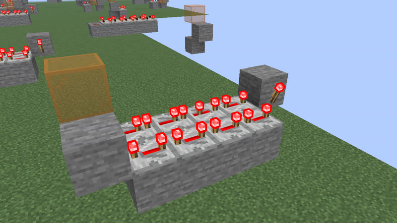</a> 54 gt (2.7 s) · redstone_torch+repeater · 20 blocks</td></tr>
</table>

## 55 gt (2.75 s)

Also reachable by: clk-obs-odd-a (n = 11), clk-rt-odd-rect (n = 4), clk-sculk-hairpin-dispenser (n = 3), dropper ring (clk-item-dropring-1d, n = 2).

<table>
<tr><td align="center"><a href="../archive/clk-sculk-hyb3-p55-2.txt">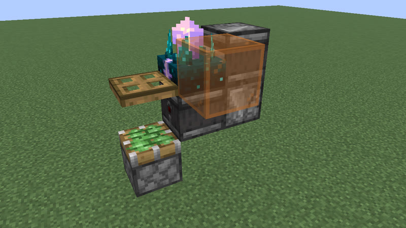</a> 55 gt (2.75 s) · calibrated_sculk_sensor+observer+sticky_piston · 6 blocks</td><td align="center"><a href="../archive/clk-obs-p55-note-obs-pis-stk-7b-9aabf5.txt">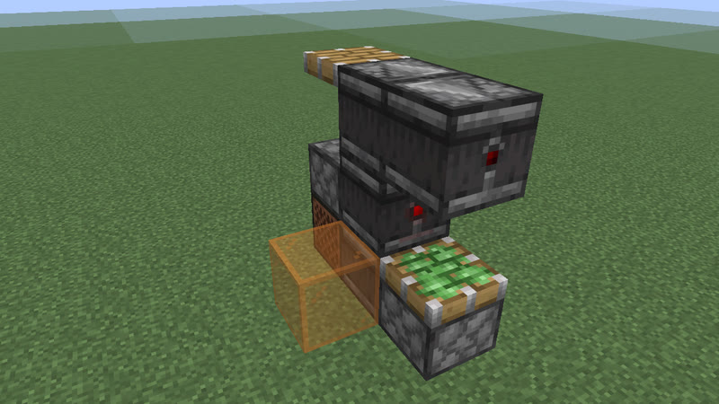</a> 55 gt (2.75 s) · note_block+observer+piston+sticky_piston · 7 blocks</td><td align="center"><a href="../archive/clk-obs-p55-note-obs-stk-7b-63cc6d.txt">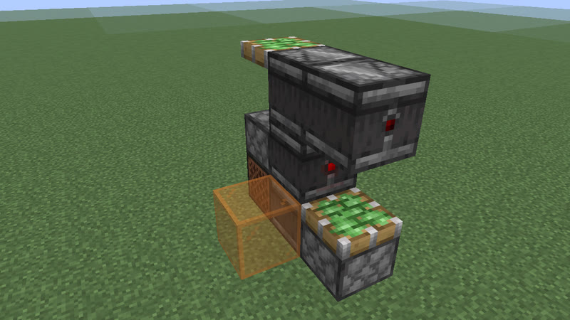</a> 55 gt (2.75 s) · note_block+observer+sticky_piston · 7 blocks</td></tr>
<tr><td align="center"><a href="../archive/clk-obs-p55-obs-pis-stk-7b-280c94.txt">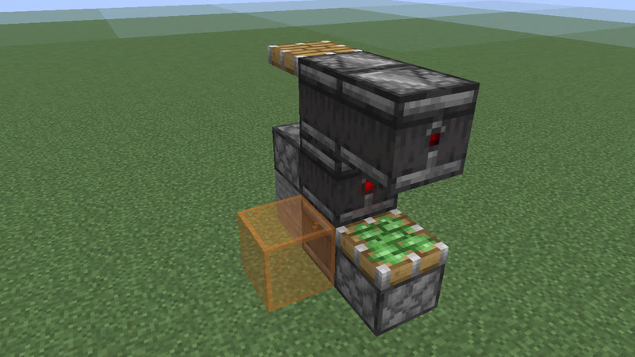</a> 55 gt (2.75 s) · observer+piston+sticky_piston · 7 blocks</td><td align="center"><a href="../archive/clk-obs-p55-obs-stk-7b-c5c4bf.txt">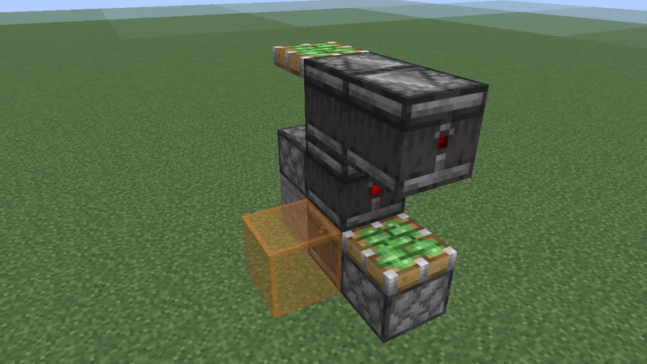</a> 55 gt (2.75 s) · observer+sticky_piston · 7 blocks</td></tr>
</table>

## 56 gt (2.8 s)

Also reachable by: clk-obs-obs-ring (n = 12), hopper ring (clk-item-hopper-ring, n = 3), clk-misc-cart-loop (n = 6), dropper ring (clk-item-dropring-1d-r4, n = 1).

<table>
<tr><td align="center"><a href="../archive/census-p56-calibrated_sculk_sensor-dispenser-oak_trapdoor-observer-sculk_sensor-6b.txt">census-p56-calibrated_sculk_sensor-dispenser-oak_trapdoor-observer-sculk_sensor-6b</a> 56 gt (2.8 s) · calibrated_sculk_sensor+dispenser+oak_trapdoor+observer+sculk_sensor · 6 blocks (picture pending)</td><td align="center"><a href="../archive/census-p56-calibrated_sculk_sensor-dispenser-observer-sculk_sensor-6b.txt">census-p56-calibrated_sculk_sensor-dispenser-observer-sculk_sensor-6b</a> 56 gt (2.8 s) · calibrated_sculk_sensor+dispenser+observer+sculk_sensor · 6 blocks (picture pending)</td><td align="center"><a href="../archive/census-p56-calibrated_sculk_sensor-dispenser-observer-piston-sculk_sensor-6b.txt">census-p56-calibrated_sculk_sensor-dispenser-observer-piston-sculk_sensor-6b</a> 56 gt (2.8 s) · calibrated_sculk_sensor+dispenser+observer+piston+sculk_sensor · 6 blocks (picture pending) also found as census-p56-calibrated_sculk_sensor-dispenser-observer-sculk_sensor-sticky_piston-6b (built with sticky_piston, without piston)</td></tr>
<tr><td align="center"><a href="../archive/clk-sculk-hyb3-p56-2.txt">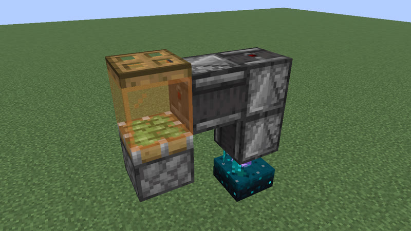</a> 56 gt (2.8 s) · calibrated_sculk_sensor+observer+sticky_piston · 6 blocks</td><td align="center"><a href="../archive/clk-obs-p56-bulb-obs-pis-7b-9f9567.txt">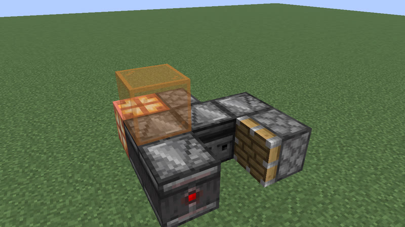</a> 56 gt (2.8 s) · copper_bulb+observer+piston · 7 blocks also found as clk-obs-p56-bulb-obs-pis-stk-7b-9293db (built with sticky_piston)</td><td align="center"> 56 gt (2.8 s) · copper_bulb+observer+redstone_lamp+sticky_piston · 7 blocks</td></tr>
<tr><td align="center"><a href="../archive/clk-obs-p56-bulb-obs-pis-rb-stk-7b-b-0aec9c.txt">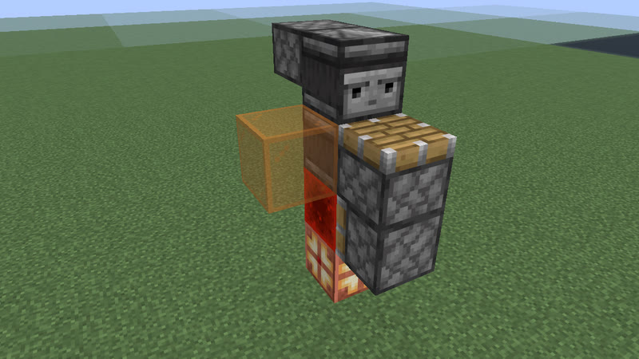</a> 56 gt (2.8 s) · copper_bulb+observer+piston+redstone_block+sticky_piston · 7 blocks</td><td align="center"><a href="../archive/clk-obs-p56-bulb-obs-pis-rb-stk-7b-f44ee9.txt">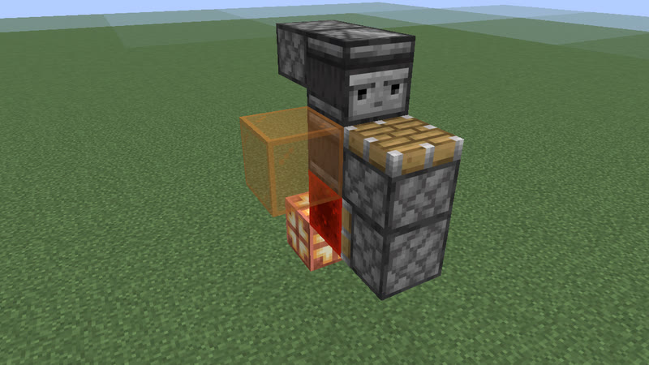</a> 56 gt (2.8 s) · copper_bulb+observer+piston+redstone_block+sticky_piston · 7 blocks</td><td align="center"><a href="../archive/clk-obs-p56-bulb-obs-stk-7b-a29efc.txt">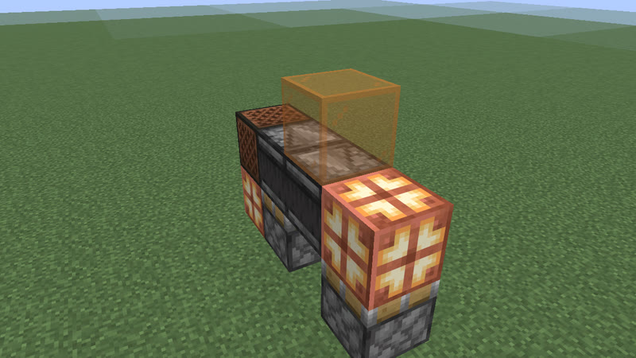</a> 56 gt (2.8 s) · copper_bulb+observer+sticky_piston · 7 blocks</td></tr>
<tr><td align="center"> 56 gt (2.8 s) · copper_bulb+observer+sticky_piston · 7 blocks</td><td align="center"><a href="../archive/clk-obs-p56-lamp-obs-stk-7b-96abec.txt">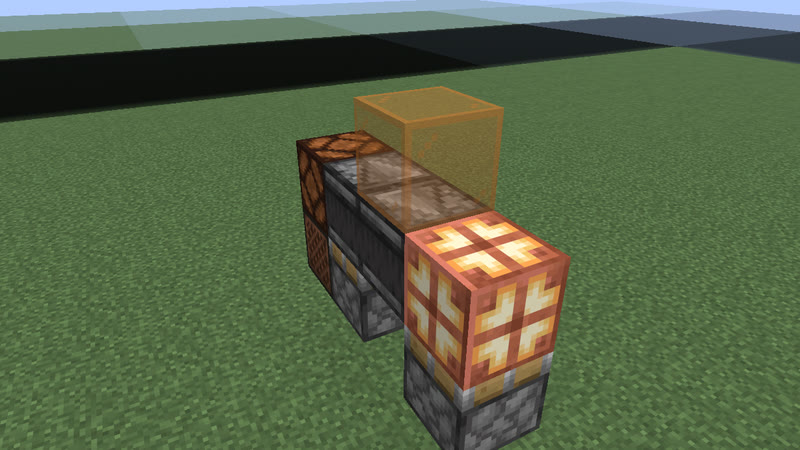</a> 56 gt (2.8 s) · observer+redstone_lamp+sticky_piston · 7 blocks</td><td align="center"><a href="../archive/clk-obs-p56-obs-stk-7b-fe8fba.txt">clk-obs-p56-obs-stk-7b-fe8fba</a> 56 gt (2.8 s) · observer+sticky_piston · 7 blocks (picture pending)</td></tr>
<tr><td align="center"><a href="../archive/clk-sculk-hyb3-p56-1.txt">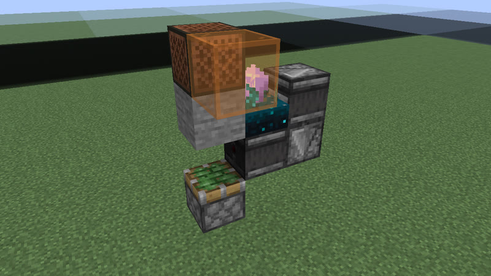</a> 56 gt (2.8 s) · calibrated_sculk_sensor+note_block+observer+sticky_piston · 7 blocks</td><td align="center"><a href="../archive/clk-obs-p56-bulb-lamp-note-obs-pis-stk-8b-2c2c45.txt">clk-obs-p56-bulb-lamp-note-obs-pis-stk-8b-2c2c45</a> 56 gt (2.8 s) · copper_bulb+note_block+observer+piston+redstone_lamp+sticky_piston · 8 blocks (picture pending)</td><td align="center"><a href="../archive/clk-obs-p56-bulb-lamp-note-obs-stk-8b-ce85bb.txt">clk-obs-p56-bulb-lamp-note-obs-stk-8b-ce85bb</a> 56 gt (2.8 s) · copper_bulb+note_block+observer+redstone_lamp+sticky_piston · 8 blocks (picture pending)</td></tr>
<tr><td align="center"><a href="../archive/clk-obs-p56-bulb-lamp-obs-pis-stk-8b-ca8da1.txt">clk-obs-p56-bulb-lamp-obs-pis-stk-8b-ca8da1</a> 56 gt (2.8 s) · copper_bulb+observer+piston+redstone_lamp+sticky_piston · 8 blocks (picture pending)</td><td align="center"><a href="../archive/clk-obs-p56-bulb-obs-rb-stk-8b-7d06ba.txt">clk-obs-p56-bulb-obs-rb-stk-8b-7d06ba</a> 56 gt (2.8 s) · copper_bulb+observer+redstone_block+sticky_piston · 8 blocks (picture pending)</td><td align="center"><a href="../archive/clk-obs-p56-lamp-obs-pis-stk-8b-c3e9f4.txt">clk-obs-p56-lamp-obs-pis-stk-8b-c3e9f4</a> 56 gt (2.8 s) · observer+piston+redstone_lamp+sticky_piston · 8 blocks (picture pending)</td></tr>
<tr><td align="center"><a href="../archive/clk-obs-p56-note-obs-pis-stk-8b-89f086.txt">clk-obs-p56-note-obs-pis-stk-8b-89f086</a> 56 gt (2.8 s) · note_block+observer+piston+sticky_piston · 8 blocks (picture pending)</td><td align="center"><a href="../archive/clk-obs-p56-note-obs-stk-8b-8d7d69.txt">clk-obs-p56-note-obs-stk-8b-8d7d69</a> 56 gt (2.8 s) · note_block+observer+sticky_piston · 8 blocks (picture pending)</td><td align="center"><a href="../archive/clk-obs-p56-obs-pis-stk-8b-175d3a.txt">clk-obs-p56-obs-pis-stk-8b-175d3a</a> 56 gt (2.8 s) · observer+piston+sticky_piston · 8 blocks (picture pending)</td></tr>
<tr><td align="center"><a href="../archive/clk-obs-p56-bulb-note-obs-pis-stk-8b-821f0f.txt">clk-obs-p56-bulb-note-obs-pis-stk-8b-821f0f</a> 56 gt (2.8 s) · copper_bulb+note_block+observer+piston+sticky_piston · 8 blocks (picture pending)</td><td align="center"><a href="../archive/clk-obs-p56-obs-rb-stk-8b-c21c21.txt">clk-obs-p56-obs-rb-stk-8b-c21c21</a> 56 gt (2.8 s) · observer+redstone_block+sticky_piston · 8 blocks (picture pending)</td><td align="center"><a href="../archive/clk-obs-p56-bulb-lamp-obs-pis-rb-stk-8b-573bb7.txt">clk-obs-p56-bulb-lamp-obs-pis-rb-stk-8b-573bb7</a> 56 gt (2.8 s) · copper_bulb+observer+piston+redstone_block+redstone_lamp+sticky_piston · 8 blocks (picture pending)</td></tr>
<tr><td align="center"><a href="../archive/clk-obs-p56-bulb-note-obs-pis-rb-stk-8b-482d33.txt">clk-obs-p56-bulb-note-obs-pis-rb-stk-8b-482d33</a> 56 gt (2.8 s) · copper_bulb+note_block+observer+piston+redstone_block+sticky_piston · 8 blocks (picture pending)</td><td align="center"> 56 gt (2.8 s) · comparator+hopper · 10 blocks</td><td align="center"> 56 gt (2.8 s) · redstone_torch+redstone_wire+repeater · 13 blocks</td></tr>
<tr><td align="center"><a href="../archive/clk-rt-rect3x5-p56-19b.txt">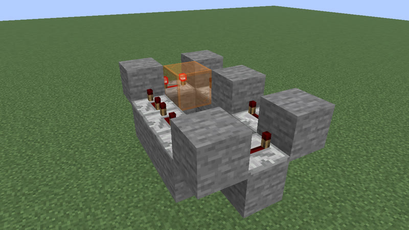</a> 56 gt (2.8 s) · repeater · 19 blocks</td><td align="center"><a href="../archive/clk-misc-bookshelf-cart.txt">clk-misc-bookshelf-cart</a> 56 gt (2.8 s) · chiseled_bookshelf+hopper+hopper_minecart · 20 blocks (picture pending)</td></tr>
</table>

## 57 gt (2.85 s)

Also reachable by: clk-obs-odd-b (n = 11), dropper ring (clk-item-dropring-2d-r1, n = 1), clk-misc-cart-pingpong (n = 4).

<table>
<tr><td align="center"><a href="../archive/clk-sculk-hyb3-p57-2.txt">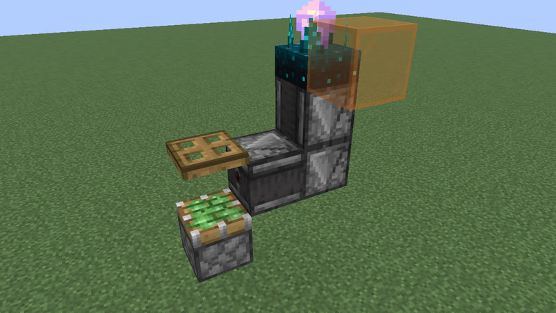</a> 57 gt (2.85 s) · calibrated_sculk_sensor+observer+sticky_piston · 6 blocks</td><td align="center"><a href="../archive/clk-obs-p57-obs-stk-7b-7fef55.txt">clk-obs-p57-obs-stk-7b-7fef55</a> 57 gt (2.85 s) · observer+sticky_piston · 7 blocks (picture pending)</td><td align="center"><a href="../archive/clk-obs-p57-obs-pis-stk-7b-f2d7c2.txt">clk-obs-p57-obs-pis-stk-7b-f2d7c2</a> 57 gt (2.85 s) · observer+piston+sticky_piston · 7 blocks (picture pending)</td></tr>
<tr><td align="center"><a href="../archive/clk-obs-p57-bulb-obs-pis-rb-stk-9b-40854a.txt">clk-obs-p57-bulb-obs-pis-rb-stk-9b-40854a</a> 57 gt (2.85 s) · copper_bulb+observer+piston+redstone_block+sticky_piston · 9 blocks (picture pending)</td><td align="center"><a href="../archive/clk-obs-p57-lamp-obs-pis-stk-9b-8a96cd.txt">clk-obs-p57-lamp-obs-pis-stk-9b-8a96cd</a> 57 gt (2.85 s) · observer+piston+redstone_lamp+sticky_piston · 9 blocks (picture pending)</td><td align="center"><a href="../archive/clk-obs-p57-note-obs-pis-stk-9b-67b753.txt">clk-obs-p57-note-obs-pis-stk-9b-67b753</a> 57 gt (2.85 s) · note_block+observer+piston+sticky_piston · 9 blocks (picture pending)</td></tr>
<tr><td align="center"><a href="../archive/clk-obs-p57-note-obs-stk-9b-2e9019.txt">clk-obs-p57-note-obs-stk-9b-2e9019</a> 57 gt (2.85 s) · note_block+observer+sticky_piston · 9 blocks (picture pending)</td><td align="center"><a href="../archive/kit-shuttle-minecart-p57-17b.txt">kit-shuttle-minecart-p57-17b</a> 57 gt (2.85 s) · detector_rail+minecart+powered_rail · 17 blocks (picture pending)</td><td align="center"> 57 gt (2.85 s) · repeater · 35 blocks</td></tr>
</table>

## 58 gt (2.9 s)

Also reachable by: observer ring with a relay block (clk-obs-note-ring, n = 12), dropper ring (clk-item-dropring-2d-r14, n = 1), clk-sculk-replin (one block swapped: 2 versions) (clk-sculk-replin, n = 6).

<table>
<tr><td align="center"><a href="../archive/clk-sculk-hyb3-p58-2.txt">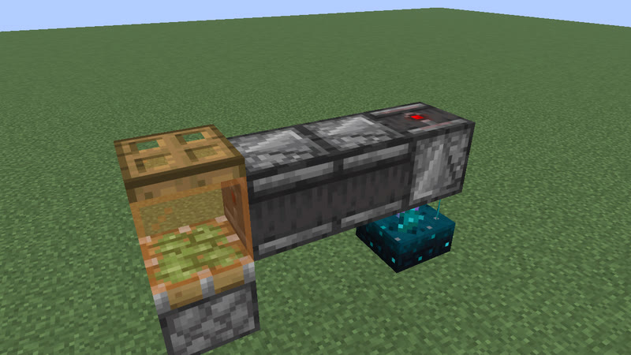</a> 58 gt (2.9 s) · calibrated_sculk_sensor+observer+sticky_piston · 6 blocks</td><td align="center"><a href="../archive/clk-obs-p58-note-obs-pis-stk-7b-80545b.txt">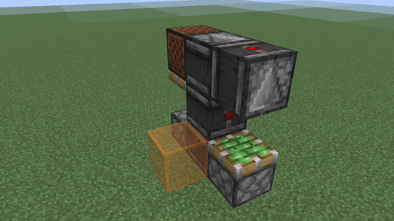</a> 58 gt (2.9 s) · note_block+observer+piston+sticky_piston · 7 blocks</td><td align="center"><a href="../archive/clk-obs-p58-obs-pis-stk-7b-63f026.txt">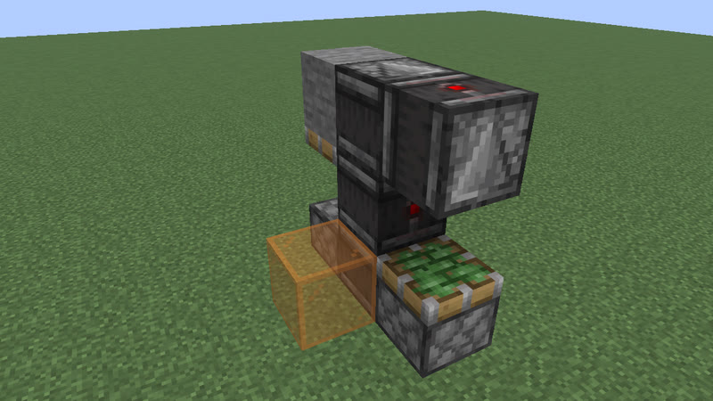</a> 58 gt (2.9 s) · observer+piston+sticky_piston · 7 blocks</td></tr>
<tr><td align="center"><a href="../archive/clk-sculk-hyb3-p58-1.txt">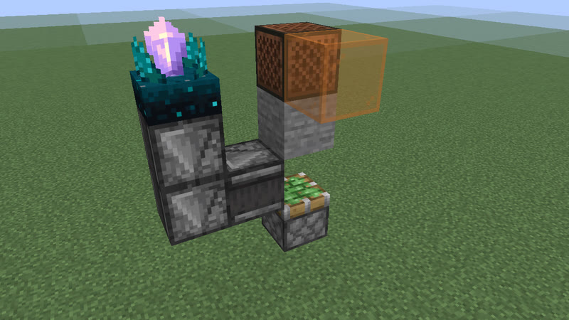</a> 58 gt (2.9 s) · calibrated_sculk_sensor+note_block+observer+sticky_piston · 7 blocks</td><td align="center"><a href="../archive/clk-obs-p58-bulb-lamp-note-obs-rb-stk-8b-76e5d7.txt">clk-obs-p58-bulb-lamp-note-obs-rb-stk-8b-76e5d7</a> 58 gt (2.9 s) · copper_bulb+note_block+observer+redstone_block+redstone_lamp+sticky_piston · 8 blocks (picture pending)</td><td align="center"><a href="../archive/clk-obs-p58-bulb-lamp-obs-rb-stk-8b-f147c6.txt">clk-obs-p58-bulb-lamp-obs-rb-stk-8b-f147c6</a> 58 gt (2.9 s) · copper_bulb+observer+redstone_block+redstone_lamp+sticky_piston · 8 blocks (picture pending)</td></tr>
<tr><td align="center"><a href="../archive/clk-obs-p58-bulb-note-obs-stk-8b-b421ea.txt">clk-obs-p58-bulb-note-obs-stk-8b-b421ea</a> 58 gt (2.9 s) · copper_bulb+note_block+observer+sticky_piston · 8 blocks (picture pending)</td><td align="center"><a href="../archive/clk-obs-p58-bulb-obs-stk-8b-f306e1.txt">clk-obs-p58-bulb-obs-stk-8b-f306e1</a> 58 gt (2.9 s) · copper_bulb+observer+sticky_piston · 8 blocks (picture pending)</td><td align="center"><a href="../archive/clk-obs-p58-lamp-obs-stk-8b-df4399.txt">clk-obs-p58-lamp-obs-stk-8b-df4399</a> 58 gt (2.9 s) · observer+redstone_lamp+sticky_piston · 8 blocks (picture pending)</td></tr>
<tr><td align="center"><a href="../archive/clk-obs-p58-note-obs-stk-8b-25ed71.txt">clk-obs-p58-note-obs-stk-8b-25ed71</a> 58 gt (2.9 s) · note_block+observer+sticky_piston · 8 blocks (picture pending)</td><td align="center"><a href="../archive/clk-obs-p58-obs-stk-8b-085527.txt">clk-obs-p58-obs-stk-8b-085527</a> 58 gt (2.9 s) · observer+sticky_piston · 8 blocks (picture pending)</td><td align="center"><a href="../archive/clk-obs-p58-note-obs-10b-60394b.txt">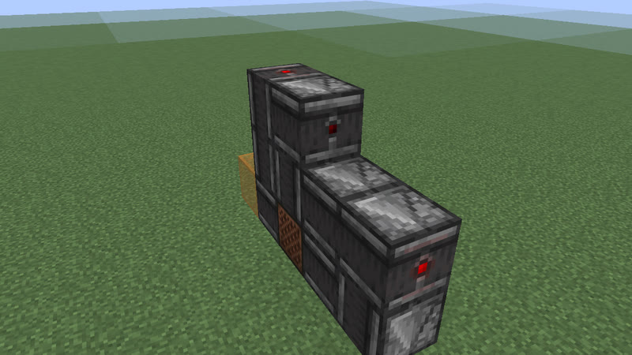</a> 58 gt (2.9 s) · note_block+observer · 10 blocks</td></tr>
<tr><td align="center"><a href="../archive/clk-obs-p58-obs-trap-10b.txt">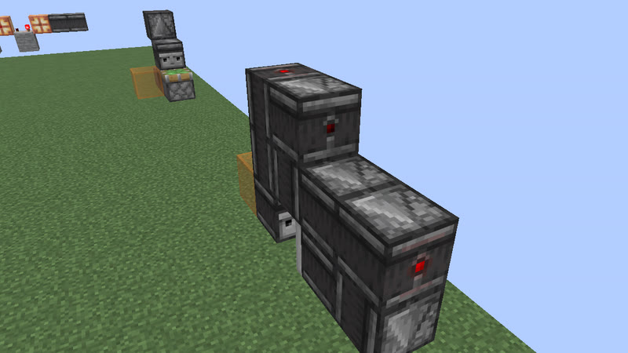</a> 58 gt (2.9 s) · iron_trapdoor+observer · 10 blocks</td><td align="center"> 58 gt (2.9 s) · comparator+hopper · 14 blocks</td><td align="center"> 58 gt (2.9 s) · redstone_torch+repeater · 20 blocks</td></tr>
<tr><td align="center"><a href="../archive/clk-rt-rect3x5-p58-20b.txt">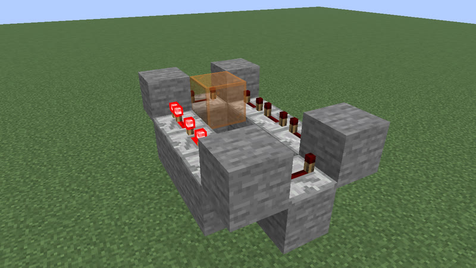</a> 58 gt (2.9 s) · repeater · 20 blocks</td></tr>
</table>

## 59 gt (2.95 s)

Also reachable by: clk-obs-odd-a (n = 12), dropper ring (clk-item-dropring-2d-r2, n = 2).

<table>
<tr><td align="center"><a href="../archive/clk-obs-p59-lamp-obs-stk-8b-048b5f.txt">clk-obs-p59-lamp-obs-stk-8b-048b5f</a> 59 gt (2.95 s) · observer+redstone_lamp+sticky_piston · 8 blocks (picture pending)</td><td align="center"><a href="../archive/clk-obs-p59-note-obs-stk-8b-2497d3.txt">clk-obs-p59-note-obs-stk-8b-2497d3</a> 59 gt (2.95 s) · note_block+observer+sticky_piston · 8 blocks (picture pending)</td><td align="center"><a href="../archive/clk-obs-p59-obs-stk-8b-832e3b.txt">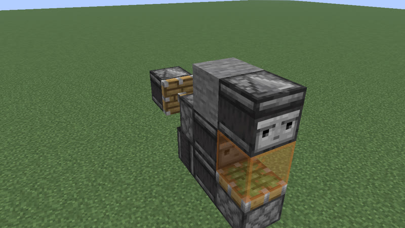</a> 59 gt (2.95 s) · observer+sticky_piston · 8 blocks</td></tr>
<tr><td align="center"><a href="../archive/clk-obs-p59-lamp-obs-pis-stk-8b-80e775.txt">clk-obs-p59-lamp-obs-pis-stk-8b-80e775</a> 59 gt (2.95 s) · observer+piston+redstone_lamp+sticky_piston · 8 blocks (picture pending)</td><td align="center"><a href="../archive/clk-obs-p59-note-obs-pis-stk-8b-c63949.txt">clk-obs-p59-note-obs-pis-stk-8b-c63949</a> 59 gt (2.95 s) · note_block+observer+piston+sticky_piston · 8 blocks (picture pending)</td><td align="center"><a href="../archive/clk-obs-p59-obs-pis-stk-8b-998a89.txt">clk-obs-p59-obs-pis-stk-8b-998a89</a> 59 gt (2.95 s) · observer+piston+sticky_piston · 8 blocks (picture pending)</td></tr>
<tr><td align="center"> 59 gt (2.95 s) · oak_trapdoor+observer+repeater+sculk_sensor · 9 blocks</td><td align="center"><a href="../archive/clk-rt-odd-rect-p59-35b.txt">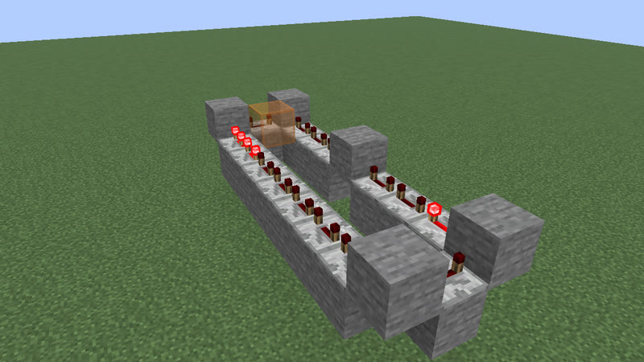</a> 59 gt (2.95 s) · repeater · 35 blocks</td></tr>
</table>

## 60 gt (3 s)

Also reachable by: clk-obs-obs-ring (n = 13), clk-obs-bulb-ring (n = 5), dropper ring (clk-item-dropring-2d-r24, n = 1), clk-sculk-racetrack (n = 1), clk-sculk-racetrack-plain (n = 3).

<table>
<tr><td align="center"><a href="../archive/clk-obs-p60-obs-stk-6b-56be80.txt">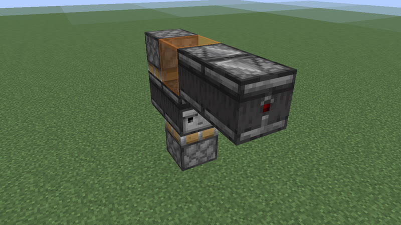</a> 60 gt (3 s) · observer+sticky_piston · 6 blocks</td><td align="center"><a href="../archive/clk-obs-p60-obs-stk-6b.txt">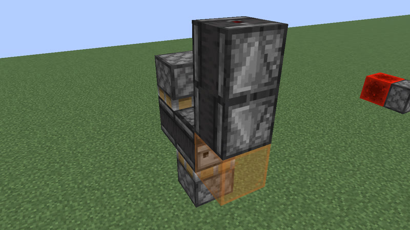</a> 60 gt (3 s) · observer+sticky_piston · 6 blocks</td><td align="center"><a href="../archive/clk-obs-p60-obs-rb-stk-7b-cc62fd.txt">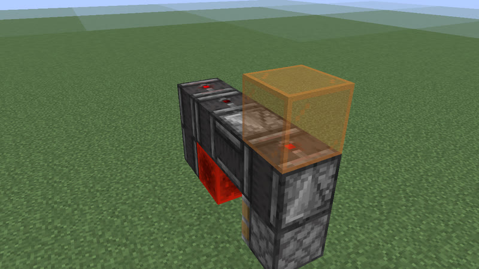</a> 60 gt (3 s) · observer+redstone_block+sticky_piston · 7 blocks</td></tr>
<tr><td align="center"><a href="../archive/clk-obs-p60-bulb-obs-stk-7b-fa3153.txt">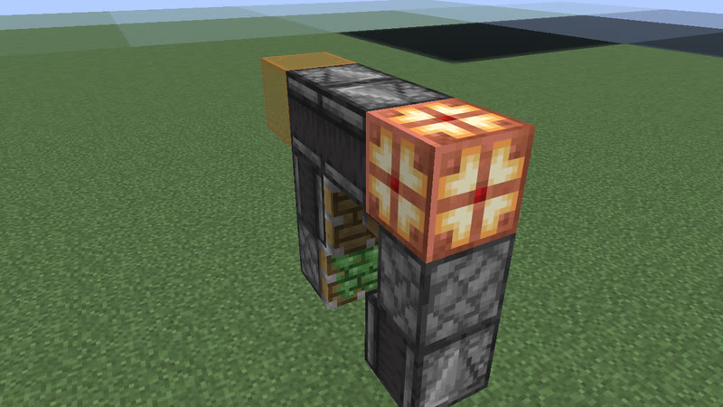</a> 60 gt (3 s) · copper_bulb+observer+sticky_piston · 7 blocks</td><td align="center"><a href="../archive/clk-obs-p60-lamp-note-obs-pis-7b-b060a7.txt">clk-obs-p60-lamp-note-obs-pis-7b-b060a7</a> 60 gt (3 s) · note_block+observer+piston+redstone_lamp · 7 blocks (picture pending)</td><td align="center"><a href="../archive/clk-obs-p60-lamp-obs-stk-7b-cfd982.txt">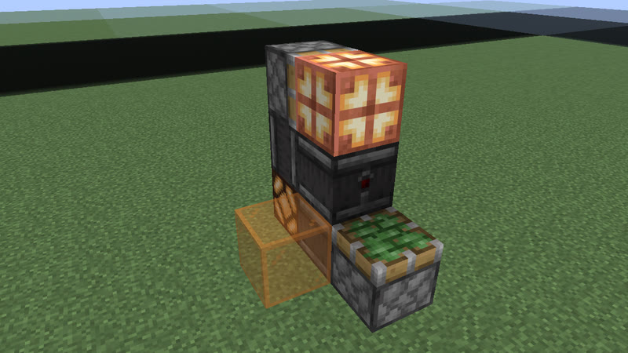</a> 60 gt (3 s) · observer+redstone_lamp+sticky_piston · 7 blocks</td></tr>
<tr><td align="center"><a href="../archive/clk-obs-p60-obs-rb-stk-7b-b-dca323.txt">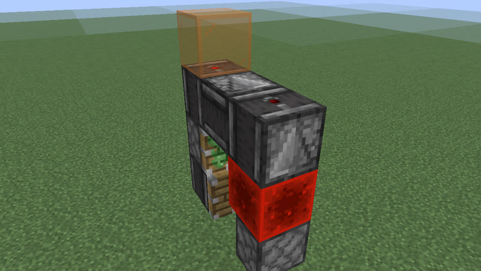</a> 60 gt (3 s) · observer+redstone_block+sticky_piston · 7 blocks</td><td align="center"><a href="../archive/clk-obs-p60-bulb-note-obs-stk-7b-a4169e.txt">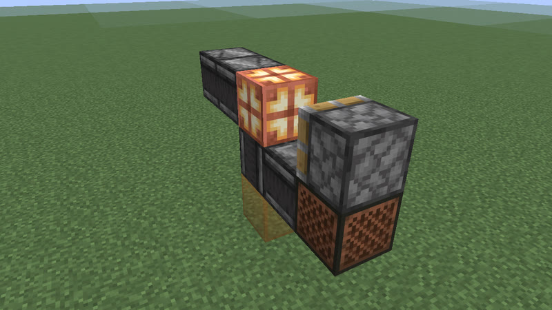</a> 60 gt (3 s) · copper_bulb+note_block+observer+sticky_piston · 7 blocks</td><td align="center"><a href="../archive/clk-obs-p60-bulb-obs-stk-7b-b-9bfd45.txt">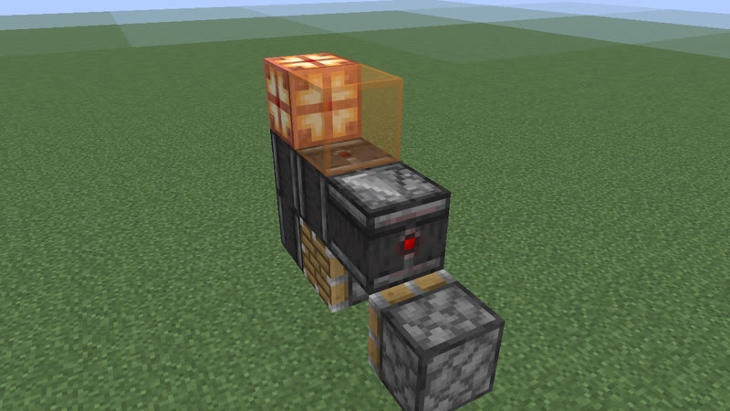</a> 60 gt (3 s) · copper_bulb+observer+sticky_piston · 7 blocks</td></tr>
<tr><td align="center"><a href="../archive/clk-obs-p60-bulb-lamp-note-obs-pis-8b-05db11.txt">clk-obs-p60-bulb-lamp-note-obs-pis-8b-05db11</a> 60 gt (3 s) · copper_bulb+note_block+observer+piston+redstone_lamp · 8 blocks (picture pending)</td><td align="center"><a href="../archive/clk-obs-p60-bulb-lamp-note-obs-pis-stk-8b-6dbbfb.txt">clk-obs-p60-bulb-lamp-note-obs-pis-stk-8b-6dbbfb</a> 60 gt (3 s) · copper_bulb+note_block+observer+piston+redstone_lamp+sticky_piston · 8 blocks (picture pending)</td><td align="center"><a href="../archive/clk-obs-p60-bulb-lamp-note-obs-stk-8b-b4e54c.txt">clk-obs-p60-bulb-lamp-note-obs-stk-8b-b4e54c</a> 60 gt (3 s) · copper_bulb+note_block+observer+redstone_lamp+sticky_piston · 8 blocks (picture pending)</td></tr>
<tr><td align="center"><a href="../archive/clk-obs-p60-bulb-lamp-obs-pis-stk-8b-59fc9d.txt">clk-obs-p60-bulb-lamp-obs-pis-stk-8b-59fc9d</a> 60 gt (3 s) · copper_bulb+observer+piston+redstone_lamp+sticky_piston · 8 blocks (picture pending)</td><td align="center"><a href="../archive/clk-obs-p60-bulb-note-obs-pis-rb-stk-8b-648abd.txt">clk-obs-p60-bulb-note-obs-pis-rb-stk-8b-648abd</a> 60 gt (3 s) · copper_bulb+note_block+observer+piston+redstone_block+sticky_piston · 8 blocks (picture pending)</td><td align="center"><a href="../archive/clk-obs-p60-bulb-note-obs-pis-stk-8b-b6b587.txt">clk-obs-p60-bulb-note-obs-pis-stk-8b-b6b587</a> 60 gt (3 s) · copper_bulb+note_block+observer+piston+sticky_piston · 8 blocks (picture pending)</td></tr>
<tr><td align="center"><a href="../archive/clk-obs-p60-bulb-note-obs-rb-stk-8b-29dc27.txt">clk-obs-p60-bulb-note-obs-rb-stk-8b-29dc27</a> 60 gt (3 s) · copper_bulb+note_block+observer+redstone_block+sticky_piston · 8 blocks (picture pending)</td><td align="center"><a href="../archive/clk-obs-p60-bulb-obs-pis-rb-stk-8b-ccbb16.txt">clk-obs-p60-bulb-obs-pis-rb-stk-8b-ccbb16</a> 60 gt (3 s) · copper_bulb+observer+piston+redstone_block+sticky_piston · 8 blocks (picture pending)</td><td align="center"><a href="../archive/clk-obs-p60-lamp-obs-rb-stk-8b-b7eeb8.txt">clk-obs-p60-lamp-obs-rb-stk-8b-b7eeb8</a> 60 gt (3 s) · observer+redstone_block+redstone_lamp+sticky_piston · 8 blocks (picture pending)</td></tr>
<tr><td align="center"><a href="../archive/clk-obs-p60-note-obs-stk-8b-deed48.txt">clk-obs-p60-note-obs-stk-8b-deed48</a> 60 gt (3 s) · note_block+observer+sticky_piston · 8 blocks (picture pending)</td><td align="center"><a href="../archive/clk-obs-p60-bulb-lamp-obs-rb-stk-8b-9f549e.txt">clk-obs-p60-bulb-lamp-obs-rb-stk-8b-9f549e</a> 60 gt (3 s) · copper_bulb+observer+redstone_block+redstone_lamp+sticky_piston · 8 blocks (picture pending)</td><td align="center"><a href="../archive/clk-sculk-ringbig4-p60-1.txt">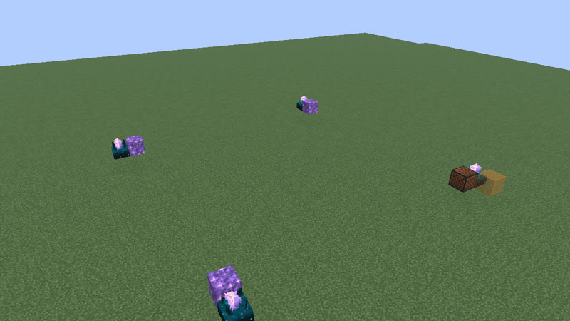</a> 60 gt (3 s) · calibrated_sculk_sensor+note_block · 8 blocks</td></tr>
<tr><td align="center"><a href="../archive/clk-obs-p60-lamp-obs-pis-rb-stk-9b-4b407f.txt">clk-obs-p60-lamp-obs-pis-rb-stk-9b-4b407f</a> 60 gt (3 s) · observer+piston+redstone_block+redstone_lamp+sticky_piston · 9 blocks (picture pending)</td><td align="center"><a href="../archive/clk-obs-p60-note-obs-pis-rb-stk-9b-62c4e7.txt">clk-obs-p60-note-obs-pis-rb-stk-9b-62c4e7</a> 60 gt (3 s) · note_block+observer+piston+redstone_block+sticky_piston · 9 blocks (picture pending)</td><td align="center"><a href="../archive/clk-rt-uloop-p60-rt-rw-r-13b.txt">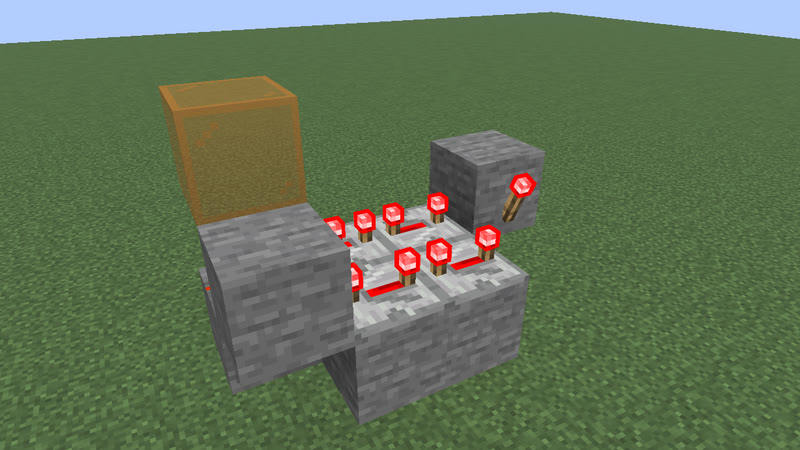</a> 60 gt (3 s) · redstone_torch+redstone_wire+repeater · 13 blocks</td></tr>
<tr><td align="center"> 60 gt (3 s) · repeater · 20 blocks</td></tr>
</table>

## 61 gt (3.05 s)

Also reachable by: clk-obs-odd-b (n = 12), clk-misc-cart-loop (n = 7), dropper ring (clk-item-dropring-2d-r3, n = 2).

<table>
<tr><td align="center"><a href="../archive/clk-obs-p61-note-obs-rb-stk-8b-a9a1a1.txt">clk-obs-p61-note-obs-rb-stk-8b-a9a1a1</a> 61 gt (3.05 s) · note_block+observer+redstone_block+sticky_piston · 8 blocks (picture pending)</td><td align="center"><a href="../archive/clk-obs-p61-obs-rb-stk-8b-ff7cbd.txt">clk-obs-p61-obs-rb-stk-8b-ff7cbd</a> 61 gt (3.05 s) · observer+redstone_block+sticky_piston · 8 blocks (picture pending)</td><td align="center"><a href="../archive/clk-obs-p61-obs-pis-stk-8b-9501aa.txt">clk-obs-p61-obs-pis-stk-8b-9501aa</a> 61 gt (3.05 s) · observer+piston+sticky_piston · 8 blocks (picture pending)</td></tr>
<tr><td align="center"><a href="../archive/clk-obs-p61-note-obs-pis-stk-8b-923747.txt">clk-obs-p61-note-obs-pis-stk-8b-923747</a> 61 gt (3.05 s) · note_block+observer+piston+sticky_piston · 8 blocks (picture pending)</td><td align="center"><a href="../archive/clk-obs-p61-note-obs-stk-8b-9141e4.txt">clk-obs-p61-note-obs-stk-8b-9141e4</a> 61 gt (3.05 s) · note_block+observer+sticky_piston · 8 blocks (picture pending)</td><td align="center"><a href="../archive/clk-obs-p61-obs-stk-8b-52cc0e.txt">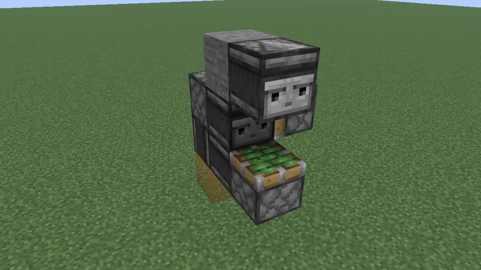</a> 61 gt (3.05 s) · observer+sticky_piston · 8 blocks</td></tr>
<tr><td align="center"><a href="../archive/clk-sculk-chain-p61-11.txt">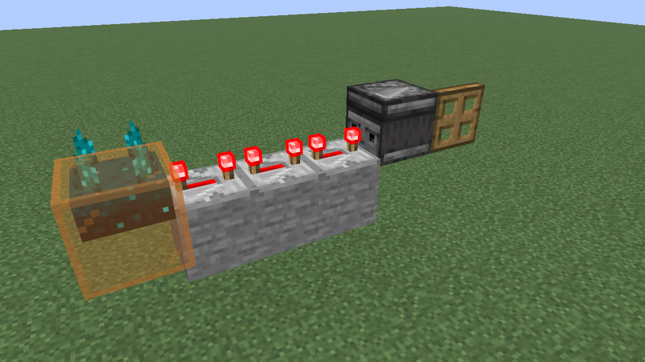</a> 61 gt (3.05 s) · oak_trapdoor+observer+repeater+sculk_sensor · 9 blocks</td><td align="center"> 61 gt (3.05 s) · repeater · 36 blocks</td></tr>
</table>

## 62 gt (3.1 s)

Also reachable by: observer ring with a relay block (clk-obs-note-ring, n = 13), clk-sculk-replin-dispenser (n = 6), dropper ring (clk-item-dropring-2d, n = 2), clk-item-latch (n = 2), clk-misc-cart-pingpong (n = 5).

<table>
<tr><td align="center"><a href="../archive/clk-obs-p62-lamp-note-obs-stk-7b-25d906.txt">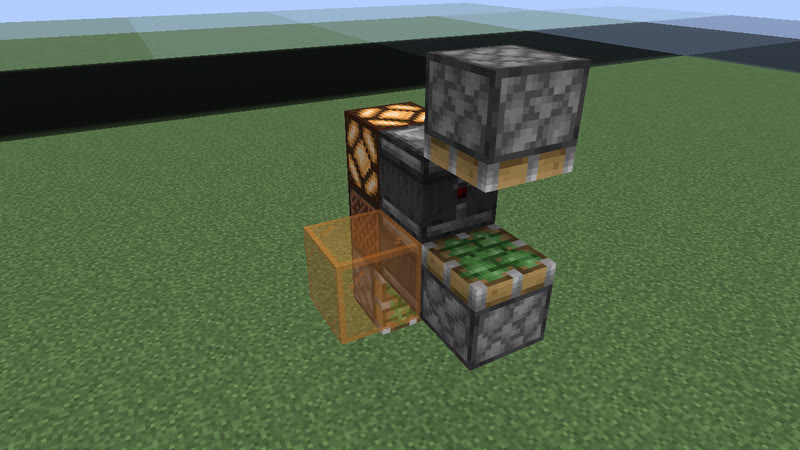</a> 62 gt (3.1 s) · note_block+observer+redstone_lamp+sticky_piston · 7 blocks</td><td align="center"><a href="../archive/clk-obs-p62-lamp-obs-stk-7b-23033e.txt">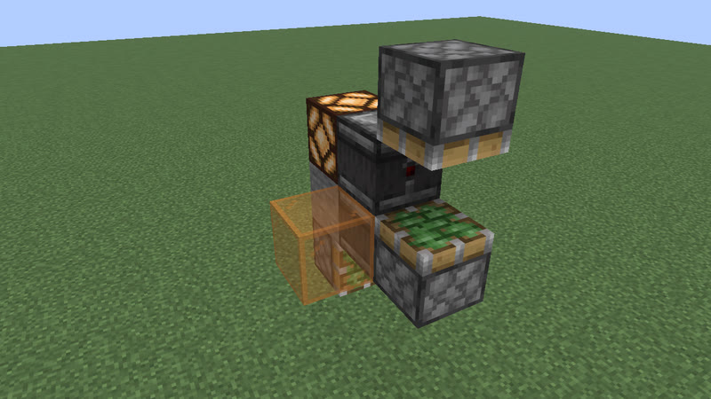</a> 62 gt (3.1 s) · observer+redstone_lamp+sticky_piston · 7 blocks</td><td align="center"><a href="../archive/clk-obs-p62-obs-pis-stk-8b-ec367f.txt">clk-obs-p62-obs-pis-stk-8b-ec367f</a> 62 gt (3.1 s) · observer+piston+sticky_piston · 8 blocks (picture pending)</td></tr>
<tr><td align="center"><a href="../archive/clk-obs-p62-obs-rb-stk-8b-81116b.txt">clk-obs-p62-obs-rb-stk-8b-81116b</a> 62 gt (3.1 s) · observer+redstone_block+sticky_piston · 8 blocks (picture pending)</td><td align="center"><a href="../archive/clk-obs-p62-obs-stk-8b-0540a2.txt">clk-obs-p62-obs-stk-8b-0540a2</a> 62 gt (3.1 s) · observer+sticky_piston · 8 blocks (picture pending)</td><td align="center"><a href="../archive/clk-obs-p62-bulb-lamp-obs-pis-stk-8b-e7a954.txt">clk-obs-p62-bulb-lamp-obs-pis-stk-8b-e7a954</a> 62 gt (3.1 s) · copper_bulb+observer+piston+redstone_lamp+sticky_piston · 8 blocks (picture pending)</td></tr>
<tr><td align="center"><a href="../archive/clk-obs-p62-bulb-lamp-obs-stk-8b-7338bc.txt">clk-obs-p62-bulb-lamp-obs-stk-8b-7338bc</a> 62 gt (3.1 s) · copper_bulb+observer+redstone_lamp+sticky_piston · 8 blocks (picture pending)</td><td align="center"><a href="../archive/clk-obs-p62-bulb-note-obs-pis-stk-8b-8865b2.txt">clk-obs-p62-bulb-note-obs-pis-stk-8b-8865b2</a> 62 gt (3.1 s) · copper_bulb+note_block+observer+piston+sticky_piston · 8 blocks (picture pending)</td><td align="center"><a href="../archive/clk-obs-p62-bulb-note-obs-rb-stk-8b-603ebc.txt">clk-obs-p62-bulb-note-obs-rb-stk-8b-603ebc</a> 62 gt (3.1 s) · copper_bulb+note_block+observer+redstone_block+sticky_piston · 8 blocks (picture pending)</td></tr>
<tr><td align="center"><a href="../archive/clk-obs-p62-bulb-note-obs-stk-8b-05236c.txt">clk-obs-p62-bulb-note-obs-stk-8b-05236c</a> 62 gt (3.1 s) · copper_bulb+note_block+observer+sticky_piston · 8 blocks (picture pending)</td><td align="center"><a href="../archive/clk-obs-p62-lamp-obs-rb-stk-8b-1f1c83.txt">clk-obs-p62-lamp-obs-rb-stk-8b-1f1c83</a> 62 gt (3.1 s) · observer+redstone_block+redstone_lamp+sticky_piston · 8 blocks (picture pending)</td><td align="center"><a href="../archive/clk-obs-p62-note-obs-rb-stk-8b-3d17ec.txt">clk-obs-p62-note-obs-rb-stk-8b-3d17ec</a> 62 gt (3.1 s) · note_block+observer+redstone_block+sticky_piston · 8 blocks (picture pending)</td></tr>
<tr><td align="center"><a href="../archive/clk-obs-p62-bulb-obs-stk-8b-c51eff.txt">clk-obs-p62-bulb-obs-stk-8b-c51eff</a> 62 gt (3.1 s) · copper_bulb+observer+sticky_piston · 8 blocks (picture pending)</td><td align="center"><a href="../archive/clk-sculk-chain-p62-11.txt">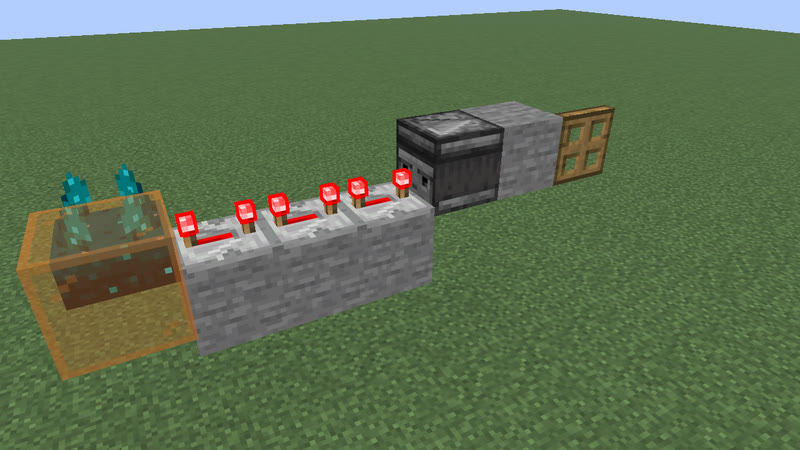</a> 62 gt (3.1 s) · oak_trapdoor+observer+repeater+sculk_sensor · 10 blocks</td><td align="center"><a href="../archive/clk-rt-uloop-T-1--4--4--4--4--4--4--4--T.txt">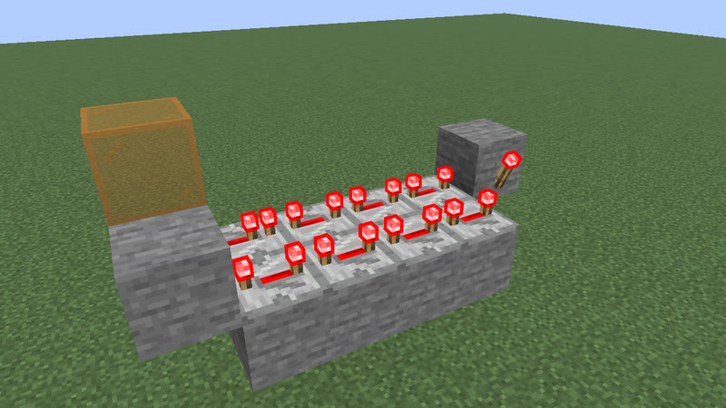</a> 62 gt (3.1 s) · redstone_torch+repeater · 20 blocks</td></tr>
<tr><td align="center"> 62 gt (3.1 s) · repeater · 20 blocks</td></tr>
</table>

## 63 gt (3.15 s)

Also reachable by: clk-obs-odd-a (n = 13), hopper ring (clk-item-hopper-ring-2, n = 8), clk-rt-odd-rect (n = 5), dropper ring (clk-item-dropring-2d-r4, n = 2).

<table>
<tr><td align="center"><a href="../archive/census-p63-calibrated_sculk_sensor-note_block-observer-sticky_piston-6b.txt">census-p63-calibrated_sculk_sensor-note_block-observer-sticky_piston-6b</a> 63 gt (3.15 s) · calibrated_sculk_sensor+note_block+observer+sticky_piston · 6 blocks (picture pending)</td><td align="center"><a href="../archive/clk-obs-p63-lamp-note-obs-pis-stk-8b-a52765.txt">clk-obs-p63-lamp-note-obs-pis-stk-8b-a52765</a> 63 gt (3.15 s) · note_block+observer+piston+redstone_lamp+sticky_piston · 8 blocks (picture pending)</td><td align="center"><a href="../archive/clk-obs-p63-lamp-obs-pis-stk-8b-9bdb34.txt">clk-obs-p63-lamp-obs-pis-stk-8b-9bdb34</a> 63 gt (3.15 s) · observer+piston+redstone_lamp+sticky_piston · 8 blocks (picture pending)</td></tr>
<tr><td align="center"><a href="../archive/clk-obs-p63-note-obs-pis-stk-8b-a5ae69.txt">clk-obs-p63-note-obs-pis-stk-8b-a5ae69</a> 63 gt (3.15 s) · note_block+observer+piston+sticky_piston · 8 blocks (picture pending)</td><td align="center"><a href="../archive/clk-obs-p63-lamp-obs-stk-8b-f311ea.txt">clk-obs-p63-lamp-obs-stk-8b-f311ea</a> 63 gt (3.15 s) · observer+redstone_lamp+sticky_piston · 8 blocks (picture pending)</td><td align="center"><a href="../archive/clk-obs-p63-note-obs-stk-8b-588a13.txt">clk-obs-p63-note-obs-stk-8b-588a13</a> 63 gt (3.15 s) · note_block+observer+sticky_piston · 8 blocks (picture pending)</td></tr>
<tr><td align="center"><a href="../archive/clk-obs-p63-obs-stk-8b-32ff6a.txt">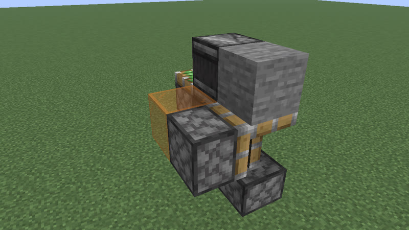</a> 63 gt (3.15 s) · observer+sticky_piston · 8 blocks</td><td align="center"><a href="../archive/clk-sculk-chaind-p63-1.txt">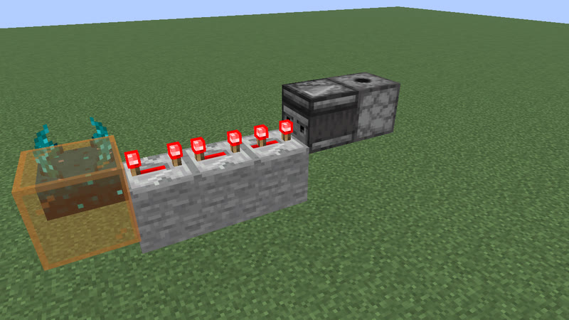</a> 63 gt (3.15 s) · dispenser+observer+repeater+sculk_sensor · 9 blocks</td></tr>
</table>

## 64 gt (3.2 s)

Also reachable by: clk-obs-obs-ring (n = 14), dropper ring (clk-item-dropring-1d-r1, n = 2), clk-rt-rect-pulse (n = 2).

<table>
<tr><td align="center"><a href="../archive/clk-obs-p64-lamp-obs-pis-stk-7b-a7417b.txt">clk-obs-p64-lamp-obs-pis-stk-7b-a7417b</a> 64 gt (3.2 s) · observer+piston+redstone_lamp+sticky_piston · 7 blocks (picture pending)</td><td align="center"><a href="../archive/clk-obs-p64-note-obs-pis-stk-7b-e224e8.txt">clk-obs-p64-note-obs-pis-stk-7b-e224e8</a> 64 gt (3.2 s) · note_block+observer+piston+sticky_piston · 7 blocks (picture pending)</td><td align="center"><a href="../archive/clk-obs-p64-obs-pis-stk-7b-37a08f.txt">clk-obs-p64-obs-pis-stk-7b-37a08f</a> 64 gt (3.2 s) · observer+piston+sticky_piston · 7 blocks (picture pending)</td></tr>
<tr><td align="center"><a href="../archive/clk-obs-p64-bulb-lamp-note-obs-stk-7b-af3e67.txt">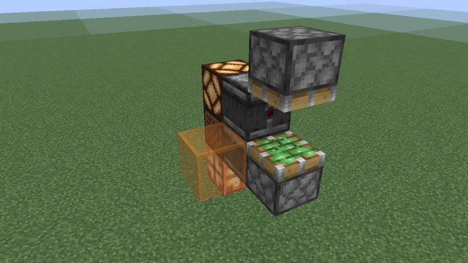</a> 64 gt (3.2 s) · copper_bulb+note_block+observer+redstone_lamp+sticky_piston · 7 blocks</td><td align="center"><a href="../archive/clk-obs-p64-bulb-obs-pis-rb-stk-7b-b-73669b.txt">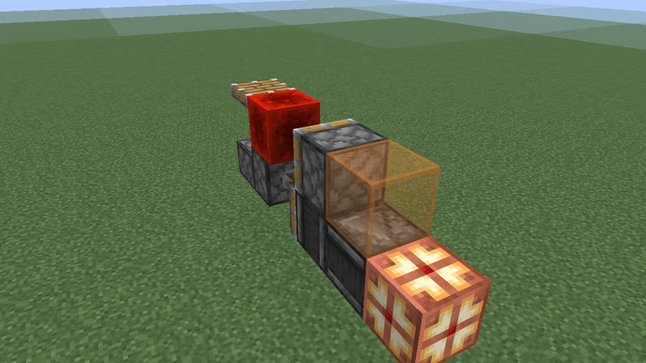</a> 64 gt (3.2 s) · copper_bulb+observer+piston+redstone_block+sticky_piston · 7 blocks</td><td align="center"><a href="../archive/clk-obs-p64-bulb-obs-stk-7b-b-a85dda.txt">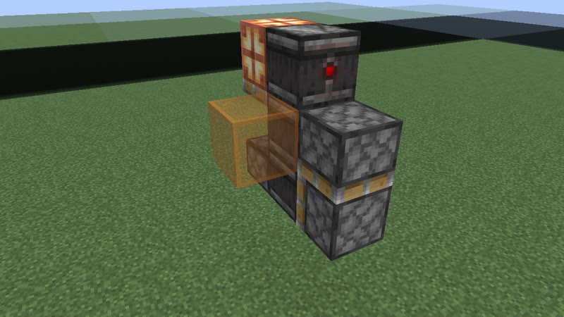</a> 64 gt (3.2 s) · copper_bulb+observer+sticky_piston · 7 blocks</td></tr>
<tr><td align="center"><a href="../archive/clk-obs-p64-bulb-obs-stk-7b-bf0bf5.txt">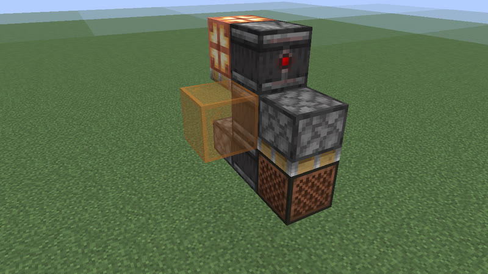</a> 64 gt (3.2 s) · copper_bulb+observer+sticky_piston · 7 blocks</td><td align="center"><a href="../archive/clk-obs-p64-bulb-note-obs-pis-stk-8b-fb7e28.txt">clk-obs-p64-bulb-note-obs-pis-stk-8b-fb7e28</a> 64 gt (3.2 s) · copper_bulb+note_block+observer+piston+sticky_piston · 8 blocks (picture pending)</td><td align="center"><a href="../archive/clk-obs-p64-bulb-note-obs-stk-8b-73b016.txt">clk-obs-p64-bulb-note-obs-stk-8b-73b016</a> 64 gt (3.2 s) · copper_bulb+note_block+observer+sticky_piston · 8 blocks (picture pending)</td></tr>
<tr><td align="center"><a href="../archive/hopburn-p64.txt">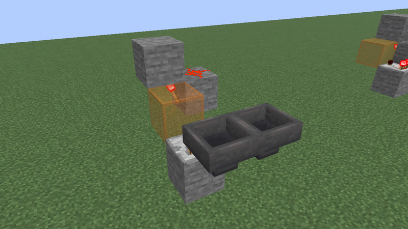</a> 64 gt (3.2 s) · hopper+redstone_torch+redstone_wire · 8 blocks</td><td align="center"><a href="../archive/clk-obs-p64-bulb-note-obs-pis-rb-stk-9b-4eb4ac.txt">clk-obs-p64-bulb-note-obs-pis-rb-stk-9b-4eb4ac</a> 64 gt (3.2 s) · copper_bulb+note_block+observer+piston+redstone_block+sticky_piston · 9 blocks (picture pending)</td><td align="center"><a href="../archive/clk-obs-p64-bulb-lamp-obs-pis-rb-stk-9b-c21aaa.txt">clk-obs-p64-bulb-lamp-obs-pis-rb-stk-9b-c21aaa</a> 64 gt (3.2 s) · copper_bulb+observer+piston+redstone_block+redstone_lamp+sticky_piston · 9 blocks (picture pending)</td></tr>
<tr><td align="center"><a href="../archive/clk-sculk-chaind-p64-1.txt">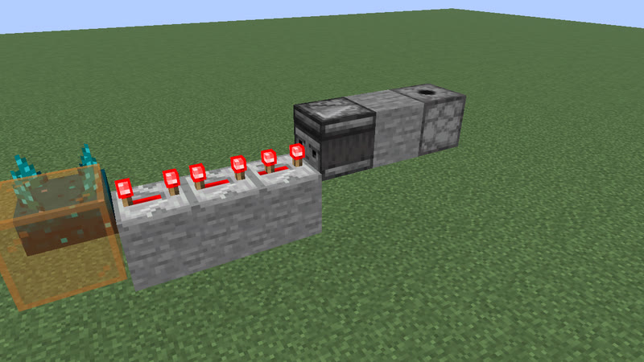</a> 64 gt (3.2 s) · dispenser+observer+repeater+sculk_sensor · 10 blocks</td><td align="center"> 64 gt (3.2 s) · redstone_torch+redstone_wire+repeater · 13 blocks</td></tr>
</table>

## 65 gt (3.25 s)

Also reachable by: clk-obs-odd-b (n = 13), dropper ring (clk-item-dropring-1d-r14, n = 1).

<table>
<tr><td align="center"><a href="../archive/clk-sculk-two-p65-1.txt">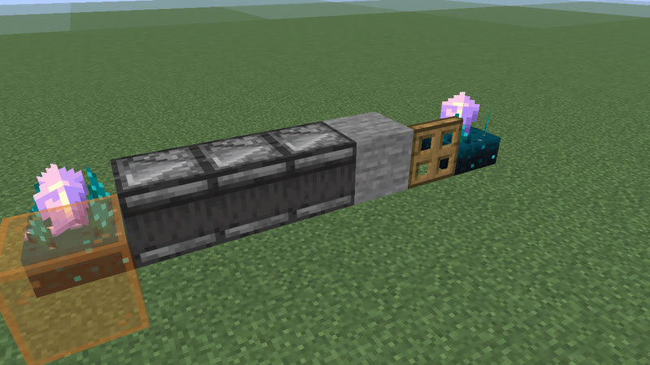</a> 65 gt (3.25 s) · calibrated_sculk_sensor+oak_trapdoor+observer · 7 blocks</td><td align="center"><a href="../archive/clk-obs-p65-obs-stk-7b-890ba1.txt">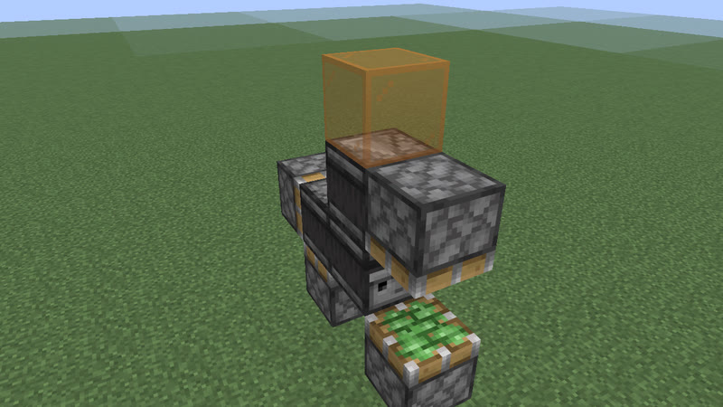</a> 65 gt (3.25 s) · observer+sticky_piston · 7 blocks</td><td align="center"><a href="../archive/clk-obs-p65-obs-pis-stk-8b-b55141.txt">clk-obs-p65-obs-pis-stk-8b-b55141</a> 65 gt (3.25 s) · observer+piston+sticky_piston · 8 blocks (picture pending)</td></tr>
<tr><td align="center"> 65 gt (3.25 s) · comparator+hopper+redstone_torch+redstone_wire · 8 blocks</td><td align="center"> 65 gt (3.25 s) · dispenser+observer+repeater+sculk_sensor · 9 blocks</td><td align="center"> 65 gt (3.25 s) · repeater · 39 blocks</td></tr>
</table>

## 66 gt (3.3 s)

Also reachable by: observer ring with a relay block (clk-obs-note-ring, n = 14), clk-misc-cart-loop (n = 8), dropper ring (clk-item-dropring-1d-r2, n = 2).

<table>
<tr><td align="center"> 66 gt (3.3 s) · calibrated_sculk_sensor+note_block+oak_trapdoor+observer · 5 blocks</td><td align="center"> 66 gt (3.3 s) · calibrated_sculk_sensor+oak_trapdoor+observer · 5 blocks</td><td align="center"> 66 gt (3.3 s) · calibrated_sculk_sensor+oak_trapdoor+observer+piston · 5 blocks also found as census-p66-calibrated_sculk_sensor-oak_trapdoor-observer-sticky_piston-5b (built with sticky_piston, without piston)</td></tr>
<tr><td align="center"> 66 gt (3.3 s) · calibrated_sculk_sensor+dispenser+observer · 6 blocks</td><td align="center"> 66 gt (3.3 s) · note_block+observer+piston+sticky_piston · 7 blocks</td><td align="center"> 66 gt (3.3 s) · observer+piston+sticky_piston · 7 blocks</td></tr>
<tr><td align="center"> 66 gt (3.3 s) · observer+sticky_piston · 7 blocks</td><td align="center"><a href="../archive/clk-obs-p66-bulb-lamp-note-obs-pis-stk-8b-1271c4.txt">clk-obs-p66-bulb-lamp-note-obs-pis-stk-8b-1271c4</a> 66 gt (3.3 s) · copper_bulb+note_block+observer+piston+redstone_lamp+sticky_piston · 8 blocks (picture pending)</td><td align="center"><a href="../archive/clk-obs-p66-bulb-lamp-note-obs-stk-8b-ade767.txt">clk-obs-p66-bulb-lamp-note-obs-stk-8b-ade767</a> 66 gt (3.3 s) · copper_bulb+note_block+observer+redstone_lamp+sticky_piston · 8 blocks (picture pending)</td></tr>
<tr><td align="center"><a href="../archive/clk-obs-p66-bulb-lamp-obs-pis-stk-8b-b65c1a.txt">clk-obs-p66-bulb-lamp-obs-pis-stk-8b-b65c1a</a> 66 gt (3.3 s) · copper_bulb+observer+piston+redstone_lamp+sticky_piston · 8 blocks (picture pending)</td><td align="center"><a href="../archive/clk-obs-p66-bulb-lamp-obs-stk-8b-5831cb.txt">clk-obs-p66-bulb-lamp-obs-stk-8b-5831cb</a> 66 gt (3.3 s) · copper_bulb+observer+redstone_lamp+sticky_piston · 8 blocks (picture pending)</td><td align="center"><a href="../archive/clk-obs-p66-obs-rb-stk-8b-a7be8d.txt">clk-obs-p66-obs-rb-stk-8b-a7be8d</a> 66 gt (3.3 s) · observer+redstone_block+sticky_piston · 8 blocks (picture pending)</td></tr>
<tr><td align="center"><a href="../archive/clk-obs-p66-lamp-note-obs-stk-8b-d9bd80.txt">clk-obs-p66-lamp-note-obs-stk-8b-d9bd80</a> 66 gt (3.3 s) · note_block+observer+redstone_lamp+sticky_piston · 8 blocks (picture pending)</td><td align="center"><a href="../archive/clk-obs-p66-bulb-lamp-note-obs-rb-stk-8b-c5094d.txt">clk-obs-p66-bulb-lamp-note-obs-rb-stk-8b-c5094d</a> 66 gt (3.3 s) · copper_bulb+note_block+observer+redstone_block+redstone_lamp+sticky_piston · 8 blocks (picture pending)</td><td align="center"><a href="../archive/clk-obs-p66-bulb-lamp-obs-rb-stk-8b-ecf436.txt">clk-obs-p66-bulb-lamp-obs-rb-stk-8b-ecf436</a> 66 gt (3.3 s) · copper_bulb+observer+redstone_block+redstone_lamp+sticky_piston · 8 blocks (picture pending)</td></tr>
<tr><td align="center"><a href="../archive/clk-obs-p66-bulb-note-obs-stk-9b-b54e6d.txt">clk-obs-p66-bulb-note-obs-stk-9b-b54e6d</a> 66 gt (3.3 s) · copper_bulb+note_block+observer+sticky_piston · 9 blocks (picture pending)</td><td align="center"><a href="../archive/kit-shuttle-minecart-p66-13b.txt">kit-shuttle-minecart-p66-13b</a> 66 gt (3.3 s) · detector_rail+minecart · 13 blocks (picture pending)</td><td align="center"> 66 gt (3.3 s) · redstone_torch+repeater · 20 blocks</td></tr>
<tr><td align="center"> 66 gt (3.3 s) · repeater · 23 blocks</td></tr>
</table>

## 67 gt (3.35 s)

Also reachable by: clk-obs-odd-a (n = 14), dropper ring (clk-item-dropring-1d-r24, n = 1), clk-sculk-replin (one block swapped: 2 versions) (clk-sculk-replin, n = 7), clk-sculk-hairpin (one block swapped: 2 versions) (clk-sculk-hairpin, n = 4), clk-misc-cart-pingpong (n = 6), clk-sculk-hairpin-plain (n = 4).

<table>
<tr><td align="center"><a href="../archive/clk-obs-p67-obs-pis-stk-8b-ca51a1.txt">clk-obs-p67-obs-pis-stk-8b-ca51a1</a> 67 gt (3.35 s) · observer+piston+sticky_piston · 8 blocks (picture pending)</td><td align="center"> 67 gt (3.35 s) · observer+sticky_piston · 8 blocks</td><td align="center"><a href="../archive/clk-obs-p67-lamp-note-obs-stk-9b-a825c1.txt">clk-obs-p67-lamp-note-obs-stk-9b-a825c1</a> 67 gt (3.35 s) · note_block+observer+redstone_lamp+sticky_piston · 9 blocks (picture pending)</td></tr>
<tr><td align="center"><a href="../archive/clk-obs-p67-note-obs-stk-9b-11c222.txt">clk-obs-p67-note-obs-stk-9b-11c222</a> 67 gt (3.35 s) · note_block+observer+sticky_piston · 9 blocks (picture pending)</td><td align="center"> 67 gt (3.35 s) · oak_fence_gate+repeater+sculk_sensor · 10 blocks</td><td align="center"> 67 gt (3.35 s) · repeater · 39 blocks</td></tr>
</table>

## 68 gt (3.4 s)

Also reachable by: clk-obs-obs-ring (n = 15), clk-obs-bulb-ring (n = 6), clk-rt-uloop2t (n = 3), dropper ring (clk-item-dropring-1d-r3, n = 2), clk-rt-uloop1t (n = 1).

<table>
<tr><td align="center"><a href="../archive/clk-obs-p68-bulb-note-obs-rb-stk-8b-cda931.txt">clk-obs-p68-bulb-note-obs-rb-stk-8b-cda931</a> 68 gt (3.4 s) · copper_bulb+note_block+observer+redstone_block+sticky_piston · 8 blocks (picture pending)</td><td align="center"><a href="../archive/clk-obs-p68-bulb-note-obs-stk-8b-430e77.txt">clk-obs-p68-bulb-note-obs-stk-8b-430e77</a> 68 gt (3.4 s) · copper_bulb+note_block+observer+sticky_piston · 8 blocks (picture pending)</td><td align="center"><a href="../archive/clk-obs-p68-bulb-obs-pis-stk-8b-6e8340.txt">clk-obs-p68-bulb-obs-pis-stk-8b-6e8340</a> 68 gt (3.4 s) · copper_bulb+observer+piston+sticky_piston · 8 blocks (picture pending)</td></tr>
<tr><td align="center"><a href="../archive/clk-obs-p68-bulb-obs-rb-stk-8b-fe9a77.txt">clk-obs-p68-bulb-obs-rb-stk-8b-fe9a77</a> 68 gt (3.4 s) · copper_bulb+observer+redstone_block+sticky_piston · 8 blocks (picture pending)</td><td align="center"><a href="../archive/clk-obs-p68-bulb-obs-stk-8b-486df3.txt">clk-obs-p68-bulb-obs-stk-8b-486df3</a> 68 gt (3.4 s) · copper_bulb+observer+sticky_piston · 8 blocks (picture pending)</td><td align="center"><a href="../archive/clk-obs-p68-lamp-obs-stk-8b-f312d6.txt">clk-obs-p68-lamp-obs-stk-8b-f312d6</a> 68 gt (3.4 s) · observer+redstone_lamp+sticky_piston · 8 blocks (picture pending)</td></tr>
<tr><td align="center"><a href="../archive/clk-obs-p68-note-obs-stk-8b-67aff6.txt">clk-obs-p68-note-obs-stk-8b-67aff6</a> 68 gt (3.4 s) · note_block+observer+sticky_piston · 8 blocks (picture pending)</td><td align="center"><a href="../archive/clk-obs-p68-obs-rb-stk-8b-800f78.txt">clk-obs-p68-obs-rb-stk-8b-800f78</a> 68 gt (3.4 s) · observer+redstone_block+sticky_piston · 8 blocks (picture pending)</td><td align="center"> 68 gt (3.4 s) · observer+sticky_piston · 8 blocks</td></tr>
<tr><td align="center"><a href="../archive/clk-obs-p68-obs-pis-stk-8b-ea70b1.txt">clk-obs-p68-obs-pis-stk-8b-ea70b1</a> 68 gt (3.4 s) · observer+piston+sticky_piston · 8 blocks (picture pending)</td><td align="center"><a href="../archive/clk-obs-p68-bulb-lamp-obs-pis-stk-8b-b2025a.txt">clk-obs-p68-bulb-lamp-obs-pis-stk-8b-b2025a</a> 68 gt (3.4 s) · copper_bulb+observer+piston+redstone_lamp+sticky_piston · 8 blocks (picture pending)</td><td align="center"><a href="../archive/clk-obs-p68-bulb-lamp-obs-rb-stk-8b-9ec250.txt">clk-obs-p68-bulb-lamp-obs-rb-stk-8b-9ec250</a> 68 gt (3.4 s) · copper_bulb+observer+redstone_block+redstone_lamp+sticky_piston · 8 blocks (picture pending)</td></tr>
<tr><td align="center"><a href="../archive/clk-obs-p68-bulb-lamp-obs-stk-8b-f449dd.txt">clk-obs-p68-bulb-lamp-obs-stk-8b-f449dd</a> 68 gt (3.4 s) · copper_bulb+observer+redstone_lamp+sticky_piston · 8 blocks (picture pending)</td><td align="center"><a href="../archive/clk-obs-p68-bulb-note-obs-pis-stk-8b-e38481.txt">clk-obs-p68-bulb-note-obs-pis-stk-8b-e38481</a> 68 gt (3.4 s) · copper_bulb+note_block+observer+piston+sticky_piston · 8 blocks (picture pending)</td><td align="center"><a href="../archive/clk-obs-p68-bulb-lamp-note-obs-rb-stk-9b-832939.txt">clk-obs-p68-bulb-lamp-note-obs-rb-stk-9b-832939</a> 68 gt (3.4 s) · copper_bulb+note_block+observer+redstone_block+redstone_lamp+sticky_piston · 9 blocks (picture pending)</td></tr>
<tr><td align="center"><a href="../archive/clk-obs-p68-bulb-lamp-note-obs-stk-9b-3feb32.txt">clk-obs-p68-bulb-lamp-note-obs-stk-9b-3feb32</a> 68 gt (3.4 s) · copper_bulb+note_block+observer+redstone_lamp+sticky_piston · 9 blocks (picture pending)</td><td align="center"><a href="../archive/clk-obs-p68-note-obs-pis-stk-9b-9e602b.txt">clk-obs-p68-note-obs-pis-stk-9b-9e602b</a> 68 gt (3.4 s) · note_block+observer+piston+sticky_piston · 9 blocks (picture pending)</td><td align="center"> 68 gt (3.4 s) · calibrated_sculk_sensor+note_block · 10 blocks</td></tr>
<tr><td align="center"> 68 gt (3.4 s) · repeater · 23 blocks</td></tr>
</table>

## 69 gt (3.45 s)

Also reachable by: clk-obs-odd-b (n = 14), dropper ring (clk-item-dropring-1d, n = 3).

<table>
<tr><td align="center"> 69 gt (3.45 s) · calibrated_sculk_sensor+dispenser+observer · 6 blocks</td><td align="center"> 69 gt (3.45 s) · observer+sticky_piston · 7 blocks</td><td align="center"><a href="../archive/clk-obs-p69-obs-stk-7b-ae75a9.txt">clk-obs-p69-obs-stk-7b-ae75a9</a> 69 gt (3.45 s) · observer+sticky_piston · 7 blocks (picture pending)</td></tr>
<tr><td align="center"> 69 gt (3.45 s) · calibrated_sculk_sensor+note_block · 11 blocks</td><td align="center"> 69 gt (3.45 s) · repeater · 40 blocks</td></tr>
</table>

## 70 gt (3.5 s)

Also reachable by: observer ring with a relay block (clk-obs-note-ring, n = 15), hopper ring (clk-item-hopper-ring, n = 4), dropper ring (clk-item-dropring-1d-r4, n = 2).

<table>
<tr><td align="center"> 70 gt (3.5 s) · calibrated_sculk_sensor+dispenser+observer+sticky_piston · 6 blocks</td><td align="center"> 70 gt (3.5 s) · calibrated_sculk_sensor+observer+sticky_piston · 7 blocks</td><td align="center"> 70 gt (3.5 s) · note_block+observer+piston+sticky_piston · 7 blocks</td></tr>
<tr><td align="center"> 70 gt (3.5 s) · note_block+observer+sticky_piston · 7 blocks</td><td align="center"> 70 gt (3.5 s) · note_block+observer+sticky_piston · 7 blocks</td><td align="center"> 70 gt (3.5 s) · observer+piston+sticky_piston · 7 blocks</td></tr>
<tr><td align="center"> 70 gt (3.5 s) · observer+piston+sticky_piston · 7 blocks</td><td align="center"> 70 gt (3.5 s) · observer+sticky_piston · 7 blocks</td><td align="center"> 70 gt (3.5 s) · observer+sticky_piston · 7 blocks</td></tr>
<tr><td align="center"><a href="../archive/clk-obs-p70-bulb-obs-stk-8b-8c639e.txt">clk-obs-p70-bulb-obs-stk-8b-8c639e</a> 70 gt (3.5 s) · copper_bulb+observer+sticky_piston · 8 blocks (picture pending)</td><td align="center"><a href="../archive/clk-obs-p70-bulb-lamp-note-obs-stk-8b-c13f74.txt">clk-obs-p70-bulb-lamp-note-obs-stk-8b-c13f74</a> 70 gt (3.5 s) · copper_bulb+note_block+observer+redstone_lamp+sticky_piston · 8 blocks (picture pending)</td><td align="center"><a href="../archive/clk-obs-p70-bulb-lamp-obs-stk-8b-4e4b1c.txt">clk-obs-p70-bulb-lamp-obs-stk-8b-4e4b1c</a> 70 gt (3.5 s) · copper_bulb+observer+redstone_lamp+sticky_piston · 8 blocks (picture pending)</td></tr>
<tr><td align="center"><a href="../archive/clk-obs-p70-bulb-note-obs-stk-9b-182140.txt">clk-obs-p70-bulb-note-obs-stk-9b-182140</a> 70 gt (3.5 s) · copper_bulb+note_block+observer+sticky_piston · 9 blocks (picture pending)</td><td align="center"><a href="../archive/clk-obs-p70-bulb-note-obs-rb-stk-9b-8bf88c.txt">clk-obs-p70-bulb-note-obs-rb-stk-9b-8bf88c</a> 70 gt (3.5 s) · copper_bulb+note_block+observer+redstone_block+sticky_piston · 9 blocks (picture pending)</td><td align="center"><a href="../archive/clk-obs-p70-bulb-obs-rb-stk-9b-7354a8.txt">clk-obs-p70-bulb-obs-rb-stk-9b-7354a8</a> 70 gt (3.5 s) · copper_bulb+observer+redstone_block+sticky_piston · 9 blocks (picture pending)</td></tr>
<tr><td align="center"><a href="../archive/kit-shuttle-minecart-p70-17b.txt">kit-shuttle-minecart-p70-17b</a> 70 gt (3.5 s) · detector_rail+minecart · 17 blocks (picture pending)</td><td align="center"> 70 gt (3.5 s) · repeater · 23 blocks</td><td align="center"> 70 gt (3.5 s) · redstone_torch+repeater · 24 blocks</td></tr>
</table>

## 71 gt (3.55 s)

Also reachable by: clk-obs-odd-a (n = 15), clk-rt-odd-rect (n = 6), clk-sculk-hairpin-dispenser (n = 4), clk-misc-cart-loop (n = 9), clk-sculk-replin-dispenser (n = 7), dropper ring (clk-item-dropring-2d-r1, n = 2).

<table>
<tr><td align="center"> 71 gt (3.55 s) · calibrated_sculk_sensor+observer+sticky_piston · 7 blocks</td><td align="center"><a href="../archive/clk-obs-p71-lamp-obs-stk-8b-8459db.txt">clk-obs-p71-lamp-obs-stk-8b-8459db</a> 71 gt (3.55 s) · observer+redstone_lamp+sticky_piston · 8 blocks (picture pending)</td><td align="center"><a href="../archive/clk-obs-p71-note-obs-stk-8b-fe08f1.txt">clk-obs-p71-note-obs-stk-8b-fe08f1</a> 71 gt (3.55 s) · note_block+observer+sticky_piston · 8 blocks (picture pending)</td></tr>
<tr><td align="center"><a href="../archive/clk-obs-p71-obs-stk-8b-60d126.txt">clk-obs-p71-obs-stk-8b-60d126</a> 71 gt (3.55 s) · observer+sticky_piston · 8 blocks (picture pending)</td><td align="center"><a href="../archive/clk-obs-p71-obs-pis-stk-9b-df66f6.txt">clk-obs-p71-obs-pis-stk-9b-df66f6</a> 71 gt (3.55 s) · observer+piston+sticky_piston · 9 blocks (picture pending)</td></tr>
</table>

## 72 gt (3.6 s)

Also reachable by: clk-obs-obs-ring (n = 16), dropper ring (clk-item-dropring-2d-r14, n = 2), clk-misc-cart-pingpong (n = 7), clk-rt-div (n = 1).

<table>
<tr><td align="center"> 72 gt (3.6 s) · calibrated_sculk_sensor+observer+sticky_piston · 6 blocks</td><td align="center"> 72 gt (3.6 s) · calibrated_sculk_sensor+oak_trapdoor+observer+sticky_piston · 7 blocks</td><td align="center"> 72 gt (3.6 s) · calibrated_sculk_sensor+iron_trapdoor+observer+sticky_piston · 7 blocks</td></tr>
<tr><td align="center"> 72 gt (3.6 s) · calibrated_sculk_sensor+oak_fence_gate+observer+sticky_piston · 7 blocks</td><td align="center"> 72 gt (3.6 s) · copper_bulb+observer+piston+sticky_piston · 7 blocks</td><td align="center"> 72 gt (3.6 s) · copper_bulb+observer+piston+sticky_piston · 7 blocks</td></tr>
<tr><td align="center"> 72 gt (3.6 s) · copper_bulb+observer+sticky_piston · 7 blocks</td><td align="center"> 72 gt (3.6 s) · copper_bulb+observer+sticky_piston · 7 blocks</td><td align="center"> 72 gt (3.6 s) · calibrated_sculk_sensor+dispenser+observer · 7 blocks</td></tr>
<tr><td align="center"><a href="../archive/clk-obs-p72-bulb-obs-pis-8b-59f307.txt">clk-obs-p72-bulb-obs-pis-8b-59f307</a> 72 gt (3.6 s) · copper_bulb+observer+piston · 8 blocks (picture pending)</td><td align="center"><a href="../archive/clk-obs-p72-bulb-lamp-obs-stk-8b-5ed181.txt">clk-obs-p72-bulb-lamp-obs-stk-8b-5ed181</a> 72 gt (3.6 s) · copper_bulb+observer+redstone_lamp+sticky_piston · 8 blocks (picture pending)</td><td align="center"><a href="../archive/clk-obs-p72-obs-rb-stk-8b-8b4c33.txt">clk-obs-p72-obs-rb-stk-8b-8b4c33</a> 72 gt (3.6 s) · observer+redstone_block+sticky_piston · 8 blocks (picture pending)</td></tr>
<tr><td align="center"><a href="../archive/clk-obs-p72-obs-pis-rb-stk-9b-579f62.txt">clk-obs-p72-obs-pis-rb-stk-9b-579f62</a> 72 gt (3.6 s) · observer+piston+redstone_block+sticky_piston · 9 blocks (picture pending)</td><td align="center"><a href="../archive/clk-obs-p72-lamp-obs-pis-stk-9b-74bce9.txt">clk-obs-p72-lamp-obs-pis-stk-9b-74bce9</a> 72 gt (3.6 s) · observer+piston+redstone_lamp+sticky_piston · 9 blocks (picture pending)</td><td align="center"> 72 gt (3.6 s) · redstone_torch+redstone_wire+repeater · 16 blocks</td></tr>
<tr><td align="center"><a href="../archive/kit-bouncer-oak_boat-p72-19b.txt">kit-bouncer-oak_boat-p72-19b</a> 72 gt (3.6 s) · oak_boat+tripwire+tripwire_hook · 19 blocks (picture pending)</td><td align="center"> 72 gt (3.6 s) · repeater · 23 blocks</td></tr>
</table>

## 73 gt (3.65 s)

Also reachable by: clk-obs-odd-b (n = 15), dropper ring (clk-item-dropring-2d-r2, n = 3).

<table>
<tr><td align="center"><a href="../archive/clk-obs-p73-obs-pis-stk-8b-0c4000.txt">clk-obs-p73-obs-pis-stk-8b-0c4000</a> 73 gt (3.65 s) · observer+piston+sticky_piston · 8 blocks (picture pending)</td><td align="center"> 73 gt (3.65 s) · observer+sticky_piston · 8 blocks</td><td align="center"> 73 gt (3.65 s) · calibrated_sculk_sensor+note_block · 10 blocks</td></tr>
<tr><td align="center"><a href="../archive/kit-bouncer-oak_boat-p73-19b.txt">kit-bouncer-oak_boat-p73-19b</a> 73 gt (3.65 s) · oak_boat+tripwire+tripwire_hook · 19 blocks (picture pending)</td><td align="center"><a href="../archive/clk-misc-boat-bouncer-c3.txt">clk-misc-boat-bouncer-c3</a> 73 gt (3.65 s) · oak_boat+tripwire+tripwire_hook · 20 blocks (picture pending)</td><td align="center"><a href="../archive/clk-misc-boat-bouncer-trapdoor.txt">clk-misc-boat-bouncer-trapdoor</a> 73 gt (3.65 s) · oak_boat+oak_trapdoor+tripwire+tripwire_hook · 20 blocks (picture pending)</td></tr>
<tr><td align="center"> 73 gt (3.65 s) · repeater · 43 blocks</td></tr>
</table>

## 74 gt (3.7 s)

Also reachable by: observer ring with a relay block (clk-obs-note-ring, n = 16), dropper ring (clk-item-dropring-2d-r24, n = 2).

<table>
<tr><td align="center"> 74 gt (3.7 s) · copper_bulb+observer+piston+sticky_piston · 7 blocks</td><td align="center"> 74 gt (3.7 s) · copper_bulb+observer+piston+sticky_piston · 7 blocks</td><td align="center"> 74 gt (3.7 s) · copper_bulb+observer+sticky_piston · 7 blocks</td></tr>
<tr><td align="center"> 74 gt (3.7 s) · copper_bulb+observer+sticky_piston · 7 blocks</td><td align="center"><a href="../archive/clk-obs-p74-obs-pis-rb-stk-8b-b57057.txt">clk-obs-p74-obs-pis-rb-stk-8b-b57057</a> 74 gt (3.7 s) · observer+piston+redstone_block+sticky_piston · 8 blocks (picture pending)</td><td align="center"><a href="../archive/clk-obs-p74-obs-pis-stk-8b-216cbb.txt">clk-obs-p74-obs-pis-stk-8b-216cbb</a> 74 gt (3.7 s) · observer+piston+sticky_piston · 8 blocks (picture pending)</td></tr>
<tr><td align="center"> 74 gt (3.7 s) · calibrated_sculk_sensor+note_block · 10 blocks</td><td align="center"> 74 gt (3.7 s) · comparator+hopper · 12 blocks</td><td align="center"><a href="../archive/kit-shuttle-minecart-p74-15b.txt">kit-shuttle-minecart-p74-15b</a> 74 gt (3.7 s) · detector_rail+minecart · 15 blocks (picture pending)</td></tr>
<tr><td align="center"><a href="../archive/kit-bouncer-oak_boat-p74-19b.txt">kit-bouncer-oak_boat-p74-19b</a> 74 gt (3.7 s) · oak_boat+tripwire+tripwire_hook · 19 blocks (picture pending)</td><td align="center"><a href="../archive/clk-misc-boat-bouncer-lantern.txt">clk-misc-boat-bouncer-lantern</a> 74 gt (3.7 s) · oak_boat+tripwire+tripwire_hook · 20 blocks (picture pending)</td><td align="center"> 74 gt (3.7 s) · redstone_torch+repeater · 24 blocks</td></tr>
<tr><td align="center"> 74 gt (3.7 s) · repeater · 24 blocks</td></tr>
</table>

## 75 gt (3.75 s)

Also reachable by: clk-obs-odd-a (n = 16), dropper ring (clk-item-dropring-2d-r3, n = 3).

<table>
<tr><td align="center"> 75 gt (3.75 s) · calibrated_sculk_sensor+note_block · 10 blocks</td><td align="center"> 75 gt (3.75 s) · detector_rail+minecart · 27 blocks</td><td align="center"> 75 gt (3.75 s) · repeater · 43 blocks</td></tr>
</table>

[catalog index](../CATALOG.md) · previous: [p43-52](p43-52.md) · next: [p76-103](p76-103.md)
