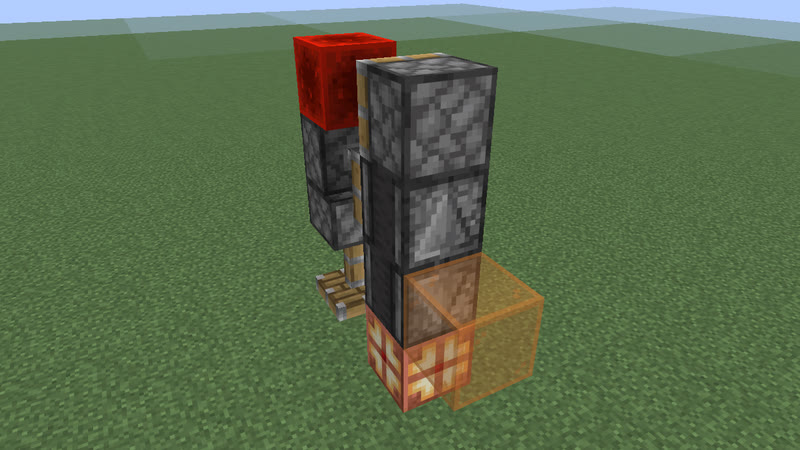

# Clocks: 64 gt (3.2 s) to 87 gt (4.35 s) (288 clock types)

[catalog index](../CATALOG.md) · previous: [p47-63](p47-63.md) · next: [p88-129](p88-129.md)

Orange glass = where the output signal is (placed only for the picture); click a picture for its design. Larger clocks of a period with the same on-time and pulses as a smaller one (whatever their block kinds), and clocks that are not robust, are listed on [variants](variants.md). Generated by `mctas clock catalog`.

## 64 gt (3.2 s)

Also reachable by: clk-obs-obs-ring (n = 14), dropper ring (clk-item-dropring-1d-r1, n = 2), clk-rt-rect-pulse (n = 2).

<table>
<tr><td align="center"><a href="../archive/clk-obs-p64-lamp-obs-pis-stk-7b-a7417b.txt">clk-obs-p64-lamp-obs-pis-stk-7b-a7417b</a> 64 gt (3.2 s) · observer+piston+redstone_lamp+sticky_piston · 7 blocks (picture pending)</td><td align="center"><a href="../archive/clk-obs-p64-note-obs-pis-stk-7b-e224e8.txt">clk-obs-p64-note-obs-pis-stk-7b-e224e8</a> 64 gt (3.2 s) · note_block+observer+piston+sticky_piston · 7 blocks (picture pending)</td><td align="center"><a href="../archive/clk-obs-p64-obs-pis-stk-7b-37a08f.txt">clk-obs-p64-obs-pis-stk-7b-37a08f</a> 64 gt (3.2 s) · observer+piston+sticky_piston · 7 blocks (picture pending)</td></tr>
<tr><td align="center"> 64 gt (3.2 s) · copper_bulb+note_block+observer+redstone_lamp+sticky_piston · 7 blocks</td><td align="center"> 64 gt (3.2 s) · copper_bulb+observer+redstone_lamp+sticky_piston · 7 blocks</td><td align="center"> 64 gt (3.2 s) · copper_bulb+observer+piston+redstone_block+sticky_piston · 7 blocks</td></tr>
<tr><td align="center"> 64 gt (3.2 s) · copper_bulb+observer+piston+redstone_block+sticky_piston · 7 blocks</td><td align="center"> 64 gt (3.2 s) · copper_bulb+observer+redstone_block+sticky_piston · 7 blocks</td><td align="center"> 64 gt (3.2 s) · copper_bulb+observer+redstone_block+sticky_piston · 7 blocks</td></tr>
<tr><td align="center"> 64 gt (3.2 s) · copper_bulb+observer+sticky_piston · 7 blocks</td><td align="center"> 64 gt (3.2 s) · copper_bulb+observer+sticky_piston · 7 blocks</td><td align="center"> 64 gt (3.2 s) · hopper+redstone_torch+redstone_wire · 8 blocks</td></tr>
<tr><td align="center"><a href="../archive/clk-obs-p64-bulb-note-obs-pis-rb-stk-9b-4eb4ac.txt">clk-obs-p64-bulb-note-obs-pis-rb-stk-9b-4eb4ac</a> 64 gt (3.2 s) · copper_bulb+note_block+observer+piston+redstone_block+sticky_piston · 9 blocks (picture pending)</td><td align="center"> 64 gt (3.2 s) · dispenser+observer+repeater+sculk_sensor · 10 blocks</td><td align="center"> 64 gt (3.2 s) · redstone_torch+redstone_wire+repeater · 13 blocks</td></tr>
</table>

## 65 gt (3.25 s)

Also reachable by: clk-obs-odd-b (n = 13), dropper ring (clk-item-dropring-1d-r14, n = 1).

<table>
<tr><td align="center"> 65 gt (3.25 s) · calibrated_sculk_sensor+oak_trapdoor+observer · 7 blocks</td><td align="center"> 65 gt (3.25 s) · observer+sticky_piston · 7 blocks</td><td align="center"><a href="../archive/clk-obs-p65-obs-pis-stk-8b-b55141.txt">clk-obs-p65-obs-pis-stk-8b-b55141</a> 65 gt (3.25 s) · observer+piston+sticky_piston · 8 blocks (picture pending)</td></tr>
<tr><td align="center"> 65 gt (3.25 s) · comparator+hopper+redstone_torch+redstone_wire · 8 blocks</td><td align="center"> 65 gt (3.25 s) · dispenser+observer+repeater+sculk_sensor · 9 blocks</td><td align="center"> 65 gt (3.25 s) · repeater · 39 blocks</td></tr>
</table>

## 66 gt (3.3 s)

Also reachable by: observer ring with a relay block (clk-obs-note-ring, n = 14), clk-misc-cart-loop (n = 8), dropper ring (clk-item-dropring-1d-r2, n = 2).

<table>
<tr><td align="center"> 66 gt (3.3 s) · calibrated_sculk_sensor+dispenser+oak_trapdoor+observer · 5 blocks</td><td align="center"> 66 gt (3.3 s) · calibrated_sculk_sensor+dispenser+observer+piston · 5 blocks also found as census-p66-calibrated_sculk_sensor-dispenser-observer-sticky_piston-5b (built with sticky_piston, without piston)</td><td align="center"> 66 gt (3.3 s) · calibrated_sculk_sensor+note_block+oak_trapdoor+observer · 5 blocks</td></tr>
<tr><td align="center"> 66 gt (3.3 s) · calibrated_sculk_sensor+note_block+observer+piston · 5 blocks also found as census-p66-calibrated_sculk_sensor-note_block-observer-sticky_piston-5b (built with sticky_piston, without piston)</td><td align="center"> 66 gt (3.3 s) · calibrated_sculk_sensor+oak_trapdoor+observer · 5 blocks</td><td align="center"> 66 gt (3.3 s) · calibrated_sculk_sensor+oak_trapdoor+observer+piston · 5 blocks also found as census-p66-calibrated_sculk_sensor-oak_trapdoor-observer-sticky_piston-5b (built with sticky_piston, without piston)</td></tr>
<tr><td align="center"> 66 gt (3.3 s) · calibrated_sculk_sensor+observer+piston · 5 blocks also found as census-p66-calibrated_sculk_sensor-observer-piston-sticky_piston-5b (built with sticky_piston), census-p66-calibrated_sculk_sensor-observer-sticky_piston-5b (built with sticky_piston, without piston)</td><td align="center"> 66 gt (3.3 s) · calibrated_sculk_sensor+dispenser+observer · 6 blocks</td><td align="center"> 66 gt (3.3 s) · observer+piston+redstone_lamp+sticky_piston · 7 blocks</td></tr>
<tr><td align="center"> 66 gt (3.3 s) · note_block+observer+piston+sticky_piston · 7 blocks</td><td align="center"> 66 gt (3.3 s) · observer+piston+sticky_piston · 7 blocks</td><td align="center"> 66 gt (3.3 s) · observer+redstone_lamp+sticky_piston · 7 blocks</td></tr>
<tr><td align="center"> 66 gt (3.3 s) · observer+redstone_lamp+sticky_piston · 7 blocks</td><td align="center"> 66 gt (3.3 s) · note_block+observer+sticky_piston · 7 blocks</td><td align="center"> 66 gt (3.3 s) · note_block+observer+sticky_piston · 7 blocks</td></tr>
<tr><td align="center"> 66 gt (3.3 s) · observer+sticky_piston · 7 blocks</td><td align="center"> 66 gt (3.3 s) · observer+sticky_piston · 7 blocks</td><td align="center"><a href="../archive/clk-obs-p66-bulb-lamp-note-obs-pis-stk-8b-1271c4.txt">clk-obs-p66-bulb-lamp-note-obs-pis-stk-8b-1271c4</a> 66 gt (3.3 s) · copper_bulb+note_block+observer+piston+redstone_lamp+sticky_piston · 8 blocks (picture pending)</td></tr>
<tr><td align="center"><a href="../archive/clk-obs-p66-bulb-lamp-note-obs-stk-8b-ade767.txt">clk-obs-p66-bulb-lamp-note-obs-stk-8b-ade767</a> 66 gt (3.3 s) · copper_bulb+note_block+observer+redstone_lamp+sticky_piston · 8 blocks (picture pending)</td><td align="center"><a href="../archive/clk-obs-p66-bulb-lamp-obs-pis-stk-8b-b65c1a.txt">clk-obs-p66-bulb-lamp-obs-pis-stk-8b-b65c1a</a> 66 gt (3.3 s) · copper_bulb+observer+piston+redstone_lamp+sticky_piston · 8 blocks (picture pending)</td><td align="center"><a href="../archive/clk-obs-p66-bulb-lamp-obs-stk-8b-5831cb.txt">clk-obs-p66-bulb-lamp-obs-stk-8b-5831cb</a> 66 gt (3.3 s) · copper_bulb+observer+redstone_lamp+sticky_piston · 8 blocks (picture pending)</td></tr>
<tr><td align="center"><a href="../archive/clk-obs-p66-lamp-note-obs-stk-8b-d9bd80.txt">clk-obs-p66-lamp-note-obs-stk-8b-d9bd80</a> 66 gt (3.3 s) · note_block+observer+redstone_lamp+sticky_piston · 8 blocks (picture pending)</td><td align="center"><a href="../archive/clk-obs-p66-bulb-lamp-note-obs-rb-stk-8b-c5094d.txt">clk-obs-p66-bulb-lamp-note-obs-rb-stk-8b-c5094d</a> 66 gt (3.3 s) · copper_bulb+note_block+observer+redstone_block+redstone_lamp+sticky_piston · 8 blocks (picture pending)</td><td align="center"><a href="../archive/clk-obs-p66-bulb-lamp-obs-rb-stk-8b-ecf436.txt">clk-obs-p66-bulb-lamp-obs-rb-stk-8b-ecf436</a> 66 gt (3.3 s) · copper_bulb+observer+redstone_block+redstone_lamp+sticky_piston · 8 blocks (picture pending)</td></tr>
<tr><td align="center"><a href="../archive/clk-obs-p66-bulb-note-obs-stk-9b-b54e6d.txt">clk-obs-p66-bulb-note-obs-stk-9b-b54e6d</a> 66 gt (3.3 s) · copper_bulb+note_block+observer+sticky_piston · 9 blocks (picture pending)</td><td align="center"><a href="../archive/clk-obs-p66-bulb-obs-stk-9b-541b6c.txt">clk-obs-p66-bulb-obs-stk-9b-541b6c</a> 66 gt (3.3 s) · copper_bulb+observer+sticky_piston · 9 blocks (picture pending)</td><td align="center"><a href="../archive/kit-shuttle-minecart-p66-13b.txt">kit-shuttle-minecart-p66-13b</a> 66 gt (3.3 s) · detector_rail+minecart · 13 blocks (picture pending)</td></tr>
<tr><td align="center"> 66 gt (3.3 s) · redstone_torch+repeater · 20 blocks</td><td align="center"> 66 gt (3.3 s) · repeater · 23 blocks</td></tr>
</table>

## 67 gt (3.35 s)

Also reachable by: clk-obs-odd-a (n = 14), dropper ring (clk-item-dropring-1d-r24, n = 1), clk-sculk-replin (one block swapped: 2 versions) (clk-sculk-replin, n = 7), clk-sculk-hairpin (one block swapped: 2 versions) (clk-sculk-hairpin, n = 4), clk-misc-cart-pingpong (n = 6), clk-sculk-hairpin-plain (n = 4).

<table>
<tr><td align="center"><a href="../archive/clk-obs-p67-obs-pis-stk-8b-ca51a1.txt">clk-obs-p67-obs-pis-stk-8b-ca51a1</a> 67 gt (3.35 s) · observer+piston+sticky_piston · 8 blocks (picture pending)</td><td align="center"> 67 gt (3.35 s) · observer+sticky_piston · 8 blocks</td><td align="center"><a href="../archive/clk-obs-p67-obs-stk-8b-67f2de.txt">clk-obs-p67-obs-stk-8b-67f2de</a> 67 gt (3.35 s) · observer+sticky_piston · 8 blocks (picture pending)</td></tr>
<tr><td align="center"><a href="../archive/clk-obs-p67-lamp-note-obs-stk-9b-a825c1.txt">clk-obs-p67-lamp-note-obs-stk-9b-a825c1</a> 67 gt (3.35 s) · note_block+observer+redstone_lamp+sticky_piston · 9 blocks (picture pending)</td><td align="center"><a href="../archive/clk-obs-p67-note-obs-stk-9b-11c222.txt">clk-obs-p67-note-obs-stk-9b-11c222</a> 67 gt (3.35 s) · note_block+observer+sticky_piston · 9 blocks (picture pending)</td><td align="center"><a href="../archive/clk-obs-p67-note-obs-rb-stk-9b-e583c6.txt">clk-obs-p67-note-obs-rb-stk-9b-e583c6</a> 67 gt (3.35 s) · note_block+observer+redstone_block+sticky_piston · 9 blocks (picture pending)</td></tr>
<tr><td align="center"> 67 gt (3.35 s) · oak_fence_gate+repeater+sculk_sensor · 10 blocks</td><td align="center"> 67 gt (3.35 s) · repeater · 39 blocks</td></tr>
</table>

## 68 gt (3.4 s)

Also reachable by: clk-obs-obs-ring (n = 15), clk-obs-bulb-ring (n = 6), clk-rt-uloop2t (n = 3), dropper ring (clk-item-dropring-1d-r3, n = 2), clk-rt-uloop1t (n = 1).

<table>
<tr><td align="center"><a href="../archive/clk-obs-p68-bulb-note-obs-rb-stk-8b-cda931.txt">clk-obs-p68-bulb-note-obs-rb-stk-8b-cda931</a> 68 gt (3.4 s) · copper_bulb+note_block+observer+redstone_block+sticky_piston · 8 blocks (picture pending)</td><td align="center"><a href="../archive/clk-obs-p68-bulb-note-obs-stk-8b-430e77.txt">clk-obs-p68-bulb-note-obs-stk-8b-430e77</a> 68 gt (3.4 s) · copper_bulb+note_block+observer+sticky_piston · 8 blocks (picture pending)</td><td align="center"><a href="../archive/clk-obs-p68-bulb-obs-pis-stk-8b-6e8340.txt">clk-obs-p68-bulb-obs-pis-stk-8b-6e8340</a> 68 gt (3.4 s) · copper_bulb+observer+piston+sticky_piston · 8 blocks (picture pending)</td></tr>
<tr><td align="center"><a href="../archive/clk-obs-p68-bulb-obs-rb-stk-8b-fe9a77.txt">clk-obs-p68-bulb-obs-rb-stk-8b-fe9a77</a> 68 gt (3.4 s) · copper_bulb+observer+redstone_block+sticky_piston · 8 blocks (picture pending)</td><td align="center"><a href="../archive/clk-obs-p68-bulb-obs-stk-8b-486df3.txt">clk-obs-p68-bulb-obs-stk-8b-486df3</a> 68 gt (3.4 s) · copper_bulb+observer+sticky_piston · 8 blocks (picture pending)</td><td align="center"><a href="../archive/clk-obs-p68-lamp-obs-stk-8b-f312d6.txt">clk-obs-p68-lamp-obs-stk-8b-f312d6</a> 68 gt (3.4 s) · observer+redstone_lamp+sticky_piston · 8 blocks (picture pending)</td></tr>
<tr><td align="center"><a href="../archive/clk-obs-p68-note-obs-stk-8b-67aff6.txt">clk-obs-p68-note-obs-stk-8b-67aff6</a> 68 gt (3.4 s) · note_block+observer+sticky_piston · 8 blocks (picture pending)</td><td align="center"><a href="../archive/clk-obs-p68-obs-rb-stk-8b-800f78.txt">clk-obs-p68-obs-rb-stk-8b-800f78</a> 68 gt (3.4 s) · observer+redstone_block+sticky_piston · 8 blocks (picture pending)</td><td align="center"><a href="../archive/clk-obs-p68-obs-stk-8b-5951e7.txt">clk-obs-p68-obs-stk-8b-5951e7</a> 68 gt (3.4 s) · observer+sticky_piston · 8 blocks (picture pending)</td></tr>
<tr><td align="center"> 68 gt (3.4 s) · observer+sticky_piston · 8 blocks</td><td align="center"><a href="../archive/clk-obs-p68-obs-pis-stk-8b-ea70b1.txt">clk-obs-p68-obs-pis-stk-8b-ea70b1</a> 68 gt (3.4 s) · observer+piston+sticky_piston · 8 blocks (picture pending)</td><td align="center"><a href="../archive/clk-obs-p68-bulb-lamp-obs-pis-stk-8b-b2025a.txt">clk-obs-p68-bulb-lamp-obs-pis-stk-8b-b2025a</a> 68 gt (3.4 s) · copper_bulb+observer+piston+redstone_lamp+sticky_piston · 8 blocks (picture pending)</td></tr>
<tr><td align="center"><a href="../archive/clk-obs-p68-bulb-lamp-obs-rb-stk-8b-9ec250.txt">clk-obs-p68-bulb-lamp-obs-rb-stk-8b-9ec250</a> 68 gt (3.4 s) · copper_bulb+observer+redstone_block+redstone_lamp+sticky_piston · 8 blocks (picture pending)</td><td align="center"><a href="../archive/clk-obs-p68-bulb-lamp-obs-stk-8b-f449dd.txt">clk-obs-p68-bulb-lamp-obs-stk-8b-f449dd</a> 68 gt (3.4 s) · copper_bulb+observer+redstone_lamp+sticky_piston · 8 blocks (picture pending)</td><td align="center"><a href="../archive/clk-obs-p68-bulb-note-obs-pis-stk-8b-e38481.txt">clk-obs-p68-bulb-note-obs-pis-stk-8b-e38481</a> 68 gt (3.4 s) · copper_bulb+note_block+observer+piston+sticky_piston · 8 blocks (picture pending)</td></tr>
<tr><td align="center"><a href="../archive/clk-obs-p68-bulb-lamp-note-obs-rb-stk-9b-832939.txt">clk-obs-p68-bulb-lamp-note-obs-rb-stk-9b-832939</a> 68 gt (3.4 s) · copper_bulb+note_block+observer+redstone_block+redstone_lamp+sticky_piston · 9 blocks (picture pending)</td><td align="center"><a href="../archive/clk-obs-p68-bulb-lamp-note-obs-stk-9b-3feb32.txt">clk-obs-p68-bulb-lamp-note-obs-stk-9b-3feb32</a> 68 gt (3.4 s) · copper_bulb+note_block+observer+redstone_lamp+sticky_piston · 9 blocks (picture pending)</td><td align="center"> 68 gt (3.4 s) · calibrated_sculk_sensor+note_block · 10 blocks</td></tr>
<tr><td align="center"> 68 gt (3.4 s) · repeater · 23 blocks</td></tr>
</table>

## 69 gt (3.45 s)

Also reachable by: clk-obs-odd-b (n = 14), dropper ring (clk-item-dropring-1d, n = 3).

<table>
<tr><td align="center"> 69 gt (3.45 s) · calibrated_sculk_sensor+dispenser+observer · 6 blocks</td><td align="center"><a href="../archive/clk-obs-p69-lamp-obs-stk-7b-ce2789.txt">clk-obs-p69-lamp-obs-stk-7b-ce2789</a> 69 gt (3.45 s) · observer+redstone_lamp+sticky_piston · 7 blocks (picture pending)</td><td align="center"><a href="../archive/clk-obs-p69-note-obs-stk-7b-43474d.txt">clk-obs-p69-note-obs-stk-7b-43474d</a> 69 gt (3.45 s) · note_block+observer+sticky_piston · 7 blocks (picture pending)</td></tr>
<tr><td align="center"> 69 gt (3.45 s) · observer+sticky_piston · 7 blocks</td><td align="center"><a href="../archive/clk-obs-p69-obs-stk-7b-ae75a9.txt">clk-obs-p69-obs-stk-7b-ae75a9</a> 69 gt (3.45 s) · observer+sticky_piston · 7 blocks (picture pending)</td><td align="center"> 69 gt (3.45 s) · calibrated_sculk_sensor+note_block · 11 blocks</td></tr>
<tr><td align="center"> 69 gt (3.45 s) · repeater · 40 blocks</td></tr>
</table>

## 70 gt (3.5 s)

Also reachable by: observer ring with a relay block (clk-obs-note-ring, n = 15), hopper ring (clk-item-hopper-ring, n = 4), dropper ring (clk-item-dropring-1d-r4, n = 2).

<table>
<tr><td align="center"> 70 gt (3.5 s) · calibrated_sculk_sensor+dispenser+observer+sticky_piston · 6 blocks</td><td align="center"> 70 gt (3.5 s) · note_block+observer+piston+sticky_piston · 7 blocks</td><td align="center"> 70 gt (3.5 s) · note_block+observer+sticky_piston · 7 blocks</td></tr>
<tr><td align="center"> 70 gt (3.5 s) · note_block+observer+sticky_piston · 7 blocks</td><td align="center"> 70 gt (3.5 s) · observer+piston+sticky_piston · 7 blocks</td><td align="center"> 70 gt (3.5 s) · observer+piston+sticky_piston · 7 blocks</td></tr>
<tr><td align="center"> 70 gt (3.5 s) · observer+sticky_piston · 7 blocks</td><td align="center"> 70 gt (3.5 s) · observer+sticky_piston · 7 blocks</td><td align="center"><a href="../archive/clk-obs-p70-bulb-obs-stk-8b-8c639e.txt">clk-obs-p70-bulb-obs-stk-8b-8c639e</a> 70 gt (3.5 s) · copper_bulb+observer+sticky_piston · 8 blocks (picture pending)</td></tr>
<tr><td align="center"><a href="../archive/clk-obs-p70-bulb-obs-pis-stk-8b-9b6b94.txt">clk-obs-p70-bulb-obs-pis-stk-8b-9b6b94</a> 70 gt (3.5 s) · copper_bulb+observer+piston+sticky_piston · 8 blocks (picture pending)</td><td align="center"><a href="../archive/clk-obs-p70-lamp-obs-stk-8b-e1b132.txt">clk-obs-p70-lamp-obs-stk-8b-e1b132</a> 70 gt (3.5 s) · observer+redstone_lamp+sticky_piston · 8 blocks (picture pending)</td><td align="center"><a href="../archive/clk-obs-p70-bulb-lamp-note-obs-stk-8b-c13f74.txt">clk-obs-p70-bulb-lamp-note-obs-stk-8b-c13f74</a> 70 gt (3.5 s) · copper_bulb+note_block+observer+redstone_lamp+sticky_piston · 8 blocks (picture pending)</td></tr>
<tr><td align="center"><a href="../archive/clk-obs-p70-bulb-lamp-obs-stk-8b-4e4b1c.txt">clk-obs-p70-bulb-lamp-obs-stk-8b-4e4b1c</a> 70 gt (3.5 s) · copper_bulb+observer+redstone_lamp+sticky_piston · 8 blocks (picture pending)</td><td align="center"><a href="../archive/kit-shuttle-minecart-p70-17b.txt">kit-shuttle-minecart-p70-17b</a> 70 gt (3.5 s) · detector_rail+minecart · 17 blocks (picture pending)</td><td align="center"> 70 gt (3.5 s) · repeater · 23 blocks</td></tr>
<tr><td align="center"> 70 gt (3.5 s) · redstone_torch+repeater · 24 blocks</td></tr>
</table>

## 71 gt (3.55 s)

Also reachable by: clk-obs-odd-a (n = 15), clk-rt-odd-rect (n = 6), clk-sculk-hairpin-dispenser (n = 4), clk-misc-cart-loop (n = 9), clk-sculk-replin-dispenser (n = 7), dropper ring (clk-item-dropring-2d-r1, n = 2).

<table>
<tr><td align="center"> 71 gt (3.55 s) · calibrated_sculk_sensor+observer+sticky_piston · 7 blocks</td><td align="center"><a href="../archive/clk-obs-p71-lamp-obs-stk-8b-8459db.txt">clk-obs-p71-lamp-obs-stk-8b-8459db</a> 71 gt (3.55 s) · observer+redstone_lamp+sticky_piston · 8 blocks (picture pending)</td><td align="center"><a href="../archive/clk-obs-p71-note-obs-stk-8b-fe08f1.txt">clk-obs-p71-note-obs-stk-8b-fe08f1</a> 71 gt (3.55 s) · note_block+observer+sticky_piston · 8 blocks (picture pending)</td></tr>
<tr><td align="center"><a href="../archive/clk-obs-p71-obs-stk-8b-60d126.txt">clk-obs-p71-obs-stk-8b-60d126</a> 71 gt (3.55 s) · observer+sticky_piston · 8 blocks (picture pending)</td><td align="center"><a href="../archive/clk-obs-p71-obs-pis-stk-9b-df66f6.txt">clk-obs-p71-obs-pis-stk-9b-df66f6</a> 71 gt (3.55 s) · observer+piston+sticky_piston · 9 blocks (picture pending)</td></tr>
</table>

## 72 gt (3.6 s)

Also reachable by: clk-obs-obs-ring (n = 16), dropper ring (clk-item-dropring-2d-r14, n = 2), clk-misc-cart-pingpong (n = 7), clk-rt-div (n = 1).

<table>
<tr><td align="center"> 72 gt (3.6 s) · calibrated_sculk_sensor+observer+sticky_piston · 6 blocks</td><td align="center"> 72 gt (3.6 s) · copper_bulb+observer+piston+sticky_piston · 7 blocks</td><td align="center"> 72 gt (3.6 s) · copper_bulb+observer+piston+sticky_piston · 7 blocks</td></tr>
<tr><td align="center"> 72 gt (3.6 s) · copper_bulb+observer+sticky_piston · 7 blocks</td><td align="center"> 72 gt (3.6 s) · copper_bulb+observer+sticky_piston · 7 blocks</td><td align="center"> 72 gt (3.6 s) · calibrated_sculk_sensor+dispenser+observer · 7 blocks</td></tr>
<tr><td align="center"><a href="../archive/clk-obs-p72-bulb-obs-pis-8b-59f307.txt">clk-obs-p72-bulb-obs-pis-8b-59f307</a> 72 gt (3.6 s) · copper_bulb+observer+piston · 8 blocks (picture pending)</td><td align="center"><a href="../archive/clk-obs-p72-obs-pis-rb-stk-9b-579f62.txt">clk-obs-p72-obs-pis-rb-stk-9b-579f62</a> 72 gt (3.6 s) · observer+piston+redstone_block+sticky_piston · 9 blocks (picture pending)</td><td align="center"><a href="../archive/clk-obs-p72-lamp-obs-pis-stk-9b-74bce9.txt">clk-obs-p72-lamp-obs-pis-stk-9b-74bce9</a> 72 gt (3.6 s) · observer+piston+redstone_lamp+sticky_piston · 9 blocks (picture pending)</td></tr>
<tr><td align="center"> 72 gt (3.6 s) · redstone_torch+redstone_wire+repeater · 16 blocks</td><td align="center"><a href="../archive/kit-bouncer-oak_boat-p72-19b.txt">kit-bouncer-oak_boat-p72-19b</a> 72 gt (3.6 s) · oak_boat+tripwire+tripwire_hook · 19 blocks (picture pending)</td><td align="center"> 72 gt (3.6 s) · repeater · 23 blocks</td></tr>
</table>

## 73 gt (3.65 s)

Also reachable by: clk-obs-odd-b (n = 15), dropper ring (clk-item-dropring-2d-r2, n = 3).

<table>
<tr><td align="center"><a href="../archive/clk-obs-p73-obs-pis-stk-8b-0c4000.txt">clk-obs-p73-obs-pis-stk-8b-0c4000</a> 73 gt (3.65 s) · observer+piston+sticky_piston · 8 blocks (picture pending)</td><td align="center"> 73 gt (3.65 s) · observer+sticky_piston · 8 blocks</td><td align="center"> 73 gt (3.65 s) · calibrated_sculk_sensor+note_block · 10 blocks</td></tr>
<tr><td align="center"><a href="../archive/kit-bouncer-oak_boat-p73-19b.txt">kit-bouncer-oak_boat-p73-19b</a> 73 gt (3.65 s) · oak_boat+tripwire+tripwire_hook · 19 blocks (picture pending)</td><td align="center"><a href="../archive/clk-misc-boat-bouncer-c3.txt">clk-misc-boat-bouncer-c3</a> 73 gt (3.65 s) · oak_boat+tripwire+tripwire_hook · 20 blocks (picture pending)</td><td align="center"><a href="../archive/clk-misc-boat-bouncer-trapdoor.txt">clk-misc-boat-bouncer-trapdoor</a> 73 gt (3.65 s) · oak_boat+oak_trapdoor+tripwire+tripwire_hook · 20 blocks (picture pending)</td></tr>
<tr><td align="center"> 73 gt (3.65 s) · repeater · 43 blocks</td></tr>
</table>

## 74 gt (3.7 s)

Also reachable by: observer ring with a relay block (clk-obs-note-ring, n = 16), dropper ring (clk-item-dropring-2d-r24, n = 2).

<table>
<tr><td align="center"> 74 gt (3.7 s) · copper_bulb+observer+piston+sticky_piston · 7 blocks</td><td align="center"> 74 gt (3.7 s) · copper_bulb+observer+piston+sticky_piston · 7 blocks</td><td align="center"> 74 gt (3.7 s) · copper_bulb+observer+sticky_piston · 7 blocks</td></tr>
<tr><td align="center"> 74 gt (3.7 s) · copper_bulb+observer+sticky_piston · 7 blocks</td><td align="center"><a href="../archive/clk-obs-p74-obs-pis-rb-stk-8b-b57057.txt">clk-obs-p74-obs-pis-rb-stk-8b-b57057</a> 74 gt (3.7 s) · observer+piston+redstone_block+sticky_piston · 8 blocks (picture pending)</td><td align="center"><a href="../archive/clk-obs-p74-obs-pis-stk-8b-216cbb.txt">clk-obs-p74-obs-pis-stk-8b-216cbb</a> 74 gt (3.7 s) · observer+piston+sticky_piston · 8 blocks (picture pending)</td></tr>
<tr><td align="center"> 74 gt (3.7 s) · calibrated_sculk_sensor+note_block · 10 blocks</td><td align="center"> 74 gt (3.7 s) · comparator+hopper · 12 blocks</td><td align="center"><a href="../archive/kit-shuttle-minecart-p74-15b.txt">kit-shuttle-minecart-p74-15b</a> 74 gt (3.7 s) · detector_rail+minecart · 15 blocks (picture pending)</td></tr>
<tr><td align="center"><a href="../archive/kit-bouncer-oak_boat-p74-19b.txt">kit-bouncer-oak_boat-p74-19b</a> 74 gt (3.7 s) · oak_boat+tripwire+tripwire_hook · 19 blocks (picture pending)</td><td align="center"><a href="../archive/clk-misc-boat-bouncer-lantern.txt">clk-misc-boat-bouncer-lantern</a> 74 gt (3.7 s) · oak_boat+tripwire+tripwire_hook · 20 blocks (picture pending)</td><td align="center"> 74 gt (3.7 s) · redstone_torch+repeater · 24 blocks</td></tr>
<tr><td align="center"> 74 gt (3.7 s) · repeater · 24 blocks</td></tr>
</table>

## 75 gt (3.75 s)

Also reachable by: clk-obs-odd-a (n = 16), dropper ring (clk-item-dropring-2d-r3, n = 3).

<table>
<tr><td align="center"> 75 gt (3.75 s) · calibrated_sculk_sensor+note_block · 10 blocks</td><td align="center"> 75 gt (3.75 s) · detector_rail+minecart · 27 blocks</td><td align="center"> 75 gt (3.75 s) · repeater · 43 blocks</td></tr>
</table>

## 76 gt (3.8 s)

Also reachable by: clk-obs-obs-ring (n = 17), clk-obs-bulb-ring (n = 7), clk-misc-cart-loop (n = 10), dropper ring (clk-item-dropring-2d, n = 3), clk-sculk-replin (one block swapped: 2 versions) (clk-sculk-replin, n = 8), clk-sculk-racetrack-plain (n = 4), ring lock (clk-item-ringlock-rows, n = 0).

<table>
<tr><td align="center"> 76 gt (3.8 s) · copper_bulb+observer+redstone_block+sticky_piston · 7 blocks</td><td align="center"> 76 gt (3.8 s) · copper_bulb+observer+sticky_piston · 7 blocks</td><td align="center"> 76 gt (3.8 s) · copper_bulb+observer+sticky_piston · 7 blocks</td></tr>
<tr><td align="center"><a href="../archive/clk-obs-p76-bulb-obs-pis-stk-8b-b88250.txt">clk-obs-p76-bulb-obs-pis-stk-8b-b88250</a> 76 gt (3.8 s) · copper_bulb+observer+piston+sticky_piston · 8 blocks (picture pending)</td><td align="center"><a href="../archive/clk-obs-p76-lamp-note-obs-pis-stk-8b-dae374.txt">clk-obs-p76-lamp-note-obs-pis-stk-8b-dae374</a> 76 gt (3.8 s) · note_block+observer+piston+redstone_lamp+sticky_piston · 8 blocks (picture pending)</td><td align="center"><a href="../archive/clk-obs-p76-lamp-note-obs-stk-8b-5f25ca.txt">clk-obs-p76-lamp-note-obs-stk-8b-5f25ca</a> 76 gt (3.8 s) · note_block+observer+redstone_lamp+sticky_piston · 8 blocks (picture pending)</td></tr>
<tr><td align="center"><a href="../archive/clk-obs-p76-lamp-obs-stk-8b-037330.txt">clk-obs-p76-lamp-obs-stk-8b-037330</a> 76 gt (3.8 s) · observer+redstone_lamp+sticky_piston · 8 blocks (picture pending)</td><td align="center"><a href="../archive/clk-obs-p76-note-obs-stk-8b-18e059.txt">clk-obs-p76-note-obs-stk-8b-18e059</a> 76 gt (3.8 s) · note_block+observer+sticky_piston · 8 blocks (picture pending)</td><td align="center"><a href="../archive/clk-obs-p76-obs-rb-stk-8b-bd1c15.txt">clk-obs-p76-obs-rb-stk-8b-bd1c15</a> 76 gt (3.8 s) · observer+redstone_block+sticky_piston · 8 blocks (picture pending)</td></tr>
<tr><td align="center"><a href="../archive/clk-obs-p76-note-obs-pis-stk-8b-0e263a.txt">clk-obs-p76-note-obs-pis-stk-8b-0e263a</a> 76 gt (3.8 s) · note_block+observer+piston+sticky_piston · 8 blocks (picture pending)</td><td align="center"><a href="../archive/clk-obs-p76-bulb-obs-pis-rb-stk-8b-dbb7e1.txt">clk-obs-p76-bulb-obs-pis-rb-stk-8b-dbb7e1</a> 76 gt (3.8 s) · copper_bulb+observer+piston+redstone_block+sticky_piston · 8 blocks (picture pending)</td><td align="center"><a href="../archive/clk-obs-p76-obs-pis-stk-8b-2c9a31.txt">clk-obs-p76-obs-pis-stk-8b-2c9a31</a> 76 gt (3.8 s) · observer+piston+sticky_piston · 8 blocks (picture pending)</td></tr>
<tr><td align="center"><a href="../archive/clk-obs-p76-bulb-note-obs-pis-stk-8b-e1df1c.txt">clk-obs-p76-bulb-note-obs-pis-stk-8b-e1df1c</a> 76 gt (3.8 s) · copper_bulb+note_block+observer+piston+sticky_piston · 8 blocks (picture pending)</td><td align="center"><a href="../archive/clk-obs-p76-bulb-lamp-obs-pis-rb-stk-9b-b8a3bd.txt">clk-obs-p76-bulb-lamp-obs-pis-rb-stk-9b-b8a3bd</a> 76 gt (3.8 s) · copper_bulb+observer+piston+redstone_block+redstone_lamp+sticky_piston · 9 blocks (picture pending)</td><td align="center"><a href="../archive/clk-obs-p76-bulb-note-obs-pis-rb-stk-9b-86d7ac.txt">clk-obs-p76-bulb-note-obs-pis-rb-stk-9b-86d7ac</a> 76 gt (3.8 s) · copper_bulb+note_block+observer+piston+redstone_block+sticky_piston · 9 blocks (picture pending)</td></tr>
<tr><td align="center"> 76 gt (3.8 s) · oak_fence_gate+repeater+sculk_sensor · 12 blocks</td><td align="center"> 76 gt (3.8 s) · comparator+hopper · 12 blocks</td><td align="center"><a href="../archive/kit-shuttle-minecart-p76-15b.txt">kit-shuttle-minecart-p76-15b</a> 76 gt (3.8 s) · detector_rail+minecart · 15 blocks (picture pending)</td></tr>
<tr><td align="center"> 76 gt (3.8 s) · redstone_torch+redstone_wire+repeater · 16 blocks</td><td align="center"> 76 gt (3.8 s) · repeater · 24 blocks</td></tr>
</table>

## 77 gt (3.85 s)

Also reachable by: clk-obs-odd-b (n = 16), hopper ring (clk-item-hopper-ring-2, n = 10), dropper ring (clk-item-dropring-2d-r4, n = 3), clk-misc-cart-pingpong (n = 8).

<table>
<tr><td align="center"><a href="../archive/clk-obs-p77-lamp-obs-pis-stk-8b-581ca1.txt">clk-obs-p77-lamp-obs-pis-stk-8b-581ca1</a> 77 gt (3.85 s) · observer+piston+redstone_lamp+sticky_piston · 8 blocks (picture pending)</td><td align="center"><a href="../archive/clk-obs-p77-note-obs-pis-stk-8b-3bdd9a.txt">clk-obs-p77-note-obs-pis-stk-8b-3bdd9a</a> 77 gt (3.85 s) · note_block+observer+piston+sticky_piston · 8 blocks (picture pending)</td><td align="center"> 77 gt (3.85 s) · observer+piston+sticky_piston · 8 blocks</td></tr>
<tr><td align="center"><a href="../archive/clk-obs-p77-obs-pis-stk-8b-d66c3f.txt">clk-obs-p77-obs-pis-stk-8b-d66c3f</a> 77 gt (3.85 s) · observer+piston+sticky_piston · 8 blocks (picture pending)</td><td align="center"><a href="../archive/clk-obs-p77-lamp-note-obs-stk-9b-91c641.txt">clk-obs-p77-lamp-note-obs-stk-9b-91c641</a> 77 gt (3.85 s) · note_block+observer+redstone_lamp+sticky_piston · 9 blocks (picture pending)</td><td align="center"> 77 gt (3.85 s) · note_block+redstone_torch+repeater+sculk_sensor · 14 blocks</td></tr>
<tr><td align="center"><a href="../archive/kit-bouncer-oak_boat-p77-19b.txt">kit-bouncer-oak_boat-p77-19b</a> 77 gt (3.85 s) · oak_boat+tripwire+tripwire_hook · 19 blocks (picture pending)</td><td align="center"><a href="../archive/clk-misc-boat-bouncer-slab.txt">clk-misc-boat-bouncer-slab</a> 77 gt (3.85 s) · oak_boat+tripwire+tripwire_hook · 20 blocks (picture pending)</td><td align="center"> 77 gt (3.85 s) · repeater · 44 blocks</td></tr>
</table>

## 78 gt (3.9 s)

Also reachable by: observer ring with a relay block (clk-obs-note-ring, n = 17), dropper ring (clk-item-dropring-1d-r1, n = 3), clk-item-latch (n = 3).

<table>
<tr><td align="center"> 78 gt (3.9 s) · observer+piston · 6 blocks also found as clk-obs-p78-obs-pis-stk-6b-ae5d12 (built with sticky_piston)</td><td align="center"> 78 gt (3.9 s) · observer+piston · 6 blocks also found as clk-obs-p78-obs-pis-stk-6b-b-9cb035 (built with sticky_piston)</td><td align="center"> 78 gt (3.9 s) · note_block+observer+piston+sticky_piston · 7 blocks</td></tr>
<tr><td align="center"><a href="../archive/clk-obs-p78-bulb-lamp-obs-rb-stk-8b-b6a0fe.txt">clk-obs-p78-bulb-lamp-obs-rb-stk-8b-b6a0fe</a> 78 gt (3.9 s) · copper_bulb+observer+redstone_block+redstone_lamp+sticky_piston · 8 blocks (picture pending)</td><td align="center"><a href="../archive/clk-obs-p78-bulb-lamp-note-obs-stk-8b-a3fa5e.txt">clk-obs-p78-bulb-lamp-note-obs-stk-8b-a3fa5e</a> 78 gt (3.9 s) · copper_bulb+note_block+observer+redstone_lamp+sticky_piston · 8 blocks (picture pending)</td><td align="center"><a href="../archive/clk-obs-p78-obs-pis-rb-stk-9b-49295c.txt">clk-obs-p78-obs-pis-rb-stk-9b-49295c</a> 78 gt (3.9 s) · observer+piston+redstone_block+sticky_piston · 9 blocks (picture pending)</td></tr>
<tr><td align="center"> 78 gt (3.9 s) · comparator+hopper · 12 blocks</td><td align="center"> 78 gt (3.9 s) · calibrated_sculk_sensor+note_block · 13 blocks</td><td align="center"> 78 gt (3.9 s) · redstone_torch+repeater · 24 blocks</td></tr>
<tr><td align="center"> 78 gt (3.9 s) · repeater · 24 blocks</td></tr>
</table>

## 79 gt (3.95 s)

Also reachable by: clk-obs-odd-a (n = 17), clk-rt-odd-rect (n = 7), dropper ring (clk-item-dropring-1d-r14, n = 2).

<table>
<tr><td align="center"> 79 gt (3.95 s) · observer+piston+sticky_piston · 7 blocks</td><td align="center"><a href="../archive/clk-obs-p79-obs-stk-8b-e1c5cf.txt">clk-obs-p79-obs-stk-8b-e1c5cf</a> 79 gt (3.95 s) · observer+sticky_piston · 8 blocks (picture pending)</td><td align="center"> 79 gt (3.95 s) · note_block+redstone_torch+repeater+sculk_sensor · 14 blocks</td></tr>
</table>

## 80 gt (4 s)

Also reachable by: clk-obs-obs-ring (n = 18), clk-sculk-replin-dispenser (n = 8), dropper ring (clk-item-dropring-1d-r2, n = 3), clk-rt-rect-pulse (n = 3).

<table>
<tr><td align="center"> 80 gt (4 s) · copper_bulb+observer+sticky_piston · 7 blocks</td><td align="center"> 80 gt (4 s) · observer+redstone_block+sticky_piston · 7 blocks</td><td align="center"> 80 gt (4 s) · observer+sticky_piston · 7 blocks</td></tr>
<tr><td align="center"> 80 gt (4 s) · observer+sticky_piston · 7 blocks</td><td align="center"><a href="../archive/clk-obs-p80-obs-pis-stk-7b-9358ba.txt">clk-obs-p80-obs-pis-stk-7b-9358ba</a> 80 gt (4 s) · observer+piston+sticky_piston · 7 blocks (picture pending)</td><td align="center"> 80 gt (4 s) · observer+redstone_block+sticky_piston · 7 blocks</td></tr>
<tr><td align="center"><a href="../archive/clk-obs-p80-bulb-lamp-obs-stk-8b-b33c55.txt">clk-obs-p80-bulb-lamp-obs-stk-8b-b33c55</a> 80 gt (4 s) · copper_bulb+observer+redstone_lamp+sticky_piston · 8 blocks (picture pending)</td><td align="center"><a href="../archive/clk-obs-p80-bulb-note-obs-stk-8b-ac0cd1.txt">clk-obs-p80-bulb-note-obs-stk-8b-ac0cd1</a> 80 gt (4 s) · copper_bulb+note_block+observer+sticky_piston · 8 blocks (picture pending)</td><td align="center"><a href="../archive/clk-obs-p80-lamp-note-obs-stk-8b-681561.txt">clk-obs-p80-lamp-note-obs-stk-8b-681561</a> 80 gt (4 s) · note_block+observer+redstone_lamp+sticky_piston · 8 blocks (picture pending)</td></tr>
<tr><td align="center"><a href="../archive/clk-obs-p80-lamp-obs-stk-8b-92ac60.txt">clk-obs-p80-lamp-obs-stk-8b-92ac60</a> 80 gt (4 s) · observer+redstone_lamp+sticky_piston · 8 blocks (picture pending)</td><td align="center"><a href="../archive/clk-obs-p80-note-obs-stk-8b-53e0db.txt">clk-obs-p80-note-obs-stk-8b-53e0db</a> 80 gt (4 s) · note_block+observer+sticky_piston · 8 blocks (picture pending)</td><td align="center"><a href="../archive/clk-obs-p80-lamp-obs-pis-stk-9b-c0e720.txt">clk-obs-p80-lamp-obs-pis-stk-9b-c0e720</a> 80 gt (4 s) · observer+piston+redstone_lamp+sticky_piston · 9 blocks (picture pending)</td></tr>
<tr><td align="center"> 80 gt (4 s) · calibrated_sculk_sensor+note_block · 13 blocks</td><td align="center"> 80 gt (4 s) · redstone_torch+redstone_wire+repeater · 16 blocks</td></tr>
</table>

## 81 gt (4.05 s)

Also reachable by: clk-obs-odd-b (n = 17), clk-misc-cart-loop (n = 11), dropper ring (clk-item-dropring-1d-r24, n = 2).

<table>
<tr><td align="center"><a href="../archive/clk-obs-p81-note-obs-stk-8b-7a23db.txt">clk-obs-p81-note-obs-stk-8b-7a23db</a> 81 gt (4.05 s) · note_block+observer+sticky_piston · 8 blocks (picture pending)</td><td align="center"><a href="../archive/clk-obs-p81-obs-pis-stk-8b-5e1540.txt">clk-obs-p81-obs-pis-stk-8b-5e1540</a> 81 gt (4.05 s) · observer+piston+sticky_piston · 8 blocks (picture pending)</td><td align="center"> 81 gt (4.05 s) · observer+sticky_piston · 8 blocks</td></tr>
<tr><td align="center"><a href="../archive/clk-obs-p81-obs-stk-8b-3401f1.txt">clk-obs-p81-obs-stk-8b-3401f1</a> 81 gt (4.05 s) · observer+sticky_piston · 8 blocks (picture pending)</td><td align="center"><a href="../archive/clk-obs-p81-lamp-note-obs-stk-9b-6b0233.txt">clk-obs-p81-lamp-note-obs-stk-9b-6b0233</a> 81 gt (4.05 s) · note_block+observer+redstone_lamp+sticky_piston · 9 blocks (picture pending)</td><td align="center"> 81 gt (4.05 s) · comparator+dropper+hopper · 10 blocks</td></tr>
<tr><td align="center"><a href="../archive/kit-bouncer-oak_boat-p81-19b.txt">kit-bouncer-oak_boat-p81-19b</a> 81 gt (4.05 s) · oak_boat+tripwire+tripwire_hook · 19 blocks (picture pending)</td><td align="center"><a href="../archive/clk-misc-boat-bouncer-trap.txt">clk-misc-boat-bouncer-trap</a> 81 gt (4.05 s) · oak_boat+tripwire+tripwire_hook · 20 blocks (picture pending)</td><td align="center"> 81 gt (4.05 s) · repeater · 47 blocks</td></tr>
</table>

## 82 gt (4.1 s)

Also reachable by: observer ring with a relay block (clk-obs-note-ring, n = 18), dropper ring (clk-item-dropring-1d-r3, n = 3), clk-misc-cart-pingpong (n = 9).

<table>
<tr><td align="center"><a href="../archive/census-p82-note_block-observer-sculk_sensor-sticky_piston-6b.txt">census-p82-note_block-observer-sculk_sensor-sticky_piston-6b</a> 82 gt (4.1 s) · note_block+observer+sculk_sensor+sticky_piston · 6 blocks (picture pending)</td><td align="center"><a href="../archive/census-p82-oak_trapdoor-observer-sculk_sensor-sticky_piston-6b.txt">census-p82-oak_trapdoor-observer-sculk_sensor-sticky_piston-6b</a> 82 gt (4.1 s) · oak_trapdoor+observer+sculk_sensor+sticky_piston · 6 blocks (picture pending)</td><td align="center"><a href="../archive/census-p82-observer-piston-sculk_sensor-sticky_piston-6b.txt">census-p82-observer-piston-sculk_sensor-sticky_piston-6b</a> 82 gt (4.1 s) · observer+piston+sculk_sensor+sticky_piston · 6 blocks (picture pending)</td></tr>
<tr><td align="center"><a href="../archive/census-p82-observer-sculk_sensor-sticky_piston-6b.txt">census-p82-observer-sculk_sensor-sticky_piston-6b</a> 82 gt (4.1 s) · observer+sculk_sensor+sticky_piston · 6 blocks (picture pending)</td><td align="center"><a href="../archive/clk-obs-p82-bulb-obs-stk-8b-cb9e2f.txt">clk-obs-p82-bulb-obs-stk-8b-cb9e2f</a> 82 gt (4.1 s) · copper_bulb+observer+sticky_piston · 8 blocks (picture pending)</td><td align="center"><a href="../archive/clk-obs-p82-lamp-obs-stk-8b-f916dd.txt">clk-obs-p82-lamp-obs-stk-8b-f916dd</a> 82 gt (4.1 s) · observer+redstone_lamp+sticky_piston · 8 blocks (picture pending)</td></tr>
<tr><td align="center"><a href="../archive/clk-obs-p82-obs-rb-stk-8b-7df460.txt">clk-obs-p82-obs-rb-stk-8b-7df460</a> 82 gt (4.1 s) · observer+redstone_block+sticky_piston · 8 blocks (picture pending)</td><td align="center"> 82 gt (4.1 s) · observer+sticky_piston · 8 blocks</td><td align="center"><a href="../archive/clk-obs-p82-obs-stk-8b-d15561.txt">clk-obs-p82-obs-stk-8b-d15561</a> 82 gt (4.1 s) · observer+sticky_piston · 8 blocks (picture pending)</td></tr>
<tr><td align="center"><a href="../archive/clk-obs-p82-bulb-obs-pis-stk-8b-df042c.txt">clk-obs-p82-bulb-obs-pis-stk-8b-df042c</a> 82 gt (4.1 s) · copper_bulb+observer+piston+sticky_piston · 8 blocks (picture pending)</td><td align="center"><a href="../archive/clk-obs-p82-obs-pis-stk-8b-7215b2.txt">clk-obs-p82-obs-pis-stk-8b-7215b2</a> 82 gt (4.1 s) · observer+piston+sticky_piston · 8 blocks (picture pending)</td><td align="center"><a href="../archive/clk-obs-p82-bulb-lamp-note-obs-stk-9b-7bd3a6.txt">clk-obs-p82-bulb-lamp-note-obs-stk-9b-7bd3a6</a> 82 gt (4.1 s) · copper_bulb+note_block+observer+redstone_lamp+sticky_piston · 9 blocks (picture pending)</td></tr>
<tr><td align="center"> 82 gt (4.1 s) · calibrated_sculk_sensor+note_block · 12 blocks</td><td align="center"><a href="../archive/kit-bouncer-oak_boat-p82-18b.txt">kit-bouncer-oak_boat-p82-18b</a> 82 gt (4.1 s) · oak_boat+tripwire+tripwire_hook · 18 blocks (picture pending)</td><td align="center"><a href="../archive/clk-misc-boat-bouncer.txt">clk-misc-boat-bouncer</a> 82 gt (4.1 s) · oak_boat+tripwire+tripwire_hook · 19 blocks (picture pending)</td></tr>
<tr><td align="center"> 82 gt (4.1 s) · redstone_torch+repeater · 24 blocks</td><td align="center"> 82 gt (4.1 s) · repeater · 27 blocks</td></tr>
</table>

## 83 gt (4.15 s)

Also reachable by: clk-obs-odd-a (n = 18), dropper ring (clk-item-dropring-1d, n = 4), clk-sculk-hairpin (one block swapped: 2 versions) (clk-sculk-hairpin, n = 5), clk-sculk-hairpin-plain (n = 5).

<table>
<tr><td align="center"> 83 gt (4.15 s) · observer+piston+sticky_piston · 8 blocks</td><td align="center"><a href="../archive/clk-obs-p83-obs-pis-stk-8b-8fbfb0.txt">clk-obs-p83-obs-pis-stk-8b-8fbfb0</a> 83 gt (4.15 s) · observer+piston+sticky_piston · 8 blocks (picture pending)</td><td align="center"> 83 gt (4.15 s) · repeater · 47 blocks</td></tr>
</table>

## 84 gt (4.2 s)

Also reachable by: clk-obs-obs-ring (n = 19), hopper ring (clk-item-hopper-ring, n = 5), clk-obs-bulb-ring (n = 8), clk-rt-uloop2t (n = 4), dropper ring (clk-item-dropring-1d-r4, n = 3), clk-rt-rect-inv (n = 1).

<table>
<tr><td align="center"> 84 gt (4.2 s) · calibrated_sculk_sensor+dispenser+observer+sculk_sensor · 5 blocks</td><td align="center"> 84 gt (4.2 s) · calibrated_sculk_sensor+dispenser+observer+piston+sculk_sensor · 5 blocks also found as census-p84-calibrated_sculk_sensor-dispenser-observer-sculk_sensor-sticky_piston-5b (built with sticky_piston, without piston)</td><td align="center"> 84 gt (4.2 s) · copper_bulb+observer+redstone_lamp+sticky_piston · 7 blocks</td></tr>
<tr><td align="center"> 84 gt (4.2 s) · copper_bulb+observer+redstone_lamp+sticky_piston · 7 blocks</td><td align="center"> 84 gt (4.2 s) · copper_bulb+note_block+observer+sticky_piston · 7 blocks</td><td align="center"> 84 gt (4.2 s) · copper_bulb+note_block+observer+sticky_piston · 7 blocks</td></tr>
<tr><td align="center"> 84 gt (4.2 s) · copper_bulb+observer+piston+sticky_piston · 7 blocks also found as clk-obs-p84-bulb-obs-pis-7b-b-5c0922 (built without sticky_piston)</td><td align="center"> 84 gt (4.2 s) · copper_bulb+observer+redstone_block+sticky_piston · 7 blocks</td><td align="center"> 84 gt (4.2 s) · copper_bulb+observer+sticky_piston · 7 blocks</td></tr>
<tr><td align="center"> 84 gt (4.2 s) · copper_bulb+observer+sticky_piston · 7 blocks</td><td align="center"> 84 gt (4.2 s) · observer+piston+redstone_lamp+sticky_piston · 7 blocks</td><td align="center"> 84 gt (4.2 s) · note_block+observer+piston+sticky_piston · 7 blocks</td></tr>
<tr><td align="center"> 84 gt (4.2 s) · observer+piston+sticky_piston · 7 blocks</td><td align="center"> 84 gt (4.2 s) · copper_bulb+observer+piston+redstone_lamp+sticky_piston · 7 blocks</td><td align="center"> 84 gt (4.2 s) · copper_bulb+observer+piston+redstone_lamp+sticky_piston · 7 blocks</td></tr>
<tr><td align="center"> 84 gt (4.2 s) · copper_bulb+note_block+observer+piston+sticky_piston · 7 blocks</td><td align="center"> 84 gt (4.2 s) · copper_bulb+note_block+observer+piston+sticky_piston · 7 blocks</td><td align="center"> 84 gt (4.2 s) · copper_bulb+observer+redstone_block+sticky_piston · 7 blocks</td></tr>
<tr><td align="center"><a href="../archive/clk-obs-p84-note-obs-stk-8b-99c63b.txt">clk-obs-p84-note-obs-stk-8b-99c63b</a> 84 gt (4.2 s) · note_block+observer+sticky_piston · 8 blocks (picture pending)</td><td align="center"><a href="../archive/clk-obs-p84-obs-stk-8b-630787.txt">clk-obs-p84-obs-stk-8b-630787</a> 84 gt (4.2 s) · observer+sticky_piston · 8 blocks (picture pending)</td><td align="center"> 84 gt (4.2 s) · comparator+hopper+redstone_torch+redstone_wire · 10 blocks</td></tr>
<tr><td align="center"> 84 gt (4.2 s) · comparator+hopper · 14 blocks</td><td align="center"> 84 gt (4.2 s) · redstone_torch+redstone_wire+repeater · 17 blocks</td><td align="center"> 84 gt (4.2 s) · repeater · 27 blocks</td></tr>
</table>

## 85 gt (4.25 s)

Also reachable by: clk-obs-odd-b (n = 18), dropper ring (clk-item-dropring-2d-r1, n = 3), clk-sculk-replin (one block swapped: 2 versions) (clk-sculk-replin, n = 9).

<table>
<tr><td align="center"><a href="../archive/census-p85-calibrated_sculk_sensor-dispenser-oak_trapdoor-observer-sculk_sensor-6b.txt">census-p85-calibrated_sculk_sensor-dispenser-oak_trapdoor-observer-sculk_sensor-6b</a> 85 gt (4.25 s) · calibrated_sculk_sensor+dispenser+oak_trapdoor+observer+sculk_sensor · 6 blocks (picture pending)</td><td align="center"><a href="../archive/census-p85-calibrated_sculk_sensor-oak_trapdoor-observer-sculk_sensor-6b.txt">census-p85-calibrated_sculk_sensor-oak_trapdoor-observer-sculk_sensor-6b</a> 85 gt (4.25 s) · calibrated_sculk_sensor+oak_trapdoor+observer+sculk_sensor · 6 blocks (picture pending)</td><td align="center"><a href="../archive/census-p85-calibrated_sculk_sensor-oak_trapdoor-observer-piston-sculk_sensor-6b.txt">census-p85-calibrated_sculk_sensor-oak_trapdoor-observer-piston-sculk_sensor-6b</a> 85 gt (4.25 s) · calibrated_sculk_sensor+oak_trapdoor+observer+piston+sculk_sensor · 6 blocks (picture pending) also found as census-p85-calibrated_sculk_sensor-oak_trapdoor-observer-sculk_sensor-sticky_piston-6b (built with sticky_piston, without piston)</td></tr>
<tr><td align="center"><a href="../archive/census-p85-calibrated_sculk_sensor-observer-piston-sculk_sensor-6b.txt">census-p85-calibrated_sculk_sensor-observer-piston-sculk_sensor-6b</a> 85 gt (4.25 s) · calibrated_sculk_sensor+observer+piston+sculk_sensor · 6 blocks (picture pending) also found as census-p85-calibrated_sculk_sensor-observer-piston-sculk_sensor-sticky_piston-6b (built with sticky_piston), census-p85-calibrated_sculk_sensor-observer-sculk_sensor-sticky_piston-6b (built with sticky_piston, without piston)</td><td align="center"> 85 gt (4.25 s) · observer+sculk_sensor+sticky_piston · 6 blocks</td><td align="center"><a href="../archive/clk-obs-p85-obs-pis-stk-9b-7fa042.txt">clk-obs-p85-obs-pis-stk-9b-7fa042</a> 85 gt (4.25 s) · observer+piston+sticky_piston · 9 blocks (picture pending)</td></tr>
<tr><td align="center"> 85 gt (4.25 s) · comparator+redstone_torch+redstone_wire+repeater · 46 blocks</td><td align="center"> 85 gt (4.25 s) · repeater · 48 blocks</td></tr>
</table>

## 86 gt (4.3 s)

Also reachable by: observer ring with a relay block (clk-obs-note-ring, n = 19), clk-misc-cart-loop (n = 12), dropper ring (clk-item-dropring-2d-r14, n = 3).

<table>
<tr><td align="center"><a href="../archive/census-p86-calibrated_sculk_sensor-dispenser-note_block-observer-sculk_sensor-6b.txt">census-p86-calibrated_sculk_sensor-dispenser-note_block-observer-sculk_sensor-6b</a> 86 gt (4.3 s) · calibrated_sculk_sensor+dispenser+note_block+observer+sculk_sensor · 6 blocks (picture pending)</td><td align="center"><a href="../archive/census-p86-calibrated_sculk_sensor-dispenser-oak_trapdoor-observer-sculk_sensor-6b.txt">census-p86-calibrated_sculk_sensor-dispenser-oak_trapdoor-observer-sculk_sensor-6b</a> 86 gt (4.3 s) · calibrated_sculk_sensor+dispenser+oak_trapdoor+observer+sculk_sensor · 6 blocks (picture pending)</td><td align="center"><a href="../archive/census-p86-calibrated_sculk_sensor-note_block-oak_trapdoor-observer-sculk_sensor-6b.txt">census-p86-calibrated_sculk_sensor-note_block-oak_trapdoor-observer-sculk_sensor-6b</a> 86 gt (4.3 s) · calibrated_sculk_sensor+note_block+oak_trapdoor+observer+sculk_sensor · 6 blocks (picture pending)</td></tr>
<tr><td align="center"><a href="../archive/census-p86-note_block-oak_trapdoor-observer-sculk_sensor-6b.txt">census-p86-note_block-oak_trapdoor-observer-sculk_sensor-6b</a> 86 gt (4.3 s) · note_block+oak_trapdoor+observer+sculk_sensor · 6 blocks (picture pending)</td><td align="center"><a href="../archive/census-p86-note_block-observer-sculk_sensor-6b.txt">census-p86-note_block-observer-sculk_sensor-6b</a> 86 gt (4.3 s) · note_block+observer+sculk_sensor · 6 blocks (picture pending)</td><td align="center"><a href="../archive/census-p86-oak_trapdoor-observer-sculk_sensor-6b.txt">census-p86-oak_trapdoor-observer-sculk_sensor-6b</a> 86 gt (4.3 s) · oak_trapdoor+observer+sculk_sensor · 6 blocks (picture pending)</td></tr>
<tr><td align="center"><a href="../archive/census-p86-calibrated_sculk_sensor-dispenser-observer-piston-sculk_sensor-6b.txt">census-p86-calibrated_sculk_sensor-dispenser-observer-piston-sculk_sensor-6b</a> 86 gt (4.3 s) · calibrated_sculk_sensor+dispenser+observer+piston+sculk_sensor · 6 blocks (picture pending) also found as census-p86-calibrated_sculk_sensor-dispenser-observer-sculk_sensor-sticky_piston-6b (built with sticky_piston, without piston)</td><td align="center"><a href="../archive/census-p86-calibrated_sculk_sensor-note_block-observer-piston-sculk_sensor-6b.txt">census-p86-calibrated_sculk_sensor-note_block-observer-piston-sculk_sensor-6b</a> 86 gt (4.3 s) · calibrated_sculk_sensor+note_block+observer+piston+sculk_sensor · 6 blocks (picture pending) also found as census-p86-calibrated_sculk_sensor-note_block-observer-sculk_sensor-sticky_piston-6b (built with sticky_piston, without piston)</td><td align="center"><a href="../archive/census-p86-note_block-observer-piston-sculk_sensor-6b.txt">census-p86-note_block-observer-piston-sculk_sensor-6b</a> 86 gt (4.3 s) · note_block+observer+piston+sculk_sensor · 6 blocks (picture pending) also found as census-p86-note_block-observer-sculk_sensor-sticky_piston-6b (built with sticky_piston, without piston)</td></tr>
<tr><td align="center"><a href="../archive/census-p86-oak_trapdoor-observer-piston-sculk_sensor-6b.txt">census-p86-oak_trapdoor-observer-piston-sculk_sensor-6b</a> 86 gt (4.3 s) · oak_trapdoor+observer+piston+sculk_sensor · 6 blocks (picture pending) also found as census-p86-oak_trapdoor-observer-sculk_sensor-sticky_piston-6b (built with sticky_piston, without piston)</td><td align="center"><a href="../archive/census-p86-observer-piston-sculk_sensor-6b.txt">census-p86-observer-piston-sculk_sensor-6b</a> 86 gt (4.3 s) · observer+piston+sculk_sensor · 6 blocks (picture pending) also found as census-p86-observer-piston-sculk_sensor-sticky_piston-6b (built with sticky_piston)</td><td align="center"> 86 gt (4.3 s) · observer+sculk_sensor+sticky_piston · 6 blocks</td></tr>
<tr><td align="center"> 86 gt (4.3 s) · copper_bulb+observer+redstone_block+sticky_piston · 7 blocks</td><td align="center"><a href="../archive/clk-obs-p86-lamp-obs-stk-7b-6f191c.txt">clk-obs-p86-lamp-obs-stk-7b-6f191c</a> 86 gt (4.3 s) · observer+redstone_lamp+sticky_piston · 7 blocks (picture pending)</td><td align="center"><a href="../archive/clk-obs-p86-note-obs-stk-7b-3da507.txt">clk-obs-p86-note-obs-stk-7b-3da507</a> 86 gt (4.3 s) · note_block+observer+sticky_piston · 7 blocks (picture pending)</td></tr>
<tr><td align="center"><a href="../archive/clk-obs-p86-obs-stk-7b-781358.txt">clk-obs-p86-obs-stk-7b-781358</a> 86 gt (4.3 s) · observer+sticky_piston · 7 blocks (picture pending)</td><td align="center"> 86 gt (4.3 s) · copper_bulb+observer+redstone_block+sticky_piston · 7 blocks</td><td align="center"><a href="../archive/clk-obs-p86-bulb-lamp-obs-stk-9b-32daa5.txt">clk-obs-p86-bulb-lamp-obs-stk-9b-32daa5</a> 86 gt (4.3 s) · copper_bulb+observer+redstone_lamp+sticky_piston · 9 blocks (picture pending)</td></tr>
<tr><td align="center"><a href="../archive/clk-obs-p86-bulb-note-obs-stk-9b-5a7d32.txt">clk-obs-p86-bulb-note-obs-stk-9b-5a7d32</a> 86 gt (4.3 s) · copper_bulb+note_block+observer+sticky_piston · 9 blocks (picture pending)</td><td align="center"><a href="../archive/clk-obs-p86-bulb-note-obs-pis-stk-9b-437410.txt">clk-obs-p86-bulb-note-obs-pis-stk-9b-437410</a> 86 gt (4.3 s) · copper_bulb+note_block+observer+piston+sticky_piston · 9 blocks (picture pending)</td><td align="center"> 86 gt (4.3 s) · comparator+redstone_torch+redstone_wire · 17 blocks</td></tr>
<tr><td align="center"> 86 gt (4.3 s) · repeater · 27 blocks</td><td align="center"> 86 gt (4.3 s) · redstone_torch+repeater · 28 blocks</td></tr>
</table>

## 87 gt (4.35 s)

Also reachable by: clk-obs-odd-a (n = 19), clk-rt-odd-rect (n = 8), clk-sculk-hairpin-dispenser (n = 5), dropper ring (clk-item-dropring-2d-r2, n = 4), clk-misc-cart-pingpong (n = 10).

<table>
<tr><td align="center"><a href="../archive/census-p87-calibrated_sculk_sensor-note_block-oak_trapdoor-observer-sculk_sensor-6b.txt">census-p87-calibrated_sculk_sensor-note_block-oak_trapdoor-observer-sculk_sensor-6b</a> 87 gt (4.35 s) · calibrated_sculk_sensor+note_block+oak_trapdoor+observer+sculk_sensor · 6 blocks (picture pending)</td><td align="center"> 87 gt (4.35 s) · calibrated_sculk_sensor+oak_trapdoor+observer+sculk_sensor · 6 blocks</td><td align="center"><a href="../archive/census-p87-calibrated_sculk_sensor-note_block-observer-piston-sculk_sensor-6b.txt">census-p87-calibrated_sculk_sensor-note_block-observer-piston-sculk_sensor-6b</a> 87 gt (4.35 s) · calibrated_sculk_sensor+note_block+observer+piston+sculk_sensor · 6 blocks (picture pending) also found as census-p87-calibrated_sculk_sensor-note_block-observer-sculk_sensor-sticky_piston-6b (built with sticky_piston, without piston)</td></tr>
<tr><td align="center"><a href="../archive/census-p87-calibrated_sculk_sensor-oak_trapdoor-observer-sculk_sensor-sticky_piston-6b.txt">census-p87-calibrated_sculk_sensor-oak_trapdoor-observer-sculk_sensor-sticky_piston-6b</a> 87 gt (4.35 s) · calibrated_sculk_sensor+oak_trapdoor+observer+sculk_sensor+sticky_piston · 6 blocks (picture pending)</td><td align="center"><a href="../archive/census-p87-calibrated_sculk_sensor-observer-piston-sculk_sensor-sticky_piston-6b.txt">census-p87-calibrated_sculk_sensor-observer-piston-sculk_sensor-sticky_piston-6b</a> 87 gt (4.35 s) · calibrated_sculk_sensor+observer+piston+sculk_sensor+sticky_piston · 6 blocks (picture pending)</td><td align="center"> 87 gt (4.35 s) · calibrated_sculk_sensor+observer+sculk_sensor+sticky_piston · 6 blocks</td></tr>
<tr><td align="center"> 87 gt (4.35 s) · observer+piston+sticky_piston · 7 blocks</td><td align="center"> 87 gt (4.35 s) · observer+sticky_piston · 7 blocks</td></tr>
</table>

[catalog index](../CATALOG.md) · previous: [p47-63](p47-63.md) · next: [p88-129](p88-129.md)
