# Clocks: 66 gt (3.3 s) to 103 gt (5.15 s) (288 clock types)

[catalog index](../CATALOG.md) · previous: [p45-65](p45-65.md) · next: [p104-172](p104-172.md)

Orange glass = where the output signal is (placed only for the picture); click a picture for its design. Larger clocks of a period that only add block kinds to a smaller one are listed on [variants](variants.md). Generated by `mctas clock catalog`.

## 66 gt (3.3 s)

Also reachable by: observer ring with a relay block (clk-obs-note-ring, n = 14), clk-misc-cart-loop (n = 8), dropper ring (clk-item-dropring-1d-r2, n = 2).

<table>
<tr><td align="center"><a href="../archive/census-p66-calibrated_sculk_sensor-dispenser-oak_trapdoor-observer-5b.txt">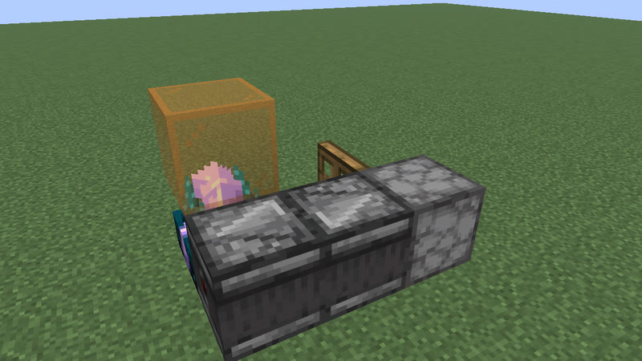</a> 66 gt (3.3 s) · calibrated_sculk_sensor+dispenser+oak_trapdoor+observer · 5 blocks</td><td align="center"><a href="../archive/census-p66-calibrated_sculk_sensor-dispenser-observer-piston-5b.txt">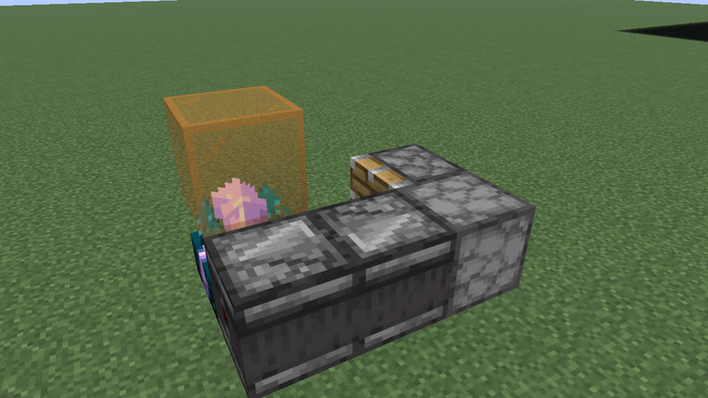</a> 66 gt (3.3 s) · calibrated_sculk_sensor+dispenser+observer+piston · 5 blocks also found as census-p66-calibrated_sculk_sensor-dispenser-observer-sticky_piston-5b (built with sticky_piston, without piston)</td><td align="center"> 66 gt (3.3 s) · calibrated_sculk_sensor+note_block+oak_trapdoor+observer · 5 blocks</td></tr>
<tr><td align="center"><a href="../archive/census-p66-calibrated_sculk_sensor-note_block-observer-piston-5b.txt">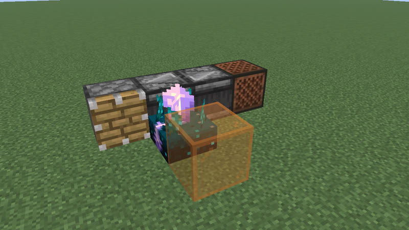</a> 66 gt (3.3 s) · calibrated_sculk_sensor+note_block+observer+piston · 5 blocks also found as census-p66-calibrated_sculk_sensor-note_block-observer-sticky_piston-5b (built with sticky_piston, without piston)</td><td align="center"> 66 gt (3.3 s) · calibrated_sculk_sensor+oak_trapdoor+observer · 5 blocks</td><td align="center"> 66 gt (3.3 s) · calibrated_sculk_sensor+oak_trapdoor+observer+piston · 5 blocks also found as census-p66-calibrated_sculk_sensor-oak_trapdoor-observer-sticky_piston-5b (built with sticky_piston, without piston)</td></tr>
<tr><td align="center"><a href="../archive/census-p66-calibrated_sculk_sensor-observer-piston-5b.txt">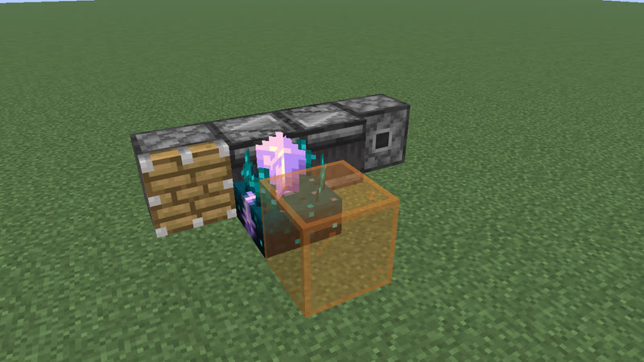</a> 66 gt (3.3 s) · calibrated_sculk_sensor+observer+piston · 5 blocks also found as census-p66-calibrated_sculk_sensor-observer-piston-sticky_piston-5b (built with sticky_piston), census-p66-calibrated_sculk_sensor-observer-sticky_piston-5b (built with sticky_piston, without piston)</td><td align="center"> 66 gt (3.3 s) · calibrated_sculk_sensor+dispenser+observer · 6 blocks</td><td align="center"><a href="../archive/clk-obs-p66-lamp-obs-pis-stk-7b-bb8466.txt">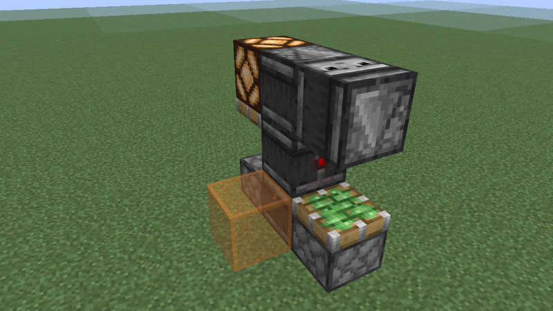</a> 66 gt (3.3 s) · observer+piston+redstone_lamp+sticky_piston · 7 blocks</td></tr>
<tr><td align="center"> 66 gt (3.3 s) · note_block+observer+piston+sticky_piston · 7 blocks</td><td align="center"> 66 gt (3.3 s) · observer+piston+sticky_piston · 7 blocks</td><td align="center"><a href="../archive/clk-obs-p66-lamp-obs-stk-7b-748c24.txt">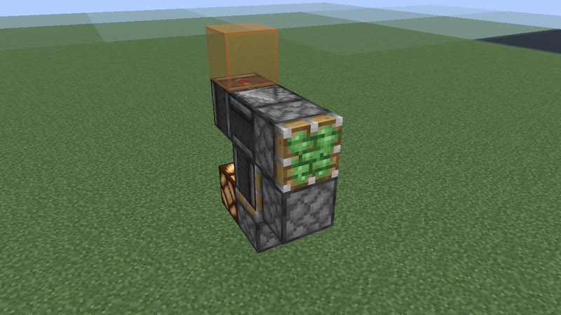</a> 66 gt (3.3 s) · observer+redstone_lamp+sticky_piston · 7 blocks</td></tr>
<tr><td align="center"><a href="../archive/clk-obs-p66-lamp-obs-stk-7b-b-fa64de.txt">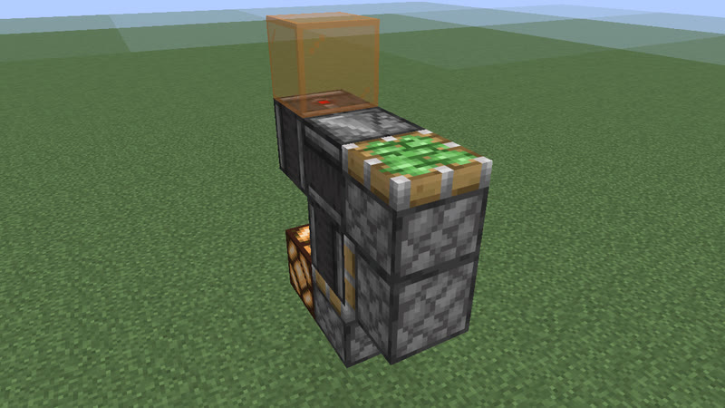</a> 66 gt (3.3 s) · observer+redstone_lamp+sticky_piston · 7 blocks</td><td align="center"><a href="../archive/clk-obs-p66-note-obs-stk-7b-b-31264e.txt">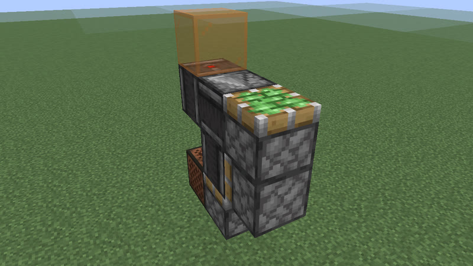</a> 66 gt (3.3 s) · note_block+observer+sticky_piston · 7 blocks</td><td align="center"><a href="../archive/clk-obs-p66-note-obs-stk-7b-cebaa9.txt">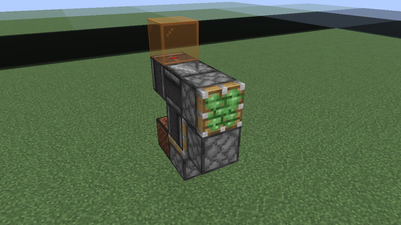</a> 66 gt (3.3 s) · note_block+observer+sticky_piston · 7 blocks</td></tr>
<tr><td align="center"><a href="../archive/clk-obs-p66-obs-stk-7b-a36052.txt">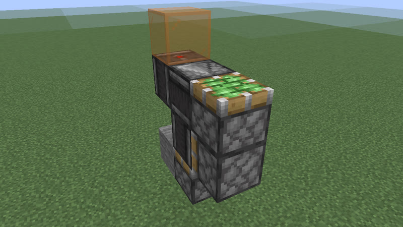</a> 66 gt (3.3 s) · observer+sticky_piston · 7 blocks</td><td align="center"> 66 gt (3.3 s) · observer+sticky_piston · 7 blocks</td><td align="center"> 66 gt (3.3 s) · redstone_torch+repeater · 20 blocks</td></tr>
<tr><td align="center"> 66 gt (3.3 s) · repeater · 23 blocks</td></tr>
</table>

## 67 gt (3.35 s)

Also reachable by: clk-obs-odd-a (n = 14), dropper ring (clk-item-dropring-1d-r24, n = 1), clk-sculk-replin (one block swapped: 2 versions) (clk-sculk-replin, n = 7), clk-sculk-hairpin (one block swapped: 2 versions) (clk-sculk-hairpin, n = 4), clk-misc-cart-pingpong (n = 6), clk-sculk-hairpin-plain (n = 4).

<table>
<tr><td align="center"> 67 gt (3.35 s) · observer+sticky_piston · 8 blocks</td><td align="center"> 67 gt (3.35 s) · oak_fence_gate+repeater+sculk_sensor · 10 blocks</td><td align="center"> 67 gt (3.35 s) · repeater · 39 blocks</td></tr>
</table>

## 68 gt (3.4 s)

Also reachable by: clk-obs-obs-ring (n = 15), clk-obs-bulb-ring (n = 6), clk-rt-uloop2t (n = 3), dropper ring (clk-item-dropring-1d-r3, n = 2), clk-rt-uloop1t (n = 1).

<table>
<tr><td align="center"> 68 gt (3.4 s) · observer+sticky_piston · 8 blocks</td><td align="center"> 68 gt (3.4 s) · calibrated_sculk_sensor+note_block · 10 blocks</td><td align="center"> 68 gt (3.4 s) · repeater · 23 blocks</td></tr>
</table>

## 69 gt (3.45 s)

Also reachable by: clk-obs-odd-b (n = 14), dropper ring (clk-item-dropring-1d, n = 3).

<table>
<tr><td align="center"> 69 gt (3.45 s) · calibrated_sculk_sensor+dispenser+observer · 6 blocks</td><td align="center"> 69 gt (3.45 s) · observer+sticky_piston · 7 blocks</td><td align="center"> 69 gt (3.45 s) · calibrated_sculk_sensor+note_block · 11 blocks</td></tr>
<tr><td align="center"> 69 gt (3.45 s) · repeater · 40 blocks</td></tr>
</table>

## 70 gt (3.5 s)

Also reachable by: observer ring with a relay block (clk-obs-note-ring, n = 15), hopper ring (clk-item-hopper-ring, n = 4), dropper ring (clk-item-dropring-1d-r4, n = 2).

<table>
<tr><td align="center"> 70 gt (3.5 s) · calibrated_sculk_sensor+dispenser+observer+sticky_piston · 6 blocks</td><td align="center"> 70 gt (3.5 s) · calibrated_sculk_sensor+observer+sticky_piston · 7 blocks</td><td align="center"> 70 gt (3.5 s) · note_block+observer+piston+sticky_piston · 7 blocks</td></tr>
<tr><td align="center"> 70 gt (3.5 s) · note_block+observer+sticky_piston · 7 blocks</td><td align="center"> 70 gt (3.5 s) · note_block+observer+sticky_piston · 7 blocks</td><td align="center"> 70 gt (3.5 s) · observer+piston+sticky_piston · 7 blocks</td></tr>
<tr><td align="center"> 70 gt (3.5 s) · observer+piston+sticky_piston · 7 blocks</td><td align="center"> 70 gt (3.5 s) · observer+sticky_piston · 7 blocks</td><td align="center"> 70 gt (3.5 s) · observer+sticky_piston · 7 blocks</td></tr>
<tr><td align="center"> 70 gt (3.5 s) · repeater · 23 blocks</td></tr>
</table>

## 71 gt (3.55 s)

Also reachable by: clk-obs-odd-a (n = 15), clk-rt-odd-rect (n = 6), clk-sculk-hairpin-dispenser (n = 4), clk-misc-cart-loop (n = 9), clk-sculk-replin-dispenser (n = 7), dropper ring (clk-item-dropring-2d-r1, n = 2).

<table>
<tr><td align="center"> 71 gt (3.55 s) · calibrated_sculk_sensor+observer+sticky_piston · 7 blocks</td></tr>
</table>

## 72 gt (3.6 s)

Also reachable by: clk-obs-obs-ring (n = 16), dropper ring (clk-item-dropring-2d-r14, n = 2), clk-misc-cart-pingpong (n = 7), clk-rt-div (n = 1).

<table>
<tr><td align="center"> 72 gt (3.6 s) · calibrated_sculk_sensor+observer+sticky_piston · 6 blocks</td><td align="center"><a href="../archive/clk-sculk-hyb3b-p72-7.txt">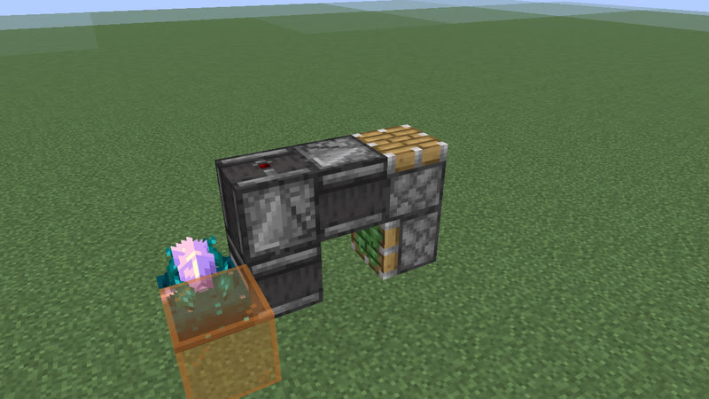</a> 72 gt (3.6 s) · calibrated_sculk_sensor+observer+piston+sticky_piston · 6 blocks</td><td align="center"> 72 gt (3.6 s) · copper_bulb+observer+piston+sticky_piston · 7 blocks</td></tr>
<tr><td align="center"> 72 gt (3.6 s) · copper_bulb+observer+piston+sticky_piston · 7 blocks</td><td align="center"> 72 gt (3.6 s) · copper_bulb+observer+sticky_piston · 7 blocks</td><td align="center"> 72 gt (3.6 s) · copper_bulb+observer+sticky_piston · 7 blocks</td></tr>
<tr><td align="center"> 72 gt (3.6 s) · calibrated_sculk_sensor+dispenser+observer · 7 blocks</td><td align="center"> 72 gt (3.6 s) · redstone_torch+redstone_wire+repeater · 16 blocks</td><td align="center"> 72 gt (3.6 s) · repeater · 23 blocks</td></tr>
</table>

## 73 gt (3.65 s)

Also reachable by: clk-obs-odd-b (n = 15), dropper ring (clk-item-dropring-2d-r2, n = 3).

<table>
<tr><td align="center"> 73 gt (3.65 s) · observer+sticky_piston · 8 blocks</td><td align="center"> 73 gt (3.65 s) · calibrated_sculk_sensor+note_block · 10 blocks</td><td align="center"><a href="../archive/clk-misc-boat-bouncer-c3.txt">clk-misc-boat-bouncer-c3</a> 73 gt (3.65 s) · oak_boat+tripwire+tripwire_hook · 20 blocks (picture pending)</td></tr>
<tr><td align="center"><a href="../archive/clk-misc-boat-bouncer-trapdoor.txt">clk-misc-boat-bouncer-trapdoor</a> 73 gt (3.65 s) · oak_boat+oak_trapdoor+tripwire+tripwire_hook · 20 blocks (picture pending)</td><td align="center"> 73 gt (3.65 s) · repeater · 43 blocks</td></tr>
</table>

## 74 gt (3.7 s)

Also reachable by: observer ring with a relay block (clk-obs-note-ring, n = 16), dropper ring (clk-item-dropring-2d-r24, n = 2).

<table>
<tr><td align="center"> 74 gt (3.7 s) · copper_bulb+observer+piston+sticky_piston · 7 blocks</td><td align="center"> 74 gt (3.7 s) · copper_bulb+observer+piston+sticky_piston · 7 blocks</td><td align="center"> 74 gt (3.7 s) · copper_bulb+observer+sticky_piston · 7 blocks</td></tr>
<tr><td align="center"> 74 gt (3.7 s) · copper_bulb+observer+sticky_piston · 7 blocks</td><td align="center"> 74 gt (3.7 s) · calibrated_sculk_sensor+note_block · 10 blocks</td><td align="center"> 74 gt (3.7 s) · comparator+hopper · 12 blocks</td></tr>
<tr><td align="center"> 74 gt (3.7 s) · redstone_torch+repeater · 24 blocks</td><td align="center"> 74 gt (3.7 s) · repeater · 24 blocks</td></tr>
</table>

## 75 gt (3.75 s)

Also reachable by: clk-obs-odd-a (n = 16), dropper ring (clk-item-dropring-2d-r3, n = 3).

<table>
<tr><td align="center"> 75 gt (3.75 s) · calibrated_sculk_sensor+note_block · 10 blocks</td><td align="center"> 75 gt (3.75 s) · detector_rail+minecart · 27 blocks</td><td align="center"> 75 gt (3.75 s) · repeater · 43 blocks</td></tr>
</table>

## 76 gt (3.8 s)

Also reachable by: clk-obs-obs-ring (n = 17), clk-obs-bulb-ring (n = 7), clk-misc-cart-loop (n = 10), dropper ring (clk-item-dropring-2d, n = 3), clk-sculk-replin (one block swapped: 2 versions) (clk-sculk-replin, n = 8), clk-sculk-racetrack-plain (n = 4), ring lock (clk-item-ringlock-rows, n = 0).

<table>
<tr><td align="center"><a href="../archive/clk-obs-p76-bulb-obs-rb-stk-7b-cd52f9.txt">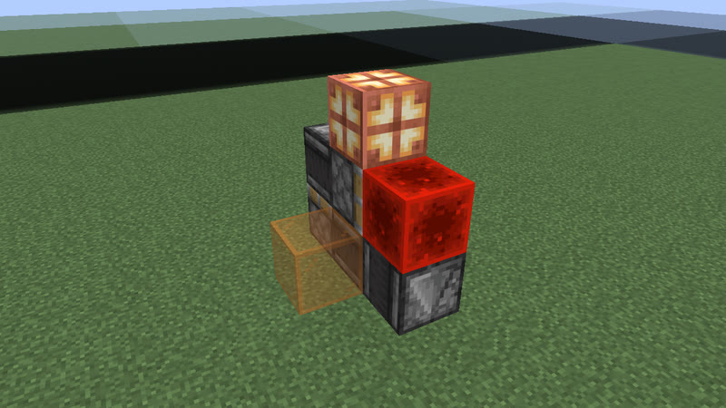</a> 76 gt (3.8 s) · copper_bulb+observer+redstone_block+sticky_piston · 7 blocks</td><td align="center"><a href="../archive/clk-obs-p76-bulb-obs-stk-7b-b-111ad2.txt">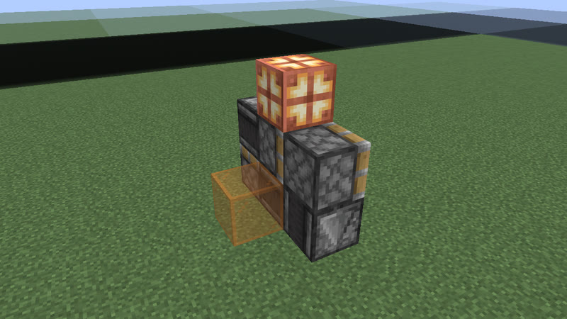</a> 76 gt (3.8 s) · copper_bulb+observer+sticky_piston · 7 blocks</td><td align="center"><a href="../archive/clk-obs-p76-bulb-obs-stk-7b-d8a316.txt">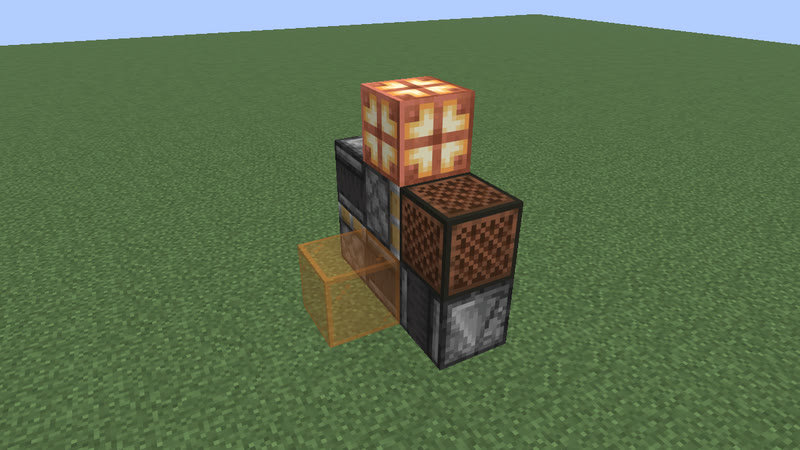</a> 76 gt (3.8 s) · copper_bulb+observer+sticky_piston · 7 blocks</td></tr>
<tr><td align="center"><a href="../archive/clk-sculk-chain-p76-5.txt">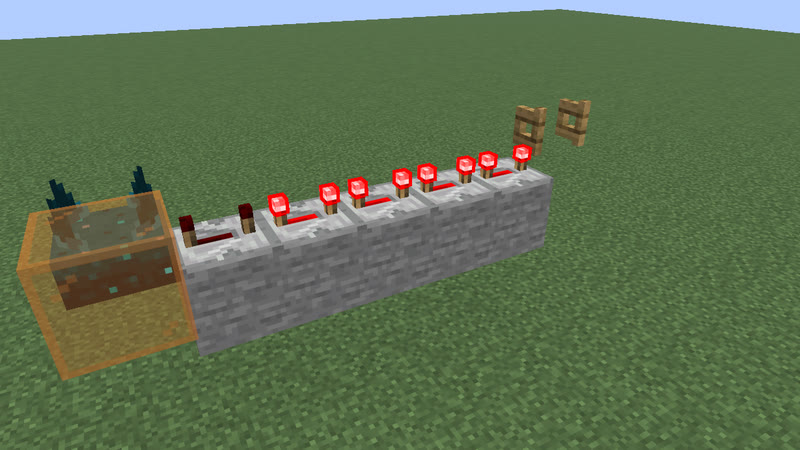</a> 76 gt (3.8 s) · oak_fence_gate+repeater+sculk_sensor · 12 blocks</td><td align="center"> 76 gt (3.8 s) · comparator+hopper · 12 blocks</td><td align="center"> 76 gt (3.8 s) · redstone_torch+redstone_wire+repeater · 16 blocks</td></tr>
<tr><td align="center"> 76 gt (3.8 s) · repeater · 24 blocks</td></tr>
</table>

## 77 gt (3.85 s)

Also reachable by: clk-obs-odd-b (n = 16), hopper ring (clk-item-hopper-ring-2, n = 10), dropper ring (clk-item-dropring-2d-r4, n = 3), clk-misc-cart-pingpong (n = 8).

<table>
<tr><td align="center"><a href="../archive/clk-obs-p77-obs-pis-stk-8b-8486d1.txt">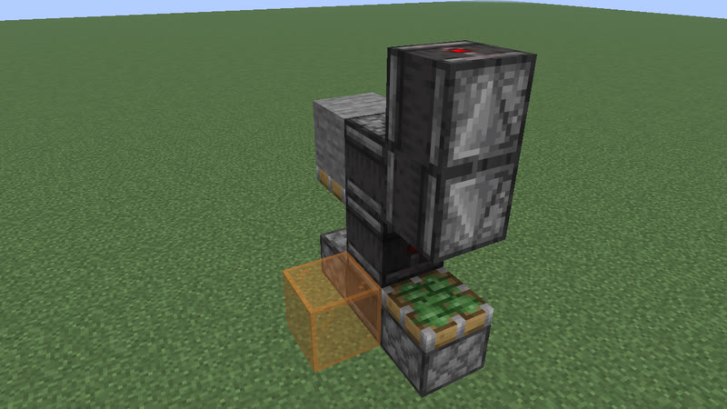</a> 77 gt (3.85 s) · observer+piston+sticky_piston · 8 blocks</td><td align="center"><a href="../archive/clk-sculk-chain-p77-1.txt">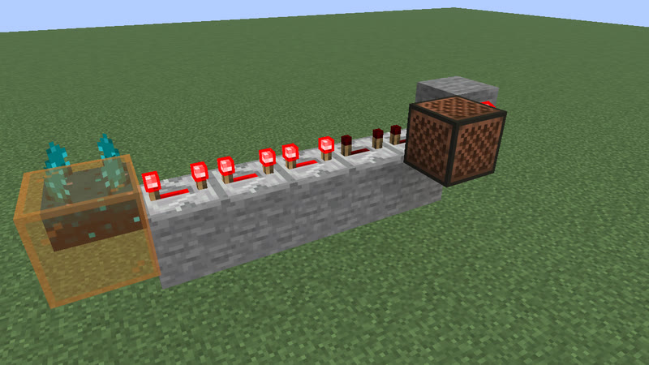</a> 77 gt (3.85 s) · note_block+redstone_torch+repeater+sculk_sensor · 14 blocks</td><td align="center"><a href="../archive/clk-misc-boat-bouncer-slab.txt">clk-misc-boat-bouncer-slab</a> 77 gt (3.85 s) · oak_boat+tripwire+tripwire_hook · 20 blocks (picture pending)</td></tr>
<tr><td align="center"><a href="../archive/clk-rt-odd-rect-p77-44b.txt">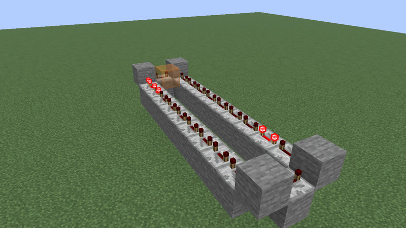</a> 77 gt (3.85 s) · repeater · 44 blocks</td></tr>
</table>

## 78 gt (3.9 s)

Also reachable by: observer ring with a relay block (clk-obs-note-ring, n = 17), dropper ring (clk-item-dropring-1d-r1, n = 3), clk-item-latch (n = 3).

<table>
<tr><td align="center"><a href="../archive/clk-obs-p78-obs-pis-6b.txt">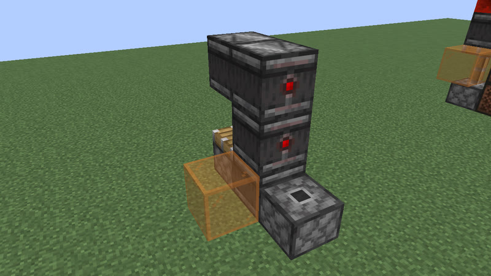</a> 78 gt (3.9 s) · observer+piston · 6 blocks also found as clk-obs-p78-obs-pis-stk-6b-ae5d12 (built with sticky_piston)</td><td align="center"><a href="../archive/clk-obs-p78-obs-pis-6b-e9cf91.txt">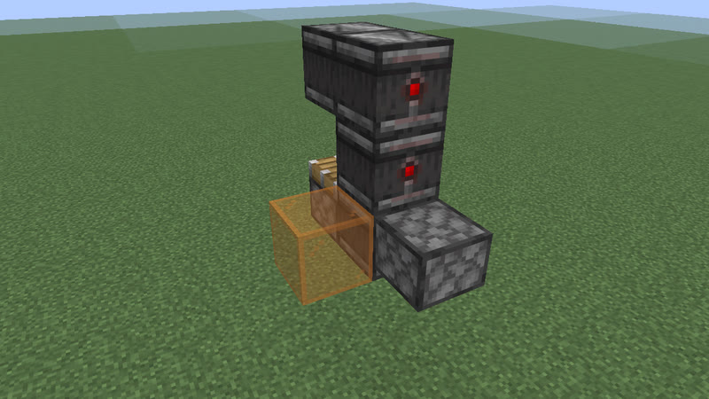</a> 78 gt (3.9 s) · observer+piston · 6 blocks also found as clk-obs-p78-obs-pis-stk-6b-b-9cb035 (built with sticky_piston)</td><td align="center"> 78 gt (3.9 s) · comparator+hopper · 12 blocks</td></tr>
<tr><td align="center"><a href="../archive/clk-sculk-ringbig6-p78-1.txt">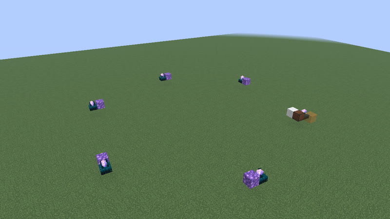</a> 78 gt (3.9 s) · calibrated_sculk_sensor+note_block · 13 blocks</td><td align="center"><a href="../archive/clk-rt-uloop-T-1--4--4--4--4--4--4--4--4--4--T.txt">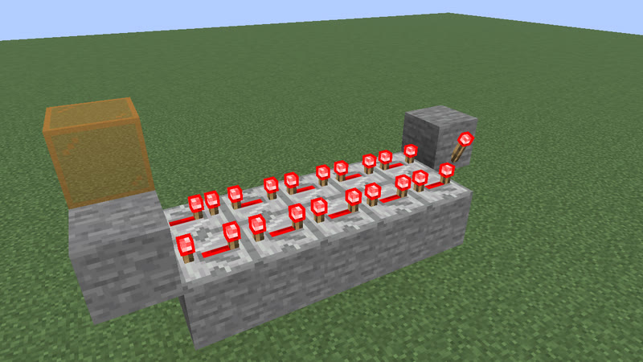</a> 78 gt (3.9 s) · redstone_torch+repeater · 24 blocks</td><td align="center"><a href="../archive/clk-rt-rect3x6-p78-24b.txt">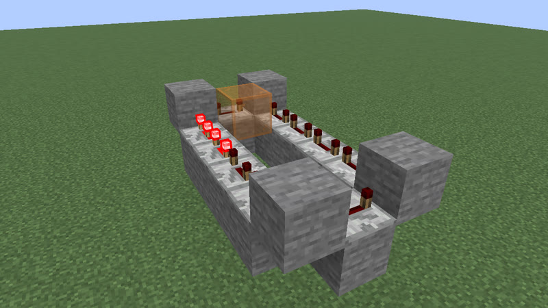</a> 78 gt (3.9 s) · repeater · 24 blocks</td></tr>
</table>

## 79 gt (3.95 s)

Also reachable by: clk-obs-odd-a (n = 17), clk-rt-odd-rect (n = 7), dropper ring (clk-item-dropring-1d-r14, n = 2).

<table>
<tr><td align="center"><a href="../archive/clk-obs-p79-obs-pis-stk-7b-109879.txt">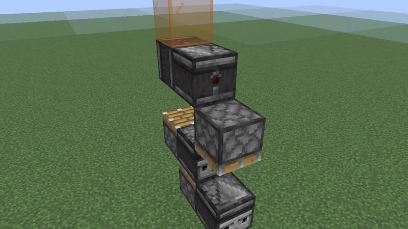</a> 79 gt (3.95 s) · observer+piston+sticky_piston · 7 blocks</td><td align="center"><a href="../archive/clk-sculk-chain-p79-1.txt">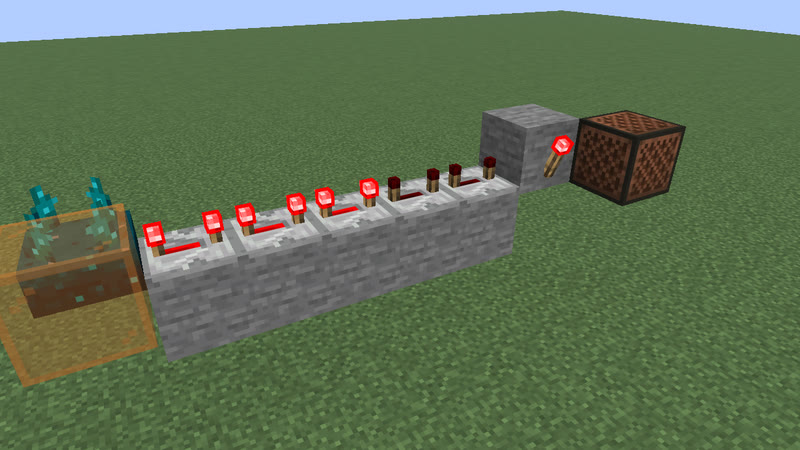</a> 79 gt (3.95 s) · note_block+redstone_torch+repeater+sculk_sensor · 14 blocks</td></tr>
</table>

## 80 gt (4 s)

Also reachable by: clk-obs-obs-ring (n = 18), clk-sculk-replin-dispenser (n = 8), dropper ring (clk-item-dropring-1d-r2, n = 3), clk-rt-rect-pulse (n = 3).

<table>
<tr><td align="center"><a href="../archive/clk-obs-p80-bulb-obs-stk-7b-8111d6.txt">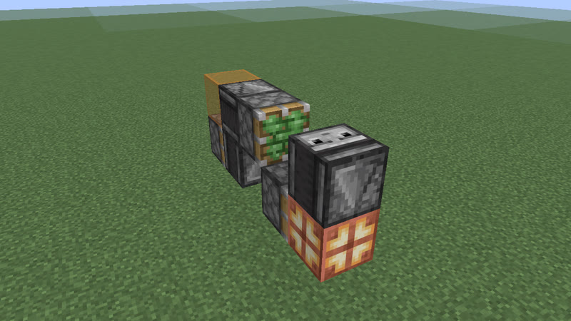</a> 80 gt (4 s) · copper_bulb+observer+sticky_piston · 7 blocks</td><td align="center"><a href="../archive/clk-obs-p80-obs-rb-stk-7b-8ebe2d.txt">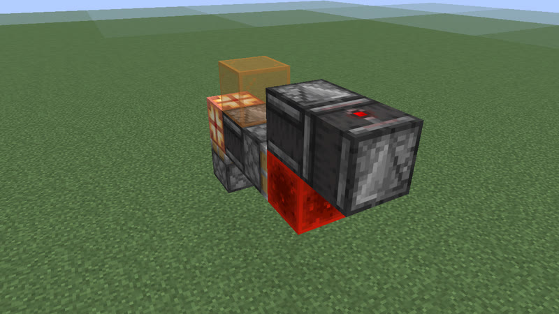</a> 80 gt (4 s) · observer+redstone_block+sticky_piston · 7 blocks</td><td align="center"><a href="../archive/clk-obs-p80-obs-stk-7b-b-21b674.txt">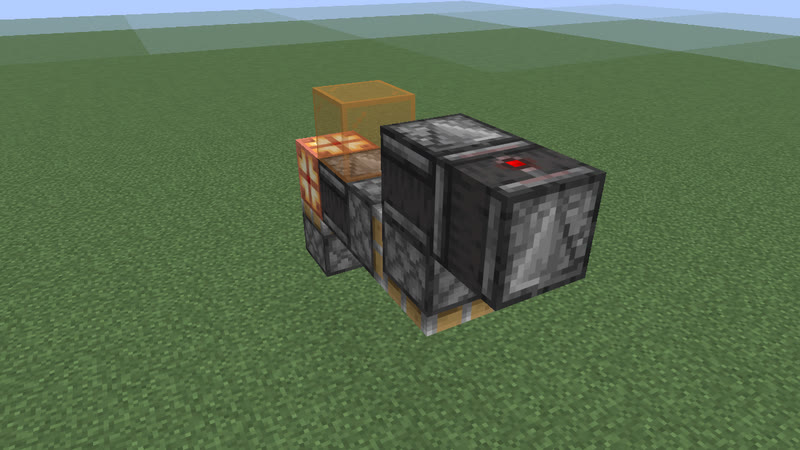</a> 80 gt (4 s) · observer+sticky_piston · 7 blocks</td></tr>
<tr><td align="center"><a href="../archive/clk-obs-p80-obs-stk-7b-ef523d.txt">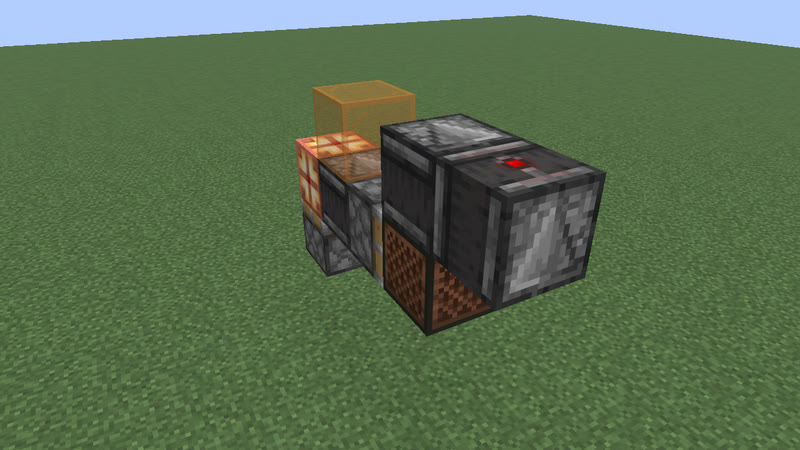</a> 80 gt (4 s) · observer+sticky_piston · 7 blocks</td><td align="center"><a href="../archive/clk-obs-p80-obs-rb-stk-7b-b-150950.txt">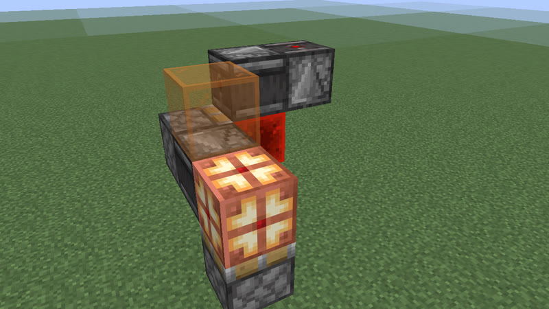</a> 80 gt (4 s) · observer+redstone_block+sticky_piston · 7 blocks</td><td align="center"><a href="../archive/clk-sculk-ringbig6-p80-1.txt">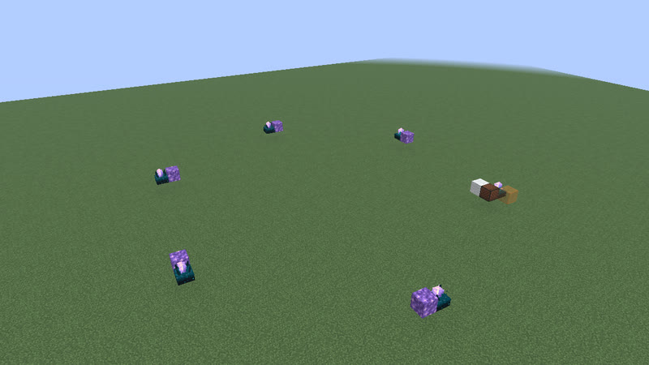</a> 80 gt (4 s) · calibrated_sculk_sensor+note_block · 13 blocks</td></tr>
<tr><td align="center"><a href="../archive/clk-rt-rect3x4-inv-p80-16b.txt">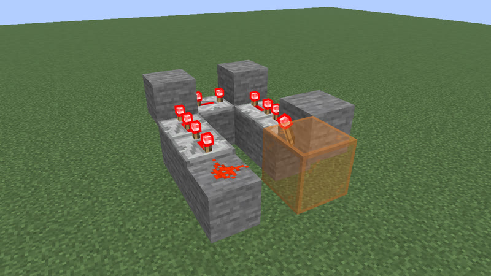</a> 80 gt (4 s) · redstone_torch+redstone_wire+repeater · 16 blocks</td></tr>
</table>

## 81 gt (4.05 s)

Also reachable by: clk-obs-odd-b (n = 17), clk-misc-cart-loop (n = 11), dropper ring (clk-item-dropring-1d-r24, n = 2).

<table>
<tr><td align="center"><a href="../archive/clk-obs-p81-obs-stk-8b-2f85ce.txt">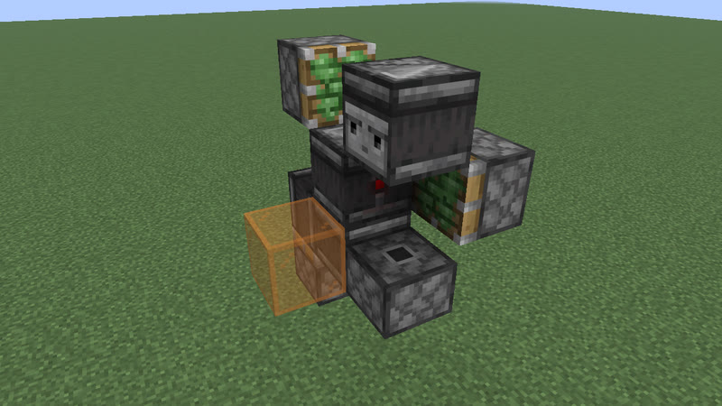</a> 81 gt (4.05 s) · observer+sticky_piston · 8 blocks</td><td align="center"> 81 gt (4.05 s) · comparator+dropper+hopper · 10 blocks</td><td align="center"> 81 gt (4.05 s) · repeater · 47 blocks</td></tr>
</table>

## 82 gt (4.1 s)

Also reachable by: observer ring with a relay block (clk-obs-note-ring, n = 18), dropper ring (clk-item-dropring-1d-r3, n = 3), clk-misc-cart-pingpong (n = 9).

<table>
<tr><td align="center"><a href="../archive/census-p82-note_block-observer-sculk_sensor-sticky_piston-6b.txt">census-p82-note_block-observer-sculk_sensor-sticky_piston-6b</a> 82 gt (4.1 s) · note_block+observer+sculk_sensor+sticky_piston · 6 blocks (picture pending)</td><td align="center"><a href="../archive/census-p82-oak_trapdoor-observer-sculk_sensor-sticky_piston-6b.txt">census-p82-oak_trapdoor-observer-sculk_sensor-sticky_piston-6b</a> 82 gt (4.1 s) · oak_trapdoor+observer+sculk_sensor+sticky_piston · 6 blocks (picture pending)</td><td align="center"><a href="../archive/census-p82-observer-piston-sculk_sensor-sticky_piston-6b.txt">census-p82-observer-piston-sculk_sensor-sticky_piston-6b</a> 82 gt (4.1 s) · observer+piston+sculk_sensor+sticky_piston · 6 blocks (picture pending)</td></tr>
<tr><td align="center"><a href="../archive/census-p82-observer-sculk_sensor-sticky_piston-6b.txt">census-p82-observer-sculk_sensor-sticky_piston-6b</a> 82 gt (4.1 s) · observer+sculk_sensor+sticky_piston · 6 blocks (picture pending)</td><td align="center"><a href="../archive/clk-obs-p82-obs-stk-8b-9b2479.txt">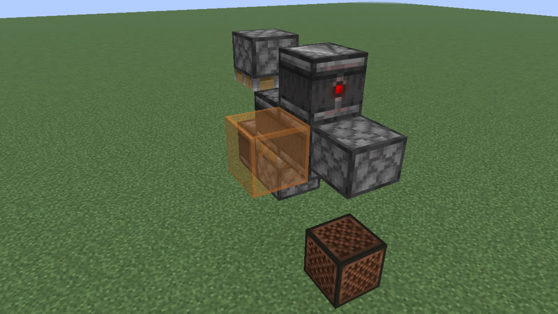</a> 82 gt (4.1 s) · observer+sticky_piston · 8 blocks</td><td align="center"><a href="../archive/clk-sculk-ringbig6-p82-1.txt">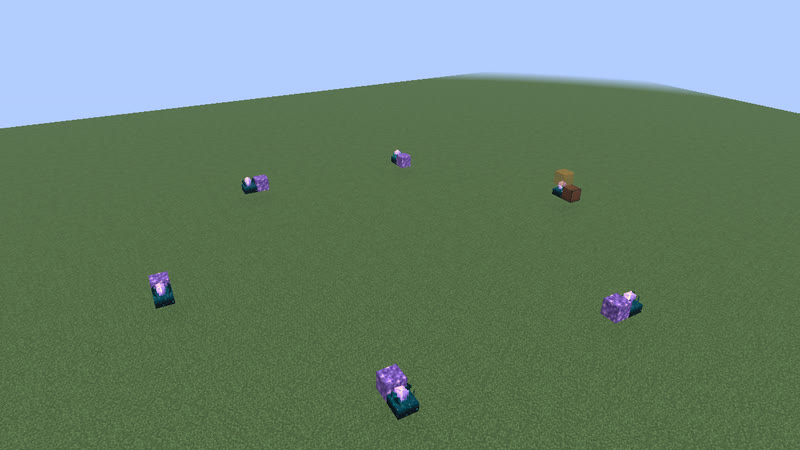</a> 82 gt (4.1 s) · calibrated_sculk_sensor+note_block · 12 blocks</td></tr>
<tr><td align="center"><a href="../archive/clk-misc-boat-bouncer.txt">clk-misc-boat-bouncer</a> 82 gt (4.1 s) · oak_boat+tripwire+tripwire_hook · 19 blocks (picture pending)</td><td align="center"><a href="../archive/clk-rt-uloop-T-3--4--4--4--4--4--4--4--4--4--T.txt">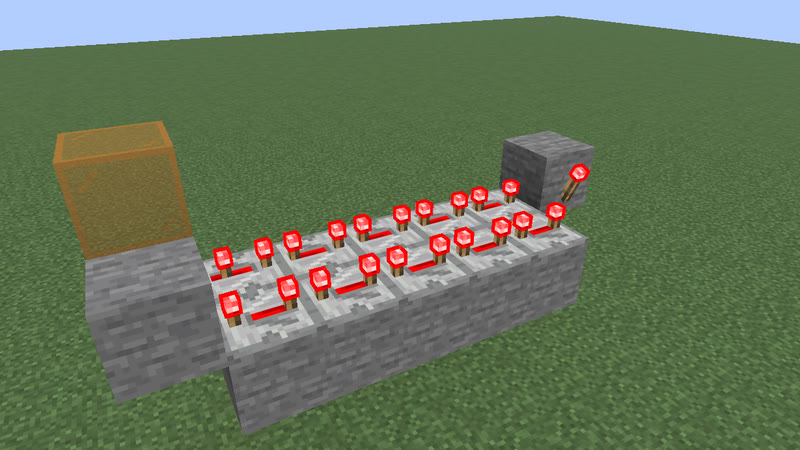</a> 82 gt (4.1 s) · redstone_torch+repeater · 24 blocks</td><td align="center"><a href="../archive/clk-rt-rect3x7-p82-27b.txt">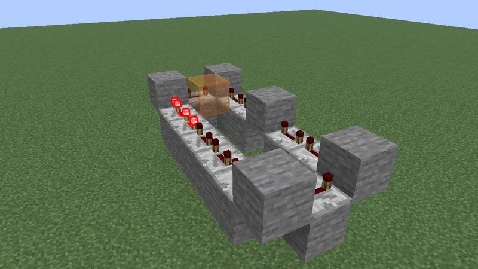</a> 82 gt (4.1 s) · repeater · 27 blocks</td></tr>
</table>

## 83 gt (4.15 s)

Also reachable by: clk-obs-odd-a (n = 18), dropper ring (clk-item-dropring-1d, n = 4), clk-sculk-hairpin (one block swapped: 2 versions) (clk-sculk-hairpin, n = 5), clk-sculk-hairpin-plain (n = 5).

<table>
<tr><td align="center"><a href="../archive/clk-obs-p83-obs-pis-stk-8b-3c3640.txt">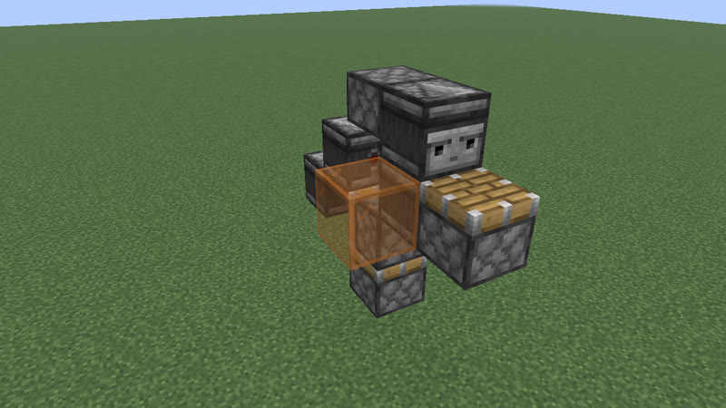</a> 83 gt (4.15 s) · observer+piston+sticky_piston · 8 blocks</td><td align="center"><a href="../archive/clk-rt-odd-rect-p83-47b.txt">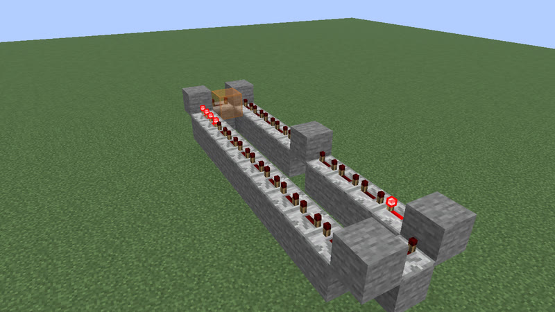</a> 83 gt (4.15 s) · repeater · 47 blocks</td></tr>
</table>

## 84 gt (4.2 s)

Also reachable by: clk-obs-obs-ring (n = 19), hopper ring (clk-item-hopper-ring, n = 5), clk-obs-bulb-ring (n = 8), clk-rt-uloop2t (n = 4), dropper ring (clk-item-dropring-1d-r4, n = 3), clk-rt-rect-inv (n = 1).

<table>
<tr><td align="center"> 84 gt (4.2 s) · calibrated_sculk_sensor+dispenser+observer+sculk_sensor · 5 blocks</td><td align="center"> 84 gt (4.2 s) · calibrated_sculk_sensor+dispenser+observer+piston+sculk_sensor · 5 blocks also found as census-p84-calibrated_sculk_sensor-dispenser-observer-sculk_sensor-sticky_piston-5b (built with sticky_piston, without piston)</td><td align="center"> 84 gt (4.2 s) · copper_bulb+observer+redstone_lamp+sticky_piston · 7 blocks</td></tr>
<tr><td align="center"> 84 gt (4.2 s) · copper_bulb+observer+redstone_lamp+sticky_piston · 7 blocks</td><td align="center"> 84 gt (4.2 s) · copper_bulb+note_block+observer+sticky_piston · 7 blocks</td><td align="center"> 84 gt (4.2 s) · copper_bulb+note_block+observer+sticky_piston · 7 blocks</td></tr>
<tr><td align="center"> 84 gt (4.2 s) · copper_bulb+observer+piston · 7 blocks</td><td align="center"> 84 gt (4.2 s) · copper_bulb+observer+piston+sticky_piston · 7 blocks</td><td align="center"> 84 gt (4.2 s) · copper_bulb+observer+piston+sticky_piston · 7 blocks also found as clk-obs-p84-bulb-obs-pis-7b-b-5c0922 (built without sticky_piston)</td></tr>
<tr><td align="center"> 84 gt (4.2 s) · copper_bulb+observer+redstone_block+sticky_piston · 7 blocks</td><td align="center"> 84 gt (4.2 s) · copper_bulb+observer+sticky_piston · 7 blocks</td><td align="center"> 84 gt (4.2 s) · copper_bulb+observer+sticky_piston · 7 blocks</td></tr>
<tr><td align="center"> 84 gt (4.2 s) · observer+piston+redstone_lamp+sticky_piston · 7 blocks</td><td align="center"> 84 gt (4.2 s) · note_block+observer+piston+sticky_piston · 7 blocks</td><td align="center"> 84 gt (4.2 s) · observer+piston+sticky_piston · 7 blocks</td></tr>
<tr><td align="center"> 84 gt (4.2 s) · copper_bulb+observer+piston+redstone_lamp+sticky_piston · 7 blocks</td><td align="center"> 84 gt (4.2 s) · copper_bulb+observer+piston+redstone_lamp+sticky_piston · 7 blocks</td><td align="center"> 84 gt (4.2 s) · copper_bulb+note_block+observer+piston+sticky_piston · 7 blocks</td></tr>
<tr><td align="center"> 84 gt (4.2 s) · copper_bulb+note_block+observer+piston+sticky_piston · 7 blocks</td><td align="center"> 84 gt (4.2 s) · copper_bulb+observer+redstone_block+sticky_piston · 7 blocks</td><td align="center"> 84 gt (4.2 s) · comparator+hopper+redstone_torch+redstone_wire · 10 blocks</td></tr>
<tr><td align="center"> 84 gt (4.2 s) · comparator+hopper · 14 blocks</td><td align="center"> 84 gt (4.2 s) · redstone_torch+redstone_wire+repeater · 17 blocks</td><td align="center"> 84 gt (4.2 s) · repeater · 27 blocks</td></tr>
</table>

## 85 gt (4.25 s)

Also reachable by: clk-obs-odd-b (n = 18), dropper ring (clk-item-dropring-2d-r1, n = 3), clk-sculk-replin (one block swapped: 2 versions) (clk-sculk-replin, n = 9).

<table>
<tr><td align="center"><a href="../archive/census-p85-calibrated_sculk_sensor-dispenser-oak_trapdoor-observer-sculk_sensor-6b.txt">census-p85-calibrated_sculk_sensor-dispenser-oak_trapdoor-observer-sculk_sensor-6b</a> 85 gt (4.25 s) · calibrated_sculk_sensor+dispenser+oak_trapdoor+observer+sculk_sensor · 6 blocks (picture pending)</td><td align="center"><a href="../archive/census-p85-calibrated_sculk_sensor-oak_trapdoor-observer-sculk_sensor-6b.txt">census-p85-calibrated_sculk_sensor-oak_trapdoor-observer-sculk_sensor-6b</a> 85 gt (4.25 s) · calibrated_sculk_sensor+oak_trapdoor+observer+sculk_sensor · 6 blocks (picture pending)</td><td align="center"><a href="../archive/census-p85-calibrated_sculk_sensor-oak_trapdoor-observer-piston-sculk_sensor-6b.txt">census-p85-calibrated_sculk_sensor-oak_trapdoor-observer-piston-sculk_sensor-6b</a> 85 gt (4.25 s) · calibrated_sculk_sensor+oak_trapdoor+observer+piston+sculk_sensor · 6 blocks (picture pending) also found as census-p85-calibrated_sculk_sensor-oak_trapdoor-observer-sculk_sensor-sticky_piston-6b (built with sticky_piston, without piston)</td></tr>
<tr><td align="center"><a href="../archive/census-p85-calibrated_sculk_sensor-observer-piston-sculk_sensor-6b.txt">census-p85-calibrated_sculk_sensor-observer-piston-sculk_sensor-6b</a> 85 gt (4.25 s) · calibrated_sculk_sensor+observer+piston+sculk_sensor · 6 blocks (picture pending) also found as census-p85-calibrated_sculk_sensor-observer-piston-sculk_sensor-sticky_piston-6b (built with sticky_piston), census-p85-calibrated_sculk_sensor-observer-sculk_sensor-sticky_piston-6b (built with sticky_piston, without piston)</td><td align="center"> 85 gt (4.25 s) · observer+sculk_sensor+sticky_piston · 6 blocks</td><td align="center"> 85 gt (4.25 s) · comparator+redstone_torch+redstone_wire+repeater · 46 blocks</td></tr>
<tr><td align="center"> 85 gt (4.25 s) · repeater · 48 blocks</td></tr>
</table>

## 86 gt (4.3 s)

Also reachable by: observer ring with a relay block (clk-obs-note-ring, n = 19), clk-misc-cart-loop (n = 12), dropper ring (clk-item-dropring-2d-r14, n = 3).

<table>
<tr><td align="center"><a href="../archive/census-p86-calibrated_sculk_sensor-dispenser-note_block-observer-sculk_sensor-6b.txt">census-p86-calibrated_sculk_sensor-dispenser-note_block-observer-sculk_sensor-6b</a> 86 gt (4.3 s) · calibrated_sculk_sensor+dispenser+note_block+observer+sculk_sensor · 6 blocks (picture pending)</td><td align="center"><a href="../archive/census-p86-calibrated_sculk_sensor-dispenser-oak_trapdoor-observer-sculk_sensor-6b.txt">census-p86-calibrated_sculk_sensor-dispenser-oak_trapdoor-observer-sculk_sensor-6b</a> 86 gt (4.3 s) · calibrated_sculk_sensor+dispenser+oak_trapdoor+observer+sculk_sensor · 6 blocks (picture pending)</td><td align="center"><a href="../archive/census-p86-calibrated_sculk_sensor-note_block-oak_trapdoor-observer-sculk_sensor-6b.txt">census-p86-calibrated_sculk_sensor-note_block-oak_trapdoor-observer-sculk_sensor-6b</a> 86 gt (4.3 s) · calibrated_sculk_sensor+note_block+oak_trapdoor+observer+sculk_sensor · 6 blocks (picture pending)</td></tr>
<tr><td align="center"><a href="../archive/census-p86-note_block-oak_trapdoor-observer-sculk_sensor-6b.txt">census-p86-note_block-oak_trapdoor-observer-sculk_sensor-6b</a> 86 gt (4.3 s) · note_block+oak_trapdoor+observer+sculk_sensor · 6 blocks (picture pending)</td><td align="center"><a href="../archive/census-p86-note_block-observer-sculk_sensor-6b.txt">census-p86-note_block-observer-sculk_sensor-6b</a> 86 gt (4.3 s) · note_block+observer+sculk_sensor · 6 blocks (picture pending)</td><td align="center"><a href="../archive/census-p86-oak_trapdoor-observer-sculk_sensor-6b.txt">census-p86-oak_trapdoor-observer-sculk_sensor-6b</a> 86 gt (4.3 s) · oak_trapdoor+observer+sculk_sensor · 6 blocks (picture pending)</td></tr>
<tr><td align="center"><a href="../archive/census-p86-calibrated_sculk_sensor-dispenser-observer-piston-sculk_sensor-6b.txt">census-p86-calibrated_sculk_sensor-dispenser-observer-piston-sculk_sensor-6b</a> 86 gt (4.3 s) · calibrated_sculk_sensor+dispenser+observer+piston+sculk_sensor · 6 blocks (picture pending) also found as census-p86-calibrated_sculk_sensor-dispenser-observer-sculk_sensor-sticky_piston-6b (built with sticky_piston, without piston)</td><td align="center"><a href="../archive/census-p86-calibrated_sculk_sensor-note_block-observer-piston-sculk_sensor-6b.txt">census-p86-calibrated_sculk_sensor-note_block-observer-piston-sculk_sensor-6b</a> 86 gt (4.3 s) · calibrated_sculk_sensor+note_block+observer+piston+sculk_sensor · 6 blocks (picture pending) also found as census-p86-calibrated_sculk_sensor-note_block-observer-sculk_sensor-sticky_piston-6b (built with sticky_piston, without piston)</td><td align="center"><a href="../archive/census-p86-note_block-observer-piston-sculk_sensor-6b.txt">census-p86-note_block-observer-piston-sculk_sensor-6b</a> 86 gt (4.3 s) · note_block+observer+piston+sculk_sensor · 6 blocks (picture pending) also found as census-p86-note_block-observer-sculk_sensor-sticky_piston-6b (built with sticky_piston, without piston)</td></tr>
<tr><td align="center"><a href="../archive/census-p86-oak_trapdoor-observer-piston-sculk_sensor-6b.txt">census-p86-oak_trapdoor-observer-piston-sculk_sensor-6b</a> 86 gt (4.3 s) · oak_trapdoor+observer+piston+sculk_sensor · 6 blocks (picture pending) also found as census-p86-oak_trapdoor-observer-sculk_sensor-sticky_piston-6b (built with sticky_piston, without piston)</td><td align="center"><a href="../archive/census-p86-observer-piston-sculk_sensor-6b.txt">census-p86-observer-piston-sculk_sensor-6b</a> 86 gt (4.3 s) · observer+piston+sculk_sensor · 6 blocks (picture pending) also found as census-p86-observer-piston-sculk_sensor-sticky_piston-6b (built with sticky_piston)</td><td align="center"> 86 gt (4.3 s) · observer+sculk_sensor+sticky_piston · 6 blocks</td></tr>
<tr><td align="center"> 86 gt (4.3 s) · copper_bulb+observer+redstone_block+sticky_piston · 7 blocks</td><td align="center"> 86 gt (4.3 s) · copper_bulb+observer+redstone_block+sticky_piston · 7 blocks</td><td align="center"> 86 gt (4.3 s) · comparator+redstone_torch+redstone_wire · 17 blocks</td></tr>
<tr><td align="center"> 86 gt (4.3 s) · repeater · 27 blocks</td></tr>
</table>

## 87 gt (4.35 s)

Also reachable by: clk-obs-odd-a (n = 19), clk-rt-odd-rect (n = 8), clk-sculk-hairpin-dispenser (n = 5), dropper ring (clk-item-dropring-2d-r2, n = 4), clk-misc-cart-pingpong (n = 10).

<table>
<tr><td align="center"><a href="../archive/census-p87-calibrated_sculk_sensor-note_block-oak_trapdoor-observer-sculk_sensor-6b.txt">census-p87-calibrated_sculk_sensor-note_block-oak_trapdoor-observer-sculk_sensor-6b</a> 87 gt (4.35 s) · calibrated_sculk_sensor+note_block+oak_trapdoor+observer+sculk_sensor · 6 blocks (picture pending)</td><td align="center"> 87 gt (4.35 s) · calibrated_sculk_sensor+oak_trapdoor+observer+sculk_sensor · 6 blocks</td><td align="center"><a href="../archive/census-p87-calibrated_sculk_sensor-note_block-observer-piston-sculk_sensor-6b.txt">census-p87-calibrated_sculk_sensor-note_block-observer-piston-sculk_sensor-6b</a> 87 gt (4.35 s) · calibrated_sculk_sensor+note_block+observer+piston+sculk_sensor · 6 blocks (picture pending) also found as census-p87-calibrated_sculk_sensor-note_block-observer-sculk_sensor-sticky_piston-6b (built with sticky_piston, without piston)</td></tr>
<tr><td align="center"><a href="../archive/census-p87-calibrated_sculk_sensor-oak_trapdoor-observer-sculk_sensor-sticky_piston-6b.txt">census-p87-calibrated_sculk_sensor-oak_trapdoor-observer-sculk_sensor-sticky_piston-6b</a> 87 gt (4.35 s) · calibrated_sculk_sensor+oak_trapdoor+observer+sculk_sensor+sticky_piston · 6 blocks (picture pending)</td><td align="center"><a href="../archive/census-p87-calibrated_sculk_sensor-observer-piston-sculk_sensor-sticky_piston-6b.txt">census-p87-calibrated_sculk_sensor-observer-piston-sculk_sensor-sticky_piston-6b</a> 87 gt (4.35 s) · calibrated_sculk_sensor+observer+piston+sculk_sensor+sticky_piston · 6 blocks (picture pending)</td><td align="center"> 87 gt (4.35 s) · calibrated_sculk_sensor+observer+sculk_sensor+sticky_piston · 6 blocks</td></tr>
<tr><td align="center"> 87 gt (4.35 s) · observer+piston+sticky_piston · 7 blocks</td><td align="center"> 87 gt (4.35 s) · observer+sticky_piston · 7 blocks</td><td align="center"> 87 gt (4.35 s) · observer+piston+sculk_sensor+sticky_piston · 7 blocks</td></tr>
<tr><td align="center"> 87 gt (4.35 s) · observer+sculk_sensor+sticky_piston · 7 blocks</td></tr>
</table>

## 88 gt (4.4 s)

Also reachable by: clk-obs-obs-ring (n = 20), dropper ring (clk-item-dropring-2d-r24, n = 3).

<table>
<tr><td align="center"> 88 gt (4.4 s) · observer+sculk_sensor+sticky_piston · 4 blocks</td><td align="center"> 88 gt (4.4 s) · note_block+observer+sculk_sensor+sticky_piston · 4 blocks</td><td align="center"> 88 gt (4.4 s) · oak_trapdoor+observer+sculk_sensor+sticky_piston · 4 blocks</td></tr>
<tr><td align="center"> 88 gt (4.4 s) · observer+sculk_sensor+sticky_piston · 4 blocks</td><td align="center"> 88 gt (4.4 s) · dispenser+observer+sculk_sensor+sticky_piston · 5 blocks</td><td align="center"> 88 gt (4.4 s) · iron_trapdoor+observer+sculk_sensor+sticky_piston · 5 blocks</td></tr>
<tr><td align="center"> 88 gt (4.4 s) · oak_fence_gate+observer+sculk_sensor+sticky_piston · 5 blocks</td><td align="center"><a href="../archive/census-p88-oak_trapdoor-observer-sculk_sensor-6b.txt">census-p88-oak_trapdoor-observer-sculk_sensor-6b</a> 88 gt (4.4 s) · oak_trapdoor+observer+sculk_sensor · 6 blocks (picture pending)</td><td align="center"><a href="../archive/census-p88-observer-piston-sculk_sensor-6b.txt">census-p88-observer-piston-sculk_sensor-6b</a> 88 gt (4.4 s) · observer+piston+sculk_sensor · 6 blocks (picture pending)</td></tr>
<tr><td align="center"><a href="../archive/census-p88-calibrated_sculk_sensor-observer-piston-sculk_sensor-sticky_piston-6b.txt">census-p88-calibrated_sculk_sensor-observer-piston-sculk_sensor-sticky_piston-6b</a> 88 gt (4.4 s) · calibrated_sculk_sensor+observer+piston+sculk_sensor+sticky_piston · 6 blocks (picture pending)</td><td align="center"> 88 gt (4.4 s) · comparator+redstone_torch+redstone_wire · 17 blocks</td><td align="center"> 88 gt (4.4 s) · redstone_torch+redstone_wire+repeater · 17 blocks</td></tr>
<tr><td align="center"> 88 gt (4.4 s) · repeater · 27 blocks</td></tr>
</table>

## 89 gt (4.45 s)

Also reachable by: clk-obs-odd-b (n = 19), clk-sculk-replin-dispenser (n = 9), dropper ring (clk-item-dropring-2d-r3, n = 4).

<table>
<tr><td align="center"><a href="../archive/census-p89-calibrated_sculk_sensor-dispenser-observer-sculk_sensor-6b.txt">census-p89-calibrated_sculk_sensor-dispenser-observer-sculk_sensor-6b</a> 89 gt (4.45 s) · calibrated_sculk_sensor+dispenser+observer+sculk_sensor · 6 blocks (picture pending)</td><td align="center"> 89 gt (4.45 s) · calibrated_sculk_sensor+observer+sculk_sensor+sticky_piston · 6 blocks</td><td align="center"> 89 gt (4.45 s) · observer+sculk_sensor+sticky_piston · 7 blocks</td></tr>
<tr><td align="center"> 89 gt (4.45 s) · oak_trapdoor+observer+sculk_sensor+sticky_piston · 7 blocks</td><td align="center"> 89 gt (4.45 s) · iron_trapdoor+observer+sculk_sensor+sticky_piston · 7 blocks</td><td align="center"> 89 gt (4.45 s) · oak_fence_gate+observer+sculk_sensor+sticky_piston · 7 blocks</td></tr>
<tr><td align="center"> 89 gt (4.45 s) · observer+piston+sculk_sensor+sticky_piston · 7 blocks</td><td align="center"> 89 gt (4.45 s) · repeater · 51 blocks</td></tr>
</table>

## 90 gt (4.5 s)

Also reachable by: observer ring with a relay block (clk-obs-note-ring, n = 20), dropper ring (clk-item-dropring-2d, n = 4), ring lock (clk-item-ringlock-rows, n = 1).

<table>
<tr><td align="center"> 90 gt (4.5 s) · oak_trapdoor+observer+sculk_sensor · 4 blocks</td><td align="center"> 90 gt (4.5 s) · observer+piston+sculk_sensor · 4 blocks also found as census-p90-observer-sculk_sensor-sticky_piston-4b (built with sticky_piston, without piston)</td><td align="center"> 90 gt (4.5 s) · calibrated_sculk_sensor+dispenser+observer+sculk_sensor · 5 blocks</td></tr>
<tr><td align="center"> 90 gt (4.5 s) · dispenser+note_block+observer+sculk_sensor · 5 blocks</td><td align="center"><a href="../archive/census-p90-dispenser-observer-sculk_sensor-sticky_piston-6b.txt">census-p90-dispenser-observer-sculk_sensor-sticky_piston-6b</a> 90 gt (4.5 s) · dispenser+observer+sculk_sensor+sticky_piston · 6 blocks (picture pending)</td><td align="center"><a href="../archive/census-p90-note_block-observer-sculk_sensor-sticky_piston-6b.txt">census-p90-note_block-observer-sculk_sensor-sticky_piston-6b</a> 90 gt (4.5 s) · note_block+observer+sculk_sensor+sticky_piston · 6 blocks (picture pending)</td></tr>
<tr><td align="center"> 90 gt (4.5 s) · calibrated_sculk_sensor+observer+sticky_piston · 6 blocks</td><td align="center"> 90 gt (4.5 s) · calibrated_sculk_sensor+oak_trapdoor+observer+sticky_piston · 6 blocks</td><td align="center"> 90 gt (4.5 s) · calibrated_sculk_sensor+iron_trapdoor+observer+sticky_piston · 6 blocks</td></tr>
<tr><td align="center"> 90 gt (4.5 s) · calibrated_sculk_sensor+oak_fence_gate+observer+sticky_piston · 6 blocks</td><td align="center"> 90 gt (4.5 s) · calibrated_sculk_sensor+note_block+observer+sticky_piston · 6 blocks</td><td align="center"> 90 gt (4.5 s) · calibrated_sculk_sensor+dispenser+observer+sticky_piston · 6 blocks</td></tr>
<tr><td align="center"> 90 gt (4.5 s) · calibrated_sculk_sensor+observer+sculk_sensor+sticky_piston · 6 blocks</td><td align="center"> 90 gt (4.5 s) · calibrated_sculk_sensor+observer+piston+sticky_piston · 6 blocks</td><td align="center"> 90 gt (4.5 s) · observer+sticky_piston · 7 blocks</td></tr>
<tr><td align="center"> 90 gt (4.5 s) · comparator+hopper · 14 blocks</td><td align="center"> 90 gt (4.5 s) · redstone_torch+repeater · 28 blocks</td><td align="center"> 90 gt (4.5 s) · repeater · 28 blocks</td></tr>
</table>

## 91 gt (4.55 s)

Also reachable by: clk-obs-odd-a (n = 20), hopper ring (clk-item-hopper-ring-2, n = 12), clk-misc-cart-loop (n = 13), dropper ring (clk-item-dropring-2d-r4, n = 4), clk-misc-crafter-loop (n = 0).

<table>
<tr><td align="center"><a href="../archive/census-p91-calibrated_sculk_sensor-dispenser-oak_trapdoor-observer-sculk_sensor-6b.txt">census-p91-calibrated_sculk_sensor-dispenser-oak_trapdoor-observer-sculk_sensor-6b</a> 91 gt (4.55 s) · calibrated_sculk_sensor+dispenser+oak_trapdoor+observer+sculk_sensor · 6 blocks (picture pending)</td><td align="center"><a href="../archive/census-p91-calibrated_sculk_sensor-dispenser-observer-piston-sculk_sensor-6b.txt">census-p91-calibrated_sculk_sensor-dispenser-observer-piston-sculk_sensor-6b</a> 91 gt (4.55 s) · calibrated_sculk_sensor+dispenser+observer+piston+sculk_sensor · 6 blocks (picture pending) also found as census-p91-calibrated_sculk_sensor-dispenser-observer-sculk_sensor-sticky_piston-6b (built with sticky_piston, without piston)</td><td align="center"> 91 gt (4.55 s) · calibrated_sculk_sensor+oak_trapdoor+observer+sculk_sensor · 6 blocks</td></tr>
<tr><td align="center"> 91 gt (4.55 s) · oak_trapdoor+observer+sculk_sensor+sticky_piston · 6 blocks</td><td align="center"> 91 gt (4.55 s) · dispenser+observer+sculk_sensor+sticky_piston · 6 blocks</td><td align="center"> 91 gt (4.55 s) · iron_trapdoor+observer+sculk_sensor+sticky_piston · 6 blocks</td></tr>
<tr><td align="center"> 91 gt (4.55 s) · oak_fence_gate+observer+sculk_sensor+sticky_piston · 6 blocks</td><td align="center"> 91 gt (4.55 s) · calibrated_sculk_sensor+observer+sculk_sensor+sticky_piston · 6 blocks</td><td align="center"> 91 gt (4.55 s) · note_block+observer+sculk_sensor+sticky_piston · 6 blocks</td></tr>
<tr><td align="center"> 91 gt (4.55 s) · observer+sculk_sensor+sticky_piston · 7 blocks</td><td align="center"> 91 gt (4.55 s) · observer+piston+sculk_sensor+sticky_piston · 7 blocks</td><td align="center"> 91 gt (4.55 s) · repeater · 51 blocks</td></tr>
</table>

## 92 gt (4.6 s)

Also reachable by: clk-obs-obs-ring (n = 21), clk-obs-bulb-ring (n = 9), dropper ring (clk-item-dropring-1d-r1, n = 4), clk-misc-cart-pingpong (n = 11), clk-sculk-racetrack (n = 2), clk-sculk-racetrack-plain (n = 5).

<table>
<tr><td align="center"> 92 gt (4.6 s) · observer+sculk_sensor+sticky_piston · 5 blocks</td><td align="center"> 92 gt (4.6 s) · observer+sculk_sensor+sticky_piston · 5 blocks</td><td align="center"> 92 gt (4.6 s) · copper_bulb+observer+piston+sticky_piston · 7 blocks</td></tr>
<tr><td align="center"> 92 gt (4.6 s) · copper_bulb+observer+piston+sticky_piston · 7 blocks</td><td align="center"> 92 gt (4.6 s) · copper_bulb+observer+sticky_piston · 7 blocks</td><td align="center"> 92 gt (4.6 s) · observer+piston+redstone_block+sticky_piston · 7 blocks</td></tr>
<tr><td align="center"> 92 gt (4.6 s) · observer+piston+sticky_piston · 7 blocks</td><td align="center"> 92 gt (4.6 s) · observer+piston+sticky_piston · 7 blocks</td><td align="center"> 92 gt (4.6 s) · observer+redstone_block+sticky_piston · 7 blocks</td></tr>
<tr><td align="center"> 92 gt (4.6 s) · observer+sticky_piston · 7 blocks</td><td align="center"> 92 gt (4.6 s) · observer+sticky_piston · 7 blocks</td><td align="center"> 92 gt (4.6 s) · redstone_torch+redstone_wire+repeater · 17 blocks</td></tr>
<tr><td align="center"> 92 gt (4.6 s) · repeater · 28 blocks</td></tr>
</table>

## 93 gt (4.65 s)

Also reachable by: clk-obs-odd-b (n = 20), dropper ring (clk-item-dropring-1d-r14, n = 3).

<table>
<tr><td align="center"> 93 gt (4.65 s) · calibrated_sculk_sensor+dispenser+observer+sculk_sensor · 5 blocks</td><td align="center"> 93 gt (4.65 s) · calibrated_sculk_sensor+oak_trapdoor+observer · 6 blocks</td><td align="center"><a href="../archive/census-p93-calibrated_sculk_sensor-note_block-observer-piston-sculk_sensor-6b.txt">census-p93-calibrated_sculk_sensor-note_block-observer-piston-sculk_sensor-6b</a> 93 gt (4.65 s) · calibrated_sculk_sensor+note_block+observer+piston+sculk_sensor · 6 blocks (picture pending) also found as census-p93-calibrated_sculk_sensor-note_block-observer-sculk_sensor-sticky_piston-6b (built with sticky_piston, without piston)</td></tr>
<tr><td align="center"> 93 gt (4.65 s) · dispenser+observer+sculk_sensor+sticky_piston · 6 blocks</td><td align="center"> 93 gt (4.65 s) · calibrated_sculk_sensor+note_block+observer+sculk_sensor · 7 blocks</td><td align="center"> 93 gt (4.65 s) · calibrated_sculk_sensor+observer+sculk_sensor+sticky_piston · 7 blocks</td></tr>
<tr><td align="center"> 93 gt (4.65 s) · calibrated_sculk_sensor+observer+sticky_piston · 7 blocks</td><td align="center"> 93 gt (4.65 s) · observer+piston+sculk_sensor+sticky_piston · 7 blocks</td><td align="center"> 93 gt (4.65 s) · repeater · 52 blocks</td></tr>
</table>

## 94 gt (4.7 s)

Also reachable by: observer ring with a relay block (clk-obs-note-ring, n = 21), dropper ring (clk-item-dropring-1d-r2, n = 4), clk-item-latch (n = 4), clk-sculk-replin (one block swapped: 2 versions) (clk-sculk-replin, n = 10).

<table>
<tr><td align="center"> 94 gt (4.7 s) · observer+sculk_sensor+sticky_piston · 5 blocks</td><td align="center"> 94 gt (4.7 s) · observer+sculk_sensor+sticky_piston · 5 blocks</td><td align="center"><a href="../archive/census-p94-dispenser-observer-sculk_sensor-6b.txt">census-p94-dispenser-observer-sculk_sensor-6b</a> 94 gt (4.7 s) · dispenser+observer+sculk_sensor · 6 blocks (picture pending)</td></tr>
<tr><td align="center"> 94 gt (4.7 s) · observer+piston+sculk_sensor+sticky_piston · 7 blocks</td><td align="center"> 94 gt (4.7 s) · redstone_torch+repeater · 28 blocks</td><td align="center"> 94 gt (4.7 s) · repeater · 28 blocks</td></tr>
</table>

## 95 gt (4.75 s)

Also reachable by: clk-obs-odd-a (n = 21), clk-rt-odd-rect (n = 9), dropper ring (clk-item-dropring-1d-r24, n = 3).

<table>
<tr><td align="center"> 95 gt (4.75 s) · oak_trapdoor+observer+sculk_sensor+sticky_piston · 6 blocks</td><td align="center"> 95 gt (4.75 s) · iron_trapdoor+observer+sculk_sensor+sticky_piston · 6 blocks</td><td align="center"> 95 gt (4.75 s) · oak_fence_gate+observer+sculk_sensor+sticky_piston · 6 blocks</td></tr>
<tr><td align="center"> 95 gt (4.75 s) · note_block+observer+sculk_sensor+sticky_piston · 6 blocks</td><td align="center"> 95 gt (4.75 s) · comparator+redstone_torch+redstone_wire+repeater · 46 blocks</td></tr>
</table>

## 96 gt (4.8 s)

Also reachable by: clk-obs-obs-ring (n = 22), clk-obs-divider (n = 3), clk-misc-cart-loop (n = 14), dropper ring (clk-item-dropring-1d-r3, n = 4), clk-rt-rect-pulse (n = 4).

<table>
<tr><td align="center"> 96 gt (4.8 s) · calibrated_sculk_sensor+dispenser+observer · 6 blocks</td><td align="center"> 96 gt (4.8 s) · calibrated_sculk_sensor+dispenser+observer+sculk_sensor · 6 blocks</td><td align="center"> 96 gt (4.8 s) · observer+sculk_sensor+sticky_piston · 6 blocks</td></tr>
<tr><td align="center"> 96 gt (4.8 s) · copper_bulb+observer+redstone_lamp+sticky_piston · 7 blocks</td><td align="center"> 96 gt (4.8 s) · copper_bulb+observer+redstone_lamp+sticky_piston · 7 blocks</td><td align="center"> 96 gt (4.8 s) · copper_bulb+note_block+observer+sticky_piston · 7 blocks</td></tr>
<tr><td align="center"> 96 gt (4.8 s) · copper_bulb+note_block+observer+sticky_piston · 7 blocks</td><td align="center"> 96 gt (4.8 s) · copper_bulb+observer+sticky_piston · 7 blocks</td><td align="center"> 96 gt (4.8 s) · note_block+observer+sculk_sensor+sticky_piston · 7 blocks</td></tr>
<tr><td align="center"> 96 gt (4.8 s) · copper_bulb+note_block+observer+piston+redstone_block+sticky_piston · 7 blocks</td><td align="center"> 96 gt (4.8 s) · copper_bulb+note_block+observer+redstone_block+sticky_piston · 7 blocks</td><td align="center"> 96 gt (4.8 s) · copper_bulb+observer+piston+redstone_block+sticky_piston · 7 blocks</td></tr>
<tr><td align="center"> 96 gt (4.8 s) · copper_bulb+observer+piston+redstone_block+sticky_piston · 7 blocks</td><td align="center"> 96 gt (4.8 s) · copper_bulb+observer+redstone_block+sticky_piston · 7 blocks</td><td align="center"> 96 gt (4.8 s) · redstone_torch+redstone_wire+repeater · 17 blocks</td></tr>
</table>

## 97 gt (4.85 s)

Also reachable by: clk-obs-odd-b (n = 21), dropper ring (clk-item-dropring-1d, n = 5), clk-misc-cart-pingpong (n = 12).

<table>
<tr><td align="center"> 97 gt (4.85 s) · observer+sculk_sensor+sticky_piston · 6 blocks</td><td align="center"> 97 gt (4.85 s) · repeater · 55 blocks</td></tr>
</table>

## 98 gt (4.9 s)

Also reachable by: observer ring with a relay block (clk-obs-note-ring, n = 22), hopper ring (clk-item-hopper-ring, n = 6), clk-sculk-replin-dispenser (n = 10), dropper ring (clk-item-dropring-1d-r4, n = 4).

<table>
<tr><td align="center"> 98 gt (4.9 s) · observer+sculk_sensor+sticky_piston · 6 blocks</td><td align="center"> 98 gt (4.9 s) · note_block+observer+sculk_sensor+sticky_piston · 7 blocks</td><td align="center"> 98 gt (4.9 s) · comparator+hopper · 10 blocks</td></tr>
<tr><td align="center"> 98 gt (4.9 s) · redstone_torch+repeater · 28 blocks</td><td align="center"> 98 gt (4.9 s) · repeater · 31 blocks</td></tr>
</table>

## 99 gt (4.95 s)

Also reachable by: clk-obs-odd-a (n = 22), dropper ring (clk-item-dropring-2d-r1, n = 4), clk-sculk-hairpin (one block swapped: 2 versions) (clk-sculk-hairpin, n = 6), clk-sculk-hairpin-plain (n = 6).

<table>
<tr><td align="center"><a href="../archive/clk-sculk-ringbig7-p99-1.txt">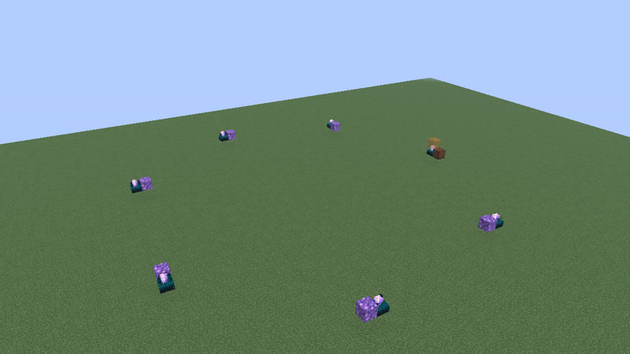</a> 99 gt (4.95 s) · calibrated_sculk_sensor+note_block · 14 blocks</td><td align="center"> 99 gt (4.95 s) · repeater · 55 blocks</td></tr>
</table>

## 100 gt (5 s)

Also reachable by: clk-obs-obs-ring (n = 23), clk-obs-bulb-ring (n = 10), clk-rt-uloop2t (n = 5), dropper ring (clk-item-dropring-2d-r14, n = 4), clk-rt-uloop1t (n = 2).

<table>
<tr><td align="center"> 100 gt (5 s) · observer+sculk_sensor+sticky_piston · 6 blocks</td><td align="center"> 100 gt (5 s) · calibrated_sculk_sensor+dispenser+observer · 7 blocks</td><td align="center"><a href="../archive/clk-obs-p100-bulb-lamp-note-obs-stk-9b-7c365c.txt">clk-obs-p100-bulb-lamp-note-obs-stk-9b-7c365c</a> 100 gt (5 s) · copper_bulb+note_block+observer+redstone_lamp+sticky_piston · 9 blocks (picture pending)</td></tr>
<tr><td align="center"><a href="../archive/clk-obs-p100-bulb-lamp-obs-stk-9b-cd468c.txt">clk-obs-p100-bulb-lamp-obs-stk-9b-cd468c</a> 100 gt (5 s) · copper_bulb+observer+redstone_lamp+sticky_piston · 9 blocks (picture pending)</td><td align="center"><a href="../archive/clk-obs-p100-lamp-note-obs-stk-9b-75a9fa.txt">clk-obs-p100-lamp-note-obs-stk-9b-75a9fa</a> 100 gt (5 s) · note_block+observer+redstone_lamp+sticky_piston · 9 blocks (picture pending)</td><td align="center"><a href="../archive/clk-obs-p100-obs-stk-9b-601348.txt">clk-obs-p100-obs-stk-9b-601348</a> 100 gt (5 s) · observer+sticky_piston · 9 blocks (picture pending)</td></tr>
<tr><td align="center"><a href="../archive/clk-obs-p100-note-obs-stk-9b-67bb42.txt">clk-obs-p100-note-obs-stk-9b-67bb42</a> 100 gt (5 s) · note_block+observer+sticky_piston · 9 blocks (picture pending)</td><td align="center"> 100 gt (5 s) · repeater · 31 blocks</td></tr>
</table>

## 101 gt (5.05 s)

Also reachable by: clk-obs-odd-b (n = 22), clk-misc-cart-loop (n = 15), dropper ring (clk-item-dropring-2d-r2, n = 5).

<table>
<tr><td align="center"><a href="../archive/clk-obs-p101-obs-stk-9b-73f480.txt">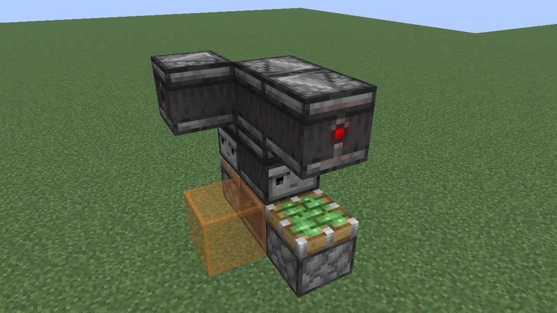</a> 101 gt (5.05 s) · observer+sticky_piston · 9 blocks</td><td align="center"><a href="../archive/clk-sculk-ringbig7-p101-1.txt">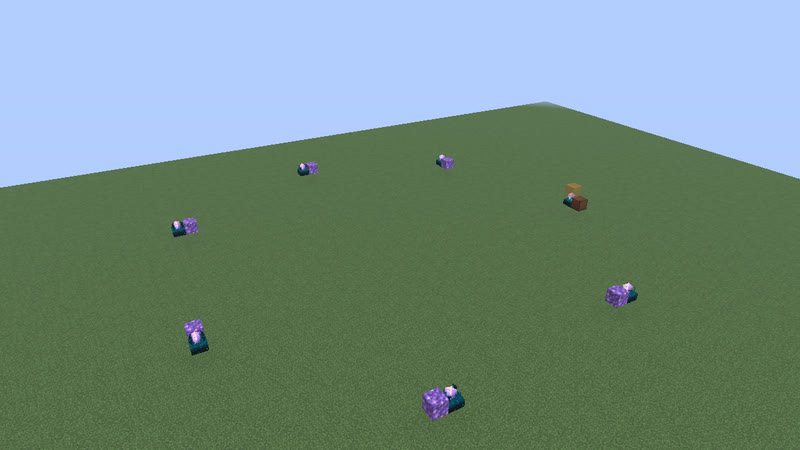</a> 101 gt (5.05 s) · calibrated_sculk_sensor+note_block · 14 blocks</td></tr>
</table>

## 102 gt (5.1 s)

Also reachable by: observer ring with a relay block (clk-obs-note-ring, n = 23), dropper ring (clk-item-dropring-2d-r24, n = 4), clk-misc-cart-pingpong (n = 13).

<table>
<tr><td align="center"><a href="../archive/clk-obs-p102-obs-pis-stk-7b-7db996.txt">clk-obs-p102-obs-pis-stk-7b-7db996</a> 102 gt (5.1 s) · observer+piston+sticky_piston · 7 blocks (picture pending)</td><td align="center"><a href="../archive/clk-obs-p102-obs-stk-7b-acc8ac.txt">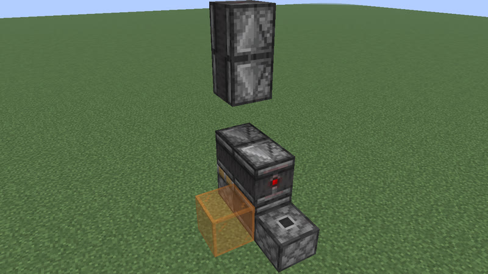</a> 102 gt (5.1 s) · observer+sticky_piston · 7 blocks</td><td align="center"><a href="../archive/clk-obs-p102-obs-stk-7b-b4bb62.txt">clk-obs-p102-obs-stk-7b-b4bb62</a> 102 gt (5.1 s) · observer+sticky_piston · 7 blocks (picture pending)</td></tr>
<tr><td align="center"> 102 gt (5.1 s) · comparator+hopper · 14 blocks</td><td align="center"><a href="../archive/clk-sculk-ringbig7-p102-1.txt">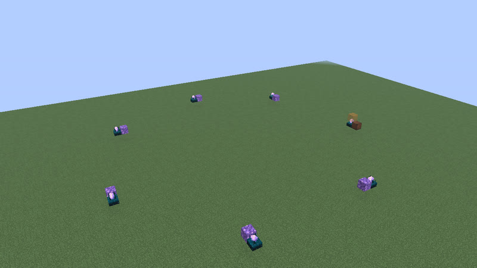</a> 102 gt (5.1 s) · calibrated_sculk_sensor+note_block · 14 blocks</td></tr>
</table>

## 103 gt (5.15 s)

Also reachable by: clk-obs-odd-a (n = 23), clk-sculk-hairpin-dispenser (n = 6), dropper ring (clk-item-dropring-2d-r3, n = 5), clk-sculk-replin (one block swapped: 2 versions) (clk-sculk-replin, n = 11).

<table>
<tr><td align="center"><a href="../archive/clk-obs-p103-note-obs-pis-stk-9b-059437.txt">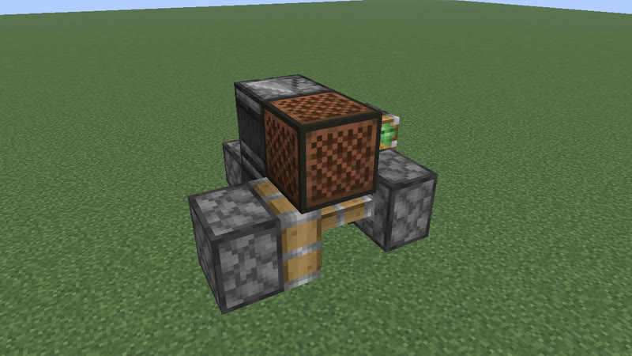</a> 103 gt (5.15 s) · note_block+observer+piston+sticky_piston · 9 blocks</td><td align="center"> 103 gt (5.15 s) · comparator+hopper · 14 blocks</td><td align="center"><a href="../archive/clk-sculk-ringbig7-p103-1.txt">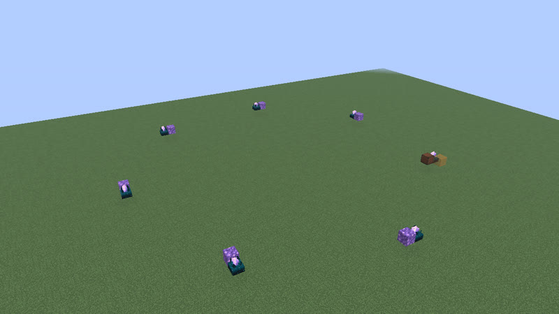</a> 103 gt (5.15 s) · calibrated_sculk_sensor+note_block · 14 blocks</td></tr>
</table>

[catalog index](../CATALOG.md) · previous: [p45-65](p45-65.md) · next: [p104-172](p104-172.md)
