# Clocks: 82 gt (4.1 s) to 128 gt (6.4 s) (299 clock types)

[catalog index](../CATALOG.md) · previous: [p48-81](p48-81.md) · next: [p129-494](p129-494.md)

Orange glass = where the output signal is (placed only for the picture); click a picture for its design. Larger clocks of a period that only add block kinds to a smaller one are listed on [variants](variants.md). Generated by `mctas clock catalog`.

## 82 gt (4.1 s)

Also reachable by: observer ring with a relay block (clk-obs-note-ring, n = 18), dropper ring (clk-item-dropring-1d-r3, n = 3), clk-misc-cart-pingpong (n = 9).

<table>
<tr><td align="center"> 82 gt (4.1 s) · observer+sticky_piston · 8 blocks</td><td align="center"> 82 gt (4.1 s) · calibrated_sculk_sensor+note_block · 12 blocks</td><td align="center"><a href="../archive/clk-misc-boat-bouncer.txt">clk-misc-boat-bouncer</a> 82 gt (4.1 s) · oak_boat+tripwire+tripwire_hook · 19 blocks (picture pending)</td></tr>
<tr><td align="center"> 82 gt (4.1 s) · redstone_torch+repeater · 24 blocks</td><td align="center"> 82 gt (4.1 s) · repeater · 27 blocks</td></tr>
</table>

## 83 gt (4.15 s)

Also reachable by: clk-obs-odd-a (n = 18), dropper ring (clk-item-dropring-1d, n = 4), clk-sculk-hairpin (one block swapped: 2 versions) (clk-sculk-hairpin, n = 5).

<table>
<tr><td align="center"> 83 gt (4.15 s) · observer+piston+sticky_piston · 8 blocks</td><td align="center"> 83 gt (4.15 s) · repeater · 47 blocks</td></tr>
</table>

## 84 gt (4.2 s)

Also reachable by: clk-obs-obs-ring (n = 19), hopper ring (clk-item-hopper-ring, n = 5), clk-obs-bulb-ring (n = 8), clk-rt-uloop2t (n = 4), dropper ring (clk-item-dropring-1d-r4, n = 3), clk-rt-rect-inv (n = 1).

<table>
<tr><td align="center"> 84 gt (4.2 s) · calibrated_sculk_sensor+dispenser+observer+sculk_sensor · 5 blocks</td><td align="center"> 84 gt (4.2 s) · calibrated_sculk_sensor+dispenser+observer+piston+sculk_sensor · 5 blocks also found as census-p84-calibrated_sculk_sensor-dispenser-observer-sculk_sensor-sticky_piston-5b (built with sticky_piston, without piston)</td><td align="center"> 84 gt (4.2 s) · copper_bulb+observer+redstone_lamp+sticky_piston · 7 blocks</td></tr>
<tr><td align="center"> 84 gt (4.2 s) · copper_bulb+observer+redstone_lamp+sticky_piston · 7 blocks</td><td align="center"> 84 gt (4.2 s) · copper_bulb+note_block+observer+sticky_piston · 7 blocks</td><td align="center"> 84 gt (4.2 s) · copper_bulb+note_block+observer+sticky_piston · 7 blocks</td></tr>
<tr><td align="center"> 84 gt (4.2 s) · copper_bulb+observer+piston · 7 blocks</td><td align="center"> 84 gt (4.2 s) · copper_bulb+observer+piston+sticky_piston · 7 blocks</td><td align="center"> 84 gt (4.2 s) · copper_bulb+observer+piston+sticky_piston · 7 blocks also found as clk-obs-p84-bulb-obs-pis-7b-b-5c0922 (built without sticky_piston)</td></tr>
<tr><td align="center"> 84 gt (4.2 s) · copper_bulb+observer+redstone_block+sticky_piston · 7 blocks</td><td align="center"> 84 gt (4.2 s) · copper_bulb+observer+sticky_piston · 7 blocks</td><td align="center"> 84 gt (4.2 s) · copper_bulb+observer+sticky_piston · 7 blocks</td></tr>
<tr><td align="center"> 84 gt (4.2 s) · observer+piston+redstone_lamp+sticky_piston · 7 blocks</td><td align="center"> 84 gt (4.2 s) · note_block+observer+piston+sticky_piston · 7 blocks</td><td align="center"> 84 gt (4.2 s) · observer+piston+sticky_piston · 7 blocks</td></tr>
<tr><td align="center"> 84 gt (4.2 s) · copper_bulb+observer+piston+redstone_lamp+sticky_piston · 7 blocks</td><td align="center"> 84 gt (4.2 s) · copper_bulb+observer+piston+redstone_lamp+sticky_piston · 7 blocks</td><td align="center"> 84 gt (4.2 s) · copper_bulb+note_block+observer+piston+sticky_piston · 7 blocks</td></tr>
<tr><td align="center"> 84 gt (4.2 s) · copper_bulb+note_block+observer+piston+sticky_piston · 7 blocks</td><td align="center"> 84 gt (4.2 s) · copper_bulb+observer+redstone_block+sticky_piston · 7 blocks</td><td align="center"> 84 gt (4.2 s) · comparator+hopper+redstone_torch+redstone_wire · 10 blocks</td></tr>
<tr><td align="center"> 84 gt (4.2 s) · comparator+hopper · 14 blocks</td><td align="center"> 84 gt (4.2 s) · redstone_torch+redstone_wire+repeater · 17 blocks</td><td align="center"> 84 gt (4.2 s) · repeater · 27 blocks</td></tr>
</table>

## 85 gt (4.25 s)

Also reachable by: clk-obs-odd-b (n = 18), dropper ring (clk-item-dropring-2d-r1, n = 3), clk-sculk-replin (n = 9).

<table>
<tr><td align="center"> 85 gt (4.25 s) · observer+sculk_sensor+sticky_piston · 6 blocks</td><td align="center"> 85 gt (4.25 s) · comparator+redstone_torch+redstone_wire+repeater · 46 blocks</td><td align="center"> 85 gt (4.25 s) · repeater · 48 blocks</td></tr>
</table>

## 86 gt (4.3 s)

Also reachable by: observer ring with a relay block (clk-obs-note-ring, n = 19), clk-misc-cart-loop (n = 12), dropper ring (clk-item-dropring-2d-r14, n = 3).

<table>
<tr><td align="center"> 86 gt (4.3 s) · observer+sculk_sensor+sticky_piston · 6 blocks</td><td align="center"> 86 gt (4.3 s) · copper_bulb+observer+redstone_block+sticky_piston · 7 blocks</td><td align="center"> 86 gt (4.3 s) · copper_bulb+observer+redstone_block+sticky_piston · 7 blocks</td></tr>
<tr><td align="center"> 86 gt (4.3 s) · comparator+redstone_torch+redstone_wire · 17 blocks</td><td align="center"> 86 gt (4.3 s) · repeater · 27 blocks</td></tr>
</table>

## 87 gt (4.35 s)

Also reachable by: clk-obs-odd-a (n = 19), clk-rt-odd-rect (n = 8), dropper ring (clk-item-dropring-2d-r2, n = 4), clk-misc-cart-pingpong (n = 10).

<table>
<tr><td align="center"> 87 gt (4.35 s) · calibrated_sculk_sensor+oak_trapdoor+observer+sculk_sensor · 6 blocks</td><td align="center"> 87 gt (4.35 s) · calibrated_sculk_sensor+observer+sculk_sensor+sticky_piston · 6 blocks</td><td align="center"> 87 gt (4.35 s) · observer+piston+sticky_piston · 7 blocks</td></tr>
<tr><td align="center"> 87 gt (4.35 s) · observer+sticky_piston · 7 blocks</td><td align="center"> 87 gt (4.35 s) · observer+piston+sculk_sensor+sticky_piston · 7 blocks</td><td align="center"> 87 gt (4.35 s) · observer+sculk_sensor+sticky_piston · 7 blocks</td></tr>
</table>

## 88 gt (4.4 s)

Also reachable by: clk-obs-obs-ring (n = 20), dropper ring (clk-item-dropring-2d-r24, n = 3).

<table>
<tr><td align="center"> 88 gt (4.4 s) · observer+sculk_sensor+sticky_piston · 4 blocks</td><td align="center"> 88 gt (4.4 s) · note_block+observer+sculk_sensor+sticky_piston · 4 blocks</td><td align="center"> 88 gt (4.4 s) · oak_trapdoor+observer+sculk_sensor+sticky_piston · 4 blocks</td></tr>
<tr><td align="center"> 88 gt (4.4 s) · observer+sculk_sensor+sticky_piston · 4 blocks</td><td align="center"> 88 gt (4.4 s) · dispenser+observer+sculk_sensor+sticky_piston · 5 blocks</td><td align="center"> 88 gt (4.4 s) · iron_trapdoor+observer+sculk_sensor+sticky_piston · 5 blocks</td></tr>
<tr><td align="center"> 88 gt (4.4 s) · oak_fence_gate+observer+sculk_sensor+sticky_piston · 5 blocks</td><td align="center"> 88 gt (4.4 s) · comparator+redstone_torch+redstone_wire · 17 blocks</td><td align="center"> 88 gt (4.4 s) · redstone_torch+redstone_wire+repeater · 17 blocks</td></tr>
<tr><td align="center"> 88 gt (4.4 s) · repeater · 27 blocks</td></tr>
</table>

## 89 gt (4.45 s)

Also reachable by: clk-obs-odd-b (n = 19), dropper ring (clk-item-dropring-2d-r3, n = 4).

<table>
<tr><td align="center"> 89 gt (4.45 s) · calibrated_sculk_sensor+observer+sculk_sensor+sticky_piston · 6 blocks</td><td align="center"> 89 gt (4.45 s) · observer+sculk_sensor+sticky_piston · 7 blocks</td><td align="center"> 89 gt (4.45 s) · oak_trapdoor+observer+sculk_sensor+sticky_piston · 7 blocks</td></tr>
<tr><td align="center"> 89 gt (4.45 s) · iron_trapdoor+observer+sculk_sensor+sticky_piston · 7 blocks</td><td align="center"> 89 gt (4.45 s) · oak_fence_gate+observer+sculk_sensor+sticky_piston · 7 blocks</td><td align="center"> 89 gt (4.45 s) · observer+piston+sculk_sensor+sticky_piston · 7 blocks</td></tr>
<tr><td align="center"> 89 gt (4.45 s) · repeater · 51 blocks</td></tr>
</table>

## 90 gt (4.5 s)

Also reachable by: observer ring with a relay block (clk-obs-note-ring, n = 20), dropper ring (clk-item-dropring-2d, n = 4), ring lock (clk-item-ringlock-rows, n = 1).

<table>
<tr><td align="center"> 90 gt (4.5 s) · oak_trapdoor+observer+sculk_sensor · 4 blocks</td><td align="center"> 90 gt (4.5 s) · observer+piston+sculk_sensor · 4 blocks also found as census-p90-observer-sculk_sensor-sticky_piston-4b (built with sticky_piston, without piston)</td><td align="center"> 90 gt (4.5 s) · calibrated_sculk_sensor+dispenser+observer+sculk_sensor · 5 blocks</td></tr>
<tr><td align="center"> 90 gt (4.5 s) · dispenser+note_block+observer+sculk_sensor · 5 blocks</td><td align="center"> 90 gt (4.5 s) · calibrated_sculk_sensor+observer+sticky_piston · 6 blocks</td><td align="center"> 90 gt (4.5 s) · calibrated_sculk_sensor+oak_trapdoor+observer+sticky_piston · 6 blocks</td></tr>
<tr><td align="center"> 90 gt (4.5 s) · calibrated_sculk_sensor+iron_trapdoor+observer+sticky_piston · 6 blocks</td><td align="center"> 90 gt (4.5 s) · calibrated_sculk_sensor+oak_fence_gate+observer+sticky_piston · 6 blocks</td><td align="center"> 90 gt (4.5 s) · calibrated_sculk_sensor+note_block+observer+sticky_piston · 6 blocks</td></tr>
<tr><td align="center"> 90 gt (4.5 s) · calibrated_sculk_sensor+dispenser+observer+sticky_piston · 6 blocks</td><td align="center"> 90 gt (4.5 s) · calibrated_sculk_sensor+observer+sculk_sensor+sticky_piston · 6 blocks</td><td align="center"> 90 gt (4.5 s) · calibrated_sculk_sensor+observer+piston+sticky_piston · 6 blocks</td></tr>
<tr><td align="center"> 90 gt (4.5 s) · note_block+observer+sculk_sensor+sticky_piston · 7 blocks</td><td align="center"> 90 gt (4.5 s) · observer+sticky_piston · 7 blocks</td><td align="center"> 90 gt (4.5 s) · comparator+hopper · 14 blocks</td></tr>
<tr><td align="center"> 90 gt (4.5 s) · redstone_torch+repeater · 28 blocks</td><td align="center"> 90 gt (4.5 s) · repeater · 28 blocks</td></tr>
</table>

## 91 gt (4.55 s)

Also reachable by: clk-obs-odd-a (n = 20), hopper ring (clk-item-hopper-ring-2, n = 12), clk-misc-cart-loop (n = 13), dropper ring (clk-item-dropring-2d-r4, n = 4), clk-misc-crafter-loop (n = 0).

<table>
<tr><td align="center"> 91 gt (4.55 s) · calibrated_sculk_sensor+oak_trapdoor+observer+sculk_sensor · 6 blocks</td><td align="center"> 91 gt (4.55 s) · oak_trapdoor+observer+sculk_sensor+sticky_piston · 6 blocks</td><td align="center"> 91 gt (4.55 s) · dispenser+observer+sculk_sensor+sticky_piston · 6 blocks</td></tr>
<tr><td align="center"> 91 gt (4.55 s) · iron_trapdoor+observer+sculk_sensor+sticky_piston · 6 blocks</td><td align="center"> 91 gt (4.55 s) · oak_fence_gate+observer+sculk_sensor+sticky_piston · 6 blocks</td><td align="center"> 91 gt (4.55 s) · calibrated_sculk_sensor+observer+sculk_sensor+sticky_piston · 6 blocks</td></tr>
<tr><td align="center"> 91 gt (4.55 s) · note_block+observer+sculk_sensor+sticky_piston · 6 blocks</td><td align="center"> 91 gt (4.55 s) · observer+sculk_sensor+sticky_piston · 7 blocks</td><td align="center"> 91 gt (4.55 s) · observer+piston+sculk_sensor+sticky_piston · 7 blocks</td></tr>
<tr><td align="center"> 91 gt (4.55 s) · repeater · 51 blocks</td></tr>
</table>

## 92 gt (4.6 s)

Also reachable by: clk-obs-obs-ring (n = 21), clk-obs-bulb-ring (n = 9), dropper ring (clk-item-dropring-1d-r1, n = 4), clk-misc-cart-pingpong (n = 11), clk-sculk-racetrack (n = 2), clk-sculk-racetrack-plain (n = 5).

<table>
<tr><td align="center"> 92 gt (4.6 s) · observer+sculk_sensor+sticky_piston · 5 blocks</td><td align="center"> 92 gt (4.6 s) · observer+sculk_sensor+sticky_piston · 5 blocks</td><td align="center"> 92 gt (4.6 s) · copper_bulb+observer+piston+sticky_piston · 7 blocks</td></tr>
<tr><td align="center"> 92 gt (4.6 s) · copper_bulb+observer+piston+sticky_piston · 7 blocks</td><td align="center"> 92 gt (4.6 s) · copper_bulb+observer+sticky_piston · 7 blocks</td><td align="center"> 92 gt (4.6 s) · observer+piston+redstone_block+sticky_piston · 7 blocks</td></tr>
<tr><td align="center"> 92 gt (4.6 s) · observer+piston+sticky_piston · 7 blocks</td><td align="center"> 92 gt (4.6 s) · observer+piston+sticky_piston · 7 blocks</td><td align="center"> 92 gt (4.6 s) · observer+redstone_block+sticky_piston · 7 blocks</td></tr>
<tr><td align="center"> 92 gt (4.6 s) · observer+sticky_piston · 7 blocks</td><td align="center"> 92 gt (4.6 s) · observer+sticky_piston · 7 blocks</td><td align="center"> 92 gt (4.6 s) · redstone_torch+redstone_wire+repeater · 17 blocks</td></tr>
<tr><td align="center"> 92 gt (4.6 s) · repeater · 28 blocks</td></tr>
</table>

## 93 gt (4.65 s)

Also reachable by: clk-obs-odd-b (n = 20), dropper ring (clk-item-dropring-1d-r14, n = 3).

<table>
<tr><td align="center"> 93 gt (4.65 s) · calibrated_sculk_sensor+dispenser+observer+sculk_sensor · 5 blocks</td><td align="center"> 93 gt (4.65 s) · calibrated_sculk_sensor+oak_trapdoor+observer · 6 blocks</td><td align="center"> 93 gt (4.65 s) · dispenser+observer+sculk_sensor+sticky_piston · 6 blocks</td></tr>
<tr><td align="center"> 93 gt (4.65 s) · calibrated_sculk_sensor+note_block+observer+sculk_sensor · 7 blocks</td><td align="center"> 93 gt (4.65 s) · calibrated_sculk_sensor+observer+sculk_sensor+sticky_piston · 7 blocks</td><td align="center"> 93 gt (4.65 s) · calibrated_sculk_sensor+observer+sticky_piston · 7 blocks</td></tr>
<tr><td align="center"> 93 gt (4.65 s) · observer+piston+sculk_sensor+sticky_piston · 7 blocks</td><td align="center"> 93 gt (4.65 s) · repeater · 52 blocks</td></tr>
</table>

## 94 gt (4.7 s)

Also reachable by: observer ring with a relay block (clk-obs-note-ring, n = 21), dropper ring (clk-item-dropring-1d-r2, n = 4), clk-item-latch (n = 4), clk-sculk-replin (n = 10).

<table>
<tr><td align="center"> 94 gt (4.7 s) · observer+sculk_sensor+sticky_piston · 5 blocks</td><td align="center"> 94 gt (4.7 s) · observer+sculk_sensor+sticky_piston · 5 blocks</td><td align="center"> 94 gt (4.7 s) · observer+piston+sculk_sensor+sticky_piston · 7 blocks</td></tr>
<tr><td align="center"> 94 gt (4.7 s) · redstone_torch+repeater · 28 blocks</td><td align="center"> 94 gt (4.7 s) · repeater · 28 blocks</td></tr>
</table>

## 95 gt (4.75 s)

Also reachable by: clk-obs-odd-a (n = 21), clk-rt-odd-rect (n = 9), dropper ring (clk-item-dropring-1d-r24, n = 3).

<table>
<tr><td align="center"> 95 gt (4.75 s) · oak_trapdoor+observer+sculk_sensor+sticky_piston · 6 blocks</td><td align="center"> 95 gt (4.75 s) · iron_trapdoor+observer+sculk_sensor+sticky_piston · 6 blocks</td><td align="center"> 95 gt (4.75 s) · oak_fence_gate+observer+sculk_sensor+sticky_piston · 6 blocks</td></tr>
<tr><td align="center"> 95 gt (4.75 s) · note_block+observer+sculk_sensor+sticky_piston · 6 blocks</td><td align="center"> 95 gt (4.75 s) · comparator+redstone_torch+redstone_wire+repeater · 46 blocks</td></tr>
</table>

## 96 gt (4.8 s)

Also reachable by: clk-obs-obs-ring (n = 22), clk-obs-divider (n = 3), clk-misc-cart-loop (n = 14), dropper ring (clk-item-dropring-1d-r3, n = 4), clk-rt-rect-pulse (n = 4).

<table>
<tr><td align="center"> 96 gt (4.8 s) · calibrated_sculk_sensor+dispenser+observer · 6 blocks</td><td align="center"> 96 gt (4.8 s) · calibrated_sculk_sensor+dispenser+observer+sculk_sensor · 6 blocks</td><td align="center"> 96 gt (4.8 s) · observer+sculk_sensor+sticky_piston · 6 blocks</td></tr>
<tr><td align="center"> 96 gt (4.8 s) · copper_bulb+observer+redstone_lamp+sticky_piston · 7 blocks</td><td align="center"> 96 gt (4.8 s) · copper_bulb+observer+redstone_lamp+sticky_piston · 7 blocks</td><td align="center"> 96 gt (4.8 s) · copper_bulb+note_block+observer+sticky_piston · 7 blocks</td></tr>
<tr><td align="center"> 96 gt (4.8 s) · copper_bulb+note_block+observer+sticky_piston · 7 blocks</td><td align="center"> 96 gt (4.8 s) · copper_bulb+observer+sticky_piston · 7 blocks</td><td align="center"> 96 gt (4.8 s) · note_block+observer+sculk_sensor+sticky_piston · 7 blocks</td></tr>
<tr><td align="center"> 96 gt (4.8 s) · copper_bulb+note_block+observer+piston+redstone_block+sticky_piston · 7 blocks</td><td align="center"> 96 gt (4.8 s) · copper_bulb+note_block+observer+redstone_block+sticky_piston · 7 blocks</td><td align="center"> 96 gt (4.8 s) · copper_bulb+observer+piston+redstone_block+sticky_piston · 7 blocks</td></tr>
<tr><td align="center"> 96 gt (4.8 s) · copper_bulb+observer+piston+redstone_block+sticky_piston · 7 blocks</td><td align="center"> 96 gt (4.8 s) · copper_bulb+observer+redstone_block+sticky_piston · 7 blocks</td><td align="center"> 96 gt (4.8 s) · redstone_torch+redstone_wire+repeater · 17 blocks</td></tr>
</table>

## 97 gt (4.85 s)

Also reachable by: clk-obs-odd-b (n = 21), dropper ring (clk-item-dropring-1d, n = 5), clk-misc-cart-pingpong (n = 12).

<table>
<tr><td align="center"> 97 gt (4.85 s) · observer+sculk_sensor+sticky_piston · 6 blocks</td><td align="center"> 97 gt (4.85 s) · repeater · 55 blocks</td></tr>
</table>

## 98 gt (4.9 s)

Also reachable by: observer ring with a relay block (clk-obs-note-ring, n = 22), hopper ring (clk-item-hopper-ring, n = 6), dropper ring (clk-item-dropring-1d-r4, n = 4).

<table>
<tr><td align="center"> 98 gt (4.9 s) · observer+sculk_sensor+sticky_piston · 6 blocks</td><td align="center"> 98 gt (4.9 s) · note_block+observer+sculk_sensor+sticky_piston · 7 blocks</td><td align="center"> 98 gt (4.9 s) · comparator+hopper · 10 blocks</td></tr>
<tr><td align="center"> 98 gt (4.9 s) · redstone_torch+repeater · 28 blocks</td><td align="center"> 98 gt (4.9 s) · repeater · 31 blocks</td></tr>
</table>

## 99 gt (4.95 s)

Also reachable by: clk-obs-odd-a (n = 22), dropper ring (clk-item-dropring-2d-r1, n = 4), clk-sculk-hairpin (one block swapped: 2 versions) (clk-sculk-hairpin, n = 6).

<table>
<tr><td align="center"> 99 gt (4.95 s) · calibrated_sculk_sensor+note_block · 14 blocks</td><td align="center"> 99 gt (4.95 s) · repeater · 55 blocks</td></tr>
</table>

## 100 gt (5 s)

Also reachable by: clk-obs-obs-ring (n = 23), clk-obs-bulb-ring (n = 10), clk-rt-uloop2t (n = 5), dropper ring (clk-item-dropring-2d-r14, n = 4), clk-rt-uloop1t (n = 2).

<table>
<tr><td align="center"> 100 gt (5 s) · observer+sculk_sensor+sticky_piston · 6 blocks</td><td align="center"> 100 gt (5 s) · calibrated_sculk_sensor+dispenser+observer · 7 blocks</td><td align="center"><a href="../archive/clk-obs-p100-bulb-lamp-note-obs-stk-9b-7c365c.txt">clk-obs-p100-bulb-lamp-note-obs-stk-9b-7c365c</a> 100 gt (5 s) · copper_bulb+note_block+observer+redstone_lamp+sticky_piston · 9 blocks (picture pending)</td></tr>
<tr><td align="center"><a href="../archive/clk-obs-p100-bulb-lamp-obs-stk-9b-cd468c.txt">clk-obs-p100-bulb-lamp-obs-stk-9b-cd468c</a> 100 gt (5 s) · copper_bulb+observer+redstone_lamp+sticky_piston · 9 blocks (picture pending)</td><td align="center"><a href="../archive/clk-obs-p100-lamp-note-obs-stk-9b-75a9fa.txt">clk-obs-p100-lamp-note-obs-stk-9b-75a9fa</a> 100 gt (5 s) · note_block+observer+redstone_lamp+sticky_piston · 9 blocks (picture pending)</td><td align="center"><a href="../archive/clk-obs-p100-obs-stk-9b-601348.txt">clk-obs-p100-obs-stk-9b-601348</a> 100 gt (5 s) · observer+sticky_piston · 9 blocks (picture pending)</td></tr>
<tr><td align="center"><a href="../archive/clk-obs-p100-note-obs-stk-9b-67bb42.txt">clk-obs-p100-note-obs-stk-9b-67bb42</a> 100 gt (5 s) · note_block+observer+sticky_piston · 9 blocks (picture pending)</td><td align="center"> 100 gt (5 s) · repeater · 31 blocks</td></tr>
</table>

## 101 gt (5.05 s)

Also reachable by: clk-obs-odd-b (n = 22), clk-misc-cart-loop (n = 15), dropper ring (clk-item-dropring-2d-r2, n = 5).

<table>
<tr><td align="center"> 101 gt (5.05 s) · observer+sticky_piston · 9 blocks</td><td align="center"> 101 gt (5.05 s) · calibrated_sculk_sensor+note_block · 14 blocks</td></tr>
</table>

## 102 gt (5.1 s)

Also reachable by: observer ring with a relay block (clk-obs-note-ring, n = 23), dropper ring (clk-item-dropring-2d-r24, n = 4), clk-misc-cart-pingpong (n = 13).

<table>
<tr><td align="center"><a href="../archive/clk-obs-p102-obs-pis-stk-7b-7db996.txt">clk-obs-p102-obs-pis-stk-7b-7db996</a> 102 gt (5.1 s) · observer+piston+sticky_piston · 7 blocks (picture pending)</td><td align="center"> 102 gt (5.1 s) · observer+sticky_piston · 7 blocks</td><td align="center"><a href="../archive/clk-obs-p102-obs-stk-7b-b4bb62.txt">clk-obs-p102-obs-stk-7b-b4bb62</a> 102 gt (5.1 s) · observer+sticky_piston · 7 blocks (picture pending)</td></tr>
<tr><td align="center"> 102 gt (5.1 s) · comparator+hopper · 14 blocks</td><td align="center"> 102 gt (5.1 s) · calibrated_sculk_sensor+note_block · 14 blocks</td></tr>
</table>

## 103 gt (5.15 s)

Also reachable by: clk-obs-odd-a (n = 23), dropper ring (clk-item-dropring-2d-r3, n = 5), clk-sculk-replin (n = 11).

<table>
<tr><td align="center"> 103 gt (5.15 s) · note_block+observer+piston+sticky_piston · 9 blocks</td><td align="center"> 103 gt (5.15 s) · comparator+hopper · 14 blocks</td><td align="center"> 103 gt (5.15 s) · calibrated_sculk_sensor+note_block · 14 blocks</td></tr>
</table>

## 104 gt (5.2 s)

Also reachable by: clk-obs-obs-ring (n = 24), dropper ring (clk-item-dropring-2d, n = 5), ring lock (clk-item-ringlock-rows, n = 2).

<table>
<tr><td align="center"><a href="../archive/clk-obs-p104-bulb-obs-stk-7b-a08748.txt">clk-obs-p104-bulb-obs-stk-7b-a08748</a> 104 gt (5.2 s) · copper_bulb+observer+sticky_piston · 7 blocks (picture pending)</td><td align="center"> 104 gt (5.2 s) · copper_bulb+observer+piston+redstone_block+sticky_piston · 7 blocks</td><td align="center"> 104 gt (5.2 s) · copper_bulb+observer+piston+sticky_piston · 7 blocks also found as clk-obs-p104-bulb-obs-pis-7b-a9fff0 (built without sticky_piston)</td></tr>
<tr><td align="center"> 104 gt (5.2 s) · copper_bulb+observer+redstone_block+sticky_piston · 7 blocks</td><td align="center"> 104 gt (5.2 s) · copper_bulb+observer+piston · 7 blocks</td><td align="center"> 104 gt (5.2 s) · copper_bulb+observer+piston+redstone_block+sticky_piston · 7 blocks</td></tr>
<tr><td align="center"> 104 gt (5.2 s) · copper_bulb+observer+piston+sticky_piston · 7 blocks</td><td align="center"> 104 gt (5.2 s) · copper_bulb+observer+redstone_block+sticky_piston · 7 blocks</td><td align="center"><a href="../archive/clk-obs-p104-obs-pis-stk-7b-b24687.txt">clk-obs-p104-obs-pis-stk-7b-b24687</a> 104 gt (5.2 s) · observer+piston+sticky_piston · 7 blocks (picture pending)</td></tr>
<tr><td align="center"> 104 gt (5.2 s) · observer+sticky_piston · 7 blocks</td><td align="center"> 104 gt (5.2 s) · observer+sticky_piston · 7 blocks</td><td align="center"> 104 gt (5.2 s) · comparator+hopper · 14 blocks</td></tr>
<tr><td align="center"><a href="../archive/clk-sculk-ringbig7-p104-1.txt">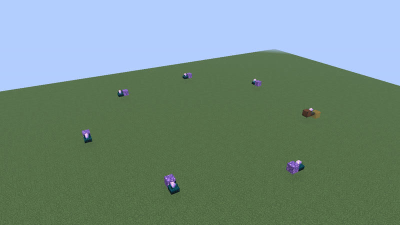</a> 104 gt (5.2 s) · calibrated_sculk_sensor+note_block · 14 blocks</td></tr>
</table>

## 105 gt (5.25 s)

Also reachable by: clk-obs-odd-b (n = 23), hopper ring (clk-item-hopper-ring-2, n = 14), dropper ring (clk-item-dropring-2d-r4, n = 5).

<table>
<tr><td align="center"> 105 gt (5.25 s) · calibrated_sculk_sensor+dispenser+observer+sculk_sensor · 6 blocks</td><td align="center"> 105 gt (5.25 s) · observer+sticky_piston · 7 blocks</td><td align="center"><a href="../archive/clk-sculk-ringbig7-p105-1.txt">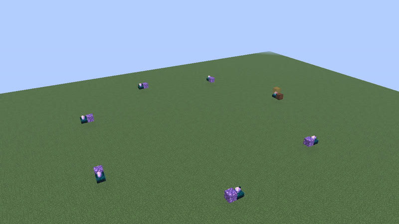</a> 105 gt (5.25 s) · calibrated_sculk_sensor+note_block · 14 blocks</td></tr>
</table>

## 106 gt (5.3 s)

Also reachable by: observer ring with a relay block (clk-obs-note-ring, n = 24), clk-misc-cart-loop (n = 16), dropper ring (clk-item-dropring-1d-r1, n = 5).

<table>
<tr><td align="center"><a href="../archive/clk-obs-p106-bulb-obs-stk-9b-c63e61.txt">clk-obs-p106-bulb-obs-stk-9b-c63e61</a> 106 gt (5.3 s) · copper_bulb+observer+sticky_piston · 9 blocks (picture pending)</td><td align="center"><a href="../archive/clk-obs-p106-obs-stk-9b-0788ce.txt">clk-obs-p106-obs-stk-9b-0788ce</a> 106 gt (5.3 s) · observer+sticky_piston · 9 blocks (picture pending)</td><td align="center"><a href="../archive/clk-obs-p106-obs-stk-9b-16e57c.txt">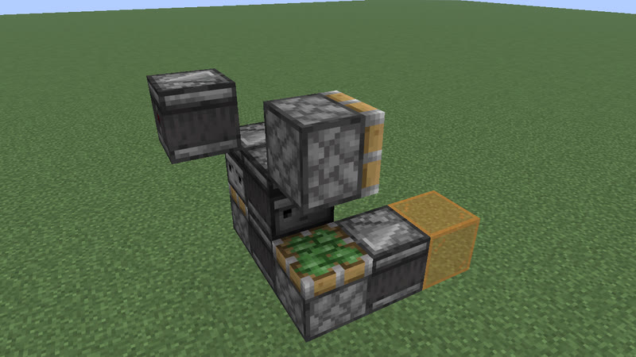</a> 106 gt (5.3 s) · observer+sticky_piston · 9 blocks</td></tr>
<tr><td align="center"> 106 gt (5.3 s) · comparator+hopper · 10 blocks</td></tr>
</table>

## 107 gt (5.35 s)

Also reachable by: clk-obs-odd-a (n = 24), dropper ring (clk-item-dropring-1d-r14, n = 4), clk-misc-cart-pingpong (n = 14).

<table>
<tr><td align="center"> 107 gt (5.35 s) · comparator+hopper · 14 blocks</td></tr>
</table>

## 108 gt (5.4 s)

Also reachable by: clk-obs-obs-ring (n = 25), clk-obs-bulb-ring (n = 11), dropper ring (clk-item-dropring-1d-r2, n = 5), clk-sculk-racetrack-plain (n = 6).

<table>
<tr><td align="center"> 108 gt (5.4 s) · observer+sticky_piston · 7 blocks</td><td align="center"> 108 gt (5.4 s) · observer+piston+sticky_piston · 7 blocks</td><td align="center"> 108 gt (5.4 s) · observer+piston+sticky_piston · 7 blocks</td></tr>
<tr><td align="center"><a href="../archive/clk-obs-p108-bulb-obs-stk-7b-41f076.txt">clk-obs-p108-bulb-obs-stk-7b-41f076</a> 108 gt (5.4 s) · copper_bulb+observer+sticky_piston · 7 blocks (picture pending)</td><td align="center"><a href="../archive/clk-obs-p108-lamp-obs-stk-8b-0fe0dc.txt">clk-obs-p108-lamp-obs-stk-8b-0fe0dc</a> 108 gt (5.4 s) · observer+redstone_lamp+sticky_piston · 8 blocks (picture pending)</td><td align="center"><a href="../archive/clk-obs-p108-note-obs-stk-8b-cfac8e.txt">clk-obs-p108-note-obs-stk-8b-cfac8e</a> 108 gt (5.4 s) · note_block+observer+sticky_piston · 8 blocks (picture pending)</td></tr>
<tr><td align="center"><a href="../archive/clk-sculk-ringbig8-p108-1.txt">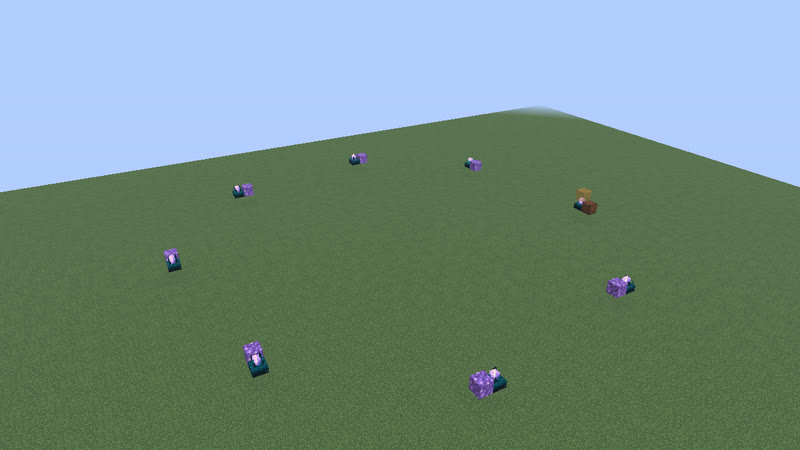</a> 108 gt (5.4 s) · calibrated_sculk_sensor+note_block · 16 blocks</td></tr>
</table>

## 109 gt (5.45 s)

Also reachable by: clk-obs-odd-b (n = 24), dropper ring (clk-item-dropring-1d-r24, n = 4).

<table>
<tr><td align="center"><a href="../archive/clk-obs-p109-obs-pis-stk-8b-c6c0d0.txt">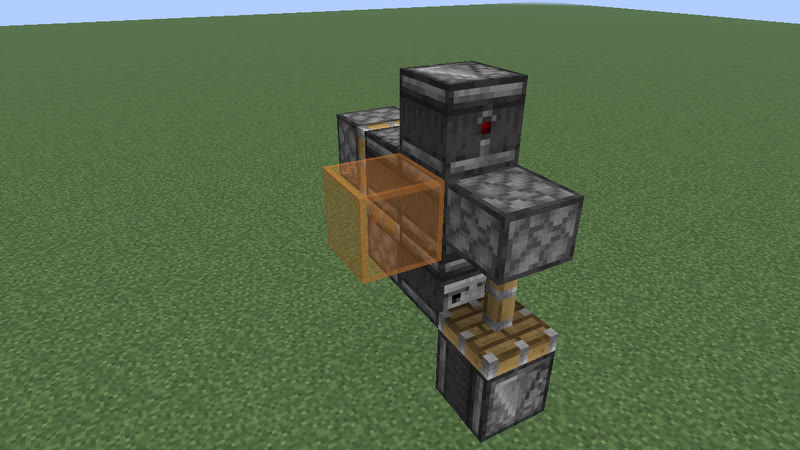</a> 109 gt (5.45 s) · observer+piston+sticky_piston · 8 blocks</td><td align="center"><a href="../archive/clk-obs-p109-obs-pis-stk-8b-da640b.txt">clk-obs-p109-obs-pis-stk-8b-da640b</a> 109 gt (5.45 s) · observer+piston+sticky_piston · 8 blocks (picture pending)</td></tr>
</table>

## 110 gt (5.5 s)

Also reachable by: observer ring with a relay block (clk-obs-note-ring, n = 25), dropper ring (clk-item-dropring-1d-r3, n = 5), clk-item-latch (n = 5).

<table>
<tr><td align="center"><a href="../archive/clk-obs-p110-bulb-note-obs-pis-stk-8b-7e47e7.txt">clk-obs-p110-bulb-note-obs-pis-stk-8b-7e47e7</a> 110 gt (5.5 s) · copper_bulb+note_block+observer+piston+sticky_piston · 8 blocks (picture pending)</td><td align="center"><a href="../archive/clk-obs-p110-bulb-note-obs-stk-8b-ce9c00.txt">clk-obs-p110-bulb-note-obs-stk-8b-ce9c00</a> 110 gt (5.5 s) · copper_bulb+note_block+observer+sticky_piston · 8 blocks (picture pending)</td><td align="center"><a href="../archive/clk-obs-p110-bulb-obs-pis-stk-8b-e952fd.txt">clk-obs-p110-bulb-obs-pis-stk-8b-e952fd</a> 110 gt (5.5 s) · copper_bulb+observer+piston+sticky_piston · 8 blocks (picture pending)</td></tr>
<tr><td align="center"><a href="../archive/clk-obs-p110-bulb-obs-stk-8b-81bc4c.txt">clk-obs-p110-bulb-obs-stk-8b-81bc4c</a> 110 gt (5.5 s) · copper_bulb+observer+sticky_piston · 8 blocks (picture pending)</td><td align="center"><a href="../archive/clk-obs-p110-note-obs-stk-8b-c0b552.txt">clk-obs-p110-note-obs-stk-8b-c0b552</a> 110 gt (5.5 s) · note_block+observer+sticky_piston · 8 blocks (picture pending)</td><td align="center"><a href="../archive/clk-obs-p110-obs-stk-8b-73b9d6.txt">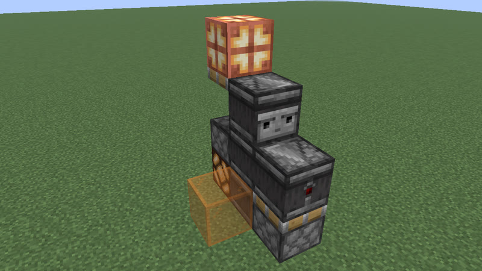</a> 110 gt (5.5 s) · observer+sticky_piston · 8 blocks</td></tr>
<tr><td align="center"><a href="../archive/clk-obs-p110-obs-stk-8b-e97c48.txt">clk-obs-p110-obs-stk-8b-e97c48</a> 110 gt (5.5 s) · observer+sticky_piston · 8 blocks (picture pending)</td><td align="center"><a href="../archive/clk-obs-p110-obs-rb-stk-8b-cff868.txt">clk-obs-p110-obs-rb-stk-8b-cff868</a> 110 gt (5.5 s) · observer+redstone_block+sticky_piston · 8 blocks (picture pending)</td><td align="center"><a href="../archive/clk-obs-p110-lamp-obs-pis-stk-9b-3599dd.txt">clk-obs-p110-lamp-obs-pis-stk-9b-3599dd</a> 110 gt (5.5 s) · observer+piston+redstone_lamp+sticky_piston · 9 blocks (picture pending)</td></tr>
<tr><td align="center"><a href="../archive/clk-obs-p110-note-obs-pis-stk-9b-d1d7e9.txt">clk-obs-p110-note-obs-pis-stk-9b-d1d7e9</a> 110 gt (5.5 s) · note_block+observer+piston+sticky_piston · 9 blocks (picture pending)</td><td align="center"><a href="../archive/clk-obs-p110-obs-pis-stk-9b-5f126c.txt">clk-obs-p110-obs-pis-stk-9b-5f126c</a> 110 gt (5.5 s) · observer+piston+sticky_piston · 9 blocks (picture pending)</td><td align="center"><a href="../archive/clk-obs-p110-lamp-obs-stk-9b-e2850e.txt">clk-obs-p110-lamp-obs-stk-9b-e2850e</a> 110 gt (5.5 s) · observer+redstone_lamp+sticky_piston · 9 blocks (picture pending)</td></tr>
</table>

## 111 gt (5.55 s)

Also reachable by: clk-obs-odd-a (n = 25), dropper ring (clk-item-dropring-1d, n = 6).

<table>
<tr><td align="center"><a href="../archive/clk-obs-p111-obs-stk-9b-7b9456.txt">clk-obs-p111-obs-stk-9b-7b9456</a> 111 gt (5.55 s) · observer+sticky_piston · 9 blocks (picture pending)</td><td align="center"><a href="../archive/clk-obs-p111-obs-stk-9b-cdb5ad.txt">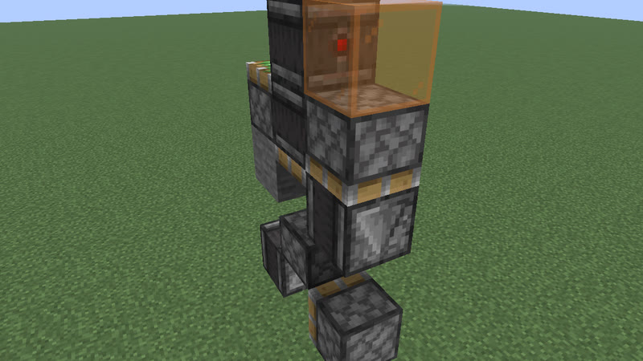</a> 111 gt (5.55 s) · observer+sticky_piston · 9 blocks</td></tr>
</table>

## 112 gt (5.6 s)

Also reachable by: clk-obs-obs-ring (n = 26), hopper ring (clk-item-hopper-ring, n = 7), dropper ring (clk-item-dropring-1d-r4, n = 5), clk-sculk-replin (n = 12), clk-rt-rect-pulse (n = 5), ring lock (clk-item-ringlock-stones-3x6, n = 1).

<table>
<tr><td align="center"><a href="../archive/clk-obs-p112-obs-pis-stk-8b-3d2059.txt">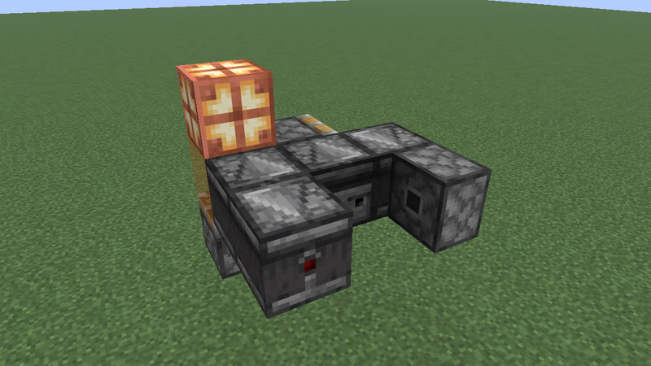</a> 112 gt (5.6 s) · observer+piston+sticky_piston · 8 blocks</td><td align="center"><a href="../archive/clk-obs-p112-obs-pis-stk-8b-fe64f4.txt">clk-obs-p112-obs-pis-stk-8b-fe64f4</a> 112 gt (5.6 s) · observer+piston+sticky_piston · 8 blocks (picture pending)</td><td align="center"><a href="../archive/clk-obs-p112-bulb-note-obs-stk-9b-9b0237.txt">clk-obs-p112-bulb-note-obs-stk-9b-9b0237</a> 112 gt (5.6 s) · copper_bulb+note_block+observer+sticky_piston · 9 blocks (picture pending)</td></tr>
<tr><td align="center"><a href="../archive/clk-obs-p112-bulb-obs-stk-9b-13fa28.txt">clk-obs-p112-bulb-obs-stk-9b-13fa28</a> 112 gt (5.6 s) · copper_bulb+observer+sticky_piston · 9 blocks (picture pending)</td><td align="center"><a href="../archive/clk-obs-p112-obs-pis-rb-stk-9b-b5c615.txt">clk-obs-p112-obs-pis-rb-stk-9b-b5c615</a> 112 gt (5.6 s) · observer+piston+redstone_block+sticky_piston · 9 blocks (picture pending)</td><td align="center"><a href="../archive/clk-obs-p112-obs-rb-stk-9b-876236.txt">clk-obs-p112-obs-rb-stk-9b-876236</a> 112 gt (5.6 s) · observer+redstone_block+sticky_piston · 9 blocks (picture pending)</td></tr>
<tr><td align="center"><a href="../archive/clk-sculk-ringbig8-p112-1.txt">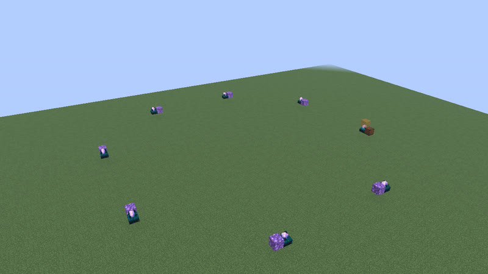</a> 112 gt (5.6 s) · calibrated_sculk_sensor+note_block · 16 blocks</td></tr>
</table>

## 113 gt (5.65 s)

Also reachable by: clk-obs-odd-b (n = 25), dropper ring (clk-item-dropring-2d-r1, n = 5).

<table>
<tr><td align="center"> 113 gt (5.65 s) · calibrated_sculk_sensor+observer+sticky_piston · 6 blocks</td></tr>
</table>

## 114 gt (5.7 s)

Also reachable by: observer ring with a relay block (clk-obs-note-ring, n = 26), dropper ring (clk-item-dropring-2d-r14, n = 5), clk-rt-fade (n = 0).

<table>
<tr><td align="center"><a href="../archive/clk-obs-p114-obs-pis-stk-8b-9834e0.txt">clk-obs-p114-obs-pis-stk-8b-9834e0</a> 114 gt (5.7 s) · observer+piston+sticky_piston · 8 blocks (picture pending)</td><td align="center"><a href="../archive/clk-obs-p114-obs-pis-stk-8b-f976bf.txt">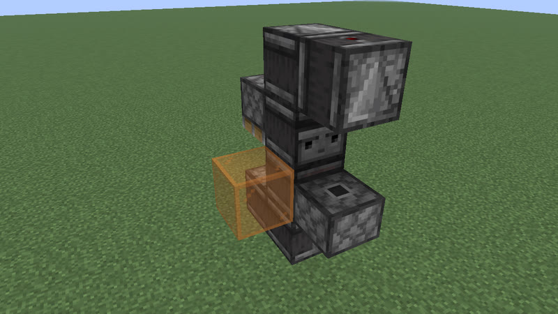</a> 114 gt (5.7 s) · observer+piston+sticky_piston · 8 blocks</td><td align="center"><a href="../archive/clk-obs-p114-bulb-obs-pis-stk-8b-d72293.txt">clk-obs-p114-bulb-obs-pis-stk-8b-d72293</a> 114 gt (5.7 s) · copper_bulb+observer+piston+sticky_piston · 8 blocks (picture pending)</td></tr>
<tr><td align="center"><a href="../archive/clk-obs-p114-bulb-obs-stk-8b-4e4a54.txt">clk-obs-p114-bulb-obs-stk-8b-4e4a54</a> 114 gt (5.7 s) · copper_bulb+observer+sticky_piston · 8 blocks (picture pending)</td><td align="center"><a href="../archive/clk-obs-p114-lamp-obs-stk-9b-d7fbca.txt">clk-obs-p114-lamp-obs-stk-9b-d7fbca</a> 114 gt (5.7 s) · observer+redstone_lamp+sticky_piston · 9 blocks (picture pending)</td><td align="center"><a href="../archive/clk-obs-p114-note-obs-stk-9b-7c322e.txt">clk-obs-p114-note-obs-stk-9b-7c322e</a> 114 gt (5.7 s) · note_block+observer+sticky_piston · 9 blocks (picture pending)</td></tr>
<tr><td align="center"><a href="../archive/clk-obs-p114-obs-stk-9b-30352a.txt">clk-obs-p114-obs-stk-9b-30352a</a> 114 gt (5.7 s) · observer+sticky_piston · 9 blocks (picture pending)</td></tr>
</table>

## 115 gt (5.75 s)

Also reachable by: clk-obs-odd-a (n = 26), dropper ring (clk-item-dropring-2d-r2, n = 6), clk-sculk-hairpin (one block swapped: 2 versions) (clk-sculk-hairpin, n = 7).

<table>
<tr><td align="center"> 115 gt (5.75 s) · calibrated_sculk_sensor+dispenser+observer · 7 blocks</td></tr>
</table>

## 116 gt (5.8 s)

Also reachable by: clk-obs-obs-ring (n = 27), clk-obs-bulb-ring (n = 12), clk-rt-uloop2t (n = 6), dropper ring (clk-item-dropring-2d-r24, n = 5), clk-rt-rect-inv (n = 2).

<table>
<tr><td align="center"> 116 gt (5.8 s) · calibrated_sculk_sensor+oak_trapdoor+observer · 7 blocks</td><td align="center"><a href="../archive/clk-obs-p116-bulb-lamp-obs-pis-stk-8b-99655e.txt">clk-obs-p116-bulb-lamp-obs-pis-stk-8b-99655e</a> 116 gt (5.8 s) · copper_bulb+observer+piston+redstone_lamp+sticky_piston · 8 blocks (picture pending)</td><td align="center"><a href="../archive/clk-obs-p116-bulb-note-obs-pis-stk-8b-aad7b4.txt">clk-obs-p116-bulb-note-obs-pis-stk-8b-aad7b4</a> 116 gt (5.8 s) · copper_bulb+note_block+observer+piston+sticky_piston · 8 blocks (picture pending)</td></tr>
<tr><td align="center"><a href="../archive/clk-obs-p116-bulb-obs-pis-stk-8b-06c7eb.txt">clk-obs-p116-bulb-obs-pis-stk-8b-06c7eb</a> 116 gt (5.8 s) · copper_bulb+observer+piston+sticky_piston · 8 blocks (picture pending)</td><td align="center"><a href="../archive/clk-obs-p116-bulb-obs-stk-8b-0f289a.txt">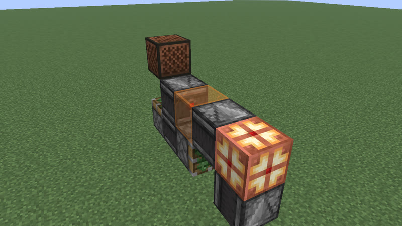</a> 116 gt (5.8 s) · copper_bulb+observer+sticky_piston · 8 blocks</td><td align="center"><a href="../archive/clk-obs-p116-bulb-obs-stk-8b-c6ad31.txt">clk-obs-p116-bulb-obs-stk-8b-c6ad31</a> 116 gt (5.8 s) · copper_bulb+observer+sticky_piston · 8 blocks (picture pending)</td></tr>
<tr><td align="center"> 116 gt (5.8 s) · copper_bulb+observer · 10 blocks</td><td align="center"><a href="../archive/clk-sculk-ringbig8-p116-1.txt">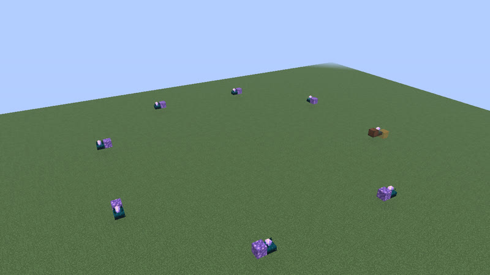</a> 116 gt (5.8 s) · calibrated_sculk_sensor+note_block · 16 blocks</td></tr>
</table>

## 117 gt (5.85 s)

Also reachable by: clk-obs-odd-b (n = 26), dropper ring (clk-item-dropring-2d-r3, n = 6).

<table>
<tr><td align="center"> 117 gt (5.85 s) · calibrated_sculk_sensor+observer+sticky_piston · 6 blocks</td></tr>
</table>

## 118 gt (5.9 s)

Also reachable by: observer ring with a relay block (clk-obs-note-ring, n = 27), dropper ring (clk-item-dropring-2d, n = 6), ring lock (clk-item-ringlock-rows, n = 3).

<table>
<tr><td align="center"><a href="../archive/clk-obs-p118-obs-pis-stk-8b-923fc6.txt">clk-obs-p118-obs-pis-stk-8b-923fc6</a> 118 gt (5.9 s) · observer+piston+sticky_piston · 8 blocks (picture pending)</td><td align="center"><a href="../archive/clk-obs-p118-obs-stk-8b-403c6f.txt">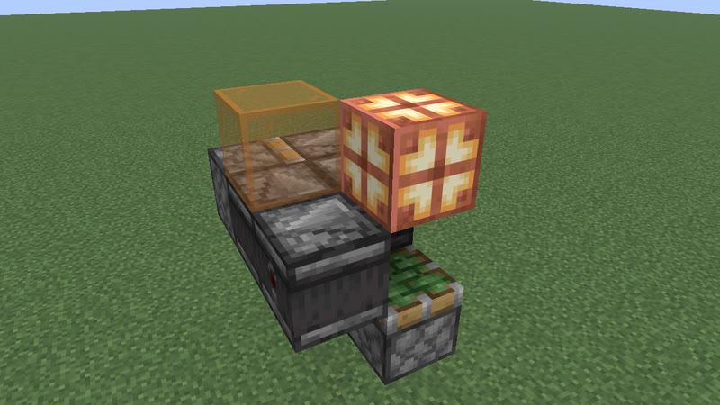</a> 118 gt (5.9 s) · observer+sticky_piston · 8 blocks</td><td align="center"><a href="../archive/clk-obs-p118-obs-stk-8b-5a37e2.txt">clk-obs-p118-obs-stk-8b-5a37e2</a> 118 gt (5.9 s) · observer+sticky_piston · 8 blocks (picture pending)</td></tr>
</table>

## 119 gt (5.95 s)

Also reachable by: clk-obs-odd-a (n = 27), hopper ring (clk-item-hopper-ring-2, n = 16), dropper ring (clk-item-dropring-2d-r4, n = 6), clk-misc-crafter-loop (n = 1).

<table>
<tr><td align="center"> 119 gt (5.95 s) · calibrated_sculk_sensor+oak_trapdoor+observer · 6 blocks</td><td align="center"><a href="../archive/clk-obs-p119-note-obs-pis-stk-9b-f81370.txt">clk-obs-p119-note-obs-pis-stk-9b-f81370</a> 119 gt (5.95 s) · note_block+observer+piston+sticky_piston · 9 blocks (picture pending)</td><td align="center"><a href="../archive/clk-obs-p119-obs-pis-stk-9b-3ec79d.txt">clk-obs-p119-obs-pis-stk-9b-3ec79d</a> 119 gt (5.95 s) · observer+piston+sticky_piston · 9 blocks (picture pending)</td></tr>
<tr><td align="center"><a href="../archive/clk-obs-p119-obs-pis-stk-9b-969977.txt">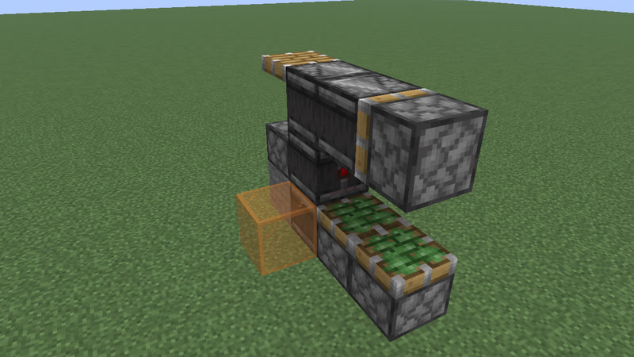</a> 119 gt (5.95 s) · observer+piston+sticky_piston · 9 blocks</td></tr>
</table>

## 120 gt (6 s)

Also reachable by: clk-obs-obs-ring (n = 28), dropper ring (clk-item-dropring-1d-r1, n = 6), ring lock (clk-item-ringlock-stones-3x6, n = 2).

<table>
<tr><td align="center"><a href="../archive/clk-obs-p120-bulb-lamp-note-obs-pis-8b-851a33.txt">clk-obs-p120-bulb-lamp-note-obs-pis-8b-851a33</a> 120 gt (6 s) · copper_bulb+note_block+observer+piston+redstone_lamp · 8 blocks (picture pending)</td><td align="center"><a href="../archive/clk-obs-p120-bulb-lamp-obs-pis-8b-d034b1.txt">clk-obs-p120-bulb-lamp-obs-pis-8b-d034b1</a> 120 gt (6 s) · copper_bulb+observer+piston+redstone_lamp · 8 blocks (picture pending)</td><td align="center"><a href="../archive/clk-obs-p120-bulb-lamp-obs-stk-8b-ae150f.txt">clk-obs-p120-bulb-lamp-obs-stk-8b-ae150f</a> 120 gt (6 s) · copper_bulb+observer+redstone_lamp+sticky_piston · 8 blocks (picture pending)</td></tr>
<tr><td align="center"><a href="../archive/clk-obs-p120-bulb-obs-rb-stk-8b-daecc7.txt">clk-obs-p120-bulb-obs-rb-stk-8b-daecc7</a> 120 gt (6 s) · copper_bulb+observer+redstone_block+sticky_piston · 8 blocks (picture pending)</td><td align="center"><a href="../archive/clk-obs-p120-bulb-obs-stk-8b-06b408.txt">clk-obs-p120-bulb-obs-stk-8b-06b408</a> 120 gt (6 s) · copper_bulb+observer+sticky_piston · 8 blocks (picture pending)</td><td align="center"><a href="../archive/clk-obs-p120-bulb-obs-stk-8b-405661.txt">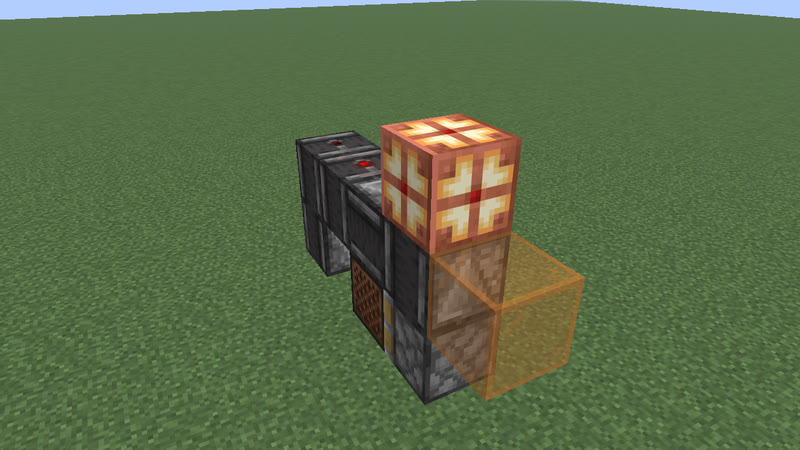</a> 120 gt (6 s) · copper_bulb+observer+sticky_piston · 8 blocks</td></tr>
<tr><td align="center"><a href="../archive/clk-obs-p120-lamp-obs-pis-rb-stk-9b-159259.txt">clk-obs-p120-lamp-obs-pis-rb-stk-9b-159259</a> 120 gt (6 s) · observer+piston+redstone_block+redstone_lamp+sticky_piston · 9 blocks (picture pending)</td><td align="center"><a href="../archive/clk-obs-p120-note-obs-pis-rb-stk-9b-a52417.txt">clk-obs-p120-note-obs-pis-rb-stk-9b-a52417</a> 120 gt (6 s) · note_block+observer+piston+redstone_block+sticky_piston · 9 blocks (picture pending)</td><td align="center"><a href="../archive/clk-obs-p120-obs-pis-rb-stk-9b-e4cc30.txt">clk-obs-p120-obs-pis-rb-stk-9b-e4cc30</a> 120 gt (6 s) · observer+piston+redstone_block+sticky_piston · 9 blocks (picture pending)</td></tr>
<tr><td align="center"><a href="../archive/clk-obs-p120-lamp-obs-stk-9b-ce3d24.txt">clk-obs-p120-lamp-obs-stk-9b-ce3d24</a> 120 gt (6 s) · observer+redstone_lamp+sticky_piston · 9 blocks (picture pending)</td><td align="center"><a href="../archive/clk-obs-p120-note-obs-stk-9b-9aeaff.txt">clk-obs-p120-note-obs-stk-9b-9aeaff</a> 120 gt (6 s) · note_block+observer+sticky_piston · 9 blocks (picture pending)</td><td align="center"><a href="../archive/clk-obs-p120-obs-stk-9b-b32325.txt">clk-obs-p120-obs-stk-9b-b32325</a> 120 gt (6 s) · observer+sticky_piston · 9 blocks (picture pending)</td></tr>
<tr><td align="center"><a href="../archive/clk-obs-p120-lamp-note-obs-stk-9b-8295ac.txt">clk-obs-p120-lamp-note-obs-stk-9b-8295ac</a> 120 gt (6 s) · note_block+observer+redstone_lamp+sticky_piston · 9 blocks (picture pending)</td><td align="center"><a href="../archive/clk-sculk-ringbig8-p120-1.txt">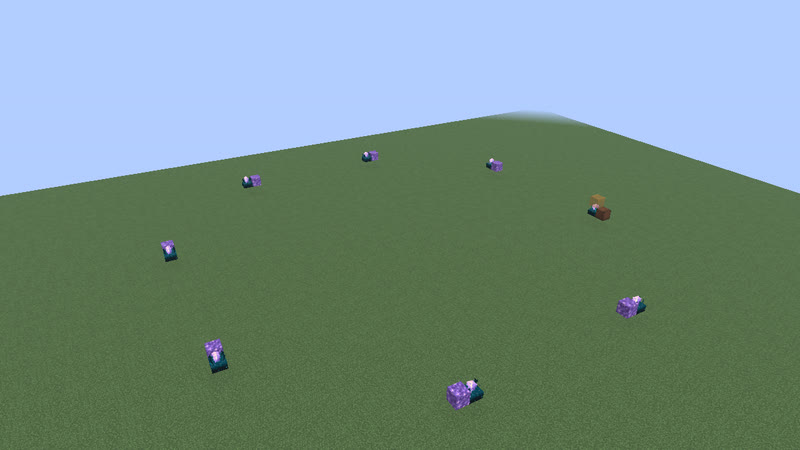</a> 120 gt (6 s) · calibrated_sculk_sensor+note_block · 16 blocks</td></tr>
</table>

## 122 gt (6.1 s)

Also reachable by: observer ring with a relay block (clk-obs-note-ring, n = 28), dropper ring (clk-item-dropring-1d-r2, n = 6).

<table>
<tr><td align="center"><a href="../archive/clk-obs-p122-bulb-obs-rb-stk-9b-18af64.txt">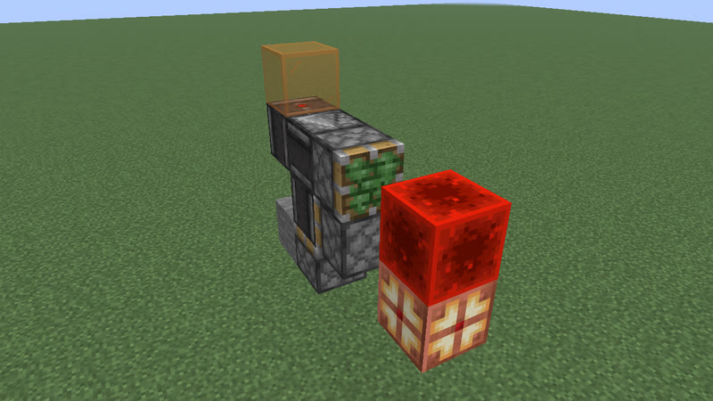</a> 122 gt (6.1 s) · copper_bulb+observer+redstone_block+sticky_piston · 9 blocks</td><td align="center"><a href="../archive/clk-obs-p122-bulb-obs-rb-stk-9b-c84d63.txt">clk-obs-p122-bulb-obs-rb-stk-9b-c84d63</a> 122 gt (6.1 s) · copper_bulb+observer+redstone_block+sticky_piston · 9 blocks (picture pending)</td></tr>
</table>

## 123 gt (6.15 s)

Also reachable by: clk-obs-odd-a (n = 28), dropper ring (clk-item-dropring-1d-r24, n = 5).

<table>
<tr><td align="center"> 123 gt (6.15 s) · dispenser+observer+sculk_sensor · 6 blocks</td></tr>
</table>

## 124 gt (6.2 s)

Also reachable by: clk-obs-obs-ring (n = 29), clk-obs-bulb-ring (n = 13), dropper ring (clk-item-dropring-1d-r3, n = 6), clk-sculk-racetrack (n = 3), clk-sculk-racetrack-plain (n = 7).

<table>
<tr><td align="center"> 124 gt (6.2 s) · calibrated_sculk_sensor+dispenser+observer+sculk_sensor · 5 blocks</td><td align="center"> 124 gt (6.2 s) · calibrated_sculk_sensor+note_block+observer+sculk_sensor · 7 blocks</td><td align="center"> 124 gt (6.2 s) · calibrated_sculk_sensor+oak_trapdoor+observer+sculk_sensor · 7 blocks</td></tr>
<tr><td align="center"> 124 gt (6.2 s) · calibrated_sculk_sensor+observer+sculk_sensor+sticky_piston · 7 blocks</td><td align="center"><a href="../archive/clk-obs-p124-bulb-lamp-note-obs-stk-8b-211583.txt">clk-obs-p124-bulb-lamp-note-obs-stk-8b-211583</a> 124 gt (6.2 s) · copper_bulb+note_block+observer+redstone_lamp+sticky_piston · 8 blocks (picture pending)</td><td align="center"><a href="../archive/clk-obs-p124-bulb-lamp-obs-stk-8b-9f0113.txt">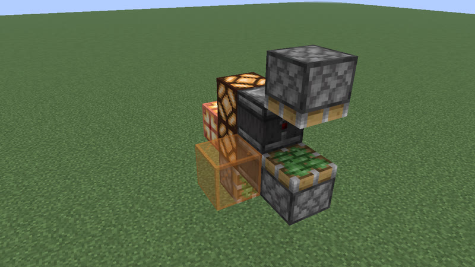</a> 124 gt (6.2 s) · copper_bulb+observer+redstone_lamp+sticky_piston · 8 blocks</td></tr>
<tr><td align="center"><a href="../archive/clk-obs-p124-bulb-lamp-obs-stk-8b-bdd278.txt">clk-obs-p124-bulb-lamp-obs-stk-8b-bdd278</a> 124 gt (6.2 s) · copper_bulb+observer+redstone_lamp+sticky_piston · 8 blocks (picture pending)</td><td align="center"><a href="../archive/clk-obs-p124-bulb-lamp-note-obs-pis-stk-8b-f57528.txt">clk-obs-p124-bulb-lamp-note-obs-pis-stk-8b-f57528</a> 124 gt (6.2 s) · copper_bulb+note_block+observer+piston+redstone_lamp+sticky_piston · 8 blocks (picture pending)</td><td align="center"><a href="../archive/clk-obs-p124-bulb-lamp-obs-pis-stk-8b-73765b.txt">clk-obs-p124-bulb-lamp-obs-pis-stk-8b-73765b</a> 124 gt (6.2 s) · copper_bulb+observer+piston+redstone_lamp+sticky_piston · 8 blocks (picture pending)</td></tr>
<tr><td align="center"><a href="../archive/clk-obs-p124-bulb-note-obs-pis-stk-8b-922a83.txt">clk-obs-p124-bulb-note-obs-pis-stk-8b-922a83</a> 124 gt (6.2 s) · copper_bulb+note_block+observer+piston+sticky_piston · 8 blocks (picture pending)</td><td align="center"><a href="../archive/clk-obs-p124-bulb-note-obs-stk-8b-9c526c.txt">clk-obs-p124-bulb-note-obs-stk-8b-9c526c</a> 124 gt (6.2 s) · copper_bulb+note_block+observer+sticky_piston · 8 blocks (picture pending)</td><td align="center"><a href="../archive/clk-obs-p124-bulb-obs-pis-stk-8b-643ba2.txt">clk-obs-p124-bulb-obs-pis-stk-8b-643ba2</a> 124 gt (6.2 s) · copper_bulb+observer+piston+sticky_piston · 8 blocks (picture pending)</td></tr>
<tr><td align="center"><a href="../archive/clk-obs-p124-bulb-obs-stk-9b-9df5da.txt">clk-obs-p124-bulb-obs-stk-9b-9df5da</a> 124 gt (6.2 s) · copper_bulb+observer+sticky_piston · 9 blocks (picture pending)</td><td align="center"><a href="../archive/clk-obs-p124-obs-stk-9b-b608e1.txt">clk-obs-p124-obs-stk-9b-b608e1</a> 124 gt (6.2 s) · observer+sticky_piston · 9 blocks (picture pending)</td><td align="center"><a href="../archive/clk-sculk-ringbig8-p124-1.txt">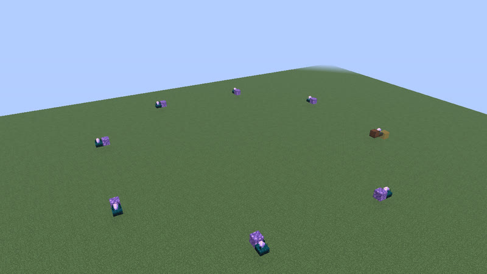</a> 124 gt (6.2 s) · calibrated_sculk_sensor+note_block · 16 blocks</td></tr>
</table>

## 125 gt (6.25 s)

Also reachable by: clk-obs-odd-b (n = 28), dropper ring (clk-item-dropring-1d, n = 7).

<table>
<tr><td align="center"> 125 gt (6.25 s) · calibrated_sculk_sensor+dispenser+oak_trapdoor+observer+sculk_sensor · 5 blocks</td><td align="center"> 125 gt (6.25 s) · calibrated_sculk_sensor+dispenser+observer+piston+sculk_sensor · 5 blocks also found as census-p125-calibrated_sculk_sensor-dispenser-observer-sculk_sensor-sticky_piston-5b (built with sticky_piston, without piston)</td><td align="center"> 125 gt (6.25 s) · oak_trapdoor+observer+sculk_sensor · 7 blocks</td></tr>
<tr><td align="center"> 125 gt (6.25 s) · calibrated_sculk_sensor+observer+sculk_sensor+sticky_piston · 7 blocks</td></tr>
</table>

## 126 gt (6.3 s)

Also reachable by: observer ring with a relay block (clk-obs-note-ring, n = 29), hopper ring (clk-item-hopper-ring, n = 8), dropper ring (clk-item-dropring-1d-r4, n = 6), clk-item-latch (n = 6).

<table>
<tr><td align="center"> 126 gt (6.3 s) · note_block+observer+sculk_sensor · 5 blocks</td><td align="center"> 126 gt (6.3 s) · dispenser+observer+sculk_sensor+sticky_piston · 6 blocks</td><td align="center"> 126 gt (6.3 s) · dispenser+observer+sculk_sensor · 6 blocks</td></tr>
<tr><td align="center"> 126 gt (6.3 s) · calibrated_sculk_sensor+observer+sticky_piston · 7 blocks</td><td align="center"> 126 gt (6.3 s) · observer+sculk_sensor+sticky_piston · 7 blocks</td><td align="center"> 126 gt (6.3 s) · observer+piston+sculk_sensor · 7 blocks</td></tr>
<tr><td align="center"> 126 gt (6.3 s) · observer+piston+sculk_sensor+sticky_piston · 7 blocks</td><td align="center"> 126 gt (6.3 s) · calibrated_sculk_sensor+observer+sculk_sensor+sticky_piston · 7 blocks</td><td align="center"> 126 gt (6.3 s) · comparator+hopper+redstone_torch+redstone_wire · 8 blocks</td></tr>
<tr><td align="center"><a href="../archive/clk-obs-p126-bulb-lamp-note-obs-pis-stk-9b-42aebd.txt">clk-obs-p126-bulb-lamp-note-obs-pis-stk-9b-42aebd</a> 126 gt (6.3 s) · copper_bulb+note_block+observer+piston+redstone_lamp+sticky_piston · 9 blocks (picture pending)</td><td align="center"><a href="../archive/clk-obs-p126-bulb-lamp-obs-pis-stk-9b-778ada.txt">clk-obs-p126-bulb-lamp-obs-pis-stk-9b-778ada</a> 126 gt (6.3 s) · copper_bulb+observer+piston+redstone_lamp+sticky_piston · 9 blocks (picture pending)</td><td align="center"><a href="../archive/clk-obs-p126-bulb-note-obs-pis-stk-9b-ee084c.txt">clk-obs-p126-bulb-note-obs-pis-stk-9b-ee084c</a> 126 gt (6.3 s) · copper_bulb+note_block+observer+piston+sticky_piston · 9 blocks (picture pending)</td></tr>
<tr><td align="center"><a href="../archive/clk-obs-p126-bulb-obs-pis-stk-9b-d627a7.txt">clk-obs-p126-bulb-obs-pis-stk-9b-d627a7</a> 126 gt (6.3 s) · copper_bulb+observer+piston+sticky_piston · 9 blocks (picture pending)</td><td align="center"><a href="../archive/clk-obs-p126-bulb-lamp-note-obs-stk-9b-cdb01c.txt">clk-obs-p126-bulb-lamp-note-obs-stk-9b-cdb01c</a> 126 gt (6.3 s) · copper_bulb+note_block+observer+redstone_lamp+sticky_piston · 9 blocks (picture pending)</td><td align="center"><a href="../archive/clk-obs-p126-bulb-lamp-obs-stk-9b-86dbaa.txt">clk-obs-p126-bulb-lamp-obs-stk-9b-86dbaa</a> 126 gt (6.3 s) · copper_bulb+observer+redstone_lamp+sticky_piston · 9 blocks (picture pending)</td></tr>
<tr><td align="center"><a href="../archive/clk-obs-p126-bulb-note-obs-stk-9b-93e51b.txt">clk-obs-p126-bulb-note-obs-stk-9b-93e51b</a> 126 gt (6.3 s) · copper_bulb+note_block+observer+sticky_piston · 9 blocks (picture pending)</td><td align="center"><a href="../archive/clk-obs-p126-bulb-obs-stk-9b-0ade61.txt">clk-obs-p126-bulb-obs-stk-9b-0ade61</a> 126 gt (6.3 s) · copper_bulb+observer+sticky_piston · 9 blocks (picture pending)</td></tr>
</table>

## 128 gt (6.4 s)

Also reachable by: clk-obs-obs-ring (n = 30), dropper ring (clk-item-dropring-2d-r14, n = 6), clk-rt-rect-pulse (n = 6), ring lock (clk-item-ringlock-stones-3x6, n = 3).

<table>
<tr><td align="center"> 128 gt (6.4 s) · calibrated_sculk_sensor+dispenser+observer+sculk_sensor · 6 blocks</td><td align="center"><a href="../archive/clk-obs-p128-obs-pis-rb-stk-8b-c36479.txt">clk-obs-p128-obs-pis-rb-stk-8b-c36479</a> 128 gt (6.4 s) · observer+piston+redstone_block+sticky_piston · 8 blocks (picture pending)</td><td align="center"><a href="../archive/clk-obs-p128-obs-rb-stk-8b-4869e1.txt">clk-obs-p128-obs-rb-stk-8b-4869e1</a> 128 gt (6.4 s) · observer+redstone_block+sticky_piston · 8 blocks (picture pending)</td></tr>
<tr><td align="center"> 128 gt (6.4 s) · oak_trapdoor+observer+sculk_sensor+sticky_piston · 8 blocks</td><td align="center"><a href="../archive/clk-obs-p128-bulb-note-obs-pis-stk-9b-0c34f1.txt">clk-obs-p128-bulb-note-obs-pis-stk-9b-0c34f1</a> 128 gt (6.4 s) · copper_bulb+note_block+observer+piston+sticky_piston · 9 blocks (picture pending)</td><td align="center"><a href="../archive/clk-obs-p128-bulb-obs-pis-stk-9b-fde629.txt">clk-obs-p128-bulb-obs-pis-stk-9b-fde629</a> 128 gt (6.4 s) · copper_bulb+observer+piston+sticky_piston · 9 blocks (picture pending)</td></tr>
<tr><td align="center"><a href="../archive/clk-obs-p128-note-obs-stk-9b-e86524.txt">clk-obs-p128-note-obs-stk-9b-e86524</a> 128 gt (6.4 s) · note_block+observer+sticky_piston · 9 blocks (picture pending)</td><td align="center"><a href="../archive/clk-obs-p128-obs-stk-9b-2d0145.txt">clk-obs-p128-obs-stk-9b-2d0145</a> 128 gt (6.4 s) · observer+sticky_piston · 9 blocks (picture pending)</td></tr>
</table>

[catalog index](../CATALOG.md) · previous: [p48-81](p48-81.md) · next: [p129-494](p129-494.md)
