# Clocks: 84 gt (4.2 s) to 220 gt (11 s) (299 clock types)

[catalog index](../CATALOG.md) · previous: [p48-83](p48-83.md) · next: [p225-17978](p225-17978.md)

Orange glass = where the output signal is (placed only for the picture); click a picture for its design. Larger clocks of a period that only add block kinds to a smaller one are listed on [variants](variants.md). Generated by `mctas clock catalog`.

## 84 gt (4.2 s)

Also reachable by: clk-obs-obs-ring (n = 19), hopper ring (clk-item-hopper-ring, n = 5), clk-obs-bulb-ring (n = 8), clk-rt-uloop2t (n = 4), dropper ring (clk-item-dropring-1d-r4, n = 3), clk-rt-rect-inv (n = 1).

<table>
<tr><td align="center"><a href="../archive/census-p84-calibrated_sculk_sensor-dispenser-observer-sculk_sensor-5b.txt">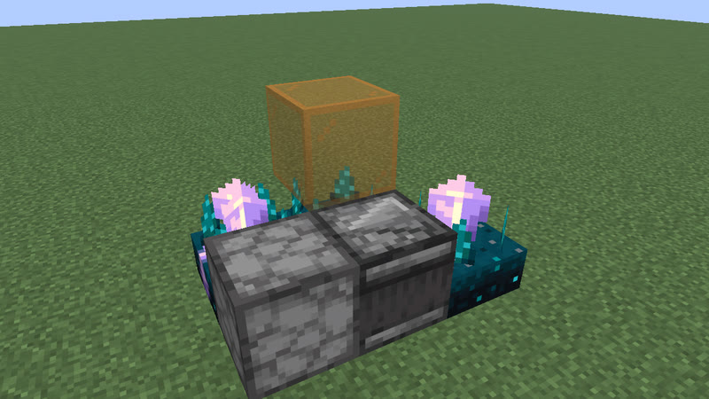</a> 84 gt (4.2 s) · calibrated_sculk_sensor+dispenser+observer+sculk_sensor · 5 blocks</td><td align="center"><a href="../archive/census-p84-calibrated_sculk_sensor-dispenser-observer-piston-sculk_sensor-5b.txt">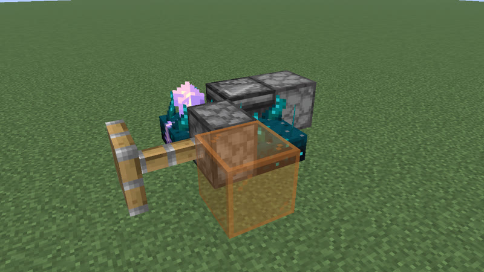</a> 84 gt (4.2 s) · calibrated_sculk_sensor+dispenser+observer+piston+sculk_sensor · 5 blocks also found as census-p84-calibrated_sculk_sensor-dispenser-observer-sculk_sensor-sticky_piston-5b (built with sticky_piston, without piston)</td><td align="center"><a href="../archive/clk-obs-p84-bulb-lamp-obs-stk-7b-b-9a153a.txt">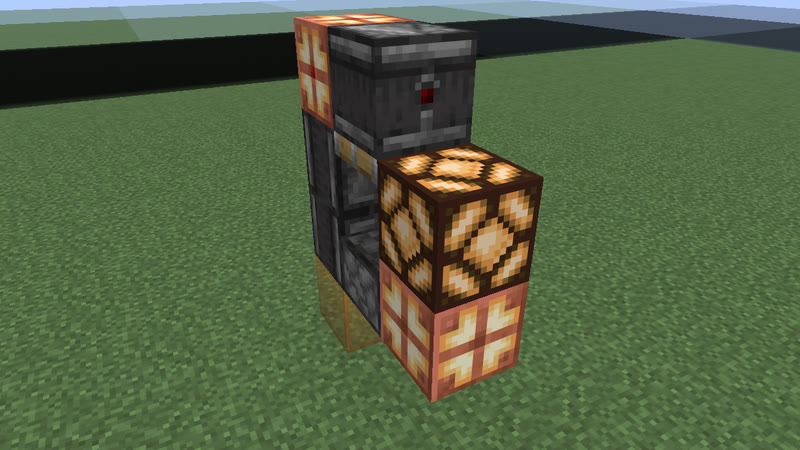</a> 84 gt (4.2 s) · copper_bulb+observer+redstone_lamp+sticky_piston · 7 blocks</td></tr>
<tr><td align="center"><a href="../archive/clk-obs-p84-bulb-lamp-obs-stk-7b-f94b2e.txt">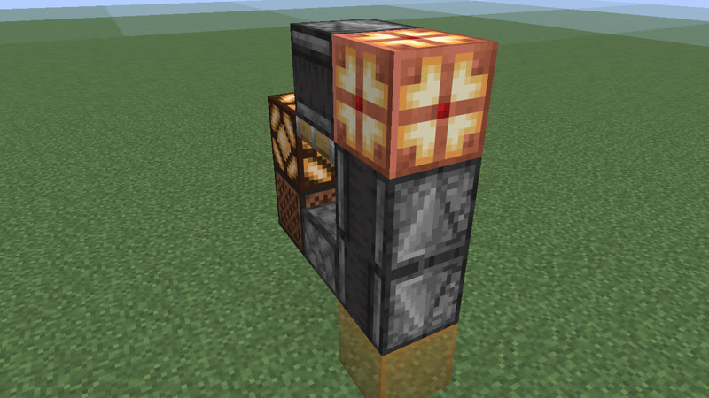</a> 84 gt (4.2 s) · copper_bulb+observer+redstone_lamp+sticky_piston · 7 blocks</td><td align="center"><a href="../archive/clk-obs-p84-bulb-note-obs-stk-7b-b-bf0c7d.txt">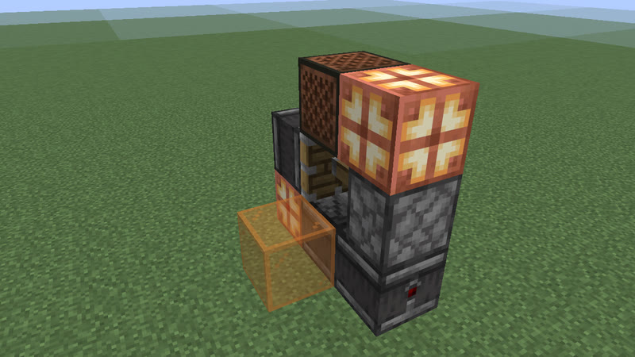</a> 84 gt (4.2 s) · copper_bulb+note_block+observer+sticky_piston · 7 blocks</td><td align="center"><a href="../archive/clk-obs-p84-bulb-note-obs-stk-7b-b15f95.txt">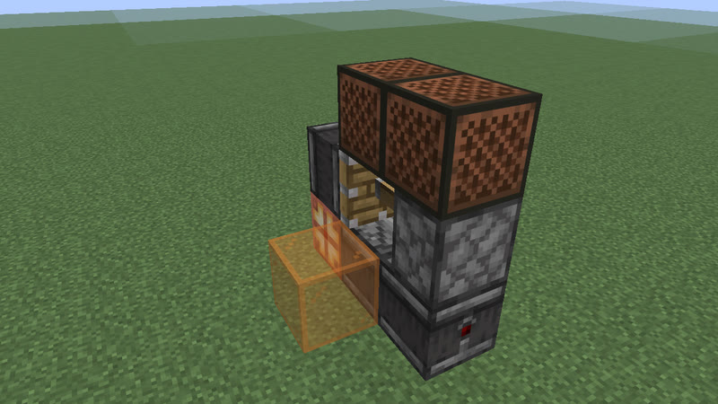</a> 84 gt (4.2 s) · copper_bulb+note_block+observer+sticky_piston · 7 blocks</td></tr>
<tr><td align="center"><a href="../archive/clk-obs-p84-bulb-obs-pis-7b-85bd93.txt">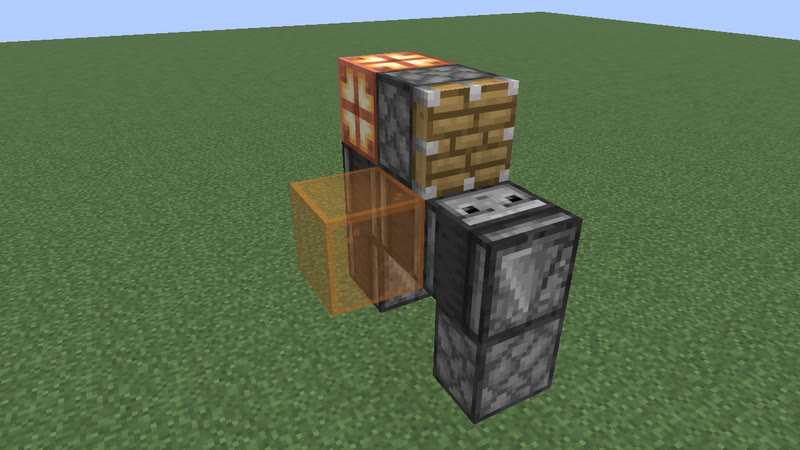</a> 84 gt (4.2 s) · copper_bulb+observer+piston · 7 blocks</td><td align="center"><a href="../archive/clk-obs-p84-bulb-obs-pis-stk-7b-b-f053ab.txt">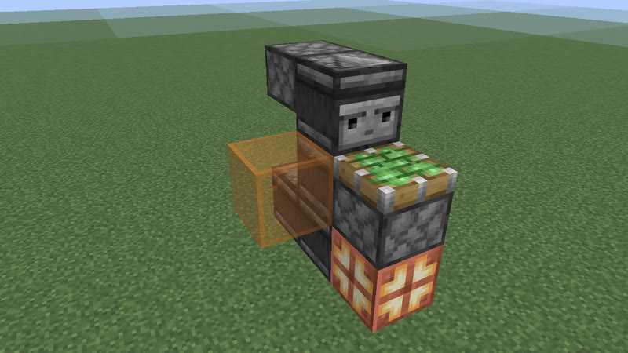</a> 84 gt (4.2 s) · copper_bulb+observer+piston+sticky_piston · 7 blocks</td><td align="center"><a href="../archive/clk-obs-p84-bulb-obs-pis-stk-7b-fca95d.txt">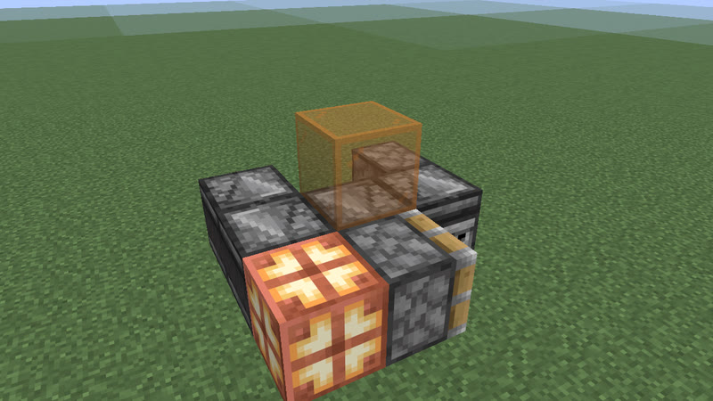</a> 84 gt (4.2 s) · copper_bulb+observer+piston+sticky_piston · 7 blocks also found as clk-obs-p84-bulb-obs-pis-7b-b-5c0922 (built without sticky_piston)</td></tr>
<tr><td align="center"><a href="../archive/clk-obs-p84-bulb-obs-rb-stk-7b-a0cb9e.txt">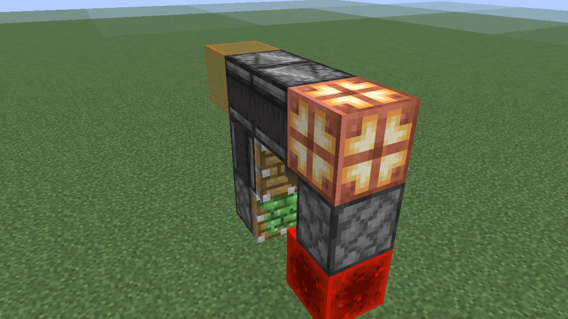</a> 84 gt (4.2 s) · copper_bulb+observer+redstone_block+sticky_piston · 7 blocks</td><td align="center"><a href="../archive/clk-obs-p84-bulb-obs-stk-7b-388fc2.txt">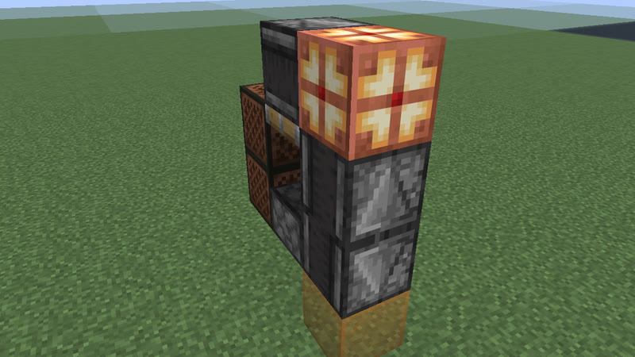</a> 84 gt (4.2 s) · copper_bulb+observer+sticky_piston · 7 blocks</td><td align="center"><a href="../archive/clk-obs-p84-bulb-obs-stk-7b-b-9dac48.txt">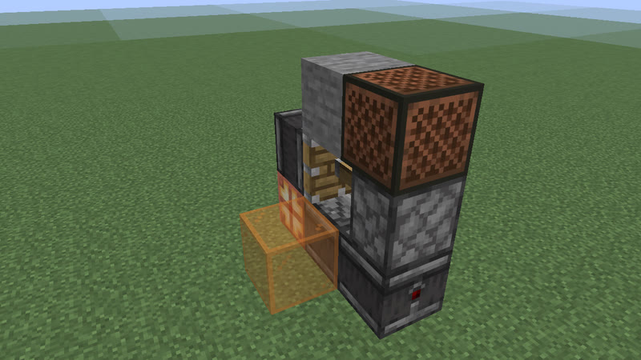</a> 84 gt (4.2 s) · copper_bulb+observer+sticky_piston · 7 blocks</td></tr>
<tr><td align="center"><a href="../archive/clk-obs-p84-lamp-obs-pis-stk-7b-7d1237.txt">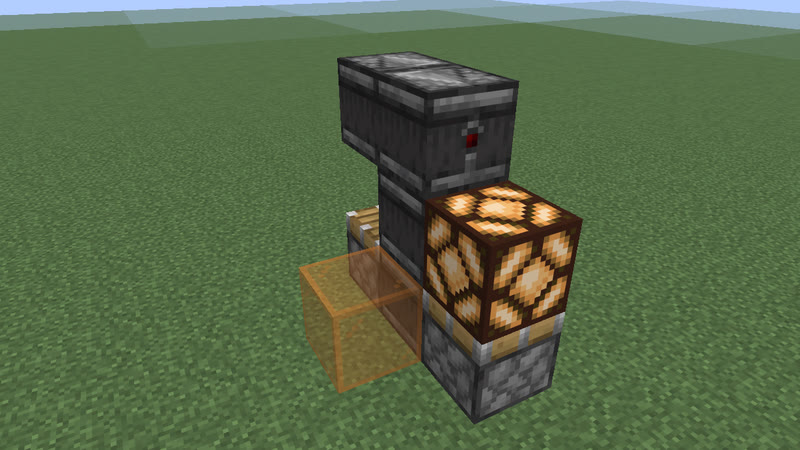</a> 84 gt (4.2 s) · observer+piston+redstone_lamp+sticky_piston · 7 blocks</td><td align="center"><a href="../archive/clk-obs-p84-note-obs-pis-stk-7b-7447eb.txt">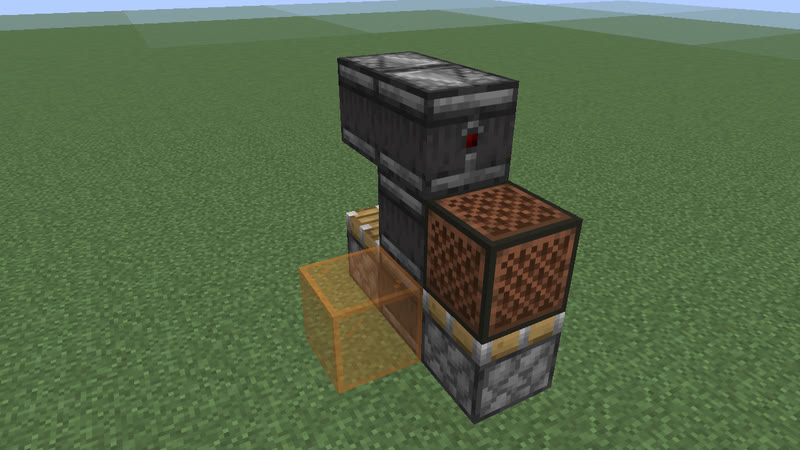</a> 84 gt (4.2 s) · note_block+observer+piston+sticky_piston · 7 blocks</td><td align="center"><a href="../archive/clk-obs-p84-obs-pis-stk-7b-d40d1f.txt">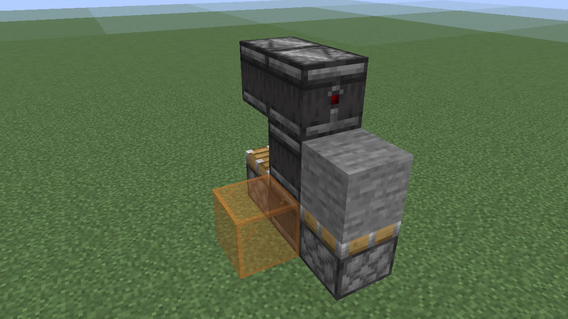</a> 84 gt (4.2 s) · observer+piston+sticky_piston · 7 blocks</td></tr>
<tr><td align="center"><a href="../archive/clk-obs-p84-bulb-lamp-obs-pis-stk-7b-3d1b1e.txt">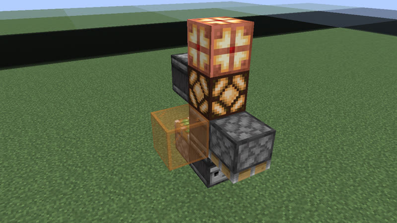</a> 84 gt (4.2 s) · copper_bulb+observer+piston+redstone_lamp+sticky_piston · 7 blocks</td><td align="center"><a href="../archive/clk-obs-p84-bulb-lamp-obs-pis-stk-7b-b-98427f.txt">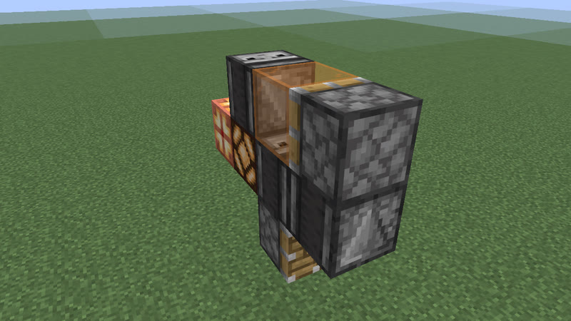</a> 84 gt (4.2 s) · copper_bulb+observer+piston+redstone_lamp+sticky_piston · 7 blocks</td><td align="center"><a href="../archive/clk-obs-p84-bulb-note-obs-pis-stk-7b-62a421.txt">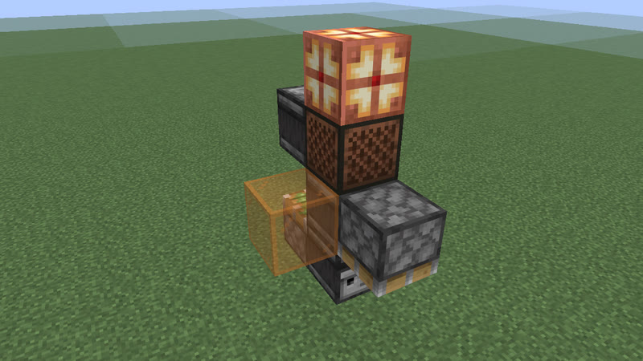</a> 84 gt (4.2 s) · copper_bulb+note_block+observer+piston+sticky_piston · 7 blocks</td></tr>
<tr><td align="center"><a href="../archive/clk-obs-p84-bulb-note-obs-pis-stk-7b-b-aba9bc.txt">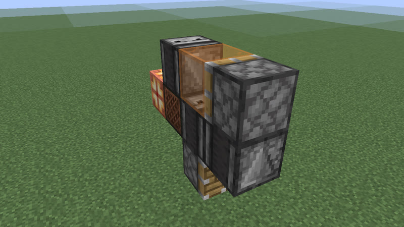</a> 84 gt (4.2 s) · copper_bulb+note_block+observer+piston+sticky_piston · 7 blocks</td><td align="center"><a href="../archive/clk-obs-p84-bulb-obs-rb-stk-7b-b-0da4c2.txt">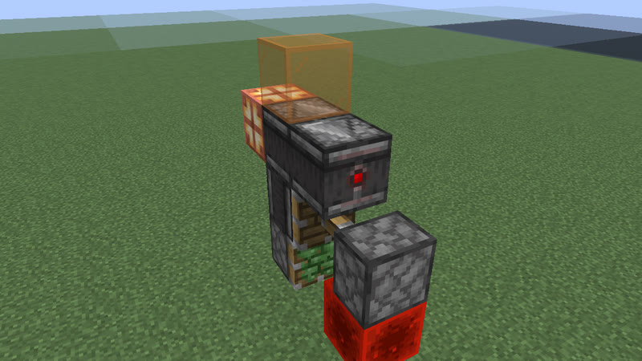</a> 84 gt (4.2 s) · copper_bulb+observer+redstone_block+sticky_piston · 7 blocks</td><td align="center"><a href="../archive/loop4burn-p84.txt">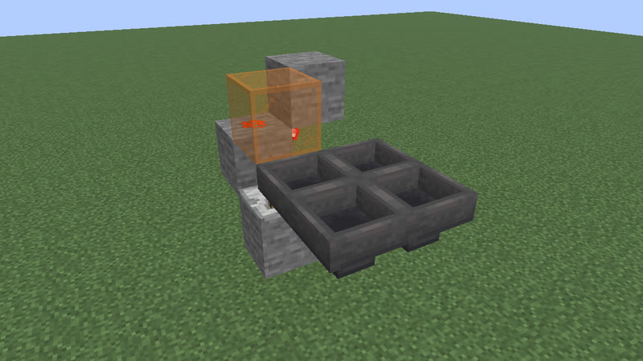</a> 84 gt (4.2 s) · comparator+hopper+redstone_torch+redstone_wire · 10 blocks</td></tr>
<tr><td align="center"> 84 gt (4.2 s) · comparator+hopper · 14 blocks</td><td align="center"><a href="../archive/clk-rt-uloop-p84-17b.txt">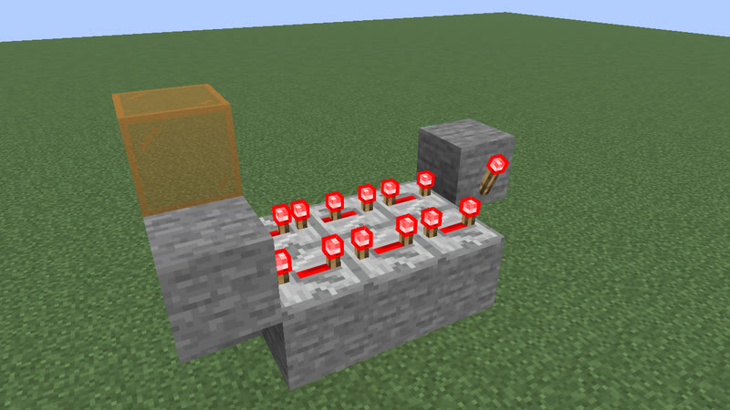</a> 84 gt (4.2 s) · redstone_torch+redstone_wire+repeater · 17 blocks</td><td align="center"><a href="../archive/clk-rt-rect3x7-p84-27b.txt">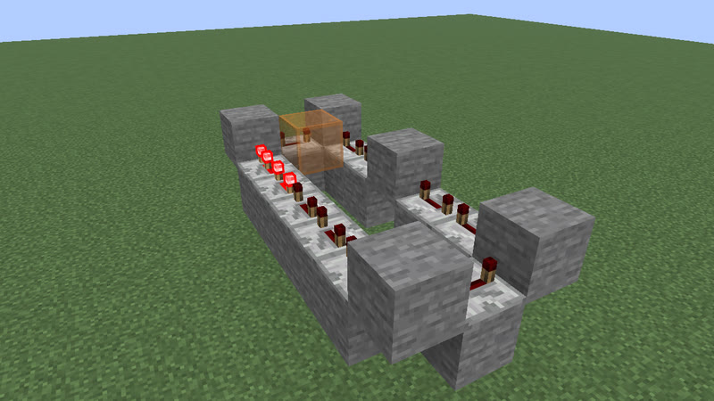</a> 84 gt (4.2 s) · repeater · 27 blocks</td></tr>
</table>

## 85 gt (4.25 s)

Also reachable by: clk-obs-odd-b (n = 18), dropper ring (clk-item-dropring-2d-r1, n = 3), clk-sculk-replin (n = 9).

<table>
<tr><td align="center"><a href="../archive/clk-sculk-hyb-p85-1.txt">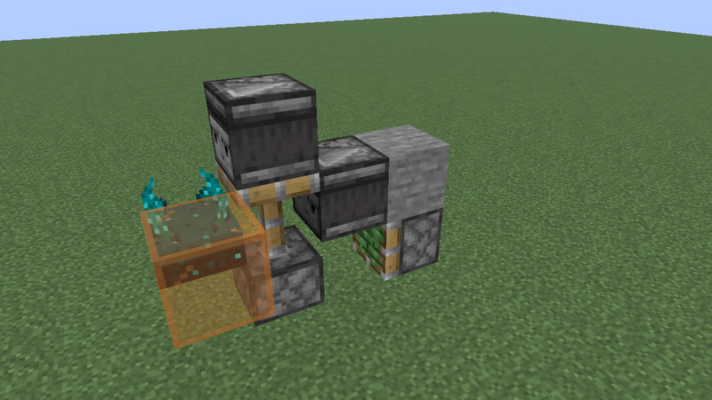</a> 85 gt (4.25 s) · observer+sculk_sensor+sticky_piston · 6 blocks</td><td align="center"><a href="../archive/clk-rt-count5-over-odd17.txt">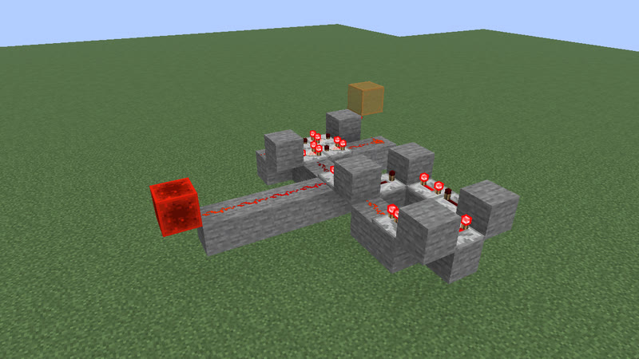</a> 85 gt (4.25 s) · comparator+redstone_torch+redstone_wire+repeater · 46 blocks</td><td align="center"><a href="../archive/clk-rt-odd-rect-p85-48b.txt">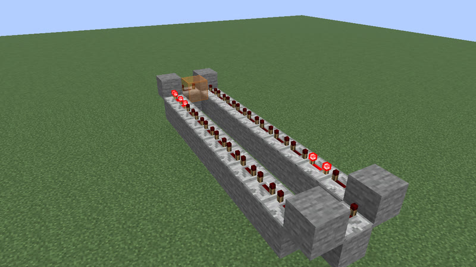</a> 85 gt (4.25 s) · repeater · 48 blocks</td></tr>
</table>

## 86 gt (4.3 s)

Also reachable by: observer ring with a relay block (clk-obs-note-ring, n = 19), clk-misc-cart-loop (n = 12), dropper ring (clk-item-dropring-2d-r14, n = 3).

<table>
<tr><td align="center"><a href="../archive/clk-sculk-hyb-p86-1.txt">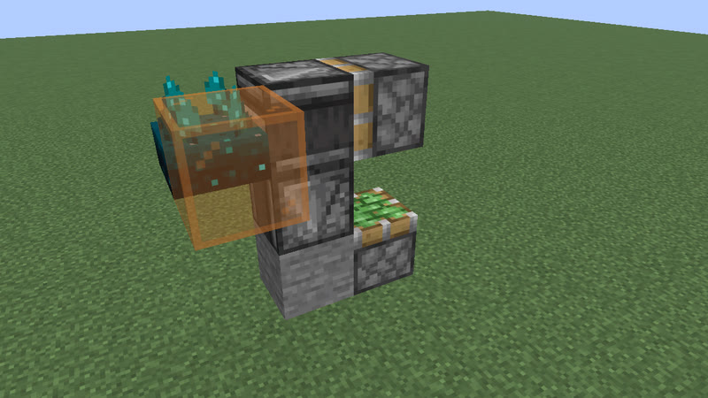</a> 86 gt (4.3 s) · observer+sculk_sensor+sticky_piston · 6 blocks</td><td align="center"><a href="../archive/clk-obs-p86-bulb-obs-rb-stk-7b-99c6a4.txt">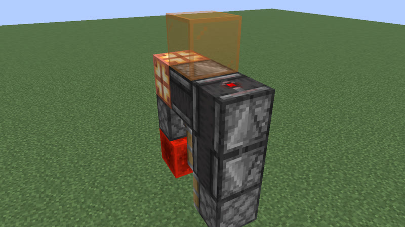</a> 86 gt (4.3 s) · copper_bulb+observer+redstone_block+sticky_piston · 7 blocks</td><td align="center"><a href="../archive/clk-obs-p86-bulb-obs-rb-stk-7b-b-2edb20.txt">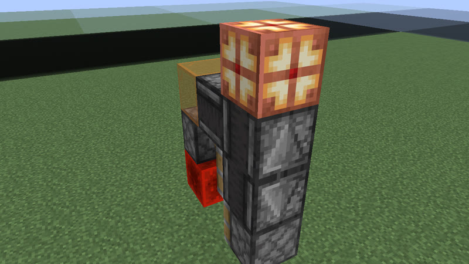</a> 86 gt (4.3 s) · copper_bulb+observer+redstone_block+sticky_piston · 7 blocks</td></tr>
<tr><td align="center"><a href="../archive/clk-rt-uloop-p86-17b.txt">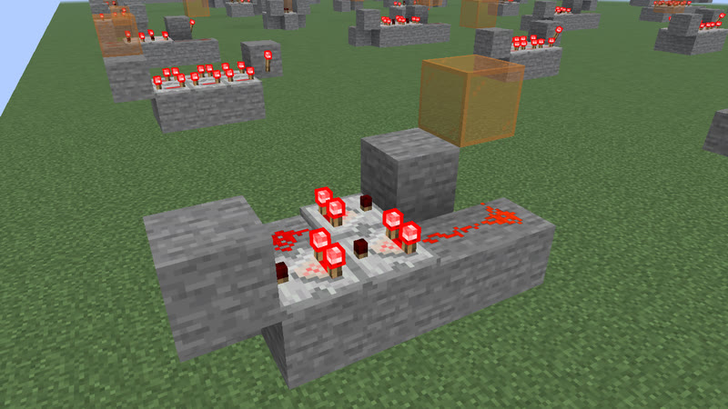</a> 86 gt (4.3 s) · comparator+redstone_torch+redstone_wire · 17 blocks</td><td align="center"> 86 gt (4.3 s) · repeater · 27 blocks</td></tr>
</table>

## 87 gt (4.35 s)

Also reachable by: clk-obs-odd-a (n = 19), clk-rt-odd-rect (n = 8), dropper ring (clk-item-dropring-2d-r2, n = 4), clk-misc-cart-pingpong (n = 10).

<table>
<tr><td align="center"><a href="../archive/clk-sculk-two-p87-1.txt">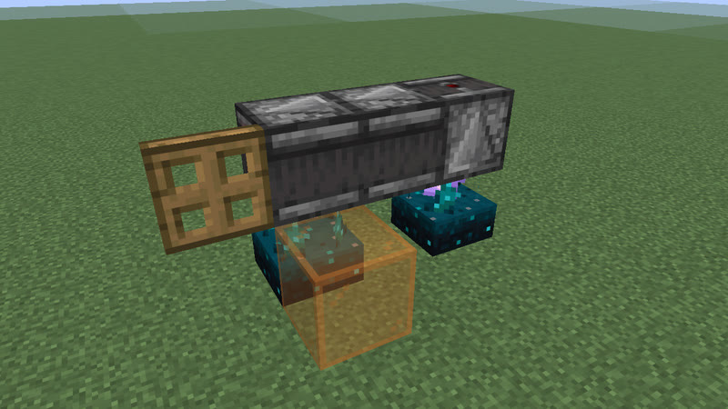</a> 87 gt (4.35 s) · calibrated_sculk_sensor+oak_trapdoor+observer+sculk_sensor · 6 blocks</td><td align="center"><a href="../archive/clk-sculk-two-p87-3.txt">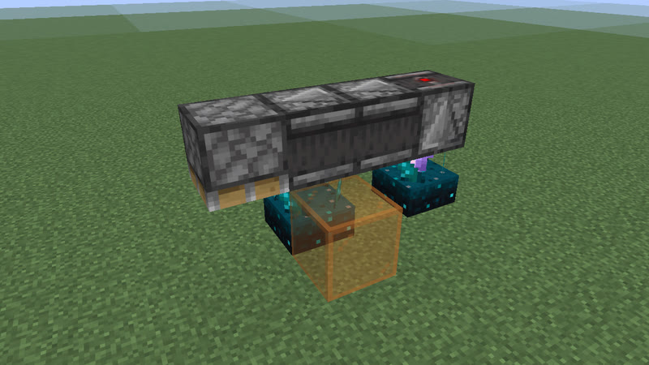</a> 87 gt (4.35 s) · calibrated_sculk_sensor+observer+sculk_sensor+sticky_piston · 6 blocks</td><td align="center"><a href="../archive/clk-obs-p87-obs-pis-stk-7b-6b98fe.txt">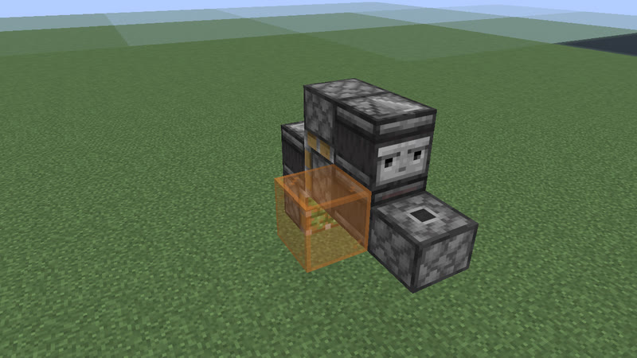</a> 87 gt (4.35 s) · observer+piston+sticky_piston · 7 blocks</td></tr>
<tr><td align="center"><a href="../archive/clk-obs-p87-obs-stk-7b-8eb4b8.txt">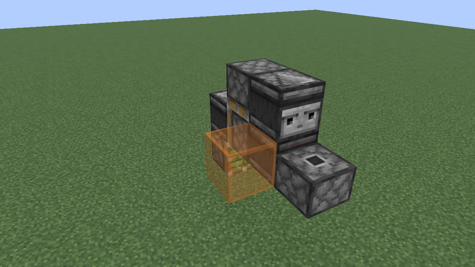</a> 87 gt (4.35 s) · observer+sticky_piston · 7 blocks</td><td align="center"><a href="../archive/clk-sculk-hyb3-p87-1.txt">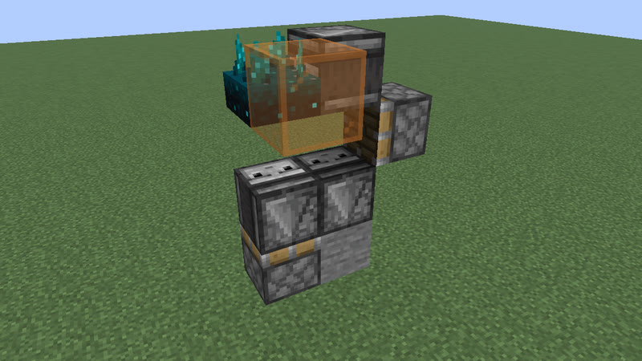</a> 87 gt (4.35 s) · observer+piston+sculk_sensor+sticky_piston · 7 blocks</td><td align="center"><a href="../archive/clk-sculk-hyb3-p87-2.txt">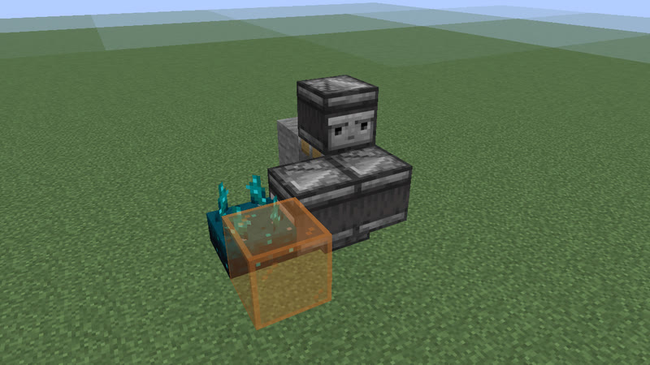</a> 87 gt (4.35 s) · observer+sculk_sensor+sticky_piston · 7 blocks</td></tr>
</table>

## 88 gt (4.4 s)

Also reachable by: clk-obs-obs-ring (n = 20), dropper ring (clk-item-dropring-2d-r24, n = 3).

<table>
<tr><td align="center"><a href="../archive/census-p88-observer-sculk_sensor-sticky_piston-4b.txt">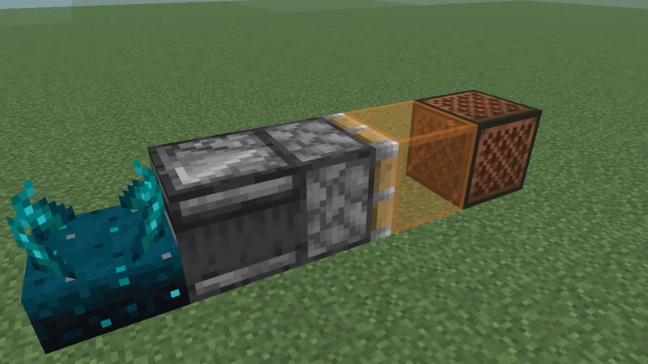</a> 88 gt (4.4 s) · observer+sculk_sensor+sticky_piston · 4 blocks</td><td align="center"><a href="../archive/census-p88-note_block-observer-sculk_sensor-sticky_piston-4b.txt">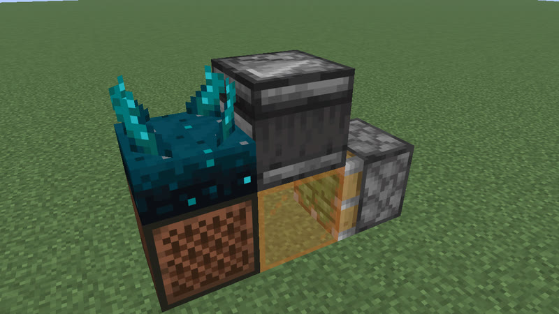</a> 88 gt (4.4 s) · note_block+observer+sculk_sensor+sticky_piston · 4 blocks</td><td align="center"><a href="../archive/census-p88-oak_trapdoor-observer-sculk_sensor-sticky_piston-4b.txt">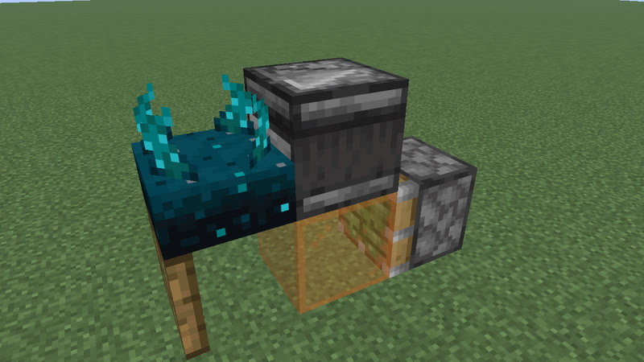</a> 88 gt (4.4 s) · oak_trapdoor+observer+sculk_sensor+sticky_piston · 4 blocks</td></tr>
<tr><td align="center"><a href="../archive/clk-sculk-hyb-p88-3.txt">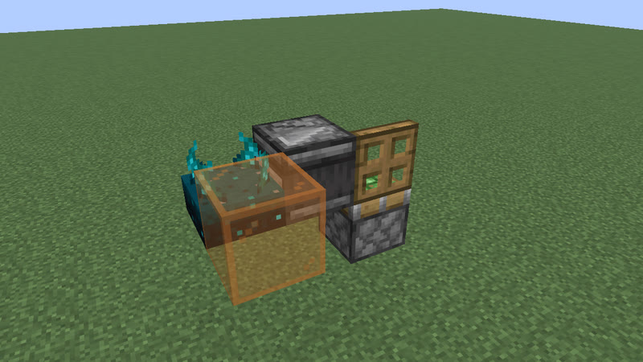</a> 88 gt (4.4 s) · observer+sculk_sensor+sticky_piston · 4 blocks</td><td align="center"><a href="../archive/census-p88-dispenser-observer-sculk_sensor-sticky_piston-5b.txt">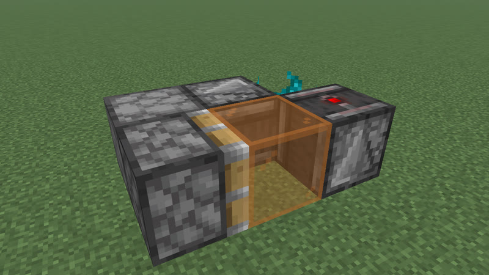</a> 88 gt (4.4 s) · dispenser+observer+sculk_sensor+sticky_piston · 5 blocks</td><td align="center"><a href="../archive/clk-sculk-hyb3b-p88-3.txt">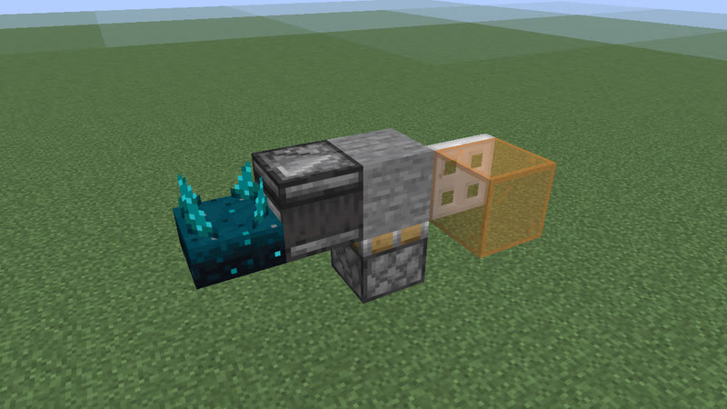</a> 88 gt (4.4 s) · iron_trapdoor+observer+sculk_sensor+sticky_piston · 5 blocks</td></tr>
<tr><td align="center"><a href="../archive/clk-sculk-hyb3b-p88-5.txt">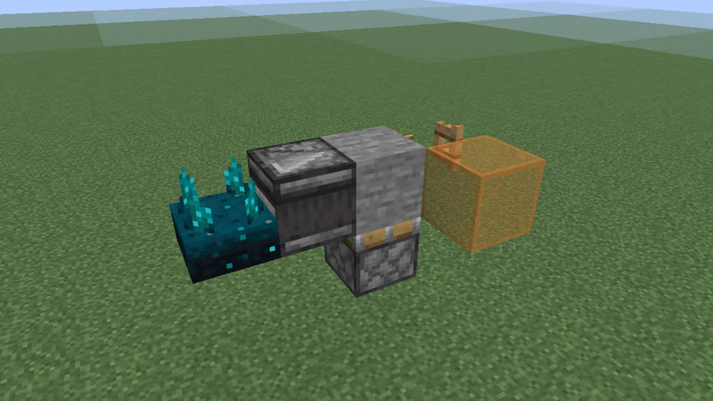</a> 88 gt (4.4 s) · oak_fence_gate+observer+sculk_sensor+sticky_piston · 5 blocks</td><td align="center"><a href="../archive/clk-rt-uloop-p88-17b.txt">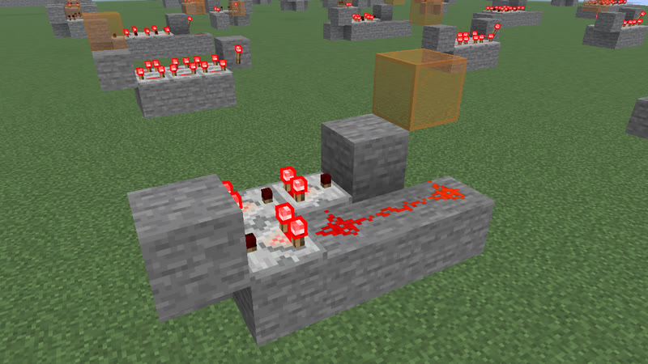</a> 88 gt (4.4 s) · comparator+redstone_torch+redstone_wire · 17 blocks</td><td align="center"><a href="../archive/clk-rt-uloop1t-p88-17b.txt">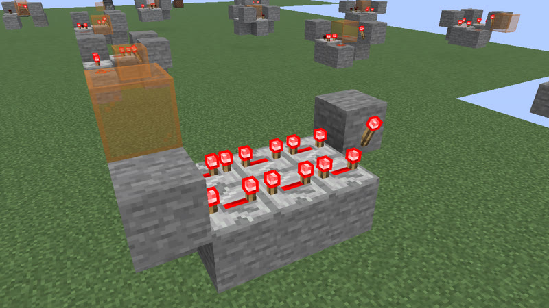</a> 88 gt (4.4 s) · redstone_torch+redstone_wire+repeater · 17 blocks</td></tr>
<tr><td align="center"><a href="../archive/clk-rt-rect3x7-p88-27b.txt">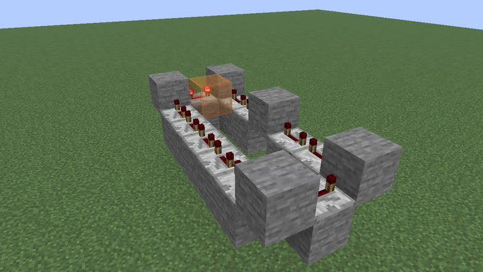</a> 88 gt (4.4 s) · repeater · 27 blocks</td></tr>
</table>

## 89 gt (4.45 s)

Also reachable by: clk-obs-odd-b (n = 19), dropper ring (clk-item-dropring-2d-r3, n = 4).

<table>
<tr><td align="center"><a href="../archive/clk-sculk-two-p89-1.txt">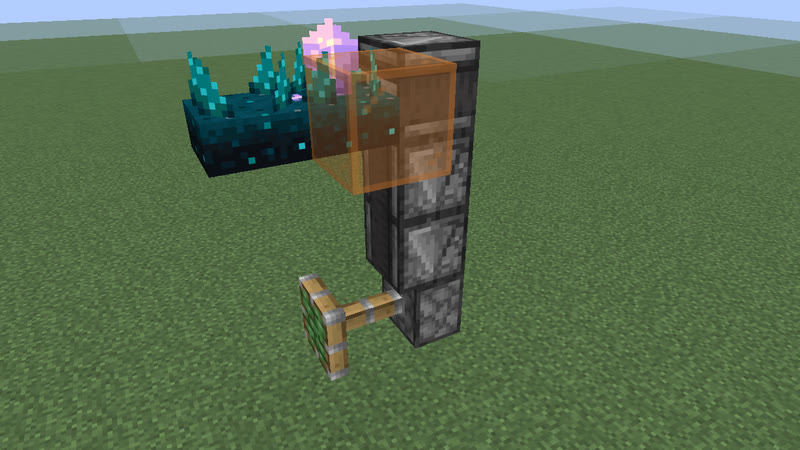</a> 89 gt (4.45 s) · calibrated_sculk_sensor+observer+sculk_sensor+sticky_piston · 6 blocks</td><td align="center"><a href="../archive/clk-sculk-hyb3-p89-2.txt">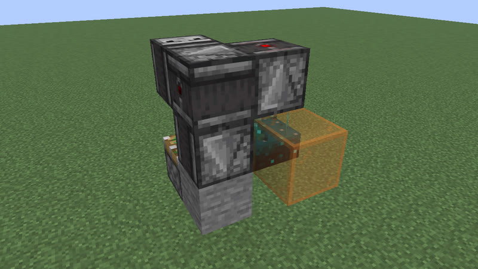</a> 89 gt (4.45 s) · observer+sculk_sensor+sticky_piston · 7 blocks</td><td align="center"><a href="../archive/clk-sculk-hyb3-p89-1.txt">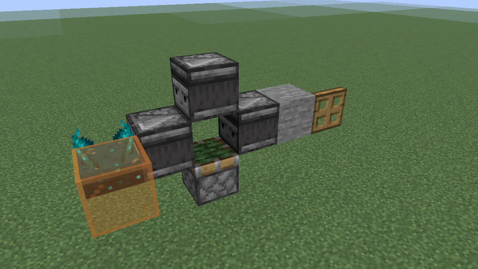</a> 89 gt (4.45 s) · oak_trapdoor+observer+sculk_sensor+sticky_piston · 7 blocks</td></tr>
<tr><td align="center"><a href="../archive/clk-sculk-hyb3b-p89-1.txt">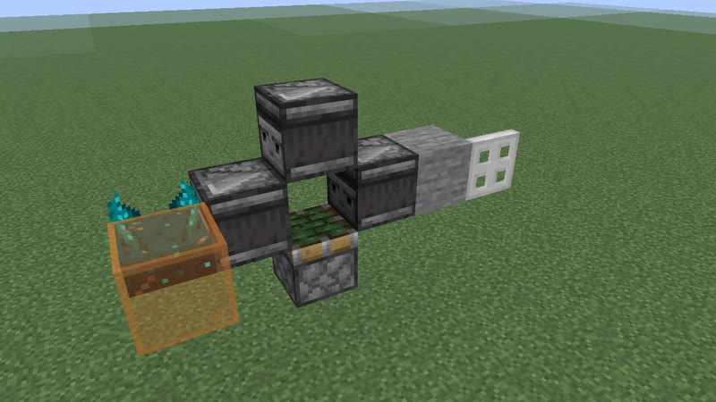</a> 89 gt (4.45 s) · iron_trapdoor+observer+sculk_sensor+sticky_piston · 7 blocks</td><td align="center"> 89 gt (4.45 s) · oak_fence_gate+observer+sculk_sensor+sticky_piston · 7 blocks</td><td align="center"> 89 gt (4.45 s) · observer+piston+sculk_sensor+sticky_piston · 7 blocks</td></tr>
<tr><td align="center"> 89 gt (4.45 s) · repeater · 51 blocks</td></tr>
</table>

## 90 gt (4.5 s)

Also reachable by: observer ring with a relay block (clk-obs-note-ring, n = 20), dropper ring (clk-item-dropring-2d, n = 4), ring lock (clk-item-ringlock-rows, n = 1).

<table>
<tr><td align="center"> 90 gt (4.5 s) · oak_trapdoor+observer+sculk_sensor · 4 blocks</td><td align="center"> 90 gt (4.5 s) · observer+piston+sculk_sensor · 4 blocks also found as census-p90-observer-sculk_sensor-sticky_piston-4b (built with sticky_piston, without piston)</td><td align="center"> 90 gt (4.5 s) · calibrated_sculk_sensor+dispenser+observer+sculk_sensor · 5 blocks</td></tr>
<tr><td align="center"> 90 gt (4.5 s) · dispenser+note_block+observer+sculk_sensor · 5 blocks</td><td align="center"> 90 gt (4.5 s) · calibrated_sculk_sensor+observer+sticky_piston · 6 blocks</td><td align="center"> 90 gt (4.5 s) · calibrated_sculk_sensor+oak_trapdoor+observer+sticky_piston · 6 blocks</td></tr>
<tr><td align="center"> 90 gt (4.5 s) · calibrated_sculk_sensor+iron_trapdoor+observer+sticky_piston · 6 blocks</td><td align="center"> 90 gt (4.5 s) · calibrated_sculk_sensor+oak_fence_gate+observer+sticky_piston · 6 blocks</td><td align="center"> 90 gt (4.5 s) · calibrated_sculk_sensor+note_block+observer+sticky_piston · 6 blocks</td></tr>
<tr><td align="center"> 90 gt (4.5 s) · calibrated_sculk_sensor+dispenser+observer+sticky_piston · 6 blocks</td><td align="center"> 90 gt (4.5 s) · calibrated_sculk_sensor+observer+sculk_sensor+sticky_piston · 6 blocks</td><td align="center"> 90 gt (4.5 s) · calibrated_sculk_sensor+observer+piston+sticky_piston · 6 blocks</td></tr>
<tr><td align="center"> 90 gt (4.5 s) · note_block+observer+sculk_sensor+sticky_piston · 7 blocks</td><td align="center"> 90 gt (4.5 s) · observer+sticky_piston · 7 blocks</td><td align="center"> 90 gt (4.5 s) · comparator+hopper · 14 blocks</td></tr>
<tr><td align="center"> 90 gt (4.5 s) · redstone_torch+repeater · 28 blocks</td><td align="center"> 90 gt (4.5 s) · repeater · 28 blocks</td></tr>
</table>

## 91 gt (4.55 s)

Also reachable by: clk-obs-odd-a (n = 20), hopper ring (clk-item-hopper-ring-2, n = 12), clk-misc-cart-loop (n = 13), dropper ring (clk-item-dropring-2d-r4, n = 4), clk-misc-crafter-loop (n = 0).

<table>
<tr><td align="center"> 91 gt (4.55 s) · calibrated_sculk_sensor+oak_trapdoor+observer+sculk_sensor · 6 blocks</td><td align="center"> 91 gt (4.55 s) · oak_trapdoor+observer+sculk_sensor+sticky_piston · 6 blocks</td><td align="center"> 91 gt (4.55 s) · dispenser+observer+sculk_sensor+sticky_piston · 6 blocks</td></tr>
<tr><td align="center"> 91 gt (4.55 s) · iron_trapdoor+observer+sculk_sensor+sticky_piston · 6 blocks</td><td align="center"> 91 gt (4.55 s) · oak_fence_gate+observer+sculk_sensor+sticky_piston · 6 blocks</td><td align="center"> 91 gt (4.55 s) · calibrated_sculk_sensor+observer+sculk_sensor+sticky_piston · 6 blocks</td></tr>
<tr><td align="center"> 91 gt (4.55 s) · note_block+observer+sculk_sensor+sticky_piston · 6 blocks</td><td align="center"> 91 gt (4.55 s) · observer+sculk_sensor+sticky_piston · 7 blocks</td><td align="center"> 91 gt (4.55 s) · observer+piston+sculk_sensor+sticky_piston · 7 blocks</td></tr>
<tr><td align="center"> 91 gt (4.55 s) · repeater · 51 blocks</td></tr>
</table>

## 92 gt (4.6 s)

Also reachable by: clk-obs-obs-ring (n = 21), clk-obs-bulb-ring (n = 9), dropper ring (clk-item-dropring-1d-r1, n = 4), clk-misc-cart-pingpong (n = 11), clk-sculk-racetrack (n = 2), clk-sculk-racetrack-plain (n = 5).

<table>
<tr><td align="center"> 92 gt (4.6 s) · observer+sculk_sensor+sticky_piston · 5 blocks</td><td align="center"> 92 gt (4.6 s) · observer+sculk_sensor+sticky_piston · 5 blocks</td><td align="center"> 92 gt (4.6 s) · copper_bulb+observer+piston+sticky_piston · 7 blocks</td></tr>
<tr><td align="center"> 92 gt (4.6 s) · copper_bulb+observer+piston+sticky_piston · 7 blocks</td><td align="center"> 92 gt (4.6 s) · copper_bulb+observer+sticky_piston · 7 blocks</td><td align="center"> 92 gt (4.6 s) · observer+piston+redstone_block+sticky_piston · 7 blocks</td></tr>
<tr><td align="center"> 92 gt (4.6 s) · observer+piston+sticky_piston · 7 blocks</td><td align="center"> 92 gt (4.6 s) · observer+piston+sticky_piston · 7 blocks</td><td align="center"> 92 gt (4.6 s) · observer+redstone_block+sticky_piston · 7 blocks</td></tr>
<tr><td align="center"> 92 gt (4.6 s) · observer+sticky_piston · 7 blocks</td><td align="center"> 92 gt (4.6 s) · observer+sticky_piston · 7 blocks</td><td align="center"> 92 gt (4.6 s) · redstone_torch+redstone_wire+repeater · 17 blocks</td></tr>
<tr><td align="center"> 92 gt (4.6 s) · repeater · 28 blocks</td></tr>
</table>

## 93 gt (4.65 s)

Also reachable by: clk-obs-odd-b (n = 20), dropper ring (clk-item-dropring-1d-r14, n = 3).

<table>
<tr><td align="center"> 93 gt (4.65 s) · calibrated_sculk_sensor+dispenser+observer+sculk_sensor · 5 blocks</td><td align="center"> 93 gt (4.65 s) · calibrated_sculk_sensor+oak_trapdoor+observer · 6 blocks</td><td align="center"> 93 gt (4.65 s) · dispenser+observer+sculk_sensor+sticky_piston · 6 blocks</td></tr>
<tr><td align="center"> 93 gt (4.65 s) · calibrated_sculk_sensor+note_block+observer+sculk_sensor · 7 blocks</td><td align="center"> 93 gt (4.65 s) · calibrated_sculk_sensor+observer+sculk_sensor+sticky_piston · 7 blocks</td><td align="center"> 93 gt (4.65 s) · calibrated_sculk_sensor+observer+sticky_piston · 7 blocks</td></tr>
<tr><td align="center"> 93 gt (4.65 s) · observer+piston+sculk_sensor+sticky_piston · 7 blocks</td><td align="center"> 93 gt (4.65 s) · repeater · 52 blocks</td></tr>
</table>

## 94 gt (4.7 s)

Also reachable by: observer ring with a relay block (clk-obs-note-ring, n = 21), dropper ring (clk-item-dropring-1d-r2, n = 4), clk-item-latch (n = 4), clk-sculk-replin (n = 10).

<table>
<tr><td align="center"> 94 gt (4.7 s) · observer+sculk_sensor+sticky_piston · 5 blocks</td><td align="center"> 94 gt (4.7 s) · observer+sculk_sensor+sticky_piston · 5 blocks</td><td align="center"> 94 gt (4.7 s) · observer+piston+sculk_sensor+sticky_piston · 7 blocks</td></tr>
<tr><td align="center"> 94 gt (4.7 s) · redstone_torch+repeater · 28 blocks</td><td align="center"> 94 gt (4.7 s) · repeater · 28 blocks</td></tr>
</table>

## 95 gt (4.75 s)

Also reachable by: clk-obs-odd-a (n = 21), clk-rt-odd-rect (n = 9), dropper ring (clk-item-dropring-1d-r24, n = 3).

<table>
<tr><td align="center"> 95 gt (4.75 s) · oak_trapdoor+observer+sculk_sensor+sticky_piston · 6 blocks</td><td align="center"> 95 gt (4.75 s) · iron_trapdoor+observer+sculk_sensor+sticky_piston · 6 blocks</td><td align="center"> 95 gt (4.75 s) · oak_fence_gate+observer+sculk_sensor+sticky_piston · 6 blocks</td></tr>
<tr><td align="center"> 95 gt (4.75 s) · note_block+observer+sculk_sensor+sticky_piston · 6 blocks</td><td align="center"> 95 gt (4.75 s) · comparator+redstone_torch+redstone_wire+repeater · 46 blocks</td></tr>
</table>

## 96 gt (4.8 s)

Also reachable by: clk-obs-obs-ring (n = 22), clk-obs-divider (n = 3), clk-misc-cart-loop (n = 14), dropper ring (clk-item-dropring-1d-r3, n = 4), clk-rt-rect-pulse (n = 4).

<table>
<tr><td align="center"> 96 gt (4.8 s) · calibrated_sculk_sensor+dispenser+observer · 6 blocks</td><td align="center"> 96 gt (4.8 s) · calibrated_sculk_sensor+dispenser+observer+sculk_sensor · 6 blocks</td><td align="center"> 96 gt (4.8 s) · observer+sculk_sensor+sticky_piston · 6 blocks</td></tr>
<tr><td align="center"> 96 gt (4.8 s) · copper_bulb+observer+redstone_lamp+sticky_piston · 7 blocks</td><td align="center"> 96 gt (4.8 s) · copper_bulb+observer+redstone_lamp+sticky_piston · 7 blocks</td><td align="center"> 96 gt (4.8 s) · copper_bulb+note_block+observer+sticky_piston · 7 blocks</td></tr>
<tr><td align="center"> 96 gt (4.8 s) · copper_bulb+note_block+observer+sticky_piston · 7 blocks</td><td align="center"> 96 gt (4.8 s) · copper_bulb+observer+sticky_piston · 7 blocks</td><td align="center"> 96 gt (4.8 s) · note_block+observer+sculk_sensor+sticky_piston · 7 blocks</td></tr>
<tr><td align="center"> 96 gt (4.8 s) · copper_bulb+note_block+observer+piston+redstone_block+sticky_piston · 7 blocks</td><td align="center"> 96 gt (4.8 s) · copper_bulb+note_block+observer+redstone_block+sticky_piston · 7 blocks</td><td align="center"> 96 gt (4.8 s) · copper_bulb+observer+piston+redstone_block+sticky_piston · 7 blocks</td></tr>
<tr><td align="center"> 96 gt (4.8 s) · copper_bulb+observer+piston+redstone_block+sticky_piston · 7 blocks</td><td align="center"> 96 gt (4.8 s) · copper_bulb+observer+redstone_block+sticky_piston · 7 blocks</td><td align="center"> 96 gt (4.8 s) · redstone_torch+redstone_wire+repeater · 17 blocks</td></tr>
</table>

## 97 gt (4.85 s)

Also reachable by: clk-obs-odd-b (n = 21), dropper ring (clk-item-dropring-1d, n = 5), clk-misc-cart-pingpong (n = 12).

<table>
<tr><td align="center"> 97 gt (4.85 s) · observer+sculk_sensor+sticky_piston · 6 blocks</td><td align="center"> 97 gt (4.85 s) · repeater · 55 blocks</td></tr>
</table>

## 98 gt (4.9 s)

Also reachable by: observer ring with a relay block (clk-obs-note-ring, n = 22), hopper ring (clk-item-hopper-ring, n = 6), dropper ring (clk-item-dropring-1d-r4, n = 4).

<table>
<tr><td align="center"> 98 gt (4.9 s) · observer+sculk_sensor+sticky_piston · 6 blocks</td><td align="center"> 98 gt (4.9 s) · note_block+observer+sculk_sensor+sticky_piston · 7 blocks</td><td align="center"> 98 gt (4.9 s) · comparator+hopper · 10 blocks</td></tr>
<tr><td align="center"> 98 gt (4.9 s) · redstone_torch+repeater · 28 blocks</td><td align="center"> 98 gt (4.9 s) · repeater · 31 blocks</td></tr>
</table>

## 99 gt (4.95 s)

Also reachable by: clk-obs-odd-a (n = 22), dropper ring (clk-item-dropring-2d-r1, n = 4), clk-sculk-hairpin (one block swapped: 2 versions) (clk-sculk-hairpin, n = 6).

<table>
<tr><td align="center"> 99 gt (4.95 s) · repeater · 55 blocks</td></tr>
</table>

## 100 gt (5 s)

Also reachable by: clk-obs-obs-ring (n = 23), clk-obs-bulb-ring (n = 10), clk-rt-uloop2t (n = 5), dropper ring (clk-item-dropring-2d-r14, n = 4), clk-rt-uloop1t (n = 2).

<table>
<tr><td align="center"> 100 gt (5 s) · observer+sculk_sensor+sticky_piston · 6 blocks</td><td align="center"> 100 gt (5 s) · calibrated_sculk_sensor+dispenser+observer · 7 blocks</td><td align="center"> 100 gt (5 s) · repeater · 31 blocks</td></tr>
</table>

## 102 gt (5.1 s)

Also reachable by: observer ring with a relay block (clk-obs-note-ring, n = 23), dropper ring (clk-item-dropring-2d-r24, n = 4), clk-misc-cart-pingpong (n = 13).

<table>
<tr><td align="center"> 102 gt (5.1 s) · comparator+hopper · 14 blocks</td></tr>
</table>

## 103 gt (5.15 s)

Also reachable by: clk-obs-odd-a (n = 23), dropper ring (clk-item-dropring-2d-r3, n = 5), clk-sculk-replin (n = 11).

<table>
<tr><td align="center"> 103 gt (5.15 s) · comparator+hopper · 14 blocks</td></tr>
</table>

## 104 gt (5.2 s)

Also reachable by: clk-obs-obs-ring (n = 24), dropper ring (clk-item-dropring-2d, n = 5), ring lock (clk-item-ringlock-rows, n = 2).

<table>
<tr><td align="center"> 104 gt (5.2 s) · copper_bulb+observer+piston+redstone_block+sticky_piston · 7 blocks</td><td align="center"> 104 gt (5.2 s) · copper_bulb+observer+piston+sticky_piston · 7 blocks also found as clk-obs-p104-bulb-obs-pis-7b-a9fff0 (built without sticky_piston)</td><td align="center"> 104 gt (5.2 s) · copper_bulb+observer+redstone_block+sticky_piston · 7 blocks</td></tr>
<tr><td align="center"> 104 gt (5.2 s) · copper_bulb+observer+piston · 7 blocks</td><td align="center"> 104 gt (5.2 s) · copper_bulb+observer+piston+redstone_block+sticky_piston · 7 blocks</td><td align="center"> 104 gt (5.2 s) · copper_bulb+observer+piston+sticky_piston · 7 blocks</td></tr>
<tr><td align="center"> 104 gt (5.2 s) · copper_bulb+observer+redstone_block+sticky_piston · 7 blocks</td><td align="center"> 104 gt (5.2 s) · observer+sticky_piston · 7 blocks</td><td align="center"> 104 gt (5.2 s) · observer+sticky_piston · 7 blocks</td></tr>
<tr><td align="center"> 104 gt (5.2 s) · comparator+hopper · 14 blocks</td></tr>
</table>

## 105 gt (5.25 s)

Also reachable by: clk-obs-odd-b (n = 23), hopper ring (clk-item-hopper-ring-2, n = 14), dropper ring (clk-item-dropring-2d-r4, n = 5).

<table>
<tr><td align="center"> 105 gt (5.25 s) · calibrated_sculk_sensor+dispenser+observer+sculk_sensor · 6 blocks</td><td align="center"> 105 gt (5.25 s) · observer+sticky_piston · 7 blocks</td></tr>
</table>

## 106 gt (5.3 s)

Also reachable by: observer ring with a relay block (clk-obs-note-ring, n = 24), clk-misc-cart-loop (n = 16), dropper ring (clk-item-dropring-1d-r1, n = 5).

<table>
<tr><td align="center"> 106 gt (5.3 s) · comparator+hopper · 10 blocks</td></tr>
</table>

## 107 gt (5.35 s)

Also reachable by: clk-obs-odd-a (n = 24), dropper ring (clk-item-dropring-1d-r14, n = 4), clk-misc-cart-pingpong (n = 14).

<table>
<tr><td align="center"> 107 gt (5.35 s) · comparator+hopper · 14 blocks</td></tr>
</table>

## 108 gt (5.4 s)

Also reachable by: clk-obs-obs-ring (n = 25), clk-obs-bulb-ring (n = 11), dropper ring (clk-item-dropring-1d-r2, n = 5), clk-sculk-racetrack-plain (n = 6).

<table>
<tr><td align="center"> 108 gt (5.4 s) · observer+sticky_piston · 7 blocks</td><td align="center"> 108 gt (5.4 s) · observer+piston+sticky_piston · 7 blocks</td><td align="center"> 108 gt (5.4 s) · observer+piston+sticky_piston · 7 blocks</td></tr>
</table>

## 113 gt (5.65 s)

Also reachable by: clk-obs-odd-b (n = 25), dropper ring (clk-item-dropring-2d-r1, n = 5).

<table>
<tr><td align="center"> 113 gt (5.65 s) · calibrated_sculk_sensor+observer+sticky_piston · 6 blocks</td></tr>
</table>

## 114 gt (5.7 s)

Also reachable by: observer ring with a relay block (clk-obs-note-ring, n = 26), dropper ring (clk-item-dropring-2d-r14, n = 5), clk-rt-fade (n = 0).

## 115 gt (5.75 s)

Also reachable by: clk-obs-odd-a (n = 26), dropper ring (clk-item-dropring-2d-r2, n = 6), clk-sculk-hairpin (one block swapped: 2 versions) (clk-sculk-hairpin, n = 7).

<table>
<tr><td align="center"> 115 gt (5.75 s) · calibrated_sculk_sensor+dispenser+observer · 7 blocks</td></tr>
</table>

## 116 gt (5.8 s)

Also reachable by: clk-obs-obs-ring (n = 27), clk-obs-bulb-ring (n = 12), clk-rt-uloop2t (n = 6), dropper ring (clk-item-dropring-2d-r24, n = 5), clk-rt-rect-inv (n = 2).

<table>
<tr><td align="center"> 116 gt (5.8 s) · calibrated_sculk_sensor+oak_trapdoor+observer · 7 blocks</td><td align="center"> 116 gt (5.8 s) · copper_bulb+observer · 10 blocks</td></tr>
</table>

## 117 gt (5.85 s)

Also reachable by: clk-obs-odd-b (n = 26), dropper ring (clk-item-dropring-2d-r3, n = 6).

<table>
<tr><td align="center"> 117 gt (5.85 s) · calibrated_sculk_sensor+observer+sticky_piston · 6 blocks</td></tr>
</table>

## 119 gt (5.95 s)

Also reachable by: clk-obs-odd-a (n = 27), hopper ring (clk-item-hopper-ring-2, n = 16), dropper ring (clk-item-dropring-2d-r4, n = 6), clk-misc-crafter-loop (n = 1).

<table>
<tr><td align="center"> 119 gt (5.95 s) · calibrated_sculk_sensor+oak_trapdoor+observer · 6 blocks</td></tr>
</table>

## 123 gt (6.15 s)

Also reachable by: clk-obs-odd-a (n = 28), dropper ring (clk-item-dropring-1d-r24, n = 5).

<table>
<tr><td align="center"> 123 gt (6.15 s) · dispenser+observer+sculk_sensor · 6 blocks</td></tr>
</table>

## 124 gt (6.2 s)

Also reachable by: clk-obs-obs-ring (n = 29), clk-obs-bulb-ring (n = 13), dropper ring (clk-item-dropring-1d-r3, n = 6), clk-sculk-racetrack (n = 3), clk-sculk-racetrack-plain (n = 7).

<table>
<tr><td align="center"> 124 gt (6.2 s) · calibrated_sculk_sensor+dispenser+observer+sculk_sensor · 5 blocks</td><td align="center"> 124 gt (6.2 s) · calibrated_sculk_sensor+note_block+observer+sculk_sensor · 7 blocks</td><td align="center"> 124 gt (6.2 s) · calibrated_sculk_sensor+oak_trapdoor+observer+sculk_sensor · 7 blocks</td></tr>
<tr><td align="center"> 124 gt (6.2 s) · calibrated_sculk_sensor+observer+sculk_sensor+sticky_piston · 7 blocks</td></tr>
</table>

## 125 gt (6.25 s)

Also reachable by: clk-obs-odd-b (n = 28), dropper ring (clk-item-dropring-1d, n = 7).

<table>
<tr><td align="center"> 125 gt (6.25 s) · calibrated_sculk_sensor+dispenser+oak_trapdoor+observer+sculk_sensor · 5 blocks</td><td align="center"> 125 gt (6.25 s) · calibrated_sculk_sensor+dispenser+observer+piston+sculk_sensor · 5 blocks also found as census-p125-calibrated_sculk_sensor-dispenser-observer-sculk_sensor-sticky_piston-5b (built with sticky_piston, without piston)</td><td align="center"> 125 gt (6.25 s) · oak_trapdoor+observer+sculk_sensor · 7 blocks</td></tr>
<tr><td align="center"> 125 gt (6.25 s) · calibrated_sculk_sensor+observer+sculk_sensor+sticky_piston · 7 blocks</td></tr>
</table>

## 126 gt (6.3 s)

Also reachable by: observer ring with a relay block (clk-obs-note-ring, n = 29), hopper ring (clk-item-hopper-ring, n = 8), dropper ring (clk-item-dropring-1d-r4, n = 6), clk-item-latch (n = 6).

<table>
<tr><td align="center"> 126 gt (6.3 s) · note_block+observer+sculk_sensor · 5 blocks</td><td align="center"> 126 gt (6.3 s) · dispenser+observer+sculk_sensor+sticky_piston · 6 blocks</td><td align="center"> 126 gt (6.3 s) · dispenser+observer+sculk_sensor · 6 blocks</td></tr>
<tr><td align="center"> 126 gt (6.3 s) · calibrated_sculk_sensor+observer+sticky_piston · 7 blocks</td><td align="center"> 126 gt (6.3 s) · observer+sculk_sensor+sticky_piston · 7 blocks</td><td align="center"> 126 gt (6.3 s) · observer+piston+sculk_sensor · 7 blocks</td></tr>
<tr><td align="center"> 126 gt (6.3 s) · observer+piston+sculk_sensor+sticky_piston · 7 blocks</td><td align="center"> 126 gt (6.3 s) · calibrated_sculk_sensor+observer+sculk_sensor+sticky_piston · 7 blocks</td><td align="center"> 126 gt (6.3 s) · comparator+hopper+redstone_torch+redstone_wire · 8 blocks</td></tr>
</table>

## 128 gt (6.4 s)

Also reachable by: clk-obs-obs-ring (n = 30), dropper ring (clk-item-dropring-2d-r14, n = 6), clk-rt-rect-pulse (n = 6), ring lock (clk-item-ringlock-stones-3x6, n = 3).

<table>
<tr><td align="center"> 128 gt (6.4 s) · calibrated_sculk_sensor+dispenser+observer+sculk_sensor · 6 blocks</td><td align="center"> 128 gt (6.4 s) · oak_trapdoor+observer+sculk_sensor+sticky_piston · 8 blocks</td></tr>
</table>

## 129 gt (6.45 s)

Also reachable by: clk-obs-odd-b (n = 29), dropper ring (clk-item-dropring-2d-r2, n = 7).

<table>
<tr><td align="center"> 129 gt (6.45 s) · dispenser+observer+sculk_sensor · 6 blocks</td><td align="center"> 129 gt (6.45 s) · observer+sculk_sensor+sticky_piston · 7 blocks</td><td align="center"> 129 gt (6.45 s) · comparator+hopper+redstone_torch+redstone_wire · 8 blocks</td></tr>
</table>

## 130 gt (6.5 s)

Also reachable by: observer ring with a relay block (clk-obs-note-ring, n = 30), dropper ring (clk-item-dropring-2d-r24, n = 6), clk-sculk-replin (n = 14).

<table>
<tr><td align="center"> 130 gt (6.5 s) · calibrated_sculk_sensor+note_block+observer+sculk_sensor · 5 blocks</td><td align="center"> 130 gt (6.5 s) · calibrated_sculk_sensor+oak_trapdoor+observer+sculk_sensor · 5 blocks</td><td align="center"> 130 gt (6.5 s) · calibrated_sculk_sensor+observer+piston+sculk_sensor · 5 blocks also found as census-p130-calibrated_sculk_sensor-observer-sculk_sensor-sticky_piston-5b (built with sticky_piston, without piston)</td></tr>
<tr><td align="center"> 130 gt (6.5 s) · dispenser+observer+sculk_sensor+sticky_piston · 6 blocks</td></tr>
</table>

## 131 gt (6.55 s)

Also reachable by: clk-obs-odd-a (n = 30), dropper ring (clk-item-dropring-2d-r3, n = 7), clk-sculk-hairpin (one block swapped: 2 versions) (clk-sculk-hairpin, n = 8).

<table>
<tr><td align="center"> 131 gt (6.55 s) · observer+sculk_sensor+sticky_piston · 7 blocks</td></tr>
</table>

## 132 gt (6.6 s)

Also reachable by: clk-obs-obs-ring (n = 31), clk-obs-bulb-ring (n = 14), clk-rt-uloop2t (n = 7), dropper ring (clk-item-dropring-2d, n = 7), clk-rt-uloop1t (n = 3), ring lock (clk-item-ringlock-rows, n = 4).

<table>
<tr><td align="center"> 132 gt (6.6 s) · observer+sculk_sensor+sticky_piston · 7 blocks</td></tr>
</table>

## 133 gt (6.65 s)

Also reachable by: clk-obs-odd-b (n = 30), hopper ring (clk-item-hopper-ring-2, n = 18), dropper ring (clk-item-dropring-2d-r4, n = 7).

<table>
<tr><td align="center"> 133 gt (6.65 s) · calibrated_sculk_sensor+dispenser+observer+piston+sculk_sensor · 5 blocks also found as census-p133-calibrated_sculk_sensor-dispenser-observer-sculk_sensor-sticky_piston-5b (built with sticky_piston, without piston)</td></tr>
</table>

## 134 gt (6.7 s)

Also reachable by: observer ring with a relay block (clk-obs-note-ring, n = 31), dropper ring (clk-item-dropring-1d-r1, n = 7).

<table>
<tr><td align="center"> 134 gt (6.7 s) · calibrated_sculk_sensor+dispenser+oak_trapdoor+observer+sculk_sensor · 5 blocks</td></tr>
</table>

## 135 gt (6.75 s)

Also reachable by: clk-obs-odd-a (n = 31), dropper ring (clk-item-dropring-1d-r14, n = 6).

<table>
<tr><td align="center"> 135 gt (6.75 s) · calibrated_sculk_sensor+oak_trapdoor+observer+sculk_sensor · 5 blocks</td><td align="center"> 135 gt (6.75 s) · calibrated_sculk_sensor+dispenser+observer+sculk_sensor · 5 blocks</td><td align="center"> 135 gt (6.75 s) · calibrated_sculk_sensor+note_block+observer+sculk_sensor · 5 blocks</td></tr>
<tr><td align="center"> 135 gt (6.75 s) · calibrated_sculk_sensor+observer+piston+sculk_sensor · 5 blocks also found as census-p135-calibrated_sculk_sensor-observer-sculk_sensor-sticky_piston-5b (built with sticky_piston, without piston)</td><td align="center"> 135 gt (6.75 s) · calibrated_sculk_sensor+observer+sticky_piston · 6 blocks</td></tr>
</table>

## 136 gt (6.8 s)

Also reachable by: clk-obs-obs-ring (n = 32), dropper ring (clk-item-dropring-1d-r2, n = 7), ring lock (clk-item-ringlock-stones-3x6, n = 4).

<table>
<tr><td align="center"> 136 gt (6.8 s) · calibrated_sculk_sensor+dispenser+observer+sculk_sensor · 5 blocks</td><td align="center"> 136 gt (6.8 s) · calibrated_sculk_sensor+oak_trapdoor+observer+sculk_sensor · 6 blocks</td><td align="center"> 136 gt (6.8 s) · calibrated_sculk_sensor+observer+sculk_sensor+sticky_piston · 6 blocks</td></tr>
<tr><td align="center"> 136 gt (6.8 s) · calibrated_sculk_sensor+note_block · 21 blocks</td></tr>
</table>

## 138 gt (6.9 s)

Also reachable by: observer ring with a relay block (clk-obs-note-ring, n = 32), dropper ring (clk-item-dropring-1d-r3, n = 7).

<table>
<tr><td align="center"> 138 gt (6.9 s) · calibrated_sculk_sensor+dispenser+observer+sculk_sensor · 5 blocks</td><td align="center"> 138 gt (6.9 s) · calibrated_sculk_sensor+note_block · 20 blocks</td></tr>
</table>

## 140 gt (7 s)

Also reachable by: clk-obs-obs-ring (n = 33), hopper ring (clk-item-hopper-ring, n = 9), clk-obs-bulb-ring (n = 15), dropper ring (clk-item-dropring-1d-r4, n = 7), clk-sculk-racetrack-plain (n = 8).

<table>
<tr><td align="center"> 140 gt (7 s) · calibrated_sculk_sensor+dispenser+observer+sculk_sensor · 4 blocks</td><td align="center"> 140 gt (7 s) · calibrated_sculk_sensor+oak_trapdoor+observer+sculk_sensor · 6 blocks</td><td align="center"> 140 gt (7 s) · calibrated_sculk_sensor+note_block+observer+sculk_sensor · 6 blocks</td></tr>
<tr><td align="center"> 140 gt (7 s) · calibrated_sculk_sensor+observer+sticky_piston · 6 blocks</td><td align="center"> 140 gt (7 s) · calibrated_sculk_sensor+observer+sculk_sensor+sticky_piston · 6 blocks</td><td align="center"> 140 gt (7 s) · comparator+hopper+redstone_torch+redstone_wire · 10 blocks</td></tr>
<tr><td align="center"> 140 gt (7 s) · calibrated_sculk_sensor+note_block · 20 blocks</td></tr>
</table>

## 141 gt (7.05 s)

Also reachable by: clk-obs-odd-b (n = 32), dropper ring (clk-item-dropring-2d-r1, n = 7).

<table>
<tr><td align="center"> 141 gt (7.05 s) · calibrated_sculk_sensor+oak_trapdoor+observer+sculk_sensor · 6 blocks</td><td align="center"> 141 gt (7.05 s) · calibrated_sculk_sensor+observer+sculk_sensor+sticky_piston · 6 blocks</td></tr>
</table>

## 142 gt (7.1 s)

Also reachable by: observer ring with a relay block (clk-obs-note-ring, n = 33), dropper ring (clk-item-dropring-2d-r14, n = 7), clk-item-latch (n = 7).

<table>
<tr><td align="center"> 142 gt (7.1 s) · calibrated_sculk_sensor+note_block · 20 blocks</td><td align="center"> 142 gt (7.1 s) · comparator+redstone_torch+redstone_wire · 21 blocks</td></tr>
</table>

## 144 gt (7.2 s)

Also reachable by: clk-obs-obs-ring (n = 34), dropper ring (clk-item-dropring-2d-r24, n = 7), clk-rt-rect-pulse (n = 7), clk-rt-div (n = 2).

<table>
<tr><td align="center"> 144 gt (7.2 s) · calibrated_sculk_sensor+note_block · 20 blocks</td><td align="center"> 144 gt (7.2 s) · comparator+redstone_torch+redstone_wire · 21 blocks</td></tr>
</table>

## 145 gt (7.25 s)

Also reachable by: clk-obs-odd-b (n = 33), dropper ring (clk-item-dropring-2d-r3, n = 8).

<table>
<tr><td align="center"> 145 gt (7.25 s) · calibrated_sculk_sensor+dispenser+observer+sculk_sensor · 5 blocks</td><td align="center"> 145 gt (7.25 s) · calibrated_sculk_sensor+note_block+observer+sculk_sensor · 6 blocks</td><td align="center"> 145 gt (7.25 s) · calibrated_sculk_sensor+oak_trapdoor+observer · 6 blocks</td></tr>
<tr><td align="center"> 145 gt (7.25 s) · calibrated_sculk_sensor+oak_trapdoor+observer+sculk_sensor · 6 blocks</td><td align="center"> 145 gt (7.25 s) · calibrated_sculk_sensor+observer+sculk_sensor+sticky_piston · 6 blocks</td><td align="center"> 145 gt (7.25 s) · calibrated_sculk_sensor+observer+sticky_piston · 6 blocks</td></tr>
</table>

## 146 gt (7.3 s)

Also reachable by: observer ring with a relay block (clk-obs-note-ring, n = 34), dropper ring (clk-item-dropring-2d, n = 8), ring lock (clk-item-ringlock-rows, n = 5).

<table>
<tr><td align="center"> 146 gt (7.3 s) · calibrated_sculk_sensor+oak_trapdoor+observer+sculk_sensor · 6 blocks</td><td align="center"> 146 gt (7.3 s) · calibrated_sculk_sensor+observer+sculk_sensor+sticky_piston · 6 blocks</td><td align="center"> 146 gt (7.3 s) · calibrated_sculk_sensor+note_block · 20 blocks</td></tr>
</table>

## 148 gt (7.4 s)

Also reachable by: clk-obs-obs-ring (n = 35), clk-obs-bulb-ring (n = 16), clk-rt-uloop2t (n = 8), dropper ring (clk-item-dropring-1d-r1, n = 8), clk-rt-rect-inv (n = 3).

<table>
<tr><td align="center"> 148 gt (7.4 s) · comparator+hopper · 12 blocks</td><td align="center"> 148 gt (7.4 s) · calibrated_sculk_sensor+note_block · 20 blocks</td></tr>
</table>

## 150 gt (7.5 s)

Also reachable by: observer ring with a relay block (clk-obs-note-ring, n = 35), dropper ring (clk-item-dropring-1d-r2, n = 8).

<table>
<tr><td align="center"> 150 gt (7.5 s) · calibrated_sculk_sensor+note_block · 20 blocks</td></tr>
</table>

## 155 gt (7.75 s)

Also reachable by: clk-obs-odd-a (n = 36), dropper ring (clk-item-dropring-2d-r1, n = 8).

<table>
<tr><td align="center"> 155 gt (7.75 s) · calibrated_sculk_sensor+dispenser+observer+sculk_sensor · 5 blocks</td><td align="center"> 155 gt (7.75 s) · calibrated_sculk_sensor+oak_trapdoor+observer+sculk_sensor · 7 blocks</td><td align="center"> 155 gt (7.75 s) · calibrated_sculk_sensor+note_block+observer+sculk_sensor · 7 blocks</td></tr>
<tr><td align="center"> 155 gt (7.75 s) · calibrated_sculk_sensor+oak_trapdoor+observer · 7 blocks</td><td align="center"> 155 gt (7.75 s) · calibrated_sculk_sensor+observer+sculk_sensor+sticky_piston · 7 blocks</td><td align="center"> 155 gt (7.75 s) · calibrated_sculk_sensor+observer+sticky_piston · 7 blocks</td></tr>
</table>

## 156 gt (7.8 s)

Also reachable by: clk-obs-obs-ring (n = 37), clk-obs-bulb-ring (n = 17), dropper ring (clk-item-dropring-2d-r14, n = 8), clk-sculk-racetrack (n = 4), clk-sculk-racetrack-plain (n = 9).

<table>
<tr><td align="center"> 156 gt (7.8 s) · copper_bulb+observer+piston · 7 blocks</td><td align="center"> 156 gt (7.8 s) · copper_bulb+observer+piston+sticky_piston · 7 blocks</td><td align="center"> 156 gt (7.8 s) · copper_bulb+observer+piston+sticky_piston · 7 blocks</td></tr>
<tr><td align="center"> 156 gt (7.8 s) · comparator+hopper · 12 blocks</td></tr>
</table>

## 158 gt (7.9 s)

Also reachable by: observer ring with a relay block (clk-obs-note-ring, n = 37), dropper ring (clk-item-dropring-2d-r24, n = 8), clk-item-latch (n = 8).

<table>
<tr><td align="center"> 158 gt (7.9 s) · comparator+hopper · 10 blocks</td></tr>
</table>

## 161 gt (8.05 s)

Also reachable by: clk-obs-odd-b (n = 37), hopper ring (clk-item-hopper-ring-2, n = 22), dropper ring (clk-item-dropring-2d-r4, n = 9).

<table>
<tr><td align="center"> 161 gt (8.05 s) · comparator+redstone_torch+redstone_wire+repeater · 44 blocks</td></tr>
</table>

## 162 gt (8.1 s)

Also reachable by: observer ring with a relay block (clk-obs-note-ring, n = 38), dropper ring (clk-item-dropring-1d-r1, n = 9).

<table>
<tr><td align="center"> 162 gt (8.1 s) · calibrated_sculk_sensor+oak_trapdoor+observer+sticky_piston · 6 blocks</td><td align="center"> 162 gt (8.1 s) · calibrated_sculk_sensor+iron_trapdoor+observer+sticky_piston · 6 blocks</td><td align="center"> 162 gt (8.1 s) · calibrated_sculk_sensor+oak_fence_gate+observer+sticky_piston · 6 blocks</td></tr>
<tr><td align="center"> 162 gt (8.1 s) · calibrated_sculk_sensor+note_block+observer+sticky_piston · 6 blocks</td><td align="center"> 162 gt (8.1 s) · calibrated_sculk_sensor+dispenser+observer+sticky_piston · 6 blocks</td></tr>
</table>

## 168 gt (8.4 s)

Also reachable by: clk-obs-obs-ring (n = 40), hopper ring (clk-item-hopper-ring, n = 11), dropper ring (clk-item-dropring-1d-r4, n = 9).

<table>
<tr><td align="center"> 168 gt (8.4 s) · dispenser+observer+sculk_sensor · 5 blocks</td></tr>
</table>

## 169 gt (8.45 s)

Also reachable by: clk-obs-odd-b (n = 39), dropper ring (clk-item-dropring-2d-r1, n = 9).

<table>
<tr><td align="center"> 169 gt (8.45 s) · observer+sculk_sensor+sticky_piston · 7 blocks</td></tr>
</table>

## 170 gt (8.5 s)

Also reachable by: observer ring with a relay block (clk-obs-note-ring, n = 40), dropper ring (clk-item-dropring-2d-r14, n = 9), clk-rt-fade (n = 1).

<table>
<tr><td align="center"> 170 gt (8.5 s) · note_block+observer+sculk_sensor+sticky_piston · 7 blocks</td></tr>
</table>

## 172 gt (8.6 s)

Also reachable by: clk-obs-obs-ring (n = 41), clk-obs-bulb-ring (n = 19), dropper ring (clk-item-dropring-2d-r24, n = 9), clk-sculk-racetrack-plain (n = 10).

<table>
<tr><td align="center"> 172 gt (8.6 s) · calibrated_sculk_sensor+note_block+oak_trapdoor+observer+sculk_sensor · 5 blocks</td><td align="center"> 172 gt (8.6 s) · calibrated_sculk_sensor+note_block+observer+piston+sculk_sensor · 5 blocks also found as census-p172-calibrated_sculk_sensor-note_block-observer-sculk_sensor-sticky_piston-5b (built with sticky_piston, without piston)</td></tr>
</table>

## 173 gt (8.65 s)

Also reachable by: clk-obs-odd-b (n = 40), dropper ring (clk-item-dropring-2d-r3, n = 10).

<table>
<tr><td align="center"> 173 gt (8.65 s) · calibrated_sculk_sensor+dispenser+note_block+observer+sculk_sensor · 5 blocks</td><td align="center"> 173 gt (8.65 s) · oak_trapdoor+observer+sculk_sensor · 6 blocks</td></tr>
</table>

## 175 gt (8.75 s)

Also reachable by: clk-obs-odd-a (n = 41), hopper ring (clk-item-hopper-ring-2, n = 24), dropper ring (clk-item-dropring-2d-r4, n = 10), clk-misc-crafter-loop (n = 3).

<table>
<tr><td align="center"> 175 gt (8.75 s) · calibrated_sculk_sensor+dispenser+note_block+observer+sculk_sensor · 5 blocks</td><td align="center"> 175 gt (8.75 s) · calibrated_sculk_sensor+oak_trapdoor+observer+sculk_sensor · 5 blocks</td><td align="center"> 175 gt (8.75 s) · calibrated_sculk_sensor+observer+piston+sculk_sensor · 5 blocks also found as census-p175-calibrated_sculk_sensor-observer-sculk_sensor-sticky_piston-5b (built with sticky_piston, without piston)</td></tr>
<tr><td align="center"> 175 gt (8.75 s) · calibrated_sculk_sensor+observer+sticky_piston · 7 blocks</td></tr>
</table>

## 176 gt (8.8 s)

Also reachable by: clk-obs-obs-ring (n = 42), dropper ring (clk-item-dropring-1d-r1, n = 10), clk-rt-rect-pulse (n = 9).

<table>
<tr><td align="center"> 176 gt (8.8 s) · dispenser+observer+sculk_sensor · 6 blocks</td><td align="center"> 176 gt (8.8 s) · calibrated_sculk_sensor+observer+sticky_piston · 7 blocks</td></tr>
</table>

## 180 gt (9 s)

Also reachable by: clk-obs-obs-ring (n = 43), clk-obs-bulb-ring (n = 20), clk-rt-uloop2t (n = 10), dropper ring (clk-item-dropring-1d-r3, n = 10), clk-rt-rect-inv (n = 4).

<table>
<tr><td align="center"> 180 gt (9 s) · dispenser+observer+sculk_sensor · 7 blocks</td><td align="center"> 180 gt (9 s) · calibrated_sculk_sensor+observer+sculk_sensor+sticky_piston · 7 blocks</td></tr>
</table>

## 182 gt (9.1 s)

Also reachable by: observer ring with a relay block (clk-obs-note-ring, n = 43), hopper ring (clk-item-hopper-ring, n = 12), dropper ring (clk-item-dropring-1d-r4, n = 10).

<table>
<tr><td align="center"> 182 gt (9.1 s) · calibrated_sculk_sensor+oak_trapdoor+observer+sculk_sensor · 5 blocks</td><td align="center"> 182 gt (9.1 s) · calibrated_sculk_sensor+observer+piston+sculk_sensor · 5 blocks</td><td align="center"> 182 gt (9.1 s) · calibrated_sculk_sensor+observer+sculk_sensor+sticky_piston · 5 blocks</td></tr>
</table>

## 192 gt (9.6 s)

Also reachable by: clk-obs-obs-ring (n = 46), clk-obs-divider (n = 4), dropper ring (clk-item-dropring-1d-r2, n = 11), clk-rt-rect-pulse (n = 10).

<table>
<tr><td align="center"> 192 gt (9.6 s) · hopper+redstone_torch+redstone_wire · 9 blocks</td></tr>
</table>

## 195 gt (9.75 s)

Also reachable by: clk-obs-odd-a (n = 46), dropper ring (clk-item-dropring-1d, n = 12), clk-sculk-hairpin (one block swapped: 2 versions) (clk-sculk-hairpin, n = 12).

<table>
<tr><td align="center"> 195 gt (9.75 s) · comparator+hopper+redstone_torch+redstone_wire · 9 blocks</td></tr>
</table>

## 200 gt (10 s)

Also reachable by: clk-obs-obs-ring (n = 48), dropper ring (clk-item-dropring-2d-r24, n = 11).

<table>
<tr><td align="center"> 200 gt (10 s) · comparator+redstone_torch+redstone_wire · 14 blocks</td></tr>
</table>

## 205 gt (10.25 s)

Also reachable by: dropper ring (clk-item-dropring-1d-r14, n = 11).

<table>
<tr><td align="center"> 205 gt (10.25 s) · redstone_torch+redstone_wire+repeater · 8 blocks</td></tr>
</table>

## 206 gt (10.3 s)

Also reachable by: dropper ring (clk-item-dropring-1d-r2, n = 12), clk-item-latch (n = 11).

<table>
<tr><td align="center"> 206 gt (10.3 s) · comparator+hopper · 14 blocks</td></tr>
</table>

## 210 gt (10.5 s)

Also reachable by: hopper ring (clk-item-hopper-ring, n = 14), dropper ring (clk-item-dropring-1d-r4, n = 12).

<table>
<tr><td align="center"> 210 gt (10.5 s) · oak_trapdoor+observer+sculk_sensor · 5 blocks</td><td align="center"> 210 gt (10.5 s) · observer+piston+sculk_sensor · 5 blocks</td><td align="center"> 210 gt (10.5 s) · observer+sculk_sensor+sticky_piston · 5 blocks</td></tr>
<tr><td align="center"> 210 gt (10.5 s) · comparator+hopper+redstone_torch+redstone_wire · 8 blocks</td><td align="center"> 210 gt (10.5 s) · comparator+redstone_torch+redstone_wire · 14 blocks</td></tr>
</table>

## 211 gt (10.55 s)

Also reachable by: dropper ring (clk-item-dropring-2d-r1, n = 12).

<table>
<tr><td align="center"> 211 gt (10.55 s) · comparator+hopper · 14 blocks</td></tr>
</table>

## 212 gt (10.6 s)

Also reachable by: dropper ring (clk-item-dropring-2d-r14, n = 12), clk-rt-rect-inv (n = 5).

<table>
<tr><td align="center"> 212 gt (10.6 s) · calibrated_sculk_sensor+dispenser+note_block+observer+sculk_sensor · 5 blocks</td><td align="center"> 212 gt (10.6 s) · calibrated_sculk_sensor+dispenser+oak_trapdoor+observer+sculk_sensor · 5 blocks</td><td align="center"> 212 gt (10.6 s) · calibrated_sculk_sensor+dispenser+observer+piston+sculk_sensor · 5 blocks also found as census-p212-calibrated_sculk_sensor-dispenser-observer-sculk_sensor-sticky_piston-5b (built with sticky_piston, without piston)</td></tr>
</table>

## 214 gt (10.7 s)

Also reachable by: dropper ring (clk-item-dropring-2d-r24, n = 12).

<table>
<tr><td align="center"> 214 gt (10.7 s) · comparator+hopper · 14 blocks</td></tr>
</table>

## 215 gt (10.75 s)

Also reachable by: dropper ring (clk-item-dropring-2d-r3, n = 13).

<table>
<tr><td align="center"> 215 gt (10.75 s) · calibrated_sculk_sensor+dispenser+note_block+observer+sculk_sensor · 5 blocks</td><td align="center"> 215 gt (10.75 s) · calibrated_sculk_sensor+dispenser+oak_trapdoor+observer+sculk_sensor · 5 blocks</td><td align="center"> 215 gt (10.75 s) · calibrated_sculk_sensor+dispenser+observer+piston+sculk_sensor · 5 blocks also found as census-p215-calibrated_sculk_sensor-dispenser-observer-sculk_sensor-sticky_piston-5b (built with sticky_piston, without piston)</td></tr>
<tr><td align="center"> 215 gt (10.75 s) · dispenser+observer+sculk_sensor · 7 blocks</td></tr>
</table>

## 216 gt (10.8 s)

Also reachable by: dropper ring (clk-item-dropring-2d, n = 13), ring lock (clk-item-ringlock-rows, n = 10).

<table>
<tr><td align="center"> 216 gt (10.8 s) · calibrated_sculk_sensor+dispenser+note_block+observer+sculk_sensor · 5 blocks</td><td align="center"> 216 gt (10.8 s) · calibrated_sculk_sensor+dispenser+oak_trapdoor+observer+sculk_sensor · 5 blocks</td><td align="center"> 216 gt (10.8 s) · calibrated_sculk_sensor+dispenser+observer+piston+sculk_sensor · 5 blocks also found as census-p216-calibrated_sculk_sensor-dispenser-observer-sculk_sensor-sticky_piston-5b (built with sticky_piston, without piston)</td></tr>
<tr><td align="center"> 216 gt (10.8 s) · observer+sculk_sensor+sticky_piston · 6 blocks</td><td align="center"> 216 gt (10.8 s) · dispenser+observer+sculk_sensor+sticky_piston · 6 blocks</td><td align="center"> 216 gt (10.8 s) · observer+piston+sculk_sensor+sticky_piston · 6 blocks</td></tr>
<tr><td align="center"> 216 gt (10.8 s) · oak_trapdoor+observer+sculk_sensor · 7 blocks</td></tr>
</table>

## 217 gt (10.85 s)

Also reachable by: hopper ring (clk-item-hopper-ring-2, n = 30), dropper ring (clk-item-dropring-2d-r4, n = 13).

<table>
<tr><td align="center"> 217 gt (10.85 s) · calibrated_sculk_sensor+dispenser+note_block+observer+sculk_sensor · 5 blocks</td></tr>
</table>

## 218 gt (10.9 s)

Also reachable by: dropper ring (clk-item-dropring-1d-r1, n = 13).

<table>
<tr><td align="center"> 218 gt (10.9 s) · comparator+hopper · 10 blocks</td></tr>
</table>

## 219 gt (10.95 s)

Also reachable by: dropper ring (clk-item-dropring-1d-r14, n = 12).

<table>
<tr><td align="center"> 219 gt (10.95 s) · oak_trapdoor+observer+sculk_sensor · 6 blocks</td></tr>
</table>

## 220 gt (11 s)

Also reachable by: dropper ring (clk-item-dropring-1d-r2, n = 13), clk-sculk-racetrack (n = 6).

<table>
<tr><td align="center"> 220 gt (11 s) · comparator+redstone_torch · 8 blocks</td><td align="center"> 220 gt (11 s) · comparator+redstone_torch+repeater · 8 blocks</td><td align="center"> 220 gt (11 s) · redstone_torch+repeater · 8 blocks</td></tr>
<tr><td align="center"> 220 gt (11 s) · redstone_torch+redstone_wire+repeater · 8 blocks</td></tr>
</table>

[catalog index](../CATALOG.md) · previous: [p48-83](p48-83.md) · next: [p225-17978](p225-17978.md)
